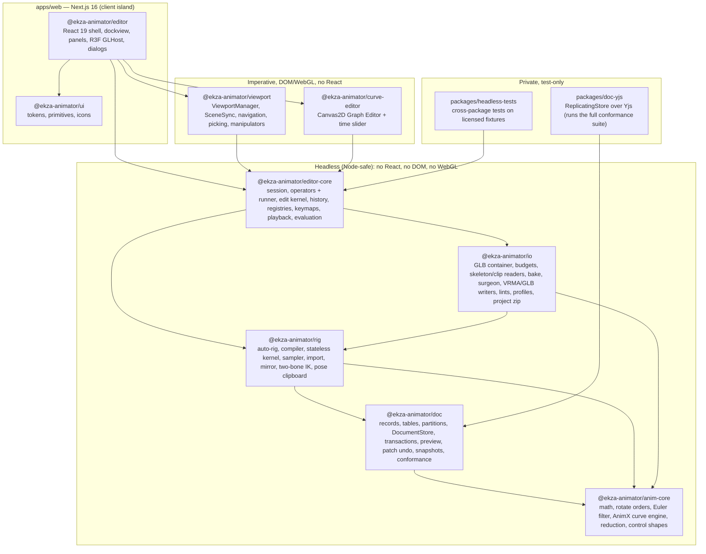

# Ekza Animator — Architecture

Status: v0.2 (2026-10-17, design review revision), the design baseline for milestone M1 (MVP). Decisions are
recorded as ADRs in [`docs/adr/`](docs/adr/README.md); the build spec with exact TypeScript contracts is
[`docs/MVP-SPEC.md`](docs/MVP-SPEC.md); requirements are in [`docs/REQUIREMENTS.md`](docs/REQUIREMENTS.md).
Research inputs live in [`docs/research/`](docs/research/) and are cited as `R01`…`R09`.

---

## 1. What we are building

A browser-based, open-source character animation editor for glTF/GLB and VRM 0.x/1.0 humanoids with a Maya-grade
interaction model: control rig of circle controls, Channel Box, time slider with range editing, Graph Editor with
Maya tangent semantics, split viewports (locked shot camera + free camera), keyframing, and exports that bake clips
into the original file losslessly or write VRMA / animation-only GLB.

Design principles:

1. **Copy Maya's interaction model, not its architecture** (R01 §0). A typed document plus a fixed evaluation
   pipeline instead of a general dependency graph.
2. **The document is ours, not three.js** (R08 D1). three.js objects are a derived view.
3. **Every mutation is a transaction** issued by an operator or a tool gesture; one gesture = one undo step
   (R08 D3, R04 §6), including unkeyed pose tweaks (ADR 0013).
4. **Pure, re-entrant evaluation**: `evaluate(program, channels(clipFrame), out)`; no global current time (R08 D5).
5. **Hot paths bypass React**: scrubbing, playback and drags never trigger React renders (R05 §3.5, R04 §4.4).
6. **Collaboration-ready data, collaboration later**: D/U/P state split, stable IDs, flat records, per-field merge
   units, partitions with a lifecycle, preview then commit, per-user undo — exercised in M1 by a test-only Yjs
   store (R06, ADR 0002).
7. **Headless cores**: everything below the viewport/curve-editor layer runs in Node without DOM or WebGL.
8. **Exports are derived; the project file is the truth** (R02 D1, R03 §5.6).

---

## 2. Layered view



Runtime data flow:

```
 input ─► panel under pointer ─► tool / keymap ─► operator (prepare → apply) ─► DocumentStore.transact
                                 └─ tool gesture ─► edit kernel ─► PreviewSession ─► commit (one step)
                                                                    │ ChangeBatch(origin, fields)
         ┌──────────────────────────────────────────────────────────┤
         ▼                                                          ▼
 EvaluationService (per frame, once):                     UndoManager (local origin) ⊂ EditorHistory
   sceneFrame → clipFrame per character                    (+ unkeyed override steps)
   ClipSampler(curves ⊕ preview overlay, clipFrame) ⊕ session pose overrides → ChannelBuffer
   RigProgram.evaluate(channels) → PoseBuffers (boneLocal, boneWorld, controlWorld, N_b, hips)
         │ publish(poseVersion)
         ├─► SceneSync: bones ← boneLocal; updateMatrixWorld; VRM node constraints; control shapes
         ├─► ViewportManager.render(): dirty panes, scissor, main → controls (2 passes) → overlays
         └─► curve-editor: redraw dirty canvases (graph base/overlay, time slider)
 React panels subscribe to narrow selectors only (selection, clip list, channel values on gesture end)
```

---

## 3. Packages and dependency rules

| Package | Dir | Responsibility | May import | Must not import |
|---|---|---|---|---|
| `@ekza-animator/anim-core` | `packages/anim-core` | Vectors, quaternions, 4×4 float64 matrices, TRS; DCC rotate orders ↔ three orders; Euler↔quat, `eulerNear`, Euler filter, gimbal axes; `EkzaError`; AnimX curve engine (compile, evaluate, tangents, infinity, shape-preserving insert, numeric fields); `reduceKeys`; control-shape registry and `SplineSet` tessellation | nothing (zero runtime deps) | everything, incl. `three` |
| `@ekza-animator/doc` | `packages/doc` | IDs, record types, `TableDef` registry, `DocumentStore` (memory) with partitions, transactions, preview sessions, `PatchUndoManager` (per merge unit), queries, scene-time mapping, migrations, snapshots, conformance suite + test network (`/testing`) | anim-core | three, React, DOM, yjs |
| `packages/doc-yjs` (private, test-only) | `packages/doc-yjs` | `ReplicatingStore` over one `Y.Doc` per partition; runs the full conformance suite in CI | doc, `yjs` | everything else; nothing may depend on it |
| `@ekza-animator/rig` | `packages/rig` | `SkeletonDesc` types, humanoid tables, auto-rig (humanoid FK + secondary, generic 1:1, mesh-based sizes), rig compiler + kernel, `ClipSampler`, inverse solving, clip import (fps detection, interpolation mapping, VRMA rules, reduction), step schedule, mirror, pose clipboard, two-bone IK, plant feet | anim-core, doc | three, React, DOM, io |
| `@ekza-animator/io` | `packages/io` | GLB container, input budgets + structural checks, accessor reader, `skeletonFromGltf` (incl. bone radii), `readAnimations`, VRMA reader, bake sampler, surgeon, animation-only GLB and VRMA writers (glTF Transform), lints + export profiles, validator wrapper, `.ekzanim` zip; subpaths `/three` (browser model loader), `/worker` (stretch), `/testing` (Node GLTFLoader harness) | anim-core, doc, rig, `@gltf-transform/*`, `fflate`; `/three` and `/testing` also `three`, `@pixiv/three-vrm*` | React; DOM outside `/three` |
| `@ekza-animator/editor-core` | `packages/editor-core` | `EditorApp` kernel: session state (zustand vanilla), prefs, operator registry + runner, edit kernel, editor history, contribution registries (importers, exporters, export profiles, menus), keymaps, tools API, built-in operators and workflows, playback clock, evaluation service, character runtime registry, service interfaces; `/testing` fake app | anim-core, doc, rig, io (headless entry), `zustand/vanilla` | React, DOM, WebGL, `three`, `io/three` |
| `@ekza-animator/viewport` | `packages/viewport` | `ViewportManager`, panes, view cameras, `NavigationController` (camera-controls), `SceneSync`, control/joint rendering, picking + marquee + cycling, `ManipulatorKit` (object/world/gimbal), viewport tools, HUD data | anim-core, doc, rig, editor-core, io/three, `three`, `camera-controls` | React, R3F |
| `@ekza-animator/curve-editor` | `packages/curve-editor` | Graph view transform, painters, hit-testing, interaction controllers, time slider with range editing; Canvas2D only | anim-core, doc, rig, editor-core | React, three |
| `@ekza-animator/ui` | `packages/ui` | Design tokens (`tokens.json` → CSS vars), Tailwind preset and `@source` setup, primitives (Radix-based, shadcn-style, owned), icon set | React, `radix-ui`, `lucide-react` | domain packages |
| `@ekza-animator/editor` | `packages/editor` | React app: `EditorShell`, `WorkspaceHost` (dockview adapter), panel registry + panels, `GLHost` (R3F), dialogs, DOM input adapter (hotkeys, tap/hold), browser services, test API | everything above, React, R3F, dockview, zustand | Next.js |
| `packages/headless-tests` (private, test-only) | `packages/headless-tests` | Node tests across packages on licensed fixtures (parity, imports, exports) | all headless packages; dev: three, three-vrm(-animation), gltf-validator | — |
| `apps/web` | `apps/web` | Next.js routes (`/`, `/editor`, dev-only `/dev/panels`, e2e-only `/e2e/vrma-check`), static assets (samples, decoders, notices), e2e specs | editor, ui; the e2e route also `three`, `@pixiv/three-vrm`, `@pixiv/three-vrm-animation`; e2e specs also `io`, `doc` | domain packages directly from app code |

Rules enforced by `tooling/check-deps.mjs` (package.json graph, **separate allow-lists for dependencies and
devDependencies**) and oxlint `no-restricted-imports` / `no-restricted-globals`:

1. The graph is acyclic and only points downwards in the table; no devDependency points up the graph either
   (cross-package fixture tests live in `headless-tests`).
2. Headless packages (anim-core, doc, rig, io main entry, editor-core) never reference `window`, `document`,
   `process`, `Buffer`, WebGL or React; their tests run in Vitest's Node environment; `node:*` only in `testing`
   subpaths, tests and tooling.
3. Only `editor` and `apps/web` import React; only `editor` imports R3F and dockview.
4. One copy each of `three`, `react`, `@pixiv/three-vrm*` (pnpm `catalog:`; CI checks `pnpm why`).
5. Only `packages/doc-yjs` imports `yjs`; in M3 the production adapter and `@hocuspocus/*` live there too.
6. `package.json` files and `pnpm-lock.yaml` are changed only by the integration agent (MVP-SPEC §3).

---

## 4. Data model

### 4.1 State scopes (D / U / P)

| Scope | Contents | Lives in | Undo | Collaboration |
|---|---|---|---|---|
| **D** document | project settings (scene clock), assets (by hash), characters, rigs, controls, constraint/solver slots, shot cameras, clips (with provenance), layers, curves, keys | `DocumentStore` | yes (per user, per merge unit) | synced (CRDT, M3) |
| **U** user session | selection, scene time, playing, playback range, time-slider band, active character/clip, active tool, pose overrides (unkeyed edits), feet pins, view cameras, pane layout, graph view transforms, clipboards, open dialog | `editor-core` session store + panel instances | overrides through the editor history; selection restored with history steps | presence/awareness only |
| **P** preferences | navigation profile, keymap overrides, Space behaviour, default tangents, auto-key toggle and mode, move/rotate manipulator space, import reduction, UI scale | `localStorage` (try/catch, works without storage) | no | never |

Hard rule: no U or P value is ever written to the document (R01 COL-02, R06 R12).

### 4.2 Records, IDs, partitions, merge units

All document data is a set of **flat tables of plain immutable records** keyed by stable string IDs (full types:
[MVP-SPEC §4.2](docs/MVP-SPEC.md#42-doc--records-partitions-store-transactions-undo-replication)):

```
project (singleton: scene fps/range, schema + minWriter versions) ─ assets (id = sha256)
characters ─► rigs ─► controls ─(slots)─ constraints, solvers
cameras (shot cameras)
clips (per character; metadata, provenance) ─► layers ─► curves (clip, layer, control, channel) ─► keys
```

- **IDs** are client-generated (`<prefix>_<16 base62>`; keys 12 chars). Auto-rig control IDs are deterministic,
  `<rigId>:<templateKey>` (e.g. `rig_X:fk.upperArm.L`), so concurrent re-runs of auto-rig on one rig agree; two
  independent imports of the same avatar create different rigs.
- **Hierarchy** by parent pointer + fractional `order` string; no child arrays (R06 R7–R8).
- **One key = one record** (R06 R3); curves are a registry. Fast evaluation uses compiled typed-array caches
  (§5), not the stored shape.
- **Merge units** (R06 R3): `keys` and `assets` merge and undo as whole records; every other table per top-level
  field (nested objects atomic). `put` inserts, `patch` updates; change batches carry the changed `fields`.
- **Soft delete** (`deleted: {by, at}`) for structural records, hard delete for keys (R06 R4).
- **Intent only**: computed tangents, world matrices, caches and thumbnails are never stored (R06 R5); the
  shape-preserving key insert is the one documented exception (ADR 0003).
- **Partitions** for the CRDT: `partitionOf(table, record)` → `scene` (project, assets, characters, cameras) |
  `char:<characterId>` (rigs, controls, constraints, solvers, clip metadata) | `clip:<clipId>` (layers, curves,
  keys). The store has an `open/close/isOpen` lifecycle; loaders await `open` (instant in the MVP).
  Cross-partition operations are written in dependency order and readers tolerate missing partitions (tested by
  applying batches partition by partition in random order).
- **Projection invariants** resolved deterministically at read time: duplicate key times on a curve → the key with
  the greatest ID wins (others hidden and flagged); duplicate curves for one `(clip, layer, control, channel)` → the
  smallest curve ID is canonical and keys are unioned (R06 R9).
- **Extensible tables**: built-in tables and extension tables are described by `TableDef` (version, partition,
  merge unit, validation, migrations); unknown tables load as opaque, transactable tables and survive save/load.

### 4.3 Time, units, rotations

Frames (float64) at the clip's rational fps; metres; radians (degrees in UI); Euler curves with per-control DCC
rotate order; quaternions everywhere after sampling ([ADR 0003](docs/adr/0003-time-rotation-and-curve-engine.md)).
A **scene clock** (`ProjectRecord.sceneFps`, session `sceneFrame`) is shared by all characters; each clip maps it
to its own frames through `sceneStart` and its fps; the UI shows the active clip's frames. Canonical character
space is VRM 1.0: +Y up, +Z forward, character left = +X; VRM 0.x gets a π-yaw `facing` on the character root.

### 4.4 Clips and layers

`Character 1─* Clip 1─* Layer 1─* Curve 1─* Key`. The MVP creates exactly one base layer per clip
(`mode: 'override'`, weight 1) and evaluates only it; additive/override layer evaluation (R01 NL-02) is V2
without schema change (layers already carry `owner` for per-user layers, R06 D11). Clips carry `contact`, `tags`
and provenance (`derivedFrom`, `redistributable`) for Ekza metadata (ADR 0010). The active clip per character is U
state.

### 4.5 Unkeyed pose changes

Two cases, mirroring Maya ([MVP-SPEC §4.11.2](docs/MVP-SPEC.md#4112-value-edits--channel-box-manipulators-reset-paste-mirror-plant-feet)):

- A channel **without keys** (no curve, or a curve with zero keys) stores an edit as the curve's `staticValue` (D):
  Maya's static attribute value. It is undoable, saved and exported (constant track). Static values are per clip,
  because clips are self-contained.
- A channel **with keys**, edited with auto-key off, gets a **session pose override** (U), shown light pink in the
  Channel Box (R01 CB-02 "changed"). Overrides are discarded on frame change and never saved; `S` turns them into
  keys; they **are undoable** through the editor history, one step per gesture or typed edit (ADR 0013).

---

## 5. Evaluation pipeline

```
curves (doc) ──compile──► CompiledAnimCurve (typed arrays, cached by curveId+version)
                               │ evaluateCurve(c, clipFrame)   (anim-core, AnimX semantics + infinity)
ClipSampler.sample(clipFrame) ─┘─► ChannelBuffer (9 slots per control: tx ty tz rx ry rz sx sy sz; defaults 0/0/1)
                                     ⊕ session pose overrides
RigProgram.evaluate(channels, out):                        (rig, compiled schedule, no allocation)
   for op in schedule:
     controlWorld  W_c = W_parent · O_c · T(t)·R(r; order)·S(s)
     constraint    (slot; MVP: disabled)                   → writes W_space(c) or W_b
     solver        (slot; MVP: disabled; V1 ik2)           → writes chain W_b
     bindBone      rotate: q_b = q(W_c)·q(K_cb), rest local translation under the current parent
                   translateRotate / full: W_b = W_c · K_cb
     boneLocal     L_b = W_parentBone⁻¹ · W_b   (uncontrolled bones: W_b = W_parentBone · L_b⁰)
   by-products: D_b = q(W_b)·q(W⁰_b)⁻¹; N_b = D_hp(b)⁻¹·D_b (canonical); hips position
PoseBuffers ──► SceneSync (three Bones ← L_b; node constraints) ──► GPU skinning (three)
```

- Signature: `program.evaluate(channels: ChannelBuffer, out: PoseBuffers): void` and
  `sampler.sample(clipFrame, out: ChannelBuffer): void`; nothing reads a global time, so onion skins, trails,
  baking, plant feet and multi-time views evaluate into side buffers (R08 §4.4).
- **Scene → clip time**: the evaluation service maps the session's `sceneFrame` to each character's active-clip
  frame (`sceneStart`, fps ratio; loop wraps, once holds).
- **Once per frame**: the `EvaluationService` evaluates each visible character once, after input and clock and
  before any viewport renders (R04 §4.3). Budget ≤ 1 ms for two humanoids.
- **Invalidation**: change batches mark compiled curves dirty by curve ID; a structural rig change recompiles the
  program; preview overlays emit `origin: 'preview'` batches and go through the same path.
- **Determinism**: same document + frame → identical buffers on every run; schedules are independent of record
  insertion order.
- **Normalized output is computed from world deltas**, never assumed equal to a control's local rotation: `fk.spine`
  is parented to `cog` while the spine bone hangs under the hips, and Seed-san has posable non-humanoid nodes
  (twist, palm) between humanoid bones. three-vrm's `q_raw = P⁻¹·N·P·B` is the special case with those nodes at
  rest (MVP-SPEC §4.11.9).

---

## 6. Rig kernel

([ADR 0004](docs/adr/0004-rig-model.md), R07)

- **Inputs**: `SkeletonDesc` (pure data from glTF JSON and BIN: nodes, parents, rest TRS, skin-joint flags, VRM
  humanoid map, VRM version, `facing`, spring-bone joints, node constraints, per-bone mesh radii, height,
  fingerprint) and a `RigDefinition` assembled from document records.
- **Compile** (on structural change only): resolve bone references (humanoid name first, then name + parent name;
  never glTF indices in the document), derive `O_c`, `K_cb`, rest lengths, mirror pairs; build ops with declared
  reads/writes; Kahn sort with `(opKindPriority, id)` tie-break; repair dangling refs and cycles with warnings.
- **Op registry**: `controlWorld`, `bindBone`, `boneLocal` in the MVP. `constraint` (`parent | point | orient |
  aim`) and `solver` (`ik2 | footRoll | chain`) are schema-defined slots whose implementations register in V1/V2
  (`registerRigOp(kind, impl)`), without a schema change. The `ik2` math (`solveTwoBoneIk`, R07 §9.2) already
  ships in M1 for *Plant Feet*.
- **Humanoid output**: the kernel writes raw bone locals itself, so the viewport loads VRMs with
  `autoUpdateHumanBones: false` and three-vrm never double-applies. Parity is tested against
  `VRMHumanoidRig.update()` fed with `flipYaw(N_b)` for VRM 0.x and `N_b` for VRM 1.0.
- **Inverse path** (manipulators, import, paste, mirror, plant feet): given a desired control or bone world,
  `solveControlChannels`/`solveBoneChannels` return channels via `(W_parent·O_c)⁻¹ · W` and `eulerNear` with the
  current values as reference, so keys never jump by 2π or flip branch. Gimbal-mode edits write one channel
  directly.
- **Auto-rig**: humanoid FK set — `root` and `cog` (pure spaces), `fk.hips` (pelvis), spine chain from `cog`,
  neck, head, jaw, shoulders, arms, hands, fingers, legs from `fk.hips`, feet, toes; secondary controls for
  non-spring, non-constrained skin joints — and generic 1:1 FK (bone-aligned, `full` binding). Shapes come from
  the shape registry; sizes from the skinned mesh (1.25 × P90 vertex distance per bone) with per-group clamps and
  offsets; colours by side with hover/selected/lead tokens.

---

## 7. IO pipeline

([ADR 0005](docs/adr/0005-export-strategy.md), [ADR 0011](docs/adr/0011-project-file-format.md), R02, R03)

```
 .glb / .vrm bytes ──► GlbContainer.parse (json, bin view, sha256; original kept immutable in AssetStore)
     ├─► checkInputBudget (avatar-scale budgets + structural checks; abort before allocating)
     ├─► detectModelFormat (vrm0 | vrm1 | gltf; reject both VRM versions)
     ├─► skeletonFromGltf ──► SkeletonDesc (+ bone radii, height) ──► autoRig ──► rig/controls records
     ├─► readAnimations (accessors incl. normalized ints, strides, sparse; compressed → error) ──► RawClip[]
     │        └─► detect source fps ──► rig.importRawClip (mapping per interpolation, eulerNear, Euler filter,
     │                                   reduction) ──► clip/curve/key records (+ provenance from VRM meta)
     └─► io/three loadModel (GLTFLoader + VRMLoaderPlugin, self-hosted Draco/meshopt/KTX2 decoders)
              └─► display scene + node-index map + node-constraint manager ──► viewport SceneSync
 .vrma ──► readVrma (three-vrm-animation rules: N_b + hips) ──► rig.importHumanoidClip (missing bones, hips scale)

 export:
   ClipSampler + RigProgram ──► bakeClip (integer clip frames, raw locals and/or N_b, hemisphere continuity,
                                 STEP only for fully stepped tracks, 2-key constant tracks over every clip of the
                                 output file, loop closure, root-motion mode)
     ├─► (1) surgeon: append-only patch of the original GLB/VRM (aligned append, marker with replaced entries,
     │        safe rollback) + ekza_animation_v1
     ├─► (2) animation-only GLB (glTF Transform Document: skeleton nodes + clips)
     └─► (3) VRMA (glTF Transform + VRMCVrmAnimation; identity-rest humanoid skeleton with parent-relative offsets)
   every output ──► read-back check + lints per export profile (+ glTF-Validator in tests; app worker: stretch)
 project ──► snapshot (sorted JSON, tableVersions) + assets/<sha256>.<ext> ──► .ekzanim zip (fflate)
```

- **Model loading** happens on the main thread (three objects cannot cross threads); decoders run in their own
  WASM workers. The loader receives the renderer before the first load (KTX2 detection).
- **Input budgets** are avatar-scale (file ≤ 256 MiB, Σ accessor counts ≤ 16 M, any accessor ≤ 4 M, decoded ≤
  512 MiB, JSON ≤ 8 MiB); the structural checks (views inside buffers, accessor extents, sparse and index ranges,
  acyclic nodes) are what stop hostile files.
- **Spring bones** of VRMs: preview-only (viewport toggle, off while scrubbing), never baked.
  **`VRMC_node_constraint`**: evaluated in the preview after the bone write, never baked into VRM outputs.
- **Export threading** in the MVP: async main-thread pipeline yielding between clips. The research-04 IO worker
  with a document replica fed by the op stream is M2.

---

## 8. Viewport

([ADR 0006](docs/adr/0006-viewport-rendering.md))

- **One canvas**: R3F `<Canvas frameloop="demand">` in `GLHost`, fixed behind the workspace. The
  `ViewportManager` (plain TS) owns panes, renders dirty panes with scissor rectangles in one `useFrame(…, 1)`
  callback, and exposes `render()`, `pick()`, `pickCandidates()`, `marquee()`, `frame()`, `invalidate()`.
- **Pane model**: `PaneDescriptor { id, element, camera: {kind: 'view', preset} | {kind: 'shot', cameraId},
  display: DisplayFlags }`. Layout presets inside the Viewport panel: single, 2-pane (left shot camera locked, right
  free perspective), 4-view (top/persp/front/side). Space-tap maximizes the pane under the pointer.
- **SceneSync** (imperative): adds the loaded model scene per character (with the `facing` root), hides bones by
  default, builds control line geometry from shape-registry splines, joint glyphs (debug), writes `PoseBuffers` into
  bones with no allocation, updates world matrices once per frame (`matrixWorldAutoUpdate = false`), then runs VRM
  node constraints.
- **Render order per pane**: main scene (meshes, grid) → control lines pass A (occluded, 35 % alpha,
  `GreaterDepth`) → pass B (visible) → `clearDepth()` → manipulators, HUD lines.
- **Picking**: manipulator handles → controls (screen-space polyline distance ≤ 6 px, click cycling) → joints (if
  shown); marquee with the crossing test; mesh click → driving control is M1-stretch.
- **Manipulators**: `ManipulatorKit` translate (object/world) and rotate (object/world/gimbal), constant pixel size;
  drags go through the editor-core gesture helper (preview, overrides, auto-key on commit, one history step).
- **Navigation**: `camera-controls` per pane behind `NavigationProfile` (Maya / Trackpad; one-button mac is
  stretch); locked shot cameras swallow navigation; navigating an unlocked shot camera commits once per gesture
  without an undo entry.

---

## 9. Curve editor

([ADR 0007](docs/adr/0007-graph-editor-canvas2d.md))

- `GraphView` transform: `x = (frame − f0)·sx`, `y = H − (value − v0)·sy`; display units: degrees for rotation
  channels, metres for translation; x axis in active-clip frames.
- `GraphEditorController` owns two canvases, a `CurveSet` (visible channels → compiled curves via the evaluation
  service), the selection of keys/handles (session store), and the interaction state machine. Edits run through the
  editor-core edit kernel inside preview sessions.
- Painters: grid + labels, infinity (dotted), curves (exact Bézier), keys, handles (selected keys only; non-weighted
  at fixed 40 px screen length, weighted at true length), playhead, marquee.
- Handle drag ("pen-like"): non-weighted → angle only; weighted + locked weight → angle only; weighted + free →
  angle and length (time offset clamped inside the segment); unified keys rotate the opposite handle to stay
  collinear (own length kept); Alt while dragging breaks temporarily; on the first drag the side(s) become `fixed`
  with the resolved values.
- Maya habits: MMB-drag anywhere moves the selection; double-click a curve selects its keys; wheel/pan/zoom follow
  the navigation profile; Space maximizes the panel.
- Insert key on curve: shape-preserving split (Hermite: value + slope; weighted: de Casteljau with the monotonic
  correction) that freezes the neighbours' affected computed sides.
- `TimeSliderController`: ruler, key ticks of the selected controls (summary row), playhead, scrub, playback range
  handles, auto-key red border, and Maya range editing (Shift-select frame/range, move, scale, RMB menu).

---

## 10. Editor shell

([ADR 0008](docs/adr/0008-operator-tool-editor-registries.md), [ADR 0013](docs/adr/0013-editor-history.md), R09)

- **`EditorApp`** (editor-core) is the kernel object: `store`, `session`, `prefs`, `operators`, `tools`, `keymap`,
  `importers`, `exporters`, `exportProfiles`, `menus`, `characters` (runtime per character: skeleton, rig program,
  sampler, pose buffers, model handle), `evaluation`, `playback`, `history`, `services` (assets, files, clipboard,
  notify, models, validate, storage). React and imperative modules receive the same `EditorApp`.
- **Operators** run as `prepare` (async, no writes) + `apply` (sync, one transaction for undoable operators);
  `app.run` is typed by `OperatorMap`; operators, tools and panels share the **edit kernel** (channel edits,
  gestures, key moves/scales, handles, tangent types, insert, delete).
- **Workspace**: dockview 8 (MIT core) behind a `WorkspaceHost` adapter so FlexLayout can replace it. MVP Animate
  workspace: menu bar; status line (tools Q/W/E, move/rotate space incl. gimbal, selection mask, auto-key, layout
  preset); left dock Outliner | Clips; centre Viewport panel (pane grid); right dock Channel Box | Attributes;
  bottom dock Graph Editor; fixed time slider + range/playback row; help line. Layout JSON persisted per user in
  `localStorage` with a schema version. Panels register explicitly.
- **Frame loop**: R3F's single rAF. `addEffect` runs input drain → playback clock → `evaluation.tick()`;
  `useFrame(…, 1)` runs `viewportManager.render()`; `addAfterEffect` redraws dirty 2D canvases. Playback and drags
  call `invalidate()`; idle renders nothing.
- **Hotkeys**: DOM adapter maps `KeyboardEvent` → `{code, mods}` → `keymap.resolve(scopeChain)` where the scope
  chain starts at the panel under the pointer; Space tap/hold handled with 200 ms timers; blur and
  `visibilitychange` reset held keys.
- **React rules**: no per-frame state; panels use `useSyncExternalStore`/zustand selectors on human-speed state;
  channel values in the Channel Box refresh on gesture end and on frame change (throttled to rAF).

---

## 11. Collaboration boundary

([ADR 0002](docs/adr/0002-document-store-and-collaboration-readiness.md), R06)

What exists in the MVP so that collaboration is a contained later change:

| Concern | MVP mechanism | M3 replacement/addition |
|---|---|---|
| Store | `MemoryDocumentStore` behind `DocumentStore`; `packages/doc-yjs` (test-only) passes the full suite in CI | `doc-yjs` hardened into the production adapter (tuple key codec, providers, persistence) |
| Edits | operators → `transact` / `PreviewSession`, `ChangeBatch.origin`, per-field `fields` | same; remote batches arrive with `origin: 'remote'` |
| Merge units | `MERGE_UNIT`: keys/assets whole-record, other tables per field | Y.Map per record for field-merge tables |
| Undo | `PatchUndoManager`, local origin only, compare-before-restore per merge unit; editor history for unkeyed edits | unchanged (skips report "changed by Alice") |
| Drags | preview overlay, one commit; `PreviewSession.conflicts` (empty) | + awareness ghost at ~15 Hz; conflict prompt |
| Identity | random IDs, deterministic auto-rig control IDs, migration ID derivation | unchanged |
| Partitions | `partitionOf()`, `open/close/isOpen`, clip metadata in `char:` | one Hocuspocus document per partition; per-document ACL; lazy loading |
| Time | shared scene clock (`sceneFps`, `sceneFrame`, clip `sceneStart`) | presence time markers in scene time |
| Binary data | content-addressed async `AssetStore` with hash/size verification | presigned upload/download (`HttpAssetStore`) |
| Structural ops | fps / rotate-order changes flagged `structural` | require an exclusive claim on the clip |
| Presence | U state in the session store | `PresenceChannel` over Yjs awareness (selection, time, claims) |

Scenario priority (R06 §16): two characters in one scene and review sessions first; "four hands" on one character
via per-user layers and region claims (P3), not free co-editing of the same curves. Collaboration phases are
named P0–P3 (R06), distinct from Ekza tiers T0–T3 and plugin trust levels.

---

## 12. Extensibility

([ADR 0008](docs/adr/0008-operator-tool-editor-registries.md), R08)

- **Registries shipped in M1**, used by the built-ins exactly as extensions will: operators, tools, keymap
  bindings, menus, importers, exporters, export profiles (`app.contribute`); panels (`editor`); control shapes
  (`anim-core`); rig op kinds (`rig`); document tables (`doc`). Identifiers are open strings with exported
  built-in constants; operator arguments extend by declaration merging on `OperatorMap`.
- **Unknown data survives**: tables without a `TableDef` and unknown fields are preserved verbatim, transactable and
  written back; per-table versions migrate independently.
- **Curves are first-class**: control shapes are `SplineSet` (`poly | bezier`, later `nurbs`) in anim-core; the
  Graph Editor's Bézier editing kernel (anchor/handle selection, break/unify, weighted, shape-preserving insert) is
  written so 3D spline editing can reuse it. Path to modeling (M6): a `curve` table registered through `TableDef`,
  CV/EP/pen tools in the viewport tool registry, component selection (`{control|curve, component}`), generator
  records with declared eval ops, and an `EKZA_curves` export extension (registered vendor prefix first). No core
  rewrite is required (R08 §9).
- **Plugins** (post-1.0): trust levels **data** (packs), **trusted** (dev-mode extensions) and **sandboxed**
  (opaque-origin iframe plugins with async RPC); evaluation-time and interactive extensions stay trusted
  (R08 §8.3).

---

## 13. Ekza integration

([ADR 0010](docs/adr/0010-ekza-integration-tiers.md), R03)

- **MVP = Tier 0**: surgeon-baked `.vrm/.glb` with slot-named clips, `.vrma` per clip, animation-only `.glb`;
  `asset.extras.ekza_animation_v1` metadata with per-clip contact, tags and provenance; export profiles as data;
  lints with registry-aligned codes; interop warnings; VRM-meta licence gate; MIME `model/gltf-binary`.
- **Contract for later tiers**: typed kind `ekza:animation:<uuid>`, profile `universal / vrma-humanoid-v1`, slot
  vocabulary v1, registry/SDK/game changes listed in R03 §7.2–7.4; Studio deep link and the
  `ekza-animator-embed/v1` iframe protocol (M4a).
- **Copy-adapted MIT helpers** from `ekza-avatar-renderer` (commit `33c417c`), each with an attribution header
  (source repo, path, commit, MIT):

  | Helper | Destination | Use |
  |---|---|---|
  | `detectVrmKind` (+ "declares both" rejection) | `io/src/gltf/format.ts` | format detection |
  | `readEmbeddedAvatarHeightScale` | `io/src/gltf/ekzaMeta.ts` | display/preserve `extras.ekza.avatar.heightScale` |
  | `measureAvatarSpatialBounds` | `viewport/src/framing/bounds.ts` | framing, height check |
  | `fitAvatarPreviewCamera` | `viewport/src/framing/fit.ts` | shot camera auto-frame, F/A |
  | `resolveDrivenParentBone`, `sortBonesByDepth` | `rig/src/humanoid/hierarchy.ts` | missing optional bones |
  | VRM 0.x thumb alias table, `flipYaw*` (reference) | `rig/src/humanoid/vrm0.ts` | VRM 0.x mapping and facing |

  No runtime dependency on `@ekza/avatar-renderer` (peer `three <0.186`, not on npm, CDN Draco) or
  `@ekza/stellar-sdk`.

---

## 14. Performance budgets

Reference: 2020-class laptop (Apple M1 or GTX 1650 class), Chrome stable, 1440×900 at DPR 2 (R04 §1). Budgets are
**measured and recorded** (benches and the `chrome` e2e project report them); they are not CI pass/fail gates on
shared runners or SwiftShader.

| Scenario | Budget | How measured |
|---|---|---|
| Idle editor | 0 WebGL frames, 0 canvas redraws | e2e counter (this one is a gate: deterministic) |
| Pose evaluation, 1 humanoid (~56 controls, ~70 bones) | ≤ 0.5 ms | vitest bench |
| Scrub: pointer move → pose visible | same animation frame | e2e trace |
| 1 VRM, 4 panes, shaded, playback at 30 fps | ≤ 8 ms CPU/frame | in-app counter |
| Graph Editor 50k keys loaded / 10k visible, pan/zoom | ≤ 8 ms redraw | benchmark (ADR 0007) |
| Graph Editor 50 curves × 200 keys full redraw | ≤ 4 ms | benchmark |
| Drag 1,000 selected keys | ≤ 4 ms per pointer frame | bench |
| Undo/redo one gesture | ≤ 5 ms | bench |
| Open Seed-san (10.9 MB VRM) to interactive | ≤ 3 s | e2e (report) |
| Bake + write VRMA, 1 humanoid × 10 s @ 30 fps | ≤ 200 ms | bench |
| Editor route JS (gzip, no fixtures) | ≤ 900 kB | size check (M2 CI gate) |

---

## 15. Testing strategy

| Layer | Tool | What |
|---|---|---|
| anim-core | Vitest (Node), fast-check, AnimX goldens | segment evaluation (1e-9), Auto/AutoMix/AutoEase tangents (1e-12), span rules, infinities incl. negative times, shape-preserving insert (1e-12, all tangent types), reduction bound, numeric-field formulas, Euler filter round trip, rotate-order table, glTF CUBICSPLINE equivalence |
| doc | Vitest + conformance suite | memory store: transactions, nested joins, batches with fields, preview, undo per merge unit, partitions, snapshot round trip, migrations, unknown tables; **doc-yjs: full replicating suite** (convergence, invariants, per-user undo, H1–H5, partition-order application) |
| rig | Vitest + synthetic fixtures | zero pose = rest (1e-9); import round trips (1e-5 rad, 1e-6 m); interpolation mapping; mirror involution and scope; two-bone IK; plant feet; determinism |
| headless-tests | Vitest (Node) + licensed fixtures | zero pose on all fixtures; three-vrm parity with the VRM 0.x mapping (1e-6); UAL import vs `GLTFLoader`; secondary filtering |
| io | Vitest + gltf-validator + fixtures | Seed-san node constraints (US-26); fresh writers 0 errors; surgeon: BIN prefix, JSON-value equality, rollback with replaced entries, re-bake byte identity, no new validator errors; VRMA rules incl. rest offsets; budgets; lints; project zip determinism |
| viewport, curve-editor, editor | Vitest browser mode (Chromium) | scissor layouts, picking/marquee/cycling, gimbal axes, painters (DPR 1/2), hit-tests, time-slider band editing, input adapter |
| editor-core | Vitest (Node) | runner rules, history, edit kernel, every operator headless against fixture documents, keymap resolution, playback clock with scene mapping |
| app | Playwright 1.63 (real Chrome locally, SwiftShader on CI) against `NEXT_PUBLIC_EKZA_E2E=1 next build && next start` | E2E-00…E2E-27 of [MVP-SPEC §6](docs/MVP-SPEC.md#6-acceptance-tests-and-e2e-scenarios); exported files validated in Node and re-imported |

Determinism hooks: `?e2e=1` (e2e builds only) uses fresh storage, Maya navigation and Space defaults, fixes the ID
seed, disables animations and exposes `window.__EKZA_ANIMATOR_TEST__`. Screenshot baselines (V1) only from the Linux
CI container.

---

## 16. Security and robustness

- Untrusted GLB/VRM input: avatar-scale budgets and structural checks before allocation; parse errors surface as
  dialogs, never crash the editor; no `eval`; decoders self-hosted (no third-party CDN, CSP-friendly).
- No secrets in the client; Ekza upload (M4a) uses device-code tokens held by the host, never exposed to plugins;
  the embed protocol checks origins on both sides.
- `beforeunload` guard when the document is dirty.
- All storage access wrapped in try/catch; the app works with storage disabled.
- Production dependency licences checked in CI; no LGPL binaries (`sharp`) installed.

---

## Appendix A — Research conflicts and how they were resolved

| # | Topic | Positions | Resolution (wins) | Why |
|---|---|---|---|---|
| 1 | Document store now | R06: Yjs-backed from day one; R04/R08: plain store + later binding | Plain `MemoryDocumentStore` in production + 06's interface (incl. partition lifecycle, per-field merge units, async assets) + a **test-only Yjs store running the full conformance suite in M1** (ADR 0002) | Hazards are fixed by data shape and API; the real Yjs cost is async open and debugging, not per-package cost; the risk control runs while contracts can still change |
| 2 | Undo | R06: own patch undo; R08: Yjs `UndoManager` later | Own `PatchUndoManager` per merge unit (R06) + editor history for unkeyed edits (ADR 0013) | Measured H4 data loss in `Y.UndoManager`; Maya undoes unkeyed tweaks |
| 3 | Stored key shape | R04/R08: per-curve typed-array blocks; R06: one record per key | Records per key + compiled typed-array caches | CRDT granularity (R06 R3) and evaluation speed (R04) |
| 4 | Time unit | R01/R02 frames; R06 flicks; R08 seconds | Float64 frames at rational clip fps + a shared scene clock (ADR 0003) | Exact integer frames, natural tangent math; fps changes are structural ops with claims in M3 |
| 5 | Tangent encoding | R01 handles; R02 slopes+weights; R04 x/y arrays; R06 fixed-only | Per-side `{dt, dv}` handles stored only for `fixed`, types per side, per-curve `weighted`; insert freezes neighbours | Maya model, store intent (R06 R5) with one documented exception |
| 6 | Auto tangent math | R01 AnimX; R09 Fritsch–Carlson | AnimX port | Maya parity with a C++ oracle |
| 7 | Rotation storage | R01/R02/R07 radians, DCC order; R08 degrees; R06 capitals | Radians, DCC lowercase orders, degrees in UI | One conversion boundary, Maya interop |
| 8 | Rotate-order defaults | R01 (spine/legs `yzx`); R07 table | R07 table (torso `zxy`, legs `yzx`, arms `yxz`/`xzy`, hands `xyz`) | Gimbal analysis per joint; autotune later |
| 9 | Multi-viewport | R01/R05/R08 drei `<View>`; R04/R09 custom single scene | Custom `ViewportManager` (ADR 0006) | `<View>` renders separate portal scenes |
| 10 | Picking | R07 GPU ID for controls; R04/R09 analytic | Analytic for controls/joints with cycling and marquee; mesh click (CPU skinned raycast) stretch; GPU ID later if needed | Exact, deterministic, no readback |
| 11 | Navigation | R01 custom controller; R09 camera-controls | camera-controls behind profiles | Proven tumble/track/dolly, `fitToBox`, `dollyToCursor` |
| 12 | Manipulators | R04 TransformControls first; R09 custom | Custom `ManipulatorKit` (translate object/world; rotate object/world/gimbal) | One canvas, N cameras; gimbal mode keeps curves clean (R07 D6, R09 §5.9) |
| 13 | Docking granularity | R09 every pane a dock panel | Dockview for panels; viewport panes in one Viewport panel grid | Simpler scissor bookkeeping; V1 can promote panes |
| 14 | Graph drawing | R04 adaptive sampling; R01/R09 exact Bézier | Exact `bezierCurveTo`, per-pixel sampling for dense curves | Both segment kinds are exact cubics |
| 15 | MVP rig scope | R07 §21.1, R05 §4: FK + two-bone leg IK (+ foot roll, spaces, constraints) | FK in M1 with the `ik2` solver math and **Plant Feet**; IK leg controls first in M2a (ADR 0004 §12); owner may pull them in (Q-RIG-5) | Coordinator scope and the parallel schedule; the solver and its tests ship now so M2a adds controls and the op only |
| 16 | Imported clips | R02 baked layers (`BakedTrack`); R07 bake onto controls | Import directly to control keys at the source frame rate, mapped by interpolation, reduced by default; sampled-track layers V1 | Brief: "editable curves"; editability of dense clips |
| 17 | Key reduction | R02 MVP (export); R01 V1 | Curve reduction in M1 (import + Graph Editor Simplify); sampled export reducer V1 | Editing imported clips needs sparse keys; export size is not the bottleneck |
| 18 | Constant tracks | R02 1 key; R07 2 keys | 2 keys, over every clip of the output file | Track duration and mixer safety |
| 19 | IO threading | R04 IO worker + replica in MVP | Main-thread async export; validator worker stretch; replica M2 | Single-character MVP is far below budget |
| 20 | Dope Sheet, marking menus, onion skin, normalize/stacked/buffer curves | R09 MVP | V1; the time slider gets Maya range editing (move/scale/delete/copy/paste/tangents) in M1 | Covers the retiming loop at ~2 agent-days |
| 21 | Mirror pose | R01 V1 | MVP (humanoid), scope expanded to mirror pairs | Brief; trivial in normalized space |
| 22 | Camera lock | R09 per pane; R01 document flag | Document flag on shot cameras; unlocked shot navigation commits without undo | A locked shot is locked for every collaborator; undo stays for animation |
| 23 | Selection & undo | R04/R09 not undoable; R08 restore with undo | Not undo steps; snapshots restored by history steps | Maya feel without history noise |
| 24 | TypeScript | R04 TS 7.0.2 | TS 6.0.3 with `types: []`-aware configs (ADR 0001) | TS 7 has no JS API (verified) |
| 25 | Package manager / test runner | R04 pnpm 11, Vitest 5 | pnpm 10.32.1, Vitest 4.1.11 | Installed toolchain; Node 25 engine range |
| 26 | Layering check | R04 dependency-cruiser; R06 ESLint rule | `check-deps.mjs` (deps and devDeps) + oxlint `no-restricted-imports` | Node 25 + TS API constraints |
| 27 | Sample VRM 1.0 | Coordinator/R03: NeonGlitch86 "CC0" | Seed-san (VRM PL 1.0, credit) (ADR 0012, erratum to R03) | File meta forbids redistribution and modification |
| 28 | Package map | R04 vs R06 vs R07 vs R08 names | anim-core, doc, rig, io, editor-core, viewport, curve-editor, ui, editor (+ test-only doc-yjs, headless-tests) | Brief's list + a headless editor kernel to avoid viewport↔editor cycles |
| 29 | drei | R05 depend; R04 selective | Not a dependency in the MVP | Heavy transitive deps, nothing needed |
| 30 | Clip names | R03 lowercase slots; R09 free text ≤ 64 | Free display names; exported name = slot or sanitized name; slot lint is an error only under Ekza profiles | Both needs met (ADR 0010) |
| 31 | Humanoid controls | R07 §5.2 (`cog` drives hips) | `cog` pure space + `fk.hips`; legs under `fk.hips`, spine under `cog` | Maya COG/hips/torso split; no counter-animation for hip sway |
| 32 | Control sizing | R07 §5.4 mesh radius; v0.1 bone length (mesh V1) | Mesh-based radius in M1 with per-group clamps and offsets | Fingers and thighs overlapped with bone-length sizing |
| 33 | Registries | R08 §11 importer/exporter/profile registries, per-type versions | Shipped in M1 (ADR 0008); plugin loading later | "Cheap now, very expensive to retrofit" (R08) |
