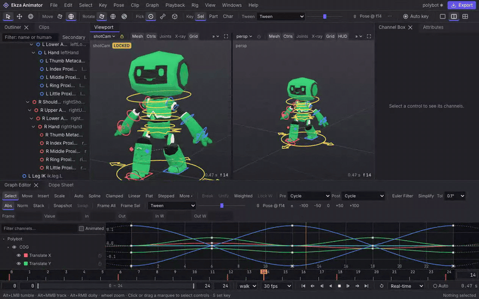
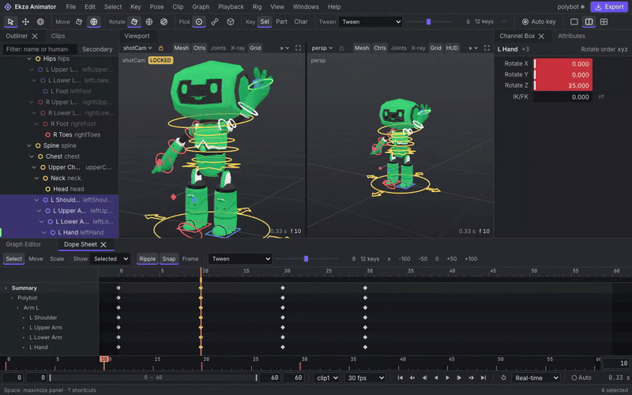
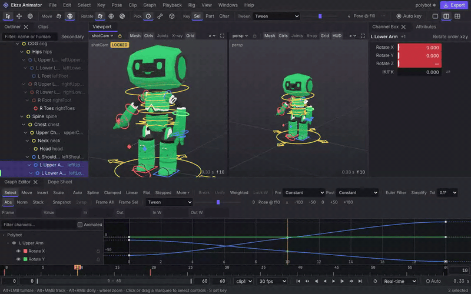

# Ekza Animator

**An open-source, browser-based character animator for glTF and VRM, with a Maya-grade workflow.**

Load a rigged GLB or a VRM 0.x/1.0 avatar, get circle controls on its bones with IK legs, key poses, retime them in
a Dope Sheet and on the time slider, tween breakdowns, shape the motion in a Graph Editor with Maya's tangent model,
then bake the clips back into the original file — every original JSON value and every byte of its binary buffer
preserved — or export VRMA and animation-only GLB. Part of the Ekza ecosystem; usable on its own.

> **Status: alpha — milestone M2a ("game-clip daily driver") is integrated and merged into `dev`** on top of the
> accepted M1 alpha. **M6a (the modeling base) is integrated on `m6a/integration`** and waits for the owner's review
> before it merges (see "What M6a is for").
> `pnpm dev` opens the full editor at `/editor`: bundled samples or your own `.vrm`/`.glb`, circle controls with IK
> legs in a split view, keying, the time slider, the Dope Sheet, the Graph Editor with tweens and buffer curves,
> exports (bake into the model, VRMA, animation-only GLB, with optional key reduction), `.ekzanim` projects and
> autosave. The end-to-end scenarios E2E-00…27 and E2E-M2A-01…25 — including the two acceptance clips, a walk cycle
> and an attack authored with leg IK and without Plant Feet — and the owner demo script, played as one scripted
> walkthrough, pass in Chrome and in the SwiftShader CI project, and the budgets are re-measured (the three M1 misses
> are fixed). The M2a acceptance round's findings are fixed on `dev` (fix round 1). Releases are tagged by the owner (`v0.1.0`, then
> `v0.2.x`) after the review of [docs/DECISIONS-OPEN.md](docs/DECISIONS-OPEN.md). Live status:
> [docs/ROADMAP.md](docs/ROADMAP.md).

| IK walk cycle (planted feet, half-cycle mirror) | Dope Sheet retime with ripple | Tween slider in the status line |
|---|---|---|
|  |  |  |

## Why

No open-source, web-native tool combines a professional Graph Editor (auto/spline/clamped/linear/flat/stepped
tangents, break/unify, weighted handles), an on-model control rig, VRM/VRMA-first round trips that also write back
into GLB, and a path to real-time multiplayer animation. The closest web neighbours are copyleft and cover one or
two of these ([research 05](docs/research/05-landscape.md)). Ekza Animator is MIT-licensed and built so that
collaboration, plugins and spline modeling can be added without rewriting the core.

## What M2a is for

M2a makes the editor a daily driver for **game clips**: walk and run cycles, attacks, hits and emotes with planted
feet and contacts, retimed in a Dope Sheet and polished with tweens and breakdowns. **Legs are IK by default; arms are
FK with IK one click away** (Attributes › Limb or Rig › IK/FK, with match and a seamless switch). Lowering the centre
of gravity leaves IK feet where they are; a simple foot roll (heel, ball, toe, bank, twists) sits on the IK foot.
Loop clips get cycle-aware tangents, so a walk does not hitch at the seam, and **Pose › Mirror Animation** writes the
other leg half a cycle later. Projects autosave to the browser and come back after a crash. Projects made with M1
open unchanged (FK); **Rig › Add Limb IK** upgrades them in one undoable step.

Known gaps, said plainly:

- **No onion skin or motion trails yet**: judge arcs by scrubbing (M2c).
- **Knee and elbow poles live in `root` space**: on turn-in-place and pivoting attacks, animate the pole with the
  foot (or aim the knee with the `twist` attribute) until space switching arrives (M5).
- **An IK limb cannot hold a hyperextended knee or elbow**: the match bends it the other way and says by how much.
- **An imported limb whose knee or elbow is not a clean hinge stays FK for that clip**, and the import says so.

Also not in M2a: animation layers, facial expressions in VRMA, FBX/BVH/Mixamo import (M2b), and importing an
animation-only GLB onto a character (VRMA clips import). The M2a-stretch items were not built either (listed in the
e2e report as `test.fixme`): a ghost display of the inactive IK/FK controls, Dope Sheet rows for un-keyed channels,
mesh picks that select the IK control (a mesh pick on an IK limb selects the FK control and says "IK limb: pick the IK
control"), key hold and a stepped preview, ankle and wrist motion trails, and an automatic Simplify after Match Range
(run Graph › Simplify). Export key reduction stays within tight per-node tolerances and never makes a file larger: it
shrinks linear blocking 3× and more, but smooth 30 fps splines keep nearly every sample (an owner decision is open on
the tolerances). Root motion "In place" removes a clip's travel on export and keeps its sway, so planted feet stay
planted in the file. Chrome and Edge are the supported browsers; Firefox and
Safari follow in V1. The first alpha (M1, `v0.1.0`) targeted in-place loops, emotes and blocking with FK legs and
Pose › Plant Feet, which still works for FK legs.

## What M6a is for

M6a adds a **Model workspace** (the tab next to Animate) for **low-poly box modeling** with Maya's hands: component
modes on `1`/`2`/`3` (or the RMB marking menu), Maya's loop and ring picks, marking menus on Shift+RMB, **Extrude on
`⌘E`/`Ctrl+E`** as an adjustable session (drag the cap with W/E/R, change Divisions on the Last-op card, step back one
drag at a time with undo), Insert Edge Loop, Multi-Cut, Bevel, Bridge, Merge/Target Weld, Slide, Mirror and
Symmetrize, **symmetry remembered per mesh** (every tool mirrors), soft selection, snapping and pivots, the Modeling
Toolkit with option boxes, `G` to repeat and `T` to type a value. Colour is a **palette slot per face** (Palette panel,
Paint Colour), exported as one palette texture, vertex colours or one material per colour. Templates (a prop, a
handheld item, humanoid guides and a body), reference image planes, a Poly Count HUD with budgets and a Mesh Check
panel help a model stay game-ready. **Static GLB export** writes the model with Ekza's provenance block and the
`ekza/omoba-handheld-v1` profile; imported characters can be **made editable** and baked back with their skin
weights, expressions and MToon looks.

Known gaps, said plainly: no subdivision preview, booleans, sculpting, UV editor or texture painting (M6c), no
skeleton or skinning for your own models yet (M6b), no Live Mirror (Symmetry plus Mesh › Mirror instead), and the
M6a-stretch items listed in the e2e report as `test.fixme` (Extrude Manifold, Select Similar, lasso, Poke, edge snap,
ramp swatches, `.gpl` palettes, component pick-walk, selection constraints, unequal Bridge, Multi-Cut across faces,
Maya's per-component Normal, Retain component spacing).

## Features

| Area | Built (M1 alpha, **M2a**) | Planned |
|---|---|---|
| Open | `.glb`, `.vrm` (VRM 0.x and 1.0), drag-and-drop, bundled samples, `.vrma` as a clip, Draco/meshopt/KTX2 display; embedded clips imported at their own frame rate with key reduction | FBX/BVH/Mixamo with humanoid retarget, `.gltf` multi-file, humanoid mapping for generic rigs (M2b); animation-only GLB onto a character |
| Control rig | Auto FK rig with circle controls sized from the mesh, offset groups (zero = rest), side colours, `root`/`cog`/hips controls; 1:1 FK rig for any skinned GLB; Pin/Plant Feet; VRM node constraints in the preview; pose-preserving rotate-order change; **two-bone leg and arm IK with knee/elbow poles, soft IK, twist, IK/FK blend, match and seamless switch, a simple foot roll with pivots from the foot mesh, custom keyable attributes, imports written to IK feet, Add Limb IK for M1 rigs** | Constraints (M2c); space switching and "pole follows foot" (M5); stretch IK |
| Viewports | One canvas, single / split (locked shot camera + free camera) / quad, Maya, trackpad and one-button navigation, Space-hold camera radial, F/A framing, display toggles, marquee, click-cycling and mesh-click selection, W/E manipulators (object/world/**gimbal**); **IK/FK control visibility, pole lines, MMB virtual slider, pick-walk with the arrows** | Scale manipulator, onion skin, motion trails, camera bookmarks (M2c) |
| Keying | `S`, `Shift+W/E/R`, key selected channels, auto-key, delete keys, static values, undoable unkeyed tweaks; **breakdown keys (`Alt+S`) with proportional retiming, the tween family (tween, blend to neighbour, ease, push/pull, blend to default) with overshoot in the status line and the curve panels, keying by body part** | Key hold, stepped preview (M2a-stretch) |
| Time | Time slider with key ticks, scrub, Shift-drag range move/scale/delete/copy/paste, playback range, loop/once/oscillate, real-time or every frame, per-clip fps, shared scene clock for several characters; **Dope Sheet (summary, character, body part, control and channel rows, hold bars), ripple edit, Mod+drag copy, MMB pose carry, insert/remove time, key nudge** | Bookmarks → clips, audio (M2c) |
| Graph Editor | Canvas2D, exact curves, select keys and handles (click, box, double-click curve), move with axis lock (LMB or MMB), auto/spline/clamped/plateau/linear/flat/stepped, break/unify, weighted with lock/free weight, pen-like handles, shape-preserving insert, numeric fields, pre/post infinity, Euler filter, Simplify; **buffer curves, normalized and stacked views, the Scale tool with a region box, cycle-aware auto tangents on loop clips; 1,000-key drags within 4 ms** | Smoothing filters, quaternion curves (M5) |
| Clips and poses | Multiple clips per character with Ekza slot, contact frame, tags and provenance; copy/paste/mirror pose; reset to rest; **mirror animation with a half-cycle offset** | Animation layers, clip sequencing, pose library (M5) |
| Undo | Transactions, one gesture = one step (including unkeyed tweaks, tween drags, IK/FK switches), per-user stack | History panel (M2c) |
| Export | Bake into the original GLB/VRM (append-only, safe re-bake), animation-only GLB, VRMA (one clip per file), read-back check, Ekza Tier-0 metadata, export profiles and lints (Ekza, Bevy); IK baked to bones like FK; **error-bounded key reduction (Export dialog, on by default)** | VRMA expressions/lookAt (M2c), BVH/FBX (M5) |
| Projects | `.ekzanim` (zip with source models by SHA-256), JSON debug variant; **autosave to IndexedDB with crash recovery**; schema version 2 (M1 apps open IK projects read-only) | Merge-on-open (M3) |
| Collaboration | Data model, store boundary and conformance suite — verified in CI against a test-only Yjs store | Live sessions with presence and claims (M3), accounts and permissions (M4b) |
| Ekza | Space-compatible exports, slot vocabulary, provenance, registry-aligned lints, interop warnings | Upload as `ekza:animation` asset, one-click publish, open from Ekza (M4a) |
| Modeling | **M6a (on `m6a/integration`): Model workspace, component modes, the box-modeling tool set with symmetry, soft selection, snapping, the extrude session, Last-op card and Toolkit, palette colour, templates, reference planes, HUD and Mesh Check, static GLB export, Make editable for imported characters**; control shapes use the shared spline type | Skeletons and skinning for own models (M6b), UV editor (M6c), AI generation (M7), splines and generators (M8) |

Full numbered list: [docs/REQUIREMENTS.md](docs/REQUIREMENTS.md).

## Quickstart

Requirements: Node.js 24 LTS (Node 25 works with engine warnings), pnpm 10.32.1, Chrome for end-to-end tests.

```bash
git clone <this repository> ekza-animator
cd ekza-animator
pnpm install
pnpm dev            # http://localhost:3000/editor
pnpm test           # unit + headless tests
pnpm test:e2e       # Playwright (real Chrome; install a browser with `pnpm exec playwright install chromium` on CI)
pnpm run ci         # format, lint, typecheck, layering, fixtures, licences, tests, build, e2e (`pnpm ci` is reserved by pnpm)
```

## Repository layout

```
apps/web/                Next.js 16 shell: landing, /editor client island, e2e specs
packages/anim-core/      math, rotate orders, Euler filter, AnimX-based curve engine, key reduction, shapes (zero deps)
packages/doc/            document records, partitions, store, transactions, preview sessions, undo, snapshots
packages/doc-yjs/        private, test-only Yjs store that runs the full store conformance suite
packages/rig/            auto-rig, rig compiler + stateless kernel, clip sampling, import, mirror, limb IK and foot roll
packages/io/             GLB/VRM/VRMA readers, budgets, bake, surgeon, VRMA + animation GLB writers, lints, .ekzanim
packages/editor-core/    headless editor kernel: session, operators, edit kernel, history, registries, playback
packages/viewport/       one-canvas multi-pane renderer, navigation, picking, manipulators (three.js)
packages/curve-editor/   Canvas2D Graph Editor and time slider
packages/ui/             design tokens, primitives, icons
packages/editor/         React shell: dockview workspace, panels, dialogs, R3F host
packages/headless-tests/ private cross-package tests on the licensed fixtures
fixtures/                redistributable sample avatars and animations (see fixtures/LICENSES.md)
docs/                    research, ADRs, requirements, roadmap, MVP spec, glossary
```

## Documentation

- [ARCHITECTURE.md](ARCHITECTURE.md) — layers, packages and dependency rules, data model, evaluation, rig, IO,
  viewport, Graph Editor, shell, collaboration boundary, extensibility, budgets, testing, and how research
  conflicts were resolved.
- [docs/MVP-SPEC.md](docs/MVP-SPEC.md) — exact MVP scope, pinned dependencies, shared TypeScript contracts,
  operator catalog, keymap, normative behaviours, user stories, e2e scenarios, work packages.
- [docs/M2A-SPEC.md](docs/M2A-SPEC.md) — build spec of milestone M2a (integrated): limb IK, Dope Sheet, tween and
  breakdowns, Graph Editor tools, autosave, and the fixes for the M1 budget misses, as contract deltas and work
  packages; with the owner demo script (§10.3).
- [docs/REQUIREMENTS.md](docs/REQUIREMENTS.md) — numbered functional and non-functional requirements.
- [docs/ROADMAP.md](docs/ROADMAP.md) — milestones M0–M6 and status.
- [docs/adr/](docs/adr/README.md) — architecture decision records.
- [docs/DECISIONS-OPEN.md](docs/DECISIONS-OPEN.md) — owner decisions with the defaults chosen and the design
  review outcomes.
- [docs/GLOSSARY.md](docs/GLOSSARY.md) — terms (control, offset group, normalized space, surgeon, …).
- [docs/research/](docs/research/) — the evidence base (Maya features, formats, Ekza reuse, web stack, landscape,
  collaboration, rig math, extensibility, UI/UX).

## Contributing

Contributions are welcome under the [Developer Certificate of Origin](https://developercertificate.org/): sign off
every commit (`git commit -s`; checked in CI). Feature branches merge into `dev`; releases go from `dev` to `main`.
Do not copy code from GPL/AGPL or unlicensed projects; implement features clean-room. Details:
[CONTRIBUTING.md](CONTRIBUTING.md).

## License

The code is MIT (see [LICENSE](LICENSE)). Exceptions:

- `packages/anim-core/src/curve/animx/` is a TypeScript port of [Autodesk AnimX](https://github.com/Autodesk/animx)
  and remains under the Apache License 2.0 with its original notices.
- Files under `fixtures/` are **not** MIT: each is under the licence recorded in
  [fixtures/LICENSES.md](fixtures/LICENSES.md) (CC0-1.0 or the VRM Public License 1.0 with credit).
- Third-party notices for the shipped web app are generated at build time and linked from Help → About.

"Ekza" is a name of the Ekza project and is not licensed for use by forks; product names of other vendors (for
example "Maya-style hotkeys") are used descriptively only.

## Credits

- "Seed-san" VRM 1.0 model by VirtualCast, Inc., [VRM Public License 1.0](https://vrm.dev/en/licenses/1.0/).
- "Polybot" VRM 0.x model by Polygonal Mind (100Avatars), CC0 1.0. It rests in an A-pose, so a VRMA clip from a
  T-pose avatar plays with its arms about 38° lower (three-vrm-animation gives the same result).
- Universal Animation Library by Quaternius, CC0 1.0.
- The GIFs in `docs/media/` show Polybot and were recorded from the e2e build with
  `apps/web/scripts/record-readme-media.mjs`.
- Curve evaluation based on Autodesk AnimX (Apache-2.0).
- Built on three.js, React Three Fiber, @pixiv/three-vrm, glTF Transform, dockview and camera-controls (MIT), and
  the Khronos glTF-Validator (Apache-2.0).

Sources, licences and checksums of every bundled asset: [fixtures/LICENSES.md](fixtures/LICENSES.md).
