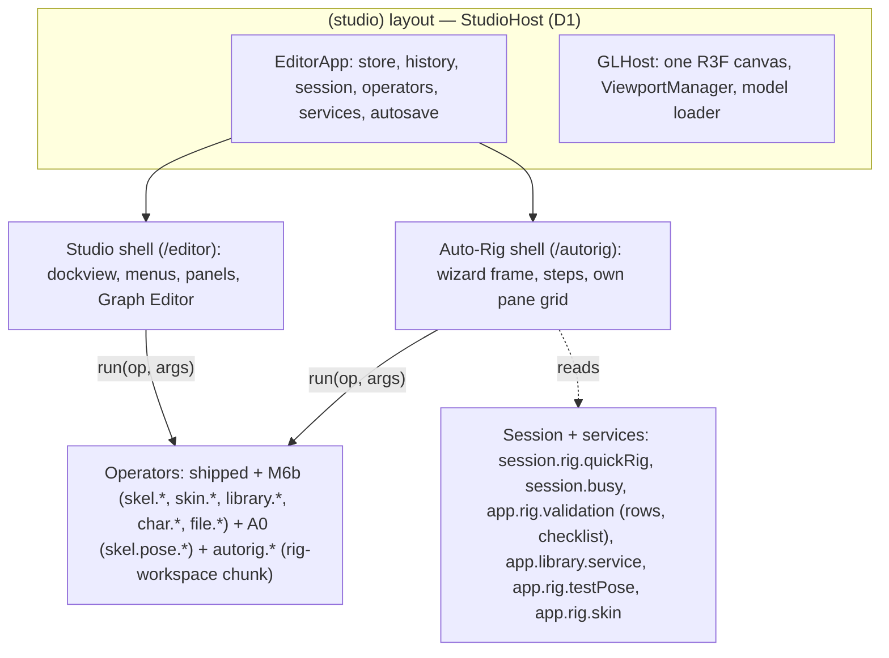
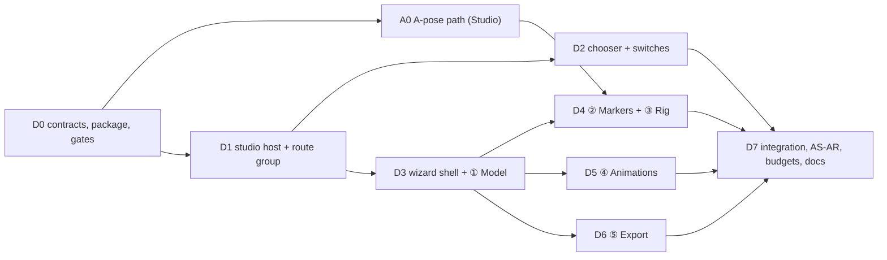

# Ekza Studio — Auto-Rig mode specification

Status: **v0.2 (2026-10-22), refreshed against the merged M6b MVP (`v0.4.0` on `dev`)** — every contract and name
checked against the code (§9 says which CR-AR requests M6b satisfied, with file evidence), the **A-pose path** added as
work package **A0** (owner decision Q-AR-4), the bundle plan rebuilt around the 25 B left in `/editor`'s M6b eager
allowance (§7), the packages made disjoint (§10) and the acceptance made concrete (§11 AS-AR-1, AS-AR-2). Change
record: §15. v0.1 (2026-10-22) was the first draft. It becomes binding when the owner accepts it and
[ADR 0021](adr/0021-autorig-mode.md) moves to Accepted; the contract (§4) freezes when D0 merges, after which a
contract change needs a PR that updates this file first.

Owner request (2026-10-22, translated): *"Can we make a minimalist Studio interface so that on opening you choose
either the full interface or a simplified auto-rig built on the interfaces we already have — like Mixamo: just an
interface to rig, get a ready model, put animations on it, see it in motion, and e.g. prepare it for use in OMOBA.
Studio must become a universal combine."*

Inputs: [M6B-SPEC](M6B-SPEC.md) v1.5 **§0 MVP cut** (merged on `dev`, released as `v0.4.0`; decision record
[ADR 0020](adr/0020-m6b-mvp-cut.md)), its §0.10 (CR-AR-1…6), §0.11 (integration record), its deferred A-pose text
(§5.7 *Apply Pose as Rest*, §5.8 step 3 and gates, §5.21 checklist ③a, Q-MVP-5) and
[DECISIONS-OPEN §L](DECISIONS-OPEN.md#l-m6b-mvp-deviations-2026-10-22) (M6B-INT-*, M6B-AF-*); the merged M6b code
(`editor-core/src/operators/builtin/rig/**`, `editor-core/src/rig/**`, `editor-core/src/library/**`,
`editor/src/panels/{quickRig,paintWeights,clipLibrary}/**`, `editor/src/dialogs/export/character/**`,
`rig/src/quickrig/**`, `io/src/character/**`, `apps/web/scripts/check-size.mjs`); [LAYOUT-PRESETS](LAYOUT-PRESETS.md);
the shipped shell (`packages/editor`: `EditorRoot`, `EditorShell`, `gl/GLHost`, `panels/viewport/PaneView`,
`FirstRunDialog`, autosave and recovery), the workspace switch (`editor-core/src/workspaces/`), the routes of `apps/web`; research
[05](research/05-landscape.md) (Mixamo, Cascadeur), [14](research/14-skinning-own-models.md),
[17](research/17-maya-rigging-basics.md), [19](research/19-rig-workspace-ui.md); OMOBA's runtime rules and local import
flow (`omoba-bevy`: `passport/src/humanoid.rs`, `docs/humanoid-motion.md`, `client/assets/avatars/manifest.json`; read
only); the market survey of §2.

Audience: the owner (§1, §3, §13), the Auto-Rig integration agent (D0, D7), the implementation agents of A0 and
D1…D6 and reviewers. Read M6B-SPEC §0 first: **Auto-Rig adds no rigging, skinning, clip or export logic of its own.**
Every document change it makes runs an operator that Studio already has (shipped, built by the M6b MVP, or built by A0
as a Studio feature); Auto-Rig is a second *shell* — a different, smaller user interface — over the same `EditorApp`,
document, history and operators. **A0 is the one package that adds rigging logic**, and it adds it to Studio (M6b's
deferred A-pose path, §10 A0), not to Auto-Rig.

Normative words: **MUST**, **SHOULD**, **MAY**. Package ids `C0…C12`, `INT`, schema v4, `QuickRigState`,
`ChannelSource 'preview'`, `ClipLibraryService`, `ekza/space-avatar-v1`, `local/generic`, the `vrm.*` lints, the
`rig-workspace` chunk and the Cube Lad are M6B-SPEC §0 terms. `H` = the character's height. "Subject" = the one
character (or the scene meshes that will become it) the wizard works on. **A-posed** = a mesh whose arms hang more
than 5° below horizontal in the front plane (the `skel.tpose` limit, M6B §5.21 v1.4); M6b's Quick Rig notice fires
above 15° (`guess.aPose`), §5.3.

Contents: [1 Goals and non-goals](#1-goals-and-non-goals) · [2 What others do](#2-what-others-do-market-survey) ·
[3 Entry: the chooser, routes and switching](#3-entry-the-chooser-routes-and-switching) ·
[4 Architecture and state model](#4-architecture-and-state-model) · [5 The wizard](#5-the-wizard) ·
[6 Edge cases and errors](#6-edge-cases-and-errors) · [7 Bundle, routes and budgets](#7-bundle-routes-and-budgets) ·
[8 Keyboard, accessibility, devices, language, privacy](#8-keyboard-accessibility-devices-language-privacy) ·
[9 Contract requests to M6b: status](#9-contract-requests-to-m6b--status-after-the-merge) · [10 Work packages](#10-work-packages) ·
[11 Acceptance](#11-acceptance-scenarios) · [12 Defaults chosen](#12-defaults-chosen) ·
[13 Open owner questions](#13-open-owner-questions) · [14 Sources](#14-sources) ·
[15 Change record](#15-change-record-v01--v02)

---

## 1. Goals and non-goals

### 1.1 Goals

| ID | Goal | Measure |
|---|---|---|
| FR-AR-01 | **Choose on opening**: the landing page offers *Auto-Rig* and *Studio*; the choice can be remembered and switched at any time | §3; AS-AR-8 |
| FR-AR-02 | **Mixamo-simple flow**: model → markers → rig → animations → export, five steps, one primary button per step | §5; AS-AR-1 |
| FR-AR-03 | **Rig a static humanoid**, **T- or A-posed** (GLB, or a model from Studio) with the M6b Quick Rig markers, One-Click guess, X symmetry and the front/side axis rule; skeleton detail (fingers) chosen on the markers step | §5.3 |
| FR-AR-04 | **Auto-rig in one click**: Create Skeleton + Bind Skin (auto-lowpoly) with a progress display, then the character **moves at once** (motion test) | §5.4 |
| FR-AR-05 | **Fix when needed**: adjust joints and paint weights with the M6b tools, without leaving the wizard | §5.4 |
| FR-AR-06 | **Animations grid**: search, preview on the character, Mixamo-style parameters (speed, trim, mirror, in place, arm space), add several clips to the character | §5.5 |
| FR-AR-07 | **Export** an OMOBA- and Space-ready VRM 1.0 with an in-browser checklist, a GLB with the clips, the clips as VRMA, and an OMOBA local test kit | §5.6 |
| FR-AR-08 | **One document**: "Open in Studio" continues with the full document (and, on the same page, with its undo history); Studio can send its model to Auto-Rig | §4.4 |
| FR-AR-09 | **Already rigged VRM → straight to animations** | §6 |
| FR-AR-10 | **Lighter route**: `/autorig` loads less code than `/editor` (gated) | §7 |
| FR-AR-11 | **Private**: nothing leaves the browser; no telemetry | §8.5 |
| FR-AR-12 | **Same bytes as Studio**: an export from Auto-Rig equals, byte for byte, the same export run from Studio on the same document | §11 AS-AR-1 step 10 |
| FR-AR-13 | **A-posed models become T-pose VRMs**: an A-posed mesh is fitted and bound in its own pose, then its rest is converted to the VRM T-pose (Studio's *Straighten to T-Pose*, A0), so the exported VRM 1.0 has a T-pose rest and passes the `vrm.*` lints and OMOBA's validator | §10 A0; §11 AS-AR-2 |

The owner's sentence "Studio must become a universal combine" is served by the architecture rule: **one app, several
shells**. Auto-Rig is the first non-dockview shell; the rule makes the next ones (a "Pose & render" shell, an "AI
model → avatar" shell after M7) cheap, because they too only compose operators.

### 1.2 Non-goals (v1)

- No new rigging, skinning, retargeting or writing logic in Auto-Rig (that is M6b's and stays there). The A-pose
  conversion is M6b's own deferred feature, built by A0 into Studio's rig kernel and operators, and Auto-Rig only runs it.
- Non-humanoid rigs (quadrupeds, props with bones), asymmetric marker sets, facial expressions, spring bones, MToon
  authoring, look-at.
- FBX, OBJ, BLEND, ZIP inputs (FBX arrives with M2b, OBJ with M7 G2 — §6, Q-AR-3); retargeting user-supplied
  animation files other than VRMA.
- Decimation of heavy meshes (Q-AR-11), texture painting, UV editing.
- Server processing, accounts, cloud storage; "Publish to Hub" is specified (§5.6.5) but hidden until M4a T3 ships.
- Collaboration in Auto-Rig (the document is the same, so M3 applies later without Auto-Rig changes).
- Bundling or importing Mixamo files (their licence forbids redistribution; research 05).

---

## 2. What others do (market survey)

| Tool | Flow | Inputs / outputs | What we take | What we avoid |
|---|---|---|---|---|
| **Mixamo** (Adobe, web, maintenance mode) | Upload → orient (rotate buttons) → markers: chin, wrists, elbows, knees, groin, *Use Symmetry*, *Skeleton LOD* (full fingers … no fingers) → server auto-rig (≈ 1–2 min, progress) → review with a default motion → Animations: search grid, click to preview on the character, per-clip sliders (*Overdrive* = speed, *Character Arm-Space*, *Trim*) and checkboxes (*In Place*, *Mirror*) → Download dialog: format (FBX binary, FBX for Unity, DAE), skin with/without, fps, keyframe reduction | FBX/OBJ/ZIP in, FBX/DAE out; Adobe ID | the five-screen rhythm; markers with symmetry; skeleton LOD on the markers screen; instant motion review; the per-clip parameters incl. **arm space** (vital for blocky low-poly bodies); one download dialog | server dependency, account, opaque failures, FBX only, no fixing tools, unredistributable clips |
| **ActorCore AccuRIG** (Reallusion, desktop, free) | Import → *Rig Body* (auto markers, drag to adjust, symmetry) → *Rig Hand* (choose the finger count, hand markers) → preview with stock motions, *Pose Offset* sliders per body part → export (FBX/USD with target profiles; 2.0 also exports retargeted motion) | OBJ/FBX in; FBX/USD/iAvatar out | auto-placed markers the user only corrects; finger count as an explicit choice; per-target export profiles | desktop install; pose offsets that silently do not reach some exports |
| **Cascadeur** Quick Rigging Tool (desktop) | Rig mode → Quick Rigging Tool → template (Humanoid/Quadruped) → map joints onto a body diagram (tabs Body, Hands, Twists) → *Add rig elements* (controllers, symmetry axis, rigid-body weights) | its own scene | a body diagram that names what each point means; generated controls | mapping every joint by hand |
| **Tripo** / **Meshy** (AI generators, web) | Generate or upload → one-click server auto-rig (humanoid; Tripo also quadruped/creature; T- or A-pose recommended, non-standard bodies may fail) → preset motion library (Meshy ≈ 500+) → export animated GLB/FBX, in-place option | own models; GLB/FBX out; paid credits | "rig → it moves immediately"; library-first; in-place | credits per action, opaque failure, no manual correction |

**Lessons that bind this spec**: (L1) five to nine markers, pre-placed, are the right amount of user work; (L2)
symmetry on by default; (L3) the proof that rigging worked is the character moving within seconds; (L4) clip parameters
are applied *before* download and shown in the preview; (L5) export is one dialog with targets, not a menu of formats;
(L6) every tool fails on off-centre, lying-down, centimetre-scaled, A-posed and non-humanoid inputs — say so before the
markers, with a one-click fix where one exists; (L7) our edge is local, offline, open (MIT), VRM-native and fixable in
a full editor one click away.

---

## 3. Entry: the chooser, routes and switching

### 3.1 Routes

| Route | What | Notes |
|---|---|---|
| `/` | Landing with the **chooser** (two cards) and credits | static; a ≤ 1.5 kB client script applies the remembered choice (§3.3) |
| `/autorig` | Auto-Rig wizard | `?step=<model\|markers\|rig\|animations\|export>` opens that step when it is reachable (§4.3), else the furthest reachable one; `?sample=<cube-lad\|polybot-tpose\|polybot-apose\|polybot\|seed-san>` loads a sample at the Model step (`autorig.sample`, §4.5); `?handoff=<slot>` (§4.4) |
| `/editor` | Studio (unchanged) | shipped `?ws=<workspace>`; new `?handoff=<slot>` |
| `/?chooser=1` | Landing without the remembered redirect | the "Switch mode" links use it |

Both app routes live in one Next route group `apps/web/app/(studio)/` whose layout hosts the shared `EditorApp`
(§4.4, D1); route groups do not change URLs, so every shipped link, test and deploy path stays valid.

### 3.2 The chooser (landing page)

```
┌──────────────────────────────────────────────────────────────────────────────┐
│ ◆ Ekza Studio                                         Credits · Source code  │
│                                                                              │
│   What do you want to do?                                                    │
│                                                                              │
│  ┌──────────────────────────────────┐  ┌──────────────────────────────────┐  │
│  │ ⟐  AUTO-RIG                      │  │ ▦  STUDIO                        │  │
│  │    Rig a character in minutes    │  │    The full 3D package           │  │
│  │                                  │  │                                  │  │
│  │  Upload a model, place a few     │  │  Model, rig & skin, animate with │  │
│  │  markers, get a skinned skeleton,│  │  the Graph Editor, export glTF,  │  │
│  │  try animations, export a VRM    │  │  VRM and VRMA. Maya-style keys   │  │
│  │  for OMOBA and Ekza Space.       │  │  and docked panels.              │  │
│  │                                  │  │                                  │  │
│  │  [ Start Auto-Rig  → ]           │  │  [ Open Studio  → ]              │  │
│  │  GLB · VRM · desktop and tablet  │  │  Best on a desktop               │  │
│  └──────────────────────────────────┘  └──────────────────────────────────┘  │
│                                                                              │
│   [✓] Remember my choice on this device   (switch any time from the app)     │
│                                                                              │
│   Everything runs in your browser. Your files are never uploaded.            │
└──────────────────────────────────────────────────────────────────────────────┘
```

- Cards are links (`<a href>`), so they work without JavaScript, open in new tabs and are keyboard-reachable; the
  primary action order is Auto-Rig first (the newcomer path), Studio second.
- Below 720 px the cards stack (Auto-Rig on top).
- The page keeps the credits and the third-party notice link of today's landing.

### 3.3 Remembered choice

- Storage: `localStorage['ekza-studio:entry:v1'] = {"choice": "autorig" | "studio", "at": <ms>}` (a new key; the
  shipped `ekza-animator:` keys keep their names, GLOSSARY). Written when a card is followed with *Remember* ticked,
  and by the in-app switches (§3.4) when the user ticks "Open this mode next time". Cleared by unticking it on the
  landing (`?chooser=1`) or by Preferences › General › *Start in: Ask / Auto-Rig / Studio*.
- `/` with a remembered choice and no `?chooser=1` replaces the location with `/autorig` or `/editor` (client script,
  `location.replace`, before first paint where possible; the chooser renders underneath so a blocked script still shows
  it). Every read/write is wrapped in `try`/`catch`; blocked storage means "Ask".
- Deep links (`/autorig`, `/editor`) never redirect.

### 3.4 Switching modes

| From | Control | Effect |
|---|---|---|
| Studio | **File › Auto-Rig This Model…** (enabled when the scene has meshes or a character) and **Help › Switch to Auto-Rig** — both run `autorig.navigate {to: 'autorig', from: 'studio'}` | navigates to `/autorig?from=studio` keeping the document (§4.4); the subject is the selection (selected meshes or the active character), else all visible scene meshes, else the only character |
| Studio first-run dialog | third answer under "What do you want to do first?": **Auto-rig a character (simple mode)** | navigates to `/autorig` and sets the remembered choice only if the user ticks it |
| Auto-Rig | header **Open in Studio ▸** (every step) | `autorig.navigate {to: 'studio', workspace}`: navigates to `/editor?ws=<rig\|animate>` keeping the document; workspace by step: Model, Markers, Rig, Export → `rig`; Animations → `animate` |
| Auto-Rig | header `⋯` › **Switch mode…** | `/?chooser=1` |

---

## 4. Architecture and state model

### 4.1 One app, two shells



Package direction (MUST): `@ekza-studio/autorig` (new, D0) depends on `editor-core`, `doc`, `ui`, `viewport` (types
and `PaneView` props only) and on `@ekza-studio/editor` **through its subpath exports only** (`./host`, `./bodies`,
D1/D0); `editor` never imports `autorig`; only `apps/web` mounts both. Value imports of `mesh-core`, `rig`, `io` and
`mesh-view` from `packages/autorig/src` are forbidden (type imports allowed); the D7 rule test enforces it.

- **Auto-Rig is a shell, not a workspace and not a separate app.** Its steps drive the shipped workspaces (`rig`,
  `animate`) through `workspace.set`, the M6b modes through `rig.mode`, and draw their viewport panes with the shipped
  `PaneView` (a DOM surface registered with the `ViewportManager`; the shared canvas draws behind it), laid out in a CSS
  grid instead of dockview. Workspace switching is already headless (`editor-core/src/workspaces/switch.ts`; entering
  `rig` loads the `rig-workspace` chunk); the Studio shell's dock layout reacts to `session.workspace`, the Auto-Rig
  shell ignores dock layouts and applies its own pane grid per step, reusing the R-Markers pane ids and sizes that C7
  exports (`RIG_MARKER_PANES`, `RIG_MARKER_SIZES` in `editor/src/shell/rig/layouts.ts`, CR-AR-5) through the viewport
  layout `'rig-markers'` (`applyRigLayout` writes `session.viewportLayout`; Auto-Rig sets the same session field).
- **The rule (MUST)**: every document write from Auto-Rig is an `app.operators.run` of an operator registered for
  Studio (shipped, M6b or A0) or of one of the few new operators of §4.5, which compose existing ones and are equally
  available to Studio, scripts and the MCP bridge. Auto-Rig code never writes the store (no `store.transact`,
  `tx.*`, `session.setState` of document-shaped state), never calls a kernel solver (fit, bind, weights, retarget,
  writer) directly, and never re-implements a validation rule; a unit test (D7) greps `packages/autorig/src` for store
  writes and value imports of the kernels. Reading services and session state (`session.rig.quickRig`,
  `session.busy`, `app.rig.validation`, `app.library.service`) and cancelling a bind (`app.rig.skin.cancel()`, U state)
  are allowed.
- Viewport tools (M6b's Quick Rig markers tool, joint transform tools, Paint Skin Weights) are viewport tools bound to
  panes, so they work in Auto-Rig's panes unchanged. M6b exported the pane ids (CR-AR-5) but did not land the "plain
  grid" browser test; D4 lands it (§9).

### 4.2 Step ↔ app state

| Step | Workspace | Rig mode / pose view | Pane grid (Auto-Rig) | Viewport tool | Session state used |
|---|---|---|---|---|---|
| ① Model | `rig` | Object | single persp | none (orbit) | — |
| ② Markers | `rig` | Object + Quick Rig session | **front │ side │ persp** (viewport layout `'rig-markers'`, panes `RIG_MARKER_PANES`, 40/30/30) | Quick Rig markers tool (C3) | `session.rig.quickRig` (`QuickRigState`: markers, moved, selected, preset, guess incl. `aPose`/`armAngle`, preview, checks, refit) |
| ③ Rig | `rig` | Skeleton (*Adjust joints*) / Skin (*Paint weights*; M6B-AF-1: a full Bind Skin already opens Skin mode, Auto-Rig sets the mode it wants after `autorig.rig`) / Object (review); pose view Bind/Test; `PREVIEW` while the motion test plays | persp (review, paint) / front │ side │ persp (adjust) | none / joint transform tools (C3) / Paint Skin Weights (C6) | `session.busy` (bind progress), `app.rig.testPose`, `app.library.service.preview`, `app.rig.validation.rows` |
| ④ Animations | `animate` | — (Animate's `animate` source; `preview` priority, C0) | single persp + a compact time bar | none (orbit) | `app.library.service` (`manifest()`, `preview`) |
| ⑤ Export | `rig` | Object, Bind | single persp (thumbnail camera on demand) | none | `characterExportRows(app, character, profile, format)` (C10; the rows `CharacterChecks` renders) |

Entering a step runs, in order: stop any library preview (`library.stop`), end any tool session (the shipped `Esc`
semantics; `skel.quickRig.cancel` when Quick Rig is open and the step is not ②), `workspace.set` when the workspace
differs, `rig.mode` when the mode differs, then the step's own start (e.g. `skel.quickRig.start {meshes}` on ②).
Leaving `rig` drops test poses from the history (M6B §5.17) and closes Quick Rig — the same as in Studio.

### 4.3 Wizard state and progress

Auto-Rig keeps only **U state** (never in the document, never an undo step) in a shell-owned store:

```ts
// packages/autorig/src/types.ts (D0)
export type AutoRigStep = 'model' | 'markers' | 'rig' | 'animations' | 'export';
export interface AutoRigSubject {
  readonly character: CharacterId | null;      // set once a character exists (Create Skeleton, a VRM import)
  readonly meshes: readonly MeshId[];          // the scene meshes that will become it (before Create Skeleton)
}
export interface IntakeReport {                // §5.2; returned by autorig.intake / autorig.inspect (rig-workspace chunk)
  readonly kind: 'static' | 'vrm' | 'rigged-humanoid' | 'rigged-other' | 'project';
  readonly fileName: string | null; readonly bytes: number | null;
  readonly meshes: readonly MeshId[];          // the scene meshes found (static kinds); [] for the others
  readonly triangles: number; readonly textured: boolean;
  readonly height: number;                     // metres, world bounds
  /** centred / grounded / facing = rig's `quickRigStartChecks(bounds, bvh)` (CR-AR-3, landed), so ① and ② agree;
   *  upright and scale are Auto-Rig's own report rows (§5.2), computed in the same operator. */
  readonly checks: { readonly centred: boolean; readonly grounded: boolean; readonly facing: boolean;
                     readonly upright: boolean; readonly scale: 'ok' | 'tiny' | 'huge' };
  readonly weight: 'light' | 'medium' | 'heavy' | 'too-heavy';   // §6.2 tiers
  /** rig's `guessMarkers(bvh, bounds)` arm angle (radians) and its pose class: 't' ≤ 5°, 'a' > 5° (the skel.tpose
   *  limit; M6b's own `aPose` flag is > 15°), null when the guess failed or the input is not static. */
  readonly pose: { readonly armAngle: number; readonly kind: 't' | 'a' } | null;
}
export interface ClipParams {                  // §5.5.3; identity = { speed: 1, trim: null, mirror: false, inPlace: false, armSpace: 0 }
  readonly speed: number;                      // 0.25 … 3
  readonly trim: { readonly start: number; readonly end: number } | null;   // seconds of the source clip
  readonly mirror: boolean;
  readonly inPlace: boolean;
  readonly armSpace: number;                   // degrees, −10 … +30 (upper-arm abduction offset)
}
export interface AutoRigSession {
  readonly step: AutoRigStep;
  readonly subject: AutoRigSubject;
  readonly intake: IntakeReport | null;
  readonly sub: 'review' | 'adjust' | 'paint';           // ③ sub-tool
  readonly motionTest: boolean;                           // ③ plays the motion test while true (default on)
  readonly draft: Readonly<Record<string, ClipParams>>;   // ④ parameters per library clip id, before Add
  readonly target: 'ekza-vrm' | 'glb' | 'vrma' | 'omoba-kit';   // ⑤
  /** Stage of the running composition; `fraction` mirrors `session.busy.progress` (the bind reports meshes done /
   *  meshes, M6B-C4-15), null = indeterminate. */
  readonly busy: { readonly stage: AutoRigStage; readonly fraction: number | null } | null;
}
export type AutoRigStage = 'import' | 'skeleton' | 'skin' | 'straighten' | 'check' | 'export';
export interface AutoRigProgress {             // pure function of the document, the C7 checklist and the session
  readonly done: Readonly<Record<AutoRigStep, boolean>>;
  readonly reachable: Readonly<Record<AutoRigStep, boolean>>;
  readonly blocked: Readonly<Partial<Record<AutoRigStep, string>>>;   // why a step is not reachable
}
export function autoRigProgress(app: EditorApp, session: AutoRigSession): AutoRigProgress;
```

**Progress is derived, not stored** (so reloads, undo and Studio edits keep it right). It reads the M6b checklist
(`rigChecklist(app, character, {rows, previewed})`, exported from `editor-core` — CR-AR-4 landed — with `rows =
app.rig.validation.rows(character, 'ekza/space-avatar-v1')`; the rows need the `rig-workspace` chunk, which every
step after ① has loaded) for the subject character:

| Step | `done` when | `reachable` when |
|---|---|---|
| ① Model | the subject has meshes or a character | always |
| ② Markers | the subject character has a skeleton (checklist ①) | ① done and the subject is not asset-sourced |
| ③ Rig | every subject mesh is bound (checklist ③) and no `skel.*`/`skin.*` error row — `skel.tpose` included, so an A-posed subject is done only after *Straighten to T-Pose* (A0); warnings and info rows allowed (M6B-INT-11) | ② done |
| ④ Animations | the character has at least one clip, or the user pressed *Skip* (session) | ③ done, or the subject is an asset-sourced humanoid |
| ⑤ Export | — (never "done"; a successful download shows a check on the card) | ④ reachable |

The stepper shows `✓` for done, the current step highlighted, unreachable steps dimmed with `blocked` as tooltip.
Clicking a reachable step jumps to it; jumping **never undoes** anything. *Back* is navigation only; going back to
② after ③ starts the M6b **re-run** (markers seeded from the joints, refit in place, `rebindSkin` confirm when bound,
M6B §0.4.2).

`?step=` and reload: the session store is mirrored to `sessionStorage['ekza-studio:autorig:v1']` (step, sub,
motionTest, draft, target; try/catch) so a reload in the same tab returns to the same step once the document is back
(§4.4).

### 4.4 One document: handoffs

**Same page (default, D1).** `/autorig` and `/editor` are siblings under the `(studio)` layout, whose client island
(`StudioHost`) creates the browser services, the `EditorApp`, autosave and the `GLHost` **once per page load**. Next
keeps a layout mounted across client navigations between its child routes, so *Open in Studio* / *Auto-Rig This
Model…* (Next `router.push`) swap only the page's shell: the document, the **undo history**, the selection, the
cameras, the autosave slot, the loaded chunks and the WebGL context all stay. Before the push the leaving shell stops
previews, ends tool sessions and closes its dialogs (§4.2 entry order); the arriving shell reads `session.workspace`
and the subject (`?from=studio` passes the Studio selection through the session, not the URL).

**New tab or reload (fallback).** A middle-click / *Open in new tab* on *Open in Studio* first runs
`file.autosaveNow` and opens `/editor?handoff=<slot>&ws=…`; a page started with `handoff=<slot>` recovers that slot
silently (`file.recover {slot}` with `markRecovered`, no Recovery dialog) and drops the parameter with
`history.replaceState`. The history does not travel across pages (documented in the toast: "Opened in Studio; undo
history starts here"). A plain reload of `/autorig` with an orphaned slot of this tab shows, on the Model step, the
card **Continue where you left off — "<name>", saved <time> [Continue] [Start over]** (`file.recover` /
`file.discardRecovery`), instead of Studio's Recovery dialog.

**Fallback if the shared layout fails its budget** (D1 decision gate, §7): two independent islands, every switch is a
same-tab navigation through the `handoff` slot (one autosave write, a page load, no undo history across). The rest of
this spec is unchanged by that fallback.

### 4.5 New operators (thin compositions; registered for every shell)

Each `autorig.*` id is a **composition**: it runs existing operators through `app.operators.run` **from its
`prepare`** (the runner refuses runs only inside `apply`, `nested-run`; `operators/runner.ts`), has no `flags.undo`
and records no undo step of its own; its `apply` only returns the result. The undo steps are those of the operators it
runs (listed per row). D0 lands a runner test: a composition that runs two undoable operators leaves exactly two
history steps, and a failure of the second leaves the first in place.

**Where they live (bundle rule, §7).** The definitions are **in the `rig-workspace` lazy chunk**, one file per owner
under `editor-core/src/operators/builtin/rig/wizard/` (D0 lands `wizard/index.ts` with the id list and a stub file per
owner; each owner replaces its file's stubs), appended to `RIG_WORKSPACE_OPERATORS` (`operators/builtin/rig/index.ts`,
one line by D0). `isRigWorkspaceOperator` (`editor-core/src/workspaces/rig.ts`) gains the `autorig` prefix (D0, the
only eager byte change of D0, ≤ 16 B), so the runner loads the chunk on the first run of an `autorig.*` id from any
shell, the palette or the MCP bridge (`lazyOperatorChunk`, M6b §2.1). Scope `global`, workspaces all, category
`autorig`, not repeatable, not adjustable; argument types in `editor-core/src/operators/args.ts` (`OperatorMap`,
additive rows by D0).

| Id | Undo steps | What it runs | File · owner |
|---|---|---|---|
| `autorig.sample {sample}` | the intake's one step | fetches `<samplesPath><file>` (`cube-lad.glb`, `polybot-unskinned-tpose.glb`, `polybot-unskinned.glb`, copied by D3 into `public/samples/`) and runs `autorig.intake`; `polybot` / `seed-san` run the shipped `file.loadSample {sample}` (the closed `SampleId` union is not extended) | `wizard/intake.ts` · D3 |
| `autorig.intake {bytes, name, dropSkin?}` | the inner import's one step | sniffs the file (§5.2 table) and runs **one** of `mesh.importStatic {bytes, name, dropSkin}` (C1; `dropSkin` landed as CR-AR-6, untyped — D3 types it), `file.importModel` (shipped), `file.openProject` (shipped); returns the `IntakeReport` | `wizard/intake.ts` · D3 |
| `autorig.inspect {meshes}` | none (U) | the `IntakeReport` of scene meshes as they are now (after fixes, for *From Studio*): world bounds, a BVH, `quickRigStartChecks` and `guessMarkers` (rig, CR-AR-3), the upright and scale rows, triangle tiers | `wizard/intake.ts` · D3 |
| `autorig.fix {fix, meshes, height?}` | the inner operator's one step | `center` → `skel.quickRig.center {meshes}` (C2); `face` → `skel.quickRig.faceForward {meshes}` (C2; turns ±90° or 180°, `quickRigFacingTurn`); `standUp` → `scene.object.transform` (shipped) −90° about X around the bounds centre; `scale` → `scene.object.transform` uniform scale to `height` (default 1.70 m) about the ground point; `freeze` → `mesh.freezeTransforms {ids: meshes, translate: false, rotate: true, scale: true}` (shipped) | `wizard/intake.ts` · D3 |
| `autorig.rig {}` | two — "Create Skeleton", "Bind Skin" — or three for an A-posed subject: + "Straighten to T-Pose" | `skel.quickRig.commit` with `quickRigCommitArgs(session.rig.quickRig)` (C2/C3, refused with `quickRigCommitBlock`'s reason; closes Quick Rig, Skeleton mode), then `skin.bind {}` with the M6b defaults (C4; Skin mode opens, M6B-AF-1), then — **only when** `app.rig.validation.rows(character, 'ekza/space-avatar-v1')` holds `skel.tpose` — `skel.pose.applyAsRest {character, pose: 'tStance'}` (A0); sets `busy` stages from `session.busy`; stops after the first failure with its message | `wizard/rig.ts` · D4 |
| `autorig.cancel` | none (U) | aborts a running bind: the skin service's `cancel()` (implemented in `rig/skinService.ts`, M6B-C4-15; the contract type has no `cancel`, so the call stays inside the chunk) | `wizard/rig.ts` · D4 |
| `autorig.clip.add {character, clip, params, replace?}` | Use Clip's one step | `library.useClip {character, clip, params, replace}` (C12, extended by D5 — CR-AR-2 was not built; `params.inPlace` sets the shipped `rootMotion: 'in-place'` inside Use Clip's transaction, as `loop` and `slot` are set there) | `wizard/clip.ts` · D5 |
| `autorig.export {character, target, fileName}` | none (download) | `ekza-vrm` / `glb`: `runExportCharacter` (`editor-core/src/workflows/exportCharacter.ts`, the function `file.exportCharacter`'s `prepare` runs, so the bytes are Studio's by construction) with the §5.6.1 request, `blockingLints` refuses as `file.exportCharacter`'s `apply` does, `services.files.download`; `vrma`: the shipped export pipeline (`file.export`, kind `vrma`) once per clip, zipped when more than one; `omoba-kit`: the `ekza-vrm` bytes + the kit packer (§5.6.4); returns the artifacts and their lints | `wizard/export.ts` · D6 |
| `autorig.navigate {to: 'autorig' \| 'studio' \| 'chooser', workspace?, from?, newTab?}` | none (U) | asks the host's navigation port (D1, `provideNavigation` in `editor-core/src/workspaces/ports.ts`) to switch shells (§4.4); without a port (headless, Node) it fails its poll with "No navigation in this host" | `wizard/navigate.ts` · D1 |

Each is listed in the command palette in both shells (category `autorig`), so Studio users and the MCP bridge can run
the same flow headless.

---

## 5. The wizard

### 5.1 The frame

```
┌ ◆ Auto-Rig · Cube Lad ────────────────────────── ↶  ↷ │ Open in Studio ▸ │ ⋯ ┐
│  ✓ Model ─── ② Markers ─── ③ Rig ─── ④ Animations ─── ⑤ Export               │
├────────────────────────────────────────────────────────────────┬─────────────┤
│                                                                │             │
│                      VIEWPORT PANE GRID (per step)             │ STEP PANEL  │
│                                                                │ (≤ 320 px)  │
│                                                                │             │
├────────────────────────────────────────────────────────────────┴─────────────┤
│ ◂ Back       status / hint / problem line                      [ Primary ▸ ] │
└──────────────────────────────────────────────────────────────────────────────┘
```

- **Header**: product mark, subject name (click to rename: `char.setVrmMeta` name once a character exists, else
  `scene.rename`), Undo/Redo (shipped `edit.undo`/`edit.redo`; tooltip shows the step label), *Open in Studio ▸*,
  `⋯` menu: New (shipped `file.new` with its dirty confirm), Open project…, Save project (`file.save`), Switch mode…,
  Preferences (navigation profile only), Keyboard shortcuts, About & credits.
- **Stepper**: `<nav aria-label="Steps">` with `aria-current="step"` (§8.2).
- **Footer**: *Back*, one status line (the current problem in words, or a hint), **one primary button** per step.
- No menu bar, no status line of tool groups, no time slider except the compact one on ④, no dock panels, no command
  palette key (it is reachable from `⋯ › Command palette…` for power users), no marking menus.

### 5.2 ① Model

```
┌ ◆ Auto-Rig · untitled ────────────────────────── ↶  ↷ │ Open in Studio ▸ │ ⋯ ┐
│  ① Model ─── ② Markers ─── ③ Rig ─── ④ Animations ─── ⑤ Export               │
├────────────────────────────────────────────────────────────────┬─────────────┤
│                                                                │ YOUR MODEL  │
│        ┌ ─ ─ ─ ─ ─ ─ ─ ─ ─ ─ ─ ─ ─ ─ ─ ─ ─ ─ ─ ─ ─ ┐           │ cube-lad.glb│
│        ┆                                           ┆           │ 1 mesh      │
│        ┆   Drop a .glb or .vrm here                ┆           │ 312 tris    │
│        ┆   or [ Choose file… ]                     ┆           │ 1.70 m tall │
│        ┆                                           ┆           │ ✓ Centred   │
│        ┆   Try a sample:                           ┆           │ ✓ On ground │
│        ┆   [Cube Lad] [Polybot] [Polybot A-pose]   ┆           │ ✓ Faces +Z  │
│        ┆                                           ┆           │ ✓ Upright   │
│        ┆   ↺ Continue "Cube Lad" (3 min ago)       ┆           │ ✓ Size      │
│        └ ─ ─ ─ ─ ─ ─ ─ ─ ─ ─ ─ ─ ─ ─ ─ ─ ─ ─ ─ ─ ─ ┘           │             │
│          (after a load the drop zone shrinks to a strip        │ FROM STUDIO │
│           and the model shows here, orbitable)                 │ [Use these] │
├────────────────────────────────────────────────────────────────┴─────────────┤
│              GLB · VRM · stays in your browser            [ Next: Markers ▸ ]│
└──────────────────────────────────────────────────────────────────────────────┘
```

**Intake** (`autorig.intake`, D3). The file is sniffed by content (GLB magic, `extensions.VRM` / `VRMC_vrm`, skins,
VRMA `VRMC_vrm_animation`), not only by extension:

| Input | Detected | Route |
|---|---|---|
| `.glb` (or `.gltf` with embedded buffers, as the shipped importer accepts) without skins | `static` | `mesh.importStatic` → scene meshes = subject → ② |
| `.vrm` 0.x / 1.0 | `vrm` | shipped `file.importModel` → asset-sourced character → **④** (②/③ show "This avatar is already rigged. Rig and weight edits on imported avatars arrive later — Open in Studio to animate by hand.") |
| `.glb` with a skin whose bones the shipped importer maps to the VRM humanoid | `rigged-humanoid` | `file.importModel` → ④; ⑤ offers what Studio's export dialog offers for that character (§6.1) |
| `.glb` with a skin not mapped as humanoid | `rigged-other` | a choice: **Re-rig from scratch** (imports the meshes at their bind pose without the skeleton: `mesh.importStatic {dropSkin: true}`, CR-AR-6) → ②, or **Open in Studio** |
| `.ekzanim` | `project` | `file.openProject`; subject = the only character, else the scene meshes; a project with several characters asks which one |
| `.vrma` | animation | refused here: "This is an animation. Rig a model first, then add it in step 4." (④ accepts `.vrma`) |
| `.fbx`, `.obj`, `.blend`, `.zip`, other | unsupported | "Auto-Rig reads GLB and VRM. In Blender: File › Export › glTF 2.0 (.glb)." (Q-AR-3) |

A document that already holds content (a previous character) gets the shipped *New* confirm first ("Start a new
character? Unsaved work is kept in autosave"), then `file.new`; *From Studio* never replaces anything.

**Checks** (panel rows, each with its one-click fix as a button on the row): *Centred* and *On the ground* (`autorig.fix
center`), *Faces +Z* (`autorig.fix face`), *Upright* (bounds taller in Z than 1.5× Y, or the C2 facing probe sees no
feet band → `autorig.fix standUp`), *Size* (height < 0.3 m "tiny" or > 3 m "huge", e.g. a centimetre export →
`autorig.fix scale`, editable target height, default 1.70 m), and **Pose** (information, never a failure: "T-pose" or
"A-pose (arms 35° down) — Auto-Rig straightens it to a T-pose after skinning", from `IntakeReport.pose`). The
centred/grounded/facing rules are **C2's start checks** (`quickRigStartChecks(bounds, bvh)` in `rig/src/quickrig/checks.ts`,
CR-AR-3 landed), computed by `autorig.inspect`, so ① and ② never disagree. A model turned sideways fails *Faces +Z*
(M6B-C2-30) and its fix turns it ±90°. *Next* is enabled when the subject exists;
failed checks do not block ① (② keeps Create Skeleton disabled until they pass, as M6b specifies) but the footer says
which fix to press.

**Samples** (`autorig.sample`): *Cube Lad* (`cube-lad.glb`, T-pose, MIT), *Polybot, no rig* (`polybot-unskinned-tpose.glb`,
T-pose, CC0) and *Polybot, A-pose* (`polybot-unskinned.glb`, CC0) — the M6b C0 fixtures, copied to `public/samples/`
by `copy-assets.mjs` (D3; `check-fixtures` already lists them) — load through `autorig.intake`; *Seed-san* / *Polybot
VRM* are the shipped VRM samples (`file.loadSample`) and go to ④. The landing's credits already name Polybot (CC0);
D2 adds "Cube Lad — Ekza Studio (MIT)".

### 5.3 ② Markers

```
┌ ◆ Auto-Rig · Cube Lad ────────────────────────── ↶  ↷ │ Open in Studio ▸ │ ⋯ ┐
│  ✓ Model ─── ② Markers ─── ③ Rig ─── ④ Animations ─── ⑤ Export               │
├──────────────────────────┬───────────────────┬──────────────────┬────────────┤
│ FRONT · drag ↔ ↕         │ SIDE · depth ↕    │ 3D · orbit       │ MARKERS    │
│                          │                   │                  │ ● Head top │
│           ◉ head top     │        ◉          │       ┌─┐        │ ● Chin     │
│          ┌─┐             │       ┌─┐         │       └┬┘        │ ● Pelvis   │
│          └┬┘◉ chin       │       └┬┘◉        │   ●━━━━┿━━━━●    │ ● Shoulder │
│  ◉━━◉━━━◉━┿━○━━━○━━○     │        ◉ ◉◉◉      │        ┃         │ ▸ Elbow ✎  │
│  wr el  sh┆ (mirror)     │       (stacked:   │       ━╋━        │ ● Wrist    │
│           ◉ pelvis       │        list wins) │       ┃ ┃        │ ● Knee     │
│          ◉ ○ knee        │        ◉          │       ┃ ┃        │ ● Ankle    │
│          ◉ ○ ankle       │        ◉━◉ toe    │      ━┛ ┗━       │ ● Toe      │
│         ◉◉ ○○ toe        │                   │  live skeleton   │ [Guess]    │
│ ◉ marker  ○ mirrored     │                   │  preview         │────────────│
│                          │                   │                  │ FINGERS    │
│                          │                   │                  │ ○ None     │
│                          │                   │                  │ ● Thumb + 1│
│                          │                   │                  │ ○ All five │
├──────────────────────────┴───────────────────┴──────────────────┴────────────┤
│ ◂ Back   Elbow: pick it in the list, drag in SIDE for depth    [ Auto-rig ▸ ]│
└──────────────────────────────────────────────────────────────────────────────┘
```

Everything here is **M6B §0.2 steps 2–4 and §0.4.2**, presented differently:

- Entering runs `select.objects {ids: subject meshes}` and `skel.quickRig.start {meshes}` (C2/C3) and sets the viewport
  layout `'rig-markers'`; the One-Click guess places the
  nine markers (head top, chin, pelvis; shoulder, elbow, wrist, knee, ankle, toe on the character's right, mirrored as
  ghosts). Markers, the guess, the axis rule (front edits x/y, side edits z/y, never the hidden axis), the pick rule
  (the list-selected marker wins on stacked markers; repeated clicks cycle), *Guess*, *Clear* + click-to-place and the
  live skeleton preview are C3's tool and C2's maths, unchanged. The marker list is C3's host-agnostic
  `QuickRigPanelBody` (`editor/src/panels/quickRig/body.tsx`, CR-AR-1 landed; props `app`, `compact`), shown compact
  beside an Auto-Rig body pictogram that highlights where the selected marker belongs (Cascadeur's diagram, L1); the
  body's own Create Skeleton button is hidden in `compact` (D4 adds the prop `hideCommit` to the body if `compact` does
  not hide it — an owned additive edit) because *Auto-rig ▸* replaces it.
- **Fingers** (skeleton detail, Mixamo's LOD): *None* → `core21`; *Thumb + 1* (mitten, the default) → `standard33`;
  *All five* → `full52`; `⋯ › Minimal skeleton (no shoulders, no toes)` → `lite17`. It runs `skel.quickRig.setPreset`
  (C3). On a re-run the select is locked to the skeleton's preset (M6b rule) with "Changing fingers rebuilds the
  skeleton — Start over" as the tooltip.
- **Symmetry** is always on in v1 (M6b's markers are mirrored by definition); the panel says so ("Left side mirrors the
  right") — asymmetric bodies are Q-AR-5.
- Notices from C2/C3 (start checks, guess failure, `aPose`) render in the panel with their M6b texts and fixes. A0
  rewrites `A_POSE_NOTICE` (`quickRigSession.ts`) for both shells: "A-posed arms: the skeleton follows them; after Bind
  Skin, Straighten to T-Pose makes the rest a VRM T-pose". Auto-Rig adds: "Auto-rig straightens it for you".
- **Auto-rig ▸** is enabled when `quickRigCommitBlock(session.rig.quickRig)` is null (start checks pass, markers
  complete); it runs `autorig.rig` (§4.5) and moves to ③.
- Keyboard placement (§8.1): arrow keys nudge the selected marker in the pane under the pointer (or the last used ortho
  pane) through `skel.quickRig.setMarker`, so the step is fully usable without dragging (WCAG 2.5.7).

### 5.4 ③ Rig

**Progress** (while `autorig.rig` runs; a modal sheet over the viewport, `aria-live="polite"`):

```
┌──────────────────────────────────────────┐
│  Rigging Cube Lad                        │
│  ✓ Skeleton — 34 joints (Standard 33),   │
│    IK legs, FK arms                      │
│  ▸ Skinning 1 of 1 mesh …  ██████░░░░    │
│  ○ Straightening to a T-pose (A-pose)    │
│  ○ Checking                              │
│                               [ Cancel ] │
└──────────────────────────────────────────┘
```

Stages come from the operators: `skeleton` from `skel.quickRig.commit` (C2; skeleton and control rig in one step),
`skin` from `skin.bind` in the skin worker (C4; `session.busy = {label: 'Binding skin…', progress: meshes done /
meshes}` — M6B-C4-15, CR-AR-2(b) partly landed — so a one-mesh body shows an indeterminate bar until it ends),
`straighten` from A0's `skel.pose.applyAsRest {pose: 'tStance'}` (shown only for an A-posed subject: the row appears
when the post-bind Validation rows hold `skel.tpose`), `check` from `app.rig.validation.rows`. *Cancel* during `skin`
runs `autorig.cancel` (the skin service's `cancel()`: rejects the pending bind with `cancelled` and terminates the
worker job) and leaves the skeleton (the first undo step) in place, with "Skeleton created; skinning cancelled — [Bind
again]". *Cancel* is not offered during `straighten` (synchronous, one transaction).

**Review** (the default sub-tool after rigging):

```
┌ ◆ Auto-Rig · Cube Lad ────────────────────────── ↶  ↷ │ Open in Studio ▸ │ ⋯ ┐
│  ✓ Model ─── ✓ Markers ─── ③ Rig ─── ④ Animations ─── ⑤ Export               │
├────────────────────────────────────────────────────────────────┬─────────────┤
│  PREVIEW Walk                                                  │ CHECK IT    │
│                         ┌─┐                                    │ Motion test │
│                         └┬┘                                    │ ▶ ● on      │
│                      ╲━━━┿━━━╱                                 │ [Walk]      │
│                          ┃                                     │ [Sword]     │
│                         ╱ ╲                                    │ [Dance]     │
│                        ╱   ╲                                   │ [Range test]│
│                                                                │─────────────│
│                                                                │ FIX         │
│                                                                │ [Adjust     │
│                                                                │  joints]    │
│                                                                │ [Paint      │
│                                                                │  weights]   │
│                                                                │ ☐ Show      │
│                                                                │   weights   │
│                                                                │─────────────│
│                                                                │ ✓ All good  │
├────────────────────────────────────────────────────────────────┴─────────────┤
│ ◂ Markers   Looks wrong? Move markers, adjust or paint.     [ Animations ▸ ] │
└──────────────────────────────────────────────────────────────────────────────┘
```

- **Motion test** (the "instant ROM preview" of the request; L3): as soon as `check` ends, the character plays a loop
  through the **library preview** (`library.preview`, C12, channel source `preview`; no document write, no undo step).
  Buttons pick Walk, Sword attack, Dance (starter-pack clips) or **Range test** (§5.4.1). C12 stops the preview on any
  document change; while `motionTest` is on, Auto-Rig restarts it after the change commits (never during a gesture).
- **Adjust joints** (`sub: 'adjust'`): front │ side │ persp panes, `rig.mode {mode: 'skeleton'}`, Go to Bind Pose,
  the C3 joint tools with symmetry (`W` drag = joint + children, `D`+`W` = this joint only, `E` = rest rotation before
  binding). After a bind, rest edits keep the mesh (Move Skinned Joints, M6B §5.7); on **Done** Auto-Rig reruns
  `skin.bind {confirm: true}` (the stored bind arguments, no question) when no weight edit ran since the last bind —
  Auto-Rig tracks it in its U session from `session.lastRun` (any `skin.weights.*` id sets `paintedSinceBind`; the
  document has no "painted" flag) — and otherwise runs plain `skin.bind {}`, whose M6b `rebindSkin` question ("Rebind
  replaces painted weights" — *Rebind* / *Keep my weights*) the shared dialog host shows. For an A-posed subject that
  was straightened, the rebind is at the T-pose rest (the baked mesh); the panel says "Weights are recomputed on the
  straightened pose".
- **Paint weights** (`sub: 'paint'`): `rig.mode {mode: 'skin'}`, persp pane, C6's Paint Skin Weights tool with a
  **reduced panel**: the influence list labelled by body part (*Left upper arm* …; click a joint glyph also picks),
  Replace / Add / Smooth, value, radius (`B` drag), *Mirror stroke* (on), *Flood*, *Mirror weights L→R*, and C6's
  "Hidden or inner points… use Volume and untick Front faces only" hint (M6B-AF-13) — every control is C6's. **CR-AR-1
  was not met for this panel** (`editor/src/panels/paintWeights/index.tsx` exports only its default panel view): D4
  extracts the body into `paintWeights/PaintWeightsControls.tsx` (props `app`, `compact`; the panel view renders it
  unchanged; C6's tests stay green). One stroke = one undo step. The weight display (greyscale) is C6's; **Show
  weights** toggles it in review too.
- **Back to markers** (footer *◂ Markers*) = the M6b re-run (refit in place, same joint ids, `rebindSkin` confirm).
- The panel's last row is the C7 Validation summary for `skel.*`/`skin.*` (errors block *Animations ▸* with the row's
  text and its Fix button; warnings are listed, not blocking).

#### 5.4.1 Range test clip

A procedurally generated range-of-motion clip in the VRM normalized frame, MIT, generated in memory (no file): the
pose list of M6B §5.17's deferred ROM clip (arms down / forward / up, elbows 0–140°, wrists ±60°, spine and neck ±40°,
legs forward / side / back, knees 0–130°, feet ±30°, finger curls when present; 4 frames per pose at 30 fps), as
`HumanoidClipData`, previewed through C12's preview path with an in-memory source (CR-AR-2(c); not built by C12 — D5 adds it, `ClipPreviewSource.start` in
`editor-core/src/evaluation/previewSource.ts` already takes any `PreviewClip`). It is never written to
the document. When M6b's post-MVP `skin.test.rom` is built it SHOULD read the same pose table
(`io/src/library/rom.ts`, D5) so there is one definition. Optional in v1 (D5 stretch; Q-AR-7).

### 5.5 ④ Animations

```
┌ ◆ Auto-Rig · Cube Lad ────────────────────────── ↶  ↷ │ Open in Studio ▸ │ ⋯ ┐
│  ✓ Model ─── ✓ Markers ─── ✓ Rig ─── ④ Animations ─── ⑤ Export               │
├─────────────────────────┬────────────────────────────────────┬───────────────┤
│ ⌕ search…               │                                    │ ON CUBE LAD   │
│ All Move Combat React   │ PREVIEW Walk  ×1.0                 │ ▶ Walk   walk │
│                         │                                    │   ×1.0  ✎ ✕   │
│ [▶ Walk   ↻ 1.3 s]      │           ┌─┐                      │ ▶ Sword  atk  │
│ [  Idle   ↻ 2.0 s]      │           └┬┘                      │   ×1.2  ✎ ✕   │
│ [  Run    ↻ 0.7 s]      │         ╲━━┿━━╱                    │               │
│ [  Jog    ↻ 0.8 s]      │            ┃                       │ Drop a .vrma  │
│ [  Sword attack   ]     │           ╱ ╲                      │ to add yours  │
│ [  Punch          ]     │                                    │               │
│ [  Cast           ]     │ ▶ ❚❚ 0:00.6 ━━━━●━━━━ 1.3 s        │ OMOBA uses    │
│   …14 clips             │ Speed [━━━━●━━━] 1.0×              │ its own       │
│   CC0 · Quaternius      │ Trim  [●━━━━━━●] 0.0–1.3 s         │ motions; your │
│                         │ Arms  [━━●━━━━━] 0°                │ clips play in │
│                         │ ☐ Mirror   ☐ In place              │ Space and GLB │
│                         │       [ + Add to character ]       │               │
├─────────────────────────┴────────────────────────────────────┴───────────────┤
│ ◂ Rig        2 animations on Cube Lad                            [ Export ▸ ]│
└──────────────────────────────────────────────────────────────────────────────┘
```

#### 5.5.1 Grid and search

- Source: C12's `app.library.service.manifest()` after `app.library.load()` (the `clip-library` chunk; fetched on first entry; clip bytes on first preview, checksum
  verified — C12 rules). Cards: label, duration, loop glyph ↻, slot chip; a failed checksum disables the card with
  C12's message.
- Search: case-insensitive substring over label, id and source name, plus a small synonym table in Auto-Rig data
  (`attack → sword, punch`, `stand → idle`, `shoot → pistol`, …; i18n-ready). Filter chips map clip ids to categories
  from an Auto-Rig data table (Move: idle, walk, run, jog, jump-*; Combat: sword-attack, punch, cast, pistol-shoot;
  React: hit, death; Fun: dance); unknown ids fall into "Other", so a manifest that grows never breaks the grid.
- No per-card animated thumbnails in v1 (the main viewport is the preview, as Mixamo's is).

#### 5.5.2 Preview

- Click (or `Enter` on a focused card) = `library.preview {character, clip, params: draft[clip] ?? identity}` (`params`
  added by D5; C12 shipped `{character, clip}`); the
  viewport badge shows `PREVIEW <label>` (C12) and the transport row plays/pauses the preview clock; `Space` toggles,
  `Esc` stops. Hover never auto-plays (keeps the GPU idle; respects reduced motion).
- Rows under **On <character>** are document clips: ▶ plays them through the shipped path (`clip.setActive`,
  `time.setLoop`, `time.play` in `animate`), which also proves that what was added is what was previewed.

#### 5.5.3 Parameters (Mixamo's, applied before adding — L4)

| Param | Range | Applied by | Notes |
|---|---|---|---|
| Speed | 0.25–3×, step 0.05 | `applyClipParams` (io, D5): sample times ÷ speed | Mixamo "Overdrive" |
| Trim | start/end within the source duration | `applyClipParams`: keeps samples in the window, re-zeroes time | loop clips keep `loop` only when the trim is the full clip |
| Arm space | −10…+30° | `applyClipParams`: adds the angle to `leftUpperArm`/`rightUpperArm` abduction (mirror-signed) on every sample | Mixamo "Character Arm-Space"; stops blocky arms cutting the torso |
| Mirror | on/off | `applyClipParams`: swaps left/right humanoid bones and reflects across the YZ plane (`q → (x, −y, −z, w)`, hips `x → −x`) | a D5 test asserts equality (≤ 1e-4 rad) with the shipped `pose.mirrorAnimation` run on the added clip |
| In place | on/off | the shipped clip setting `rootMotion: 'in-place'` (exports remove the X/Z travel, `io/src/bake/bake.ts`); the preview removes the travel with the **same** helper, exported from `bake.ts` by D5 (no behaviour change) | Mixamo "In Place" |

`applyClipParams(data: HumanoidClipData, params: ClipParams): HumanoidClipData` is pure and deterministic; identity
params return the input unchanged (same object), so C12's existing tests and the Use-Clip equality stay bit-equal.

#### 5.5.4 Adding, editing, removing

- **+ Add to character** = `autorig.clip.add {character, clip, params}` → C12's Use Clip (one undo step; name = label,
  `loop`, `slot` when free, CC0 Quaternius provenance) with the params applied, with `rootMotion: 'in-place'` when *In place*. The
  params are recorded on the clip as tags in the shipped `ClipRecord.tags` vocabulary (`[a-z0-9_-]`, ≤ 8 tags):
  `ar-<library id>`, `ar-speed-<percent>`, `ar-trim-<startMs>-<endMs>`, `ar-mirror`, `ar-inplace`, `ar-arms-<deg>`
  (`m` for minus) — no schema change — so ✎ can reopen them.
- ✎ on a row loads the clip's library id and params into the editor above; *Update* runs `autorig.clip.add {…,
  replace: clipId}` (one step: the old clip deleted, the new one added, keeping the clip's name and slot).
- 🗑 = shipped `clip.delete`.
- Slot chips: click to choose the slot from the Ekza slot vocabulary through the shipped clip settings operator.
- Dropping `.vrma` files on the step = shipped `file.importAnimation` onto the subject.
- **Export ▸** is enabled with zero clips (OMOBA needs none); the footer says "No animations — the VRM still works in
  OMOBA, which plays its own".

### 5.6 ⑤ Export

```
┌ ◆ Auto-Rig · Cube Lad ────────────────────────── ↶  ↷ │ Open in Studio ▸ │ ⋯ ┐
│  ✓ Model ─── ✓ Markers ─── ✓ Rig ─── ✓ Animations ─── ⑤ Export               │
├──────────────────────────────────────────┬───────────────────────────────────┤
│ GET YOUR CHARACTER                       │ READY FOR OMOBA AND EKZA SPACE    │
│ ● Ekza avatar · VRM 1.0  (recommended)   │ ✓ VRM 1.0 humanoid                │
│   One file for OMOBA and Ekza Space      │ ✓ All 15 required bones           │
│ ○ GLB with animations                    │ ✓ 34 of 64 bones                  │
│   For Unity, Godot, Blender, three.js    │ ✓ Standard bone parents           │
│ ○ Animations only (.vrma)                │ ✓ T-pose rest                     │
│   2 clips → cube-lad-animations.zip      │ ✓ Plain transforms, even scale    │
│ ▸ For developers                         │ ✓ File 0.4 / 50 MiB · JSON 61 KiB │
│   ○ OMOBA local test kit (.zip)          │ ✓ 412 / 4,096 nodes               │
│───────────────────────────────────────── │ ✓ Allowed extensions only         │
│ ABOUT THIS AVATAR (saved in the file)    │ ✓ Licence and author set          │
│ Name    [Cube Lad            ]           │ ✓ Thumbnail                       │
│ Author  [Tester              ]           │                                   │
│ Licence [Open — CC0        ▾]            │ OMOBA plays its own motion library│
│ Thumbnail [■] [Render again]             │ on your VRM; your clips play in   │
│                                          │ Space.                            │
├──────────────────────────────────────────┴───────────────────────────────────┤
│ ◂ Animations     cube-lad.vrm · 0.4 MiB                       [ Download ▸ ] │
└──────────────────────────────────────────────────────────────────────────────┘
```

#### 5.6.1 Targets

Every target runs `autorig.export {character, target, fileName}` (§4.5). The character request fields are io's
`CharacterExportRequest` (`io/src/types.ts`: `character, fileName, format, profile, clips: ClipId[] | 'slots',
includeProps, material, thumbnail, validate`).

| Target | Request (through `runExportCharacter`, the code `file.exportCharacter` runs) | File | Gate |
|---|---|---|---|
| **Ekza avatar · VRM 1.0** (default) | `{format: 'vrm', profile: 'ekza/space-avatar-v1', clips: 'slots', includeProps: null, material: null, thumbnail: 'stored', validate: true}` | `<name>.vrm` | the profile's error rows (Validation incl. `skel.tpose`, VRM meta) and the byte lints (every `vrm.*` lint = OMOBA's runtime rules, M6B §0.4.6), the read-back and glTF-Validator errors — `blockingLints` |
| **GLB with animations** | `{format: 'glb', profile: 'local/generic', clips: <every non-test clip of the character, in order>, thumbnail: 'none', …}` (io has no `'all'`) | `<name>.glb` | `local/generic` errors |
| **Animations only** | the shipped export pipeline, kind `vrma` (`file.export`; `ExportRequest {kind: 'vrma', character, clips, …}`), one artifact per clip; D6 verifies it on a model-sourced character first (`workflows/export.ts` requires a humanoid runtime, which C1 registers) and hides the target if it is refused | one `.vrma`, or `<name>-animations.zip` (fflate from the shipped project-archive chunk) | VRMA lints |
| **OMOBA local test kit** (under *For developers*) | the VRM target's bytes, then the kit packer (§5.6.4) | `<slug>-omoba-kit.zip` | the VRM gate |

For asset-sourced characters (an uploaded VRM), `file.exportCharacter` refuses (model-sourced only); the targets are
what Studio's Export dialog offers for them (the shipped `file.export` bake profiles; `ekza/space-avatar-v1` keeps
passing for VRM 0.x per M6B §0.4.6). A target that is not available is not shown.

#### 5.6.2 The checklist

Before *Download* the right column is **`characterExportRows(app, character, profile, format)`** (C10, the rows its
host-agnostic `CharacterChecks` / `useCharacterRows` render — CR-AR-1 landed for `VrmMetaFields`, `CharacterChecks`,
`ThumbnailPreview` in `editor/src/dialogs/export/character/`), rendered as plain sentences by an Auto-Rig label table
keyed by rule id (`vrm.meta-required` → "Name and author set", `vrm.licence-unset` → "Licence chosen",
`skel.tpose` → "T-pose rest", `skin.unbound` → "Every part skinned", …). Unknown rule ids render with their own
message, so a new lint is never hidden; info rows are listed and never gate (M6B-INT-11). Errors are red with the
row's Fix button when it has one (`RigValidationRow.fix`; `skel.tpose`'s Fix is A0's *Straighten to T-Pose*), and they
disable *Download*; warnings are amber and do not. **There is no dry run in C10**: the byte rules (`vrm.glb-size`,
`vrm.json-size`, `vrm.node-count`, `vrm.humanoid-bone-count`, `vrm.container`, …) are known only once the bytes are
written, so *Download* writes, lints and then saves (as `file.exportCharacter` does: a blocking byte lint means no
file and an error toast); after a download the column adds the measured rows ("File 0.4 / 50 MiB", "412 / 4,096
nodes", "33 of 64 humanoid bones") from the artifact.

#### 5.6.3 Metadata

Name, author, licence preset ("Open — CC0" first) and the thumbnail are C10's host-agnostic `VrmMetaFields` and
`ThumbnailPreview` (`char.setVrmMeta {character, patch}`, one undo step per committed edit; `char.renderThumbnail
{character}`); Auto-Rig prefills the author from the last export
(preference) and renders the thumbnail automatically on first entry when none exists.

#### 5.6.4 OMOBA local test kit

For developers who run OMOBA locally (its `OMOBA_AVATAR_MANIFEST` flow; `omoba-bevy/docs/humanoid-motion.md`): a zip
with `<slug>.glb` (the VRM bytes unchanged — OMOBA's local flow copies a valid VRM container to a `.glb` path),
`<slug>.png` (the thumbnail), `manifest-entry.json` (`{author, collection: "Ekza Studio", display_name, license, slug,
source_url: null, thumbnail}` — the fields of `client/assets/avatars/manifest.json`) and `README.txt` with the
`validate-runtime-vrm` command and the note that runtime compatibility is not approval. `slug` = the name in
`[a-z0-9-]`. Auto-Rig never touches an OMOBA checkout. Thumbnail format and exposure: Q-AR-8.

#### 5.6.5 Publish to Ekza Hub (later)

Placement reserved: a second primary button **Publish to Ekza Hub ▸** next to *Download* for the VRM target. It
appears only when the M4a T3 slice (TODO item 13: the `studio-upload` scope) is built and the user is signed in to
the Hub; it uploads the same bytes *Download* would save to `hub.ekza.io` (Hub → rendition builder bakes the five
clips → curator review → submit to OMOBA). Until then it is **absent** (M6b's rule: deferred UI is absent, not
disabled), and the export step says "Upload this file to Ekza Hub to use it in OMOBA online".

#### 5.6.6 Continue in Studio

Under the targets: "Want to keyframe your own motion? **Continue in Studio ▸**" (`autorig.navigate {to: 'studio', workspace: 'animate'}`).

---

## 6. Edge cases and errors

### 6.1 Model kinds

| Case | Detection | Behaviour |
|---|---|---|
| Non-humanoid (prop, quadruped) | C2's `guessMarkers` returns null (no leg split or arm run) | markers placed from template proportions with C2's message, plus Auto-Rig's: "This does not look like a person standing. Auto-Rig makes humanoid (VRM) skeletons. You can still place the markers by hand." Auto-rig stays possible; ⑤'s checks decide |
| A-posed arms (> 5° below horizontal) | `IntakeReport.pose.kind = 'a'` on ①; C2's `guess.aPose` notice above 15° on ② | the skeleton follows the arms (C2's fit along the marker line, 0–50°); `autorig.rig` binds in the mesh's own pose and then runs A0's *Straighten to T-Pose* (`skel.pose.applyAsRest {pose: 'tStance'}`: T-Stance computed, the bound meshes baked by LBS, the joint rests set to the T-pose), a third undo step; ③ onward and ⑤'s VRM see a T-pose rest, `skel.tpose` clean (AS-AR-2). If straightening fails (e.g. an arm chain the T-Stance cannot reach within 5°) ③ shows the `skel.tpose` row with its Fix and the reason; the VRM target stays blocked, GLB/VRMA stay allowed (`local/generic` warns) |
| Several meshes (body, hair, sword …) | `IntakeReport.meshes.length > 1` | the Model panel lists them with checkboxes *Part of the character* (default: all visible meshes); unticked ones stay in the scene, visible and untouched (`view.hide` hides the selection only, and hiding is not needed), and are left out of `subject.meshes`, so `skel.quickRig.start {meshes}` and the commit adopt only the ticked ones. A mesh whose bounds lie outside the body's (a weapon on the floor) is unticked by default with "Looks separate" |
| Already-rigged VRM | `kind: 'vrm'` | straight to ④ (FR-AR-09); ②/③ show the already-rigged notice (C11 is deferred) |
| Rigged non-VRM humanoid GLB | `kind: 'rigged-humanoid'` | ④; ⑤ shows the targets Studio offers for it |
| Rigged GLB, unknown skeleton | `kind: 'rigged-other'` | *Re-rig from scratch* (CR-AR-6) or *Open in Studio* |
| Skinned mesh selected from Studio | C1 refuses skinned meshes in `char.fromModel` | the Model step offers *Re-rig from scratch* only for imported assets; for Studio meshes it shows C1's message |
| Off-centre, lying down, wrong facing, centimetres | §5.2 checks | one-click fixes on ① (same functions as C2's start checks) |
| Non-uniform or negative object scale | C1's refusal "Freeze Transformations first" | the row offers **Freeze** = shipped `mesh.freezeTransforms` |
| Open meshes, holes, non-manifold | C4 binds anyway (visibility rules); `skin.unreachable-island` etc. | ③ lists C7's rows with their Fix buttons |
| Textured models (AI generators) | `IntakeReport.textured` | textures stay asset materials (C1 adoption keeps them); a D7 acceptance case checks they reach the VRM (AS-AR-6); if C10 does not carry them, that is a C10 bug, not an Auto-Rig workaround |
| A file over the shipped input budget (`io` `DEFAULT_INPUT_BUDGET`) | intake error | the shipped message, plus the conversion hint |

### 6.2 Heavy meshes

| Tier | Triangles (all subject meshes) | Behaviour |
|---|---|---|
| light | ≤ 20,000 | normal |
| medium | 20,001–60,000 | ① notes "Detailed model: rigging takes a few seconds"; ③'s progress shows the fraction |
| heavy | 60,001–200,000 | ① warns "Very detailed model (N triangles). Rigging may take a minute and painting may lag; phones may run out of memory. OMOBA files must stay under 50 MiB." *Next* asks once to confirm |
| too-heavy | > 200,000 (`MAKE_EDITABLE_MAX_TRIANGLES`) | refused: "Reduce it to under 200,000 triangles (Blender: Decimate modifier) and try again." In-browser decimation is Q-AR-11 |

The tiers are report thresholds, not new limits: the hard limit is io's. The bind runs in C4's worker, so the page stays
responsive; *Cancel* works in every tier.

### 6.3 Failures

- An operator failure shows its message in the footer status line and as a toast; the step stays; nothing is half
  applied (operators are transactional).
- WebGL unavailable or lost: the shipped `KernelUnavailable` / context-lost handling; Auto-Rig shows "Auto-Rig needs
  3D graphics (WebGL 2)".
- Storage blocked: autosave off (shipped toast); the remembered choice falls back to "Ask"; the session mirror is
  skipped.
- The library manifest unreachable (offline first visit): ④ says "Animations could not be loaded — check the
  connection" with *Retry*; ⑤ still works (VRM needs no clips).

---

## 7. Bundle, routes and budgets

### 7.0 The starting point (binding)

`/editor`'s first-visit route is **895,688 B** gzip on `dev` after the M6b acceptance fix round (M6B-AF-7): the M6b
baseline 889,569 B plus +6,119 B of the +6,144 B MVP eager allowance (`apps/web/scripts/size-baseline.json`,
`eagerDelta`, enforced) — **25 B of headroom** under the M6b limit 895,713 B, and 4,312 B under the 900,000 B gate.
Therefore:

1. **Zero eager bytes by default.** Every Auto-Rig byte that `/editor` would load lives in a lazy chunk: the
   `autorig` shell package (only `/autorig` imports it), the composition operators (in the `rig-workspace` chunk,
   §4.5), A0's operators and kernel code (in `rig-workspace`, the skin/character chunks and the lazy dialogs), D2's
   chooser (only `/`), the Preferences and First-run additions (their lazy dialog chunks).
2. **Listed eager exceptions** — the only `/editor` eager changes this milestone may make, each measured by its
   package against `autorig/mvp` at merge and recorded in its wp-notes:

   | Package | What | Allowance (gzip) |
   |---|---|---|
   | D0 | the `autorig` alternative in `isRigWorkspaceOperator` (`editor-core/src/workspaces/rig.ts`) | 64 B |
   | A0 | none: the `skel.pose.*` operators, T-Stance, the bake, the dialog and the menu items are in the rig chunk / lazy dialog / lazy rig shell (`editor/src/shell/rig/**`) | 0 B |
   | D1 | the route-group split: the `(studio)` layout island (`StudioHost`), the Studio shell page, `?handoff=` and the navigation port | 1,408 B |
   | D2 | Studio's *File › Auto-Rig This Model…* and *Help › Switch to Auto-Rig* items (`editor/src/shell/menuItems.ts`; MAY come from the lazy chunk's registry instead, then 0 B) | 448 B |
   | D3 | the `'simple'` navigation profile's bindings (`viewport/src/navigation/profiles.ts`, eager because the `ViewportManager` reads it) | 128 B |
   | **Total** | | **2,048 B** |

3. **Re-baseline by recorded decision (AR-B1).** D0's first commit measures `/editor` on `autorig/mvp` (production
   build, `check:size`), records it in `size-baseline.json` as the new `baseline` (`label: "dev at v0.4.0 + M6b
   fixes, before Auto-Rig D0"`, the measured `total`) with `eagerDelta.allowance: 2048`, `enforce: true` and the
   per-package split above, moves the M6b record under `previous`, and writes the row **AR-B1** in DECISIONS-OPEN §M
   ("Auto-Rig") with the measured number, the M6b total it replaces (895,688 B expected) and the limit (baseline +
   2,048 B, which must stay ≤ 900,000 B). This is the only re-baseline; it is an owner review item (§13 Q-AR-17), and
   until the owner overrides it, the numbers stand.
4. **Decision gate for D1** (§4.4): if the shared layout costs more than 1,408 B on `/editor`, D1 takes the two-island
   fallback (each route its own island; `?handoff=` only), measures again and records which one it shipped. Unused
   allowance of one package is not taken by another without D7's approval in wp-notes (M6b's rule).
5. A package that cannot meet its allowance moves code lazy (a menu item's label can come from the operator registry
   of the lazy chunk; the handoff reader can live in the recovery-dialog chunk) — never by raising the gate.

### 7.1 What `/autorig` loads

The M2a attribution of `/editor` (M2A-INT-4, gzip) is three 174.4 kB, next 127.4, dockview 82.9, editor-core 75.4,
editor 74.8 (panels 48.9), R3F 52.7, rig 39.4, curve-editor 28.7, viewport 28.5, doc 19.7, io 13.5, anim-core 13.2,
camera-controls 9.5 (M6a raised the route to ≈ 869–890 kB, M6b to 895.7 kB; D0 re-runs the attribution with
`check:size`'s source-map path and records it). `/autorig`'s initial route drops dockview, the curve editor (Graph
Editor, Dope Sheet), the panel registry, the menu bar, the command palette, the marking menu, the first-run dialog and
the Studio shell, and adds the wizard frame and the ① step:

| Part | Estimate (gzip) |
|---|---|
| three + R3F + camera-controls | ≈ 237 kB |
| next runtime | ≈ 127 kB |
| editor-core (operators are registered eagerly, as in `/editor`) | ≈ 85 kB |
| rig + viewport + doc + io + anim-core + ui | ≈ 130 kB |
| host part of `editor` (services, GL host, input, autosave, toasts, dialog host, `PaneView`) | ≈ 30 kB |
| `autorig` frame + ① + i18n table | ≈ 25 kB |
| **Total** | **≈ 635 kB** (vs 895.7 kB) |

### 7.2 Gates (D0 lands them in `check:size`; D1 measures and records the `/autorig` baseline)

- `/autorig` first-visit route **≤ 660,000 B** gzip (gate), target 620,000 B (report); recorded in
  `size-baseline.json` under `autorig` (D1). Reported, not enforced, until D1 records it; if D1 measures above the gate
  with the plan of §7.1 done, D1 records the measure and D7 brings the gate to the owner (never silently raised).
- `/editor` stays under its **900,000 B** gate and the AR-B1 limit (§7.0).
- **Autorig BOUNDARIES** (markers that must not appear in `/autorig`'s initial scripts): every shipped lazy boundary,
  plus `dockview` (a dockview-only string), `curve-editor` (Graph Editor/Dope Sheet markers), `model-operators`,
  `command-palette`, `marking-menu`, `dialog-first-run`, `studio-shell` (marker `ekza-studio-shell`, referenced only
  by the Studio shell's entry, D1), and the M6b chunks `rig-workspace`, `skin-worker`, `character-runtime`,
  `clip-library`, which load per step.
- **Editor BOUNDARY** (new, must not appear in `/editor`'s initial scripts): `autorig-shell` (marker
  `ekza-autorig-shell`, referenced by `packages/autorig/src/index.ts`).
- Per-step lazy loads (report): ① on the first file or sample = `rig-workspace` (intake) + mesh kernel; ② = mesh view;
  ③ = `skin-worker` + `character-runtime`; ④ = `clip-library` + import path; ⑤ = export path. A D7 bench records the
  bytes fetched over AS-AR-1 and asserts **dockview is never fetched** on `/autorig` (until *Open in Studio*).
- `check-size.mjs` gains a `--route` loop over both routes (`checkSize(nextDir, {route})` and `readRouteScripts(nextDir,
  route)` already take a route; the loop, per-route boundaries and the per-route baseline keys are new); route groups
  do not change the prerendered paths (`server/app/editor.html`, `server/app/autorig.html`).

### 7.3 Runtime budgets (reference machine; report-only unless marked)

| Scenario | Budget |
|---|---|
| `/autorig` first visit to an interactive ① | ≤ 1.5 s |
| ② first entry (chunks + guess) on the Cube Lad | ≤ 1.0 s |
| *Auto-rig* (commit + bind) on the Cube Lad / a 10k-triangle body | ≤ 1.0 s / ≤ 2.5 s |
| First motion-test frame after rigging | ≤ 300 ms after `check` |
| Idle in every step with no preview playing | **0 WebGL frames over 2 s (gate, E2E-AR-10)** |
| Export of the Cube Lad VRM | ≤ 500 ms (C10's budget) |
| *Straighten to T-Pose* (A0) on A-posed Polybot (1,184 points) | ≤ 200 ms |

---

## 8. Keyboard, accessibility, devices, language, privacy

### 8.1 Keyboard (key scope `autorig`; the Maya preset's rig keys inside steps where they apply)

| Keys | Where | Action |
|---|---|---|
| `Mod+Z` / `Mod+Shift+Z` | everywhere | undo / redo (shipped) |
| `Mod+Enter` | everywhere (not in text fields) | the step's primary button |
| `Alt+1`…`Alt+5` | everywhere | go to step 1…5 when reachable (Auto-Rig has no layout presets; the browser default is prevented as in Studio) |
| `Esc` | everywhere | stop the preview / cancel the gesture / close the sheet (never leaves the step) |
| `F` | panes | frame the subject |
| `↑ ↓` | ② marker list | select marker |
| arrows / `Shift`+arrows | ② pane focus | nudge the selected marker 1 cm / 1 mm in the pane's two axes (`skel.quickRig.setMarker`) |
| `G` | ② | Guess again (`skel.quickRig.guess`) |
| `W`, `D`+`W`, `E` | ③ Adjust | M6b joint tools (C3) |
| `B` drag, `Ctrl`-click | ③ Paint | brush radius, sample (C6 keys) |
| `/` | ④ | focus the search |
| `Enter` / `A` | ④ focused card | preview / add |
| `Space` | ④, ③ review | play / pause the preview (in Auto-Rig `Space` never maximizes panes) |
| `Shift+F` | everywhere | browser full screen (shipped) |

Navigation in panes uses the **Simple** profile (D3): in the persp pane a left drag on empty space orbits, a right or
two-finger drag pans, wheel / pinch zooms; a tool that claims the press (marker, joint, brush on the mesh) wins.
`Alt` + mouse (Maya) keeps working. Ortho panes never orbit. The profile is added to `NavProfile` as `'simple'` and is
also selectable in Studio's Preferences.

### 8.2 Accessibility (target: WCAG 2.2 AA for the wizard chrome)

- Landmarks: `header`, `nav` (stepper, `aria-current="step"`), `main` (panes + step panel), `footer`; one `h1` (the
  step title, visually in the stepper).
- Every pointer action has a keyboard path (markers by list + nudge, joints by list + numeric fields in *Adjust*,
  clips by roving-tabindex grid, export by radio group). Dragging is never the only way (2.5.7).
- Viewport content has text equivalents: marker coordinates in the list (cm), "34 joints — fingers: thumb + 1",
  progress stages, the export checklist.
- Live regions: progress (`polite`), errors (`assertive`), "Added Walk".
- Markers differ by shape (filled = placed, ring = mirrored ghost, square = selected) and colour; colour is never the
  only signal. Contrast via `packages/ui` tokens and the CI contrast check (new rows for Auto-Rig tokens).
- `prefers-reduced-motion`: no auto-play of the motion test (a *Play motion test* button instead), no animated
  transitions.
- Focus is moved to the step heading on step change; the progress sheet traps focus with *Cancel* reachable.

### 8.3 Devices

| Class | Support |
|---|---|
| Desktop / laptop (≥ 1024 px, mouse or trackpad) | full |
| Tablet landscape (≥ 1024 × 700, touch or pencil) | full; touch targets ≥ 44 px; markers drag with one finger in ortho panes, two fingers pan/zoom; paint with pencil or finger |
| Tablet portrait / small laptop (700–1023 px) | full; step panel becomes a bottom sheet; ② shows two panes (front │ side) with a 3D toggle |
| Phone (< 700 px) | ①, ④, ⑤ full; ② one pane at a time with a **Front │ Side │ 3D** segmented switch and the marker list as a bottom sheet; ③ review and adjust; *Paint weights* shows "Painting needs a larger screen" (Q-AR-10) |

```
┌ Auto-Rig · Cube Lad  ⋯ ┐
│ ✓ ② ③ ④ ⑤  Markers     │
│ [Front][Side][ 3D ]    │
│                        │
│        ◉               │
│       ┌─┐              │
│  ◉━◉━━┿━━○━○           │
│       ◉                │
│      ◉ ○               │
│     ◉◉ ○○              │
├────────────────────────┤
│ ▸ Elbow   ↕ drag  ⋯    │  ← bottom sheet (list)
├────────────────────────┤
│ ◂            Auto-rig ▸│
└────────────────────────┘
```

### 8.4 Language

v1 ships **English**. Every Auto-Rig string lives in one typed message table (`packages/autorig/src/i18n/en.ts`,
keys, no runtime library; numbers and units through `Intl.NumberFormat`); components never inline user-visible text.
Adding `ru` or `zh` is a new table plus the `?lang=` / `navigator.language` pick (Q-AR-9). Strings coming from M6b
operators and lints are English in v1; their localisation is a Studio-wide decision, not Auto-Rig's.

### 8.5 Privacy (telemetry-free)

- No analytics, no error reporting service, no beacons, no third-party requests. Network = same-origin static files
  only: `/_next/static/**`, `/decoders/**`, `/samples/**`, `/library/**`.
- User files never leave the browser; autosave stays in this browser's IndexedDB (shipped).
- E2E-AR-11 records every request during AS-AR-1 and fails on any non-same-origin URL or any `POST`.
- *Publish to Hub* (later) is the only egress, explicit, after sign-in.

---

## 9. Contract requests to M6b — status after the merge

M6b took the requests of M6B-SPEC §0.10 during its build where they were cheap. The status below was checked against
the merged code on `dev` (2026-10-22); **landed** needs no Auto-Rig work, **partly** and **not built** become work of
the named D package (its Dirs in §10 list the owned edits). D0's wp-notes repeat this table as the starting record.

| ID | Request | Status | Evidence | Remaining work (owner) |
|---|---|---|---|---|
| CR-AR-1 | host-agnostic panel bodies | **partly** | `QuickRigPanelBody` (`editor/src/panels/quickRig/body.tsx`, re-exported by `quickRig/index.tsx`; props `app`, `compact`); `ClipCardList` (`editor/src/panels/clipLibrary/ClipCardList.tsx`; `app`, `compact`); `VrmMetaFields`, `CharacterChecks` + `useCharacterRows`, `ThumbnailPreview` (`editor/src/dialogs/export/character/`, re-exported by `ExportCharacterSection.tsx`); none imports `dockview-react`. **Missing: `PaintWeightsControls`** — `editor/src/panels/paintWeights/index.tsx` exports only `PaintWeightsView` (default) | D4 extracts `PaintWeightsControls` (§5.4); D1 publishes the bodies through `@ekza-studio/editor/bodies` (a subpath, lazy-imported by Auto-Rig) |
| CR-AR-2 | (a) `params`/`replace` on `library.preview`/`library.useClip`; (b) bind progress + abort; (c) in-memory preview source | (a) **not built**, (b) **partly**, (c) **not built** | (a)(c) `docs/wp-notes/m6b-clip-library.md` "Deferred or not built"; `OperatorMap` rows `library.preview {character, clip}`, `library.useClip {character, clip}` (`editor-core/src/operators/args.ts`). (b) M6B-C4-15: `session.busy = {label: 'Binding skin…', progress: meshes done / meshes}` (`operators/builtin/rig/bind.ts`), the skin service's `cancel()` (`rig/skinService.ts`; not on the `SkinService` contract type) | (a)(c) D5 (`operators/builtin/library.ts`, `editor-core/src/library/**`, `evaluation/previewSource.ts`, `args.ts` rows); (b) D4 uses the per-mesh progress and `autorig.cancel` (§4.5); no per-island progress (not needed) |
| CR-AR-3 | pure start checks | **landed** | `quickRigStartChecks(bounds, bvh)` and `quickRigFacingTurn` in `rig/src/quickrig/checks.ts`, exported by `@ekza-studio/rig`; tests `rig/test/m6b-skeleton/quickrig.test.ts` "start checks (§0.4.2, CR-AR-3)" | none (D3 calls it from `autorig.inspect`; the signature is `(bounds, bvh)`, not `(meshes, bvh)`) |
| CR-AR-4 | checklist export; Validation without the panel | **landed** | `rigChecklist(app, character, {rows, previewed})` (`editor-core/src/rig/validation/checklist.ts`, exported by `editor-core`), `rigValidation(app)` / `app.rig.validation.rows(character, profile)` usable headless once the rig chunk is loaded (`rig/validation/index.ts` header) | none |
| CR-AR-5 | tools in any `PaneView`; exported pane ids; a plain-grid browser test | **partly** | `RIG_MARKER_PANES`, `RIG_MARKER_SIZES`, `RIG_LAYOUT`, `applyRigLayout` exported from `editor/src/shell/rig/layouts.ts` (type-only `dockview-react` import); the tools are pane-bound viewport tools. **Missing: the plain-grid browser test** | D4 lands it (E2E-AR-04 part: markers drag, joint `W`, one paint stroke in Auto-Rig's CSS-grid panes) and fixes what fails; D1 moves the three constants to `editor/src/host/panes.ts` re-exported by `layouts.ts` (no dockview path on `/autorig`) |
| CR-AR-6 | `mesh.importStatic {dropSkin}` | **landed, untyped, untested** | `operators/builtin/rig/character.ts` (`extraArgs: ['bytes', 'name', 'dropSkin']`, `raw['dropSkin'] === true`; M6B-C1-12: `args.ts` was closed); no test references `dropSkin` | D3 types it in `OperatorMap` (additive) and adds the test (a skinned GLB with `dropSkin` imports its meshes at the bind pose; without it `import.skinned`) |

The A-pose path (M6B §0.3 C2/C3 rows, Q-MVP-5) is not a CR-AR item: it was deferred by the MVP cut and is pulled
forward by Q-AR-4 as work package **A0** (§10).

---

## 10. Work packages

### 10.0 Branches, order and the shared-file rule

The M6b MVP is merged (`v0.4.0`), so Auto-Rig starts now. Integration branch **`autorig/mvp`** from `dev` (this spec's
branch); each package branches `autorig/<slug>` from `autorig/mvp` when its dependsOn packages have merged there,
works only in its **Dirs**, lands its tests and e2e scenarios, and merges back with `EKZA_E2E_PORT=<port> pnpm run ci`
green (local Chrome for e2e — never the swiftshader project, never `CI=1`; the local gate, not GitHub CI). D7 merges
`autorig/mvp` into `dev` last. M6B §9.1's shared-file rule applies: **a path not listed in a package's Dirs belongs to
nobody and needs D7's approval** recorded in that package's wp-notes. The Dirs below are disjoint; where two packages
touch one file over time, the earlier one (D0) lands the lines or stub files the later one owns, so no two packages
that can run at the same time share a file. Closed contract files (`editor-core/src/operators/args.ts`,
`editor-core/src/types.ts`) are edited **only by D0**, which lands every additive contract change of the milestone in
one commit (§4.5 ids, A0's `skel.pose.applyAsRest` args, D3's `dropSkin`, D5's `ClipParams` / `params` / `replace`,
`NavProfile` `'simple'`).



| ID | Slug | Size (agent-days) | dependsOn | Uses M6b packages |
|---|---|---|---|---|
| D0 | `contracts` | 2 | — | C0 (types), C7 (chunk registry) |
| A0 | `a-pose` | 5 | D0 | C1, C2, C3, C4, C6, C7, C10 |
| D1 | `studio-host` | 4 | D0 | — (shell refactor; C7's layouts untouched except the constants' new home) |
| D2 | `entry-chooser` | 1.5 | D1 | — |
| D3 | `wizard-shell` | 5 | D1 | C1, C2, C7 |
| D4 | `rig-steps` | 5 | D3, A0 | C2, C3, C4, C6, C7, C12 |
| D5 | `animations` | 4.5 | D3 | C1, C12 |
| D6 | `export` | 4 | D3 | C7, C10, C12 |
| D7 | `integration` | 3 (+ fix round ≈ 2) | D2, D4, D5, D6 | all |

**Total ≈ 36 agent-days**; critical path D0 → D1 → D3 → D4 → D7 ≈ 19 working days (A0 runs beside D1 and D3 and
must merge before D4 starts); at most three packages run at once (A0 ∥ D1, then A0 ∥ D2 ∥ D3, then D4 ∥ D5 ∥ D6).

### D0 — `contracts` (Auto-Rig integration agent; first)

- **Dirs**: `packages/autorig/{package.json,tsconfig.json}`, `packages/autorig/src/{index.ts,types.ts}` (§4.3 types,
  the `AUTORIG_SHELL_MARKER = 'ekza-autorig-shell'` constant), stubs `packages/autorig/src/{shell,session,progress,
  i18n}/index.ts` and `packages/autorig/src/steps/{model,markers,rig,animations,export}/index.ts`; root `tsconfig.json`
  references; `apps/web/package.json` (dependency), `apps/web/next.config.ts` (`transpilePackages` line);
  `tooling/check-deps.mjs` (the `autorig` row and its allowed imports, §4.1 direction); **contracts**:
  `editor-core/src/operators/args.ts` (rows for every §4.5 id; `skel.pose.applyAsRest {character?, pose?: 'test' |
  'tStance'} | void`; `mesh.importStatic … dropSkin?: boolean`; `library.preview` / `library.useClip` `params?:
  ClipParams`, `useClip` `replace?: ClipId`), `editor-core/src/types.ts` (`ClipParams`, `NavProfile` + `'simple'`,
  `NavigationPort` type), `editor-core/src/workspaces/rig.ts` (`isRigWorkspaceOperator` + `autorig`);
  **stub files**: `editor-core/src/operators/builtin/rig/wizard/{index,intake,rig,clip,export,navigate}.ts` (stub
  definitions, poll-fail "Arrives with Auto-Rig"), `editor-core/src/operators/builtin/rig/restPose.ts` (the two
  `skel.pose.*` stubs moved out of `rig/skeleton.ts`, whose two rows D0 deletes), `editor-core/src/operators/builtin/
  rig/index.ts` (the two spread lines); `editor-core/test/autorig/composition.test.ts` (the §4.5 runner test);
  `packages/editor/package.json` (`exports` `./host`, `./bodies`), `packages/editor/src/bodies.ts` (subpath barrel of
  the CR-AR-1 bodies), `packages/editor/src/host/index.ts` (stub), `packages/editor/src/panels/paintWeights/
  PaintWeightsControls.tsx` (stub rendering null), `packages/editor/src/test-api/autorig.ts` (`autorig(): {step,
  reachable, done, subject, intake, busy, draft} | null`, fed by a provider the Auto-Rig shell registers in e2e
  mode) and its one line in the test-API types; `apps/web/app/autorig/page.tsx` (placeholder);
  `apps/web/scripts/{check-size.mjs,check-size.d.mts,size-baseline.json}`, `apps/web/scripts/lib/route-scripts.mjs`,
  their tests under `apps/web/test/`; `apps/web/e2e/helpers/autorig.ts`, `apps/web/e2e/ar-00-foundation.spec.ts`;
  `docs/wp-notes/ar-contracts.md`; DECISIONS-OPEN **§M "Auto-Rig"** (created with row AR-B1; D7 owns it afterwards).
- **Scope**: the contract of §4.3/§4.5 compiled; the §9 table copied to wp-notes as the starting record; the size work
  of §7.0–§7.2 (re-baseline AR-B1 with the measured number as its first commit; the route loop; the `/autorig` gate
  reported, not enforced, until D1 records it; the `autorig-shell` boundary on `/editor`; the attribution re-run).
- **DoD**: CI green; a placeholder `/autorig` page builds and `check:size` measures both routes; `/editor` within
  AR-B1's limit with D0's own delta ≤ 64 B; every stub operator is listed by `RIG_WORKSPACE_OPERATORS` and its id
  routes to the chunk (`lazyOperatorChunk` unit test).
- **E2E owned**: E2E-AR-00.

### A0 — `a-pose` (M6b's deferred A-pose path, as a Studio feature)

The M6b MVP fits and binds A-posed meshes but blocks their VRM export with `skel.tpose` (M6B §0.4.2 "T-pose required
in the MVP", §0.3 C2/C3 rows, Q-MVP-5; the full spec text is M6B §5.7 *Apply Pose as Rest*, §5.8 step 3 and its
"A-pose path gate", §5.17 T-Stance, §5.21 checklist ③a, P-J4/P-J5). A0 builds that path, with these MVP-sized
choices:

- **Order**: fit (Quick Rig on the A-posed mesh: the guess measures the arm angle, the fit follows the marker line) →
  Create Skeleton → **Bind Skin in the A-pose** (C4's solvers see the mesh as modelled) → **Straighten to T-Pose** →
  everything after (paint, clips, export) on the T-pose rest.
- **T-Stance** (`tStancePose(joints, skeleton)`, rig, pure): per side, root-first along the chains the `skel.tpose`
  check measures (upper arm → lower arm → hand; upper leg → lower leg → foot, the shin rule), the rotation **about the
  character Z axis only** that makes the segment's front-plane (XY) direction equal the template direction (arms ±X,
  shins −Y), applied to the segment's joint and inherited by its subtree; the out-of-plane angle (the hinge depth and
  the 2° minimum bend, ≤ 15°) is kept; the left side mirrors the right exactly (symmetric skeletons give bit-mirrored
  poses). Segments already within 0.1° are untouched. Deterministic. `skel.pose.tStance {character?}` writes it as a
  **test pose** (§5.17: `TestPoseService`, IK limbs switched to FK for the test, never a key, view → Test).
- **Apply Pose as Rest** (`skel.pose.applyAsRest {character?, pose?: 'test' | 'tStance'}`, undoable, one step):
  `pose: 'test'` (default) takes the current test pose (poll fails "Pose the character first (T-Stance)" without one);
  `pose: 'tStance'` computes `tStancePose` in `prepare` and applies it directly (no test-pose history part) — label
  **"Straighten to T-Pose"**. In one transaction (M6B §5.7): bake every bound mesh of the character with the LBS of the
  posed skeleton (`v′ = Σ wₖ·(Wₖ(P)·IBMₖ)·v`, mesh-core `bakeSkinnedPoints`, through the mesh kernel's
  `storeRevision`; normals are derived, faceted flags kept), set each joint's `restPosition` to its posed world
  position, keep `restRotation` **identity** for joints whose rest rotation was identity (every template joint: the
  exported VRM stays normalized) and take the posed world rotation for the others, **weights bit-equal**, clear the
  test pose, run `rig.autoRig.update` (controls follow the new rest). Refusals: an unbound character mesh ("Bind Skin
  first: the mesh follows the skeleton only once it is bound"), an asset-sourced character (M6b's imported-avatar rule),
  `modification: prohibited` licences. When the character has clips, the UI path first shows M6b's `applyPoseAsRest`
  confirm ("Clips authored on the old rest shift by the pose delta (n clips). Do this before animating.");
  headless runs and `pose: 'tStance'` on a clip-less character never ask.
- **Studio UI**: Skeleton › **T-Stance** and Skeleton › **Straighten to T-Pose** (Apply Pose as Rest) in the lazy rig
  menus; the `skel.tpose` Validation row's Fix = `skel.pose.applyAsRest {character, pose: 'tStance'}` ("Straighten to
  T-Pose"); checklist ② shows "A-posed: Bind Skin, then Straighten to T-Pose" while `skel.tpose` is the only `skel.*`
  error (M6B §5.21 ③a, folded into ② because the MVP checklist type has six steps); `A_POSE_NOTICE` rewritten (§5.3).
- **Dirs**: `packages/rig/src/joints/rest.ts` (new: `applyPoseAsRest`, `tStancePose`) and the `applyPoseAsRest` stub
  in `packages/rig/src/joints/index.ts` replaced by its re-export, `packages/rig/src/index.ts` (export lines),
  `packages/rig/src/quickrig/{guess,fit}.ts` **only** for a calibration the A-posed Polybot gates need (recorded as a
  contract PR to M6B §0.4.2's thresholds), `packages/rig/test/autorig-a0/**`; `packages/mesh-core/src/skin/pose/**`
  (new: `bakeSkinnedPoints`) and its export line in `packages/mesh-core/src/skin/index.ts`,
  `packages/mesh-core/test/autorig-a0/**`; `packages/editor-core/src/operators/builtin/rig/restPose.ts` (replaces D0's
  stubs), `packages/editor-core/src/operators/builtin/rig/quickRigSession.ts` (`A_POSE_NOTICE` only),
  `packages/editor-core/src/rig/validation/{rows,checklist}.ts` (the `skel.tpose` Fix and the ② detail only),
  `packages/editor-core/test/autorig-a0/**`; `packages/editor/src/shell/menus/rig.ts` (the two Skeleton items),
  `packages/editor/src/dialogs/ApplyPoseAsRestDialog.tsx` (new, lazy) and its line in `dialogs/DialogHost.tsx`
  (replacing `pendingRig` for `applyPoseAsRest`); `packages/headless-tests/test/autorig-a0.*.test.ts`;
  `apps/web/e2e/ar-a0-apose.spec.ts`, `apps/web/e2e/helpers/apose.ts`; `docs/M6B-SPEC.md` (the §0.3 C2/C3 deferred
  cells and §0.4.2's "T-pose required in the MVP" paragraph marked "built by AUTORIG-SPEC A0", no other change);
  `docs/wp-notes/ar-a-pose.md`.
- **Tests (gates)**: on `fixtures/models/polybot-unskinned.glb` (A-posed Polybot, CC0, C0's fixture with
  `polybot-truth.json` `poses.apose` / `poses.tpose`; A-pose truth markers derived in the test with rig's
  `markersFromJoints` from the A-pose truth joints — no new fixture): (1) the guess places every marker within
  **0.05 H** of the A-pose truth markers and its arm angle within **5°** of the truth's (M6B §5.8's gate, not landed by
  the MVP), bit-identical over two runs; (2) the fit on synthesized A-pose markers places every humanoid joint within
  **0.03 H** of the A-pose truth (P-J4 for the A-pose); (3) after Create Skeleton → Bind Skin → `skel.pose.applyAsRest
  {pose: 'tStance'}`: `skel.tpose` clean, every humanoid joint within **0.05 H** of the T-pose truth, every point's
  weights bit-equal across the bake, template joints' `restRotation` identity, the baked points equal an independent
  LBS evaluation of the posed bind within 1e-6 m, one undo step whose undo restores rest, points and test pose
  bit-equal; (4) P-J5 (identity-rest joints keep identity; a non-identity chain's local +X still points at its child,
  1e-9); (5) `tStancePose` unit tests: segments within 0.1° untouched (bit-equal), out-of-plane angle kept within
  1e-9 rad, left = mirror(right); (6) the synthetic 35° Cube Lad variant (E2E-QR-02's) straightens and exports;
  (7) headless writer: the straightened Polybot's VRM 1.0 (`ekza/space-avatar-v1`) has every `vrm.*` lint clean, a
  read-back whose humanoid upper arm → hand directions are within 5° of ±X and lower leg → foot within 5° of −Y, and
  is written to `test-results/autorig-a0/polybot-apose.vrm`; (8) the P-S7 bind-quality numbers on A-posed Polybot
  unchanged (74.2 % exact, ≥ 98 % within one joint, M6B §0.11 I-6).
- **DoD**: the gates above; E2E-AR-A0 green; `node tooling/omoba-validate.mjs test-results/autorig-a0/polybot-apose.vrm`
  exits 0 with "Compatible local humanoid" (local, recorded in wp-notes; "skipped" does not count); `/editor` eager
  delta 0 B; every M6b suite unchanged (E2E-QR-02's and E2E-RIG-08's A-posed variants keep asserting the notice and
  the `skel.tpose` gate **before** straightening); CI green.
- **E2E owned**: E2E-AR-A0 (Studio path: Create › Import Static Model… `polybot-unskinned.glb` → Rig & Skin → Quick
  Rig (A-pose notice) → Create Skeleton → Bind Skin → Validation's `skel.tpose` Fix *Straighten to T-Pose* → row gone,
  one undo step → Export Character VRM enabled and written; plus the T-Stance + Apply Pose as Rest menu path with the
  test pose).

### D1 — `studio-host`

- **Dirs**: `packages/editor/src/host/**` (replaces D0's stub: `StudioHost` — services, `EditorApp`, autosave,
  `GLHost` mount, window input, toasts, dialog host, the navigation port binding — and `host/panes.ts` with
  `RIG_MARKER_PANES` / `RIG_MARKER_SIZES` / `RIG_LAYOUT`), `packages/editor/src/shell/rig/layouts.ts` (re-exports
  those three from `host/panes.ts`), `packages/editor/src/shell/EditorRoot.tsx`, `packages/editor/src/{Editor.tsx,
  index.ts}`, `packages/editor/src/test-api/params.ts` (`handoff`, `from`), `packages/editor-core/src/workspaces/
  ports.ts` (`provideNavigation`, additive), `editor-core/src/operators/builtin/rig/wizard/navigate.ts`,
  `apps/web/app/(studio)/**` (layout island; `apps/web/app/editor/` and D0's `apps/web/app/autorig/` moved in; the
  `autorig/` page mounts D0's shell stub — D3 owns `(studio)/autorig/**` after D1 merges), `apps/web/e2e/ar-01-host-*.spec.ts`,
  `docs/wp-notes/ar-studio-host.md`. D1 reports its `/autorig` and `/editor` measures; the integration agent writes
  them into `size-baseline.json` at D1's merge.
- **Scope**: §4.4 — one app per page load in the layout, shells as route children, the same-page switch keeping the
  document, history, selection, cameras and GL context; `?handoff=<slot>` silent recovery; `autorig.navigate`; the size
  measure and the §7.0 decision gate (shared layout vs two islands) recorded with the attribution; `/editor` e2e suite
  unchanged.
- **DoD**: `/editor` eager delta ≤ 1,408 B; switching `/editor` → `/autorig` → `/editor` keeps `history()` and the
  store version (browser test); a new-tab handoff opens the same document; CI green.
- **E2E owned**: E2E-AR-01.

### D2 — `entry-chooser`

- **Dirs**: `apps/web/app/page.tsx`, `apps/web/app/EntryChooser.tsx` (client, ≤ 1.5 kB gzip), `apps/web/app/entry.ts`
  (the remembered choice, try/catch storage), `apps/web/test/entry-*.test.ts`, `packages/editor/src/dialogs/
  FirstRunDialog.tsx` (third answer), `packages/editor/src/shell/menuItems.ts` (File › Auto-Rig This Model…, Help ›
  Switch to Auto-Rig), `packages/editor/src/dialogs/PreferencesDialog.tsx` (*Start in*; the *Simple* navigation
  option), `apps/web/e2e/ar-02-chooser-*.spec.ts`, `docs/wp-notes/ar-entry-chooser.md`.
- **Scope**: §3.2–§3.4.
- **DoD**: the chooser works without JS (links); remembered redirect and `?chooser=1`; first-run third answer; Studio
  switch passes the selection as the subject; blocked storage = Ask; `/editor` eager delta ≤ 448 B; CI green.
- **E2E owned**: E2E-AR-02.

### D3 — `wizard-shell` (frame + ① Model)

- **Dirs**: `packages/autorig/src/{shell,session,progress,keymap,nav,i18n,a11y,steps/model}/**` (replacing D0's stubs),
  `packages/autorig/test/**` (unit; not `rule.test.ts`), `packages/viewport/src/navigation/profiles.ts` (the
  `'simple'` bindings) and `packages/viewport/test/navigation-simple.test.ts`,
  `editor-core/src/operators/builtin/rig/wizard/intake.ts` (`autorig.sample`, `autorig.intake`, `autorig.inspect`,
  `autorig.fix`), `editor-core/test/autorig/{intake,dropskin}.test.ts` (CR-AR-6's missing test),
  `apps/web/scripts/copy-assets.mjs` (the three static fixtures into `public/samples/`), `apps/web/app/(studio)/
  autorig/**`, `apps/web/e2e/ar-03-model-*.spec.ts`, `apps/web/e2e/ar-12-layouts.spec.ts`,
  `docs/wp-notes/ar-wizard-shell.md`.
- **Scope**: §4.1–§4.3 (frame, stepper, footer, pane grid with `PaneView`, progress from `rigChecklist` and the
  Validation rows, step entry order, session mirror, `?step=`), §5.1, §5.2 (intake table, checks and fixes incl. the
  Pose row, samples, continue-where-left, *From Studio*), §6 rows owned by ①, §8.1 (scope `autorig`, the global rows),
  §8.2 frame rules, §8.3 frame breakpoints, §8.4 table, the Simple navigation profile.
- **DoD**: progress is a pure function (unit-tested over document fixtures); every ① fix is one undo step; `/autorig`
  within its gate; `/editor` eager delta ≤ 128 B; CI green.
- **E2E owned**: E2E-AR-03, E2E-AR-12 (layouts at 1440×900, 1024×768 touch, 390×844).

### D4 — `rig-steps` (② Markers + ③ Rig)

- **Dirs**: `packages/autorig/src/steps/{markers,rig}/**`, `editor-core/src/operators/builtin/rig/wizard/rig.ts`
  (`autorig.rig`, `autorig.cancel`), `editor-core/test/autorig/rig.test.ts`,
  `packages/editor/src/panels/paintWeights/{index.tsx,PaintWeightsControls.tsx}` (CR-AR-1: the body extracted, the
  panel renders it), `packages/editor/src/panels/quickRig/body.tsx` (only the additive `hideCommit` prop, if needed),
  `apps/web/e2e/ar-04-markers-*.spec.ts` (incl. CR-AR-5's plain-grid test), `apps/web/e2e/ar-05-rig-*.spec.ts`,
  `docs/wp-notes/ar-rig-steps.md`.
- **Scope**: §5.3, §5.4 (progress sheet incl. *straighten*, review, motion test with restart rule, Adjust with the
  rebind rule, Paint with the reduced panel, Back-to-markers re-run), keyboard nudge, the non-humanoid notice (§6.1).
- **DoD**: AS-AR-1 steps 2–6 and AS-AR-2 steps 2–5 green through the UI; the committed joints equal the last preview
  (C2's rule observed through Auto-Rig); *Cancel* during the bind leaves exactly one undo step; C6's panel tests
  unchanged; `/editor` eager delta 0 B; CI green.
- **E2E owned**: E2E-AR-04, E2E-AR-05.

### D5 — `animations`

- **Dirs**: `packages/autorig/src/steps/animations/**`, `packages/io/src/library/{params,rom}.ts` and their export
  lines in `packages/io/src/library/index.ts`, `packages/io/test/ar-library/**`, `packages/io/src/bake/bake.ts` (export
  the travel-removal helper only; shipped tests unchanged), `editor-core/src/operators/builtin/rig/wizard/clip.ts`
  (`autorig.clip.add`), CR-AR-2 (a)(c) (`editor-core/src/operators/builtin/library.ts`, `editor-core/src/library/**`,
  `editor-core/src/evaluation/previewSource.ts`), `editor-core/test/autorig/clip.test.ts`,
  `apps/web/e2e/ar-06-animations-*.spec.ts`, `docs/wp-notes/ar-animations.md`.
- **Scope**: §5.5 (grid, search with synonyms, categories, preview, params, add/edit/remove, slots, `.vrma` drop) and
  the §5.4.1 range-test clip (stretch, `test.fixme('ar-rom')` until done).
- **DoD**: `applyClipParams` unit tests (identity returns the input; speed/trim timing; arm space signs; mirror equals
  `pose.mirrorAnimation` within 1e-4 rad on Walk and Sword attack; in-place preview equals the bake's travel removal at
  sampled frames); a clip added with params previews and plays back identically (bone worlds within 1e-5 at 10
  frames); `autorig.clip.add` with identity params deep-equals C12's Use Clip; every C12 test unchanged (identity
  params are the shipped path); the `clip-library` chunk ≤ 60 kB; CI green.
- **E2E owned**: E2E-AR-06.

### D6 — `export`

- **Dirs**: `packages/autorig/src/steps/export/**`, `packages/autorig/src/omoba/**` (rule-label table, kit packer),
  `editor-core/src/operators/builtin/rig/wizard/export.ts` (`autorig.export`), `editor-core/test/autorig/export.test.ts`,
  `apps/web/e2e/ar-07-export-*.spec.ts`, `apps/web/e2e/helpers/omoba-kit.ts`, `docs/wp-notes/ar-export.md`.
- **Scope**: §5.6 (targets, checklist labels incl. the unknown-rule fallback, metadata and auto-thumbnail, the OMOBA
  kit, the Publish-to-Hub slot behind a flag that is off and absent from the UI, Continue in Studio).
- **DoD**: every target's bytes equal `file.exportCharacter` (or `file.export` for VRMA) run from Studio with the
  same request on the same document (SHA-256, FR-AR-12); the checklist lists every error row of the profile; a
  blocking byte lint saves nothing and shows its message; the kit zip's `manifest-entry.json` parses with OMOBA's field
  names (`author, collection, display_name, license, slug, source_url, thumbnail`); CI green.
- **E2E owned**: E2E-AR-07.

### D7 — `integration` (Auto-Rig integration agent; after every package)

- **Dirs**: `apps/web/e2e/ar-as-*.spec.ts`, `apps/web/e2e/ar-{08,09,10,11}-*.spec.ts`,
  `apps/web/e2e/bench/autorig.bench.ts`, `packages/autorig/test/rule.test.ts` (the §4.1 grep), `README.md`, `TODO.md`,
  `docs/{ROADMAP,REQUIREMENTS,DECISIONS-OPEN,GLOSSARY}.md`, `docs/guides/autorig.md`, `docs/adr/0021-autorig-mode.md`,
  this spec (integration record), `apps/web/scripts/size-baseline.json` (recording D1's measures at its merge),
  `docs/wp-notes/ar-integration.md`.
- **Scope**: merges in order (D0, A0 ∥ D1, D2/D3, D4/D5/D6), gates → failures, the AS-AR scenarios scripted, budgets
  (§7), the OMOBA validator runs on the AS-AR-1 and AS-AR-2 exports (`tooling/omoba-validate.mjs`, local), the owner
  demo, docs, one fix round, `autorig/mvp` → `dev`.
- **DoD**: §11 green; `pnpm run ci` green on `dev` with every earlier suite unchanged; the owner runs AS-AR-1 and
  AS-AR-2 by hand (timed); README gains "Auto-Rig: from a GLB to an OMOBA-ready VRM in minutes".
- **E2E owned**: E2E-AR-08…11 and the AS-AR scripts.

---

## 11. Acceptance scenarios

Fixtures: the M6b C0 fixtures (`fixtures/models/cube-lad.glb` + `cube-lad-truth.json`; `polybot-unskinned-tpose.glb`
and `polybot-unskinned.glb` (A-pose) + `polybot-truth.json` with `poses.tpose` / `poses.apose`), the shipped
`polybot.vrm` and `seed-san.vrm`; variants built in the test helpers by transforming those bytes in memory (Z-up,
×100 scale, off-centre, a two-mesh scene, a 250k-triangle subdivided Cube Lad) — no new binary fixtures. A-pose truth
markers come from rig's `markersFromJoints` over `poses.apose`. Exports of the scripted scenarios are written to
`test-results/autorig/` for the local OMOBA run. **The OMOBA check** = `node tooling/omoba-validate.mjs <file.vrm>`,
which runs OMOBA's real validator (`cargo run -p omoba-passport --bin validate-runtime-vrm -- <file>` in
`/Users/wotori/git/ekza/omoba-bevy`, read-only, its shared cargo cache A, never `cargo clean`); it passes only with
exit 0 and the line "Compatible local humanoid: VRM 1.0 …" — a "skipped" (no checkout) is not a pass. Local only,
never in `pnpm run ci`.

**AS-AR-1 — "Static T-posed humanoid GLB to an OMOBA VRM"** (the owner runs it once by hand in Chrome with the file
from disk, times recorded; `ar-as-01-static.spec.ts` (E2E-AR-08) replays it on `polybot-unskinned-tpose.glb` and,
parameterized, on `cube-lad.glb`):

| Step | Action | Checks |
|---|---|---|
| 1 | Open `/`; click **Start Auto-Rig** | `/autorig`, ① Model; no dockview chunk fetched; no request leaves the origin |
| 2 | Drop `polybot-unskinned-tpose.glb` | `IntakeReport.kind = 'static'`, `pose.kind = 't'`; every check ✓; one undo step "Import Static Model"; *Next* enabled |
| 3 | Rename the subject "Polybot" (header); *Next* | ② with front │ side │ persp (`'rig-markers'`); nine markers within **0.05 H** of the T-pose truth markers; `history()` unchanged by the guess |
| 4 | Select *Elbow* in the list; drag it 0.02 m back in SIDE; `Shift+↓` twice on *Knee* in FRONT | the elbow's x unchanged bit-equal, the knee's z unchanged bit-equal; the preview follows; still no document change |
| 5 | Fingers: *Thumb + 1*; **Auto-rig** | the sheet shows *Skeleton*, *Skinning*, *Checking* (no *Straightening*); exactly two undo steps "Create Skeleton", "Bind Skin"; a model-sourced character with 34 joints (Standard 33 + `root`); every humanoid joint within **0.05 H** of the T-pose truth (the two drags applied); every point weighted, ≤ 4 influences, sums within 1e-6, none on `root`; no `skel.*`/`skin.*` error or warning row; ③ review with `PREVIEW Walk` within 300 ms of *Checking*; store version, `history()` and keys hash unchanged by the preview |
| 6 | Motion test: Sword, then Dance | `posedPositions` of a hand point change over 0.5 s each |
| 7 | **Animations ▸**; search "walk" → Walk; Speed 1.2, In place on; **Add** | one undo step "Use Clip Walk"; clip Walk (slot `walk`, `rootMotion 'in-place'`, tags `ar-walk`, `ar-speed-120`, `ar-inplace`); it plays through the shipped path identically to its preview (bone worlds within 1e-5 at 10 frames) |
| 8 | Add *Idle* and *Sword attack* (Mirror on) | three clips; Sword attack mirrored (left hand leads) |
| 9 | **Export ▸**; Author "Tester", licence CC0; thumbnail auto-rendered; target VRM; **Download** | every pre-download row ✓ ("T-pose rest" included); `polybot.vrm` saved; glTF-Validator and `vrm-validator` 0 errors; every `vrm.*` lint clean; read-back equal (joints, humanoid map, `jointsFingerprint`, triangles); three-vrm loads it and plays a VRMA idle (`/e2e/character-check`) |
| 10 | (script) run `file.exportCharacter` in Studio (`autorig.navigate` to `/editor`, same page) with the same request | the two files' SHA-256 are equal (FR-AR-12) |
| 11 | (D7, local) `node tooling/omoba-validate.mjs test-results/autorig/as-ar-1-polybot.vrm` and the same for the Cube Lad run | both exit 0, "Compatible local humanoid: VRM 1.0 …" |

**AS-AR-2 — "A-posed GLB to a T-pose OMOBA VRM"** (owner by hand; `ar-as-02-apose.spec.ts` replays it):

| Step | Action | Checks |
|---|---|---|
| 1 | `/autorig`; drop `polybot-unskinned.glb` (A-posed Polybot) | `kind = 'static'`; the Pose row says "A-pose (arms N° down)", N within **5°** of the truth's arm angle; centred, grounded, facing ✓ |
| 2 | *Next* | ② markers within **0.05 H** of the A-pose truth markers; the A-pose notice (A0's text) when N > 15°; Auto-rig enabled |
| 3 | **Auto-rig** (Standard 33) | the sheet shows *Skeleton*, *Skinning*, **Straightening to a T-pose**, *Checking*; exactly **three** undo steps "Create Skeleton", "Bind Skin", "Straighten to T-Pose"; no `skel.tpose` row; every humanoid joint within **0.05 H** of the **T-pose** truth; every template joint's `restRotation` identity; ≤ 4 influences, sums within 1e-6 |
| 4 | `Mod+Z` once, read; `Mod+Shift+Z`, read | undo returns the A-posed rest, points and the `skel.tpose` row bit-equal to after "Bind Skin"; the weights read before and after the redo are bit-equal (the straighten never touches weights); the redo restores the T-pose |
| 5 | Motion test Walk; **Animations ▸** add Walk | the hands swing below the shoulders (the T-pose rest makes the library's arms right: at Walk's first frame each hand is lower than its upper arm by ≥ 0.3 × arm length); one undo step "Use Clip Walk" |
| 6 | **Export ▸** VRM (Tester, CC0) **Download** | every pre-download row ✓ incl. "T-pose rest"; `vrm.*` lints, glTF-Validator and `vrm-validator` clean; the written file's humanoid rest: upper arm → hand within 5° of ±X, lower leg → foot within 5° of −Y; SHA-256 equal to Studio's `file.exportCharacter` |
| 7 | (D7, local) `node tooling/omoba-validate.mjs test-results/autorig/as-ar-2-polybot-apose.vrm` | exit 0, "Compatible local humanoid: VRM 1.0 …" |
| 8 | (negative) `Mod+Z` until before "Straighten to T-Pose" is undone; ⑤ | the VRM target's checklist shows "T-pose rest" ✗ with **Straighten to T-Pose**; Download disabled; GLB allowed (`local/generic` warns); the Fix = one undo step and enables Download |

**Other scenarios**

| ID | Name | Steps → assertions | Owner |
|---|---|---|---|
| AS-AR-3 (E2E-AR-01) | **Open in Studio and back** | after AS-AR-1 step 7: *Open in Studio* → `/editor?ws=animate`, the clip Walk is active in the Graph Editor, `Mod+Z` undoes "Use Clip Walk" (same-page history); *Help › Switch to Auto-Rig* → ④ shows Walk gone; a new-tab handoff opens the same document without the Recovery dialog | D1 |
| AS-AR-4 (E2E-AR-03 part) | **VRM skips to animations** | drop `polybot.vrm` → ④ directly; ②/③ show the already-rigged notice; add Walk; ⑤ offers the asset bake targets and the Space profile passes | D3, D5, D6 |
| AS-AR-5 (E2E-AR-03 part) | **Bad placement** | Z-up ×100 off-centre Cube Lad → *Upright*, *Size*, *Centred* rows fail; three fixes = three undo steps; then ② guesses within 0.05 H | D3 |
| AS-AR-6 (E2E-AR-07 part) | **Several meshes and textures** | a textured two-mesh scene (Polybot + a box "sword" on the floor) → the box unticked by default; rig the body; the VRM keeps the body's texture; the box stays a scene mesh | D3, D6 |
| AS-AR-7 (E2E-AR-03/05 parts) | **Heavy mesh** | the 250k-triangle variant is refused with the decimation hint; an 80k variant warns and rigs with *Cancel* working mid-bind (one undo step left) | D3, D4 |
| AS-AR-8 (E2E-AR-02) | **Chooser memory and deep links** | tick *Remember*, pick Auto-Rig → next `/` lands on `/autorig`; `/?chooser=1` shows the chooser; `/editor` never redirects; blocked storage shows the chooser | D2 |
| AS-AR-9 (E2E-AR-09) | **Reload mid-wizard** | after AS-AR-1 step 5, reload → *Continue where you left off* → ③ with the same document and step | D3, D7 |
| AS-AR-10 (E2E-AR-10) | **Idle** | in every step with no preview, 0 WebGL frames over 2 s (M6B-INT-5's settling rule) | D7 |
| AS-AR-11 (E2E-AR-11) | **Private and keyboard-only** | AS-AR-1 by keyboard only (list + nudge, `Mod+Enter`, grid keys, radio + Download); every request same-origin, no `POST` | D7 |
| AS-AR-12 (E2E-AR-12) | **Tablet and phone** | 1024×768 touch: AS-AR-1 steps 2–7 by touch emulation; 390×844: ② pane switch and bottom sheet, *Paint weights* shows its notice | D3 |
| E2E-AR-A0 | **A-pose path in Studio** | §10 A0 | A0 |

**Definition of done**: A0 and D0…D7 merged into `autorig/mvp` and that into `dev`; `pnpm run ci` green with the AS-AR
scripts and every earlier suite unchanged; the §7 gates green (AR-B1 on `/editor`, `/autorig` ≤ its gate); AS-AR-1
and AS-AR-2 passed by the owner with their OMOBA steps green; README, ROADMAP, TODO, REQUIREMENTS (FR-AR rows; M6b's
FR-JNT/FR-SKIN rows for Apply Pose as Rest and the A-pose fitter marked ✓) and DECISIONS-OPEN §M consistent with the
code. Release tag: the owner's call.

---

## 12. Defaults chosen

| ID | Decision | Why |
|---|---|---|
| AR-D1 | Auto-Rig is a **second shell** over the same `EditorApp`; no new workspace, no new app | one document, zero duplicated logic, every Studio fix benefits both |
| AR-D2 | Five steps: Model, Markers (incl. skeleton detail), Rig (auto + check + fix), Animations, Export | Mixamo's rhythm; skeleton LOD sits with the markers as in Mixamo |
| AR-D3 | *Auto-rig* = Create Skeleton then Bind Skin (two undo steps), plus *Straighten to T-Pose* (a third) only when `skel.tpose` fires after the bind | honest history; each step is a Studio operator unchanged |
| AR-D4 | The motion test uses the library preview (never the document) | the "it moves" proof without touching undo or keys |
| AR-D5 | Clip params are applied before Use Clip by a pure io function; in place uses the shipped clip setting | preview = result; exports already honour `rootMotion` |
| AR-D6 | Inputs v1: GLB (+ embedded glTF), VRM, `.ekzanim`, `.vrma` on ④ | what Studio reads today; FBX/OBJ arrive with M2b/M7 |
| AR-D7 | Same-page handoff through a shared route-group layout; slot handoff for new tabs and reloads | keeps undo across the switch; falls back cleanly |
| AR-D8 | `/autorig` gate 660,000 B, target 620,000 B; `/editor` grows by at most the listed exceptions (§7.0, 2,048 B in all) under a re-baseline recorded as AR-B1 | "lighter" made measurable; the M6b allowance has 25 B left |
| AR-D9 | English only, all strings in one table | cheap to add `ru`/`zh` later |
| AR-D10 | Desktop and tablet full; phone without weight painting | painting needs precision and screen |
| AR-D11 | No telemetry; same-origin network only, tested | a privacy promise the landing page states |
| AR-D12 | Starts now (the M6b MVP is merged, `v0.4.0`); nine packages, ≈ 36 agent-days | every step depends on M6b operators |
| AR-D13 | **A-pose path = A0, in place in the document**: bind in the mesh's own A-pose, then *Straighten to T-Pose* = `skel.pose.applyAsRest {pose: 'tStance'}` (T-Stance about Z only, LBS bake of the bound meshes, template joints keep identity rest rotations, weights bit-equal), one undo step; not an export-time conversion | the document then equals what is exported: Validation, paint, clips (VRMA's T-pose frame) and the one writer all see the T-pose rest; it is M6b's own spec (§5.7) cut to the MVP |
| AR-D14 | The `autorig.*` compositions live in the `rig-workspace` lazy chunk (one file per owner under `operators/builtin/rig/wizard/`), routed by the `autorig` prefix in `isRigWorkspaceOperator`; they run their inner operators from `prepare` | zero new eager modules; every shell and the MCP bridge get them; the runner forbids runs only inside `apply` |
| AR-D15 | `autorig.sample` fetches the static fixtures from `/samples/` instead of extending the closed `SampleId` union | no contract change for samples |
| AR-D16 | The export checklist shows the Validation and meta rows before *Download* and the byte lints after it (C10 has no dry run); `autorig.export` calls `runExportCharacter`, the function `file.exportCharacter` runs | same bytes as Studio by construction; no new writer path |
| AR-D17 | The rebind after *Adjust joints* asks only when a `skin.weights.*` operator ran since the last bind (tracked in Auto-Rig's U session from `session.lastRun`); otherwise `skin.bind {confirm: true}` | the document has no "painted" flag; M6b's `confirm` argument exists for exactly this |
| AR-D18 | Unticked meshes of a multi-mesh model stay in the scene, visible, and are not adopted | `view.hide` works on the selection only; hiding is not needed for the export |
| AR-D19 | D0 alone edits the closed contract files (`args.ts`, `types.ts`) and lands stub files for every later owner, so the nine packages' Dirs are disjoint | M6b's C0 pattern; parallel packages never share a file |

---

## 13. Open owner questions

| ID | Question | Default (stands until overridden) |
|---|---|---|
| Q-AR-1 | Is the chooser the landing page `/` (two cards), or a dialog inside `/editor`? | landing page |
| Q-AR-2 | With *Remember* ticked, should `/` redirect automatically next time? | yes |
| Q-AR-3 | Inputs: GLB/VRM only in v1, FBX with M2b, OBJ with M7 G2 — or pull FBX (three's FBXLoader, a lazy chunk) into Auto-Rig v1? | GLB/VRM only |
| Q-AR-4 | **A-posed models** (common from AI generators and marketplaces) cannot become OMOBA VRMs until M6b's deferred A-pose path (T-Stance + Apply Pose as Rest) exists. Build that first after the M6b MVP, before the Auto-Rig public launch? | **Decided by the owner (2026-10-22): yes** — built in this milestone as A0, before D4 (AS-AR-2) |
| Q-AR-5 | Asymmetric bodies (a different arm, a tail): stay out of v1? | out |
| Q-AR-6 | Clip parameters: speed, trim, mirror, in place, arm space — all five in v1? | all five |
| Q-AR-7 | The procedural Range test clip in ③ (D5 stretch)? | yes, if time remains |
| Q-AR-8 | OMOBA local test kit: under *For developers* (default) or visible to everyone; thumbnail as `.png` or `.jpg` (OMOBA's roster uses `.jpg`)? | under *For developers*; `.png` |
| Q-AR-9 | Ship Russian (and Chinese) strings in v1? | English only, table ready |
| Q-AR-10 | Phones: no weight painting — acceptable? | yes |
| Q-AR-11 | Models over 200k triangles: refuse with a Blender hint (default), or add in-browser decimation as a later package? | refuse; decimation later |
| Q-AR-12 | Name: "Auto-Rig" (default), "Quick Rig" (M6b's tool name) or "Rig Wizard"? | Auto-Rig |
| Q-AR-13 | Keep the undo history across the Studio switch (shared layout, more refactoring in D1) or accept a reload handoff without history (simpler)? | shared layout, with the D1 fallback |
| Q-AR-14 | Offer *Re-rig from scratch* for skinned GLBs with an unknown skeleton (needs `dropSkin`, CR-AR-6)? | yes |
| Q-AR-15 | Hosted path: confirm Hub upload → rendition builder (five clips) → curator → OMOBA, and that the *Publish to Ekza Hub* button stays absent until M4a T3 | confirmed as written |
| Q-AR-16 | Send CR-AR-1…6 to the M6b build now (cheaper) or keep the fallbacks for after the MVP? | **Closed by the merge**: CR-AR-3, -4 landed; -1, -5, -6 partly; -2 mostly not built — the remainder is D-package work (§9) |
| Q-AR-17 | **Bundle**: `/editor` has 25 B left in the M6b allowance. Accept a re-baseline (AR-B1: new baseline = the measured `dev`, +2,048 B Auto-Rig allowance split D0 64 / D1 1,408 / D2 448 / D3 128, under the unchanged 900,000 B gate), or require Auto-Rig to add 0 B to `/editor` (then: two islands instead of the shared layout — no undo across the switch — and the Studio menu items from the lazy registry)? | re-baseline AR-B1, recorded by D0 with the measured numbers |
| Q-AR-18 | Auto-Rig straightens an A-posed body **automatically** after the bind (default), or asks first ("Straighten to a T-pose for VRM?")? | automatically; the step is listed in the progress sheet and undoable |
| Q-AR-19 | After straightening, *Adjust joints* + rebind computes the weights on the **T-posed** (baked) mesh, which can differ from the A-pose bind at the armpits. Accept (default), or keep a copy of the A-pose mesh to rebind in A-pose and re-straighten (a schema change)? | accept; paint fixes cover the difference |

---

## 14. Sources

- Mixamo auto-rigger markers and limits: CG Channel, "Mixamo makes auto-rigger free for low-poly meshes" (2012),
  https://www.cgchannel.com/2012/06/mixamo-makes-auto-rigger-free-for-low-poly-meshes ; Tripo, "How to rig an
  AI-generated character for Mixamo", https://www.tripo3d.ai/blog/rig-ai-generated-character-for-mixamo ; Adobe
  community thread on marker placement and symmetry, https://community.adobe.com/t5/mixamo-discussions/mixamo-doesn-t-think-i-placed-the-markers-on-my-model/m-p/12215400
- Mixamo download settings (skin with/without, fps, keyframe reduction): Animancer docs,
  https://kybernetik.com.au/animancer/docs/manual/getting/mixamo ; animation parameters (in place, mirror, overdrive,
  arm space, trim) as automated by the community `mixamo-mcp` project, https://www.remoteopenclaw.com/mcp/V1xel/mixamo-mcp
- AccuRIG: CG Channel 2022 and 2023 coverage, https://www.cgchannel.com/2023/10/rig-and-showcase-3d-characters-for-free-with-accurig-1-3 ;
  Digital Production on AccuRIG 2.0, https://digitalproduction.com/2025/07/21/animation-for-all-reallusion-accurig-2-0-and-friends-keep-things-moving/ ;
  Reallusion feedback tracker on motions not exported, https://www.reallusion.com/FeedBackTracker/Issue/When-I-export-animation-to-FBX-file-the-file-has-no-frame-data-It-shows-T-pos-only
- Cascadeur Quick Rigging Tool: https://cascadeur.com/help/rig/rig_mode/quick_rigging_tool ,
  https://cascadeur.com/learn/rigging/quick_rigging_tool
- Tripo auto-rig and animation: https://developers.tripo3d.com/en/models/animation ,
  https://www.tripo3d.ai/blog/apply-preset-animations-to-3d-character ; Meshy Animate guide,
  https://docs.meshy.ai/en/webapp/guides/animate
- In-repo: research 05 §Mixamo/Cascadeur, M6B-SPEC v1.5 §0 and §5.7/§5.8/§5.17/§5.21 (on `dev`), DECISIONS-OPEN §L,
  `docs/wp-notes/m6b-*.md` (CR-AR records: skeleton-kernel, skeleton-ui, auto-skin, rig-shell, character-runtime,
  character-writer, clip-library), M2A-INT-4 attribution (`docs/wp-notes/m2a-integration.md`),
  `apps/web/scripts/size-baseline.json`, `omoba-bevy/docs/humanoid-motion.md`, `passport/src/humanoid.rs` and
  `client/assets/avatars/manifest.json` (read only).

---

## 15. Change record (v0.1 → v0.2)

Refresh of the spec against the merged M6b MVP (`dev`, `v0.4.0`), 2026-10-22.

| # | Change | Why | Where |
|---|---|---|---|
| R1 | M6b is merged: inputs, package order and §9 rewritten from "requests to a build in progress" to a **status table with file evidence** (CR-AR-3, -4 landed; -1 partly — no `PaintWeightsControls`; -5 partly — no plain-grid test; -6 landed untyped and untested; -2 (a)(c) not built, (b) partly) | the owner's refresh request | header, §9 |
| R2 | **A0 `a-pose`** added (Q-AR-4 decided): M6b's deferred T-Stance + Apply Pose as Rest, cut to the MVP (`pose: 'tStance'` one-step *Straighten to T-Pose*, Z-only T-Stance, LBS bake, identity rests kept), with its gates on A-posed Polybot; D4 depends on it; `autorig.rig` straightens when `skel.tpose` fires; FR-AR-13; AS-AR-2 | the owner's decision; the A-pose path was §0.3-deferred | §1.1, §4.5, §5.3, §5.4, §6.1, §10 A0, §11, AR-D13 |
| R3 | **Bundle plan** rebuilt: 25 B of M6b allowance left; zero-eager rule with four listed exceptions (2,048 B), re-baseline AR-B1 recorded by D0; compositions in the `rig-workspace` chunk; `autorig-shell` boundary on `/editor`; `/autorig` estimate 635 kB | the 900,000 B gate and the exhausted M6b allowance | §4.5, §7, AR-D8, AR-D14, Q-AR-17 |
| R4 | Names corrected to the code: `quickRigStartChecks(bounds, bvh)`; `rigChecklist(app, character, {rows, previewed})`; `app.rig.validation.rows`; `session.rig.quickRig`; `session.busy {label, progress}`; `app.library.service`; `quickRigCommitArgs` / `quickRigCommitBlock`; `RIG_MARKER_PANES`; `characterExportRows`; `select.objects {ids}`; `skin.bind {confirm}`; `CharacterExportRequest.clips` is `ClipId[] \| 'slots'` (no `'all'`); `ui.navigate` → `autorig.navigate`; stage `control-rig` folded into `skeleton` (one operator) | v0.1 named contracts before the code existed | §4, §5 |
| R5 | Export: no C10 dry run — byte lints after *Download*; `autorig.export` uses `runExportCharacter`; asset characters keep the shipped bake targets | `file.exportCharacter` downloads in `apply`; FR-AR-12 by construction | §5.6, AR-D16 |
| R6 | New compositions `autorig.sample`, `autorig.inspect`, `autorig.cancel`; compositions run inner operators from `prepare` (runner rule) with a D0 runner test | the closed `SampleId`, the start checks needing a BVH, the bind cancel living off the contract type | §4.5, AR-D14, AR-D15 |
| R7 | Packages made disjoint: D0 owns every closed-file and stub change; per-owner wizard files; A0/D1/D3 boundaries in `editor/`; `size-baseline.json` written by the integration agent | v0.1 shared `operators/builtin/autorig.ts` among five packages | §10 |
| R8 | Acceptance made concrete: AS-AR-1 on `polybot-unskinned-tpose.glb` (and the Cube Lad in the script), AS-AR-2 on `polybot-unskinned.glb`, each ending in OMOBA's real validator (a "skipped" run is not a pass); the old A-pose-blocked scenario is AS-AR-2 step 8 | the owner's acceptance request | §11 |
| R9 | Rebind rule, multi-mesh rule, the Simple profile's eager cost, Q-AR-17…19 | facts of the merged code (no "painted" flag; `view.hide` takes the selection; `profiles.ts` is eager) | §5.4, §6.1, §7.0, §12, §13 |
