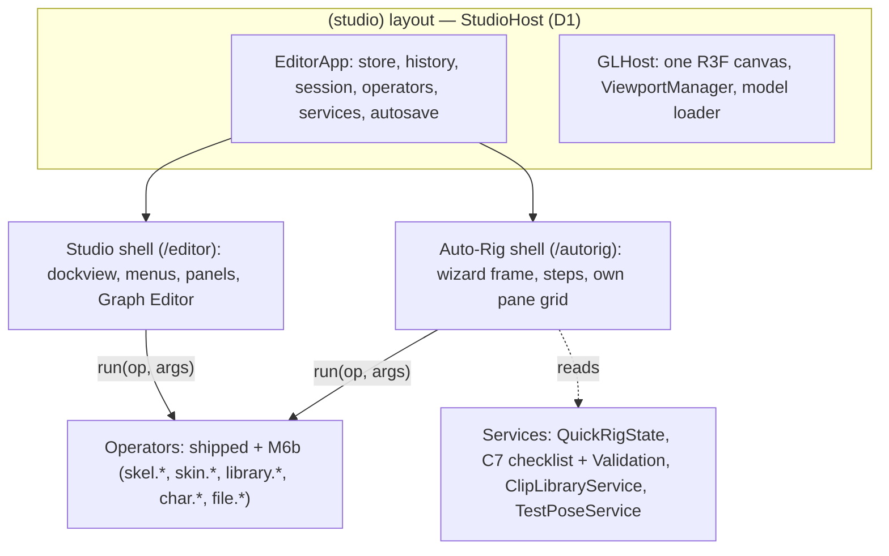
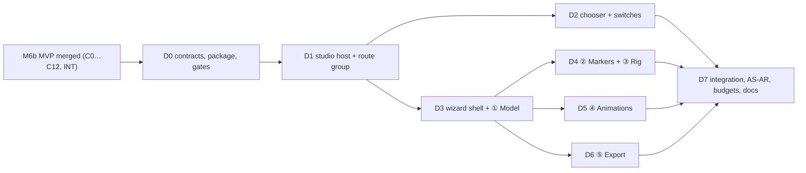

# Ekza Studio — Auto-Rig mode specification

Status: **v0.1 (2026-10-22), draft for the owner's review.** It becomes binding when the owner accepts it and
[ADR 0021](adr/0021-autorig-mode.md) moves to Accepted; the contract (§4) freezes when D0 merges, after which a
contract change needs a PR that updates this file first.

Owner request (2026-10-22, translated): *"Can we make a minimalist Studio interface so that on opening you choose
either the full interface or a simplified auto-rig built on the interfaces we already have — like Mixamo: just an
interface to rig, get a ready model, put animations on it, see it in motion, and e.g. prepare it for use in OMOBA.
Studio must become a universal combine."*

Inputs: [M6B-SPEC](M6B-SPEC.md) v1.3 **§0 MVP cut** (on branch `m6b/mvp` until the M6b MVP merges into `dev`; its
decision record is ADR 0020 on the same branch) and its §9.0 work packages C0…C12; [LAYOUT-PRESETS](LAYOUT-PRESETS.md);
the shipped shell (`packages/editor`: `EditorRoot`, `EditorShell`, `GLHost`, `PaneView`, `FirstRunDialog`, autosave
and recovery), the workspace switch (`editor-core/src/workspaces/`), the routes of `apps/web`; research
[05](research/05-landscape.md) (Mixamo, Cascadeur), [14](research/14-skinning-own-models.md),
[17](research/17-maya-rigging-basics.md), [19](research/19-rig-workspace-ui.md); OMOBA's runtime rules and local import
flow (`omoba-bevy`: `passport/src/humanoid.rs`, `docs/humanoid-motion.md`, `client/assets/avatars/manifest.json`; read
only); the market survey of §2.

Audience: the owner (§1, §3, §13), the Auto-Rig integration agent (D0, D7), the implementation agents of D1…D6 and
reviewers. Read M6B-SPEC §0 first: **Auto-Rig adds no rigging, skinning, clip or export logic of its own.** Every
document change it makes runs an operator that Studio already has (shipped, or built by the M6b MVP); Auto-Rig is a
second *shell* — a different, smaller user interface — over the same `EditorApp`, document, history and operators.

Normative words: **MUST**, **SHOULD**, **MAY**. Package ids `C0…C12`, `INT`, schema v4, `QuickRigState`,
`ChannelSource 'preview'`, `ClipLibraryService`, `ekza/space-avatar-v1`, the `vrm.*` lints and the Cube Lad are
M6B-SPEC §0 terms. `H` = the character's height. "Subject" = the one character (or the scene meshes that will become
it) the wizard works on.

Contents: [1 Goals and non-goals](#1-goals-and-non-goals) · [2 What others do](#2-what-others-do-market-survey) ·
[3 Entry: the chooser, routes and switching](#3-entry-the-chooser-routes-and-switching) ·
[4 Architecture and state model](#4-architecture-and-state-model) · [5 The wizard](#5-the-wizard) ·
[6 Edge cases and errors](#6-edge-cases-and-errors) · [7 Bundle, routes and budgets](#7-bundle-routes-and-budgets) ·
[8 Keyboard, accessibility, devices, language, privacy](#8-keyboard-accessibility-devices-language-privacy) ·
[9 Contract requests to M6b](#9-contract-requests-to-m6b) · [10 Work packages](#10-work-packages) ·
[11 Acceptance](#11-acceptance-scenarios) · [12 Defaults chosen](#12-defaults-chosen) ·
[13 Open owner questions](#13-open-owner-questions) · [14 Sources](#14-sources)

---

## 1. Goals and non-goals

### 1.1 Goals

| ID | Goal | Measure |
|---|---|---|
| FR-AR-01 | **Choose on opening**: the landing page offers *Auto-Rig* and *Studio*; the choice can be remembered and switched at any time | §3; AS-AR-8 |
| FR-AR-02 | **Mixamo-simple flow**: model → markers → rig → animations → export, five steps, one primary button per step | §5; AS-AR-1 |
| FR-AR-03 | **Rig a static humanoid** (GLB, or a model from Studio) with the M6b Quick Rig markers, One-Click guess, X symmetry and the front/side axis rule; skeleton detail (fingers) chosen on the markers step | §5.3 |
| FR-AR-04 | **Auto-rig in one click**: Create Skeleton + Bind Skin (auto-lowpoly) with a progress display, then the character **moves at once** (motion test) | §5.4 |
| FR-AR-05 | **Fix when needed**: adjust joints and paint weights with the M6b tools, without leaving the wizard | §5.4 |
| FR-AR-06 | **Animations grid**: search, preview on the character, Mixamo-style parameters (speed, trim, mirror, in place, arm space), add several clips to the character | §5.5 |
| FR-AR-07 | **Export** an OMOBA- and Space-ready VRM 1.0 with an in-browser checklist, a GLB with the clips, the clips as VRMA, and an OMOBA local test kit | §5.6 |
| FR-AR-08 | **One document**: "Open in Studio" continues with the full document (and, on the same page, with its undo history); Studio can send its model to Auto-Rig | §4.4 |
| FR-AR-09 | **Already rigged VRM → straight to animations** | §6 |
| FR-AR-10 | **Lighter route**: `/autorig` loads less code than `/editor` (gated) | §7 |
| FR-AR-11 | **Private**: nothing leaves the browser; no telemetry | §8.5 |
| FR-AR-12 | **Same bytes as Studio**: an export from Auto-Rig equals, byte for byte, the same export run from Studio on the same document | §11 AS-AR-3 |

The owner's sentence "Studio must become a universal combine" is served by the architecture rule: **one app, several
shells**. Auto-Rig is the first non-dockview shell; the rule makes the next ones (a "Pose & render" shell, an "AI
model → avatar" shell after M7) cheap, because they too only compose operators.

### 1.2 Non-goals (v1)

- No new rigging, skinning, retargeting or writing logic (that is M6b's and stays there).
- Non-humanoid rigs (quadrupeds, props with bones), asymmetric marker sets, facial expressions, spring bones, MToon
  authoring, look-at.
- FBX, OBJ, BLEND, ZIP inputs (FBX arrives with M2b, OBJ with M7 G2 — §6, Q-AR-3); retargeting user-supplied
  animation files other than VRMA.
- Decimation of heavy meshes (Q-AR-11), texture painting, UV editing.
- Server processing, accounts, cloud storage; "Publish to Hub" is specified (§5.6.5) but hidden until M4a T3 ships.
- Collaboration in Auto-Rig (the document is the same, so M3 applies later without Auto-Rig changes).
- Bundling or importing Mixamo files (their licence forbids redistribution; research 05).

---

## 2. What others do (market survey)

| Tool | Flow | Inputs / outputs | What we take | What we avoid |
|---|---|---|---|---|
| **Mixamo** (Adobe, web, maintenance mode) | Upload → orient (rotate buttons) → markers: chin, wrists, elbows, knees, groin, *Use Symmetry*, *Skeleton LOD* (full fingers … no fingers) → server auto-rig (≈ 1–2 min, progress) → review with a default motion → Animations: search grid, click to preview on the character, per-clip sliders (*Overdrive* = speed, *Character Arm-Space*, *Trim*) and checkboxes (*In Place*, *Mirror*) → Download dialog: format (FBX binary, FBX for Unity, DAE), skin with/without, fps, keyframe reduction | FBX/OBJ/ZIP in, FBX/DAE out; Adobe ID | the five-screen rhythm; markers with symmetry; skeleton LOD on the markers screen; instant motion review; the per-clip parameters incl. **arm space** (vital for blocky low-poly bodies); one download dialog | server dependency, account, opaque failures, FBX only, no fixing tools, unredistributable clips |
| **ActorCore AccuRIG** (Reallusion, desktop, free) | Import → *Rig Body* (auto markers, drag to adjust, symmetry) → *Rig Hand* (choose the finger count, hand markers) → preview with stock motions, *Pose Offset* sliders per body part → export (FBX/USD with target profiles; 2.0 also exports retargeted motion) | OBJ/FBX in; FBX/USD/iAvatar out | auto-placed markers the user only corrects; finger count as an explicit choice; per-target export profiles | desktop install; pose offsets that silently do not reach some exports |
| **Cascadeur** Quick Rigging Tool (desktop) | Rig mode → Quick Rigging Tool → template (Humanoid/Quadruped) → map joints onto a body diagram (tabs Body, Hands, Twists) → *Add rig elements* (controllers, symmetry axis, rigid-body weights) | its own scene | a body diagram that names what each point means; generated controls | mapping every joint by hand |
| **Tripo** / **Meshy** (AI generators, web) | Generate or upload → one-click server auto-rig (humanoid; Tripo also quadruped/creature; T- or A-pose recommended, non-standard bodies may fail) → preset motion library (Meshy ≈ 500+) → export animated GLB/FBX, in-place option | own models; GLB/FBX out; paid credits | "rig → it moves immediately"; library-first; in-place | credits per action, opaque failure, no manual correction |

**Lessons that bind this spec**: (L1) five to nine markers, pre-placed, are the right amount of user work; (L2)
symmetry on by default; (L3) the proof that rigging worked is the character moving within seconds; (L4) clip parameters
are applied *before* download and shown in the preview; (L5) export is one dialog with targets, not a menu of formats;
(L6) every tool fails on off-centre, lying-down, centimetre-scaled, A-posed and non-humanoid inputs — say so before the
markers, with a one-click fix where one exists; (L7) our edge is local, offline, open (MIT), VRM-native and fixable in
a full editor one click away.

---

## 3. Entry: the chooser, routes and switching

### 3.1 Routes

| Route | What | Notes |
|---|---|---|
| `/` | Landing with the **chooser** (two cards) and credits | static; a ≤ 1.5 kB client script applies the remembered choice (§3.3) |
| `/autorig` | Auto-Rig wizard | `?step=<model\|markers\|rig\|animations\|export>` opens that step when it is reachable (§4.3), else the furthest reachable one; `?sample=<cube-lad\|polybot-unrigged\|polybot\|seed-san>` loads a sample at the Model step; `?handoff=<slot>` (§4.4) |
| `/editor` | Studio (unchanged) | shipped `?ws=<workspace>`; new `?handoff=<slot>` |
| `/?chooser=1` | Landing without the remembered redirect | the "Switch mode" links use it |

Both app routes live in one Next route group `apps/web/app/(studio)/` whose layout hosts the shared `EditorApp`
(§4.4, D1); route groups do not change URLs, so every shipped link, test and deploy path stays valid.

### 3.2 The chooser (landing page)

```
┌──────────────────────────────────────────────────────────────────────────────┐
│ ◆ Ekza Studio                                         Credits · Source code  │
│                                                                              │
│   What do you want to do?                                                    │
│                                                                              │
│  ┌──────────────────────────────────┐  ┌──────────────────────────────────┐  │
│  │ ⟐  AUTO-RIG                      │  │ ▦  STUDIO                        │  │
│  │    Rig a character in minutes    │  │    The full 3D package           │  │
│  │                                  │  │                                  │  │
│  │  Upload a model, place a few     │  │  Model, rig & skin, animate with │  │
│  │  markers, get a skinned skeleton,│  │  the Graph Editor, export glTF,  │  │
│  │  try animations, export a VRM    │  │  VRM and VRMA. Maya-style keys   │  │
│  │  for OMOBA and Ekza Space.       │  │  and docked panels.              │  │
│  │                                  │  │                                  │  │
│  │  [ Start Auto-Rig  → ]           │  │  [ Open Studio  → ]              │  │
│  │  GLB · VRM · desktop and tablet  │  │  Best on a desktop               │  │
│  └──────────────────────────────────┘  └──────────────────────────────────┘  │
│                                                                              │
│   [✓] Remember my choice on this device   (switch any time from the app)     │
│                                                                              │
│   Everything runs in your browser. Your files are never uploaded.            │
└──────────────────────────────────────────────────────────────────────────────┘
```

- Cards are links (`<a href>`), so they work without JavaScript, open in new tabs and are keyboard-reachable; the
  primary action order is Auto-Rig first (the newcomer path), Studio second.
- Below 720 px the cards stack (Auto-Rig on top).
- The page keeps the credits and the third-party notice link of today's landing.

### 3.3 Remembered choice

- Storage: `localStorage['ekza-studio:entry:v1'] = {"choice": "autorig" | "studio", "at": <ms>}` (a new key; the
  shipped `ekza-animator:` keys keep their names, GLOSSARY). Written when a card is followed with *Remember* ticked,
  and by the in-app switches (§3.4) when the user ticks "Open this mode next time". Cleared by unticking it on the
  landing (`?chooser=1`) or by Preferences › General › *Start in: Ask / Auto-Rig / Studio*.
- `/` with a remembered choice and no `?chooser=1` replaces the location with `/autorig` or `/editor` (client script,
  `location.replace`, before first paint where possible; the chooser renders underneath so a blocked script still shows
  it). Every read/write is wrapped in `try`/`catch`; blocked storage means "Ask".
- Deep links (`/autorig`, `/editor`) never redirect.

### 3.4 Switching modes

| From | Control | Effect |
|---|---|---|
| Studio | **File › Auto-Rig This Model…** (enabled when the scene has meshes or a character) and **Help › Switch to Auto-Rig** | navigates to `/autorig?from=studio` keeping the document (§4.4); the subject is the selection (selected meshes or the active character), else all visible scene meshes, else the only character |
| Studio first-run dialog | third answer under "What do you want to do first?": **Auto-rig a character (simple mode)** | navigates to `/autorig` and sets the remembered choice only if the user ticks it |
| Auto-Rig | header **Open in Studio ▸** (every step) | navigates to `/editor?ws=<rig\|animate>` keeping the document; workspace by step: Model, Markers, Rig, Export → `rig`; Animations → `animate` |
| Auto-Rig | header `⋯` › **Switch mode…** | `/?chooser=1` |

---

## 4. Architecture and state model

### 4.1 One app, two shells



- **Auto-Rig is a shell, not a workspace and not a separate app.** Its steps drive the shipped workspaces (`rig`,
  `animate`) through `workspace.set`, the M6b modes through `rig.mode`, and draw their viewport panes with the shipped
  `PaneView` (a DOM surface registered with the `ViewportManager`; the shared canvas draws behind it), laid out in a CSS
  grid instead of dockview. Workspace switching is already headless (`editor-core/src/workspaces/switch.ts`); the
  Studio shell's dock layout reacts to `session.workspace`, the Auto-Rig shell ignores dock layouts and applies its own
  pane grid per step.
- **The rule (MUST)**: every document write from Auto-Rig is an `app.operators.run` of an operator registered for
  Studio (shipped or M6b) or of one of the few new operators of §4.5, which compose existing ones and are equally
  available to Studio, scripts and the MCP bridge. Auto-Rig code never writes the store, never calls a kernel solver
  (fit, bind, weights, retarget, writer) directly, and never re-implements a validation rule; a unit test (D7) greps
  `packages/autorig/src` for store writes and kernel imports.
- Viewport tools (M6b's Quick Rig markers tool, joint transform tools, Paint Skin Weights) are viewport tools bound to
  panes, so they work in Auto-Rig's panes unchanged (CR-AR-5 asks C3/C6 to keep it that way and to test it).

### 4.2 Step ↔ app state

| Step | Workspace | Rig mode / pose view | Pane grid (Auto-Rig) | Viewport tool | Session state used |
|---|---|---|---|---|---|
| ① Model | `rig` | Object | single persp | none (orbit) | — |
| ② Markers | `rig` | Object + Quick Rig session | **front │ side │ persp** (the M6b R-Markers proportions 40/30/30) | Quick Rig markers tool (C3) | `RigSessionState.quickRig` (C3) |
| ③ Rig | `rig` | Skeleton (*Adjust joints*) / Skin (*Paint weights*) / Object (review); pose view Bind/Test; `PREVIEW` while the motion test plays | persp (review, paint) / front │ side │ persp (adjust) | none / joint transform tools (C3) / Paint Skin Weights (C6) | `TestPoseService` (C7), library preview (C12) |
| ④ Animations | `animate` | — (Animate's `animate` source; `preview` priority, C0) | single persp + a compact time bar | none (orbit) | `ClipLibraryService.preview` (C12) |
| ⑤ Export | `rig` | Object, Bind | single persp (thumbnail camera on demand) | none | C7 Validation rows (profile `ekza/space-avatar-v1` or `local/generic`) |

Entering a step runs, in order: stop any library preview (`library.stop`), end any tool session (the shipped `Esc`
semantics), `workspace.set` when the workspace differs, `rig.mode` when the mode differs, then the step's own start
(e.g. `skel.quickRig.start` on ②). Leaving `rig` drops test poses from the history (M6B §5.17) — the same as in Studio.

### 4.3 Wizard state and progress

Auto-Rig keeps only **U state** (never in the document, never an undo step) in a shell-owned store:

```ts
// packages/autorig/src/types.ts (D0)
export type AutoRigStep = 'model' | 'markers' | 'rig' | 'animations' | 'export';
export interface AutoRigSubject {
  readonly character: CharacterId | null;      // set once a character exists (Create Skeleton, a VRM import)
  readonly meshes: readonly MeshId[];          // the scene meshes that will become it (before Create Skeleton)
}
export interface IntakeReport {                // §5.2; computed from the import result, pure
  readonly kind: 'static' | 'vrm' | 'rigged-humanoid' | 'rigged-other' | 'project';
  readonly fileName: string | null; readonly bytes: number | null;
  readonly meshes: number; readonly triangles: number; readonly textured: boolean;
  readonly height: number;                     // metres, world bounds
  readonly checks: { readonly centred: boolean; readonly grounded: boolean; readonly facing: boolean;
                     readonly upright: boolean; readonly scale: 'ok' | 'tiny' | 'huge' };
  readonly weight: 'light' | 'medium' | 'heavy' | 'too-heavy';   // §6.2 tiers
  readonly aPose: boolean | null;              // from guessMarkers when known
}
export interface ClipParams {                  // §5.5.3; identity = { speed: 1, trim: null, mirror: false, inPlace: false, armSpace: 0 }
  readonly speed: number;                      // 0.25 … 3
  readonly trim: { readonly start: number; readonly end: number } | null;   // seconds of the source clip
  readonly mirror: boolean;
  readonly inPlace: boolean;
  readonly armSpace: number;                   // degrees, −10 … +30 (upper-arm abduction offset)
}
export interface AutoRigSession {
  readonly step: AutoRigStep;
  readonly subject: AutoRigSubject;
  readonly intake: IntakeReport | null;
  readonly sub: 'review' | 'adjust' | 'paint';           // ③ sub-tool
  readonly motionTest: boolean;                           // ③ plays the motion test while true (default on)
  readonly draft: Readonly<Record<string, ClipParams>>;   // ④ parameters per library clip id, before Add
  readonly target: 'ekza-vrm' | 'glb' | 'vrma' | 'omoba-kit';   // ⑤
  readonly busy: { readonly stage: AutoRigStage; readonly fraction: number | null } | null;
}
export type AutoRigStage = 'import' | 'skeleton' | 'control-rig' | 'skin' | 'check' | 'export';
export interface AutoRigProgress {             // pure function of the document, the C7 checklist and the session
  readonly done: Readonly<Record<AutoRigStep, boolean>>;
  readonly reachable: Readonly<Record<AutoRigStep, boolean>>;
  readonly blocked: Readonly<Partial<Record<AutoRigStep, string>>>;   // why a step is not reachable
}
export function autoRigProgress(app: EditorApp, session: AutoRigSession): AutoRigProgress;
```

**Progress is derived, not stored** (so reloads, undo and Studio edits keep it right). It reads the M6b checklist (C7,
§0.4.5 ①…⑥, through CR-AR-4) for the subject character:

| Step | `done` when | `reachable` when |
|---|---|---|
| ① Model | the subject has meshes or a character | always |
| ② Markers | the subject character has a skeleton (checklist ①) | ① done and the subject is not asset-sourced |
| ③ Rig | every subject mesh is bound (③) and no `skel.*`/`skin.*` error (② and ④ without errors; warnings allowed) | ② done |
| ④ Animations | the character has at least one clip, or the user pressed *Skip* (session) | ③ done, or the subject is an asset-sourced humanoid |
| ⑤ Export | — (never "done"; a successful download shows a check on the card) | ④ reachable |

The stepper shows `✓` for done, the current step highlighted, unreachable steps dimmed with `blocked` as tooltip.
Clicking a reachable step jumps to it; jumping **never undoes** anything. *Back* is navigation only; going back to
② after ③ starts the M6b **re-run** (markers seeded from the joints, refit in place, `rebindSkin` confirm when bound,
M6B §0.4.2).

`?step=` and reload: the session store is mirrored to `sessionStorage['ekza-studio:autorig:v1']` (step, sub,
motionTest, draft, target; try/catch) so a reload in the same tab returns to the same step once the document is back
(§4.4).

### 4.4 One document: handoffs

**Same page (default, D1).** `/autorig` and `/editor` are siblings under the `(studio)` layout, whose client island
(`StudioHost`) creates the browser services, the `EditorApp`, autosave and the `GLHost` **once per page load**. Next
keeps a layout mounted across client navigations between its child routes, so *Open in Studio* / *Auto-Rig This
Model…* (Next `router.push`) swap only the page's shell: the document, the **undo history**, the selection, the
cameras, the autosave slot, the loaded chunks and the WebGL context all stay. Before the push the leaving shell stops
previews, ends tool sessions and closes its dialogs (§4.2 entry order); the arriving shell reads `session.workspace`
and the subject (`?from=studio` passes the Studio selection through the session, not the URL).

**New tab or reload (fallback).** A middle-click / *Open in new tab* on *Open in Studio* first runs
`file.autosaveNow` and opens `/editor?handoff=<slot>&ws=…`; a page started with `handoff=<slot>` recovers that slot
silently (`file.recover {slot}` with `markRecovered`, no Recovery dialog) and drops the parameter with
`history.replaceState`. The history does not travel across pages (documented in the toast: "Opened in Studio; undo
history starts here"). A plain reload of `/autorig` with an orphaned slot of this tab shows, on the Model step, the
card **Continue where you left off — "<name>", saved <time> [Continue] [Start over]** (`file.recover` /
`file.discardRecovery`), instead of Studio's Recovery dialog.

**Fallback if the shared layout fails its budget** (D1 decision gate, §7): two independent islands, every switch is a
same-tab navigation through the `handoff` slot (one autosave write, a page load, no undo history across). The rest of
this spec is unchanged by that fallback.

### 4.5 New operators (thin compositions; registered for every shell)

Each `autorig.*` id is a **composition**: it runs existing operators through `app.operators.run` and records no undo
step of its own; the undo steps are those of the operators it runs (listed per row).

| Id | Undo steps | What it runs | Owner |
|---|---|---|---|
| `autorig.intake {bytes, name}` | the inner import's one step | sniffs the file (§5.2 table) and runs **one** of `mesh.importStatic` (C1), `file.importModel` (shipped), `file.openProject` (shipped); returns the `IntakeReport` | D3 |
| `autorig.fix {fix}` | the inner operator's one step | `center` → `skel.quickRig.center` (C2); `face` → `skel.quickRig.faceForward` (C2); `standUp` → `scene.object.transform` (shipped) −90° about X around the bounds centre; `scale {height}` → `scene.object.transform` uniform scale to the height (default 1.70 m) about the ground point | D3 |
| `autorig.rig {preset}` | two: "Create Skeleton", "Bind Skin" | `skel.quickRig.commit {preset, markers, meshes, flexion}` (C2, "Create Skeleton"), then `skin.bind {}` with the M6b defaults (C4, "Bind Skin"); reports `busy` stages; stops after the first failure with its message | D4 |
| `autorig.clip.add {character, clip, params, replace?}` | Use Clip's one step | `library.useClip {character, clip, params, replace}` (C12 with CR-AR-2; `params.inPlace` sets the shipped `rootMotion: 'in-place'` inside Use Clip's transaction, as `loop` and `slot` are set there) | D5 |
| `autorig.export {target}` | none (download) | `file.exportCharacter` (C10) for `ekza-vrm` / `glb`; the shipped `file.export` VRMA path once per clip for `vrma` (zipped when more than one); `ekza-vrm` + the OMOBA kit packer for `omoba-kit` (§5.6.4) | D6 |
| `ui.navigate {route, newTab?}` | none (U) | asks the shell's navigation port (D1, `provideNavigation`) to switch shells (§4.4) | D1 |

Each is listed in the command palette in both shells (category `autorig`), so Studio users and the MCP bridge can run
the same flow headless.

---

## 5. The wizard

### 5.1 The frame

```
┌ ◆ Auto-Rig · Cube Lad ────────────────────────── ↶  ↷ │ Open in Studio ▸ │ ⋯ ┐
│  ✓ Model ─── ② Markers ─── ③ Rig ─── ④ Animations ─── ⑤ Export               │
├────────────────────────────────────────────────────────────────┬─────────────┤
│                                                                │             │
│                      VIEWPORT PANE GRID (per step)             │ STEP PANEL  │
│                                                                │ (≤ 320 px)  │
│                                                                │             │
├────────────────────────────────────────────────────────────────┴─────────────┤
│ ◂ Back       status / hint / problem line                      [ Primary ▸ ] │
└──────────────────────────────────────────────────────────────────────────────┘
```

- **Header**: product mark, subject name (click to rename: `char.setVrmMeta` name once a character exists, else
  `scene.rename`), Undo/Redo (shipped `edit.undo`/`edit.redo`; tooltip shows the step label), *Open in Studio ▸*,
  `⋯` menu: New (shipped `file.new` with its dirty confirm), Open project…, Save project (`file.save`), Switch mode…,
  Preferences (navigation profile only), Keyboard shortcuts, About & credits.
- **Stepper**: `<nav aria-label="Steps">` with `aria-current="step"` (§8.2).
- **Footer**: *Back*, one status line (the current problem in words, or a hint), **one primary button** per step.
- No menu bar, no status line of tool groups, no time slider except the compact one on ④, no dock panels, no command
  palette key (it is reachable from `⋯ › Command palette…` for power users), no marking menus.

### 5.2 ① Model

```
┌ ◆ Auto-Rig · untitled ────────────────────────── ↶  ↷ │ Open in Studio ▸ │ ⋯ ┐
│  ① Model ─── ② Markers ─── ③ Rig ─── ④ Animations ─── ⑤ Export               │
├────────────────────────────────────────────────────────────────┬─────────────┤
│                                                                │ YOUR MODEL  │
│        ┌ ─ ─ ─ ─ ─ ─ ─ ─ ─ ─ ─ ─ ─ ─ ─ ─ ─ ─ ─ ─ ─ ┐           │ cube-lad.glb│
│        ┆                                           ┆           │ 1 mesh      │
│        ┆   Drop a .glb or .vrm here                ┆           │ 312 tris    │
│        ┆   or [ Choose file… ]                     ┆           │ 1.70 m tall │
│        ┆                                           ┆           │ ✓ Centred   │
│        ┆   Try a sample:                           ┆           │ ✓ On ground │
│        ┆   [Cube Lad] [Polybot, no rig] [Seed-san] ┆           │ ✓ Faces +Z  │
│        ┆                                           ┆           │ ✓ Upright   │
│        ┆   ↺ Continue "Cube Lad" (3 min ago)       ┆           │ ✓ Size      │
│        └ ─ ─ ─ ─ ─ ─ ─ ─ ─ ─ ─ ─ ─ ─ ─ ─ ─ ─ ─ ─ ─ ┘           │             │
│          (after a load the drop zone shrinks to a strip        │ FROM STUDIO │
│           and the model shows here, orbitable)                 │ [Use these] │
├────────────────────────────────────────────────────────────────┴─────────────┤
│              GLB · VRM · stays in your browser            [ Next: Markers ▸ ]│
└──────────────────────────────────────────────────────────────────────────────┘
```

**Intake** (`autorig.intake`, D3). The file is sniffed by content (GLB magic, `extensions.VRM` / `VRMC_vrm`, skins,
VRMA `VRMC_vrm_animation`), not only by extension:

| Input | Detected | Route |
|---|---|---|
| `.glb` (or `.gltf` with embedded buffers, as the shipped importer accepts) without skins | `static` | `mesh.importStatic` → scene meshes = subject → ② |
| `.vrm` 0.x / 1.0 | `vrm` | shipped `file.importModel` → asset-sourced character → **④** (②/③ show "This avatar is already rigged. Rig and weight edits on imported avatars arrive later — Open in Studio to animate by hand.") |
| `.glb` with a skin whose bones the shipped importer maps to the VRM humanoid | `rigged-humanoid` | `file.importModel` → ④; ⑤ offers what Studio's export dialog offers for that character (§6.1) |
| `.glb` with a skin not mapped as humanoid | `rigged-other` | a choice: **Re-rig from scratch** (imports the meshes at their bind pose without the skeleton: `mesh.importStatic {dropSkin: true}`, CR-AR-6) → ②, or **Open in Studio** |
| `.ekzanim` | `project` | `file.openProject`; subject = the only character, else the scene meshes; a project with several characters asks which one |
| `.vrma` | animation | refused here: "This is an animation. Rig a model first, then add it in step 4." (④ accepts `.vrma`) |
| `.fbx`, `.obj`, `.blend`, `.zip`, other | unsupported | "Auto-Rig reads GLB and VRM. In Blender: File › Export › glTF 2.0 (.glb)." (Q-AR-3) |

A document that already holds content (a previous character) gets the shipped *New* confirm first ("Start a new
character? Unsaved work is kept in autosave"), then `file.new`; *From Studio* never replaces anything.

**Checks** (panel rows, each with its one-click fix as a button on the row): *Centred* and *On the ground* (`autorig.fix
center`), *Faces +Z* (`autorig.fix face`), *Upright* (bounds taller in Z than 1.5× Y, or the C2 facing probe sees no
feet band → `autorig.fix standUp`), *Size* (height < 0.3 m "tiny" or > 3 m "huge", e.g. a centimetre export →
`autorig.fix scale`, editable target height, default 1.70 m). The centred/grounded/facing rules are **C2's start
checks** called through CR-AR-3 (pure, exported), so ① and ② never disagree. *Next* is enabled when the subject exists;
failed checks do not block ① (② keeps Create Skeleton disabled until they pass, as M6b specifies) but the footer says
which fix to press.

**Samples**: `cube-lad` and `polybot-unrigged` (the M6b C0 fixtures `cube-lad.glb`, `polybot-unskinned-tpose.glb`,
copied to `public/samples/` by `copy-assets.mjs`, D3) load through `mesh.importStatic`; `seed-san` / `polybot` are the
shipped VRM samples (`file.loadSample`) and go to ④.

### 5.3 ② Markers

```
┌ ◆ Auto-Rig · Cube Lad ────────────────────────── ↶  ↷ │ Open in Studio ▸ │ ⋯ ┐
│  ✓ Model ─── ② Markers ─── ③ Rig ─── ④ Animations ─── ⑤ Export               │
├──────────────────────────┬───────────────────┬──────────────────┬────────────┤
│ FRONT · drag ↔ ↕         │ SIDE · depth ↕    │ 3D · orbit       │ MARKERS    │
│                          │                   │                  │ ● Head top │
│           ◉ head top     │        ◉          │       ┌─┐        │ ● Chin     │
│          ┌─┐             │       ┌─┐         │       └┬┘        │ ● Pelvis   │
│          └┬┘◉ chin       │       └┬┘◉        │   ●━━━━┿━━━━●    │ ● Shoulder │
│  ◉━━◉━━━◉━┿━○━━━○━━○     │        ◉ ◉◉◉      │        ┃         │ ▸ Elbow ✎  │
│  wr el  sh┆ (mirror)     │       (stacked:   │       ━╋━        │ ● Wrist    │
│           ◉ pelvis       │        list wins) │       ┃ ┃        │ ● Knee     │
│          ◉ ○ knee        │        ◉          │       ┃ ┃        │ ● Ankle    │
│          ◉ ○ ankle       │        ◉━◉ toe    │      ━┛ ┗━       │ ● Toe      │
│         ◉◉ ○○ toe        │                   │  live skeleton   │ [Guess]    │
│ ◉ marker  ○ mirrored     │                   │  preview         │────────────│
│                          │                   │                  │ FINGERS    │
│                          │                   │                  │ ○ None     │
│                          │                   │                  │ ● Thumb + 1│
│                          │                   │                  │ ○ All five │
├──────────────────────────┴───────────────────┴──────────────────┴────────────┤
│ ◂ Back   Elbow: pick it in the list, drag in SIDE for depth    [ Auto-rig ▸ ]│
└──────────────────────────────────────────────────────────────────────────────┘
```

Everything here is **M6B §0.2 steps 2–4 and §0.4.2**, presented differently:

- Entering runs `select.objects {subject meshes}` and `skel.quickRig.start` (C2/C3); the One-Click guess places the
  nine markers (head top, chin, pelvis; shoulder, elbow, wrist, knee, ankle, toe on the character's right, mirrored as
  ghosts). Markers, the guess, the axis rule (front edits x/y, side edits z/y, never the hidden axis), the pick rule
  (the list-selected marker wins on stacked markers; repeated clicks cycle), *Guess*, *Clear* + click-to-place and the
  live skeleton preview are C3's tool and C2's maths, unchanged. The marker list is C3's Quick Rig panel body
  (CR-AR-1), shown with friendlier labels and a body pictogram that highlights where the selected marker belongs
  (Cascadeur's diagram, L1).
- **Fingers** (skeleton detail, Mixamo's LOD): *None* → `core21`; *Thumb + 1* (mitten, the default) → `standard33`;
  *All five* → `full52`; `⋯ › Minimal skeleton (no shoulders, no toes)` → `lite17`. It runs `skel.quickRig.setPreset`
  (C3). On a re-run the select is locked to the skeleton's preset (M6b rule) with "Changing fingers rebuilds the
  skeleton — Start over" as the tooltip.
- **Symmetry** is always on in v1 (M6b's markers are mirrored by definition); the panel says so ("Left side mirrors the
  right") — asymmetric bodies are Q-AR-5.
- Notices from C2/C3 (start checks, guess failure, `aPose`) render in the panel with their M6b texts and fixes.
- **Auto-rig ▸** is enabled when the start checks pass; it runs `autorig.rig` (§4.5) and moves to ③.
- Keyboard placement (§8.1): arrow keys nudge the selected marker in the pane under the pointer (or the last used ortho
  pane) through `skel.quickRig.setMarker`, so the step is fully usable without dragging (WCAG 2.5.7).

### 5.4 ③ Rig

**Progress** (while `autorig.rig` runs; a modal sheet over the viewport, `aria-live="polite"`):

```
┌──────────────────────────────────────────┐
│  Rigging Cube Lad                        │
│  ✓ Skeleton — 34 joints (Standard 33)    │
│  ✓ Control rig — IK legs, FK arms        │
│  ▸ Skinning 312 points …   ████████░░ 80%│
│  ○ Checking                              │
│                               [ Cancel ] │
└──────────────────────────────────────────┘
```

Stages come from the operators: `skeleton` and `control-rig` from `skel.quickRig.commit` (C2, synchronous, one step),
`skin` from `skin.bind` in the skin worker (C4; fraction when CR-AR-2b lands, else indeterminate), `check` from the C7
Validation service. *Cancel* during `skin` aborts the worker job (C4's worker protocol) and leaves the skeleton (the
first undo step) in place, with "Skeleton created; skinning cancelled — [Bind again]".

**Review** (the default sub-tool after rigging):

```
┌ ◆ Auto-Rig · Cube Lad ────────────────────────── ↶  ↷ │ Open in Studio ▸ │ ⋯ ┐
│  ✓ Model ─── ✓ Markers ─── ③ Rig ─── ④ Animations ─── ⑤ Export               │
├────────────────────────────────────────────────────────────────┬─────────────┤
│  PREVIEW Walk                                                  │ CHECK IT    │
│                         ┌─┐                                    │ Motion test │
│                         └┬┘                                    │ ▶ ● on      │
│                      ╲━━━┿━━━╱                                 │ [Walk]      │
│                          ┃                                     │ [Sword]     │
│                         ╱ ╲                                    │ [Dance]     │
│                        ╱   ╲                                   │ [Range test]│
│                                                                │─────────────│
│                                                                │ FIX         │
│                                                                │ [Adjust     │
│                                                                │  joints]    │
│                                                                │ [Paint      │
│                                                                │  weights]   │
│                                                                │ ☐ Show      │
│                                                                │   weights   │
│                                                                │─────────────│
│                                                                │ ✓ All good  │
├────────────────────────────────────────────────────────────────┴─────────────┤
│ ◂ Markers   Looks wrong? Move markers, adjust or paint.     [ Animations ▸ ] │
└──────────────────────────────────────────────────────────────────────────────┘
```

- **Motion test** (the "instant ROM preview" of the request; L3): as soon as `check` ends, the character plays a loop
  through the **library preview** (`library.preview`, C12, channel source `preview`; no document write, no undo step).
  Buttons pick Walk, Sword attack, Dance (starter-pack clips) or **Range test** (§5.4.1). C12 stops the preview on any
  document change; while `motionTest` is on, Auto-Rig restarts it after the change commits (never during a gesture).
- **Adjust joints** (`sub: 'adjust'`): front │ side │ persp panes, `rig.mode {mode: 'skeleton'}`, Go to Bind Pose,
  the C3 joint tools with symmetry (`W` drag = joint + children, `D`+`W` = this joint only, `E` = rest rotation before
  binding). After a bind, rest edits keep the mesh (Move Skinned Joints, M6B §5.7); on **Done** Auto-Rig reruns
  `skin.bind` with the stored arguments when the weights are still automatic (C6 `skinDirty` false), otherwise asks
  with M6b's `rebindSkin` confirm ("Rebind replaces painted weights" — *Rebind* / *Keep my weights*).
- **Paint weights** (`sub: 'paint'`): `rig.mode {mode: 'skin'}`, persp pane, C6's Paint Skin Weights tool with a
  **reduced panel**: the influence list labelled by body part (*Left upper arm* …; click a joint glyph also picks),
  Replace / Add / Smooth, value, radius (`B` drag), *Mirror stroke* (on), *Flood*, *Mirror weights L→R* — every
  control is C6's (CR-AR-1). One stroke = one undo step. The weight display (greyscale) is C6's; **Show weights**
  toggles it in review too.
- **Back to markers** (footer *◂ Markers*) = the M6b re-run (refit in place, same joint ids, `rebindSkin` confirm).
- The panel's last row is the C7 Validation summary for `skel.*`/`skin.*` (errors block *Animations ▸* with the row's
  text and its Fix button; warnings are listed, not blocking).

#### 5.4.1 Range test clip

A procedurally generated range-of-motion clip in the VRM normalized frame, MIT, generated in memory (no file): the
pose list of M6B §5.17's deferred ROM clip (arms down / forward / up, elbows 0–140°, wrists ±60°, spine and neck ±40°,
legs forward / side / back, knees 0–130°, feet ±30°, finger curls when present; 4 frames per pose at 30 fps), as
`HumanoidClipData`, previewed through C12's preview path with an in-memory source (CR-AR-2c). It is never written to
the document. When M6b's post-MVP `skin.test.rom` is built it SHOULD read the same pose table
(`io/src/library/rom.ts`, D5) so there is one definition. Optional in v1 (D5 stretch; Q-AR-7).

### 5.5 ④ Animations

```
┌ ◆ Auto-Rig · Cube Lad ────────────────────────── ↶  ↷ │ Open in Studio ▸ │ ⋯ ┐
│  ✓ Model ─── ✓ Markers ─── ✓ Rig ─── ④ Animations ─── ⑤ Export               │
├─────────────────────────┬────────────────────────────────────┬───────────────┤
│ ⌕ search…               │                                    │ ON CUBE LAD   │
│ All Move Combat React   │ PREVIEW Walk  ×1.0                 │ ▶ Walk   walk │
│                         │                                    │   ×1.0  ✎ ✕   │
│ [▶ Walk   ↻ 1.3 s]      │           ┌─┐                      │ ▶ Sword  atk  │
│ [  Idle   ↻ 2.0 s]      │           └┬┘                      │   ×1.2  ✎ ✕   │
│ [  Run    ↻ 0.7 s]      │         ╲━━┿━━╱                    │               │
│ [  Jog    ↻ 0.8 s]      │            ┃                       │ Drop a .vrma  │
│ [  Sword attack   ]     │           ╱ ╲                      │ to add yours  │
│ [  Punch          ]     │                                    │               │
│ [  Cast           ]     │ ▶ ❚❚ 0:00.6 ━━━━●━━━━ 1.3 s        │ OMOBA uses    │
│   …14 clips             │ Speed [━━━━●━━━] 1.0×              │ its own       │
│   CC0 · Quaternius      │ Trim  [●━━━━━━●] 0.0–1.3 s         │ motions; your │
│                         │ Arms  [━━●━━━━━] 0°                │ clips play in │
│                         │ ☐ Mirror   ☐ In place              │ Space and GLB │
│                         │       [ + Add to character ]       │               │
├─────────────────────────┴────────────────────────────────────┴───────────────┤
│ ◂ Rig        2 animations on Cube Lad                            [ Export ▸ ]│
└──────────────────────────────────────────────────────────────────────────────┘
```

#### 5.5.1 Grid and search

- Source: C12's `ClipLibraryService.manifest()` (fetched on first entry; clip bytes on first preview, checksum
  verified — C12 rules). Cards: label, duration, loop glyph ↻, slot chip; a failed checksum disables the card with
  C12's message.
- Search: case-insensitive substring over label, id and source name, plus a small synonym table in Auto-Rig data
  (`attack → sword, punch`, `stand → idle`, `shoot → pistol`, …; i18n-ready). Filter chips map clip ids to categories
  from an Auto-Rig data table (Move: idle, walk, run, jog, jump-*; Combat: sword-attack, punch, cast, pistol-shoot;
  React: hit, death; Fun: dance); unknown ids fall into "Other", so a manifest that grows never breaks the grid.
- No per-card animated thumbnails in v1 (the main viewport is the preview, as Mixamo's is).

#### 5.5.2 Preview

- Click (or `Enter` on a focused card) = `library.preview {character, clip, params: draft[clip] ?? identity}`; the
  viewport badge shows `PREVIEW <label>` (C12) and the transport row plays/pauses the preview clock; `Space` toggles,
  `Esc` stops. Hover never auto-plays (keeps the GPU idle; respects reduced motion).
- Rows under **On <character>** are document clips: ▶ plays them through the shipped path (`clip.setActive`,
  `time.setLoop`, `time.play` in `animate`), which also proves that what was added is what was previewed.

#### 5.5.3 Parameters (Mixamo's, applied before adding — L4)

| Param | Range | Applied by | Notes |
|---|---|---|---|
| Speed | 0.25–3×, step 0.05 | `applyClipParams` (io, D5): sample times ÷ speed | Mixamo "Overdrive" |
| Trim | start/end within the source duration | `applyClipParams`: keeps samples in the window, re-zeroes time | loop clips keep `loop` only when the trim is the full clip |
| Arm space | −10…+30° | `applyClipParams`: adds the angle to `leftUpperArm`/`rightUpperArm` abduction (mirror-signed) on every sample | Mixamo "Character Arm-Space"; stops blocky arms cutting the torso |
| Mirror | on/off | `applyClipParams`: swaps left/right humanoid bones and reflects across the YZ plane (`q → (x, −y, −z, w)`, hips `x → −x`) | a D5 test asserts equality (≤ 1e-4 rad) with the shipped `pose.mirrorAnimation` run on the added clip |
| In place | on/off | the shipped clip setting `rootMotion: 'in-place'` (exports remove the X/Z travel, `io/src/bake/bake.ts`); the preview removes the travel with the **same** helper, exported from `bake.ts` by D5 (no behaviour change) | Mixamo "In Place" |

`applyClipParams(data: HumanoidClipData, params: ClipParams): HumanoidClipData` is pure and deterministic; identity
params return the input unchanged (same object), so C12's existing tests and the Use-Clip equality stay bit-equal.

#### 5.5.4 Adding, editing, removing

- **+ Add to character** = `autorig.clip.add {character, clip, params}` → C12's Use Clip (one undo step; name = label,
  `loop`, `slot` when free, CC0 Quaternius provenance) with the params applied, with `rootMotion: 'in-place'` when *In place*. The
  params are recorded on the clip as tags in the shipped `ClipRecord.tags` vocabulary (`[a-z0-9_-]`, ≤ 8 tags):
  `ar-<library id>`, `ar-speed-<percent>`, `ar-trim-<startMs>-<endMs>`, `ar-mirror`, `ar-inplace`, `ar-arms-<deg>`
  (`m` for minus) — no schema change — so ✎ can reopen them.
- ✎ on a row loads the clip's library id and params into the editor above; *Update* runs `autorig.clip.add {…,
  replace: clipId}` (one step: the old clip deleted, the new one added, keeping the clip's name and slot).
- 🗑 = shipped `clip.delete`.
- Slot chips: click to choose the slot from the Ekza slot vocabulary through the shipped clip settings operator.
- Dropping `.vrma` files on the step = shipped `file.importAnimation` onto the subject.
- **Export ▸** is enabled with zero clips (OMOBA needs none); the footer says "No animations — the VRM still works in
  OMOBA, which plays its own".

### 5.6 ⑤ Export

```
┌ ◆ Auto-Rig · Cube Lad ────────────────────────── ↶  ↷ │ Open in Studio ▸ │ ⋯ ┐
│  ✓ Model ─── ✓ Markers ─── ✓ Rig ─── ✓ Animations ─── ⑤ Export               │
├──────────────────────────────────────────┬───────────────────────────────────┤
│ GET YOUR CHARACTER                       │ READY FOR OMOBA AND EKZA SPACE    │
│ ● Ekza avatar · VRM 1.0  (recommended)   │ ✓ VRM 1.0 humanoid                │
│   One file for OMOBA and Ekza Space      │ ✓ All 15 required bones           │
│ ○ GLB with animations                    │ ✓ 34 of 64 bones                  │
│   For Unity, Godot, Blender, three.js    │ ✓ Standard bone parents           │
│ ○ Animations only (.vrma)                │ ✓ T-pose rest                     │
│   2 clips → cube-lad-animations.zip      │ ✓ Plain transforms, even scale    │
│ ▸ For developers                         │ ✓ File 0.4 / 50 MiB · JSON 61 KiB │
│   ○ OMOBA local test kit (.zip)          │ ✓ 412 / 4,096 nodes               │
│───────────────────────────────────────── │ ✓ Allowed extensions only         │
│ ABOUT THIS AVATAR (saved in the file)    │ ✓ Licence and author set          │
│ Name    [Cube Lad            ]           │ ✓ Thumbnail                       │
│ Author  [Tester              ]           │                                   │
│ Licence [Open — CC0        ▾]            │ OMOBA plays its own motion library│
│ Thumbnail [■] [Render again]             │ on your VRM; your clips play in   │
│                                          │ Space.                            │
├──────────────────────────────────────────┴───────────────────────────────────┤
│ ◂ Animations     cube-lad.vrm · 0.4 MiB                       [ Download ▸ ] │
└──────────────────────────────────────────────────────────────────────────────┘
```

#### 5.6.1 Targets

| Target | Runs | File | Gate |
|---|---|---|---|
| **Ekza avatar · VRM 1.0** (default) | `file.exportCharacter {profile: 'ekza/space-avatar-v1', format: 'vrm', clips: 'slots'}` (C10) | `<name>.vrm` | the profile's error rows (C7 Validation, incl. every `vrm.*` lint = OMOBA's runtime rules) |
| **GLB with animations** | `file.exportCharacter {profile: 'local/generic', format: 'glb', clips: 'all'}` (C10) | `<name>.glb` | `local/generic` errors |
| **Animations only** | the shipped VRMA export (`file.export`, VRMA route) once per clip of the character | one `.vrma`, or `<name>-animations.zip` (fflate from the shipped project-archive chunk) | VRMA lints |
| **OMOBA local test kit** (under *For developers*) | the VRM target, then the kit packer (§5.6.4) | `<slug>-omoba-kit.zip` | the VRM gate |

For asset-sourced characters (an uploaded VRM), the targets are what Studio's Export dialog offers for them (the
shipped asset-bake profiles; `ekza/space-avatar-v1` keeps passing for VRM 0.x per M6B §0.4.6). A target that is not
available is not shown.

#### 5.6.2 The checklist

The right column is the **C7 Validation rows** of the chosen profile, rendered as plain sentences by an Auto-Rig label
table keyed by rule id (`vrm.required-bones` → "All 15 required bones", `vrm.glb-size` → "File x / 50 MiB",
`skel.tpose` → "T-pose rest", …). Unknown rule ids render with their own message, so a new lint is never hidden.
Errors are red with the row's Fix button (C7) when it has one, and they disable *Download*; warnings are amber and do
not. The numbers (size, JSON size, node and bone counts) are measured on the bytes C10 would write (C10's dry-run /
lint path; nothing is downloaded until *Download*).

#### 5.6.3 Metadata

Name, author, licence preset ("Open — CC0" first) and the thumbnail are C10's VRM Meta fields (`char.setVrmMeta`, one
undo step per committed edit; `char.renderThumbnail`); Auto-Rig prefills the author from the last export
(preference) and renders the thumbnail automatically on first entry when none exists.

#### 5.6.4 OMOBA local test kit

For developers who run OMOBA locally (its `OMOBA_AVATAR_MANIFEST` flow; `omoba-bevy/docs/humanoid-motion.md`): a zip
with `<slug>.glb` (the VRM bytes unchanged — OMOBA's local flow copies a valid VRM container to a `.glb` path),
`<slug>.png` (the thumbnail), `manifest-entry.json` (`{author, collection: "Ekza Studio", display_name, license, slug,
source_url: null, thumbnail}` — the fields of `client/assets/avatars/manifest.json`) and `README.txt` with the
`validate-runtime-vrm` command and the note that runtime compatibility is not approval. `slug` = the name in
`[a-z0-9-]`. Auto-Rig never touches an OMOBA checkout. Thumbnail format and exposure: Q-AR-8.

#### 5.6.5 Publish to Ekza Hub (later)

Placement reserved: a second primary button **Publish to Ekza Hub ▸** next to *Download* for the VRM target. It
appears only when the M4a T3 slice (TODO item 13: the `studio-upload` scope) is built and the user is signed in to
the Hub; it uploads the same bytes *Download* would save to `hub.ekza.io` (Hub → rendition builder bakes the five
clips → curator review → submit to OMOBA). Until then it is **absent** (M6b's rule: deferred UI is absent, not
disabled), and the export step says "Upload this file to Ekza Hub to use it in OMOBA online".

#### 5.6.6 Continue in Studio

Under the targets: "Want to keyframe your own motion? **Continue in Studio ▸**" (`ui.navigate`, workspace `animate`).

---

## 6. Edge cases and errors

### 6.1 Model kinds

| Case | Detection | Behaviour |
|---|---|---|
| Non-humanoid (prop, quadruped) | C2's `guessMarkers` returns null (no leg split or arm run) | markers placed from template proportions with C2's message, plus Auto-Rig's: "This does not look like a person standing. Auto-Rig makes humanoid (VRM) skeletons. You can still place the markers by hand." Auto-rig stays possible; ⑤'s checks decide |
| A-posed arms | `guess.aPose` (C2, arm angle > 15°) | C2's notice; the skeleton follows the arms; ⑤ blocks the Ekza VRM target with `skel.tpose` ("Straighten the arms in Studio's Model workspace, then Back to markers") and still allows GLB/VRMA (`local/generic` warns). Pulling M6b's deferred A-pose path forward is Q-AR-4 |
| Several meshes (body, hair, sword …) | `IntakeReport.meshes > 1` | the Model panel lists them with checkboxes *Part of the character* (default: all visible meshes); unticked ones are hidden (`view.hide`) and left out of `subject.meshes`, so `char.fromModel` adopts only the ticked ones. A mesh whose bounds lie outside the body's (a weapon on the floor) is unticked by default with "Looks separate" |
| Already-rigged VRM | `kind: 'vrm'` | straight to ④ (FR-AR-09); ②/③ show the already-rigged notice (C11 is deferred) |
| Rigged non-VRM humanoid GLB | `kind: 'rigged-humanoid'` | ④; ⑤ shows the targets Studio offers for it |
| Rigged GLB, unknown skeleton | `kind: 'rigged-other'` | *Re-rig from scratch* (CR-AR-6) or *Open in Studio* |
| Skinned mesh selected from Studio | C1 refuses skinned meshes in `char.fromModel` | the Model step offers *Re-rig from scratch* only for imported assets; for Studio meshes it shows C1's message |
| Off-centre, lying down, wrong facing, centimetres | §5.2 checks | one-click fixes on ① (same functions as C2's start checks) |
| Non-uniform or negative object scale | C1's refusal "Freeze Transformations first" | the row offers **Freeze** = shipped `mesh.freezeTransforms` |
| Open meshes, holes, non-manifold | C4 binds anyway (visibility rules); `skin.unreachable-island` etc. | ③ lists C7's rows with their Fix buttons |
| Textured models (AI generators) | `IntakeReport.textured` | textures stay asset materials (C1 adoption keeps them); a D7 acceptance case checks they reach the VRM (AS-AR-6); if C10 does not carry them, that is a C10 bug, not an Auto-Rig workaround |
| A file over the shipped input budget (`io` `DEFAULT_INPUT_BUDGET`) | intake error | the shipped message, plus the conversion hint |

### 6.2 Heavy meshes

| Tier | Triangles (all subject meshes) | Behaviour |
|---|---|---|
| light | ≤ 20,000 | normal |
| medium | 20,001–60,000 | ① notes "Detailed model: rigging takes a few seconds"; ③'s progress shows the fraction |
| heavy | 60,001–200,000 | ① warns "Very detailed model (N triangles). Rigging may take a minute and painting may lag; phones may run out of memory. OMOBA files must stay under 50 MiB." *Next* asks once to confirm |
| too-heavy | > 200,000 (`MAKE_EDITABLE_MAX_TRIANGLES`) | refused: "Reduce it to under 200,000 triangles (Blender: Decimate modifier) and try again." In-browser decimation is Q-AR-11 |

The tiers are report thresholds, not new limits: the hard limit is io's. The bind runs in C4's worker, so the page stays
responsive; *Cancel* works in every tier.

### 6.3 Failures

- An operator failure shows its message in the footer status line and as a toast; the step stays; nothing is half
  applied (operators are transactional).
- WebGL unavailable or lost: the shipped `KernelUnavailable` / context-lost handling; Auto-Rig shows "Auto-Rig needs
  3D graphics (WebGL 2)".
- Storage blocked: autosave off (shipped toast); the remembered choice falls back to "Ask"; the session mirror is
  skipped.
- The library manifest unreachable (offline first visit): ④ says "Animations could not be loaded — check the
  connection" with *Retry*; ⑤ still works (VRM needs no clips).

---

## 7. Bundle, routes and budgets

### 7.1 What `/autorig` loads

The M2a attribution of `/editor` (M2A-INT-4, gzip) is three 174.4 kB, next 127.4, dockview 82.9, editor-core 75.4,
editor 74.8 (panels 48.9), R3F 52.7, rig 39.4, curve-editor 28.7, viewport 28.5, doc 19.7, io 13.5, anim-core 13.2,
camera-controls 9.5 (M6a then raised the route to ≈ 869–890 kB). `/autorig`'s initial route drops dockview, the
curve editor (Graph Editor, Dope Sheet), the panel registry, the menu bar, the command palette, the marking menu and
the first-run dialog, and adds the wizard frame and the ① step:

| Part | Estimate (gzip) |
|---|---|
| three + R3F + camera-controls | ≈ 237 kB |
| next runtime | ≈ 127 kB |
| editor-core (operators are registered eagerly, as in `/editor`) | ≈ 80 kB |
| rig + viewport + doc + io + anim-core + ui | ≈ 125 kB |
| host part of `editor` (services, GL host, input, autosave, toasts, dialog host) | ≈ 25 kB |
| `autorig` frame + ① + i18n table | ≈ 25 kB |
| **Total** | **≈ 620 kB** (vs ≈ 890 kB) |

### 7.2 Gates (D0 lands them in `check:size`; D1 measures and records the baseline)

- `/autorig` first-visit route **≤ 660,000 B** gzip (gate), target 620,000 B (report); recorded in
  `size-baseline.json` under `autorig`.
- `/editor` stays under its shipped **900,000 B** gate; D1's route-group move may add at most **+2,048 B** (the layout
  split costs gzip restarts; D1 reports the attribution). If D1 cannot meet it, D1 takes the two-island fallback of
  §4.4 and records the decision.
- **Autorig BOUNDARIES** (markers that must not appear in `/autorig`'s initial scripts): every shipped lazy boundary,
  plus `dockview` (a dockview-only string), `curve-editor` (Graph Editor/Dope Sheet markers), `model-operators`,
  `command-palette`, `marking-menu`, `dialog-first-run`, `studio-shell` (a marker string only the Studio shell
  contains), and the M6b chunks `ekza-rig-workspace`, `ekza-skin-worker`, `ekza-character-runtime`,
  `ekza-clip-library`, which load per step.
- Per-step lazy loads (report): ② = mesh kernel + mesh view + `rig-workspace`; ③ = `skin-worker` +
  `character-runtime`; ④ = `clip-library` + import path; ⑤ = export path. A D7 bench records the bytes fetched over
  AS-AR-1 and asserts **dockview is never fetched** on `/autorig` (until *Open in Studio*).
- `check-size.mjs` gains a `--route` loop (both routes) using `readRouteScripts(nextDir, 'autorig')`; route groups do
  not change the prerendered paths (`server/app/editor.html`, `server/app/autorig.html`).

### 7.3 Runtime budgets (reference machine; report-only unless marked)

| Scenario | Budget |
|---|---|
| `/autorig` first visit to an interactive ① | ≤ 1.5 s |
| ② first entry (chunks + guess) on the Cube Lad | ≤ 1.0 s |
| *Auto-rig* (commit + bind) on the Cube Lad / a 10k-triangle body | ≤ 1.0 s / ≤ 2.5 s |
| First motion-test frame after rigging | ≤ 300 ms after `check` |
| Idle in every step with no preview playing | **0 WebGL frames over 2 s (gate, E2E-AR-10)** |
| Export of the Cube Lad VRM | ≤ 500 ms (C10's budget) |

---

## 8. Keyboard, accessibility, devices, language, privacy

### 8.1 Keyboard (key scope `autorig`; the Maya preset's rig keys inside steps where they apply)

| Keys | Where | Action |
|---|---|---|
| `Mod+Z` / `Mod+Shift+Z` | everywhere | undo / redo (shipped) |
| `Mod+Enter` | everywhere (not in text fields) | the step's primary button |
| `Alt+1`…`Alt+5` | everywhere | go to step 1…5 when reachable (Auto-Rig has no layout presets; the browser default is prevented as in Studio) |
| `Esc` | everywhere | stop the preview / cancel the gesture / close the sheet (never leaves the step) |
| `F` | panes | frame the subject |
| `↑ ↓` | ② marker list | select marker |
| arrows / `Shift`+arrows | ② pane focus | nudge the selected marker 1 cm / 1 mm in the pane's two axes (`skel.quickRig.setMarker`) |
| `G` | ② | Guess again (`skel.quickRig.guess`) |
| `W`, `D`+`W`, `E` | ③ Adjust | M6b joint tools (C3) |
| `B` drag, `Ctrl`-click | ③ Paint | brush radius, sample (C6 keys) |
| `/` | ④ | focus the search |
| `Enter` / `A` | ④ focused card | preview / add |
| `Space` | ④, ③ review | play / pause the preview (in Auto-Rig `Space` never maximizes panes) |
| `Shift+F` | everywhere | browser full screen (shipped) |

Navigation in panes uses the **Simple** profile (D3): in the persp pane a left drag on empty space orbits, a right or
two-finger drag pans, wheel / pinch zooms; a tool that claims the press (marker, joint, brush on the mesh) wins.
`Alt` + mouse (Maya) keeps working. Ortho panes never orbit. The profile is added to `NavProfile` as `'simple'` and is
also selectable in Studio's Preferences.

### 8.2 Accessibility (target: WCAG 2.2 AA for the wizard chrome)

- Landmarks: `header`, `nav` (stepper, `aria-current="step"`), `main` (panes + step panel), `footer`; one `h1` (the
  step title, visually in the stepper).
- Every pointer action has a keyboard path (markers by list + nudge, joints by list + numeric fields in *Adjust*,
  clips by roving-tabindex grid, export by radio group). Dragging is never the only way (2.5.7).
- Viewport content has text equivalents: marker coordinates in the list (cm), "34 joints — fingers: thumb + 1",
  progress stages, the export checklist.
- Live regions: progress (`polite`), errors (`assertive`), "Added Walk".
- Markers differ by shape (filled = placed, ring = mirrored ghost, square = selected) and colour; colour is never the
  only signal. Contrast via `packages/ui` tokens and the CI contrast check (new rows for Auto-Rig tokens).
- `prefers-reduced-motion`: no auto-play of the motion test (a *Play motion test* button instead), no animated
  transitions.
- Focus is moved to the step heading on step change; the progress sheet traps focus with *Cancel* reachable.

### 8.3 Devices

| Class | Support |
|---|---|
| Desktop / laptop (≥ 1024 px, mouse or trackpad) | full |
| Tablet landscape (≥ 1024 × 700, touch or pencil) | full; touch targets ≥ 44 px; markers drag with one finger in ortho panes, two fingers pan/zoom; paint with pencil or finger |
| Tablet portrait / small laptop (700–1023 px) | full; step panel becomes a bottom sheet; ② shows two panes (front │ side) with a 3D toggle |
| Phone (< 700 px) | ①, ④, ⑤ full; ② one pane at a time with a **Front │ Side │ 3D** segmented switch and the marker list as a bottom sheet; ③ review and adjust; *Paint weights* shows "Painting needs a larger screen" (Q-AR-10) |

```
┌ Auto-Rig · Cube Lad  ⋯ ┐
│ ✓ ② ③ ④ ⑤  Markers     │
│ [Front][Side][ 3D ]    │
│                        │
│        ◉               │
│       ┌─┐              │
│  ◉━◉━━┿━━○━○           │
│       ◉                │
│      ◉ ○               │
│     ◉◉ ○○              │
├────────────────────────┤
│ ▸ Elbow   ↕ drag  ⋯    │  ← bottom sheet (list)
├────────────────────────┤
│ ◂            Auto-rig ▸│
└────────────────────────┘
```

### 8.4 Language

v1 ships **English**. Every Auto-Rig string lives in one typed message table (`packages/autorig/src/i18n/en.ts`,
keys, no runtime library; numbers and units through `Intl.NumberFormat`); components never inline user-visible text.
Adding `ru` or `zh` is a new table plus the `?lang=` / `navigator.language` pick (Q-AR-9). Strings coming from M6b
operators and lints are English in v1; their localisation is a Studio-wide decision, not Auto-Rig's.

### 8.5 Privacy (telemetry-free)

- No analytics, no error reporting service, no beacons, no third-party requests. Network = same-origin static files
  only: `/_next/static/**`, `/decoders/**`, `/samples/**`, `/library/**`.
- User files never leave the browser; autosave stays in this browser's IndexedDB (shipped).
- E2E-AR-11 records every request during AS-AR-1 and fails on any non-same-origin URL or any `POST`.
- *Publish to Hub* (later) is the only egress, explicit, after sign-in.

---

## 9. Contract requests to M6b

M6b is being built now; these are cheap if C0/C3/C4/C6/C7/C12 take them during the build, and each has a fallback
that a D package performs after the M6b MVP merges (owned edits listed in §10). None changes M6b behaviour.

| ID | To | Request | Fallback (owner) |
|---|---|---|---|
| CR-AR-1 | C3, C6, C10, C12 | Export each panel's **body** as a host-agnostic component (props: `app`, optional `compact`), no `dockview-react` import outside `editor/src/shell/**`: `QuickRigPanelBody` (C3), `PaintWeightsControls` (C6), `ClipCardList` (C12), `VrmMetaFields` and `CharacterChecks` (C10/C7) | D4/D5/D6 render their own UI over the same session state and operators (UI only; no logic) |
| CR-AR-2 | C12 | `library.preview` and `library.useClip` accept optional `params: ClipParams` (identity by default; the transform is `applyClipParams`, D5, and `inPlace` sets `rootMotion`) and `useClip` an optional `replace: ClipId`; **(b)** C4: `skin.bind` reports progress (`session.busy` with `fraction` and a stage label) and is abortable; **(c)** C12: the preview accepts an in-memory `HumanoidClipData` source (for the range test) | D5 edits C12's `library.ts`, `editor-core/src/library/**`, `evaluation/previewSource.ts`; D4 shows an indeterminate bar |
| CR-AR-3 | C2 | export the Quick Rig start checks as a pure function `quickRigStartChecks(meshes, bvh)` → `{centred, grounded, facing}` (the one `skel.quickRig.start` uses) | D3 calls `skel.quickRig.start` + `cancel` to read `QuickRigState.checks` (U state, no step) |
| CR-AR-4 | C7 | export the checklist evaluation `rigChecklist(app, character)` and keep the Validation service usable without the Rig Toolkit panel mounted | D3 adds the export in C7's files |
| CR-AR-5 | C3, C6 | the markers tool, joint tools and Paint Skin Weights work in any registered `PaneView` (no dockview assumptions); the R-Markers pane ids are exported constants; one browser test mounts them in a plain grid | D4 fixes what fails |
| CR-AR-6 | C1 | `mesh.importStatic {bytes, name, dropSkin?: boolean}`: with `dropSkin` a skinned file imports its meshes at the bind pose (skin and skeleton ignored) instead of refusing | D3 adds the argument in C1's operator file |

---

## 10. Work packages

### 10.0 Branches and order

Auto-Rig starts **after the M6b MVP merges into `dev`** (M6B §0.7 definition of done). Integration branch
`autorig/mvp` from `dev`; each package branches `autorig/<slug>` from `autorig/mvp` when its dependsOn packages have
merged there, works only in its **Dirs**, lands its e2e scenarios, and merges back with `pnpm run ci` green (local
Chrome for e2e; the local gate, not GitHub CI). D7 merges `autorig/mvp` into `dev` last. The shared-file rule of M6B
§9.1 applies: a path not listed belongs to nobody and needs D7's approval.



| ID | Slug | Size (agent-days) | dependsOn | Uses M6b packages |
|---|---|---|---|---|
| D0 | `contracts` | 1.5 | M6b INT | C0 (types) |
| D1 | `studio-host` | 4 | D0 | — (shell refactor; C7's layouts untouched) |
| D2 | `entry-chooser` | 1.5 | D1 | — |
| D3 | `wizard-shell` | 5 | D1 | C1, C2, C7 |
| D4 | `rig-steps` | 5 | D3 | C2, C3, C4, C6, C7, C12 |
| D5 | `animations` | 4.5 | D3 | C1, C12 |
| D6 | `export` | 4 | D3 | C7, C10, C12 |
| D7 | `integration` | 3 (+ fix round ≈ 2) | D2, D4, D5, D6 | all |

**Total ≈ 30.5 agent-days**; critical path D0 → D1 → D3 → D4 → D7 ≈ 20.5 working days; at most three packages run
at once (D4, D5, D6). The D1 spike (route group + shared layout, size measure) MAY run read-only on `m6b/mvp` before
the merge to de-risk §4.4.

### D0 — `contracts` (Auto-Rig integration agent; first)

- **Dirs**: `packages/autorig/{package.json,tsconfig.json}`, `packages/autorig/src/{index.ts,types.ts}` (§4.3 types),
  stubs `packages/autorig/src/{shell,steps/*,i18n,progress,session}/index.ts`; `pnpm-workspace` / `tsconfig.json`
  references and `apps/web/next.config.ts` `transpilePackages` line; `editor-core/src/types.ts` additive lines
  (`NavProfile` + `'simple'`; operator ids of §4.5 as stubs in `editor-core/src/operators/builtin/autorig.ts`;
  `ui.navigate` stub); `apps/web/scripts/{check-size.mjs,size-baseline.json}` (route loop, `/autorig` gate and
  BOUNDARIES, §7.2) and `apps/web/scripts/lib/route-scripts.mjs`; `editor/src/test-api/autorig.ts` stub
  (`autorig(): {step, reachable, done, subject, intake, busy, draft} | null`); `apps/web/e2e/helpers/autorig.ts`,
  `apps/web/e2e/ar-00-foundation.spec.ts`; `docs/wp-notes/ar-contracts.md`.
- **Scope**: the contract of §4.3/§4.5 compiled; the CR-AR table re-checked against what M6b actually merged (each CR
  marked *landed* or assigned to its fallback owner in wp-notes); the size gate wiring (the `/autorig` gate is
  reported, not enforced, until D1 records the baseline).
- **DoD**: CI green; a placeholder `/autorig` page builds and `check:size` measures both routes.

### D1 — `studio-host`

- **Dirs**: `packages/editor/src/host/**` (new: `StudioHost` — services, `EditorApp`, autosave, `GLHost` mount,
  window input, toasts, dialog host, the navigation port), `packages/editor/src/shell/EditorRoot.tsx`,
  `packages/editor/src/{Editor.tsx,index.ts}`, `packages/editor/package.json` (exports `./host`, `./studio-shell`),
  `packages/editor/src/test-api/params.ts` (`handoff`, `from`), `packages/editor-core/src/workspaces/ports.ts`
  (`provideNavigation`, additive), `editor-core/src/operators/builtin/autorig.ts` (`ui.navigate` only),
  `apps/web/app/(studio)/**` (layout island; `editor/` moved in; `autorig/` page stub), `apps/web/e2e/ar-01-host-*.spec.ts`,
  `docs/wp-notes/ar-studio-host.md`.
- **Scope**: §4.4 — one app per page load in the layout, shells as route children, the same-page switch keeping the
  document, history, selection, cameras and GL context; `?handoff=<slot>` silent recovery; the size measure and the
  §7.2 decision gate (shared layout vs two islands) recorded with the attribution; `/editor` e2e suite unchanged.
- **DoD**: `/editor` route within +2,048 B; switching `/editor` → `/autorig` → `/editor` keeps `history()` and the
  store version (browser test); a new-tab handoff opens the same document; CI green.
- **E2E owned**: E2E-AR-01.

### D2 — `entry-chooser`

- **Dirs**: `apps/web/app/page.tsx`, `apps/web/app/EntryChooser.tsx` (client, ≤ 1.5 kB gzip), `packages/editor/src/
  dialogs/FirstRunDialog.tsx` (third answer), the Studio menu items in `packages/editor/src/shell/menuItems.ts` (File ›
  Auto-Rig This Model…, Help › Switch to Auto-Rig), `packages/editor/src/dialogs/PreferencesDialog.tsx` (*Start in*),
  `apps/web/e2e/ar-02-chooser-*.spec.ts`, `docs/wp-notes/ar-entry-chooser.md`.
- **Scope**: §3.2–§3.4.
- **DoD**: the chooser works without JS (links); remembered redirect and `?chooser=1`; first-run third answer; Studio
  switch passes the selection as the subject; blocked storage = Ask; CI green.
- **E2E owned**: E2E-AR-02.

### D3 — `wizard-shell` (frame + ① Model)

- **Dirs**: `packages/autorig/src/{shell,progress,session,keymap,nav,i18n,a11y,steps/model}/**`,
  `packages/autorig/test/**` (unit), `packages/viewport/src/camera/simple*.ts` (the Simple navigation profile, used by
  both shells), `editor-core/src/operators/builtin/autorig.ts` (`autorig.intake`, `autorig.fix`),
  `editor-core/src/workflows/samples.ts` (sample ids `cube-lad`, `polybot-unrigged`), `apps/web/scripts/copy-assets.mjs`
  (copy the two fixtures), CR-AR-3/-4/-6 fallbacks when needed (C2's `rig/src/quickrig/index.ts` export line, C7's
  `editor-core/src/rig/validation/**` export line, C1's `mesh.importStatic` argument), the `(studio)/autorig` island,
  `apps/web/e2e/ar-03-model-*.spec.ts`, `docs/wp-notes/ar-wizard-shell.md`.
- **Scope**: §4.1–§4.3 (frame, stepper, footer, pane grid with `PaneView`, progress from the C7 checklist, step entry
  order, session mirror, `?step=`), §5.1, §5.2 (intake table, checks and fixes, samples, continue-where-left, *From
  Studio*), §6 rows owned by ①, §8.1 (scope `autorig`, the global rows), §8.2 frame rules, §8.3 frame breakpoints,
  §8.4 table, the Simple navigation profile.
- **DoD**: progress is a pure function (unit-tested over document fixtures); every ① fix is one undo step; an Auto-Rig
  source grep finds no store write and no kernel import (§4.1 rule test); `/autorig` within its gate; CI green.
- **E2E owned**: E2E-AR-03, E2E-AR-12 (layouts at 1440×900, 1024×768 touch, 390×844).

### D4 — `rig-steps` (② Markers + ③ Rig)

- **Dirs**: `packages/autorig/src/steps/{markers,rig}/**`, `editor-core/src/operators/builtin/autorig.ts`
  (`autorig.rig`), CR-AR-1/-2b/-5 fallbacks when needed (body exports in `editor/src/panels/{quickRig,paintWeights}/**`,
  progress plumbing in `editor-core/src/rig/skinService.ts`), `apps/web/e2e/ar-04-markers-*.spec.ts`,
  `apps/web/e2e/ar-05-rig-*.spec.ts`, `docs/wp-notes/ar-rig-steps.md`.
- **Scope**: §5.3, §5.4 (progress sheet, review, motion test with restart rule, Adjust with the rebind rule, Paint with
  the reduced panel, Back-to-markers re-run), keyboard nudge, the A-pose / non-humanoid notices (§6.1).
- **DoD**: AS-AR-1 steps 2–5 green through the UI; the committed joints equal the last preview (C2's rule observed
  through Auto-Rig); *Cancel* during the bind leaves exactly one undo step; CI green.
- **E2E owned**: E2E-AR-04, E2E-AR-05.

### D5 — `animations`

- **Dirs**: `packages/autorig/src/steps/animations/**`, `packages/io/src/library/{params,rom}.ts` and
  `packages/io/test/ar-library/**`, `packages/io/src/bake/bake.ts` (export the travel-removal helper only; shipped tests
  unchanged), `editor-core/src/operators/builtin/autorig.ts` (`autorig.clip.add`), CR-AR-2/-2c fallbacks when needed
  (C12's `editor-core/src/operators/builtin/library.ts`, `editor-core/src/library/**`,
  `editor-core/src/evaluation/previewSource.ts`), `apps/web/e2e/ar-06-animations-*.spec.ts`,
  `docs/wp-notes/ar-animations.md`.
- **Scope**: §5.5 (grid, search with synonyms, categories, preview, params, add/edit/remove, slots, `.vrma` drop) and
  the §5.4.1 range-test clip (stretch, `test.fixme('ar-rom')` until done).
- **DoD**: `applyClipParams` unit tests (identity returns the input; speed/trim timing; arm space signs; mirror equals
  `pose.mirrorAnimation` within 1e-4 rad on Walk and Sword attack; in-place preview equals the bake's travel removal at
  sampled frames); a clip added with params previews and plays back identically (bone worlds within 1e-5 at 10
  frames); `autorig.clip.add` with identity params deep-equals C12's Use Clip; CI green.
- **E2E owned**: E2E-AR-06.

### D6 — `export`

- **Dirs**: `packages/autorig/src/steps/export/**`, `packages/autorig/src/omoba/**` (rule-label table, kit packer),
  `editor-core/src/operators/builtin/autorig.ts` (`autorig.export`), CR-AR-1 fallback for the meta fields when needed
  (`editor/src/dialogs/VrmMetaDialog.tsx` body export), `apps/web/e2e/ar-07-export-*.spec.ts`,
  `apps/web/e2e/helpers/omoba-kit.ts`, `docs/wp-notes/ar-export.md`.
- **Scope**: §5.6 (targets, checklist labels incl. the unknown-rule fallback, metadata and auto-thumbnail, the OMOBA
  kit, the Publish-to-Hub slot behind a flag that is off, Continue in Studio).
- **DoD**: every target's bytes equal the same operator run from Studio (SHA-256, FR-AR-12); the checklist lists every
  error row of the profile; the kit zip's `manifest-entry.json` parses with OMOBA's field names; CI green.
- **E2E owned**: E2E-AR-07.

### D7 — `integration` (Auto-Rig integration agent; after every package)

- **Dirs**: `apps/web/e2e/ar-as-*.spec.ts`, `apps/web/e2e/ar-{10,11}-*.spec.ts`, `apps/web/e2e/bench/autorig.bench.ts`,
  `packages/autorig/test/rule.test.ts` (the §4.1 grep), `README.md`, `TODO.md`, `docs/{ROADMAP,REQUIREMENTS,
  DECISIONS-OPEN}.md`, `docs/guides/autorig.md`, this spec (integration record), `docs/wp-notes/ar-integration.md`.
- **Scope**: merges in order (D0, D1, D2/D3, D4/D5/D6), gates → failures, the AS-AR scenarios scripted, budgets
  (§7), the OMOBA validator run on the AS-AR-1 export (`tooling/omoba-validate.mjs`, local), the owner demo, docs, one
  fix round, `autorig/mvp` → `dev`.
- **DoD**: §11 green; `pnpm run ci` green on `dev` with every earlier suite unchanged; the owner runs AS-AR-1 by hand
  (timed); README gains "Auto-Rig: from a GLB to an OMOBA-ready VRM in minutes".
- **E2E owned**: E2E-AR-08…11 and the AS-AR scripts.

---

## 11. Acceptance scenarios

Fixtures: the M6b C0 fixtures (`cube-lad.glb`, `cube-lad-truth.json`, `polybot-unskinned.glb` (A-pose),
`polybot-unskinned-tpose.glb`, `polybot-truth.json`), the shipped `polybot.vrm` and `seed-san.vrm`; variants built in
the test helpers by transforming those bytes in memory (Z-up, ×100 scale, off-centre, a two-mesh scene, a 250k-triangle
subdivided Cube Lad) — no new binary fixtures.

**AS-AR-1 — "Static humanoid to an OMOBA VRM"** (owner runs it by hand once, times recorded; E2E-AR-08 replays it):

| Step | Action | Checks |
|---|---|---|
| 1 | Open `/`; click **Start Auto-Rig** | `/autorig`, ① Model; no dockview chunk fetched |
| 2 | Drop `cube-lad.glb` | `IntakeReport.kind = 'static'`, 1 mesh, every check ✓; one undo step "Import Model"; *Next* enabled |
| 3 | *Next* | ② with front │ side │ persp; nine markers within 0.05 H of the truth markers; `history()` unchanged |
| 4 | Select *Elbow* in the list; drag it 0.02 m back in SIDE; `Shift+↓` twice on *Knee* in FRONT | the elbow's x unchanged bit-equal, the knee's z unchanged bit-equal; the preview follows; still no document change |
| 5 | Fingers: *Thumb + 1*; **Auto-rig** | progress shows four stages; two undo steps ("Create Skeleton", "Bind Skin"); 34 joints; every point weighted, ≤ 4 influences; ③ review with `PREVIEW Walk` within 300 ms; store version, `history()` and keys hash unchanged by the preview |
| 6 | Motion test: Sword, then Dance | `posedPositions` of a hand point change over 0.5 s each |
| 7 | **Animations ▸**; search "walk" → Walk; Speed 1.2, In place on; **Add** | one undo step "Use Clip Walk"; clip Walk (slot `walk`, `rootMotion 'in-place'`, tags `ar-speed-120`, `ar-inplace`); the clip plays through the shipped path identically to its preview |
| 8 | Add *Idle* and *Sword attack* (Mirror on) | three clips; Sword attack mirrored (left hand leads) |
| 9 | **Export ▸**; Author "Tester", licence CC0; target VRM; **Download** | every checklist row ✓; `cube-lad.vrm` passes glTF-Validator, `vrm-validator` and every `vrm.*` lint; its SHA-256 equals `file.exportCharacter` run with the same arguments in Studio on the same document |
| 10 | (D7, local) `node tooling/omoba-validate.mjs cube-lad.vrm` | OMOBA's `validate-runtime-vrm` exits 0 |

**Other scenarios**

| ID | Name | Steps → assertions | Owner |
|---|---|---|---|
| AS-AR-2 (E2E-AR-03 part) | **VRM skips to animations** | drop `polybot.vrm` → ④ directly; ②/③ show the already-rigged notice; add Walk; export VRM passes the Space profile | D3, D5 |
| AS-AR-3 (E2E-AR-01) | **Open in Studio and back** | after AS-AR-1 step 7: *Open in Studio* → `/editor?ws=animate`, the clip Walk is active in the Graph Editor, `Mod+Z` undoes "Use Clip Walk" (same-page history); *Help › Switch to Auto-Rig* → ④ shows Walk gone; a new-tab handoff opens the same document without the Recovery dialog | D1 |
| AS-AR-4 (E2E-AR-04 part) | **A-pose** | `polybot-unskinned.glb` → the A-pose notice; Auto-rig works; ⑤ VRM target blocked with "T-pose rest" and its explanation; GLB target allowed with a warning | D4, D6 |
| AS-AR-5 (E2E-AR-03 part) | **Bad placement** | Z-up ×100 off-centre Cube Lad → *Upright*, *Size*, *Centred* rows fail; three fixes = three undo steps; then ② guesses within 0.05 H | D3 |
| AS-AR-6 (E2E-AR-07 part) | **Several meshes and textures** | a textured two-mesh scene (body + sword on the floor) → sword unticked by default; rig the body; the VRM keeps the body's texture | D3, D6 |
| AS-AR-7 (E2E-AR-03 part) | **Heavy mesh** | the 250k-triangle variant is refused with the decimation hint; a 80k variant warns and rigs with *Cancel* working mid-bind | D3, D4 |
| AS-AR-8 (E2E-AR-02) | **Chooser memory and deep links** | tick *Remember*, pick Auto-Rig → next `/` lands on `/autorig`; `/?chooser=1` shows the chooser; `/editor` never redirects; blocked storage shows the chooser | D2 |
| AS-AR-9 (E2E-AR-09) | **Reload mid-wizard** | after AS-AR-1 step 5, reload → *Continue where you left off* → ③ with the same document and step | D3, D7 |
| AS-AR-10 (E2E-AR-10) | **Idle** | in every step with no preview, 0 WebGL frames over 2 s | D7 |
| AS-AR-11 (E2E-AR-11) | **Private and keyboard-only** | AS-AR-1 by keyboard only (list + nudge, `Mod+Enter`, grid keys, radio + Download); every request same-origin, no `POST` | D7 |
| AS-AR-12 (E2E-AR-12) | **Tablet and phone** | 1024×768 touch: AS-AR-1 steps 2–7 by touch emulation; 390×844: ② pane switch and bottom sheet, *Paint weights* shows its notice | D3 |

**Definition of done**: D0…D7 merged into `autorig/mvp` and that into `dev`; `pnpm run ci` green with the AS-AR
scripts and every earlier suite unchanged; the §7.2 gates green; AS-AR-1 passed by the owner with step 10 green;
README, ROADMAP, TODO, REQUIREMENTS (FR-AR rows) and DECISIONS-OPEN (an "Auto-Rig deviations" section) consistent with
the code. Release tag: the owner's call.

---

## 12. Defaults chosen

| ID | Decision | Why |
|---|---|---|
| AR-D1 | Auto-Rig is a **second shell** over the same `EditorApp`; no new workspace, no new app | one document, zero duplicated logic, every Studio fix benefits both |
| AR-D2 | Five steps: Model, Markers (incl. skeleton detail), Rig (auto + check + fix), Animations, Export | Mixamo's rhythm; skeleton LOD sits with the markers as in Mixamo |
| AR-D3 | *Auto-rig* = Create Skeleton then Bind Skin, two undo steps | honest history; each step is an M6b operator unchanged |
| AR-D4 | The motion test uses the library preview (never the document) | the "it moves" proof without touching undo or keys |
| AR-D5 | Clip params are applied before Use Clip by a pure io function; in place uses the shipped clip setting | preview = result; exports already honour `rootMotion` |
| AR-D6 | Inputs v1: GLB (+ embedded glTF), VRM, `.ekzanim`, `.vrma` on ④ | what Studio reads today; FBX/OBJ arrive with M2b/M7 |
| AR-D7 | Same-page handoff through a shared route-group layout; slot handoff for new tabs and reloads | keeps undo across the switch; falls back cleanly |
| AR-D8 | `/autorig` gate 660,000 B, target 620,000 B; `/editor` unchanged ±2 kB | "lighter" made measurable |
| AR-D9 | English only, all strings in one table | cheap to add `ru`/`zh` later |
| AR-D10 | Desktop and tablet full; phone without weight painting | painting needs precision and screen |
| AR-D11 | No telemetry; same-origin network only, tested | a privacy promise the landing page states |
| AR-D12 | Starts after the M6b MVP merges; ≈ 30.5 agent-days | every step depends on M6b operators |

---

## 13. Open owner questions

| ID | Question | Default (stands until overridden) |
|---|---|---|
| Q-AR-1 | Is the chooser the landing page `/` (two cards), or a dialog inside `/editor`? | landing page |
| Q-AR-2 | With *Remember* ticked, should `/` redirect automatically next time? | yes |
| Q-AR-3 | Inputs: GLB/VRM only in v1, FBX with M2b, OBJ with M7 G2 — or pull FBX (three's FBXLoader, a lazy chunk) into Auto-Rig v1? | GLB/VRM only |
| Q-AR-4 | **A-posed models** (common from AI generators and marketplaces) cannot become OMOBA VRMs until M6b's deferred A-pose path (T-Stance + Apply Pose as Rest) exists. Build that first after the M6b MVP, before the Auto-Rig public launch? | yes, as the first post-MVP M6b item |
| Q-AR-5 | Asymmetric bodies (a different arm, a tail): stay out of v1? | out |
| Q-AR-6 | Clip parameters: speed, trim, mirror, in place, arm space — all five in v1? | all five |
| Q-AR-7 | The procedural Range test clip in ③ (D5 stretch)? | yes, if time remains |
| Q-AR-8 | OMOBA local test kit: under *For developers* (default) or visible to everyone; thumbnail as `.png` or `.jpg` (OMOBA's roster uses `.jpg`)? | under *For developers*; `.png` |
| Q-AR-9 | Ship Russian (and Chinese) strings in v1? | English only, table ready |
| Q-AR-10 | Phones: no weight painting — acceptable? | yes |
| Q-AR-11 | Models over 200k triangles: refuse with a Blender hint (default), or add in-browser decimation as a later package? | refuse; decimation later |
| Q-AR-12 | Name: "Auto-Rig" (default), "Quick Rig" (M6b's tool name) or "Rig Wizard"? | Auto-Rig |
| Q-AR-13 | Keep the undo history across the Studio switch (shared layout, more refactoring in D1) or accept a reload handoff without history (simpler)? | shared layout, with the D1 fallback |
| Q-AR-14 | Offer *Re-rig from scratch* for skinned GLBs with an unknown skeleton (needs `dropSkin`, CR-AR-6)? | yes |
| Q-AR-15 | Hosted path: confirm Hub upload → rendition builder (five clips) → curator → OMOBA, and that the *Publish to Ekza Hub* button stays absent until M4a T3 | confirmed as written |
| Q-AR-16 | Send CR-AR-1…6 to the M6b build now (cheaper) or keep the fallbacks for after the MVP? | send now; fallbacks stay owned |

---

## 14. Sources

- Mixamo auto-rigger markers and limits: CG Channel, "Mixamo makes auto-rigger free for low-poly meshes" (2012),
  https://www.cgchannel.com/2012/06/mixamo-makes-auto-rigger-free-for-low-poly-meshes ; Tripo, "How to rig an
  AI-generated character for Mixamo", https://www.tripo3d.ai/blog/rig-ai-generated-character-for-mixamo ; Adobe
  community thread on marker placement and symmetry, https://community.adobe.com/t5/mixamo-discussions/mixamo-doesn-t-think-i-placed-the-markers-on-my-model/m-p/12215400
- Mixamo download settings (skin with/without, fps, keyframe reduction): Animancer docs,
  https://kybernetik.com.au/animancer/docs/manual/getting/mixamo ; animation parameters (in place, mirror, overdrive,
  arm space, trim) as automated by the community `mixamo-mcp` project, https://www.remoteopenclaw.com/mcp/V1xel/mixamo-mcp
- AccuRIG: CG Channel 2022 and 2023 coverage, https://www.cgchannel.com/2023/10/rig-and-showcase-3d-characters-for-free-with-accurig-1-3 ;
  Digital Production on AccuRIG 2.0, https://digitalproduction.com/2025/07/21/animation-for-all-reallusion-accurig-2-0-and-friends-keep-things-moving/ ;
  Reallusion feedback tracker on motions not exported, https://www.reallusion.com/FeedBackTracker/Issue/When-I-export-animation-to-FBX-file-the-file-has-no-frame-data-It-shows-T-pos-only
- Cascadeur Quick Rigging Tool: https://cascadeur.com/help/rig/rig_mode/quick_rigging_tool ,
  https://cascadeur.com/learn/rigging/quick_rigging_tool
- Tripo auto-rig and animation: https://developers.tripo3d.com/en/models/animation ,
  https://www.tripo3d.ai/blog/apply-preset-animations-to-3d-character ; Meshy Animate guide,
  https://docs.meshy.ai/en/webapp/guides/animate
- In-repo: research 05 §Mixamo/Cascadeur, M6B-SPEC v1.3 §0 (branch `m6b/mvp`), M2A-INT-4 attribution
  (`docs/wp-notes/m2a-integration.md`), `omoba-bevy/docs/humanoid-motion.md` and `client/assets/avatars/manifest.json`
  (read only).
