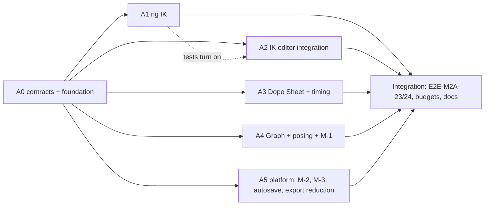

# Ekza Animator — M2a build specification ("game-clip daily driver")

Status: v0.1 (2026-10-18), the build spec for milestone M2a. Audience: the integration agent (A0 and the final
integration), five parallel implementation agents (A1…A5) and reviewers. Read [MVP-SPEC.md](MVP-SPEC.md) (v0.3) first:
it stays the base contract. This file lists **deltas**; where the two disagree for M2a work, this file wins.
Requirements: [REQUIREMENTS.md](REQUIREMENTS.md); research: R01 (Maya features), R02 §6.4 (export reduction), R07
(rig math), R09 (UI).

Normative words: **MUST**, **SHOULD**, **MAY**. "Contract" means a type or signature in §4 or a package's *Public API*
block in §8. Changing a contract needs a PR that updates this file first. M1 contracts not mentioned here are
unchanged.

Contents: [1 Scope](#1-scope) · [2 Dependencies and toolchain](#2-dependencies-and-toolchain) ·
[3 Conventions](#3-conventions-deltas-to-mvp-spec-3) · [4 Contract deltas](#4-contract-deltas) ·
[5 Normative behaviours](#5-normative-behaviours) · [6 Keymap additions](#6-keymap-additions-preset-maya) ·
[7 UI placement](#7-ui-placement) · [8 Work packages](#8-work-packages) ·
[9 Acceptance tests](#9-acceptance-tests-and-e2e-scenarios) · [10 Integration and definition of done](#10-integration-plan-and-m2a-definition-of-done) ·
[11 Defaults chosen](#11-defaults-chosen-owner-may-override)

---

## 1. Scope

### 1.1 In scope (M2a core)

| # | Area | Content | Requirements |
|---|---|---|---|
| 1 | **Limb IK** | Two-bone IK for legs and arms on the existing solver slot: `ik.leg.L/R`, `pole.leg.L/R`, `ik.arm.L/R`, `pole.arm.L/R` controls; the `ik2` rig op (R07 §9.2 with the rest-exact amendments of §5.3); soft IK; pole twist; per-limb `ikFk` blend with IK/FK control visibility; **match** FK→IK and IK→FK; **seamless switch**; a simple **foot roll** on leg IK controls (heel, ball and toe pivots, bank, heel and toe twist); custom keyable attribute channels (`@name`), which the IK attributes need; imports write IK controls from sampled feet (R07 §15.4); Plant Feet also works on IK legs; exports bake IK to bones exactly like FK; an explicit, undoable upgrade of M1 rigs | FR-RIG-11, part of FR-RIG-12 (foot roll, simple variant) |
| 2 | **Time slider extras** | Mod+drag copies a band's keys, **ripple** for band moves and scales, **MMB-drag carries the pose** to another frame, insert and remove time, breakdown ticks in green | FR-TIME-07 (V1 part), FR-TIME-10 |
| 3 | **Dope Sheet** | Dockable panel with Summary › Character › Body part › Control › Channel rows, key and breakdown glyphs, hold bars, select/move/scale/delete/copy/paste, ripple, shared key selection with the Graph Editor and the time slider | FR-DS-01, FR-DS-02 |
| 4 | **Posing tools** | Tween slider family (tween, blend to neighbour, ease, push/pull, blend to default) with overshoot; breakdown keys with proportional retiming; mirror animation with a half-cycle offset | FR-KEY-08, FR-KEY-09, FR-POSE-05 |
| 5 | **Graph Editor and productivity** | Buffer curves (snapshot, swap); normalized and stacked views; scale tool with a region box; export-side error-bounded key reduction of sampled tracks; pick-walk; Channel Box virtual slider; keying by body part; autosave to IndexedDB with crash recovery | FR-GE-18, FR-GE-19, FR-GE-20, FR-EXP-12, FR-OUT-05, FR-CB-05, FR-KEY-10, FR-PROJ-05 |
| 6 | **M1 budget misses** | M-1 drag 1,000 keys ≤ 4 ms; M-2 editor route JS ≤ 900 kB gzip with real headroom (initial route ≤ 800,000 B) through lazy loading and a CI size gate; M-3 anim-core 2,200 curves ≤ 0.3 ms | NFR-01, NFR-14 |

### 1.2 M2a-stretch (implement only if time remains; tests `test.fixme` until done)

| Item | Fallback in M2a core |
|---|---|
| "Ghost" display of the inactive IK/FK set (25 % alpha) | `prefs.ikFkVisibility` accepts only `'hide'`; `'ghost'` poll-fails in Preferences with "not available yet" |
| Dope Sheet "show all keyable channels" (rows for channels without curves) | Only animated channels get rows |
| Graph Editor tween slider target `keys` on a mixed selection of keys of different frames inside one curve | Each selected key uses its own neighbours (§5.13); no extra mode |
| Mesh-pick → IK control mapping when `ikFk > 0.5` (R07 §6) | Mesh picks keep returning the FK control; the help line says "IK limb: pick the IK control" |

### 1.3 Out of scope (later milestones)

Space switching and "pole follows foot" (M5), stretch IK, spline/FABRIK chains, full-body IK, constraints (M2c),
the `footRoll` solver type as a separate record (the leg `ik2` op carries the foot roll), rig editing UI for pivots
and IK control shapes (M2c Rig workspace), quaternion curves, animation layers, `K`-drag viewport time scrub,
marking menus, time bookmarks, playblast, collaboration (M3), Ekza upload (M4a), modeling (M6).

### 1.4 What M2a is for (say it plainly)

M2a makes the editor a daily driver for **game clips**: walk and run cycles, attacks, hits and emotes with planted
feet and contacts, retimed in a Dope Sheet and polished with tweens and breakdowns. Acceptance: a walk cycle and an
attack clip with planted feet are authored with leg IK and **without Plant Feet** (E2E-M2A-23, -24). The release is
`v0.2.x` (the tag is the owner's call). README and the first-run card change "Legs are FK" to "Legs are IK by
default; arms are FK with IK one click away".

---

## 2. Dependencies and toolchain

**No new runtime or dev dependency.** IndexedDB, Web Locks, Pointer Lock and `requestIdleCallback` are browser APIs;
every use is feature-detected and wrapped in try/catch (NFR-12). The toolchain of MVP-SPEC §2 is unchanged.

`package.json` changes (owned by the integration agent, landed in A0):

| Package | Change | Why |
|---|---|---|
| `@ekza-animator/io` | new subpath export `"./write": "./src/write.ts"` (bake, surgeon, animation-GLB and VRMA writers, export lints) | M-2: glTF Transform loads only when an export runs (§5.21.2) |
| `apps/web` | script `"check:size": "node scripts/check-size.mjs"` | M-2 size gate |
| root | `ci` runs `pnpm --filter web check:size` after `build` | M-2 size gate in CI |

---

## 3. Conventions (deltas to MVP-SPEC §3)

1. **Contract freeze after A0.** A0 lands every §4 type, every new public function as a stub
   (`EkzaError('not-implemented', '<package>.<symbol>')`), every new operator registered as a stub that poll-fails with
   "not available yet", every §6 keymap row, menu item and `data-testid` reservation. After A0 merges, A1…A5 edit only
   their owned directories (§8). A contract change goes through a PR to this file reviewed by the integration agent.
2. **New files over shared files.** New operators live in new files (`operators/builtin/{ik,tween,breakdown,
   graphBuffer,mirrorAnimation,autosave}.ts`); A0 creates them with stubs and registers them in
   `operators/builtin/index.ts`, so no two packages edit the index. Operators that act on a focused panel controller
   (`dopeSheet.frame`, `graph.view.setMode`) are registered by the curve-editor contribution functions
   (`registerDopeSheetContributions`, `registerGraphContributions`), whose A0 versions register them as poll-failing
   stubs; operators of existing files (`key.toggleRipple` in `time.ts`, `select.pickWalk` in `select.ts`, …) are
   stubbed by A0 in those files.
3. **Deterministic IDs** for auto-rig solvers: `solverId(rig, templateKey)` = `'slv_'` + 16 base62 characters of
   `sha256(rigId + ':' + templateKey)` (the derivation of `deriveMigratedId`); controls keep `controlId(rig, key)`.
   Two peers adding limb IK to the same rig create identical records.
4. **Test gates.** A package whose tests need another M2a package uses the M1 pattern: `describe.skipIf(!READY.a1)`
   in unit tests and `test.fixme` with the blocking package id in e2e, turned into failures at integration
   (MVP-SPEC INT-55). The `READY` flags live in each package's `test/ready.ts`.
5. **E2E files** are `apps/web/e2e/m2a-NN-<slug>.spec.ts` (one scenario or a serial group per file); helpers are
   `apps/web/e2e/helpers/m2a-<package>.ts`. Bench files are `apps/web/e2e/bench/m2a-<package>.bench.ts`;
   `budgets.bench.ts` stays A5's.
6. **Notes.** Each package records interpretations in `docs/wp-notes/m2a-<id>.md`; the integration agent copies the
   decisions into DECISIONS-OPEN §F "M2a build deviations" (IDs `M2A-<id>-<n>`).
7. Every rule of MVP-SPEC §3 still holds (no allocation in per-frame paths, explicit registration, Node-safe headless
   packages, `EkzaError` for caller errors, repair never reject for document content).

---

## 4. Contract deltas

Blocks below are additions to the named contract files unless marked *changed*. "Additive" means existing callers
compile and behave as before.

### 4.1 anim-core

No contract change. M-3 work (§5.21.3) is internal: `evaluateAnimCurve` and `compileAnimCurve` keep their signatures
and results (goldens ≤ 1e-9).

### 4.2 doc — attribute definitions, solver IDs, schema version 2

`packages/doc/src/records.ts` (additive optional fields on the nested `AttrDef`; `ControlRecord.attrs` stays one
atomic field):

```ts
export interface AttrDef {
  readonly type: 'float' | 'bool' | 'enum';
  readonly default: number;
  readonly min?: number;
  readonly max?: number;
  readonly enumLabels?: readonly string[];
  readonly keyable: boolean;
  /** M2a: new keys on this attribute get in 'flat', out 'step' (MVP: stored, unused). */
  readonly stepped?: boolean;
  /** M2a: Channel Box and Graph Editor label; default: the name title-cased ('heelTwist' → 'Heel Twist'). */
  readonly label?: string;
  /** M2a: stored radians or metres, shown in degrees or metres; absent = a plain number (3 decimals). */
  readonly unit?: 'angle' | 'distance';
  /** M2a: how pose and animation mirroring map the value (§5.14); default 'copy'. */
  readonly mirror?: 'copy' | 'negate';
}
```

`packages/doc/src/ids/` and `index.ts`:

```ts
/** Deterministic auto-rig solver ID (§3 rule 3): 'slv_' + 16 base62 of sha256(`${rig}:${templateKey}`). */
export function solverId(rig: RigId, templateKey: string): SolverId;
```

`packages/doc/src/snapshot/version.ts` and migrations (*changed*):

```ts
export const SCHEMA_VERSION: 2;
/**
 * Lowest app schema version that evaluates this content correctly (§5.7): 2 when any live solver record is
 * enabled with type 'ik2', else 1. `snapshot()` writes it as DocSnapshot.minWriterVersion and as the project
 * record's minWriterVersion in the written snapshot.
 */
export function requiredWriterVersion(tables: SnapshotTables): number;
```

`CORE_MIGRATIONS[0]` (schema 1 → 2) is the identity on records: M1 documents contain no `ik2` solvers, no attribute
curves and no breakdown keys. Table versions are **not** bumped (all new fields are optional; M1 apps preserve unknown
fields). Validation (`validateRecord`) accepts the new `AttrDef` fields and rejects wrong types; it never rejects a
loaded document (repair rules of MVP-SPEC §3 rule 6).

### 4.3 rig — attribute slots, limbs, `ik2`, op compile context

`packages/rig/src/types.ts` additions:

```ts
import type { AttrDef, BoneRef, ControlId, SolverId } from '@ekza-animator/doc';
import type { ReadonlyVec3 } from '@ekza-animator/anim-core';

/** A limb that can carry two-bone IK. */
export type LimbId = 'leg.L' | 'leg.R' | 'arm.L' | 'arm.R';
export const LIMB_IDS: readonly LimbId[];                                // ['leg.L', 'leg.R', 'arm.L', 'arm.R']
/** Attribute names on a limb's IK control. Legs carry all seven, arms the first three. */
export const LIMB_ATTR: { readonly ikFk: 'ikFk'; readonly soft: 'soft'; readonly twist: 'twist'; readonly roll: 'roll';
  readonly bank: 'bank'; readonly heelTwist: 'heelTwist'; readonly toeTwist: 'toeTwist' };
export type LimbAttr = keyof typeof LIMB_ATTR;

/** `${ControlId}/@${name}`: key of an attribute slot. */
export type AttrKey = `${string}/@${string}`;
export interface AttrSlot { readonly control: ControlId; readonly name: string; readonly def: AttrDef }

/** Foot-roll pivots of a leg, in the IK control's REST frame (origin = its rest position, character axes, metres). */
export interface FootRollParams {
  readonly side: 1 | -1;                       // +1 left, −1 right
  readonly heel: ReadonlyVec3;
  readonly ball: ReadonlyVec3;
  readonly toe: ReadonlyVec3;                  // toe tip
  readonly inner: ReadonlyVec3;
  readonly outer: ReadonlyVec3;
  readonly breakAngle: number;                 // β, radians; default π/6
}

/** `SolverRecord.params` for `type: 'ik2'` (version 1). Unknown fields are preserved. */
export interface Ik2Params {
  readonly v: 1;
  readonly limb: LimbId;
  readonly bones: { readonly upper: BoneRef; readonly mid: BoneRef; readonly end: BoneRef; readonly toes: BoneRef | null };
  readonly fk: { readonly upper: ControlId; readonly mid: ControlId; readonly end: ControlId; readonly toes: ControlId | null };
  readonly ikControl: ControlId;               // owns the LIMB_ATTR attributes
  readonly pole: ControlId;
  /** Unit hinge axis in canonical character space at rest, + = flexion (§5.2 table). */
  readonly hinge: readonly [number, number, number];
  readonly foot: FootRollParams | null;        // legs; null for arms
}

/** A compiled, enabled `ik2` solver. */
export interface LimbDesc {
  readonly id: LimbId;
  readonly solver: SolverId;
  readonly params: Ik2Params;
  readonly nodes: { readonly upper: number; readonly mid: number; readonly end: number; readonly toes: number };   // toes −1 when absent
  /** ChannelBuffer.attrs slot per limb attribute; −1 when the IK control lacks it. */
  readonly attrSlots: Readonly<Record<LimbAttr, number>>;
  /** l1, l2 (rest, scaled) and d⁰ = rest |end − upper| (§5.3 amendment A). */
  readonly lengths: { readonly upper: number; readonly lower: number; readonly restReach: number };
  readonly fkControls: readonly ControlId[];   // fk.upper, fk.mid, fk.end: hidden in full IK (§5.5)
  readonly ikControls: readonly ControlId[];   // ik control, pole: hidden in full FK
}

/** Compile-time view handed to rig op implementations (§5.4). */
export interface RigOpCompileContext {
  readonly skeleton: SkeletonDesc;
  readonly controls: ReadonlyMap<ControlId, ControlRecord>;
  resolveBone(ref: BoneRef): number;                                     // node index, −1 when absent
  attrSlot(control: ControlId, name: string): number;                    // −1 when absent
  controlChildren(control: ControlId): readonly ControlId[];             // by order, then id
  nodeChildren(node: number): readonly number[];
}
```

*Changed* (additive): `ChannelBuffer.attrs` has one slot per `RigProgram.attrSlots` entry (it was always empty);
`RigProgram` gains

```ts
  /** Custom attribute slots: control slot order, then attribute name (code-unit order). */
  readonly attrSlots: readonly AttrSlot[];
  readonly attrIndex: ReadonlyMap<AttrKey, number>;
  /** Enabled, compiled ik2 solvers in solver-id order. */
  readonly limbs: readonly LimbDesc[];
```

`resetChannels` and `allocChannels` set each attribute slot to its `AttrDef.default`.

`TwoBoneIkInput` gains (additive)

```ts
  /** ik2 op only: enables the rest-exact amendments A and B of §5.3. Absent = M1 behaviour (Plant Feet). */
  readonly restReach?: number;
```

`RigOpImpl` (*changed*, source-compatible for implementers):

```ts
export interface RigOpImpl {
  reads(record: ConstraintRecord | SolverRecord, ctx: RigOpCompileContext): { readonly controls: readonly ControlId[]; readonly nodes: readonly number[] };
  writes(record: ConstraintRecord | SolverRecord, ctx: RigOpCompileContext): { readonly controls: readonly ControlId[]; readonly nodes: readonly number[] };
  /** Optional, once per compile after scheduling: precomputed rest data and scratch buffers, handed to `run`. */
  compile?(record: ConstraintRecord | SolverRecord, ctx: RigOpCompileContext & { readonly program: RigProgram }): unknown;
  run(record: ConstraintRecord | SolverRecord,
      ctx: { readonly pose: PoseBuffers; readonly channels: ChannelBuffer; readonly program: RigProgram; readonly state: unknown }): void;
}
```

`ImportRawOptions` gains `readonly ik?: 'auto' | 'none'` (default `'auto'`, §5.8); `ImportHumanoidOptions` inherits it.

Public API additions (`@ekza-animator/rig`, owner A1; signatures in §8 A1).

### 4.4 io — export reduction, write subpath

`packages/io/src/types.ts` additions:

```ts
/** R02 §6.4 tolerances; position terms scale with the character height H (÷ 1.7 m). */
export interface ExportReduceSpec {
  readonly positionM: number;                  // ε_pos for a 1.7 m character; default 0.0002
  readonly rotationCapRad: number;             // θ_cap; default 0.25° = 0.004363323129985824
  readonly minLeverM: number;                  // L_min; default 0.01
  readonly scaleRel: number;                   // default 1e-4 (relative)
}
export const DEFAULT_EXPORT_REDUCE: ExportReduceSpec;

export interface ReductionStats {
  readonly samplesBefore: number;
  readonly samplesAfter: number;
  readonly maxRotationErrorRad: number;
  readonly maxTranslationErrorM: number;
}
```

*Changed* (additive): `ExportRequest.reduce?: ExportReduceSpec | null` (absent or null = no reduction, the M1
output byte for byte); `BakeOptions.reduce?: { readonly spec: ExportReduceSpec; readonly height: number;
readonly leverArm: ReadonlyMap<number, number>; readonly keep: ReadonlyMap<TrackKey, readonly Frame[]> } | null`;
`BakedClip.reduction?: ReductionStats`; `ExportArtifact.stats.reduction?: ReductionStats`.

The `@ekza-animator/io/write` subpath re-exports `bakeClip`, `bakeIntoModel`, `writeAnimationGlb`, `writeVrma`,
`lintExport`, `readBackCheck`, `ekzaAnimationMeta`, `preexistingTracks` and `reduceBakedClip` (§8 A5). The main entry
keeps exporting them in M2a (headless tests and tooling use it; no breaking change), but `editor-core` and `editor`
obtain them only through a dynamic `import('@ekza-animator/io/write')`; an oxlint `no-restricted-imports` rule in
those two packages forbids importing these names from the main entry, so the bundler can drop glTF Transform from
the initial route.

### 4.5 editor-core — session, prefs, kernel, evaluation, edit kernel

`packages/editor-core/src/types.ts` additions and changes:

```ts
import type { AnimCurve } from '@ekza-animator/anim-core';
import type { AssetId, AssetRecord, CurveId, DocSnapshot } from '@ekza-animator/doc';
import type { LimbId } from '@ekza-animator/rig';

export const PANEL = { …M1, dopeSheet: 'dopeSheet' } as const;                 // changed (additive)
export const GRAPH_TOOL = { select: 'select', move: 'move', insert: 'insert', scale: 'scale' } as const;   // changed
export const DOPE_TOOL = { select: 'select', move: 'move', scale: 'scale' } as const;

export type KeyTarget = 'selected' | 'bodyPart' | 'character';
export type BodyPart = 'root' | 'torso' | 'head' | 'arm.L' | 'arm.R' | 'fingers.L' | 'fingers.R' | 'leg.L' | 'leg.R';
export type GraphViewMode = 'absolute' | 'normalized' | 'stacked';
export type TweenMode = 'tween' | 'neighbor' | 'ease' | 'pushPull' | 'toDefault';
/** 'auto': 'seamless' when the ikFk curve has keys or auto-key is on, else 'none' (§5.6). */
export type IkFkKeyMode = 'auto' | 'none' | 'key' | 'seamless';
export type ControlVisibility = 'visible' | 'ghost' | 'hidden';

export interface ToolState {
  readonly viewport: ToolId;
  readonly graph: ToolId;
  readonly dopeSheet: ToolId;                                     // M2a, default 'select'
  readonly manipulatorSize: number;
  readonly selectionMask: SelectionMask;
  readonly keyTarget: KeyTarget;                                  // changed: + 'bodyPart'
  readonly ripple: boolean;                                       // M2a, default false (Dope Sheet + time slider)
}

/** Graph Editor buffer curve (per user, never in the document). */
export interface CurveBuffer { readonly curve: AnimCurve; readonly capturedAt: number }

export interface AutosaveSlotInfo {
  readonly id: string;                                            // 'as_' + 16 base62, one per page load
  readonly projectName: string;
  readonly savedAt: number;                                       // ms since epoch
  readonly characters: number;
  readonly clips: number;
  readonly bytes: number;                                         // snapshot JSON + new asset bytes
  readonly appVersion: string;
  readonly schemaVersion: number;
}
export interface AutosaveStatus {
  readonly enabled: boolean;                                      // false: storage unavailable or prefs off
  readonly slot: string | null;
  readonly lastSavedAt: number | null;
  readonly pending: boolean;
  readonly error: string | null;
}

export interface SessionState {
  …M1 fields…
  readonly curveBuffers: ReadonlyMap<CurveId, CurveBuffer>;       // M2a
  readonly autosave: AutosaveStatus;                              // M2a
  readonly recovery: readonly AutosaveSlotInfo[];                 // M2a: orphaned slots found at start
}
export type UiDialog = …M1 | 'recovery';                          // changed (additive)

export interface Prefs {
  …M1 fields (version stays 1; missing fields take defaults on load)…
  readonly autoRigIk: { readonly legs: boolean; readonly arms: boolean };          // default { legs: true, arms: true }
  readonly ikFkVisibility: 'hide' | 'ghost';                                      // default 'hide' ('ghost' is stretch)
  readonly ikFkSwitchKey: IkFkKeyMode;                                            // default 'auto'
  readonly tweenOvershoot: boolean;                                               // default false
  readonly arrowKeys: 'pickWalk' | 'frames';                                       // default 'pickWalk' (Q-UI-2)
  readonly virtualSlider: { readonly degPerPx: number; readonly metresPerPx: number; readonly unitsPerPx: number };   // 0.5, 0.01, 0.01
  readonly exportReduce: { readonly enabled: boolean } & ExportReduceSpec;          // dialog default; enabled true
  readonly autosave: { readonly enabled: boolean; readonly delayMs: number; readonly maxIntervalMs: number };       // true, 2000, 30000
}

export interface EvaluationService {
  …M1…
  /** M2a: value of any channel (TRS or '@attr') at the control's current clip frame, curves ⊕ overrides. */
  channelValue(control: ControlId, channel: ChannelId): number;
  /** M2a: every custom attribute of the control by name (without '@'). */
  attrValues(control: ControlId): Readonly<Record<string, number>>;
  /** M2a: evaluated ikFk of a limb of the character (null without that limb). */
  ikFk(character: CharacterId, limb: LimbId): number | null;
}

/** M2a: content-addressed autosave slots (IndexedDB in the browser; null in Node). */
export interface AutosaveStore {
  /** Claims a slot for this page (Web Lock held until unload); returns its id. */
  open(): Promise<string>;
  write(slot: string, data: { readonly snapshotJson: string; readonly assets: readonly AssetRecord[];
    readonly info: Omit<AutosaveSlotInfo, 'id' | 'bytes'> }, readAsset: (id: AssetId) => Promise<Uint8Array>): Promise<{ readonly bytes: number }>;
  /** Slots whose page is gone (lock not held, or heartbeat older than 20 s without Web Locks). */
  listOrphans(): Promise<readonly AutosaveSlotInfo[]>;
  read(slot: string): Promise<{ readonly snapshot: unknown; readonly assets: ReadonlyMap<AssetId, { readonly record: AssetRecord; readonly bytes: Uint8Array }> } | null>;
  remove(slot: string): Promise<void>;
}
export interface EditorServices { …M1…; readonly autosave?: AutosaveStore | null }

export interface EditorApp {
  …M1…
  /**
   * M2a (M-1): run `task` once before the next frame's evaluation; a later call with the same key replaces the
   * pending task. Without a frame requester (Node) the task runs synchronously.
   */
  scheduleBeforeFrame(key: string, task: () => void): void;
  /** Runs every pending task now, in scheduling order (the frame loop's first step; pointerup; tests). */
  flushScheduled(): void;
}
```

Edit kernel additions (`@ekza-animator/editor-core`, §4.11.0 of MVP-SPEC extended):

```ts
/** One key-editing drag (Graph Editor, Dope Sheet, time slider): preview, once-per-frame updates, one history step. */
export interface KeyEditGesture {
  readonly active: boolean;
  /** Replaces the pending edit; applied at the next `flushScheduled` on top of committed state. */
  update(edit: (tx: Tx) => void): void;
  /** Applies `final` immediately (callers pass resolveCollisions: true), commits ONE transaction, records ONE step. */
  commit(final: (tx: Tx) => void, meta?: { readonly label?: string }): ChangeBatch | null;
  cancel(): void;
}
export function beginKeyEditGesture(app: EditorApp, label: string): KeyEditGesture;

export interface KeyEditOptions {
  readonly snap: boolean;
  readonly resolveCollisions: boolean;
  readonly ripple?: boolean;                 // M2a §5.11; default false
  readonly retimeBreakdowns?: boolean;       // M2a §5.12; default true
}
/** M2a: value scale of keys around `pivot` (display units); handles' dv scale with the factor. */
export function scaleKeyValues(app: EditorApp, tx: Tx, keys: readonly KeyId[], pivot: number, factor: number): KeyEditResult;
/** M2a: copies of `keys` at t + dFrames (same curves); colliding non-copied keys are replaced. */
export function copyKeys(app: EditorApp, tx: Tx, keys: readonly KeyId[], dFrames: number, opts: KeyEditOptions): { readonly created: readonly KeyId[]; readonly deleted: readonly KeyId[] };
/** M2a §5.9: insert (frames > 0) or remove (frames < 0) time after `at` on the curves. */
export function insertTime(app: EditorApp, tx: Tx, curves: readonly CurveId[], at: Frame, frames: number): KeyEditResult;
/** M2a §5.13: target values of a tween; pure (reads the committed state of `app.store` and the session overrides). */
export function tweenEdits(app: EditorApp, mode: TweenMode, amount: number,
  target: { readonly kind: 'frame'; readonly controls: readonly ControlId[]; readonly channels: readonly ChannelRef[] | null; readonly frame: Frame }
        | { readonly kind: 'keys'; readonly keys: readonly KeyId[] }): readonly { readonly curve: CurveId | null; readonly control: ControlId; readonly channel: ChannelId; readonly t: Frame; readonly value: number }[];
/** M2a §5.5: one rule used by the viewport, the Outliner, picking, key targets and the test API. */
export function controlVisibility(app: EditorApp, control: ControlId): ControlVisibility;
/** M2a §5.19 */
export function bodyPartOf(app: EditorApp, control: ControlId): BodyPart | null;
export function keyTargetControls(app: EditorApp, target: KeyTarget): readonly ControlId[];
```

`beginChannelEditGesture` keeps its contract; its `update` is coalesced through `scheduleBeforeFrame` like
`beginKeyEditGesture` (M-1). `applyChannelEdits` accepts `'@attr'` channels (§5.1).

`packages/editor-core/src/operators/args.ts` (*changed*, additive; behaviour in §4.9):

```ts
import type { LimbId } from '@ekza-animator/rig';
import type { BodyPart, GraphViewMode, IkFkKeyMode, KeyTarget, TweenMode } from '../types';

export type KeyChannels = 'all' | 'translate' | 'rotate' | 'scale' | 'attributes' | 'selected';   // changed: + 'attributes'

export interface OperatorMap {
  …M1 entries, with these argument changes:…
  'key.set': { args: { readonly channels?: KeyChannels; readonly target?: KeyTarget; readonly breakdown?: boolean } | void; result: CountResult };
  'time.setFrame': { args: { readonly frame: Frame; readonly unit?: 'clip' | 'scene'; readonly carry?: boolean }; result: void };
  'graph.keys.move': { args: { readonly dFrames: number; readonly dValue: number; readonly ripple?: boolean }; result: CountResult };
  'graph.keys.scale': { args: { readonly pivot: Frame; readonly factor: number; readonly ripple?: boolean;
    readonly valuePivot?: number; readonly valueFactor?: number }; result: CountResult };

  // rig (M2a)
  'rig.addLimbIk': { args: { readonly character?: CharacterId; readonly limbs?: readonly LimbId[] } | void;
    result: { readonly added: readonly LimbId[]; readonly warnings: readonly string[] } };
  'rig.ikFk.switch': { args: { readonly limb: LimbId; readonly to: 'ik' | 'fk'; readonly match?: boolean;
    readonly key?: IkFkKeyMode; readonly character?: CharacterId }; result: ChannelEditResult };
  'rig.ikFk.match': { args: { readonly limb: LimbId; readonly side: 'ik' | 'fk'; readonly key?: boolean;
    readonly character?: CharacterId }; result: ChannelEditResult };
  'rig.ikFk.matchRange': { args: { readonly limb: LimbId; readonly side: 'ik' | 'fk';
    readonly range?: { readonly start: Frame; readonly end: Frame }; readonly step?: 'keys' | 'frames';
    readonly character?: CharacterId }; result: CountResult };
  // select / key / pose (M2a)
  'select.pickWalk': { args: { readonly direction: 'up' | 'down' | 'left' | 'right'; readonly add?: boolean }; result: void };
  'key.setTarget': { args: { readonly target: KeyTarget }; result: void };
  'key.toggleRipple': { args: { readonly ripple?: boolean } | void; result: void };
  'key.tween': { args: { readonly mode: TweenMode; readonly amount: number; readonly target?: 'frame' | 'keys';
    readonly breakdown?: boolean }; result: CountResult };
  'key.convert': { args: { readonly to: 'breakdown' | 'key' }; result: CountResult };
  'pose.mirrorAnimation': { args: { readonly mode: MirrorMode; readonly offset?: 'none' | 'halfCycle';
    readonly controls?: readonly ControlId[] }; result: CountResult };
  // time (M2a)
  'time.insertTime': { args: { readonly at: Frame; readonly frames: number; readonly target?: 'selected' | 'character' }; result: CountResult };
  // graph and dope sheet (M2a)
  'graph.keys.copyTo': { args: { readonly dFrames: number }; result: CountResult };
  'graph.buffer.snapshot': { args: { readonly curves?: readonly CurveId[] } | void; result: CountResult };
  'graph.buffer.swap': { args: { readonly curves?: readonly CurveId[] } | void; result: CountResult };
  'graph.buffer.clear': { args: void; result: void };
  'graph.view.setMode': { args: { readonly mode: GraphViewMode | 'toggleNormalized' | 'toggleStacked' }; result: void };
  'dopeSheet.frame': { args: { readonly what: 'selection' | 'all' }; result: void };
  // file (M2a)
  'file.recover': { args: { readonly slot: string }; result: { readonly readOnly: boolean } };
  'file.discardRecovery': { args: { readonly slot: string }; result: void };
  'file.autosaveNow': { args: void; result: { readonly slot: string; readonly bytes: number } | null };   // internal
}
```

`view.tool` accepts `{ panel: 'dopeSheet', tool }` and `{ panel: 'graph', tool: 'scale' }`.

### 4.6 viewport

No type change. `SceneSync`, picking, marquee and the HUD read `controlVisibility` (§5.5); the control renderer gains
the pole annotation line and per-control alpha (§5.5).

### 4.7 curve-editor — Dope Sheet, Graph Editor views

`packages/curve-editor/src/types.ts` additions:

```ts
import type { BodyPart, GraphViewMode } from '@ekza-animator/editor-core';

export type DopeSheetRowKind = 'summary' | 'character' | 'group' | 'control' | 'channel';
export interface DopeSheetRow {
  readonly id: string;                         // 'summary' | `chr:${id}` | `grp:${chr}:${part}` | control id | `${control}/${channel}`
  readonly kind: DopeSheetRowKind;
  readonly label: string;
  readonly depth: number;
  readonly group?: BodyPart;
  readonly control?: ControlId;
  readonly channel?: ChannelId;
  readonly curves: readonly CurveId[];         // curves under the row (active clip, base layer)
  readonly expanded: boolean;
  readonly dimmed: boolean;                    // control hidden by the IK/FK rule (§5.5)
}
export interface DopeSheetViewState { readonly f0: number; readonly sx: number; readonly scrollY: number }
export type DopeSheetHit =
  | { readonly kind: 'glyph'; readonly row: string; readonly frame: Frame }
  | { readonly kind: 'region-start' | 'region-end' | 'region-middle'; readonly frame: Frame }
  | { readonly kind: 'ruler'; readonly frame: Frame }
  | { readonly kind: 'none'; readonly row: string | null; readonly frame: Frame };
export type RegionHandle = 'left' | 'right' | 'top' | 'bottom' | 'tl' | 'tr' | 'bl' | 'br' | 'inside';
export type { GraphViewMode };
```

Public API in §8 A3 (`DopeSheetController`, `buildDopeSheetRows`, `registerDopeSheetContributions`) and §8 A4
(`GraphEditorController` additions).

### 4.8 editor — panels, layout, probes, test API

- `registerDopeSheetPanel(registry)` in `packages/editor/src/panels/dopesheet/` (A0 placeholder, A3 body), called by
  `registerBuiltinPanels`. Key scope `'dopeSheet'` (§6 scope `D`).
- Layout: `LAYOUT_SCHEMA_VERSION` 2; `ANIMATE_SLOTS` adds `{ kind: 'dopeSheet', slot: 'bottom', title: 'Dope Sheet' }`
  as an inactive tab of the Graph Editor's group. A stored v1 layout is migrated: the Dope Sheet tab is added to the
  group that holds the Graph Editor (or a new bottom group), the rest of the stored layout is kept.
- Probes (`ProbeMap`) gain `dopeSheet: DopeSheetProbe` (A3); `GraphProbe` gains the view mode, buffers, region
  handles and tween points (A4); A0 adds the keys and fields. The kernel-level test functions (`attrs`,
  `controlWorld`, `limbs`, `limbPivots`, `autosave`, `flushAutosave`) are implemented by A0 over the kernel, the rig
  functions and the operators (stubbed until A1 and A5 land); no panel probe is needed for them.
- Panels mounted lazily: the Dope Sheet panel and every dialog are `React.lazy` (§5.21.2).

Test API additions (`packages/editor/src/test-api/types.ts`; A0 writes the types and stubs, the owners fill the
probes):

```ts
export interface EkzaAnimatorTestApi {
  …M1…
  state(): { …M1…; keyTarget: string; ripple: boolean; dirty: boolean; recovery: string[] };   // changed (additive)
  curves(clip: string, control?: string): { …M1…; keys: { …M1…; breakdown: boolean }[] }[];   // changed (additive)
  /** M2a: custom attributes by name (without '@') at a clip frame (default: current). */
  attrs(control: string, clipFrame?: number): Record<string, number>;
  /** M2a: control world in canonical character space at a clip frame (default: current). */
  controlWorld(control: string, clipFrame?: number): { t: [number, number, number]; q: [number, number, number, number] };
  /** M2a (A0 over RigProgram.limbs): limbs of a character with their evaluated ikFk at the current frame. */
  limbs(character?: string): { id: string; ikFk: number; ikControl: string; pole: string; fk: string[] }[];
  /** M2a (A0 over rig footPivotWorlds): world positions of a leg's foot-roll pivots at the current frame. */
  limbPivots(character: string, limb: string): { heel: number[]; ball: number[]; toe: number[]; inner: number[]; outer: number[] } | null;
  /** M2a (A3) */
  dopeSheet(): { rows: { id: string; kind: string; label: string; depth: number; expanded: boolean; dimmed: boolean;
      keys: number[]; breakdowns: number[]; selected: number[]; holds: [number, number][] }[];
    view: { f0: number; sx: number; scrollY: number }; canvasRect: { x: number; y: number; w: number; h: number } } | null;
  screenOfDopeKey(row: string, frame: number): { x: number; y: number } | null;
  screenOfDopeRegion(part: 'start' | 'middle' | 'end'): { x: number; y: number } | null;
  /** M2a (A3): time-slider ticks of the current key set. */
  timelineTicks(): { frame: number; breakdown: boolean; selected: boolean }[];
  graph(): { …M1…; viewMode: string; buffers: string[] } | null;                           // changed (additive, A4)
  screenOfRegionHandle(handle: string): { x: number; y: number } | null;                    // A4, scale tool region box
  screenOfTween(panel: 'graph' | 'dopeSheet', amount: number): { x: number; y: number } | null;   // A4
  /** M2a (A0 over session.autosave and file.autosaveNow; A5 implements the store) */
  autosave(): { enabled: boolean; slot: string | null; lastSavedAt: number | null; pending: boolean };
  flushAutosave(): Promise<void>;
}
```

URL parameters (e2e builds only), additive: `ns=<string>` names the storage namespace (localStorage prefix and the
IndexedDB database suffix) so a reload of the same URL sees the same storage (default: a fresh namespace per page
load, as in M1); `storage=blocked` makes every storage access throw (NFR-12 e2e). A0 parses them and passes them to
`createBrowserServices(opts)`, which gains `storageNamespace?: string` and `storageBlocked?: boolean` (additive; A5
implements their effect on the autosave store).

`data-testid` additions (owners in brackets):

| Element | `data-testid` | Owner |
|---|---|---|
| Channel Box attribute rows, IK/FK row and switch | `cb-field-@<attr>`, `cb-name-@<attr>` (e.g. `cb-field-@roll`), `cb-ikfk-row`, `cb-ikfk-field`, `cb-ikfk-switch` | A2 |
| Attributes limb section | `attr-limb-<limb>`, `attr-limb-mode-ik-<limb>`, `attr-limb-mode-fk-<limb>`, `attr-limb-match-ik-<limb>`, `attr-limb-match-fk-<limb>`, `attr-limb-key-mode`, `attr-add-limb-ik` | A2 |
| Status line key target | `status-keytarget-<selected or bodyPart or character>` | A0 (shell) |
| Dope Sheet | `ds-canvas`, `ds-row-<rowId>`, `ds-show`, `ds-ripple`, `ds-tool-<id>`, `ds-frame-all` | A3 |
| Time slider menu | `timeline-menu-ripple`, `timeline-menu-insert-frame`, `timeline-menu-remove-frame`, `timeline-menu-delete-time` | A3 |
| Tween bar (Graph Editor and Dope Sheet toolbars) | `tween-slider-<panel>`, `tween-mode-<panel>`, `tween-overshoot-<panel>` | A4 |
| Graph Editor | `ge-view-<absolute or normalized or stacked>`, `ge-buffer-snapshot`, `ge-buffer-swap`, `ge-tool-scale`, `ge-convert-breakdown`, `ge-convert-key` | A4 |
| Export dialog | `export-reduce` | A5 |
| Recovery dialog | `recovery-dialog`, `recovery-row-<slot>`, `recovery-recover-<slot>`, `recovery-discard-<slot>`, `recovery-later` | A5 |

### 4.9 Operator catalog additions

`U` = undoable (one transaction, one history step). Owner = the package that implements it (A0 registers stubs).

| ID | U | Owner | Behaviour |
|---|---|---|---|
| `rig.addLimbIk` | U | A2 (A1 records) | §5.7. Humanoid rigs only (poll). Adds IK controls and `ik2` solvers for the requested limbs (default: every limb without one) with **`ikFk` default 0**, so existing animation is unchanged; `flags.structural`. Label `Add Limb IK`. |
| `rig.ikFk.switch` | U | A2 | §5.6: optional match, then sets `ikFk` to 1 (`to: 'ik'`) or 0 with the key policy. Label `Switch L Leg to FK`. |
| `rig.ikFk.match` | U | A2 | §5.6: sets the `side` controls from the current pose of the other side without changing `ikFk`; `key: true` keys them. |
| `rig.ikFk.matchRange` | U | A2 | §5.6: match at every key time of the limb's driving curves (`'keys'`, default) or every integer frame of the range (default: the clip range), keying the `side` controls; Euler filter on the written rotation curves. |
| `select.pickWalk` | — | A2 | §5.17. Not a history step. |
| `key.set` (changed) | U | A2 | `target: 'bodyPart'` (§5.19), `channels: 'attributes'` and `'all'` include keyable attributes (§5.1), `breakdown: true` creates breakdown keys and turns existing keys at the frame into breakdowns (label `Set Breakdown`). |
| `key.setTarget` | — | A2 | Writes `session.tools.keyTarget`. |
| `key.toggleRipple` | — | A3 | Writes `session.tools.ripple` (registered in `operators/builtin/time.ts`). |
| `key.tween` | U | A4 | §5.13 one-shot (menus, scripts); the toolbar slider uses the gesture form. |
| `key.convert` | U | A4 | Sets `breakdown` on the selected keys (or the keys at the current frame on the target controls). |
| `pose.mirrorAnimation` | U | A4 | §5.14. Humanoid rigs only (poll). |
| `pose.plantFeet` (changed) | U | A2 | §5.8: IK legs get IK control channels, FK legs the M1 solve; one step. |
| `time.setFrame` (changed) | — | A3 | `carry: true` keeps the pose (§5.9). |
| `time.insertTime` | U | A3 | §5.9. |
| `graph.keys.move` / `graph.keys.scale` (changed) | U | A3 | `ripple` (§5.11); value scale via `valuePivot`/`valueFactor` (§5.15.3). |
| `graph.keys.copyTo` | U | A3 | `copyKeys` on the selected keys (time-slider Mod+drag commit uses the kernel helper directly). |
| `graph.buffer.snapshot` / `.swap` / `.clear` | —/U/— | A4 | §5.15.1. |
| `graph.view.setMode` | — | A4 | §5.15.2, focused Graph Editor. |
| `dopeSheet.frame` | — | A3 | Focused Dope Sheet: frame the selected keys (else all rows) with 8 % padding. |
| `file.recover` / `file.discardRecovery` | —/— | A5 | §5.20. Not undoable (`file.openProject` semantics). |
| `file.autosaveNow` | — | A5 | Internal; writes the slot now (tests, menu "Save recovery point"). |

---

## 5. Normative behaviours

### 5.1 Custom attribute channels (`@name`)

1. A control's `attrs` define its custom channels; the channel id is `'@' + name`. Curves, keys, static values,
   overrides, the clipboards and undo treat them like TRS channels. Attributes cannot be locked in M2a
   (`ControlRecord.locked` covers TRS only): `channel.toggleLock` skips attribute channels and the Channel Box menu
   disables Lock on attribute rows; a Graph Editor curve lock (`CurveRecord.locked`) works as for any curve.
2. **Slots**: `RigProgram.attrSlots` lists every attribute of every control in control slot order, then by name
   (code-unit order); `ChannelBuffer.attrs[slot]` holds the value. `resetChannels` writes `AttrDef.default`.
3. **Sampling**: a curve with keys evaluates per the curve engine; a key-less curve gives `staticValue ?? default`;
   no curve gives `AttrDef.default`. Overrides (`ChannelValues` keys `'@name'`) are applied after sampling. Values of
   attributes with `min`/`max` are clamped **where they are consumed** (the `ik2` op), never in curves.
4. **Keying**: `key.set {channels: 'all'}` keys keyable TRS channels and keyable attributes; `'attributes'` keys
   attributes only; `'translate'`/`'rotate'`/`'scale'` never key attributes. A new key on an attribute with
   `stepped: true` gets `in: 'flat', out: 'step'`; other attributes use `prefs.defaultTangents`. Auto-key rules of
   MVP-SPEC §4.11.2 apply unchanged.
5. **Display**: Channel Box rows after the TRS rows, in `attrs` key order, label `AttrDef.label` or the title-cased
   name; `unit: 'angle'` shows degrees (typed values are degrees), `'distance'` metres, otherwise 3 decimals; `bool`
   shows 0/1; `enum` shows `enumLabels`. The Graph Editor channel list shows attribute curves after TRS with the
   `other` colour; its value axis uses the same display units.
6. **Export**: attribute curves never produce glTF tracks; they influence tracks through the ops that read them
   (§5.8 step schedule).

### 5.2 Limb IK rig: controls, solver records, placement

Generated by `limbIkRecords` (A1) for `autoRig(…, { ik })` and `rig.addLimbIk`. Only for humanoid programs, only for
limbs whose three chain bones exist (`leftUpperLeg`/`leftLowerLeg`/`leftFoot`, `leftUpperArm`/`leftLowerArm`/
`leftHand`, mirrored for the right side) and are driven by FK controls; a missing limb is skipped with a warning.

| Template key | Name | Parent | Rest world `W⁰` | Rotate order | Keyable | Shape |
|---|---|---|---|---|---|---|
| `ik.leg.L` / `.R` | `L Leg IK` | `root` | t = foot bone rest position; q = identity (world-aligned) | `zxy` | t, r | `custom` footprint: the polygon heel-inner → toe-inner → toe-outer → heel-outer at the ground plane, from the foot pivots below |
| `pole.leg.L` / `.R` | `L Knee Pole` | `root` | t = §5.2.2; q = identity | `xyz` | t | `diamond`, size 0.015·H |
| `ik.arm.L` / `.R` | `L Arm IK` | `root` | t = hand bone rest position; q = identity | `zxy` | t, r | `cube`, size 1.2 × the `fk.hand` control size |
| `pole.arm.L` / `.R` | `L Elbow Pole` | `root` | t = §5.2.2; q = identity | `xyz` | t | `diamond`, size 0.015·H |

All four kinds: `side` L/R, `group: 'body'`, `drives: null`, `mirror` = the counterpart, `hiddenByDefault: false`,
`order` after the existing children of `root`. IDs `controlId(rig, key)`; solver `solverId(rig, 'ik2.leg.L')`
etc., `type: 'ik2'`, `enabled: true`, `params: Ik2Params`.

**Attributes** on the IK control (`ik.leg.*` all seven, `ik.arm.*` the first three):

| Name | Default | Range | Unit | Keyable | Stepped | Mirror |
|---|---|---|---|---|---|---|
| `ikFk` | legs 1, arms 0 for new rigs; **0 for every limb added by `rig.addLimbIk`** | 0…1 | — | yes | yes | copy |
| `soft` | 0 | 0…0.25 (fraction of l1 + l2) | — | yes | no | copy |
| `twist` | 0 | — | angle | yes | no | negate |
| `roll` | 0 | — | angle | yes | no | copy |
| `bank` | 0 | — | angle | yes | no | copy |
| `heelTwist` | 0 | — | angle | yes | no | negate |
| `toeTwist` | 0 | — | angle | yes | no | negate |

#### 5.2.1 Hinge axis

`x̂⁰_U` = unit rest direction of the upper bone (upper → mid, canonical space). Distal swing direction `s`: legs
(0, 0, −1) (the shin swings back), arms (0, 0, 1) (the forearm swings forward).
`hinge = normalize(x̂⁰_U × s)`; if `|x̂⁰_U × s| < 0.1`, use the R07 §5.2 table (knees (1, 0, 0), left elbow
(0, −1, 0), right elbow (0, 1, 0)). T-pose results equal the table. The compiler converts `hinge` into the mid bone's
rest frame (`hingeLocal = q(W⁰_mid)⁻¹ ⊗ hinge`). A rest bend > 2° that opposes the hinge (hyperextended rest) warns
(`RigWarning 'asymmetric-rest'` reused with a limb message) and keeps the hinge.

#### 5.2.2 Rest pole

`a⁰, b⁰, c⁰` = rest positions of upper, mid, end; `x̂⁰ = normalize(c⁰ − a⁰)`; `m⁰ = (b⁰ − a⁰) − ((b⁰ − a⁰)·x̂⁰)x̂⁰`;
`k⁰ = hinge`. Pole direction `p̂⁰ = normalize(m⁰)` when `|m⁰| > 1e-3·(l1 + l2)` and `m⁰·(x̂⁰ × k⁰) > 0`, else
`p̂⁰ = normalize(x̂⁰ × k⁰)` (the direction the mid joint moves under flexion: knees forward, elbows back). Rest pole
position = `b⁰ + p̂⁰·(l1 + l2)`. This makes the pole twist at rest exactly zero (§5.3 B).

#### 5.2.3 Foot pivots (legs)

From bones and the mesh-based foot control size `r_f` (the `fk.foot` shape size; MVP-SPEC §4.11.15 feet group), in
character space, then expressed in the IK control's rest frame: ankle `A` = foot rest position; ground
`y_g = 0`, or `A.y − 0.5·r_f` when `A.y < 0.5·r_f`; forward `f` = horizontal unit direction from `A` to the toes
bone rest position when it exists, else (0, 0, 1); lateral `l = f × (0, 1, 0)` oriented so that `l·(1, 0, 0) > 0`
for the left foot and `< 0` for the right foot (outward).
`ball` = toes rest position projected to `y_g` when toes exist, else `A_g + f·1.5·r_f` (`A_g` = `A` projected);
`heel = A_g − f·r_f`; `toe = ball + f·1.2·r_f`; `outer = ball + l·r_f`; `inner = ball − l·r_f`;
`breakAngle = π/6`; `side = +1` left, `−1` right. Pivots are data (`FootRollParams`); a Rig workspace may edit them
later (M2c).

### 5.3 The `ik2` op (evaluation)

Registered by A1 with `registerRigOp('solver', 'ik2', impl)` from the rig package's own registration function
`registerBuiltinRigOps()`, called once by `createEditorApp` and by tests (nothing registers on import).

**Declarations** (`reads`/`writes`, §5.4): reads the IK control and the pole control (their worlds and attribute
slots) and the bone world of the upper bone's parent. Writes every node of `subtree(upper)` (chain bones,
intermediate nodes between them, and every descendant) and every control that is a descendant (by control parent
pointers) of `fk.upper`, `fk.mid` or `fk.end` but is not one of those three (fingers, `fk.toes`, secondary
controls under the chain).

**Per evaluate** (allocation-free; `state` from `compile` holds rest data, slots and scratch):

```
w = clamp(attrs[ikFk], 0, 1);  if w == 0: return                     // FK: worlds stay as the bone steps wrote them
L = l1 + l2;  soft_m = clamp(attrs[soft], 0, 0.25)·L;  τ = attrs[twist]
W_ik = controlWorld(ikControl);  p = t(controlWorld(pole));  Pa = boneWorld(parent(upper))
// 1. Effective end target (legs: foot roll §5.3.1; arms: F = identity)
W_tgt = W_ik · F · K_end                                             // K_end = (W⁰_ik)⁻¹ · W⁰_end
// 2. Solve: solveTwoBoneIk with parentWorld Pa, upperRest = L⁰_upper, midRest = (W⁰_upper)⁻¹·W⁰_mid,
//    endRest = (W⁰_mid)⁻¹·W⁰_end (intermediate nodes rigid at rest, as Plant Feet, WP-3 R-15),
//    hingeLocal, target t(W_tgt), pole p, twist τ, soft soft_m, endWorldRotation q(W_tgt), restReach d⁰
//    → chain-relative rotations q_ik(upper), q_ik(mid), q_ik(end)
// 3. Blend (w < 1) in chain-relative local space, top-down (R07 §10):
//    q_fk(X) = chain-relative rotation of X from the FK worlds already in boneWorld
//    q(X) = slerp(q_fk(X), σ·q_ik(X), w),  σ = sign(q_fk(X) · q_ik(X))
// 4. Compose chain worlds top-down: upper from Pa with its rest local translation and scale; an intermediate node
//    from its parent with its FK local; mid and end: world rotation = (chain parent's world rotation)·q(X),
//    position = actual parent world · rest local translation
// 5. Follow rule: Δ_X = W_X,new · (W_X,fk)⁻¹ for every node X on the chain path (chain bones and the intermediate
//    nodes composed in step 4); every other written node n: W_n = Δ_X(n) · W_n,fk with X(n) its nearest ancestor on
//    the chain path; every written control c: W_c = Δ_X(c) · W_c,fk with X(c) the bone driven by c's nearest
//    chain-control ancestor
// 6. Toes rule (legs with a toes bone): C = K_end⁻¹ · Ball⁻¹ · K_end (ball roll removed, §5.3.1), C_w = slerp(I, C, w)
//    (same pivot); W_toes = W_end,new · C_w · (W_end,fk⁻¹ · W_toes,fk); the toes subtree and `fk.toes` with its
//    descendant controls follow Δ_toes = W_toes,new · W_toes,fk⁻¹ instead of Δ_end
// 7. Write every new world into pose.boneWorld / pose.controlWorld
```

The kernel re-reads op-written worlds (MVP behaviour of custom ops), derives raw locals from worlds and computes
`N_b` and the hips position as before. At `w = 1` the end bone's world equals `W_tgt` whenever the target is
reachable.

**Amendments to R07 §9.2 inside `solveTwoBoneIk`, active only when `restReach` is given**:

- **A (reach)**: the upper clamp is `hi = max(L − ε, restReach)` (ε = 1e-5·L), so a limb that is straight at rest is
  reached at rest without bending; soft IK uses `hi` in place of `L` (`d = (hi − s) + s·(1 − e^{−(d_raw − (hi − s))/s})`
  for `d_raw > hi − s`).
- **B (bend plane)**: in step 5, when `|m| ≤ 1e-3·L`, `m` is replaced by `x̂ × k` (the hinge-implied bend
  direction, `k` the world hinge after step 4); the pole twist then aligns that direction with the pole.

Without `restReach` the function is bit-for-bit the M1 solver (Plant Feet and the M1 IK tests are unaffected).

**Rest exactness**: at default channels (IK control, pole and attributes at rest, `ikFk` 1) every bone local equals
the rest local within **1e-7** (rotations in radians, translations in metres) on Seed-san and Polybot, legs and arms.

#### 5.3.1 Foot roll (simple variant, R07 §12)

In the IK control's local frame, with `pivotRot(p, R) = T(p)·R·T(−p)` and the attributes `roll`, `bank`,
`heelTwist`, `toeTwist`:

```
heelRoll = min(roll, 0);   ballRoll = clamp(roll, 0, β);   toeRoll = max(roll − β, 0)
Bank = pivotRot(side·bank ≥ 0 ? inner : outer, R_z(side·bank))
Heel = pivotRot(heel, R_y(heelTwist) · R_x(heelRoll))
Toe  = pivotRot(toe,  R_y(toeTwist)  · R_x(toeRoll))
Ball = pivotRot(ball, R_x(ballRoll))
F    = Bank · Heel · Toe · Ball
```

Positive `roll` lifts the heel (toe-off), negative `roll` lifts the toes (heel strike); positive `bank` lifts the
outer edge on both sides. Gates (A1 unit + E2E-M2A-04): `roll < 0` keeps the heel pivot's world position;
`0 < roll ≤ β` keeps the ball pivot and the toes bone world; `roll > β` keeps the toe pivot and turns the toes by
`roll − β`; `side·bank > 0` keeps the inner pivot; each within 1e-6.

### 5.4 Compile and schedule rules (rig compiler)

Changes to `compileRig` (MVP behaviour is unchanged for programs without enabled custom ops):

1. `reads`/`writes`/`compile` receive `RigOpCompileContext`; attribute slots are assigned before ops compile.
2. Edges for an op `o`: producer → `o` for every read control or node; for every written node `n`: `bone(n) → o`
   and `o → bone(c)` for each child `c` of `n` **not written by `o`**; for every written control `w`:
   `control(w) → o`, and `o → control(c)` for each child `c` of `w` not written by `o`, and `o → bone(driven(w))`
   when that node is not written by `o`. (M1 added `o → child` for every child, so an op that wrote a parent and its
   child formed a cycle and was disabled.)
3. Two ops writing a common node or control are ordered by `(priority, id)` as in M1.
4. `RigProgram.limbs` lists the enabled `ik2` ops that compiled; a disabled op (dangling reference, cycle,
   unsupported params version) is absent and warns.
5. Rig bench (report): Seed-san with four IK limbs evaluates in ≤ 0.06 ms (the §14 pose budget stays 0.5 ms).

### 5.5 IK/FK visibility and display

`controlVisibility(app, control)` is the single rule (viewport drawing and picking, marquee, Outliner dimming,
`pickWalk`, the test API `controls()[].visible`); key targets (`'character'`, `'bodyPart'`) apply rule 1 only (§5.19):

1. `hidden` when `session.hiddenControls` has it, or it is `hiddenByDefault` and `showSecondary` is off (M1).
2. For a limb control with `w = evaluation.ikFk(character, limb)` at the current frame: the limb's `fkControls` are
   `hidden` when `w ≥ 0.999`; its `ikControls` are `hidden` when `w ≤ 0.001`; with `prefs.ikFkVisibility: 'ghost'`
   (stretch) they are `ghost` instead (25 % alpha, not pickable). `fk.toes` and finger controls follow rule 1 only.
3. A selected control that rule 2 hides is drawn `ghost` (25 % alpha, never pickable) and stays selected; the Channel
   Box keeps showing it.
4. Pole annotation: when a pole control is visible, the viewport draws a dashed line (token `--rig-pole-line`, 1 px,
   60 % alpha) from the mid bone's world position to the pole control's world position, in both control passes.
5. Recomputed per pose version; no React render per frame.

### 5.6 Match, switch and keying policy

All matching is at the current clip frame of the active clip, evaluated with overrides.

- **Match FK to IK** (`side: 'fk'`, before switching IK → FK): evaluate the pose with `ikFk = 1` (`ikPose`); FK
  channels for `fk.upper`, `fk.mid`, `fk.end` and `fk.toes` (when present) = `solveBoneChannels` of those bones' worlds
  in `ikPose`, top-down, `eulerNear` against the current channels (`matchFkToIk`).
- **Match IK to FK** (`side: 'ik'`, before switching FK → IK): evaluate with `ikFk = 0` (`fkPose`);
  `W_ik = W_end,fk · K_end⁻¹ · F⁻¹` with `F` at the current foot-roll attributes; pole =
  `b + normalize(m)·D` when `|m| > 1e-3·L` else `b + normalize(x̂ × k_fk)·D` (§5.3 B, `k_fk` the FK world hinge),
  `D` = the current pole distance from `b` when ≥ 0.25·L, else `L`; `twist` = 0 (`matchIkToFk`). With `soft > 0`
  the match is exact only outside the soft zone; the operator warns when the end misses by > 1e-4 m.
- Round trip gate: FK → IK → FK leaves the chain bones unchanged within 1e-6 for random poses with a mid bend ≥ 5°.
- **Switch** `rig.ikFk.switch {limb, to, match = true, key}` with `key` resolved from `prefs.ikFkSwitchKey` when
  absent (`'auto'` → `'seamless'` if the `ikFk` curve has keys or auto-key is on, else `'none'`):
  - `'none'`: matched channels and `ikFk` through `applyChannelEdits(key: 'auto')`.
  - `'key'`: force keys at frame `f` on the matched channels and on `ikFk` (step tangent).
  - `'seamless'`: as `'key'`, plus a key on `ikFk` at `f − 1` with its value before the switch (step tangent),
    unless a key exists there. The pose at `f − 1` and the pose at `f` are unchanged (1e-6).
  - One transaction, one history step; label `Switch L Leg to IK` / `… to FK`.
- **UI**: the Channel Box shows an `IK/FK` proxy row (`cb-ikfk-row`) for any selected control of a limb (FK chain,
  IK control, pole), editing `<ikControl>/@ikFk`; its button `cb-ikfk-switch` runs the switch towards the other
  mode with `match: true`. The Attributes panel has a Limb section (`attr-limb-<limb>`): IK/FK segmented buttons
  (switch with match), "Match FK to IK", "Match IK to FK", the key-mode select (writes `prefs.ikFkSwitchKey`), and
  `attr-add-limb-ik` when the humanoid rig has no `ik2` solver. Menu Rig › IK/FK: Switch, Match, Match Range to FK,
  Match Range to IK, Add Limb IK.

### 5.7 M1 rigs, schema version 2, read-only rule

- Projects saved by M1 open unchanged: no IK records are added on open. When the active character is a humanoid rig
  without `ik2` solvers, the editor shows an info toast once per character: "This rig has FK limbs only. Rig › Add
  Limb IK adds IK controls (your animation stays unchanged)." with the action `rig.addLimbIk`.
- `rig.addLimbIk` adds the §5.2 records with `ikFk` default 0 for every added limb; the pose at every frame of every
  clip is unchanged (exactly: the op returns early at `w = 0`). Undo removes the records.
- `SCHEMA_VERSION` = 2. `snapshot()` writes `schemaVersion: 2` and `minWriterVersion = requiredWriterVersion(…)`:
  2 when the document has an enabled `ik2` solver, else 1. An M1 app opens an IK project read-only with its "update
  the app" banner (M1 rule) instead of evaluating the legs as FK; projects without IK stay writable in M1.

### 5.8 Import, Plant Feet, export and mirroring with IK

- **Import** (`importRawClip`, `importHumanoidClip`, R07 §15.4): controls are solved top-down per time as in M1.
  With `ik: 'auto'` (default), for each limb whose `ikFk` default is ≥ 0.5, the importer computes `matchIkToFk` from
  the solved FK pose at every key time and writes keys on the IK control (t, r) and the pole (t) instead of the
  limb's FK chain curves (`fk.upper`, `fk.mid`, `fk.end` get no curves); `fk.toes` keeps its FK curve. Euler filter
  and reduction run on the written curves. `ik: 'none'` writes FK curves only (M1). Import dialogs gain no control
  for this in M2a (the rig decides).
- **Plant Feet**: per pinned side, a leg with `ikFk ≥ 0.5` at the current frame gets IK control channels that put the
  foot bone on the pin with the current foot-roll attributes (`W_ik = Pin · K_end⁻¹ · F⁻¹`, `solveControlChannels`);
  an FK leg gets the M1 solve. One step. The M1 gates (US-25, ops tests) hold unchanged on IK legs.
- **Export** bakes through `RigProgram.evaluate` exactly as FK. `computeStepSchedule` counts, for a node written by
  an op, the curves of every control the op reads (and their control ancestors, attribute curves included) as
  influencing curves. Attribute curves never produce tracks.
- **Mirror pose/animation**: IK controls and poles are world-aligned mirror pairs and use the M1 channel rule
  (`rx, −ry, −rz`; `−tx, ty, tz`); attributes map by `AttrDef.mirror`.
- **Pose clipboard** carries attribute values (`'@name'` keys); paste writes them through `applyChannelEdits`.

### 5.9 Time slider extras (A3)

- **Mod+drag** on the band middle copies the band's keys: copies at `t + Δ` (snapped), originals unchanged; on
  release a copy landing on a non-copied key's time replaces it; the band moves to the copies; one step
  `Copy Keys`. Ripple does not apply to copies.
- **Ripple** (`session.tools.ripple`, toggled by `timeline-menu-ripple`, `ds-ripple` or `key.toggleRipple`): band
  moves and scales follow §5.11 on the band's target curves.
- **MMB-drag carry** (FR-TIME-10, R01 TS-03): an MMB drag on the slider scrubs with `time.setFrame {carry: true}`:
  every control of the active character whose channel values at the new frame differ from the values held at the
  drag's start (curves ⊕ overrides, ≥ 1e-12) gets those held values as session overrides; the pose stays visible and
  `S` keys it at the new frame. The carry ends like any override (next frame change, clip switch). The whole drag
  records **one** editor-history step whose override delta sits at the release frame (before: no overrides, after:
  the carried values) — an exception to MVP-SPEC §4.11.0 runner rule 7, which records override deltas only at an
  unchanged frame. `Mod+Z` drops the carried pose and keeps the frame.
- **Insert / remove time** `time.insertTime {at, frames}` on the target controls' curves (selected, all when none):
  `frames > 0`: keys with `t > at` shift by `frames`; `frames < 0`: keys with `at < t ≤ at + |frames|` are deleted
  and keys with `t > at + |frames|` shift by `frames`. Menu items: Insert Frame (`{at: f, frames: 1}`, Maya "Add
  Inbetween"), Remove Frame (`{at: f, frames: −1}`), Delete Time with a band `[a, b]` (`{at: a − 1, frames:
  −(b − a + 1)}`). Breakdowns retime per §5.12. One step.
- **Ticks**: breakdown keys draw in `--key-breakdown` (green); a tick with both kinds draws as a key.

### 5.10 Dope Sheet (A3)

- **Rows**: Summary › Character › Body part (humanoid rigs; §5.19 groups in the order Root, Torso, Head, Arm L,
  Fingers L, Arm R, Fingers R, Leg L, Leg R, Other) › Control › Channel. Shown controls: `ds-show` "Selected"
  (default; the active character's controls when nothing is selected) or "Character" (every control of the active
  character). Only controls with at least one keyed curve in the active clip get rows; channel rows exist for keyed
  channels. Rows expand and collapse (panel state, persisted with the layout); a control hidden by §5.5 rule 2 is
  listed dimmed.
- **Glyphs**: a row shows a glyph at each key time of its curves (`|Δt| < 1e-6`): ◆ key (`--key-default`), ◇
  breakdown (`--key-breakdown`) when every key there is a breakdown; yellow (`--key-selected`) when every key there
  is selected, a yellow outline when some are.
- **Hold bars**: on a channel row between consecutive keys `k`, `k+1` when `v_{k+1}` and the span's four Bézier
  ordinates (`segmentControlPoints`) all equal `v_k` within `1e-9·max(1, |v_k|)`; on an aggregate row between two consecutive
  aggregate key times when every child channel holds over that interval (a channel without keys inside it holds).
  Stepped spans of channel rows get a hatch.
- **Selection** shares `Selection.keys` with the Graph Editor and the time slider: a glyph click selects every key
  under the row at that time (Shift toggle, Mod remove, Mod+Shift add); marquee over rows × time; double-click a row
  label selects all its keys; a click on a control or channel label selects that control/channel
  (`select.controls`, `selection.channels`).
- **Edit**: LMB drag on a selected glyph (Select or Move tool) or MMB drag anywhere moves the selected keys in time
  (snapped; Alt disables snapping); with keys selected a region bar spans their min…max: dragging its middle moves,
  dragging an end scales around the opposite end (factor ≥ 0.01); the Scale tool (`R`) scales around the press
  frame when the drag starts outside the region. Each drag is one `beginKeyEditGesture` step; Esc cancels. Moves and
  scales apply ripple (§5.11) and breakdown retiming (§5.12). `Delete`, `Mod+C`/`Mod+V` (paste at the current frame
  onto the same curves), `Digit1…7` tangent types, `S` key.set, `F`/`A` frame, `Mod+A` select all shown keys.
- **View**: own time axis (`DopeSheetViewState`), ruler strip at the top (click/drag scrubs), playhead, playback and
  clip range shading; Maya profile: wheel zooms time around the cursor, Shift+wheel scrolls rows, Alt+MMB pans,
  Alt+RMB zooms time; trackpad profile: two-finger scroll pans (vertical scrolls rows), pinch zooms time. Rows are
  virtualized; the painter draws visible rows only.
- **Budgets** (report): redraw of 50 controls × 9 channels × 200 keys ≤ 4 ms; drag of 1,000 selected keys ≤ 4 ms
  per pointer frame (shares the M-1 path).

### 5.11 Ripple rules (Dope Sheet and time slider)

Per affected curve (a curve with at least one key in the edited set): `tMin`, `tMax` = min and max time of its
edited keys before the edit.

- **Move by Δ**: every key with `t ≥ tMin` moves by Δ (edited or not). With Δ < 0 the block stops before the last
  key with `t < tMin` (snap rule of MVP-SPEC §4.11.3 applied to the block as a whole, so every moved key gets the same
  effective Δ).
- **Scale by factor around pivot**: keys in `[tMin, tMax]` scale (edited or not); keys with `t > tMax` shift by
  `(pivot + (tMax − pivot)·factor) − tMax`.
- Ripple never changes values or tangents; breakdown retiming (§5.12) runs after it.

### 5.12 Breakdown keys and proportional retiming

- A breakdown is a key with `breakdown: true` (stored M1 field). Created by `key.set {breakdown: true}` (`Alt+S`),
  by tween keys (§5.13) and converted by `key.convert`. Displayed green (◇ in Graph Editor and Dope Sheet, green
  ticks).
- **Retiming** (inside `moveKeys` and `scaleKeys`, including ripple and band edits, unless
  `retimeBreakdowns: false`): per curve, for every **non-edited** breakdown `b`, let `a` and `c` be the nearest
  non-breakdown keys before and after `b` in the pre-edit key set. When `a` or `c` moved: `r = (t_b − t_a)/(t_c − t_a)`,
  `t_b' = t_a' + r·(t_c' − t_a')`; with snapping on, `t_b' = floor(t_b' + 0.5)` clamped into
  `[t_a' + 1, t_c' − 1]`, keeping the exact value when no integer fits. A breakdown with no anchor on one side moves
  with the anchor it has (by that anchor's Δ) if that anchor moved. Values and tangents never change; edited
  breakdowns move as directed. Order is preserved because the map is monotonic.

### 5.13 Tween family (A4)

Neighbours of a channel at time `t`: `p` = nearest key with `t_p < t`, `n` = nearest key with `t_n > t` on that
curve (excluding the key itself); a channel without both is skipped. `v_c` = value at `t` (curve ⊕ overrides for
`'frame'`; the key value for `'keys'`), captured when the gesture starts. Amount `a` in slider units:
`[−100, 100]`, `[−150, 150]` with overshoot (`prefs.tweenOvershoot` or the toolbar toggle).

```
tween:     w = (a + 100)/200;           v = v_p + w·(v_n − v_p)            (w outside [0, 1] = overshoot)
neighbor:  u = |a|/100;                 v = v_c + u·((a < 0 ? v_p : v_n) − v_c)
ease:      r = (t − t_p)/(t_n − t_p);  u = min(|a|, 100)/100;  k = 1 + 3u
           e = a < 0 ? r^k : a > 0 ? 1 − (1 − r)^k : r;   v = v_p + e·(v_n − v_p)      (no overshoot)
pushPull:  v = v_c + (a/100)·(v_c − (v_p + v_n)/2)                          (a = −100 → the average)
toDefault: v = v_c + (a/100)·(d − v_c)                                      (d = channel default; a < 0 pushes away)
```

- Target `'frame'` (default when no keys are selected in the panel): the key-target controls' keyable channels (or
  the Channel Box's selected channels) that have a curve with ≥ 1 key; a key is set or patched at the current frame;
  new keys are breakdowns unless `breakdown: false`. Target `'keys'` (keys selected in the Graph Editor or Dope
  Sheet): each selected key's value changes in place, using its own curve's neighbours.
- Rotations tween per Euler curve. Values of attributes are clamped to their range.
- **Tween bar** (Graph Editor and Dope Sheet toolbars, shared component): mode select, slider, overshoot toggle.
  The thumb's amount is rounded to a whole number (slider step 1). A slider drag is one gesture (preview, one
  history step, label `Tween`); release keeps the result and springs the thumb back to 0; Esc cancels. `key.tween`
  is the one-shot form.

### 5.14 Mirror animation with half-cycle offset (A4)

`pose.mirrorAnimation {mode, offset, controls}` on the active clip; humanoid rigs; scope = the given or selected
controls expanded to mirror pairs (whole character when none):

- Channel rule per curve (world-aligned controls): `rx, ty, tz` copy; `ry, rz, tx` negate; attributes by
  `AttrDef.mirror`. Values, `dv` of fixed handles and static values are mapped; tangent types, `dt`, `broken`,
  `weightLocked`, `breakdown`, `weighted` and infinities are copied.
- `flip`: each pair swaps mirrored curves; side `C` controls get their own mirrored curves. `leftToRight` /
  `rightToLeft`: the target side's curves are replaced by the source side's mirrored curves; side `C` controls are
  unchanged.
- `offset: 'halfCycle'` (poll: `clip.loop`): with `T = end − start`, every source key at `t ∈ [start, end)` lands at
  `start + ((t − start + T/2) mod T)`; a source key at `end` is dropped; when a key lands at `start`, a copy is added
  at `end`. Keys are written per curve in time order; tangents of a landed key are those of its source key.
- Unpaired L/R controls are left unchanged with a warning (M1 rule). One step, label `Mirror Animation`.
- Gate (FR-POSE-05): after `leftToRight` with half cycle, `ik.leg.R` evaluated at `start + ((t − start + T/2) mod T)`
  equals the mirror of `ik.leg.L` at `t` (1e-9 on channel values) at every integer frame `t ∈ [start, end)`.

### 5.15 Graph Editor additions (A4)

#### 5.15.1 Buffer curves

`graph.buffer.snapshot` copies each target curve (curves of the selected keys or selected channels, else every
visible curve) as `AnimCurve` into `session.curveBuffers` (per user, never saved or synced). The painter draws the
buffer of each visible curve as a dashed line (`--curve-buffer`, exact Bézier, behind the curves). `graph.buffer.swap`
replaces each target curve's keys, `weighted`, `pre` and `post` with its buffer (new key IDs; one transaction, label
`Swap Buffer Curves`) and stores the replaced data as the new buffer; swapping twice restores the curve (deep-equal
on values and tangents). Undo restores the document; buffers are U state and are not restored by undo.
`graph.buffer.clear` empties the buffers. Deleting a curve drops its buffer.

#### 5.15.2 Normalized and stacked views

Per Graph Editor instance (`GraphViewMode`, persisted with the layout; `N` toggles normalized, `Shift+N` stacked):

- **normalized**: each curve is drawn as `y' = 2·(v − m_c)/(M_c − m_c) − 1`, where `[m_c, M_c]` is the min and max of
  the curve over its key range (keys plus the extrema of each span's Bézier); a flat curve (`M_c − m_c < 1e-9`)
  draws at 0. The value axis shows −1…1.
- **stacked**: one lane per visible curve (equal height, minimum 40 px, vertical scroll beyond), each normalized
  into its lane; lane separators and curve labels.
- Ranges are computed when the mode or the curve set changes and **frozen during a drag** (recomputed on commit).
- Editing works in every mode: value deltas convert per curve (`Δv = Δy'·(M_c − m_c)/2`), handle drags convert
  slopes per curve, inserts and numeric fields use data values. The data never changes by a mode switch (deep-equal).
- `F`/`A` frame time in stacked mode, time and −1…1 in normalized mode.

#### 5.15.3 Scale tool and region box

Graph tool `scale` (`R`, `ge-tool-scale`): with keys selected, a region box spans their time and display-value
bounds. Dragging an edge scales that axis around the opposite edge; a corner scales both around the opposite corner;
inside moves; outside the box scales around the press point (horizontal = time, vertical = value; Shift locks the
dominant axis after 4 px). Time scaling uses `scaleKeys` (factor ≥ 0.01, snapping, breakdown retiming); value
scaling uses `scaleKeyValues` (fixed handles' `dv` scale with the factor, factor may be negative: a flip). One drag =
one step (`Scale Keys`). `graph.keys.scale {valuePivot, valueFactor}` is the operator form. Lattice deform is V2.

### 5.16 Export-side key reduction (A5, FR-EXP-12)

Implemented on baked tracks after hemisphere continuity and root-motion handling, before writing (R02 §6.4):

- **Tolerances** (character height `H`): `ε_pos = positionM·(H/1.7)`; per node `j`, `θ_tol(j) = min(rotationCapRad,
  ε_pos / max(L_j, minLeverM))` with `L_j` = longest rest distance from `j` to any descendant joint × 1.1; translation
  tolerance `ε_pos`; scale tolerance `scaleRel` relative.
- **Keep set**: first and last sample; the loop-closure sample; the clip's `contact` frame; for each track the key
  times of its influencing curves inside the range (`computeInfluenceKeyTimes`, A1); step discontinuities. STEP tracks
  and 2-key constant tracks are not reduced.
- **Algorithm**: recursive split between kept neighbours `i < j`: reconstruct every sample `k ∈ (i, j)` by slerp
  (rotation) or lerp (translation, scale) at its time; error `2·acos(min(1, |q̂·q|))`, `|p̂ − p|`,
  `max_c |ŝ_c − s_c|/|s_c|`; keep the sample with the largest error (ties: smallest index) while it exceeds the
  tolerance. Deterministic.
- `ExportRequest.reduce` absent or null → no reduction (M1 bytes; E2E-16…18 unchanged). The Export dialog has
  `export-reduce` (checked by default from `prefs.exportReduce.enabled`) and passes `DEFAULT_EXPORT_REDUCE`.
- The read-back check compares the written file with the **reduced** clip (M1 tolerances); `stats.reduction` reports
  the sample counts and the max errors against the unreduced samples; the export toast shows "N → M samples".
- Gate: on Seed-san's hand-keyed `wave` clip (0…30) the total sample count shrinks ≥ 3×, and sampling the written
  tracks at every integer frame stays within the per-node tolerances of the unreduced bake.

### 5.17 Pick-walk (A2, FR-OUT-05)

`select.pickWalk {direction, add}` over the control hierarchy of the active character, skipping controls that are
not `visible` (§5.5):

- `up`: the nearest visible ancestor; `down`: the first visible child by `order`, then id; `left` / `right`: the
  previous / next visible sibling by order (no wrap); without one in that direction, the visible mirror counterpart;
  otherwise the control stays.
- Every selected control walks; duplicates collapse; the lead's result stays the lead. `add: true` adds the results
  to the selection instead of replacing it. Not a history step (selection rule of M1).
- Bound to the arrow keys in the viewport and Channel Box scopes (§6) when `prefs.arrowKeys` is `'pickWalk'`; with
  `'frames'`, ←/→ step one frame and ↑/↓ go to the next/previous key. The Outliner keeps its ARIA tree keys
  (acceptance round 2/3 rule).

### 5.18 Channel Box virtual slider (A2, FR-CB-05)

- **Start**: MMB press on any row, or an LMB drag of ≥ 3 px horizontally that starts on a channel name (an LMB click
  still selects the name). Channels: the Channel Box's selected channels when the pressed row is one of them, else the
  pressed row's channel; applied to every selected control that has the channel.
- **Rate** per pixel of horizontal motion: rotation channels and `angle` attributes `prefs.virtualSlider.degPerPx`
  (0.5°); translations and `distance` attributes `metresPerPx` (0.01 m); scale `unitsPerPx` (0.01); attributes with
  `min` and `max`: `(max − min)/200`; other attributes `unitsPerPx`. Shift ×0.1, Mod ×10, read at each move (the
  value integrates increments). Values are relative per control and clamped to an attribute's range.
- Pointer Lock when available (no edge stop), else pointer capture. Updates go through `beginChannelEditGesture`
  (coalesced per frame): one history step, auto-key per M1 rules on release, Esc cancels and restores.

### 5.19 Keying by body part (A2, FR-KEY-10)

`key.set {target: 'bodyPart'}` (or `tools.keyTarget: 'bodyPart'`, status line toggle `status-keytarget-bodyPart`)
keys every control of the body parts of the selected controls that §5.5 rule 1 does not hide; controls hidden only by
the IK/FK rule are keyed too, so a later switch finds keys on both sets. Humanoid template-key groups:

| Part | Controls |
|---|---|
| `root` | `root` |
| `torso` | `cog`, `fk.hips`, `fk.spine`, `fk.chest`, `fk.upperChest` |
| `head` | `fk.neck`, `fk.head`, `fk.jaw` |
| `arm.L` / `arm.R` | `fk.shoulder`, `fk.upperArm`, `fk.lowerArm`, `fk.hand`, `ik.arm`, `pole.arm` of that side |
| `fingers.L` / `fingers.R` | every finger control of that side |
| `leg.L` / `leg.R` | `fk.upperLeg`, `fk.lowerLeg`, `fk.foot`, `fk.toes`, `ik.leg`, `pole.leg` of that side |

A secondary control belongs to the part of its nearest grouped ancestor. On generic rigs `'bodyPart'` keys the
selected controls and the help line says so. Gate: `S` with `fk.hand.L` selected keys exactly the `arm.L` controls.

### 5.20 Autosave and crash recovery (A5, FR-PROJ-05)

- **Slot**: on start the editor opens one slot per page load (`AutosaveStore.open`, a Web Lock
  `ekza-animator:autosave:<slot>` held until unload; without Web Locks a heartbeat every 5 s). IndexedDB database
  `ekza-animator-autosave-v1` (+ the e2e namespace), stores `slots` (info + snapshot JSON) and `assets` (bytes by
  SHA-256, shared by slots, written once).
- **Cadence**: after a committed batch that makes the document dirty (any origin but `preview` and `load`), write
  `delayMs` (2 s) after the last such batch, but at most `maxIntervalMs` (30 s) after the first unsaved one; never while
  a preview (gesture) is active (deferred to its commit); writes are serialized and run in `requestIdleCallback` (or
  a 0 ms timeout). The snapshot is `serializeSnapshot(store.snapshot())`. Budget (report): ≤ 50 ms main-thread time
  per write for Seed-san with 10 clips.
- **Clean ends**: a successful `file.save`/`saveAs` and `file.new` remove the slot's snapshot (it is rewritten on the
  next dirty batch); `beforeunload` while not dirty removes it (best effort).
- **Recovery**: at start (after the first-run dialog) the editor lists orphaned slots; when any exist the `recovery`
  dialog lists them (project name, relative time, characters, clips, size) with Recover, Discard (asks first) and
  Later (keeps them; no prompt again in this page load). Recover runs `file.recover`: the `file.openProject` path on
  the slot's snapshot and assets (migrations, read-only rule), then `dirty: true`, history empty, toast "Recovered
  '<name>' from <time>. Save it to keep it." The recovered slot is removed after this page's first successful
  autosave.
- **Housekeeping**: orphans older than 14 days are removed at start; at most 5 orphans are kept (oldest removed);
  unreferenced assets are deleted. A quota error pauses autosave until the next save and shows one warning toast.
- **Storage unavailable** (private mode, blocked, `storage=blocked`): autosave is off, one info toast "Autosave is
  off: this browser blocks storage.", no dialog; everything else works.
- E2E hooks: `autosave()`, `flushAutosave()` (writes now and resolves after the transaction completes).

### 5.21 Budget fixes (M-1, M-2, M-3)

#### 5.21.1 M-1: drag 1,000 selected keys ≤ 4 ms per pointer frame (A4; A0 provides the scheduler)

- **Target** on the measuring machine (Apple M4 Pro, real Chrome, DPR 2, load average < 8 recorded): bench `Graph
  Editor drag` median ≤ 2.5 ms and p95 ≤ 4.0 ms (headroom for the 1.5–2× slower §14 reference); doc bench preview
  update of 1,000 keys ≤ 1.0 ms (was 2.20 ms).
- **Required mechanisms**: (1) pointer moves coalesce to one preview update per animation frame
  (`beginKeyEditGesture`, `beginChannelEditGesture`, A0's `scheduleBeforeFrame`); (2) the memory store's preview
  update avoids re-reverting and deep-comparing records whose new value is the same object (reference check first)
  and journals in place; (3) the query engine drops each curve's key group once per batch, not once per changed key;
  (4) only curves touched by the batch recompile; only characters whose curves changed re-evaluate.
- The store contract, the conformance suite (memory and `doc-yjs`), undo semantics and every M1 drag test are
  unchanged and green.

#### 5.21.2 M-2: editor route JS ≤ 900 kB gzip with headroom (A5)

- **Target**: the scripts loaded by `/editor` until the empty state is visible and the network is idle total
  ≤ **800,000 B** gzip -9 (decimal kB, the stricter unit). **CI gate** `pnpm --filter web check:size` fails above
  900,000 B and prints every lazy chunk group with its size.
- **Required lazy boundaries** (dynamic `import()`, prefetched on intent, never at idle): (1) the model loader
  (`io/three`, `@pixiv/three-vrm`, three's GLTF/Draco/KTX2/meshopt loaders) on the first file drop, Open, sample
  hover/click or `file.openProject`; (2) the export path (`@ekza-animator/io/write`, glTF Transform) when the Export
  dialog opens or `file.export` runs; (3) every dialog (`React.lazy`); (4) the Dope Sheet panel until its tab is
  first shown; (5) `fflate` and the project archive code on the first save or open.
- `Open Seed-san to interactive` (report) must not regress by more than 100 ms median; the first export's extra
  chunk load is reported in the bench.

#### 5.21.3 M-3: anim-core 2,200 curves ≤ 0.3 ms (A5)

- First re-measure on an idle machine (load < 4, single worker) and record it. Target: mean ≤ 0.20 ms, p75 ≤ 0.25 ms.
- Allowed mechanisms, results unchanged (AnimX goldens ≤ 1e-9, property tests unchanged): a per-compiled-curve
  segment hint for monotonic playback (a cache, not state: any frame order returns the same values); coefficients
  stored on the compiled object at compile time (no side-table lookup per call); constant-infinity and single-span
  fast paths.

### 5.22 New and re-measured budgets (report only, ARCHITECTURE §14 extended)

| Scenario | Budget | Owner |
|---|---|---|
| Pose evaluation, 1 humanoid with 4 IK limbs | ≤ 0.5 ms (target ≤ 0.06 ms) | A1 |
| Dope Sheet redraw, 50 controls × 9 channels × 200 keys | ≤ 4 ms | A3 |
| Dope Sheet drag, 1,000 selected keys | ≤ 4 ms per pointer frame | A3 |
| Tween slider drag on 60 channels | ≤ 4 ms per pointer frame | A4 |
| Autosave write, Seed-san × 10 clips | ≤ 50 ms main thread | A5 |
| M-1, M-2, M-3 | §5.21 | A4, A5 |

---

## 6. Keymap additions (preset `maya`)

Scopes as MVP-SPEC §4.10 plus `D` = Dope Sheet. Maya has no default chord for breakdowns, tweens, buffer curves or
IK/FK switching; they stay menu/toolbar items except where noted.

| Chord | Operator (args) | Scope | Origin |
|---|---|---|---|
| `ArrowUp` / `ArrowDown` / `ArrowLeft` / `ArrowRight` | `select.pickWalk {direction: 'up'/'down'/'left'/'right'}` (`prefs.arrowKeys: 'frames'`: `time.nextKey`/`time.prevKey`/`time.step {−1}`/`time.step {+1}`) | V, C | Maya pickWalk |
| `Shift+Arrow…` | `select.pickWalk {…, add: true}` | V, C | Maya |
| `Alt+KeyS` | `key.set {breakdown: true}` | V, O, C, T, D | R09 §7.2 (E) |
| `KeyQ` / `KeyW` / `KeyR` | `view.tool {panel: 'dopeSheet', tool: 'select'/'move'/'scale'}` | D | Maya |
| `KeyR` | `view.tool {panel: 'graph', tool: 'scale'}` | G | Maya |
| `KeyN` / `Shift+KeyN` | `graph.view.setMode {mode: 'toggleNormalized'/'toggleStacked'}` | G | R09 §7.2 (E) |
| `KeyS` | `key.set {channels: 'all'}` | D | Maya |
| `Delete`, `Backspace` | `graph.keys.delete` | D | M1 rule |
| `Mod+KeyC` / `Mod+KeyV` | `graph.keys.copy` / `graph.keys.paste` | D | M1 rule |
| `Mod+KeyA` | `select.all` (all keys of the shown rows) | D | M1 rule |
| `Digit1`…`Digit7` | `graph.tangent.set {type: …}` | D | M1 rule |
| `KeyF` / `KeyA` | `dopeSheet.frame {what: 'selection'/'all'}` | D | Maya |

Not bound (menu or toolbar): `rig.*`, `key.tween`, `key.convert`, `key.setTarget`, `key.toggleRipple`,
`pose.mirrorAnimation`, `time.insertTime`, `graph.buffer.*`, `file.recover`. The shortcut sheet lists every new
binding.

---

## 7. UI placement

```
┌ Menu: File Edit Select Key Pose Rig Time Graph View Window Help ───────────────────────────────────────────┐
│ Status: [Q][W][E] │ Move/Rotate space │ Pick mask │ Key: [Sel│Part│Char] │ Auto-key │ Layout        │
├──────────┬───────────────────────────────────────────────────────────────────────┬─────────────────────┤
│ Outliner │                       Viewport panel (panes)                          │ Channel Box         │
│ | Clips  │   IK foot (footprint), pole diamonds + dashed knee lines              │  TRS rows           │
│          │   FK leg circles hidden while the leg is IK                           │  attribute rows     │
│          │                                                                        │  IK/FK row  [⇄]     │
│          │                                                                        │ | Attributes        │
│          │                                                                        │  Limb: [IK|FK] Match│
├──────────┴──────────────────────────────────────────────────────────┬────────────┴─────────────────────┤
│ [Graph Editor | Dope Sheet]  toolbar … Tween [mode▾] ◀━━━●━━━▶ [±]  │ (bottom dock, tabs)              │
├─────────────────────────────────────────────────────────────────────┴──────────────────────────────────┤
│ Time slider (ticks: red keys, green breakdowns; band; MMB carry; RMB: Ripple ✓, Insert/Remove Frame…)  │
│ Range slider │ Clip ▾ │ fps ▾ │ transport │ loop │ speed │ auto-key                                     │
└──────────────────────────────────────────────────────────────────────────────────────────────────────────┘
```

- **Dope Sheet**: a tab beside the Graph Editor in the bottom dock (inactive by default, lazy-loaded); toolbar: tools
  (Select/Move/Scale), Show (Selected/Character), Ripple, Snap, Frame, Tween bar.
- **Graph Editor toolbar**: + Scale tool, View (Absolute/Normalized/Stacked), Buffer (Snapshot/Swap), Convert
  (Breakdown/Key) in "More ▾", Tween bar.
- **Channel Box**: attribute rows and the IK/FK proxy row with the switch button; virtual slider on rows.
- **Attributes**: Limb section for the lead control's limb; "Add Limb IK" on IK-less humanoid rigs.
- **Status line**: key target toggle group.
- **Menus**: Key › Set Breakdown, Convert to Breakdown/Key, Tween ▸ (modes at ±50), Ripple Edit ✓, Key Target ▸;
  Pose › Mirror Animation ▸ (Flip, Left → Right, Right → Left, each also "(half cycle)"); Rig › IK/FK ▸, Add Limb IK;
  Time › Insert Frame, Remove Frame, Delete Time; Graph › Buffer ▸, View ▸; File › Recover…, Save Recovery Point.
- **Dialogs**: Recovery (A5). Export dialog: "Reduce keys" checkbox.

---

## 8. Work packages

Parallel build in separate git worktrees. A0 lands first (contracts, stubs and the shared foundation), then A1…A5
build in parallel; IK-dependent tests in A2 turn on when A1 merges. Sizes are agent-days.



| ID | Slug (`m2a/<slug>`) | Owner | Size | Depends on |
|---|---|---|---|---|
| A0 | `contracts-foundation` | Integration agent | 2.5 | — |
| A1 | `rig-ik` | Agent 1 | 6 | A0 |
| A2 | `ik-editor` | Agent 2 | 5.5 | A0 (IK tests need A1) |
| A3 | `dopesheet-timing` | Agent 3 | 5 | A0 |
| A4 | `graph-posing` | Agent 4 | 5 | A0 |
| A5 | `platform-perf` | Agent 5 | 5 | A0 |
| INT | final integration | Integration agent | 3 | all |

Total ≈ 32 agent-days (ROADMAP's 20–25 plus the three budget fixes and the attribute-channel foundation); critical
path ≈ A0 (2.5) + A1/A2 (6) + INT (3) ≈ 12 working days.

### A0 — Contracts, stubs and shared foundation (integration agent; first)

- **Dirs**: every §4 contract file (`doc/src/records.ts`, `rig/src/types.ts`, `io/src/types.ts`,
  `editor-core/src/types.ts`, `editor-core/src/operators/args.ts`, `curve-editor/src/types.ts`,
  `editor/src/test-api/types.ts`, `editor/src/shell/types.ts` probe map); `doc/src/ids/` (`solverId`);
  `rig/src/sampler/`, `rig/src/kernel/` (attribute slots only); `editor-core/src/{app,testing,keymap}/` (except
  `app/autosave.ts`, A5);
  `editor-core/src/operators/builtin/{index.ts,menus.ts}` and the new stub files; `editor-core/src/evaluation/`
  (attribute reads: `channelValue`, `attrValues`); `editor/src/panels/{index.ts,dopesheet/}` (placeholder);
  `editor/src/shell/{layout.ts,StatusLine.tsx,menuItems.ts}`; `editor/src/test-api/`; `package.json` files;
  `apps/web/scripts/check-size.mjs` (stub that reports only).
- **Responsibilities**: (1) all §4 types verbatim, stubs for every new symbol, `index.ts` exports; (2) attribute
  channels end to end in the kernel and sampler (§5.1 rules 1–3), overrides, `evaluation.channelValue`/`attrValues`,
  the test kit's naive program with attribute slots; (3) `scheduleBeforeFrame`/`flushScheduled` in the kernel and
  the frame loop (first step of `addEffect`), `beginKeyEditGesture`, coalesced `beginChannelEditGesture`;
  (4) operator stubs registered from the new files (poll-fail "not available yet"), §6 keymap rows, §7 menu items,
  the status-line key-target toggle (wired to `key.setTarget`), layout v2 with the Dope Sheet tab and its migration,
  the probe map keys; (5) the §4.8 test API: types, the kernel-level functions (`attrs`, `controlWorld`, `limbs`,
  `limbPivots`, `autosave`, `flushAutosave`, the `state()`/`curves()` additions) and stubs for the panel slices, URL
  parameters `ns` and `storage`; `evaluation.ikFk`; (6) `io/write` subpath and `check:size` script entries; (7)
  `docs/wp-notes/m2a-a0.md`.
- **Tests**: attribute slot order, defaults, sampling and overrides (rig unit); scheduler coalescing (editor-core:
  two updates in one frame → one preview update; Node: synchronous); layout v1 → v2 migration (editor browser test);
  keymap table includes every §6 row; every M1 gate green.
- **DoD**: `pnpm run ci` green with E2E-00…27 unchanged; each new operator resolves and poll-fails cleanly; the
  §4 blocks compile together.

### A1 — Rig IK (`packages/rig`, schema v2 in `packages/doc`)

- **Dirs**: `packages/rig/**` (after A0); `packages/doc/src/{records,snapshot,migrations}/**`;
  `packages/headless-tests/test/rig.ik.*.test.ts`; `docs/wp-notes/m2a-a1.md`.
- **Responsibilities**: §5.2 records (`limbIkRecords`, `autoRig` `ik` option, `AUTORIG_VERSION` '0.3.0' when IK is
  added); §5.3 `ik2` op with foot roll, follow and toes rules, rest-exact amendments in `solveTwoBoneIk`; §5.4
  compiler rules and `RigProgram.limbs`; §5.6 matching functions; §5.8 import to IK, Plant Feet IK solve, step
  schedule with op reads, `computeInfluenceKeyTimes`; `registerBuiltinRigOps`; `requiredWriterVersion`,
  `SCHEMA_VERSION` 2, core migration 1 → 2, `AttrDef` validation, `solverId` tests.
- **Public API** (`@ekza-animator/rig`, additions):

```ts
import type { Disposer, Frame, Mat4 } from '@ekza-animator/anim-core';
import type { ChannelValues, ControlId, ControlRecord, SolverRecord } from '@ekza-animator/doc';
import type { ChannelBuffer, ClipSampler, LimbDesc, LimbId, PoseBuffers, RigDefinition, RigProgram, SkeletonDesc,
  TrackKey } from '@ekza-animator/rig';

export function registerBuiltinRigOps(): Disposer;                                    // registers 'solver:ik2'
export function limbIkRecords(def: RigDefinition, skeleton: SkeletonDesc, opts: { readonly limbs: readonly LimbId[];
  readonly ikFkDefault: 'by-limb' | 0 }): { readonly controls: readonly ControlRecord[]; readonly solvers: readonly SolverRecord[];
  readonly warnings: readonly string[] };
// autoRig(skeleton, ids, opts?: { …M1; readonly ik?: { readonly legs: boolean; readonly arms: boolean } }) — absent ik = M1 output
export function readAttr(program: RigProgram, ch: ChannelBuffer, control: ControlId, name: string): number | undefined;
export function writeAttr(program: RigProgram, ch: ChannelBuffer, control: ControlId, name: string, value: number): void;
export function limbOfControl(program: RigProgram, control: ControlId): LimbDesc | null;
/** Copies `ch`, sets the limb's ikFk to `ikFk`, evaluates into `out` (side buffers for matching). */
export function evaluateWithLimbMode(program: RigProgram, ch: ChannelBuffer, limb: LimbId, ikFk: number, scratch: ChannelBuffer, out: PoseBuffers): void;
export function matchFkToIk(program: RigProgram, ikPose: PoseBuffers, limb: LimbId,
  reference: ReadonlyMap<ControlId, ChannelValues>): Map<ControlId, ChannelValues>;
export function matchIkToFk(program: RigProgram, fkPose: PoseBuffers, ch: ChannelBuffer, limb: LimbId,
  reference: ReadonlyMap<ControlId, ChannelValues>): { readonly values: Map<ControlId, ChannelValues>; readonly endErrorM: number };
export function ikControlForEndWorld(program: RigProgram, pose: PoseBuffers, ch: ChannelBuffer, limb: LimbId, endWorld: Mat4,
  reference: ChannelValues): ChannelValues;
export function footPivotWorlds(program: RigProgram, pose: PoseBuffers, ch: ChannelBuffer, limb: LimbId):
  { readonly heel: Float64Array; readonly ball: Float64Array; readonly toe: Float64Array; readonly inner: Float64Array; readonly outer: Float64Array } | null;
export function computeInfluenceKeyTimes(program: RigProgram, sampler: ClipSampler, range: { readonly start: Frame; readonly end: Frame },
  target: 'raw' | 'humanoid'): ReadonlyMap<TrackKey, readonly Frame[]>;
```

- **Tests**: rest exactness 1e-7 on Seed-san and Polybot with four IK limbs (`headless-tests`); FR-RIG-11 (cog
  −0.05 m → foot world unchanged 1e-6); reach/soft monotonicity; pole plane (1e-6 rad) and twist; foot-roll pivot
  gates (§5.3.1); follow rule (finger worlds relative to the hand unchanged 1e-6 under arm IK); toes rule; blend at
  `w = 0.5` lies between FK and IK per bone; FK→IK→FK round trip 1e-6; compile: no cycle for chain writes, schedule
  determinism under shuffled records, dangling refs disable with warnings; import to IK: `importHumanoidClip(bake)`
  with IK legs reproduces bone worlds ≤ 1e-5 rad / 1e-6 m at key times on Seed-san; Plant Feet on IK legs (US-25
  numbers); step schedule includes IK control curves; `requiredWriterVersion`; migration idempotence; M1 rig gates
  unchanged (they call `autoRig` without `ik`); bench with IK (report).
- **DoD**: all gates green; no allocation in `run` after `compile` (bench asserts zero growth with
  `--expose-gc` heap sampling or a counting allocator shim); notes recorded.

### A2 — IK editor integration, pick-walk, virtual slider, body parts

- **Dirs**: `packages/editor-core/src/{edit/channels.ts,edit/channelMeta.ts}`, `editor-core/src/operators/builtin/
  {ik.ts,key.ts,pose.ts,select.ts,rig.ts}`, `editor-core/src/workflows/{importModel.ts,importAnimation.ts,pose.ts,
  targets.ts,bodyParts.ts,ik.ts,visibility.ts}`; `packages/viewport/**`; `packages/editor/src/panels/{channel-box,
  attributes,outliner,viewport}/**`; e2e `m2a-01…07`, `m2a-18`, `m2a-19`, `m2a-25`; `docs/wp-notes/m2a-a2.md`.
- **Responsibilities**: `controlVisibility` (§5.5) used by viewport, Outliner, targets and the test API; viewport
  pole lines, alpha, footprint and diamond shapes, hidden-control picking rules; `applyChannelEdits` and channel
  states for attributes; `key.set` changes (attributes, body part, breakdown flag), `key.setTarget`; IK operators
  (§4.9) and their menus' poll reasons; import workflow passing `prefs.autoRigIk` and `ik: 'auto'`; Plant Feet IK
  path; the one-time "FK limbs only" toast (§5.7); `select.pickWalk` and `prefs.arrowKeys`; `bodyPartOf`,
  `keyTargetControls`; Channel Box attribute rows, IK/FK proxy row and switch button, virtual slider (§5.18);
  Attributes Limb section.
- **Public API**: the §4.5 edit-kernel functions it owns (`controlVisibility`, `bodyPartOf`, `keyTargetControls`)
  and the operators; no new package exports beyond §4.
- **Tests**: headless operator tests (poll, apply, undo/redo exact) for every A2 operator incl. seamless switch keys
  and pose continuity; body-part tables on Seed-san and Polybot; pick-walk order; visibility rule with `ikFk` 0, 0.5,
  1; browser tests: Channel Box attribute display units, proxy row writes the owner's curve, virtual slider rate and
  one history step; viewport hidden controls are not pickable and not marquee-selected; M1 E2E-01…27 unchanged.
- **DoD**: E2E-M2A-01…07, 18, 19, 25 green (IK ones after A1 merges); M1 suite green.

### A3 — Dope Sheet, time-slider extras, ripple, breakdown retiming

- **Dirs**: `packages/curve-editor/src/{timeline,dopesheet}/**`; `packages/editor/src/panels/{timeline,dopesheet}/**`;
  `packages/editor-core/src/edit/keys.ts`; `editor-core/src/operators/builtin/{time.ts,graph.ts}`; e2e
  `m2a-08…12`, `m2a-14` (with A4's display), bench `m2a-a3.bench.ts`; `docs/wp-notes/m2a-a3.md`.
- **Responsibilities**: §5.9 (Mod+drag copy, ripple, MMB carry, insert/remove/delete time, breakdown ticks); §5.10
  Dope Sheet controller, painter, rows, hit-testing, interactions, panel with toolbar (mounting A4's Tween bar once it
  lands), `dopeSheet.frame`, probes `dopeSheet`, `screenOfDopeKey`, `screenOfDopeRegion`,
  `timelineTicks`; `key.toggleRipple` (in `time.ts`); §5.11 ripple and §5.12 retiming inside
  `moveKeys`/`scaleKeys`; `copyKeys`, `insertTime`;
  `graph.keys.move`/`scale` arguments (`ripple`, value scale via A4's `scaleKeyValues` once merged — until then
  `valueFactor` ≠ 1 poll-fails); `graph.keys.copyTo`.
- **Public API** (`@ekza-animator/curve-editor`, additions):

```ts
import type { Disposer, Frame } from '@ekza-animator/anim-core';
import type { ClipId, ControlId } from '@ekza-animator/doc';
import type { EditorApp, ToolKeyEvent, ToolPointerEvent, ToolWheelEvent } from '@ekza-animator/editor-core';
import type { DopeSheetHit, DopeSheetRow, DopeSheetViewState } from '@ekza-animator/curve-editor';

export function buildDopeSheetRows(app: EditorApp, opts: { readonly clip: ClipId | null; readonly controls: readonly ControlId[];
  readonly expanded: ReadonlySet<string>; readonly show: 'selected' | 'character' }): DopeSheetRow[];
export class DopeSheetController {
  constructor(opts: { readonly app: EditorApp; readonly canvas: HTMLCanvasElement });
  readonly view: DopeSheetViewState;
  setView(view: DopeSheetViewState): void;
  rows(): readonly DopeSheetRow[];
  setExpanded(row: string, expanded: boolean): void;
  setShow(show: 'selected' | 'character'): void;
  frame(what: 'all' | 'selection'): void;
  resize(cssWidth: number, cssHeight: number, dpr: number): void;
  hitTest(x: number, y: number): DopeSheetHit;
  glyphPoint(row: string, frame: Frame): { readonly x: number; readonly y: number } | null;
  regionPoint(part: 'start' | 'middle' | 'end'): { readonly x: number; readonly y: number } | null;
  pointerDown(e: ToolPointerEvent): void;
  pointerMove(e: ToolPointerEvent): void;
  pointerUp(e: ToolPointerEvent): void;
  wheel(e: ToolWheelEvent): void;
  key(e: ToolKeyEvent): boolean;
  redraw(force?: boolean): void;
  cancel(): void;
  readonly dragging: boolean;
  dispose(): void;
}
/** Registers the Dope Sheet tools and dopeSheet.frame (acting on the focused controller). */
export function registerDopeSheetContributions(app: EditorApp, focused: () => DopeSheetController | null): Disposer;
```

  The panel directory exports `registerDopeSheetPanel(registry: PanelRegistry): Disposer` (A0 placeholder).
- **Tests**: browser: rows for Seed-san groups, glyph aggregation, hold bars (equal values with auto tangents; not
  with spline overshoot), marquee and modifiers, move/scale/ripple through the kernel (one history step each),
  region handles, MMB move, wheel per profile, painter smoke DPR 1/2; kernel: ripple and retiming rules (fast-check:
  order preserved, values unchanged), `insertTime`, `copyKeys` collisions; time slider: Mod+drag copy, ripple band,
  MMB carry override step; redraw and drag benches (report).
- **DoD**: E2E-M2A-08…12 and 14 green; E2E-23 (M1) unchanged; Dope Sheet budgets recorded.

### A4 — Graph Editor features, tween, breakdown display, mirror animation, M-1

- **Dirs**: `packages/curve-editor/src/{graph,painters,hit,tools,channel-tree,view}/**`;
  `packages/editor/src/panels/{graph,shared}/**` (`shared/TweenBar.tsx`); `editor-core/src/operators/builtin/
  {tween.ts,breakdown.ts,graphBuffer.ts,mirrorAnimation.ts}`, `editor-core/src/edit/{tween.ts,valueScale.ts}`,
  `editor-core/src/workflows/mirrorAnimation.ts`; `packages/doc/src/{store,queries}/**` (M-1); e2e `m2a-13`,
  `m2a-15…17`; bench `m2a-a4.bench.ts`; `docs/wp-notes/m2a-a4.md`.
- **Responsibilities**: §5.13 tween math (`tweenEdits`), gesture, Tween bar (Graph Editor and the shared component
  for the Dope Sheet), `key.tween`, `key.convert`, breakdown glyphs in the Graph Editor (◇, `--key-breakdown`); §5.14
  `pose.mirrorAnimation` and its menu items; §5.15 buffers, view modes, scale tool and region, `scaleKeyValues`,
  probes `graph().viewMode/buffers`, `screenOfRegionHandle`, `screenOfTween`; §5.21.1 M-1 (Graph Editor on
  `beginKeyEditGesture`; store preview and query engine fast paths).
- **Public API** (`GraphEditorController` additions):

```ts
  setViewMode(mode: GraphViewMode): void;
  readonly viewMode: GraphViewMode;
  regionHandlePoint(handle: RegionHandle): { readonly x: number; readonly y: number } | null;
  tweenPoint(amount: number): { readonly x: number; readonly y: number } | null;   // via the panel's Tween bar
```

- **Tests**: tween formulas (unit, every mode, overshoot bounds, skipped channels); gesture = one step, Esc cancels;
  mirror animation channel rule, half-cycle landing and closing key, `flip` involution (`flip(flip) = id`); buffer
  swap twice = identity; normalized/stacked mapping round trip (display → data → display 1e-12), edits in normalized
  mode change only the dragged curve by the converted delta; region scale numbers; conformance suite (memory +
  `doc-yjs`) green after the store changes; doc bench preview update ≤ 1.0 ms; bench `Graph Editor drag` (report).
- **DoD**: E2E-M2A-13, 15, 16, 17 green; M-1 target met and recorded; E2E-08…13 (M1) unchanged.

### A5 — Platform: bundle (M-2), anim-core (M-3), autosave, export reduction

- **Dirs**: `packages/anim-core/src/curve/**`; `packages/io/src/{bake,writers,surgeon,validate,write.ts,index.ts}`;
  `editor-core/src/workflows/{export.ts,project.ts,autosave.ts}`, `editor-core/src/operators/builtin/{file.ts,
  autosave.ts}`, `editor-core/src/app/autosave.ts`; `packages/editor/src/{shell,dialogs,services,gl}/**` and
  `Editor.tsx` (except files A0 owns); `apps/web/{scripts,app}/**`; bench `e2e/bench/budgets.bench.ts`; e2e
  `m2a-20…22`; `docs/wp-notes/m2a-a5.md`.
- **Responsibilities**: §5.21.2 lazy boundaries, intent prefetch, `check:size` gate; §5.21.3 anim-core fast paths;
  §5.20 autosave store (IndexedDB, Web Locks/heartbeat), scheduler, recovery dialog, `file.recover`,
  `file.discardRecovery`, `file.autosaveNow`, storage-blocked behaviour; the browser services honour the storage
  namespace and the blocked-storage switch that A0 parses from the URL (`createBrowserServices` options
  `storageNamespace`, `storageBlocked`); §5.16 reduction (`reduceBakedClip`, `ExportRequest.reduce`, Export dialog checkbox,
  stats, read-back against the reduced clip); re-measure the full §14 table with the bench.
- **Public API** (`@ekza-animator/io` and `/write`, additions):

```ts
import type { BakedClip, ExportReduceSpec, ReductionStats } from '@ekza-animator/io';
import type { Frame } from '@ekza-animator/anim-core';
import type { TrackKey } from '@ekza-animator/rig';
export const DEFAULT_EXPORT_REDUCE: ExportReduceSpec;
export function reduceBakedClip(clip: BakedClip, opts: { readonly spec: ExportReduceSpec; readonly height: number;
  readonly leverArm: ReadonlyMap<number, number>; readonly keep: ReadonlyMap<TrackKey, readonly Frame[]> }): { readonly clip: BakedClip; readonly stats: ReductionStats };
/** L_j of R02 §6.4 per SkeletonDesc node (raw) or HUMAN_BONE_NAMES index (humanoid). */
export function trackLeverArms(skeleton: SkeletonDesc, target: 'raw' | 'humanoid'): ReadonlyMap<number, number>;
```

  Browser services: `createBrowserServices` returns `autosave` (IndexedDB) or `null` when storage is unavailable.
- **Tests**: anim-core goldens and property tests unchanged, bench recorded; reduction: tolerance bound at every
  sample, keep set honoured, determinism (byte-identical re-export), STEP and constant tracks untouched; export
  workflow with and without `reduce` (without = M1 bytes); autosave scheduler (fake timers: debounce, max interval,
  deferred during a preview, serialized writes), IndexedDB store with `fake` IDB in browser mode, orphan detection
  with and without Web Locks, quota error path; recovery dialog component; size gate script on a fixture manifest.
- **DoD**: E2E-M2A-20…22 green; `check:size` ≤ 800,000 B and wired into CI; M-3 target met or the idle
  re-measurement recorded as Met; `budgets.bench.ts` updated and ROADMAP budget table re-recorded.

### Integration (after A1…A5)

Merge in the order of §10.1; turn every `READY`/`test.fixme` gate into a failure; write and stabilize the acceptance
scenarios E2E-M2A-23 and -24 (`apps/web/e2e/m2a-23-24-acceptance.spec.ts`); re-run the full budget bench; update
README (feature table, "What M2a is for", GIFs of IK walk, Dope Sheet retime and tween recorded from the e2e build),
ROADMAP status and budgets, REQUIREMENTS milestone columns, DECISIONS-OPEN §F; owner demo script (§10.3).

---

## 9. Acceptance tests and e2e scenarios

Playwright setup and rules: MVP-SPEC §6.1 (real input at test-API coordinates, assertions through the test API,
independent scenarios, `chrome` and `chromium-swiftshader` projects). New scenarios start with `?e2e=1`. "Seed X"
means the M1 `seed.ts` helpers (`loadSample`). Angles in steps are degrees; tolerances are radians or metres.

### 9.1 Scenarios

| ID | Name | Steps | Assertions |
|---|---|---|---|
| E2E-M2A-01 | Leg IK holds the feet (FR-RIG-11) | seed Polybot; record `boneWorld(polybot, leftFoot)` and `leftLowerLeg`; select `cog` (Outliner row); `cb-field-ty` type `-0.05`, Enter; then click `screenOfControl(ik.leg.L, 'pane-right')`, `W`, drag `screenOfManipulator('pane-right', 'ty')` 40 px up | `limbs()`: leg.L/R `ikFk` 1, arm.L/R 0; `controls()`: `fk.upperLeg.L` not visible, `ik.leg.L` and `pole.leg.L` visible, `ik.arm.L` not visible; after the cog edit: left foot world t and q unchanged (1e-6), hips y −0.05 (1e-9), knee z increased by > 1e-3 (bends forward); after the drag: foot y increased, foot rotation unchanged (1e-6); `Mod+Z` twice restores the rest worlds (1e-7, §5.3 rest exactness) |
| E2E-M2A-02 | Pole, twist, soft | seed Polybot; select `pole.leg.L`; `cb-field-tx` `+=0.3`; select `ik.leg.L`; `cb-field-@twist` `30`; then `cb-field-@soft` `0.1` and move `ik.leg.L` ty down in 20 steps of 0.01·L via `channel.setValues` | pole: knee world x increased by > 5e-3, foot world unchanged (1e-6); twist: knee offset ⊥ hip→foot rotates by 30° (1e-6 rad) about that axis; soft: hip→foot distance never decreases across the steps and stays < l1 + l2; the foot misses the target inside the soft zone |
| E2E-M2A-03 | Seamless IK→FK switch | seed Seed-san; key `ik.leg.L` at 0 (rest) and at 10 (tx 0.1, ty 0.05, tz 0.15, rx 20) with `channel.setValues` + `key.set`; record chain bone worlds at 9 and 10; frame 10; select `ik.leg.L`; Attributes `attr-limb-key-mode` = seamless; click `attr-limb-mode-fk-leg.L`; then frame 15, `attr-limb-mode-ik-leg.L` with key mode `key` | at 9 and 10: upper/lower leg, foot and toes worlds equal the recorded ones (1e-6); `curves(clip, ik.leg.L)` `@ikFk` keys {t 9, v 1, out step}, {t 10, v 0, out step}; at 10 `fk.upperLeg.L` visible and `ik.leg.L` not; at 9 the reverse; switching back at 15 keeps the pose (1e-6); one `Mod+Z` per switch restores the curves (deep-equal) |
| E2E-M2A-04 | Foot roll | seed Seed-san; select `ik.leg.L`; `cb-field-@roll` `20`, then `-15`, then `50`; then `cb-field-@roll` `0`, `cb-field-@bank` `10` | `limbPivots(seed-san, leg.L)` and bone worlds: roll 20 → toes world and ball pivot unchanged vs roll 0 (1e-6), foot rotated by 20° (1e-6 rad); roll −15 → heel pivot unchanged; roll 50 → toe pivot unchanged and the toes turned by 20° vs roll 0 (1e-6 rad); bank 10 → inner pivot unchanged, outer pivot y increased |
| E2E-M2A-05 | Arm IK with fingers | seed Seed-san; select `fk.hand.L`; `attr-limb-mode-ik-arm.L` (match); record hand and `leftIndexProximal` worlds; select `cog`; `cb-field-ty` `-0.05` | the switch kept the hand and finger worlds (1e-6); after the cog edit the hand world is unchanged (1e-6) and `controlWorld(fk.indexProximal.L)` relative to the hand bone is unchanged (1e-6); `ik.arm.L` visible, `fk.upperArm.L` hidden |
| E2E-M2A-06 | Import writes IK | seed Seed-san; `clip.new {name: 'steps'}` (active); `rig.ikFk.switch {to: 'fk', key: 'none'}` for `leg.L` and `leg.R` (static `ikFk` 0 in this clip); key `fk.upperLeg.L` rx 30/−20/30 at 0/10/20 and `fk.lowerLeg.L` rx 0/40/0; `file.export {kind: 'vrma', clips: [steps]}`; load Polybot; `loadFile('steps.vrma', bytes, {auto: true})` onto it; `prefs.set {patch: {autoRigIk: {legs: false, arms: false}}}`; load Polybot again (`Polybot 2`, an FK-only rig) and import the same VRMA | Polybot: `ik.leg.L` has t and r curves with keys, `pole.leg.L` t curves, `fk.upperLeg.L`/`fk.lowerLeg.L`/`fk.foot.L` none; Polybot 2: FK leg curves only; hips-relative foot and knee positions of the two characters agree at frames 0, 5, 10, 15, 20 (1e-4 m) and foot rotations (1e-3 rad) |
| E2E-M2A-07 | Export bakes IK | seed Seed-san; new clip `crouch`; key `cog` ty 0/−0.1/0 at 0/10/20 and `ik.leg.L` tx 0/0.05/0; `file.export {kind: 'animation-glb'}` and `{kind: 'vrma'}` | 0 validator errors; re-read raw locals of the leg bones at frame 10 match the editor's `boneWorld`-derived locals (1e-4 rad, E2E-18 method); `/e2e/vrma-check` normalized rotations vs the editor (1e-3 rad, E2E-17 method) |
| E2E-M2A-08 | Time-slider copy and ripple | seed Polybot; key `fk.upperArm.L`, `fk.lowerArm.L`, `fk.hand.L` rz at 0/10/20 (0/30/60); select the three; Shift+click `screenOfTick(10)`; Mod+drag the band to `screenOfFrame(14)`; `Mod+Z`; RMB → `timeline-menu-ripple`; Shift+click tick 10; drag the band to 12; `Mod+Z`; Shift-drag 0…10, drag the band end to 15 | copy: keys at 10 unchanged plus keys at 14 with the values of 10, one `Mod+Z` restores (deep-equal); ripple move: 10 → 12 and 20 → 22, 0 unchanged, one undo restores; ripple scale: 0 stays, 10 → 15, 20 → 25 |
| E2E-M2A-09 | MMB carry (FR-TIME-10) | seed Polybot; key `fk.lowerArm.L` rz 30 at 0 and −30 at 20; frame 0; MMB-drag on the slider from `screenOfFrame(0)` to `screenOfFrame(10)`; press `S` (viewport hovered); `time.setFrame 11`, then 10 | after the drag: `clipFrame` 10, `channelValues(fk.lowerArm.L).rz` = 30° (1e-9), `overrides(fk.lowerArm.L)` non-empty; after `S`: a key at 10 with 30°; after the frame changes: no overrides and the value at 10 is 30° |
| E2E-M2A-10 | Dope Sheet basics | seed Polybot with E2E-M2A-08's keys; select the three controls; `workspace.showPanel {panel: 'dopeSheet'}`; click `screenOfDopeKey('summary', 10)`; drag it to frame 13; `Mod+Z`; `Mod+A` over the Dope Sheet; drag `screenOfDopeRegion('end')` from 20 to 40; select `fk.hand.L` only, frame 50, `S` (same values as at 40) | rows: summary, character, group `Arm L`, three control rows; summary keys [0, 10, 20]; the click selects the 9 keys at 10 (`state().selection.keys`); the drag moves them to 13, undo restores; the region scale gives times 0, 20, 40; after the hold key, `rows[fk.hand.L].holds` contains [40, 50] and the summary row's holds do not (the other controls have no key at 50) |
| E2E-M2A-11 | Dope Sheet ripple (FR-DS-02) | as E2E-M2A-10 setup; click `ds-ripple`; click summary glyph at 10; drag to 15; `Mod+Z` | keys at 10 → 15 and 20 → 25 on the three controls; keys at 0 unchanged; one undo restores (deep-equal) |
| E2E-M2A-12 | Shared selection DS ↔ GE (FR-DS-01) | as E2E-M2A-10 setup; click summary glyph at 20 in the Dope Sheet; hover the Graph Editor; `Delete` | the Graph Editor shows the same 9 keys selected (`state().selection.keys`); after Delete the Dope Sheet summary keys are [0, 10] |
| E2E-M2A-13 | Tween slider (FR-KEY-09) | seed Polybot; key `fk.lowerArm.L` rz 0 at 0 and 60 at 20 (linear tangents); select it; frame 10; drag the Graph Editor tween thumb from `screenOfTween('graph', 0)` to `screenOfTween('graph', 50)`; `Mod+Z`; then from fresh setups at frame 10: `key.tween` tween 125 (overshoot on); neighbor −50; ease −50; toDefault 50; and pushPull 100 after a tween 50 | drag: a key at 10 with 45° (1e-9), `breakdown: true`, one history step (undo removes it and the pose returns to 30°); tween 125 → 67.5°; neighbor −50 → 15°; ease −50 → 60·0.5^2.5° (1e-9); toDefault 50 → 15°; pushPull 100 on 45° → 60° |
| E2E-M2A-14 | Breakdowns retime (FR-KEY-08) | seed Polybot; key rz 0 at 0, 60 at 20; frame 10, `Alt+S` over the viewport (breakdown with the current value); select the key at 20 in the Graph Editor and drag it to frame 30 | `timelineTicks()` frame 10 `breakdown: true`; after the drag the rz curve's breakdown is at 15 with its value unchanged (the rx/ry breakdowns stay at 10: their anchors did not move); in a fresh setup a breakdown at 7 between keys at 0 and 20, with 20 dragged to 30, lands at 11 (10.5 rounded half up); after `key.convert {to: 'key'}` the key no longer moves with its neighbours |
| E2E-M2A-15 | Mirror animation, half cycle (FR-POSE-05) | seed Seed-san; `clip.setSettings {range: 0…24, loop: true}`; key `ik.leg.L` tz 0.1/0/−0.1/0/0.1 and tx 0.02/0/−0.02/0/0.02 at 0/6/12/18/24 (linear); menu Pose › Mirror Animation › Left → Right (half cycle) | `ik.leg.R` tz keys {12: 0.1, 18: 0, 0: −0.1, 6: 0, 24: −0.1}, tx negated; `channelValues(ik.leg.R, (t + 12) mod 24)` equals the mirror of `ik.leg.L` at t (1e-9) for t = 0…23; right foot world at t + 12 = mirror of the left foot at t (1e-3 m, rest asymmetry) |
| E2E-M2A-16 | Buffer curves and views (FR-GE-18, -19) | `seedWaveClip` (Polybot); `ge-buffer-snapshot`; `ge-field-value` `-45` on key@15; `ge-buffer-swap`; `ge-buffer-swap`; `ge-view-normalized`; `ge-view-stacked`; `ge-view-absolute` | after the edit `graph().buffers` has the rz curve; first swap: curve deep-equals the snapshot (values and tangents); second swap: the edited curve; view switches leave `curves()` deep-equal; in stacked mode `screenOfKey` of every key lies inside the canvas |
| E2E-M2A-17 | Scale tool and region (FR-GE-20) | `seedWaveClip`; double-click the curve (all keys); `R`; drag `screenOfRegionHandle('right')` to the x of frame 60; then drag `screenOfRegionHandle('top')` down by half the box height | first drag: times 0, 30, 60 with values unchanged (one step); second drag: times unchanged, values `v' = v_bottom + (v − v_bottom)·0.5` (−30° stays, 30° becomes 0°; 1e-9), one step |
| E2E-M2A-18 | Pick-walk and body-part keying (FR-OUT-05, FR-KEY-10) | seed Seed-san; select `fk.lowerArm.L`; `ArrowUp`, `ArrowDown`, `ArrowRight`; select `fk.hand.L`; click `status-keytarget-bodyPart`; `S` | ↑ → `fk.upperArm.L`; ↓ → `fk.lowerArm.L`; → with no sibling → `fk.lowerArm.R`; `S` keys exactly `fk.shoulder.L`, `fk.upperArm.L`, `fk.lowerArm.L`, `fk.hand.L`, `ik.arm.L`, `pole.arm.L` (curves with a key at the frame) and no finger or other control |
| E2E-M2A-19 | Virtual slider (FR-CB-05) | seed Polybot; select `fk.lowerArm.L`; MMB-drag on `cb-name-rz` 40 px right; `Mod+Z`; Shift+MMB-drag 40 px | rz = +20° (1e-9) after the drag; one history step; with Shift +2° |
| E2E-M2A-20 | Autosave and recovery (FR-PROJ-05) | `/editor?e2e=1&ns=r1`; `seedWaveClip`; `flushAutosave()`; `page.reload()` (same URL); click `recovery-recover-<slot>`; then `/editor?e2e=1&ns=r2&storage=blocked` | after reload `recovery-dialog` lists one slot; after Recover: `counts()` and `curves()` deep-equal the pre-reload ones, `state().dialog` null, dirty; blocked storage: no dialog, one info toast, `autosave().enabled` false, seeding still works |
| E2E-M2A-21 | Export key reduction (FR-EXP-12) | seed Seed-san; clip `wave` (E2E-16 keys); Export dialog: VRMA, `export-reduce` checked; confirm; then the same export unchecked | 0 validator errors for both; reduced file total samples ≤ 1/3 of the unreduced; sampling both files' tracks in Node at every integer frame differs by ≤ the per-node tolerances (§5.16) |
| E2E-M2A-22 | Lazy loading | fresh production-like e2e page: record script responses until `ready` and the empty state; then click `sample-polybot` | no `three-vrm`/GLTFLoader chunk before the click; the sample loads and `controls()` is non-empty; (size gate runs separately in CI) |
| E2E-M2A-23 | **Acceptance: walk cycle with leg IK** | seed Polybot; `clip.new {name: 'walk'}`; `clip.setSettings {range: 0…24, loop: true, slot: 'walk', rootMotion: 'in-place'}`; select `ik.leg.L` by clicking it in the viewport; with Channel Box typing and `S` key it at 0 (tz 0.15, ty 0), 12 (tz −0.15, ty 0), 18 (tz 0, ty 0.06), 24 (tz 0.15, ty 0); Shift-drag a time-slider band over 0…12 and press `4` (linear tangents on the keys at 0 and 12); select `cog` and key ty 0/−0.03/0/−0.03/0 and tx 0/0.02/0/−0.02/0 at 0/6/12/18/24; Pose › Mirror Animation › Left → Right (half cycle); in the Dope Sheet Shift-select the `cog` row glyphs at 6 and 18 and drag them to 5 and 17; Graph Editor tween bar on `ik.leg.L` ty at frame 21: drag to 50; export VRMA with `export-reduce` checked | left foot during 0…12 and right foot during 12…24: world x and y vary ≤ 1e-6 m and z changes linearly (second differences ≤ 1e-6 m) — the planted foot slides only with the treadmill; the `ik.leg.R` keys are the half-cycle mirror (E2E-M2A-15 rule); `ik.leg.L` ty at 21 = 0.015 (breakdown); pose at 24 equals pose at 0 (1e-6); the history labels contain no `Plant Feet`; the VRMA has 0 validator errors and fewer samples than an unreduced export |
| E2E-M2A-24 | **Acceptance: attack clip with planted feet** | seed Seed-san; `clip.new {name: 'attack'}`; `clip.setSettings {range: 0…20, slot: 'attack', contact: 12}`; key `ik.leg.L` at 0 with tz 0.2 and `ik.leg.R` at 0 with tz −0.1 (Channel Box typing, `S`); key `cog` at 0 (rest), 12 (ty −0.08, tz 0.12, ry 25) and 20 (rest); key `fk.upperArm.R` and `fk.lowerArm.R` rotations at 0/8/12/20 (windup at 8, strike at 12); in the Dope Sheet drag the arm keys at 8 to 9; export VRMA and bake into the model | both foot bone worlds identical at every integer frame 0…20 (1e-6) while the hips move; `contactSeconds` = 12/30 in `ekza_animation_v1`; VRMA 0 validator errors, bake no new validator errors; the history labels contain no `Plant Feet` |
| E2E-M2A-25 | Upgrade an M1 rig | `prefs.set {patch: {autoRigIk: {legs: false, arms: false}}}`; seed Polybot; key `fk.upperLeg.L` rx 0/30 at 0/10; record leg worlds at 0, 5, 10; `prefs.set` back to defaults; click `attr-add-limb-ik` (select `fk.upperLeg.L` first); `Mod+Z`; `Shift+Z` | before: `limbs()` empty and a "FK limbs only" toast once; after Add: four limbs with `ikFk` 0, worlds at 0/5/10 unchanged (1e-9), FK controls visible; undo removes the limbs (`counts().controls` and `solvers` back), redo restores |

E2E-M2A-17: the top-edge drag scales values about the bottom edge with `factor = (y_bottom − y_release)/(y_bottom −
y_top)` in display units; the spec computes the expected values from the pre-drag keys. E2E-M2A-23: the contact span
is linear because both keys at 0 and 12 have linear tangents (MVP-SPEC §4.11.4); the mirror copies the tangent types.

### 9.2 Unit and headless gates (additions)

| Package | Gate |
|---|---|
| doc | `AttrDef` validation; `solverId` determinism; `requiredWriterVersion`; migration 1 → 2 idempotent; an IK project opens read-only under a simulated `SCHEMA_VERSION` 1 (M1 reader test double); conformance suite (memory + `doc-yjs`) unchanged and green after the M-1 store changes; preview-update bench (report) |
| rig | §8 A1 tests; M1 rig gates unchanged |
| io | §8 A5 reduction tests; writers unchanged without `reduce` (byte-identical to M1 outputs on the three fixtures) |
| editor-core | every new or changed operator: poll, prepare/apply, undo, redo exact (Node, fixtures); scheduler; key gesture; ripple/retime/tween/mirror kernels with fast-check properties (order preserved, values unchanged by retiming, `mirror ∘ mirror = id`); autosave scheduler |
| curve-editor, editor, viewport | browser tests listed per package in §8 |
| apps/web | E2E-00…27 unchanged; E2E-M2A-01…25; the M1 acceptance-round specs |

---

## 10. Integration plan and M2a definition of done

### 10.1 Merge order

1. A0 → `dev`. **Contract checkpoint**: §4 compiles; every M1 gate green.
2. A5 (platform) and A4 (Graph Editor, store perf) — they change shared hot paths early, so later packages build on
   them; A3 rebases on A4 for `scaleKeyValues` and the Tween bar.
3. A1 (rig IK). **Operator freeze for IK**: `rig.*` argument shapes change only by a contract PR after this point.
4. A2 (IK editor) — its IK tests turn on.
5. A3 (Dope Sheet and timing).
6. Integration: E2E-M2A-23/24, budgets, docs.

Each merge: `pnpm run ci` green, with scenarios that depend on unmerged packages as `test.fixme` naming the package.

### 10.2 M2a definition of done

- All §9 gates green in `chromium-swiftshader` (CI) and locally in real Chrome; M1's E2E-00…27 and acceptance-round
  specs unchanged and green; stretch items listed as `test.fixme` in `apps/web/e2e/stretch.spec.ts`.
- Budgets re-measured (ROADMAP "M2a budgets"): M-1, M-2, M-3 **Met**; the §5.22 rows recorded; `check:size` gating
  CI at 900,000 B with the initial route ≤ 800,000 B.
- Conformance suite green on the memory store and `doc-yjs`; export policy (MVP-SPEC §4.11.13) holds for every
  exported file, reduced or not.
- README (feature table, status, GIFs), ROADMAP (status, budgets), REQUIREMENTS (milestone columns of the shipped
  items), DECISIONS-OPEN §F and this spec consistent with the code; `v0.2.0` tag is the owner's call.

### 10.3 Owner demo script (10 minutes)

1. Load Polybot: legs show IK feet and knee poles; FK leg circles are hidden.
2. Lower `cog` with `W`: the feet stay; drag the left IK foot; move the knee pole; type a roll of 20° and −15°.
3. Switch the left leg to FK at frame 10 (seamless) and back: no pop; switch the left arm to IK and lower `cog`:
   the hand stays.
4. Block a 24-frame walk with the IK feet and `cog`; mirror left → right with half-cycle offset; play.
5. Open the Dope Sheet: retime the passing pose with ripple on; undo; scale a block with the region bar.
6. Tween a breakdown at frame 3 with the slider; set a breakdown with `Alt+S`, move a neighbour key: the breakdown
   keeps its ratio.
7. In the Graph Editor: snapshot the buffer, edit, swap back; normalized and stacked views; scale keys with `R`.
8. MMB-drag the time slider to carry a pose and press `S`; Shift-drag a band and Mod-drag it to copy.
9. Pick-walk with the arrows; key a hand by body part; scrub a channel with MMB in the Channel Box.
10. Export VRMA with key reduction (size shown); reload the page with unsaved work and recover it.

---

## 11. Defaults chosen (owner may override)

| ID | Question | Default | Impact if changed |
|---|---|---|---|
| M2A-D1 | IK on new rigs | Legs IK (`ikFk` 1), arms FK with IK controls present (`ikFk` 0) — Q-RIG-2 | `prefs.autoRigIk` per user |
| M2A-D2 | M1 projects | Not upgraded on open; an explicit, undoable `rig.addLimbIk` with `ikFk` 0 (animation unchanged) | An automatic upgrade would change rigs silently |
| M2A-D3 | Where `ikFk` lives | Attribute on the IK control, shown as a proxy row on every limb control (no separate switch control, which would need constraints) | A switch control can be added with constraints (M2c) |
| M2A-D4 | IK control space | `root` only (space switching is M5) | Arms in `world`/`chest` need M5 |
| M2A-D5 | Foot roll | Simple variant (heel/ball/toe, bank, twists) on the leg `ik2` op; pivots from bones and the foot control size | Mesh-based pivots and a pivot editor in the Rig workspace (M2c) |
| M2A-D6 | Fingers and toes under IK | Follow the IK hand/foot (follow rule); toes keep their FK rotation and stay planted under ball roll | A "toe tap" attribute could replace `fk.toes` in IK mode |
| M2A-D7 | Schema | `SCHEMA_VERSION` 2; `minWriterVersion` 2 only when an `ik2` solver is enabled (M1 apps then open read-only) | Bumping table versions would make every M2a project read-only in M1 |
| M2A-D8 | Export reduction | Off in the API (M1 bytes), on by default in the Export dialog with R02 §6.4 tolerances | A different default changes exported bytes |
| M2A-D9 | Ripple scope | Dope Sheet and time slider; the Graph Editor never ripples (Maya) | — |
| M2A-D10 | Breakdown rounding | Retimed breakdowns snap to whole frames inside their anchors when snapping is on | Sub-frame breakdowns (Maya-exact) by turning snapping off |
| M2A-D11 | Arrow keys | Pick-walk in viewport and Channel Box; Outliner keeps ARIA arrows (Q-UI-2) | `prefs.arrowKeys: 'frames'` |
| M2A-D12 | Autosave | On, 2 s debounce, 30 s max interval, one slot per tab, recovery prompt at start | `prefs.autosave` |
