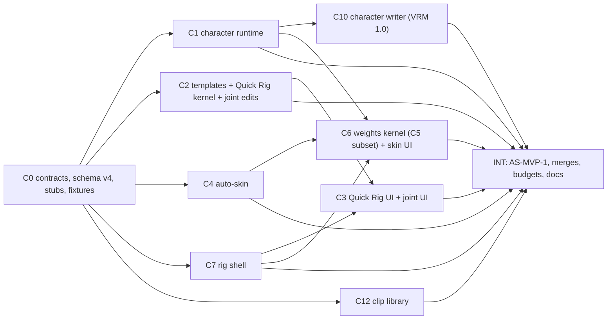
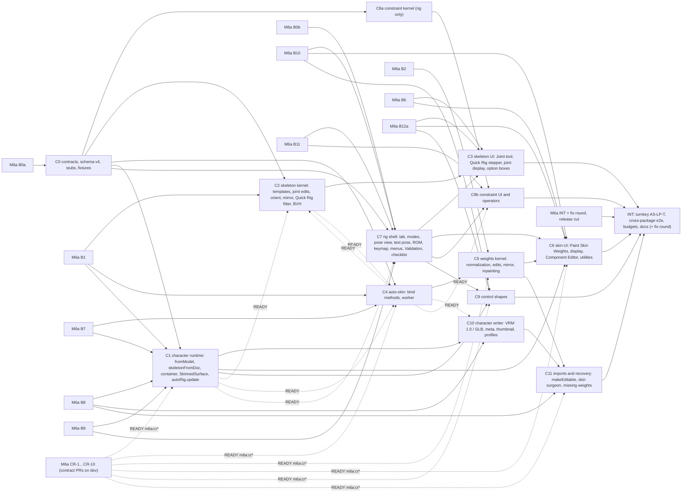

# Ekza Studio — M6b build specification ("Rig & Skin workspace")

Status: **v1.3 (2026-10-22): §0 revised after the MVP spec review (18 issues, record §0.9)**; v1.2 (2026-10-22): §0
"MVP cut" added — binding, it wins over every other section where they differ
([ADR 0020](adr/0020-m6b-mvp-cut.md)); v1.1 (2026-10-19), the binding build spec for milestone M6b, revised after its design review (45 issues: one
blocker, twenty-three majors, twenty-one minors, three of them duplicates; the record with every applied change and
every rejection is §12.5). M6b turns
a mesh modelled in the editor (M6a) into
an animatable, exportable character inside one browser tab, and — on the owner's request "do we have basic rigging
tools? let's add them too" — grows from "characters from own models" into a full but bounded **Rig & Skin workspace**:
Maya's joint tools, Orient and Mirror Joint, templates and Quick Rig, Bind Skin with automatic weights, Paint Skin
Weights, the Component Editor weight table, weight utilities, parent/point/orient/aim constraints (moved from M2c,
FR-RIG-10), control shape editing (moved from M2c, FR-RIG-13), bind-pose management, deformation tests and the
VRM 1.0 / GLB character writer.

It is derived from [MODELING-PLAN](MODELING-PLAN.md) v0.3 §5 (expanded with this spec), research
[14](research/14-skinning-own-models.md) (pipeline, data, writers), [17](research/17-maya-rigging-basics.md) (Maya's
rigging tools, auto weights, painting), [18](research/18-constraints-control-shapes.md) (constraints and control
shapes) and [19](research/19-rig-workspace-ui.md) (workspace UI), [M6A-SPEC](M6A-SPEC.md) v1.1 (whose contracts,
conventions and shared-file rules this spec extends), [M2A-SPEC](M2A-SPEC.md) (IK, attribute channels, compile rules),
research [07](research/07-rig-controls-math.md) and ADRs [0004](adr/0004-rig-model.md), [0005](adr/0005-export-strategy.md),
[0010](adr/0010-ekza-integration-tiers.md), [0014](adr/0014-mesh-kernel.md)–[0016](adr/0016-modeling-interaction-paradigm.md).
The contract freezes when C0 merges; after that a contract change needs a PR that updates this file first.

Audience: the M6b integration agent (C0 and INT), the implementation agents of C1…C11 and reviewers. Read MVP-SPEC,
M2A-SPEC and M6A-SPEC first. This file lists the **M6b deltas**; where it disagrees with them, with a research note or
with the plan, **this file wins**, and §12 lists every deliberate refinement and every research conflict it resolved.
Requirements: [REQUIREMENTS](REQUIREMENTS.md) FR-JNT-01…10, FR-SKIN-01…09, FR-RIG-10 and FR-RIG-13 (moved from M2c),
FR-SHELL-11 (the Rig & Skin tab).

Normative words: **MUST**, **SHOULD**, **MAY**. Notation (research 07 §1.2): character space is canonical (+Y up, +Z
forward, left = +X), metres; `H` = the character's height; transforms are similarity transforms `X = (t, q, s)`,
column vectors, `A·B` applies `B` first; quaternions `(x, y, z, w)` with `w ≥ 0` when stored; `W` = world (character
space), `L` = local, `Z` = a control's zero frame, superscript `⁰` = rest. "Joint" = a `JointRecord`; "bone" = a
`SkeletonDesc` node; "control" = a `ControlRecord`; "point" = a mesh-core point (a welded vertex; weights are per
point); "palette" = the joint list a mesh's skin layers index. Angles are stored in radians and shown in degrees;
weights are fractions shown as `0.500`.

Contents: [0 MVP cut](#0-mvp-cut-owner-flow-2026-10-22) · [1 Scope](#1-scope) · [2 Dependencies, branches, M6a prerequisites](#2-dependencies-branches-and-m6a-prerequisites) ·
[3 Conventions](#3-conventions-deltas-to-m6a-spec-3) · [4 Contract deltas](#4-contract-deltas) ·
[5 Normative behaviours](#5-normative-behaviours) · [6 Operator table](#6-operator-table) ·
[7 Keymap](#7-keymap-additions-preset-maya) · [8 UI placement](#8-ui-placement) · [9 Work packages](#9-work-packages) ·
[10 Acceptance](#10-acceptance-tests-e2e-scenarios-and-as-lp-t) · [11 Integration and definition of done](#11-integration-plan-and-m6b-definition-of-done) ·
[12 Decisions, refinements, owner questions](#12-defaults-refinements-and-owner-questions) · [13 Sources](#13-sources)

---

## 0. MVP cut (owner flow, 2026-10-22)

**Binding. Where §0 and any other section of this file differ, §0 wins.** Every other section keeps its text as the
full-M6b reference; items §0.3 marks *deferred* are built after the MVP (their spec text, tests and ids stay, their
e2e scenarios are not landed in the MVP). Decision record: [ADR 0020](adr/0020-m6b-mvp-cut.md).

### 0.1 Goal in the owner's words

> "I model a character. I go to the front view and place locators where the joints are — elbows, shoulders, neck,
> head — and in the side view too, and the VRM skeleton is created automatically from these locators. I quickly
> adjust it to the model. I press a button, everything gets skinned, and I can look at different animations."

The MVP is that loop, end to end, in one browser tab: **model → Quick Rig markers → Create Skeleton → fit joints →
Bind Skin → paint fixes → test pose → clip library preview → Use Clip → edit in the Graph Editor → shade → Export
VRM 1.0** that OMOBA's runtime admits (§0.4.6) and Ekza Space plays. Everything else of M6b (constraints, control
shape editing, the Joint tool, imports recovery, the weight table) follows after the MVP.

### 0.2 Primary scenario (precise UX)

Starting point: a scene mesh (or several) modelled in Model — a low-poly humanoid box-modelled from cubes, standing on
the ground (min y = 0), facing +Z, **T-posed**, X-symmetric (M6a's symmetry; the "Cube Lad" of §0.7 is the reference).

1. **Enter.** Select the meshes → the Rig & Skin tab (or Model Toolkit footer `Rig & Skin ▸`). The checklist (§0.4.5)
   opens at ① *Place markers*; its button (and Skeleton › Quick Rig…) starts **Quick Rig** on the selected meshes.
   Quick Rig first checks the geometry (§0.4.2 *Start checks*): a model off the centre line, not grounded or not facing
   +Z gets a notice with the one-click fixes *Center and ground* and *Rotate to face +Z* (one undo step each), and
   Create Skeleton stays disabled until the checks pass.
2. **Markers, pre-placed.** Quick Rig switches the viewport to the layout **R-Markers** (`front │ side │ persp`,
   40/30/30) and runs the **One-Click guess** at once (`guessMarkers`, §0.4.2): nine user markers appear on the mesh —
   centre markers **Head top**, **Chin / neck**, **Pelvis** (on `x = 0`) and side markers **Shoulder**, **Elbow**,
   **Wrist**, **Knee**, **Ankle**, **Toe** on the character's **right** side (`x < 0`, the left half of the front
   pane). The left side shows their mirror images as non-interactive ghosts. The user only corrects. The marker list in
   the Quick Rig panel names each marker with its state (guessed / moved) and highlights the selected one; when the
   guess fails (no leg split or no arm run) the markers are placed from the template proportions on the bounds and the
   panel says why. **Clear** removes every marker (the panel then asks for them in list order: a click in the front
   pane places the next missing marker at the click's x/y with its depth by projected centre); **Guess** re-runs the
   guess. Markers and the preview are session state (U): no document write, no history step, gone when Quick Rig closes
   or the workspace changes.
3. **Front edits X/Y, side edits Z.** Dragging a marker in the **front** pane changes only its x and y; in the **side**
   pane only its z and y; **dragging in an orthographic pane never changes the axis that pane does not show**, so a
   depth set in the side view survives any later front drag. Centre markers keep `x = 0` (a front drag moves them in y
   only). The persp pane shows markers and the preview but does not drag them (hover hint "Drag markers in the front or
   side view"). Snapping: `X` grid snap as in Model; `Shift` ×0.1 drag speed. **Overlapping markers** (in a T-pose the
   side pane shows shoulder, elbow and wrist on one spot): the marker selected in the panel list wins the pick, and
   repeated clicks on the same spot cycle through the markers under the pointer (§0.4.2 *Pick rule*); the selected
   marker is drawn on top with its label, so "select Elbow in the list, drag in the side pane" sets the elbow's depth.
4. **Live skeleton preview.** While markers move, the **VRM humanoid skeleton of the chosen template** (Standard 33 by
   default; Lite 17 / Core 21 / Full 52 in the panel's template select) is fitted from the markers on every pointer
   frame (`fitTemplate`, §0.4.2) and drawn as a preview (joints and bones in the ghost style of §8.3, both sides), so
   the user sees spine, chest, clavicles, neck, head, fingers and toes follow. Interpolated joints (spine, chest,
   clavicles, fingers, toe tails) are never markers.
5. **Create Skeleton.** The panel's **Create Skeleton** runs `skel.quickRig.commit` (§5.8 step 5): in **one undo
   step** the character is created from the selected meshes (§5.1 `char.fromModel`), its skeleton with the previewed
   joints (bit-equal to the last preview), and its control rig (legs IK, arms FK). Quick Rig closes and the workspace
   is **in Skeleton mode** (`rigState().mode === 'skeleton'`) with the joints drawn; the next step needs no key press
   (pressing `1` now would toggle back to Object, §5.24). **Quick Rig again** on a character that already has a
   template skeleton seeds the markers from its current joints and, on Create Skeleton, refits those joints **in
   place** (same ids, one undo step "Refit Skeleton" with `rig.autoRig.update` inside); when its meshes are bound it
   first shows the `rebindSkin` confirm (§0.4.2 *Re-run*).
6. **Fit joints quickly.** Skeleton mode, symmetry on: `W` drag moves a joint with its subtree, `D` held + `W` the joint
   only (knees, elbows), `E` rotates the rest (before binding), the partner follows (§5.7). Skeleton › Orient Joints and
   Mirror Joints (§5.5, §5.6.1) are there for non-standard edits; Attributes of the selected joint (name, human bone,
   rest position) sit in the Rig Toolkit; rename is optional (§0.3).
7. **Bind Skin — one click.** Checklist ③ or Skin › Bind Skin runs `skin.bind` with the defaults (`auto-lowpoly`, four
   influences, normalized, symmetrized) on every mesh of the character, in the skin worker, one undo step; Skin mode
   (`2`) opens with the greyscale weight display. The option box `⋯` exposes the method and its numbers.
8. **Paint fixes.** Skin mode: the Paint Skin Weights brush with Replace / Add / Smooth (Scale too), value, opacity,
   radius (`B`/`M`/`N` drags), Flood, X-mirror stroke (default on with skeleton symmetry), holds; greyscale or
   influence-colour display; pick the active influence in the panel list or by clicking a joint glyph. One stroke = one
   undo step. Mirror Skin Weights copies one side to the other.
9. **Test pose.** `E` on a bound joint (or a control in Object mode) poses it for testing (§5.17: never a key, never in
   the document; IK limbs switch to FK for the test); painting works on the posed mesh; **Go to Bind Pose** returns.
10. **Look at animations.** The **Clip Library** panel (Rig Toolkit section in Rig & Skin, a right-dock tab in Animate;
    §0.4.7) lists the CC0 starter pack (Idle, Walk, Run, Jog, Sword attack, Punch, Cast, Hit, Death, Dance, Pistol
    shoot, Jump start / loop / land). **Click a clip → the character plays it** in a loop (preview: no document write,
    no undo step, badge `PREVIEW Walk`); click another to switch, `Esc` or Stop to end.
11. **Use Clip.** The clip's **Use Clip** button brings it into the document as an **editable clip on the character's
    controls** (one undo step, the shipped VRMA import path, the clip becomes active); in Animate it is edited like
    any clip — the Graph Editor, the Dope Sheet, keys. Works on imported VRM characters as well.
12. **Shade** (shipped, [SHADING-SPEC](SHADING-SPEC.md)): in Model, select faces or the mesh → Assign New Material ›
    Lambert / Blinn, or edit swatches in the Palette panel; weights survive (paint edits never touch skin layers).
13. **Export VRM 1.0.** File › Export Character…: VRM meta (name, authors, licence preset — "Open — CC0" first), the
    thumbnail, the profile **Ekza avatar — Space and OMOBA (VRM 1.0)** (`ekza/space-avatar-v1`), the Validation rows
    as the gate, the banner "OMOBA plays its own motion library on your VRM; your clips play in Space". The file passes
    glTF-Validator, `vrm-validator`, the `vrm.*` lints (OMOBA's runtime rules, §0.4.6) and OMOBA's own
    `validate-runtime-vrm`.

### 0.3 Scope: in and deferred

| Package (§9) | MVP | What the MVP builds | Deferred (post-MVP; spec text kept) |
|---|---|---|---|
| **C0** contracts | **in** | §4 contracts verbatim (complete, so post-MVP work adds no schema change), schema v4 (§4.1) compatible with swatches table v2 (§0.4.8), stubs, the §0.5 additions (incl. the `preview` priority, the pre-run hook, the badge slot, every MVP panel registration), lazy chunks incl. `clip-library`, fixtures incl. the Cube Lad (§0.7), test-API stubs, e2e helpers | — |
| **C1** character runtime | **in** | §5.1 (`char.fromModel`, `char.adopt`, `mesh.importStatic`, `skeletonFromDoc`, `jointsFingerprint`, `measureSkinned`, container, registry hook, `character-runtime` chunk), `SkinnedSurface`, §5.16 `rig.autoRig.update` (humanoid + generic rules; prop and socket controls are written but unused), minimal writer, CR-7 (§0.4.1) | — (props and sockets arrive with C2's deferred operators) |
| **C2** templates + Quick Rig | **in** | §5.2 templates (four presets, Standard 33 default, root helper, flexion, CR-2 pre-fit), **Quick Rig v2** (§0.4.2) with `guessMarkers` and `fitTemplate`, `projectedCenter`, the BVH, joint edits for the flow: `skel.joint.move`, `skel.joint.rotateRest`, `skel.joint.setRest`, `skel.joint.orient` (§5.5, key conversion included), `skel.joint.mirror` (§5.6.1), `skel.joint.setHumanBone`, `skel.joint.rename` (optional: implement if time remains), `skel.symmetry.set`, `skel.template.create`, `skel.template.addMissing`, `skel.joint.flex`, `checkSkeleton` (`skel.*`, `xform.*`) | Joint tool chains (`skel.joint.create`), Insert/Split, Remove/Delete, reparent/unparent, Duplicate, Set Side/Role, sockets, Attach Prop, `skel.pose.applyAsRest` and the A-pose path (§0.4.2) |
| **C3** skeleton UI | **in** (subset) | Quick Rig panel, markers tool and the front/side axis rule, live preview, layout R-Markers; joint overlay and picking (§8.3 joints, bones, x-ray, axes on selection, labels on hover, missing-bone rings); §5.7 state table (`W`, `D`+`W`, `E`, `D`+`E`; test pose on bound joints incl. IK → FK); Orient / Mirror option boxes; the Rig Toolkit Skeleton section with the selected joint's fields | Joint, Insert Joint and Socket tools, Add Chain, Duplicate, Attach Prop dialog, T-Stance, Apply Pose as Rest dialog, Outliner joint rows (need CR-5), Channel Box rest rows, `rig.tools.skeleton` marking menu |
| **C4** auto-skin | **in** | §5.9: `auto-lowpoly` (default), `heat` (Jacobi PCG), `rigid-islands`, `closest`; visibility; post-processing with symmetrize and rigidify; palette rules; point and joint masks (one joint = rigid attach); the skin worker; `skin.bind` (incl. the `rebindSkin` confirm), `skin.unbind`; first-bind control rig; the CSR / PSD Laplacian / lumped-mass / PCG kit | `skin.weights.autoForJoints` (no Joint tool in the MVP), sparse LDLᵀ (only inpainting needs it) |
| **C5** weights kernel | **merged into C6** for the MVP (the MVP's ≤ 10 packages) | the MVP subset lives in C6 (below) | inpainting, `transferWeights`, `fillMissingWeights`, `foldJoints`, Hammer, Move Weights, copy/paste vertex weights, Rigid Islands utility, review layer flow |
| **C6** skin UI | **in** (+ C5 subset) | kernel: §5.10 normalization with holds, `editWeights` kinds `set`, `stroke`, `flood`, `smooth`, `prune`, `normalize`, `compact`; `beginStroke` (P-S2); `mirrorWeights` (P-S3); `checkSkin`; `skinDirty`; UI: Paint Skin Weights (Replace, Add, Scale, Smooth, Flood, value, opacity, radius, falloff, surface/volume, front faces, X-mirror stroke, `B`/`M`/`N`/`I`/`Shift+I`, posed picking, Skin-mode `E` test rotate), weight display greyscale / ramp / influence colours (the 0-byte influence switch), Paint Weights panel (§8.7, influence list with holds), the Rig Toolkit Skin section (Bind Skin button and `⋯`, Unbind, Mirror Skin Weights, Prune, Normalize), Attributes › Skin inside the Toolkit | Component Editor (optional: implement if time remains, tests as `test.fixme('c6-ce')`), numbers overlay, Lock-Relative, Paint Select mode, the `rig.tools.skin`/`skin.joint`/`paint.ops` marking menus |
| **C7** rig shell | **in** (subset) | §5.24 workspace (enabled tab, modes Object / Skeleton `1` / Skin `2`, `F8`; Shapes mode hidden), CR-4 (§0.4.1), scopes and shadows (`S` never keys), §5.17 test pose (`TestPoseService`, `recordTestPose`, `dropTestPoses`), channel sources `bind` and `test` (C0 lands `animate` and the `preview` priority, §0.5), pose view Bind / Test (+ the `PREVIEW` badge), layouts R-Side and R-Markers, menus Skeleton and Skin (MVP items only) and File › Export Character / VRM Meta / Render Thumbnail, Rig Toolkit frame with the MVP checklist (§0.4.5), Validation service and panel as the export gate, tab glyph, empty states, Getting started card, the eager gate | ROM clip (`skin.test.rom`; the library replaces it for "look at animations"), Constrain and Control menus, marking menus other than `rig.modes`, Rig Outliner variant (CR-5), R-Quad / R-Paint presets |
| C8a constraint kernel | **deferred** | — (the compiler keeps compiling constraint records as disabled ops; `parseConstraintParams` and `withoutConstraints` stay C0 baselines) | all of §5.18 |
| C8b constraint UI | **deferred** | — | all of §5.19 |
| C9 control shapes | **deferred** | — | all of §5.20 (the shipped Attributes Size field stays) |
| **C10** character writer | **in** | §5.22 corrected by §0.4.6: VRM 1.0 writer (meta, licence presets, thumbnail, palette materials with swatch shaders, slot clips through the kernel, `ekza_model_v1`, determinism, joint-subset read-back), plain GLB through `local/generic` only, the `vrm.*` lints = OMOBA's runtime rules, Export dialog Character section, VRM Meta dialog, Attributes › Character inside the Toolkit, `/e2e/character-check`, the optional OMOBA validator runner | props in exports (no Attach Prop), `ekza/omoba-humanoid-v1` for model characters (demoted, §0.4.6) |
| C11 imports and recovery | **deferred** | — (Skin mode on imported characters is read-only: "Rig and skin edits on imported avatars arrive after the MVP"; **Use Clip and preview work on imported VRMs**) | all of §5.23, §5.14 automation |
| **C12** clip library (**new**) | **in** | §0.4.7: the CC0 starter pack converted once from the Quaternius UAL fixture to VRMA on the VRM humanoid, committed with a manifest and licence rows; the Clip Library panel; preview; Use Clip | user libraries, uploads, Hub-hosted packs, retargeting non-UAL sources |
| INT | **in** | merges, gates → failures, AS-MVP-1 (§0.7), E2E-RIG-10, budgets, docs, the OMOBA validator run, a fix round | AS-LP-T (§10.3) moves to after the full M6b |

The §1.2 stretch list stays deferred except the CC0 starter pack, which is now C12 (core). Owner-visible features
that are deferred never appear as enabled UI in the MVP: their menu items are absent (not disabled stubs), so the
menus show only what works. C0 still registers every §6 operator id from stub files (contract freeze), but the menus,
the palette and the keymap list only the MVP operators (§0.6).

### 0.4 Binding deltas

#### 0.4.1 Branches, M6a contract requests, release

- **M6a is released** (`v0.3.0`, `v0.3.1` on `main`). The staging rule of §2.2 is replaced: the MVP integration branch
  is **`m6b/mvp`** (from `dev`, carrying this spec). C0 lands on it first; every package branches `m6b/<slug>` from
  `m6b/mvp` after its dependsOn packages merged there and merges back into it. INT merges `m6b/mvp` into `dev` as its
  last step, with the full gate green. Schema v4 reaches `main` only with the release that ships the MVP (owner's call,
  §0.8 Q-MVP-1); `v0.3.x` patch releases are cut from `main`.
- **Contract requests** (§2.4): M6a's packages are merged, so the MVP edits M6a files **directly**, each change owned
  by one package (§9.0) and tested by it. In the MVP: **CR-2** (`humanoidBodyRig`) → C2; **CR-4** (`keyModes` in the
  scope chain) → C7; **CR-7** (`mesh.primitive.set` refuses skinned meshes) → C1. **Deferred with their fallbacks**
  (§2.4 last column): CR-1 (weight-only `writeData`: plain `writeData`, stroke undo ≤ 40 ms, the C6 bench reports),
  CR-3 (marking menus over joints), CR-5 (per-workspace Outliner/Attributes/Channel Box providers: the Rig panels render
  inside the Rig Toolkit), CR-6 (palette mirror keys: the MVP's joints are template joints whose VRM names pair
  `left*`/`right*`, which the shipped name-pair rule handles), CR-8, CR-9, CR-10 (their features are deferred).
- `READY` and `test.fixme` gates (§3 rule 4) work as specified, with the gate ids of §9.0.

#### 0.4.2 Quick Rig v2 (replaces §5.8 for the MVP; C2 maths, C3 UI)

- **Markers** (`QuickRigMarker`, §0.5): centre `headTop`, `chin`, `pelvis` (x = 0); right side `shoulder`, `elbow`,
  `wrist`, `knee`, `ankle`, `toe` (x < 0; the left joints use the mirror `(−x, y, z)`). Meaning: `headTop` = the top of
  the head (head tail; with the ground it gives `H`); `chin` = where the neck meets the head, under the chin; `pelvis` =
  the hips joint; `shoulder` = the upper-arm joint (the ball of the shoulder); `elbow`, `wrist` = lower-arm and hand
  joints; `knee`, `ankle` = lower-leg and foot joints; `toe` = the toes joint (the ball of the foot).
- **Fit** (`fitTemplate(template, markers, bvh, opts)`, pure, deterministic; preview and commit call it with the same
  inputs, so the committed joints equal the last preview bit for bit). With `H = headTop.y − ground` (ground = the
  meshes' min y): `hips = pelvis`; `rightUpperLeg = (knee.x, pelvis.y − 0.02 H, pelvis.z)`; `rightLowerLeg = knee`;
  `rightFoot = ankle`; `rightToes = toe`, toes tail = the meshes' front extent at the toe's x and below `toe.y + 0.02 H`
  (else `toe + (0, 0, 0.04 H)`); `rightUpperArm = shoulder`, `rightLowerArm = elbow`, `rightHand = wrist`, hand tail =
  `wrist + 0.55·(wrist − elbow)`; `rightShoulder` (clavicle) = halfway between `shoulder` and the spine axis at the
  shoulder's height (z of the chest); `neck = (0, chin.y − 0.01 H, chin.z)`; `head = (0, chin.y + 0.02 H, chin.z)`;
  head tail = `headTop`; `spine`, `chest` (and `upperChest` for Full 52) evenly between `hips` and `neck` on the line
  between them, their z by projected centre; fingers by preset along `wrist − elbow` with the thumb at 45° (§5.2
  finger table on the hand length `h = |hand tail − wrist|`); every left joint the mirror of its right partner; rest
  flexion last, as a **minimum bend** (below). Markers are never moved by the fit; joints are (flexion only).
- **Rest flexion = minimum bend** (replaces §5.2's absolute "moves to z" for Quick Rig; on the straight template limbs
  of `skel.template.create` both give the same joints). Per right limb, with the root joint `A` (`rightUpperArm` /
  `rightUpperLeg`), the hinge joint `B` (`rightLowerArm` / `rightLowerLeg`), the end joint `C` (`rightHand` /
  `rightFoot`), the hinge direction `d` (elbow `(0, 0, −1)`, knee `(0, 0, +1)`), `a = |B − A|`, `b = |C − B|`, `P` = the
  closest point to `B` on the line `A–C` and `θ = opts.flexion` (2°): the current bend is `δ = (B − P)·d` and the
  required bend `δmin = θ·a·b/(a + b)`. If `δ ≥ δmin` the joint is unchanged (bit-equal); else `B' = B + (δmin − δ)·d`
  (only `z` changes). The left side mirrors the result. So a depth the user set in the side pane that already bends the
  limb by ≥ θ toward its hinge side survives the commit bit-equal, and the guess's hinge bias (below) is not counted
  twice. Unit tests (C2): a side-pane elbow `z` edit with `δ ≥ δmin` survives `skel.quickRig.commit` bit-equal; a
  straight limb gets exactly `δmin`; a hyper-extended limb (`δ < 0`) is pushed to `δmin`; x and y never change.
- **Guess** (`guessMarkers(bvh, bounds)`): §5.8 step 2's silhouette method extended to the new markers: `headTop` =
  the highest inside sample on `x = 0`; `chin` = the narrowest row between the shoulder row and 0.9 H, ties (rows whose
  widths differ by ≤ 1 raster column, e.g. every row of a box neck) broken by the **topmost** such row; `pelvis` =
  `(0, groin.y + 0.04 H, ·)`; `knee` midway between groin and 0.05 H on the leg run's centre; `ankle` at 0.05 H;
  `toe` at 0.02 H, z at 0.65 of the foot's length from the ankle toward the front extent; `shoulder`, `elbow`,
  `wrist` from the arm run and the arm angle as §5.8 (shoulder = `elbow − 0.95·(wrist − elbow)` clamped into the torso
  edge). Every marker's z = the slab midpoint along the front view ray through its (x, y) (`projectedCenter`), elbows
  shifted back and knees forward by the hinge bias. Deterministic, ≤ 50 ms at 10k triangles (C2 bench, report-only).
  Thresholds are defaults calibrated by C2's spike on the fixtures (recorded in its wp-notes; a change is a contract PR
  to this paragraph).
- **T-pose required in the MVP.** The guess still measures the arm angle; when it exceeds 15° (`aPose: true`) the panel
  shows "A-posed arms: the skeleton follows them, but VRM export needs a T-pose — straighten the arms in Model (the
  A-pose fix arrives after the MVP)" and Validation reports `skel.tpose` (an error for the Ekza profile, a warning for
  `local/generic`). T-Stance and Apply Pose as Rest are deferred.
- **Axis rule** (C3): a drag in a pane maps the pointer to the plane through the marker that faces that pane's camera
  and writes only the two axes the pane shows (front: x, y; side: z, y; top, if the user switched a pane to it: x, z);
  the hidden axis is copied from the marker, bit-equal. Centre markers clamp x to 0. Perspective panes never drag
  markers.
- **Pick rule** (C3): a pointer-down in an ortho pane collects every marker (and ghost; ghosts never drag) within the
  pick radius (8 CSS px). The selected marker (`QuickRigState.selected`, set from the panel list or by the last pick)
  wins when it is among them; otherwise the nearest one wins, ties in list order (`QUICK_RIG_CENTRE_MARKERS` then
  `QUICK_RIG_SIDE_MARKERS`). A click without a drag on the same spot (within 2 px) as the previous click selects the next
  marker of that set in list order (cycling). Each pane draws the selected marker last (on top) with its label.
- **Start checks** (§5.8 step 1 kept, C2 maths, C3 notice): when Quick Rig starts, it measures the meshes' world
  bounds: **centred** `|centre x| ≤ 0.01 H`, **grounded** `|min y| ≤ 0.01 H` and **facing +Z** (the toes' front extent
  — the mean z of the inside samples of the lowest 0.05 H band — lies in front of the band's slab midpoint). A failed
  check shows a notice in the Quick Rig panel with its fix: *Center and ground* (translates the meshes' placements so
  that centre x = 0 and min y = 0) or *Rotate to face +Z* (180° about Y around the centre), each one undo step, run
  before any marker is guessed (the guess re-runs after the fix). Create Skeleton is disabled with the reason until
  every check passes. Validation keeps `skel.grounded` and `skel.facing` (§5.21) for later edits.
- **Re-run** (C2 operator, C3 panel): `skel.quickRig.start` on a character that already has a template skeleton seeds
  the markers from its joints (`headTop` = head tail, `chin` = (0, neck.y + 0.01 H, neck.z), `pelvis` = hips, side
  markers = the right joints of their meaning, before flexion is undone: the markers take the joints as they are) and
  sets every marker `moved` (no guess runs; Guess stays available). Commit then refits the existing joints **in place**
  (same ids, keys, names and human bones; one step "Refit Skeleton" with `rig.autoRig.update` inside), never a second
  character. The preset select is locked to the skeleton's `SkeletonRecord.preset` (changing the template means a new
  skeleton; out of scope). When any of the character's meshes is bound, commit first shows the `rebindSkin` confirm
  ("Rebind replaces painted weights"); on confirm the same step refits the joints and rebinds every bound mesh with its
  stored bind arguments; Cancel keeps Quick Rig open. An asset-sourced (imported) character refuses Quick Rig with
  "Rig edits on imported avatars arrive after the MVP" (§0.3 C11 row).
- **Session state** (`RigSessionState.quickRig`, §0.5) holds the markers, which ones the user moved, the selected
  marker, the template preset and the current preview; the stepper of §5.8 collapses to one panel (markers, template,
  Guess, Clear, Create Skeleton, Cancel). `skel.quickRig.commit` args: `{preset, markers, meshes, flexion}` (no
  `proportions`: the markers carry the proportions). Leaving Rig & Skin, `Esc` or Cancel closes Quick Rig without a
  step.
- **Gates** (C2, P-J4 replaced): on synthesized markers (the truth's own joints) the fit places every humanoid joint
  within **0.03 H** of the truth on the Cube Lad (§0.7), the generated body and T-posed Polybot; the guess places every
  marker within **0.05 H** of the truth markers on the same three — **the Cube Lad's `chin` included** (the box-neck tie
  rule) — and the guess is bit-identical over two runs; a front drag of 1,000 random markers leaves z bit-equal and a
  side drag leaves x bit-equal (C3 unit test of the axis rule); the minimum-bend tests above; the pick rule (selected
  wins, click cycles; C3 unit test); the start checks on an off-centre and a −Z-facing Cube Lad (C2 unit test); a
  re-run commit keeps every joint id (C2 unit test).

#### 0.4.3 Joint fit (C2 kernel, C3 UI)

The §5.7 state table holds as written (`W` subtree, `D`+`W` joint only, `E` rest rotate before binding, `D`+`E`
re-orient, test pose on bound joints, `R` disabled) with symmetry. Orient Joint (§5.5) and Mirror Joint (§5.6.1) are in
the Skeleton menu and the Toolkit. Selecting joints: click (sphere > bone > mesh), `Shift`/`Mod` modifiers, marquee in
Skeleton mode, `Mod+A`. Every rest edit runs `rig.autoRig.update` in its transaction (§5.16). A required bone can be
re-mapped with `skel.joint.setHumanBone` from the Toolkit; `skel.required-bones` keeps its Fix (Add Missing Bones).

#### 0.4.4 Bind and weights (C4 kernel, C6 kernel and UI)

§5.9 and §5.10–§5.12 hold for the listed subset. **Unweighted points** (a Model edit that appended unweighted geometry
to a bound mesh, e.g. a new primitive combined in a later Model session — rare, since M6a's layer rules carry weights
through topology ops) are fixed without inpainting: the Validation row `skin.unweighted-vertex` gets the Fix **Bind
Unweighted Points** = `skin.bind {meshes: [m], points: <the unweighted points>}` with the stored bind arguments (a
masked re-solve; every other point keeps its weights bit-equal). The automatic fill on leaving Model is deferred.

#### 0.4.5 Shell, checklist, Validation (C7)

- **Checklist (MVP)**: ① *Place markers* (done when the character has a skeleton; button: Quick Rig) · ② *Fit joints*
  (no `skel.*` error; hint "`D` + drag moves one joint") · ③ *Bind skin* (every mesh bound; button: Bind Skin, one
  click) · ④ *Fix weights* (no `skin.*` error or warning; button: Skin mode, Paint) · ⑤ *Try animations* (a library
  clip was previewed this session or a clip exists; button: Clip Library) · ⑥ *Export* (no error row for the chosen
  profile; button: Export Character…). It collapses to `Setup 6/6 · ●`.
- **Validation** (§5.21) with the MVP rows: every `skel.*` and `xform.*` row, `skin.unbound`, `skin.unweighted-vertex`
  (Fix §0.4.4), `skin.influences`, `skin.weight-sum`, `skin.unreachable-island`, `skin.cross-side`,
  `skin.joint-without-weights`, `skin.non-deforming-weighted`, `rig.out-of-sync`, and every `vrm.*` row of §0.4.6.
  The Export dialog's Character section blocks on the profile's error rows.
- **WorkspaceDef menus (MVP)**: `file, edit, create, select, modify, display, skeleton, skin, windows, help` (§5.24's
  `constrain` and `control` are absent, Q-MVP-15). The MVP checklist has no "Control rig" step (§5.16's "checklist step
  ⑥" and §5.21's ⑥ row do not apply): the rig is created by Create Skeleton and kept in sync by every rest edit, and
  `rig.autoRig.update` is reachable from **Skeleton › Update Control Rig** and the `rig.out-of-sync` Fix.
- **Menus (MVP)**: Skeleton — Quick Rig… · Skeleton Template ▸ · Orient Joints ⋯ · Mirror Joints ⋯ · Map Humanoid
  Bone ▸ · Rename (if built) · Update Control Rig · Symmetry X ✓ · Snap to Projected Center ✓; Skin — Bind Skin ⋯ · Unbind Skin · Go to
  Bind Pose · Paint Skin Weights · Mirror Skin Weights ⋯ · Smooth Skin Weights ⋯ · Prune Small Weights ⋯ · Normalize
  Weights · Remove Unused Influences · Component Editor (if built); Display — Joint Size ▸ · X-Ray Joints · Local
  Rotation Axes ▸ · Joint Labels ▸ · Weight Display ▸; File — Export Character… · VRM Meta… · Render Thumbnail;
  Windows — Rig Toolkit · Paint Weights · Validation · Clip Library.

#### 0.4.6 Export: VRM 1.0 is the OMOBA deliverable (corrects §5.22 "Profiles" and the banner; C10)

Facts verified in `omoba-bevy` (`passport/src/humanoid.rs`, read-only): **OMOBA has no skeleton of its own; it uses
VRM humanoid semantics and plays its own motion library on VRM avatars** (user clips play in Ekza Space). The
deliverable is therefore **one VRM 1.0 file** (`VRMC_vrm`, `specVersion "1.0"`) that Space and OMOBA both admit; the
plain five-clip GLB is not an OMOBA deliverable.

- **Profiles for model-sourced characters**: `ekza/space-avatar-v1` (label "Ekza avatar — Space and OMOBA (VRM 1.0)",
  the default) writes `writeCharacter({format: 'vrm'})` and adds the `vrm.*` lints below to its rules; `local/generic`
  writes VRM 1.0 or a plain GLB (`format: 'glb'`, the plain GLB's only route). `ekza/omoba-humanoid-v1` (the shipped
  five-clip GLB bake) is **not offered** for model-sourced characters; it stays unchanged for asset-sourced bakes.
- **`vrm.*` lints = OMOBA's runtime rules, check for check** (`io/src/lint/vrm.ts` mirrors
  `omoba-bevy/passport/src/humanoid.rs`; errors for the Ekza profile, warnings for `local/generic` VRM, absent for
  plain GLB). They accept **VRM 0.x and VRM 1.0 exactly as OMOBA does**, with the version taken from the file:
  - `vrm.spec-version`: exactly one of `extensions.VRM` (`specVersion` starting `"0."`) or `extensions.VRMC_vrm`
    (`specVersion` = `"1.0"`); neither or both is an error; `asset.version` = `"2.0"`.
  - `vrm.container`: a GLB with one JSON chunk followed by at most one BIN chunk; exactly one buffer whose
    `byteLength` equals the BIN chunk; no `uri` on any buffer or image (embedded only).
  - `vrm.glb-size` (GLB ≤ 50 MiB), `vrm.json-size` (JSON chunk ≤ 4 MiB), `vrm.node-count` (1–4,096 nodes).
  - `vrm.humanoid-bone-count` (≤ 64 entries in the humanoid map).
  - `vrm.bone-names`: every mapped name is a humanoid bone of the file's version (VRM 1.0 thumbs `ThumbMetacarpal/
    Proximal/Distal`; VRM 0 `ThumbProximal/Intermediate/Distal`); no bone name or node assigned twice.
  - `vrm.required-bones`: hips, spine, head, left/right upper arm, lower arm, hand, upper leg, lower leg, foot (15);
    **VRM 0 adds `chest` and `neck`** (17).
  - `vrm.parent-map`: every mapped bone's nearest mapped ancestor is its humanoid parent after skipping unmapped
    optional parents (OMOBA's `semantic_parent` for the version); `upperChest` requires `chest`; an `Intermediate`/
    `Distal` finger segment (and VRM 1.0 `ThumbProximal`) requires its preceding segment.
  - `vrm.node-tree`: every node has at most one parent and no duplicate child reference; scene 0 lists distinct root
    nodes; no skin lists a joint twice.
  - `vrm.trs-only` (no `matrix`); `vrm.unit-rotation` (every rotation quaternion has `| |q| − 1 | ≤ 1e-4`, never
    zero); `vrm.translation-range` (`|t_i| ≤ 1e6`); `vrm.uniform-scale` (every scale component in `[1e-6, 1e6]` and
    within `s₀·1e-5` of `s₀`).
  - `vrm.extensions-required` (only `KHR_materials_unlit`, `KHR_texture_transform`; `extensionsUsed` is unrestricted,
    so `KHR_materials_specular` of a Blinn swatch stays allowed as used-only).
  - `vrm.bones-skinned` (every mapped bone is a joint of a skin of a mesh node under scene 0).
  - plus §5.21's `vrm.meta-required`, `vrm.licence-unset`, `vrm.thumbnail-square`.

  Each rule has one failing fixture (`packages/io/test/m6b-vrm-lints/` or `headless-tests/test/m6b.writer.*`) and its
  message quotes OMOBA's. The rules run on the **written bytes** of every Ekza-profile VRM route, so **asset-sourced
  Space bakes keep passing**: the shipped `ops.export.test.ts` export of `fixtures/models/polybot.vrm` (VRM 0.x) with
  `ekza/space-avatar-v1` stays green unchanged (it has `chest` and `neck`; C10 adds an explicit regression assertion
  that the `vrm.*` rows are clean for it). Our own writer always emits VRM 1.0 (`writeCharacter`); the lints do not
  require it. The Space profile's `jsonMaxBytes` becomes 4 MiB (C10's `builtin.ts` edit) to match `vrm.json-size`.
- **Rest pose**: T-pose with the template's 2° elbow and knee flexion (§5.2) — inside VRM's T-pose tolerance and
  admitted by OMOBA.
- **Clips in the VRM**: slot clips (incl. clips brought in with Use Clip) are embedded for Space; OMOBA ignores them.
- **Banner** (Export dialog, Character section; replaces §5.22's interop banner): **"OMOBA plays its own motion
  library on your VRM; your clips play in Space."**
- **External validator** (INT, local only, never in `pnpm run ci`): `tooling/omoba-validate.mjs <file.vrm>` runs `cargo
  run -p omoba-passport --bin validate-runtime-vrm -- <file.vrm>` in `/Users/wotori/git/ekza/omoba-bevy` with that
  repository's existing target dir (`CARGO_TARGET_DIR` = its shared `target`; never `cargo clean`, never a new target
  dir) and exits 0 with "skipped" when the checkout is absent. The checkout is read-only for this project.

#### 0.4.7 C12 — Clip Library (new package)

- **Source**: `fixtures/animations/quaternius-ual.glb` (Quaternius Universal Animation Library, CC0 1.0, Rigify `DEF-*`
  skeleton, shipped fixture with its LICENSES row). Reference pose: its `A_TPose` clip at the first key.
- **Bone map** (`UAL_BONE_MAP`, ported from `omoba-bevy/scripts/retarget_animations.py` `BONE_MAP` and checked against
  `ekza-avatar-renderer/src/humanoidRetarget.ts`, both read-only): `DEF-hips` → hips, `DEF-spine.001` → spine,
  `DEF-spine.002` → chest, `DEF-spine.003` → upperChest, `DEF-neck` → neck, `DEF-head` → head, `DEF-shoulder.L/R` →
  left/rightShoulder, `DEF-upper_arm.*` → *UpperArm, `DEF-forearm.*` → *LowerArm, `DEF-hand.*` → *Hand, `DEF-thigh.*`
  → *UpperLeg, `DEF-shin.*` → *LowerLeg, `DEF-foot.*` → *Foot, `DEF-toe.*` → *Toes, fingers `DEF-f_index|f_middle|
  f_ring|f_pinky|thumb.0{1,2,3}.L/R` → *Index|Middle|Ring|Little|Thumb + Proximal|Intermediate|Distal (VRM 1.0 thumb
  names: `.01` → ThumbMetacarpal, `.02` → ThumbProximal, `.03` → ThumbDistal).
- **Retarget** (`retargetUalClip`, io, pure and deterministic): the world-space delta method of the OMOBA script onto
  the **VRM normalized T-pose** (the VRMA frame): per sampled frame `ΔW_b(t) = W_b(t) · (W_b^ref)⁻¹` for every mapped
  bone `b` (rotations; `W^ref` = `A_TPose`'s first key), yaw alignment `A` (identity or 180° about Y, from the sign of
  the left hand's x in the reference, so the result faces +Z with left = +X), normalized world `N_b = A·ΔW_b·A⁻¹`,
  local `n_b = N_parent(b)⁻¹ · N_b` along the VRM humanoid parent map; hips translation = the hips world position
  rotated by `A`, in source metres, with `restHipsPosition` = the reference hips (the shipped VRMA importer scales by
  hips height). Sampling at the source key times (30 fps), quaternions normalized with `w ≥ 0` continuity
  (hemisphere-continuous), no reduction beyond removing constant tracks.
- **Clips** (14; ids are file names; `slot` is a suggestion applied on Use Clip only when the character has no clip
  in that slot):

  | id | UAL clip | label | slot | loop |
  |---|---|---|---|---|
  | `idle` | Idle_Loop | Idle | idle | ✓ |
  | `walk` | Walk_Loop | Walk | walk | ✓ |
  | `run` | Sprint_Loop | Run | run | ✓ |
  | `jog` | Jog_Fwd_Loop | Jog | — | ✓ |
  | `sword-attack` | Sword_Attack | Sword attack | attack | — |
  | `punch` | Punch_Cross | Punch | — | — |
  | `cast` | Spell_Simple_Shoot | Cast | cast | — |
  | `hit` | Hit_Chest | Hit | hit | — |
  | `death` | Death01 | Death | death | — |
  | `dance` | Dance_Loop | Dance | dance | ✓ |
  | `pistol-shoot` | Pistol_Shoot | Pistol shoot | — | — |
  | `jump-start` | Jump_Start | Jump start | jump | — |
  | `jump-loop` | Jump_Loop | Jump loop | — | ✓ |
  | `jump-land` | Jump_Land | Jump land | — | — |

- **Tooling** (the generator imports io's TypeScript, which plain Node cannot load — workspace exports point at `src/
  *.ts` with extensionless imports — so it runs under **vitest**, already a dependency of `io`; no new runner):
  the generator and the check are one test file, `packages/io/test/m6b-library/starter-pack.gen.test.ts`. In
  `pnpm run test` it is the **check**: it regenerates every output in memory and fails when any committed file
  differs (bytes) or is missing or extra. With `EKZA_WRITE_STARTER_PACK=1` it **writes** the outputs instead.
  `tooling/make-starter-pack.mjs [--check]` is a thin plain-Node wrapper (only `node:` modules) that spawns `pnpm
  --filter @ekza-studio/io exec vitest run test/m6b-library/starter-pack.gen.test.ts` with or without that variable,
  for humans; `check:fixtures` does **not** run it (it runs before `test` and cannot import TypeScript). The generator
  is deterministic; it reads the fixture, verifies its SHA-256 against
  `fixtures/LICENSES.md`, retargets each clip and writes **committed outputs** to `apps/web/public/library/animations/`:
  `<id>.vrma` (VRMA 1.0 through the shipped VRMA writer path, `ekza_animation_v1` provenance: licence CC0-1.0, credit
  Quaternius, source UAL clip name), `starter-pack.json` (the manifest, §0.5) and `LICENSE.md` (CC0 deed link and the
  credit line). These are the one exception to ADR 0012's "public/ is generated": they are derived artefacts committed
  so the static deploy needs no build step (ADR 0020). Budget: all files together ≤ 4 MiB (C12 test). `fixtures/
  LICENSES.md` gains a "Starter pack" section with one row per file (derived from the UAL row, CC0) whose path cell is
  **repository-rooted** (`apps/web/public/library/animations/<file>`). `tooling/check-fixtures.mjs` today resolves every
  row against `fixtures/` and requires it under `fixtures/models|animations/`, so C12 extends it: a row whose path
  starts with `apps/web/public/library/` resolves against the repository root, must exist and match its SHA-256, and
  every file under `apps/web/public/library/animations/` needs a row (the same two-way rule); C12 adds the cases to
  `tooling/test/check-fixtures.test.mjs`. The third-party notices page credits "Universal Animation Library by
  Quaternius (CC0)".
- **Serving**: same origin, `/library/animations/starter-pack.json` and `/library/animations/<file>` (studio.ekza.io
  serves `apps/web/public` as static files; no CDN, ADR 0012); `EditorServices.libraryPath` (default `/library/`)
  lets tests and embeds point elsewhere (plumbed like `samplesPath`: one line each in `editor/src/Editor.tsx`,
  `editor/src/shell/EditorRoot.tsx`, `editor/src/services/browser.ts` and `apps/web/app/editor/EditorIsland.tsx`, C0).
  The **manifest** is fetched on the first panel open; **each clip's bytes** on its first Play or Use Clip, verified
  against the manifest's `sha256` and `bytes` (mismatch → that card turns disabled with "The file failed its
  checksum" and the action fails with that toast), and cached in memory per session. Opening the panel never downloads
  the 14 clip files.
- **Panel** (`clipLibrary`, lazy chunk `clip-library`, marker `ekza-clip-library`): a list of clip cards (label,
  duration, loop glyph, slot chip), a search field, Play/Stop per card, **Use Clip** per card, the active character's
  name and "Library: Quaternius UAL · CC0" with the credit link. Placement: a right-dock tab in Animate (Windows › Clip
  Library) and a Rig Toolkit section in Rig & Skin. **C0 lands both registrations** (the `ANIMATE_SLOTS` entry
  `{kind: PANEL.clipLibrary, slot: 'right', title: 'Clip Library'}` in `editor/src/shell/layout.ts`, from which
  `menuItems.ts` derives the Windows item, and the Toolkit section stub), so C12 edits no shared registry. Empty state
  without a humanoid character: "Select a humanoid character (a VRM, or one you rigged here) to preview clips".
- **Preview** (`library.preview {character, clip}` / `library.stop`; U state, never an undo step): the VRMA is read
  (`inspectVrma`) and converted in memory onto the character's rig with the shipped `importHumanoidClip` (same options
  as Use Clip), then played in a loop at its own clock through the evaluation channel source **`preview`** (§0.5): the
  viewport shows it; the document, the history, `session.overrides`, the test pose and the current time are untouched
  (keys hash and store version unchanged). Any document change, keying attempt, workspace switch, character switch,
  `Esc`, Stop or a second click on the playing card stops it. Works on asset-sourced (imported VRM) and model-sourced
  humanoid characters; a generic (non-humanoid) character gets "Clips need a humanoid character". **Mechanics (who owns
  what)**: (1) C0's baseline channel-source resolution (`evaluation/rigSource.ts`, called by the evaluation service in
  **every workspace**, Animate included) gives priority to the registered `preview` provider whenever its
  `values(character)` is non-null, over the workspace's own source (`animate`, `bind` or `test`); C12's provider
  (`evaluation/previewSource.ts`) returns null when no preview runs, so **stopping is the provider returning null** —
  the workspace source applies again with nothing to restore. (2) C0's operator runner (`operators/runner.ts`)
  exposes `app.operators.onBeforeDocumentRun(listener)`: listeners run synchronously before `prepare` of every
  operator with `flags.undo` (which covers every key operator, auto-key and Use Clip) and before `edit.undo` /
  `edit.redo`; C12 subscribes and stops the preview there, so a key is never sampled from the preview pose. Remote document changes stop it through
  the store subscription. (3) C0's viewport badge slot (`editor/src/panels/viewport/hud/badges.ts`, mounted in every
  workspace's viewport) takes providers; C7 registers `BIND` / `TEST POSE`, C12 registers `PREVIEW <label>` from its
  chunk, so the badge shows in Animate and Rig & Skin. (4) Workspace and character switches, the start of a transform
  drag on the previewed character and any test-pose write (`app.rig.testPose.subscribe`, e.g. `E` on a joint) reach
  C12 through the shipped workspace, selection and tool-session subscriptions and C7's test-pose service. The clip-library chunk reads VRMA bytes through the shipped import
  chunk (`workflows/importLoader` `loadImportPath()`, dynamic `import()`), never by importing `parseGlb`/`readVrma` or
  gltf-transform statically.
- **Use Clip** (`library.useClip {character, clip}`; undoable, one step "Use Clip Walk"): `prepare` fetches the
  verified bytes and runs `prepareVrmaImport` (the shipped VRMA import path of `file.importAnimation`); `apply` runs,
  in **one transaction**, `applyClipImport` and then sets on the new clip `{name: uniqueName(label), loop:
  manifest.loop, slot: manifest.slot when no clip of the character holds it (else null)}`. The shipped path would name
  the clip after the VRMA animation and derive `loop` from `/loop/i` on that name; Use Clip overrides both, so the
  name written into the VRMA does not matter for Use Clip. **`writeHumanoidVrma` writes the UAL source name** (e.g.
  `Walk_Loop`) as the VRMA animation name, so a plain `file.importAnimation` of a starter-pack file also gets the
  right loop flag. Keys land on the character's controls (IK legs written as IK by the shipped `ik: 'auto'` rule);
  provenance is licence CC0-1.0, credit Quaternius, source clip (read by the shipped path from the VRMA's embedded
  `ekza_animation_v1`; any field it does not carry is set by Use Clip in the same transaction); the clip is made
  active; the preview stops. The shipped path stores the VRMA bytes as one `animation-source` asset; the asset
  store is content-addressed (id = SHA-256), so repeated Use Clip of one clip reuses one asset. In Animate the clip is
  an ordinary editable clip (Graph Editor, Dope Sheet).
- **Tests**: retarget unit tests (bone map coverage of every UAL `DEF-*` deformer except the root; the reference frame
  gives identity normalized rotations within 1e-6 — a sanity check only; a known Walk frame against a
  three-vrm-animation playback golden of the produced VRMA on the VRM normalized rig, within 1e-4 rad — a read-back
  check only) **plus semantic tests against the UAL source**, which catch left/right and yaw mistakes: (a) at the Walk
  frame where `DEF-foot.L` is furthest forward in the source, the retargeted `leftFoot` world on a VRM T-pose rig has
  x > 0 and is the forward foot (larger z than `rightFoot`); (b) at three frames of Walk and Sword attack, the
  retargeted world direction of each hand's segment (`*Hand` − `*LowerArm`) equals the source's direction after the
  same `ΔW` and `A` within 1e-4 rad; (c) Death's last frame has the hips lower than in the reference. Also: the
  generator check (above); manifest parse and checksum refusal; preview leaves the store version, history and keys
  hash unchanged; a key operator run during a preview stops it first and keys the `animate` value; Use Clip = one undo
  step, and its clip **equals a `file.importAnimation` of the same bytes in curves, keys, fps and range** (deep-equal),
  while `name` = the label, `loop` = the manifest's, `slot` = the manifest's when free and provenance = CC0 Quaternius
  are asserted as given; a second Use Clip of the same clip adds no asset; E2E-LIB-01…03 (§0.7).

#### 0.4.8 Shading and schema v4 compatibility

Schema v4 (§4.1) changes only the core tables named there; the **swatches table stays version 2** (ADR 0019): the
3 → 4 migration never touches `swatches`, `emptySnapshot` writes `schemaVersion: 4` with `tableVersions.swatches = 2`,
and a v3 document with swatches version 1 or 2 migrates both (core 3 → 4, swatches 1 → 2) in one load. A v0.3.1 build
opens a v4 document **read-only when its `minWriterVersion` is 4** (the §4.1 `requiredWriterVersion` rule: a skeleton,
a model character, a built-in constraint, a test clip or a thumbnail asset; `migrate.ts`: `readOnly =
minWriterVersion > SCHEMA_VERSION || newerTable`); **otherwise it opens writable** and saves `schemaVersion: 3`, which
is harmless because such a document has no v4-only content and the idempotent 3 → 4 migration re-applies on the next
v4 load. C0 tests both cases (a v4 snapshot with a skeleton → `readOnly` under a simulated `SCHEMA_VERSION = 3`; a v4
snapshot with meshes and swatches only → writable, saved as 3, reloaded as 4 equal to the original). The character writer applies swatch shaders on `lit` meshes
exactly as SHADING-SPEC §4 does for static exports (Lambert → roughness 1 / metallic 0; Blinn → roughness from
glossiness and `KHR_materials_specular` in `extensionsUsed` only); VRM exports keep the palette texture (§5.22) per
shader group; `unlit` meshes keep `KHR_materials_unlit`.

#### 0.4.9 Budgets (replaces the eager row of §5.25 for the MVP)

The `/editor` initial route stays **≤ 900,000 B** (`check:size`; ≈ 889.5 kB on `dev` at the MVP start) and the MVP's
eager additions are **≤ +6,144 B gzip** over the `dev` measure **before C0** (C0 records it in `size-baseline.json`
as its first commit, so C0's own delta counts), gate by C7. **Per-package eager allowances** (gzip, each measured by
the package against `m6b/mvp` at its merge and reported in its wp-notes): **C0 2,048 B** (stubs, registrations, hooks,
`PANEL` ids, the Animate slot), **C7 2,560 B** (`WorkspaceDef`, menus, keymap, the rig chunk loader), **C12 1,024 B**
(panel stub, `EditorApp.library` service shell, the preview-provider registration), **C1 512 B** (the registry hook);
every other package 0 B (all its code lazy). A package over its allowance may take unused headroom only with INT's
approval recorded in its wp-notes. Recording that baseline is the owner decision Q-MVP-14, which overrides §9.1's
"INT re-records the baseline only with an owner decision" for this one re-record. Lazy chunks: `rig-workspace`
≤ 250 kB, `skin-worker` ≤ 120 kB, `character-runtime` ≤ 150 kB, **`clip-library` ≤ 60 kB** gzip (warnings), each with
its BOUNDARY marker never in the initial route. The library panel's operators, panel and preview code live in
`clip-library`, and it loads io's readers only through the shipped import chunk by dynamic `import()` (§0.4.7);
Animate's eager route gains only the panel stub and the `ANIMATE_SLOTS` entry. Every other §5.25 row applies to the
MVP features it names; rows of deferred features are not measured.

### 0.5 Contract additions and changes (C0 lands them with §4)

```ts
// ---------- rig (C2): Quick Rig v2 — replaces QuickRigMarker, QuickRigMarkers, fitTemplate, guessMarkers of §4.3 ----------
export type QuickRigMarker = 'headTop' | 'chin' | 'pelvis' | 'shoulder' | 'elbow' | 'wrist' | 'knee' | 'ankle' | 'toe';
export const QUICK_RIG_CENTRE_MARKERS: readonly QuickRigMarker[];   // ['headTop', 'chin', 'pelvis']
export const QUICK_RIG_SIDE_MARKERS: readonly QuickRigMarker[];     // ['shoulder', 'elbow', 'wrist', 'knee', 'ankle', 'toe']
/** Character space; side markers are the character's RIGHT side (x < 0); the left side is their (−x, y, z) mirror. */
export type QuickRigMarkers = Readonly<Partial<Record<QuickRigMarker, readonly [number, number, number]>>>;
/** §0.4.2 fit. Missing markers take the template's proportions scaled to the bounds. Pure; preview = commit. */
export function fitTemplate(template: readonly TemplateJoint[], markers: QuickRigMarkers, bvh: TriangleBvh,
  opts: { readonly ground: number; readonly hingeBias: number /* 0.15 */; readonly flexion: number /* 2° */ }): readonly TemplateJoint[];
/** §0.4.2 guess; null when no leg split or arm run is found. `aPose` = armAngle > 15°. */
export function guessMarkers(bvh: TriangleBvh, bounds: readonly [readonly number[], readonly number[]]):
  { readonly markers: Required<QuickRigMarkers>; readonly armAngle: number; readonly aPose: boolean } | null;

// ---------- editor-core (C0 types; C3 Quick Rig state, C7 channel sources, C12 library) ----------
export interface QuickRigState {
  readonly meshes: readonly MeshId[];                            // the scene meshes being rigged
  readonly preset: SkeletonPreset;                               // 'standard33'
  readonly markers: QuickRigMarkers;
  readonly moved: ReadonlySet<QuickRigMarker>;                   // user-moved (vs guessed)
  readonly selected: QuickRigMarker | null;
  readonly guess: { readonly armAngle: number; readonly aPose: boolean; readonly failed: string | null } | null;
  readonly preview: readonly TemplateJoint[] | null;             // fitTemplate of the current markers
  /** §0.4.2 start checks; Create Skeleton is disabled while any is false. */
  readonly checks: { readonly centred: boolean; readonly grounded: boolean; readonly facing: boolean };
  /** §0.4.2 re-run: the skeleton being refitted in place, or null for a new character. */
  readonly refit: SkeletonId | null;
}
// RigSessionState.quickRig (changed from §4.6): QuickRigState | null
// Operator ids (C3, U state): skel.quickRig.pick {marker} selects a marker (panel list); C2 (undoable):
// skel.quickRig.center (Center and ground), skel.quickRig.faceForward (Rotate to face +Z).
export type ChannelSource = 'animate' | 'bind' | 'test' | 'clip' | 'preview';   // changed: + 'preview' (C12)
/** C0 hook in `editor-core/src/evaluation/rigSource.ts`: C12 registers the provider of the 'preview' source.
 *  Resolution (C0 baseline, every workspace incl. Animate): if the registered 'preview' provider's
 *  values(character) is non-null, those values drive the character; else the workspace's source does
 *  ('animate' in Animate and Model; 'animate' | 'bind' | 'test' in Rig & Skin, C7). Stopping = returning null. */
export interface ChannelSourceProvider {
  /** Channel values (attribute channels included) of the character at the provider's own clock, or null = not playing. */
  values(character: CharacterId): ReadonlyMap<ControlId, ChannelValues> | null;
  readonly version: number;                                      // bumps per preview frame
}
export function registerChannelSourceProvider(source: 'preview', provider: ChannelSourceProvider): Disposer;
/** C0 hook (type in `editor-core/src/types.ts`, dispatch in `editor-core/src/operators/runner.ts`): listeners run
 *  synchronously before `prepare` of every operator with `flags.undo` and before `edit.undo` / `edit.redo`
 *  (C12 stops the preview there). */
export interface OperatorRegistry { …; onBeforeDocumentRun(listener: (id: OperatorId) => void): Disposer }   // changed (additive)
/** C0 slot `editor/src/panels/viewport/hud/badges.ts`, mounted in the viewport HUD of every workspace. */
export interface ViewportBadgeProvider { readonly id: string; label(app: EditorApp): string | null;   // null = hidden
  subscribe(listener: () => void): Disposer }
export function registerViewportBadge(provider: ViewportBadgeProvider): Disposer;   // C7: BIND / TEST POSE; C12: PREVIEW
export interface ClipPreviewState { readonly character: CharacterId; readonly clip: string; readonly seconds: number;
  readonly duration: number; readonly loop: boolean }
export interface ClipLibraryService {
  /** The manifest from `<libraryPath>animations/starter-pack.json`, parsed and cached. */
  manifest(): Promise<StarterPackManifest>;
  /** Verified bytes of one clip (sha256 and size against the manifest), cached per session. */
  bytes(clip: string): Promise<Uint8Array>;
  readonly preview: ClipPreviewState | null;
  subscribe(listener: () => void): Disposer;
}
export interface EditorApp { …; readonly library: { readonly service: ClipLibraryService; load(): Promise<void>;
  readonly loaded: boolean } }                                    // changed (additive); loads the clip-library chunk
export interface EditorServices { …; readonly libraryPath?: string }   // default '/library/'
export const PANEL = { …, clipLibrary: 'clipLibrary', quickRig: 'quickRig' } as const;   // changed
// Layout preset ids 'rig-side' (§8.2) and 'rig-markers' (front │ side │ persp, 40/30/30): C7, editor/src/shell/rig/layouts.ts

// ---------- io (C12): library ----------
export interface StarterPackClip {
  readonly id: string;                       // file stem, [a-z0-9-]+
  readonly source: string;                   // UAL clip name, e.g. 'Walk_Loop'
  readonly label: string; readonly slot: string | null; readonly loop: boolean;
  readonly file: string;                     // '<id>.vrma'
  readonly bytes: number; readonly sha256: string;
  readonly duration: number; readonly fps: 30;
  readonly license: 'CC0-1.0'; readonly credit: 'Quaternius';
}
export interface StarterPackManifest {
  readonly version: 1; readonly id: 'ekza/starter-pack';
  readonly title: string;                    // 'Starter pack — Universal Animation Library'
  readonly license: 'CC0-1.0';
  readonly credit: string;                   // 'Universal Animation Library by Quaternius (CC0)'
  readonly sourceUrl: string;                // https://quaternius.com/packs/universalanimationlibrary.html
  readonly source: { readonly file: string; readonly sha256: string };   // the fixture
  readonly generator: string;                // 'tooling/make-starter-pack.mjs v1'
  readonly clips: readonly StarterPackClip[];
}
export const UAL_BONE_MAP: Readonly<Record<string, HumanBoneName>>;
/** Throws EkzaError('invalid-input') naming the field. */
export function parseStarterPackManifest(json: unknown): StarterPackManifest;
/** §0.4.7 world-delta retarget of one UAL clip onto the VRM normalized T-pose. */
export function retargetUalClip(ual: GlbContainer, clip: string): HumanoidClipData;
/** Deterministic VRMA 1.0 bytes of a normalized humanoid clip (the shipped VRMA writer's layout and provenance). */
export function writeHumanoidVrma(data: HumanoidClipData, meta: { readonly generator: string;
  readonly license: string; readonly credit: string; readonly source: string }): Promise<Uint8Array>;
```

Test-API additions (`EkzaStudioTestApi`, each in its owner's `editor/src/test-api/m6b/<slug>.ts`):

```ts
quickRig(): { markers: Record<string, number[]>; moved: string[]; selected: string | null; preset: string;
  preview: { key: string; position: number[] }[] | null; aPose: boolean | null } | null;          // C3
screenOfMarker(marker: string, side: 'R' | 'L', paneId: string): { x: number; y: number } | null; // C3
library(): { clips: { id: string; label: string; slot: string | null; ok: boolean }[];
  preview: { character: string; clip: string; seconds: number } | null } | null;                 // C12
```

### 0.6 Operators in the MVP

Registered, menu-listed and implemented in the MVP (owners as §6 unless noted): `mesh.importStatic`, `char.fromModel`,
`char.adopt` (C1); `char.setVrmMeta`, `char.renderThumbnail`, `file.exportCharacter` (C10); `skel.template.create`,
`skel.template.addMissing`, `skel.quickRig.start` / `.setMarker` / `.guess` / **`.clear`** / **`.setPreset`** /
**`.cancel`** / **`.pick`** (U state; C3, new ids in bold), **`skel.quickRig.center`**, **`skel.quickRig.faceForward`**
(undoable start-check fixes, §0.4.2; C2), `skel.quickRig.commit` (args §0.4.2; refits in place on a re-run), `skel.joint.move`,
`skel.joint.rotateRest`, `skel.joint.setRest`, `skel.joint.orient`, `skel.joint.mirror`, `skel.joint.setHumanBone`,
`skel.joint.flex`, `skel.symmetry.set`, `skel.joint.rename` (if built), `select.joints` (C2 kernel / C3 UI);
`skin.bind`, `skin.unbind` (C4); `skin.weights.paint`, `.flood`, `.set`, `.mirror`, `.smooth`, `.prune`, `.normalize`,
`skin.palette.compact`, `skin.influence.*`, `skin.paint.*`, `skin.testRotate.toggle` (C6); `rig.mode`, `rig.pose.view`,
`rig.pose.resetTest`, `rig.animateOnly`, `rig.validation.profile`, `rig.autoRig.update` (C1 / C7), `view.hide` /
`view.showAll` / `view.isolate` Rig variants (C7); **`library.open`**, **`library.preview {character, clip}`**,
**`library.stop`** (U state), **`library.useClip {character, clip}`** (undoable, one step; C12). Every other §6 id is
registered by C0 from its stub file, poll-fails "Arrives after the MVP" and is listed nowhere (menus, palette, keymap).

### 0.7 Acceptance: AS-MVP-1 and the MVP e2e scenarios

**Cube Lad** (C0): a low-poly humanoid box-modelled from cubes with M6a operators — torso, pelvis, head, neck, upper
arms, forearms, hands, thighs, shins, feet (13 boxes, a few extrudes), T-posed, X-symmetric, 1.70 m, one combined mesh
(≈ 300 triangles). Built two ways that must agree: `apps/web/e2e/helpers/m6b-cube-lad.ts` (`buildCubeLad()` through
`run('mesh.create.cube', …)`, transforms and `mesh.combine`) and `tooling/make-mvp-fixtures.mjs` →
`fixtures/models/cube-lad.glb` (unskinned) and `fixtures/models/cube-lad-truth.json` (the designed joint positions of
every Standard 33 joint and the nine truth markers; MIT, this repository).

**AS-MVP-1 — "Cube Lad comes alive"** (the owner flow as an acceptance scenario; the owner runs it once by hand in
Chrome, times recorded, not gating; INT's scripted twin E2E-MVP-01 replays it through the UI and the test API):

| Step | Action | Checks |
|---|---|---|
| 1 | Model: build the Cube Lad (`buildCubeLad()`); select it; Rig & Skin | the checklist shows ① |
| 2 | ① Place markers → Quick Rig opens with the R-Markers layout and the guessed markers | nine markers + six mirrored ghosts; every marker within 0.05 H of the truth markers; `history()` unchanged |
| 3 | front pane: drag the right elbow marker 0.03 m down; side pane: drag the right knee marker 0.02 m forward; panel list: select Elbow, side pane: drag it 0.02 m back | the front drag kept the elbow's z and the side drags kept the knee's and elbow's x bit-equal; the side-pane elbow drag moved the elbow marker (selected marker wins the overlapping pick) and no other marker; the left elbow and knee mirror them; the preview's `rightLowerArm` equals the elbow marker exactly (its bend now exceeds the 2° minimum, §0.4.2 minimum bend) and followed every drag; still no document change |
| 4 | Create Skeleton (Standard 33) | one undo step "Create Skeleton"; a model-sourced character with 34 joints (`root` a helper); every humanoid joint within 0.03 H of the truth (with the three drags applied to the truth); the right elbow joint equals the side-dragged marker bit for bit; a control rig with IK legs; the committed joints equal the last preview bit for bit |
| 5 | (already in Skeleton mode: `rigState().mode === 'skeleton'`, no key press) select the right knee; hold `D` and `W`-drag it 0.01 m in z in the side pane | both knees moved (symmetry); the feet's rests bit-equal; one undo step |
| 6 | ③ Bind Skin (one click) | one undo step; every point weighted, ≤ 4 influences, sums within 1e-6, no weight on `root`; each forearm box dominated by its lower arm on ≥ 95 % of its points |
| 7 | `E` on the left elbow (30°); `2`; active `leftUpperArm`; one Replace stroke (value 1, mirror on) over the shoulder box's outer points; Go to Bind Pose | `TEST POSE` after `E`, keys hash unchanged; the stroke changed the left points and their right partners (`w(p(v)) = M(w(v))`); one undo step per stroke; Bind restores the rest |
| 8 | Clip Library: play Walk, Sword attack, Death in turn | for each, `posedPositions` of a hand point change over 0.5 s of preview; store version, `history()` and keys hash unchanged; Stop returns the bind pose |
| 9 | Use Clip on Walk; Animate; Graph Editor: drag one key of `fk.upperArm.L` rz by +10° | "Use Clip Walk" is one undo step; `clips()` holds Walk (slot `walk`, provenance CC0 Quaternius) with keys on the character's controls; the key edit is one undo step and changes `boneWorld(leftUpperArm)` at that frame |
| 10 | Model: select the torso faces; Edit Mesh › Assign New Material › Blinn; back to Rig & Skin | weights of every point bit-equal; Validation clean |
| 11 | VRM Meta (author "Tester", CC0); Render Thumbnail; Export Character (VRM 1.0, `ekza/space-avatar-v1`, clips: slots) | Validation clean, Export enabled; glTF-Validator and `vrm-validator` 0 errors; every `vrm.*` lint clean; read-back equal (joints, humanoid map, `jointsFingerprint`, tris); three-vrm loads it and plays a VRMA idle (`/e2e/character-check`); the file has `KHR_materials_specular` in `extensionsUsed` only; exporting twice gives the same SHA-256; the file is written to `test-results/m6b-mvp/cube-lad.vrm` |
| 12 | (INT, local) `node tooling/omoba-validate.mjs test-results/m6b-mvp/cube-lad.vrm` | OMOBA's `validate-runtime-vrm` accepts it (exit 0) |

**MVP e2e scenarios** (files `apps/web/e2e/m6b-<family>-NN-<slug>.spec.ts`; Gates as §10's rule over the §9.0 closures;
scenarios of §10.1 not listed here are deferred and are not landed in the MVP):

| ID | Name | Steps → assertions (summary; the full rows are the §10.1 rows where they exist, cut to the MVP features) | Owner | Gates |
|---|---|---|---|---|
| E2E-M6B-00 | Foundation | `m6b-00-foundation.spec.ts`: the Rig & Skin tab enabled, the `rig-workspace` and `clip-library` chunks load, MVP operators listed in the palette, deferred ids absent from menus | C0 | — |
| E2E-QR-01 | **Markers: guess, axis rule, live preview** | Cube Lad; Quick Rig → markers within 0.05 H (`chin` included); front drag keeps z bit-equal, side drag keeps x bit-equal, centre markers keep x = 0; **select Elbow in the panel list, drag in the side pane where shoulder, elbow and wrist overlap → only the elbow's z (and y) change; two clicks on that spot cycle the selection**; left ghosts mirror; the preview follows each pointer frame; Clear empties, clicks in the front pane re-place markers in list order, Guess restores; `Esc` closes with `history()` unchanged; **an off-centre Cube Lad (translated 0.1 m in x in Model)** → the centre notice, Create Skeleton disabled, *Center and ground* = one undo step, then the guess runs and Create Skeleton is enabled | C3 | — |
| E2E-QR-02 | **Create Skeleton** | Cube Lad and the generated humanoid body (smooth): guess, Create Skeleton → one step, joints within 0.03 H of each truth, committed = last preview, `rigState().mode === 'skeleton'`; template Full 52 adds `upperChest` and fingers; an A-posed variant (arms rotated 35° in Model) shows the A-pose notice and `skel.tpose`; **re-run**: Quick Rig again on the Cube Lad character → markers seeded from the joints, drag the knee marker, Create Skeleton → one step "Refit Skeleton", same joint ids, still one character; after `run('skin.bind', {})` the re-run shows the `rebindSkin` confirm | C3 | c1, c4 |
| E2E-JNT-01 | **Fit joints** | character from E2E-QR-02 (`run`); assert `rigState().mode === 'skeleton'`; `D`+`W` a knee (front pane) → partner follows, feet bit-equal; `W` an upper arm → subtree moves; `E` rest-rotate before binding; Orient Joints (Auto → World on humanoid joints: no change); Mirror Joints L → R updates in place (ids unchanged); every rest edit one step; keys hash unchanged; after a bind (`run('skin.bind', {})`) `W` keeps the mesh (Move Skinned Joints) and `E` is a test pose | C3 | c1, c4 |
| E2E-SKIN-01 | **Bind Skin, one click** (MVP cut of §10.1) | Cube Lad character (`run`); Toolkit ③ Bind Skin → one step; ≤ 4 influences, sums within 1e-6, no weight on `root`; bound manifests equal a Node `bindSkin` run (P-S5 through the UI); import `polybot-unskinned-tpose.glb` (`mesh.importStatic`), Quick Rig guess, Create Skeleton, Bind → no error row, joints within 0.05 H of `polybot-truth.json` | C4 | c1, c2, c3, c6, c7 |
| E2E-SKIN-02 | Paint fix with one undo (§10.1 row) | as §10.1 on the bound Cube Lad | C6 | c2 |
| E2E-SKIN-03 | Mirror Skin Weights (§10.1 row, the Component Editor step replaced by `run('skin.weights.set', …)`) | as §10.1 | C6 | c2 |
| E2E-SKIN-10 | Test pose, posed painting with mirror stroke, Go to Bind Pose (§10.1 part (a) and the knee/Skin-mode `E` items of part (b)) | as §10.1 | C6 | c2, c3 |
| E2E-RIG-04 | Paint keys (§10.1 row without Paint Select mode: Flood over the hilited mesh's points with a value of 0.5 on a fresh joint) | as §10.1 | C6 | c2 |
| E2E-RIG-01 | **MVP checklist** | Cube Lad; ① markers + Create Skeleton; ② `D`-drag a knee; ③ Bind; ④ one stroke; ⑤ preview a library clip; ⑥ Export Character dialog with Export enabled → every glyph `done`, tab glyph ● | C7 | c1, c2, c3, c4, c6, c10, c12 |
| E2E-RIG-02 | Modes, scopes, shadows (§10.1 row without Shapes and the Joint tool) | `1`, `2`, `F8`; `S` in every mode leaves the keys hash unchanged; `Mod+E` opens Export; `Alt+C` → weights in Skin mode | C7 | c1, c2, c4 |
| E2E-RIG-05 | Pose view and history (§10.1 row) | as §10.1 | C7 | c1, c2, c3, c4 |
| E2E-RIG-08 | Validation as the export gate (§10.1 row) + an A-posed `skel.tpose` blocking the Ekza profile but not `local/generic` | as §10.1 | C7 | c1, c2, c10 |
| E2E-SKIN-05 | **VRM 1.0 export** (§10.1 row on the bound Cube Lad) + every `vrm.*` lint clean, the banner text, a Blinn swatch exported used-only, three exports byte-identical | C10 | c2, c4, c7 |
| E2E-SKIN-06 | **Plain GLB is local only** | bound Cube Lad: the Export dialog offers `ekza/space-avatar-v1` and `local/generic` only; `local/generic` + GLB writes no `VRMC_vrm` and passes its lints; a fixture VRM with `extensionsRequired: ['KHR_draco_mesh_compression']` read through the `vrm.*` lints gives `vrm.extensions-required` | C10 | c2, c4, c7 |
| E2E-LIB-01 | **Preview on an imported VRM** | `file.loadSample {sample: 'polybot'}`; Animate; Windows › Clip Library (opening it fetches only the manifest); play Walk (badge `PREVIEW Walk` in Animate), then Death, then Stop → bone worlds change while playing and return to the Animate pose after Stop; store version, history and keys hash unchanged; `Esc` stops; a keying attempt (`S`) stops the preview first and keys the Animate value, not the preview's | C12 | — (C0's preview priority, pre-run hook and badge slot) |
| E2E-LIB-02 | **Use Clip and edit it** | Polybot; Use Clip on Sword attack → one undo step; the clip's curves, keys, fps and range deep-equal a `file.importAnimation` of the same bytes, its name is "Sword attack", `loop` false, slot `attack`, provenance CC0 Quaternius; Use Clip on Walk → `loop` true, slot `walk`; Graph Editor key drag edits it; undo removes edit and clip in turn; a clip whose served bytes are altered by a route intercept turns its card disabled on Play | C12 | — |
| E2E-LIB-03 | **Library on a rigged model** | bound Cube Lad in Rig & Skin; the Toolkit's Clip Library section previews Idle (badge `PREVIEW Idle`), `E` on a joint stops it; Use Clip Run → slot `run` | C12 | c1, c2, c3, c4, c7 |
| E2E-MVP-01 | **AS-MVP-1 scripted** | the table above, steps 1–11, plus the file written for step 12 | INT | — |
| E2E-RIG-10 | Idle (§10.1 row) | as §10.1 | INT | — |

Unit and headless gates of the MVP: §10.2 rows restricted to the MVP features, with P-J1 (for the MVP edits), P-J2,
P-J3, P-J4 (§0.4.2), P-J6, P-S1 (for the MVP edit kinds), P-S2, P-S3, P-S4, P-S5, P-S6, P-S7 (Polybot, the generated
body and the Cube Lad), P-C6, P-W1, P-W2, the swatches/schema compatibility tests of §0.4.8 and C12's tests.

**MVP definition of done**: every §9.0 package merged into `m6b/mvp` and `m6b/mvp` merged into `dev`; `pnpm run ci`
green on `dev` with the MVP scenarios above and every M1/M2a/M6a/shading suite unchanged; AS-MVP-1 passed by the owner
with step 12 green; the §0.4.9 gates green; README ("Rig & Skin: from cubes to a VRM in minutes"), ROADMAP, TODO,
REQUIREMENTS (FR-JNT/FR-SKIN rows marked ✓ or partial), DECISIONS-OPEN (an "M6b MVP deviations" section) and this
spec consistent with the code. The release tag is the owner's call.

### 0.8 Owner decisions taken for the MVP (defaults; the owner may override any)

| ID | Decision | Why |
|---|---|---|
| Q-MVP-1 | Build on `m6b/mvp` from `dev`; no `m6b/dev` staging; `m6b/mvp` → `dev` only at INT; schema v4 reaches `main` with the MVP release (tag: owner's call, proposed `v0.4.0`) | M6a is released; one integration branch is enough |
| Q-MVP-2 | M6a files are edited directly by the owning M6b package (CR-2 C2, CR-4 C7, CR-7 C1); CR-1, -3, -5, -6, -8, -9, -10 deferred with their fallbacks | the M6a packages are closed; only three CRs serve the owner flow |
| Q-MVP-3 | Quick Rig marker set v2: nine user markers (`headTop`, `chin`, `pelvis`; right-side `shoulder`, `elbow`, `wrist`, `knee`, `ankle`, `toe`); `pelvis` = the hips joint; "chin / neck" one marker with neck and head derived; spine, chest, clavicles, fingers and toe tails interpolated | the owner's list; fewest clicks that still pin every limb |
| Q-MVP-4 | Markers drag only in orthographic panes (front: x/y, side: z/y; the hidden axis never changes); persp shows them read-only; layout R-Markers `front │ side │ persp` | the owner's front/side rule, without depth ambiguity in persp |
| Q-MVP-5 | T-posed models required for VRM export in the MVP; the A-pose path (T-Stance, Apply Pose as Rest) deferred; A-posed arms are fitted and flagged | VRMA and OMOBA assume a T-pose rest; keeps the MVP small |
| Q-MVP-6 | One VRM 1.0 deliverable for Space and OMOBA through `ekza/space-avatar-v1`; OMOBA's runtime rules as `vrm.*` lints on every Ekza VRM export; plain GLB only through `local/generic`; `ekza/omoba-humanoid-v1` not offered for model characters (unchanged for asset bakes) | OMOBA uses VRM humanoid semantics and its own motion library |
| Q-MVP-7 | Starter pack = 14 UAL clips (table §0.4.7); "Jog" = `Jog_Fwd_Loop`; "Jump" = `Jump_Start` / `Jump_Loop` / `Jump_Land`; slots as listed, applied only when free | the owner's list mapped to the clips that exist in UAL |
| Q-MVP-8 | Starter-pack outputs committed in `apps/web/public/library/animations/` (exception to ADR 0012's generated-public rule), verified by the generator check in `pnpm run test` (Q-MVP-21) | the static deploy at studio.ekza.io needs the files without a build-time conversion |
| Q-MVP-9 | Retarget = world-space delta from UAL `A_TPose` onto the VRM normalized T-pose (the OMOBA script's method); `DEF-spine.001/.002/.003` → spine / chest / upperChest | proven on OMOBA's avatars; VRMA's own frame |
| Q-MVP-10 | Use Clip = the shipped VRMA import path; preview = a new session-only `preview` channel source that stops on any document change | reuses tested code; the preview can never dirty the document |
| Q-MVP-11 | ROM clip deferred (the library is the "look at animations" step); schema v4 keeps `ClipSource 'test'` unchanged | no schema change later |
| Q-MVP-12 | C5 merged into C6 for the MVP; inpainting, transfer and the automatic fill deferred; unweighted points fixed by a masked rebind | ≤ 10 packages; the flow never needs inpainting |
| Q-MVP-13 | No new npm package for the library: `io/src/library` (retarget, manifest), `editor-core/src/library`, the `clipLibrary` panel, lazy chunk `clip-library` | fewer manifests; one more BOUNDARY |
| Q-MVP-14 | MVP eager allowance +6,144 B gzip under the unchanged 900,000 B gate | ≈ 10.5 kB headroom on `dev` |
| Q-MVP-15 | Deferred UI is absent, not disabled (menus, palette, keymap list only MVP operators); Component Editor and joint rename optional | an MVP that shows only what works |
| Q-MVP-16 | Quick Rig rest flexion is a **minimum bend** (§0.4.2): the hinge joint moves only when the markers bend the limb by less than 2° | the side-view depth the owner sets must survive Create Skeleton |
| Q-MVP-17 | Overlapping markers: the panel-selected marker wins the pick, repeated clicks cycle | the T-pose side view stacks shoulder, elbow and wrist |
| Q-MVP-18 | Create Skeleton leaves the workspace in Skeleton mode; Quick Rig on an existing template skeleton refits it in place (same ids), behind the `rebindSkin` confirm when bound | the owner's "quickly adjust" loop without a second character |
| Q-MVP-19 | Quick Rig keeps §5.8's geometry checks (centred, grounded, facing +Z) with one-click fixes; Create Skeleton waits for them | the v2 maths assumes a centred, +Z-facing model |
| Q-MVP-20 | `vrm.*` lints accept VRM 0.x and 1.0 exactly as OMOBA does (VRM 0 also requires chest and neck); our writer emits 1.0 | asset-sourced Space bakes of VRM 0.x avatars keep passing; never weaken shipped tests |
| Q-MVP-21 | The starter-pack generator runs under vitest in `io` (check in `pnpm run test`, write with `EKZA_WRITE_STARTER_PACK=1`); no TS runner dependency | the generator needs io's TypeScript; plain Node cannot import it |
| Q-MVP-22 | The library preview overrides the workspace source in every workspace through C0's priority rule; C0 lands the pre-run hook, the badge slot and every MVP panel registration | C12 then edits no shared file and its scenarios need no C7 gate |

### 0.9 MVP spec review record (v1.2 → v1.3, 2026-10-22)

One review of §0/§9.0 raised 18 issues (9 major, 9 minor). Every major and every minor is applied; none is rejected.

| # | Sev | Issue | Disposition | Where |
|---|---|---|---|---|
| M1 | major | No package owned the library preview in Animate: C0 evaluates only `animate`, §4.6 "Animate always uses animate", stop/restore, the Animate `PREVIEW` badge and the pre-key stop unowned | **Applied**: C0's resolution gives a non-null `preview` provider priority in every workspace (stop = null, no restore); §4.6 amended; C0 lands `app.operators.onBeforeDocumentRun` (runner) and the viewport badge slot; C12 subscribes and registers `PREVIEW`; LIB-01/02 need no C7 gate | §0.4.7 Preview, §0.5, §4.6, §9.0 C0/C12 |
| M2 | major | `vrm.spec-version = 1.0` on every route breaks the shipped `ops.export.test.ts` VRM 0.x Space export | **Applied**: the lints mirror OMOBA: VRM 0.x or 1.0 by the file, VRM 0 adds `chest`/`neck`; asset bakes keep passing; regression assertion in C10 | §0.4.6, Q-MVP-20 |
| M3 | major | Use Clip naming/loop: the shipped path names clips after the VRMA and sets `loop` by `/loop/i`; "deep-equals" contradicts label naming; the stored asset unmentioned | **Applied**: Use Clip = `prepareVrmaImport` + `applyClipImport` + `{name: label, loop, slot}` in one transaction; VRMA name = the UAL source name; equality = curves/keys/fps/range; one content-addressed asset | §0.4.7 Use Clip and Tests, E2E-LIB-02 |
| M4 | major | Absolute flexion overwrites the side-view depth and double-counts the hinge bias | **Applied**: minimum-bend rule with formula and unit tests; AS-MVP-1 step 3/4 assert a side-view elbow edit survives | §0.4.2, §5.2 note, §0.7 |
| M5 | major | T-pose side view stacks shoulder/elbow/wrist; no pick rule | **Applied**: selected wins, clicks cycle, selected drawn on top; E2E-QR-01 and AS-MVP-1 step 3 drag the elbow in the side pane | §0.2 step 3, §0.4.2 Pick rule, §0.7 |
| M6 | major | `make-starter-pack.mjs --check` in `check:fixtures` cannot import io's TypeScript; `check-fixtures.mjs` rejects rows outside `fixtures/` | **Applied** (option 1): generator and check are one vitest file in `io/test/m6b-library`; the `.mjs` is a thin wrapper, not in `check:fixtures`; C12 owns the `check-fixtures.mjs` row-resolution change and its tests | §0.4.7 Tooling, §9.0 C12 |
| M7 | major | After Create Skeleton the script presses `1`, toggling to Object | **Applied**: commit leaves Skeleton mode; `1` dropped from AS-MVP-1 step 5 and E2E-JNT-01, replaced by `rigState().mode === 'skeleton'` | §0.2 step 5, §0.7 |
| M8 | major | Animate dock slot and Windows item for the Clip Library unowned; panel registrations spread over packages | **Applied**: C0 adds the `ANIMATE_SLOTS` entry (Windows item derived) and every MVP panel and Toolkit-section registration line | §0.4.7 Panel, §9.0 C0 |
| M9 | major | v2 dropped §5.8's centred/grounded/facing checks | **Applied**: start checks with *Center and ground* / *Rotate to face +Z* (one step each), Create Skeleton disabled until clean; E2E-QR-01 off-centre row | §0.2 step 1, §0.4.2, §0.5, §0.7 |
| m1 | minor | "v0.3.1 opens a v4 document read-only" is wrong for `minWriterVersion` 3 documents | **Applied**: reworded to the `migrate.ts` rule; C0 tests both cases | §0.4.8, §9.0 C0 |
| m2 | minor | Eager allowance not split; baseline re-record conflicts with §9.1; `clip-library` could pull gltf-transform | **Applied**: C0 2,048 / C7 2,560 / C12 1,024 / C1 512 B, C0's delta counts; Q-MVP-14 overrides §9.1 once; readers only through the import chunk | §0.4.9, §0.4.7 |
| m3 | minor | `vrm.*` misses humanoid.rs checks; Space `jsonMaxBytes` 8 MiB vs 4 MiB | **Applied**: every check listed with a failing fixture each; Space profile `jsonMaxBytes` = 4 MiB in C10 | §0.4.6, §9.0 C10 |
| m4 | minor | Retarget tests are tautological or read-back only | **Applied**: semantic tests against the UAL source (forward left foot at +X, hand directions, Death hips) | §0.4.7 Tests |
| m5 | minor | Chin "narrowest row" ties on box necks | **Applied**: topmost of the rows within 1 column; Cube Lad `chin` in the guess gate; determinism asserted | §0.4.2 |
| m6 | minor | Quick Rig on a character with a skeleton undefined | **Applied**: seeds from the joints, refits in place (same ids), `rebindSkin` confirm when bound; E2E-QR-02 re-run row | §0.2 step 5, §0.4.2 Re-run, §0.7 |
| m7 | minor | Panel open downloads all 14 clips; `libraryPath` plumbing unowned | **Applied**: manifest on open, bytes on first Play/Use; the plumbing lines go to C0 | §0.4.7 Serving, §9.0 C0 |
| m8 | minor | Rig WorkspaceDef still lists `constrain`/`control`; checklist ⑥ = Update Control Rig in §5.16 | **Applied**: MVP menus listed; Skeleton › Update Control Rig added; §5.16/§5.21 ⑥ do not apply | §0.4.5 |
| m9 | minor | C6 uses C3's glyph picking and test rotate without a `c3` gate; C1 ↔ C2 mutual gates undocumented | **Applied**: `c3` added to C6; mutual gates noted | §9.0 table |

---

### 0.10 Auto-Rig reuse requirements (CR-AR-1…6, owner request 2026-10-22)

The owner asked for a Mixamo-style **Auto-Rig** mode (a second, minimal shell over the same document and operators;
spec `docs/AUTORIG-SPEC.md` on branch `autorig/spec`, built after this MVP). It reuses the M6b operators, services and
panels, so the packages below **SHOULD** satisfy these requests now (cheap while building; each has a fallback owned
by an Auto-Rig package later, so none is a blocker for the M6b DoD):

| ID | To | Request | Fallback (owner) |
|---|---|---|---|
| CR-AR-1 | C3, C6, C10, C12 | Export each panel's **body** as a host-agnostic component (props: `app`, optional `compact`), no `dockview-react` import outside `editor/src/shell/**`: `QuickRigPanelBody` (C3), `PaintWeightsControls` (C6), `ClipCardList` (C12), `VrmMetaFields` and `CharacterChecks` (C10/C7) | D4/D5/D6 render their own UI over the same session state and operators (UI only; no logic) |
| CR-AR-2 | C12 | `library.preview` and `library.useClip` accept optional `params: ClipParams` (identity by default; the transform is `applyClipParams`, D5, and `inPlace` sets `rootMotion`) and `useClip` an optional `replace: ClipId`; **(b)** C4: `skin.bind` reports progress (`session.busy` with `fraction` and a stage label) and is abortable; **(c)** C12: the preview accepts an in-memory `HumanoidClipData` source (for the range test) | D5 edits C12's `library.ts`, `editor-core/src/library/**`, `evaluation/previewSource.ts`; D4 shows an indeterminate bar |
| CR-AR-3 | C2 | export the Quick Rig start checks as a pure function `quickRigStartChecks(meshes, bvh)` → `{centred, grounded, facing}` (the one `skel.quickRig.start` uses) | D3 calls `skel.quickRig.start` + `cancel` to read `QuickRigState.checks` (U state, no step) |
| CR-AR-4 | C7 | export the checklist evaluation `rigChecklist(app, character)` and keep the Validation service usable without the Rig Toolkit panel mounted | D3 adds the export in C7's files |
| CR-AR-5 | C3, C6 | the markers tool, joint tools and Paint Skin Weights work in any registered `PaneView` (no dockview assumptions); the R-Markers pane ids are exported constants; one browser test mounts them in a plain grid | D4 fixes what fails |
| CR-AR-6 | C1 | `mesh.importStatic {bytes, name, dropSkin?: boolean}`: with `dropSkin` a skinned file imports its meshes at the bind pose (skin and skeleton ignored) instead of refusing | D3 adds the argument in C1's operator file |

## 1. Scope

### 1.1 In scope (M6b core)

| # | Area | Content | Requirements |
|---|---|---|---|
| 1 | **Workspace** | The Rig & Skin tab enabled between Model and Animate; four modes (Object, Skeleton `1`, Skin `2`, Shapes `3`, `F8` toggles); pose view `Bind │ Test │ Clip`; Maya's Rigging menus (Skeleton, Skin, Constrain, Control); marking menus; Rig Toolkit with a setup checklist; Paint Weights panel; Component Editor; Validation panel as the export gate; key scopes `rig.viewport.<mode>`; selection undo; Animate keying rows shadowed | FR-JNT-01, FR-SHELL-11 |
| 2 | **Characters from models** | A model-sourced character from selected scene meshes (`char.fromModel`, run by the template step); `skeletonFromDoc`; the synthesized `GlbContainer` (display, export and rig keep one path); live skinned display in Rig & Skin; `rig.autoRig.update` inside every skeleton edit (control IDs, curves and user shape edits kept); **Attach Prop** (prop joint, rigid bind, prop control, parent constraint) | FR-JNT-09, FR-JNT-10 |
| 3 | **Skeleton** | VRM humanoid templates Lite 17 / Core 21 / Standard 33 (default) / Full 52 with 2° rest flexion at elbows and knees, pre-fitted on M6a's generated body; **Quick Rig** (markers, guides, One-Click guess, projected centre; T- and A-posed meshes); **Joint tool** (Snap to Projected Center, X symmetry, MMB/`Insert` reposition, `Backspace`, `Enter`/RMB one step, `Esc` no step, automatic parent); Insert Joint, Split Bone, Add Chain, **Duplicate Joints**; Remove (splice) and Delete (subtree); reparent/unparent; rename with mirror rename; Map Humanoid Bone; Set Side; **joint roles** (deforming bone, non-deforming helper, prop) and **sockets** (helper joints with a control, for sheathes and aim targets); **Orient Joint**; **Mirror Joint** (YZ, update in place); joint display; Apply Pose as Rest; `skel.*` lints | FR-JNT-02…07 |
| 4 | **Test loop** | One rule per state for move/rotate on joints (Move Skinned Joints at bind pose; rotate = test pose once bound, IK limbs switched to FK for the test); test poses as session values that never key; Go to Bind Pose (constraint-free); ROM test clip; painting on the posed mesh | FR-JNT-08 |
| 5 | **Binding** | Bind Skin: `auto-lowpoly` (default), `closest` (hierarchy, dropoff), `rigid-islands`, `heat`; joint and point masks; bind to one joint = rigid attach; symmetrize; ≤ 4 influences, always normalized; in a worker; adjustable; Unbind; **Auto Weights for Selected Joints** (Maya's Add Influence for a new chain on a bound mesh) | FR-SKIN-01 |
| 6 | **Weights** | Normalization contract with holds; Paint Skin Weights (Replace/Add/Scale/Smooth, Flood, value/opacity, deterministic stroke rule, surface/volume, X-mirror stroke, sample, pick influence, posed painting); weight display (greyscale, ramp, influence colours, numbers overlay, Lock-Relative); Component Editor with a Hold row; assign, rigid islands, Mirror/Copy (inpainting)/Smooth/Hammer Skin Weights, copy/paste vertex weights, prune, normalize, Remove Unused Influences, Move Weights; missing weights after topology edits filled by inpainting with a review flag | FR-SKIN-02…06 |
| 7 | **Constraints** | Built-in rig ops `parent`, `point`, `orient`, `aim` on the shipped `ConstraintRecord` (params v1); weights and blend as holder attribute channels; offsets rest-derived / stored / snap, per target (Add Target with an offset mode; Update Offset with a match target for drops); sequential hemisphere-aligned rotation average; five world-up types; compiler rules (data-flow edges, solvers before constraints, conflict and cycle disabling); influence, export and inverse fixes; create, edit, targets, Update/Clear Offset, Bake to Keys, Mirror, Delete; UI in Rig & Skin and in Animate's Rig menu | FR-RIG-10 |
| 8 | **Control shapes** | Library (10 shipped + `arrow`, `arrow2`, `gear`, `doubleCircle`); colour (side, 32-swatch palette, hex); size; line width; `W`/`E`/`R` on the shape offset; CV edit converting to `custom`; Mirror/Copy/Paste/Reset/Size from Mesh; user edits survive `rig.autoRig.update`; never keys, never recompile | FR-RIG-13 |
| 9 | **Export** | Fresh VRM 1.0 and plain GLB character writer (VRM meta with licence presets, thumbnail, palette materials, `ekza_model_v1`, slot clips, props); ~~OMOBA five-clip GLB~~ **VRM 1.0 is the OMOBA deliverable, the plain GLB is `local/generic` only (§0.4.6)**; validators and read-back; exporter-agnostic `ekza/space-avatar-v1`; `vrm.*` lints (OMOBA's runtime rules, §0.4.6); interop banner | FR-SKIN-07, FR-SKIN-09 |
| 10 | **Imports** | Weight edits on made-editable meshes of imported characters, exported through M6a's surgeon (the "skin surgeon"); `char.makeEditable` converts an imported character into a model-sourced one (rebind at rest, licence gate) | FR-SKIN-08 |
| 11 | **Schema** | v4 (§4.1): `CharacterRecord.vrm`, `JointRecord.role` (`bone`/`helper`/`prop`) and `JointRecord.key` (the rename-proof control-key stem), thumbnail assets, test clips, `ControlShape.edited`; the writer version rule for skeletons, built-in constraints and test clips | — |

### 1.2 M6b-stretch (implement only if time remains; tests `test.fixme` until done)

| Item | Fallback in M6b core |
|---|---|
| Space switching as a select-mode parent constraint (`rig.space.add`, `rig.space.switch` with match, Graph Editor markers; research 18 §10) | weighted parent constraints with keyed weights; FR-RIG-12 space switching stays M5 |
| MToon "toon palette" material preset in the VRM writer | unlit palette (`KHR_materials_unlit`), the M6a material set |
| Paint Select mode; Gradient brush; Scene (world-unit) brush radius | Paint and Select modes; screen-pixel radius |
| Envelope bind (capsule manipulators, Maya Interactive Skin Bind) | `auto-lowpoly`, `heat`, numbers and table |
| Copy Skin Weights between different skeletons (name / humanoid / closest-joint influence passes) and in UV space | Copy Skin Weights within one skeleton |
| Connect Joint (connect mode), Reroot Skeleton (generic skeletons) | Reparent / Disconnect |
| Orient Joint options "match active joint" and "view axis" | presets and the Maya fields |
| Symmetric CV edits inside one centre control | Mirror Shape between counterparts |
| ~~CC0 VRMA starter pack converted once from the Quaternius UAL fixture~~ — **now core: package C12 (§0.4.7)** | — |

Stretch scenarios live in `apps/web/e2e/m6b-stretch.spec.ts` as `test.fixme` with the fallback asserted.

### 1.3 Out of scope (owner non-goals and later work)

Set driven keys, a node editor, rig scripting, blend-shape authoring and the expressions UI, muscle systems (owner
non-goals). Skin layers (Maya 2027's integrated ngSkinTools), dual-quaternion or weight-blended skinning (glTF is
linear blend with one set of four influences), more than four influences, Normalize Off/Post, multiple bind poses,
geodesic voxel binding (M7 G2), scale, geometry, normal and point-on-poly constraints, motion paths, the No Flip and
Cache rotation modes (they need frame history), joint limits, HumanIK, spline IK, IK handle creation outside the limb
templates, VRM 0.x export, spring-bone / lookAt / firstPerson / expression authoring, editing on the posed cage, a
geometry surgeon that keeps VRM extensions through topology edits of imports, and collaboration claims (designed in
§5.24, built in M3).

### 1.4 What M6b is for (say it plainly)

After M6b a Maya user can take the low-poly character and sword they box-modelled in M6a, fit a VRM humanoid skeleton
with a template or Quick Rig, add a ponytail chain with the Joint tool, bind it with automatic weights, test it by
rotating joints and scrubbing a range-of-motion clip, fix weights by typing numbers into the Component Editor or
painting with Maya's Paint Skin Weights semantics, attach the sword to the right hand with a parent constraint whose
weights can be keyed, restyle the control shapes, animate a walk and an attack with the shipped M1/M2a tools, and
export one VRM 1.0 that Ekza Space and OMOBA both admit (OMOBA plays its own motion library on it; corrected by §0.4.6)
and pass the Ekza profiles. The release is `v0.4.0`
("turnkey"; the tag is the owner's call). It does not author facial expressions or spring bones, does not do skin
layers or envelopes, and keeps rotations of a weighted orient constraint stateless (targets far apart in rotation can
flip, as Maya's Average mode does).

---

## 2. Dependencies, branches and M6a prerequisites

### 2.1 Dependencies

New dependencies (checked on the npm registry 2026-10-19; exact pins; landed by C0, the integration agent):

| Package | Version | Licence | Kind | Used by | Why |
|---|---|---|---|---|---|
| `@pixiv/types-vrmc-vrm-1.0` | 3.5.5 | MIT | dev (types only) | `io` | types of the `VRMC_vrm` writer extension class (research 14 §9.2) |
| `vrm-validator` | 2.0.0-dev.3.10 | Apache-2.0 | dev, CI only | `io`, `headless-tests` | VRM 1.0 checks on the writer's output; pinned and replaceable (last publish 2024-11-07, research 14 R11); our `vrm.*` lints and the three-vrm read-back are the contract |

Reused: `@gltf-transform/core` 4.5.1 (writer), `@pixiv/three-vrm` 3.5.5 (read-back, display), `gltf-validator`
2.0.0-dev.3.10, `three-mesh-bvh` (mesh-view, interactive picking on posed meshes), `fast-check`. **No WASM and no new
runtime dependency**: every solver (bone heat, inpainting, closest-in-hierarchy, normalization) is float64 TypeScript
(research 17 §9.1: ≤ 10k points × 60 joints solve well under a second; Eigen is MPL-2.0 and CHOLMOD LGPL/GPL). Headless
geometry queries (projected centre, visibility rays, closest point) use mesh-core's own triangle BVH (§4.2), so the
solvers run identically in Node, a Worker and Chromium.

Package edges added: `rig → mesh-core` (types only, as MODELING-PLAN §3.1); `io → rig` (already; `skeletonFromDoc`
lives in `io` because it needs `measureSkinned` and io's SHA-256, and `rig` never imports `io`);
`editor-core → mesh-core/skin` only through dynamic `import()` inside the `rig-workspace` chunk and the skin worker.

**Eager/lazy split (binding).** The Rig & Skin workspace is a lazy chunk `rig-workspace` (marker string
`ekza-rig-workspace`, a new `check-size` BOUNDARY landed by C0): every `skel.*`, `skin.*`, `rig.shape.*`, `char.*`,
`rig.constraint.*` operator registration, keymap row of the `rig.*` scopes, menu body, marking-menu definition, panel,
tool and overlay. It loads when the Rig & Skin tab is entered (the tab shows a spinner, `workspace.set` awaits it), when
Animate's **Rig › Constrain ▸** submenu or the command palette opens (background load; palette items appear when it
resolves), and when anything (a menu, the palette, the test API) runs an operator id with one of these prefixes or the
id `mesh.importStatic` (Model's Create › Import Static Model… item is an eager menu stub whose run awaits the chunk).
The skin solvers load in a second lazy chunk, the **skin worker** (`ekza-skin-worker`). A third lazy chunk,
**`character-runtime`** (marker `ekza-character-runtime`, C1), holds what every workspace needs to show and animate a
model-sourced character: `skeletonFromDoc`, `measureSkinned`, `readSkin`, `jointsFingerprint`, `synthesizeContainer` and
the minimal writer. The `CharacterRegistry` model-character hook (§5.1) awaits it with `import()` whenever the document
holds a live character with `source.kind === 'model'`, in any workspace (runtime creation is already asynchronous; the
character appears when the chunk resolves); the `rig-workspace` chunk imports it. The **eager route** gains only: the
enabled Rig & Skin `WorkspaceDef` and its loader, schema v4 validation and repairs (`store.load` is synchronous), the
constraint rig ops and compiler changes in `packages/rig` (the kernel compiles documents with constraints at load in
every workspace), the `Rig › Constrain ▸` and Import Static Model menu stubs and the model-character hook. Budget: **≤
+8,192 B gzip over the M6a release baseline** (gate in `check:size`, added by C7 next to B9's gate), with an
attribution report per package that adds eager code; the 900,000 B route gate is unchanged; the `rig-workspace` chunk
≤ 250 kB gzip (warning), the skin worker ≤ 120 kB gzip (warning), `character-runtime` ≤ 150 kB gzip (warning; glTF
Transform is shared with M6a's lazy author writer, not duplicated). This allowance
assumes the owner's decision on M6a's eager allowance (M6a B0a wp-notes, option A); if the M6a route ends above
891,808 B, INT records an owner decision before M6b's eager code merges (§12.3, Q-M6B-5).

### 2.2 Branches and the release cut

*Superseded for the MVP by §0.4.1 (M6a is released; integration branch `m6b/mvp`; three CRs are direct edits).*

M6b overlaps M6a, but `v0.3.0` must be cut from an M6a-only `dev`. Therefore:

1. C0 creates the staging branch **`m6b/dev`** from `dev` after M6a's B0a merged. Every M6b package branches from
   `m6b/dev` as `m6b/<slug>` and merges back into it.
2. The M6b integration agent merges `dev` into `m6b/dev` after every M6a merge into `dev` (conflicts in M6a-owned
   files resolve to `dev`'s side; M6b's one-line registrations, §9.1, are re-applied). **No M6b branch edits an
   M6a-owned file beyond those one-line registrations**: every contract request (§2.4) reaches `m6b/dev` only through
   `dev`, so the "resolve to `dev`" rule can never drop one.
3. When M6a's `release/0.3.0` branch is cut from `dev`, INT merges `m6b/dev` into `dev` as its first step; packages
   still open after that point retarget `dev`.
4. No M6b commit reaches `main` before `v0.4.0`. Schema v4 never appears in a `v0.3.x` build.

The alternative (M6b merging straight into `dev` behind a feature flag, constraints shipped inside schema v3) is
recorded as owner question Q-M6B-1 (§12.4).

### 2.3 M6a prerequisites per package

| M6b package | Needs merged from M6a (dependsOn) | Uses through READY gates (`m6a:<id>`, `m6a:cr<n>`) |
|---|---|---|
| C0 `rig-contracts` | B0a | — |
| C1 `character-runtime` | B1 (layers, revisions), B7 (`MeshRuntime`, `writeData`), B8 (author writer, `meshToPrimitives`, `rebuildContainer`), B9 (workspace registry) | B13 (humanoid body generator for the pre-fit), CR-1, CR-2, CR-7 |
| C2 `skeleton-kernel` | B1 | B2 (partner maps for template fitting tests), B13, CR-2 |
| C3 `skeleton-ui` | B6 (picking), B11 (Last-op card, option boxes), B12a (modal transform contract, `D` hold) | CR-3, CR-4, CR-5 |
| C4 `auto-skin` | B1, B7 | B2 (`buildSymmetryMap` for the fixed partner map), CR-1, CR-6 |
| C5 `weights-kernel` | B1, B2 | CR-1, CR-6 |
| C6 `skin-ui` | B6, B10 (`ComponentSelection`, selection undo), B12a | CR-1 (stroke undo budget), CR-3, CR-4, CR-5 |
| C7 `rig-shell` | B0b (scope chain), B9 (shell, marking menus, palette), B10, B11 | CR-3, CR-4, CR-5 |
| C8a `constraint-kernel` | — (rig package only) | — |
| C8b `constraint-ui` | B11 | CR-5 |
| C9 `control-shapes` | B10, B12a (component transform tools reused for CVs) | CR-3, CR-5, CR-10 |
| C10 `character-writer` | B8 | — |
| C11 `imports-recovery` | B8 (surgeon "replace primitives", Make editable) | B4 (Combine), CR-8, CR-9 |
| INT | every M6a package and M6a's fix round (the turnkey acceptance models with M6a's tools) | every CR merged (a CR still open at INT is an owner decision) |

### 2.4 Contract requests to M6a (small; land on `dev` through M6A-SPEC contract PRs)

*For the MVP, §0.4.1 decides which CRs are built (CR-2, CR-4, CR-7, as direct edits) and which keep their fallback.*

Every request below is filed by the M6b integration agent as an **M6A-SPEC contract PR against `dev`** (the M6A-SPEC
text first, then the code): the M6a owner of the file implements it when that package is still open; once the package
has merged, the M6a integration agent does. A CR reaches `m6b/dev` only through the next `dev` merge (§2.2); **CR edits
on `m6b/dev` are forbidden**. Each CR is a READY gate `m6a:cr<n>`: unit tests `describe.skipIf(!READY['m6a:cr<n>'])`,
e2e `test.fixme('m6a:cr<n>')`. Until a gate turns on, the M6b package uses the fallback in the last column (never a local
patch of the M6a file). C0 files CR-1…CR-10 in its first two days.

| # | Contract | Owner in M6a | Why | Fallback until merged |
|---|---|---|---|---|
| CR-1 | `MeshRuntimeRegistry.writeData(tx, id, data, opts?: { readonly dirty?: DirtySet })` — additive `opts`; with `dirty` only chunks spanned by the dirty points/layers are re-hashed (as `commitOp`). **Weight-only path**: when `dirty.topology === false` and only point layers are dirty, the runtime updates its `MeshData` and every open `EditMesh` layer **in place**, records a **journal edge** (a synthetic layer-write `MeshDelta` holding the before/after chunk refs of the dirty layers) so undo and redo take the ≤ 5 ms journal path (M6A-SPEC §5.5 rule 4), emits `{type: 'changed', dirty}` and never `'rebuilt'`; `ComponentSelectionService.restore` compares a **topology hash** (`MeshRef.topology`, the hash of the topology chunks) instead of the manifest, so selection snapshots survive weight-only revisions. B7 adds the bench row "weight-only commit and undo at 10k points" (≤ 5 / ≤ 5 ms) | B7 | a paint stroke rewrites only the ~32 KiB weight chunks it touched (ADR 0015) and undoes within §5.25's budget without re-uploading the mesh | plain `writeData` (whole revision, ≤ 40 ms undo; the C6 bench reports instead of gating) |
| CR-2 | `humanoidBodyRig(params): Readonly<Partial<Record<HumanBoneName, readonly [number, number, number]>>>` next to `humanoidBody` (`mesh-core/src/templates`), the joint positions the generator was built around, in generator-local space | B13 | pre-fitted templates on the generated body (§5.2) | the bounds-scaled template (§5.2 fitting (2)) |
| CR-3 | `MarkingMenuDef.when.over` gains `'joint' \| 'control'`; `ToolKeyEvent` unchanged | B9 | RMB on a joint in Skin mode, RMB on a control in Shapes mode (§8.5) | `rig.modes` over joints and controls |
| CR-4 | `scopeChain()` reads the active workspace's mode provider (`WorkspaceDef.keyModes?(app): readonly string[]`, deepest first) instead of Model's component mode only | B0b → B9 | `rig.viewport.<mode>` scopes (§7) | mode rows bound in `rig.viewport` with a mode poll |
| CR-5 | Outliner, Attributes and Channel Box accept per-workspace content providers (`registerOutlinerVariant(workspace, component)`, `registerAttributesSection(def)`, `registerChannelBoxRows(provider)`) | B13, B11 | Rig variants without edits in B13/B11 files | the Rig panels render inside the Rig Toolkit |
| CR-6 | The `skin.joints` palette meta gains a mirror key per entry: `{ joints: [{ id, parent, mirror: id \| null }] }` (written by M6b's `withSkin` from `SkinSkeleton.mirror`); M6a's "mirroring" layer rule (M6A-SPEC §5.2) swaps joints through `mirror` when present, else through the name pairs as today | B1 | joints made by the Joint tool, Mirror Joint or Attach Prop have derived ids, so name pairs cannot find their partners: after Mesh › Mirror the mirrored half kept the left joint | C11's leave-Model workflow marks the points of a bound mesh that ran `mesh.mirror` or `mesh.symmetrize` in the Model session for review (`skin.review`, reason `transferred`) and the toast offers Mirror Skin Weights |
| CR-7 | `mesh.primitive.set` refuses a mesh with skin layers or a non-null `MeshRecord.skin` (`primitive.skinned`, "Regenerating would discard the skin weights"), like `freeze.skinned` | B13 | a bound mesh that kept a live generator lost every weight on regeneration | M6b sets `generator: null` on adoption (§5.1), so no adopted mesh has a live generator; the refusal guards merges and imports |
| CR-8 | Combine (M6A-SPEC §5.13) accepts unskinned inputs when exactly one skeleton is present: the result keeps the skinned input's `MeshRecord.skin` **whatever the lead**, and the points from unskinned inputs get zero weights (Σ = 0, filled on leaving Model, §5.14) | B4 (kernel), B7 (runner) | combining a pouch into a bound body | E2E-SKIN-12 stays `test.fixme('m6a:cr8')` |
| CR-9 | The imported-skin palette meta is pinned: `id = 'node:<glTF node index>'` (not the skin-joint index), with `parent` the same encoding or null | B8 | M6b's Skin mode on made-editable imports (§5.23) and M6a's reader must agree | C11 reads B8's encoding from its fixture test and fails loudly on a mismatch |
| CR-10 | `CharacterRegistry` accepts a recompile filter (`registerRecompileFilter((change) => boolean)`, one-line hook): a `controls` change whose only differing field is `shape` is not structural | B8 (`characters/registry.ts`) | shape edits never recompile the program (§5.20.1) | shape edits recompile (E2E-RIG-07's `rigCompiles` assertion stays `test.fixme('m6a:cr10')`) |

---

## 3. Conventions (deltas to M6A-SPEC §3)

1. **Contract freeze after C0.** C0 lands every §4 type verbatim, every new public function as a stub
   (`EkzaError('not-implemented', '<package>.<symbol>')`), every §6 operator registered from its owner's stub file
   (poll-failing "not available yet"), every §7 keymap row bound to its stub, every §8.15 `data-testid` reserved. **Working
   baselines, never throwing stubs** (a shipped path or another package's baseline calls them): the schema v4 migration,
   `requiredWriterVersion`, validation repairs, `referencesOf` for the new fields; `parseConstraintParams` (defaults
   and repair, §4.3) and `withoutConstraints`; `jointsFingerprint` (§4.4); `EditorHistory.recordTestPose` and
   `dropTestPoses` (the history files close after C0); the reference triangle-query implementation `TriangleBvh`
   (brute force over triangles, §4.2); `readSkin`/`withSkin`; the Rig & Skin `WorkspaceDef` (enabled, its layout a placeholder) and the lazy chunk loader;
   `skeletonFromDoc` for a skeleton without skinned meshes (rest data only, radii `null`); the compiler accepting
   constraint records as today (disabled ops) until C8a.
2. **New files over shared files.** Each package's operators, panels, tools and overlays live in new files that C0
   creates as stubs and registers with **one line** in the shared index files (§9.1). No two M6b packages edit the same
   file.
3. **Deterministic IDs** (M6A-SPEC §3 rule 3 extended). Template joints `<skeletonId>:<humanBone>` and the template's
   non-humanoid root `<skeletonId>:root`; every other record an operator creates gets
   `derivedId(kind, opId, inputIds, stepSeed, n)`: joints (`'joint'`; inputs = [skeletonId]), constraints
   (`'constraint'`; inputs = [driven control or bone key]), the character, skeleton and rig of `char.fromModel`
   (inputs = [the first adopted source mesh id]), adopted mesh records (`derivedId('mesh', 'char.adopt',
   [characterId, sourceMeshId], '', 0)`), thumbnail assets (by content hash, as every asset). An adjusted re-run
   therefore reuses the IDs, and M3 peers never duplicate them. Control IDs stay `<rigId>:<templateKey>` (shipped), so
   `rig.autoRig.update` keeps every curve. For **model-sourced** skeletons the template keys of non-humanoid controls
   (`fk.*` of generic rigs, `sec.*`, `prop.*`, `sock.*`) use the joint's stable **`JointRecord.key`** (§4.1) instead of
   its name, so a rename never orphans curves; asset-sourced skeletons keep the shipped name-based keys.
4. **Test gates.** M2a/M6a pattern: `describe.skipIf(!READY.<id>)` in unit tests (ids `c1`…`c7`, `c8a`, `c8b`,
   `c9`…`c11`), `test.fixme('<ids>')` in e2e naming the blocking M6b ids and, where needed, M6a ids prefixed `m6a:`
   (`m6a:b12a`); INT turns every gate into a failure.
5. **Files.** E2E specs are `apps/web/e2e/m6b-<family>-NN-<slug>.spec.ts` (`family` = `skin`, `rig`, `cns`); helpers
   `apps/web/e2e/helpers/m6b-rig.ts` (C0: enter Rig & Skin, create the generated-body character, screen points of joints
   and points, `undoUntil(label)`; closed after C0) and `helpers/m6b-<package-slug>.ts`; benches `apps/web/e2e/bench/m6b-*.bench.ts` and
   `packages/{mesh-core,rig}/bench/m6b-*.bench.ts`.
6. **Notes.** Each package records interpretations in `docs/wp-notes/m6b-<slug>.md`; INT copies the decisions into a new
   DECISIONS-OPEN §I "M6b build deviations" (`M6B-<id>-<n>`).
7. **Rig edits never create keys** (FR-RIG-13, generalized; ADR 0004 §11). Every `skel.*`, `skin.*`, `rig.shape.*`,
   `char.*` operator, `rig.autoRig.update` and every test-pose edit leaves the `curves` and `keys` tables unchanged,
   except: `rig.autoRig.update` soft-deletes controls whose bone vanished (their curves stay, with a warning);
   `rig.constraint.delete` and `rig.constraint.removeTarget` remove the holder attributes' curves; `rig.constraint.bake`
   writes keys; `skel.joint.orient` converts rotation keys of bone-aligned controls (§5.5). A table-driven test asserts
   the keys-table hash before and after every other operator of §6.
8. **Solver rules** (mesh-core skin, rig kernel): typed arrays, float64 arithmetic, `Math.fround` only when writing an
   `f32` layer; no `Math.random`; no iteration over float-keyed maps; ties to the smaller palette index, then the smaller
   point index; fixed iteration counts or tolerances with a fixed cap. The same input gives the same weights bit for bit
   in Node, the skin worker and Chromium (gate P-S5).
9. **Literal updates** expected in shipped tests (each in the commit that changes the contract): `SCHEMA_VERSION` 3 → 4
   and `"schemaVersion":3` in snapshot fixtures; B9's disabled-tab test (Rig & Skin is enabled); the keymap table test
   (new rows); Animate's Rig menu (one new item, `Constrain ▸`); the rig compiler's priority constants (§5.18.5).
10. **Animate stays the shipped experience** unless this spec names a change. Named changes: Rig › Constrain ▸ submenu;
    constraint children in the Outliner, constraint chips and weight rows in the Channel Box and the Attributes ›
    Constraint section when a control has constraints; the Attributes Size field runs `rig.shape.set`; constraint lines
    (off by default in Animate). E2E-00…27, E2E-M2A-01…25 and E2E-MOD-01…32 MUST stay green at every merge into
    `m6b/dev` and `dev`.
11. Every rule of MVP-SPEC §3, M2A-SPEC §3 and M6A-SPEC §3 still holds.

---

## 4. Contract deltas

Blocks below are additions to the named contract files unless marked *changed*. "Additive" means existing callers
compile and behave as before. The placement rule of M6A-SPEC §4 holds: `interface`, `type` and literal unions are
copied verbatim into the block's contract file; `function`, `class` and `const` lines are signatures of implementation
modules that C0 lands as stubs (or working baselines, §3 rule 1) in the owner's **Dirs** (§9) and re-exports from the
package root.

### 4.1 doc — schema v4 (C0)

`packages/doc/src/records.ts`, `ids.ts`, `snapshot/version.ts`, `migrations/migrate.ts`, `records/validate.ts`
(closed after M6a's B0a; C0 changes them as the M6b integration agent).

```ts
// ---------- changed (v4) ----------
export interface AssetRecord {
  …v3…
  readonly role: 'model' | 'animation-source' | 'reference-image' | 'thumbnail';   // changed: + thumbnail (png/jpg, square;
                                                                                   // archived under images/, M6A §5.20)
}
export type ClipSource =
  | …v3…
  | { readonly kind: 'test'; readonly generator: 'rom'; readonly version: 1 };     // changed: generated test clip; never exported
export interface CharacterRecord {
  …v3…
  /** v4: VRM meta of a model-sourced character's exports (§5.22); null until the user sets it; ignored for
   *  asset-sourced characters (their VRM meta is the asset's). */
  readonly vrm: CharacterVrmMeta | null;
}
/** v4. 'bone' deforms (a candidate of automatic weights); 'helper' and 'prop' do not deform: automatic methods skip
 *  them unless masked in, paint and the table may still weight them (with the lint skin.non-deforming-weighted).
 *  'helper' = the template root, sockets (§5.6.3), end and aim helpers; 'prop' = the attach point of a held prop
 *  (§5.6.2). */
export type JointRole = 'bone' | 'helper' | 'prop';
export interface JointRecord {
  …v3…
  readonly role: JointRole;                   // v4
  /** v4: stable control-key stem, set once at creation and never changed by a rename: template joints the human bone
   *  or 'root'; other joints the sanitized name at creation (`sanitizeNodeName`), de-duplicated per skeleton with the
   *  shipped `#n` rule; `char.makeEditable` the import-time stem, so control ids equal the asset rig's (§5.23).
   *  Template keys of non-humanoid controls of model-sourced skeletons: fk.<key>, sec.<key>, prop.<key>, sock.<key>. */
  readonly key: string;
}
/** Shape fields a user edited; `rig.autoRig.update` keeps them (§5.20). */
export type ShapeField = 'kind' | 'size' | 'offset' | 'color' | 'lineWidth';
export interface ControlShape {
  …v3…
  readonly edited?: readonly ShapeField[];    // v4, optional: absent = generated; 'kind' also covers the custom points
}

// ---------- new (v4) ----------
export type VrmLicensePreset = 'cc0' | 'cc-by-4.0' | 'personal' | 'custom';
/** VRMC_vrm 1.0 meta (schema defaults in comments) plus the editor's licence preset and thumbnail. */
export interface CharacterVrmMeta {
  readonly name: string;                                   // required; default: the character name
  readonly version: string;                                // '' = omitted
  readonly authors: readonly string[];                     // required, ≥ 1 non-empty entry at export (no default)
  readonly copyrightInformation: string;                   // '' = omitted
  readonly contactInformation: string;                     // '' = omitted
  readonly references: readonly string[];
  readonly licensePreset: VrmLicensePreset | null;         // null = not chosen: export blocked (Q-SKIN-3)
  readonly avatarPermission: 'onlyAuthor' | 'onlySeparatelyLicensedPerson' | 'everyone';          // onlyAuthor
  readonly commercialUsage: 'personalNonProfit' | 'personalProfit' | 'corporation';                // personalNonProfit
  readonly creditNotation: 'required' | 'unnecessary';                                             // required
  readonly allowRedistribution: boolean;                                                          // false
  readonly modification: 'prohibited' | 'allowModification' | 'allowModificationRedistribution';   // prohibited
  readonly allowExcessivelyViolentUsage: boolean;                                                 // false
  readonly allowExcessivelySexualUsage: boolean;                                                  // false
  readonly allowPoliticalOrReligiousUsage: boolean;                                               // false
  readonly allowAntisocialOrHateUsage: boolean;                                                   // false
  readonly otherLicenseUrl: string;                        // '' = omitted; the CC presets fill the deed URL
  readonly thirdPartyLicenses: string;                     // '' = filled from provenance at export (§5.22)
  readonly thumbnail: AssetId | null;                      // AssetRecord role 'thumbnail'
}
export interface DocQueries {
  …M1/M2a/M6a…
  skeletonOfCharacter(character: CharacterId): SkeletonRecord | undefined;      // live; the newest by id on a conflict
  constraintsOfRig(rig: RigId): readonly ConstraintRecord[];                    // live, by id
  meshesBoundTo(skeleton: SkeletonId): readonly MeshRecord[];                   // skin.skeleton === skeleton, live, by order
}
```

Rules (repair, never reject on load; local writes run the per-record rules, M6A-SPEC §4.2):

| Change | Validation and repair | `referencesOf` |
|---|---|---|
| `AssetRecord.role 'thumbnail'` | ext `png`/`jpg`; mime matches | — |
| `ClipSource.kind 'test'` | `generator === 'rom'`, `version === 1` (repair: `{kind: 'new'}`) | — |
| `CharacterRecord.vrm` | null or every field present and of its type; enums known (repair: the schema default); `authors`/`references` arrays of strings (repair: drop non-strings); `thumbnail` an asset id or null | + assets (`vrm.thumbnail`) |
| `JointRecord.role` | `'bone' \| 'helper' \| 'prop'` (repair: `'bone'`) | — |
| `JointRecord.key` | a non-empty string, unique among the skeleton's live joints (repair: missing → the sanitized name; duplicates → `#n` suffixes in id order) | — |
| `ControlShape.edited` | absent or an array of known `ShapeField`s without duplicates (repair: drop unknown and duplicates) | — |
| `ConstraintRecord.params` | unchanged (a plain object); `parseConstraintParams` (§4.3) types it at compile time and never throws | unchanged (targets' controls) |
| `MeshRecord.skin.bind` (v3 field; M6b content) | a `SkinBindRecord` (§4.2) or null; an unknown shape is kept, and Attributes › Skin › Rebind… then starts from the defaults | — |

**Schema v4** (`SCHEMA_VERSION = 4`; one C0 commit): `CORE_MIGRATIONS[2]` (3 → 4) is pure and idempotent — every
`characters` record without `vrm` gets `vrm: null`, every `joints` record without `role` gets `role: 'bone'` and
without `key` the sanitized name (de-duplicated per skeleton in id order); nothing else changes.
`requiredWriterVersion(tables)` returns **4** when any live `skeletons` record exists, any live character
has `source.kind === 'model'`, any live **enabled** constraint has a built-in `type` (`parent`, `point`, `orient`,
`aim`), any live clip has `source.kind === 'test'`, or any asset has `role === 'thumbnail'`; otherwise the v3 rule
(3 for live meshes, groups, image planes or png/jpg assets; 2 for an enabled `ik2`; else 1). A `v0.3.x` app therefore
opens a project with an own-model character or a constraint read-only instead of showing a wrong pose (research 18
R10). `ControlShape.edited` and new shape kinds alone do not raise it: older apps keep unknown fields and draw an
unknown kind as the fallback circle. `.ekzanim`: thumbnails are stored like reference images (`images/<sha256>.png`,
manifest key `images`, M6A-SPEC §5.20).

### 4.2 mesh-core — skin, solvers, triangle queries (C0 stubs; owners C2, C4, C5)

`packages/mesh-core/src/skin/**` and `src/query/**`, exported from the package root (the lazy kernel chunk; nothing
here is eager). `BUILTIN_LAYERS.skinJoints` / `skinWeights` (M6a) are the storage; the palette is the `skin.joints`
layer meta `{ joints: [{ id, parent, mirror }] }` (ADR 0015 §8; `mirror` by CR-6), copied into `MeshRef.joints` by the
runtime. **Palette order** (normative): a full bind and `skin.palette.compact` write the palette in skeleton order;
every other edit (stroke, table, paste, masked bind, Auto Weights for Selected Joints) **appends** a joint it adds at
the palette end, so no existing point's indices change and only the edited chunks are dirty. Readers never assume any
order.

```ts
import type { ReadonlyVec3 } from '@ekza-studio/anim-core';

// ---------- skin value objects (C0 working baseline: readSkin, withSkin, readSkinReview) ----------
/** Point layer (u8, interp 'or', mirror 'none'): points to review after a fill or a transfer (§5.14). */
export const SKIN_REVIEW_LAYER: 'group:skin.review';
/** key: a JointId; 'node:<glTF node index>' for imported skins (CR-9). mirror: the partner's key or null (CR-6). */
export interface SkinPaletteEntry { readonly key: string; readonly parent: string | null; readonly mirror: string | null }
export interface SkinWeights {
  readonly points: number;
  readonly palette: readonly SkinPaletteEntry[];
  readonly joints: Uint16Array;              // 4·points palette indices, by descending weight (ties: smaller index); unused slots 0
  readonly weights: Float32Array;            // 4·points; weighted point: Σ = 1 ± 1e-6, ≤ 4 non-zero; unweighted point: all 0
}
export interface SkinReview {
  readonly reason: 'filled' | 'transferred';
  readonly source: string | null;            // manifest id of the source revision (transfer) or null (fill)
  readonly points: Uint32Array;              // ascending
}
export function readSkin(m: MeshData | EditMesh): SkinWeights | null;
export function readSkinReview(m: MeshData | EditMesh): SkinReview | null;
/** A MeshData sharing every array of `data` except the skin layers, their meta and the review layer. */
export function withSkin(data: MeshData, skin: SkinWeights | null, review?: SkinReview | null): MeshData;
/** Dirty set of a skin change, for `writeData(…, { dirty })` (CR-1). */
export function skinDirty(before: SkinWeights | null, after: SkinWeights | null): DirtySet;

// ---------- the skeleton and geometry as the solvers see them ----------
export interface SkinSkeleton {
  readonly keys: readonly string[];          // every joint, topological (parents first, then JointRecord.order, then id)
  readonly parent: Int32Array;               // −1 = root
  readonly head: Float64Array;               // 3J rest positions, character space
  readonly tail: Float64Array;               // 3J: humanoid-chain child, else first child, else JointRecord.tail, else head + 0.05·H along the parent direction
  readonly mirror: Int32Array;               // −1 none: JointRecord.mirror, then mirrorHumanBone, then the L/R name swap (§5.13)
  readonly side: Uint8Array;                 // 0 C, 1 L, 2 R
  readonly deform: Uint8Array;               // 1 = role 'bone'; 0 = 'helper' or 'prop': never a candidate of automatic
                                             // methods unless masked in (§5.9), never a fold or remainder target (§5.10)
  readonly humanBone: readonly (string | null)[];
  readonly height: number;                   // H
}
export interface SkinGeometry {
  readonly positions: Float64Array;          // 3P, character space (skinned meshes have identity placement, §5.1)
  readonly tris: Uint32Array;                // point indices × 3: M6a's one triangulation mapped corners → points
  readonly normals: Float64Array;            // 3P: angle-weighted point normals (unit; [0, 1, 0] when degenerate)
  readonly partner: Int32Array;              // the skin pipeline's own X partner map (−1 none, self = seam)
  readonly paired: number;                   // fraction of points with a partner (self counts), 0…1
}
/** The partner map is **fixed and session-independent**: `buildSymmetryMap(edit, {axis: 'x', space: 'object',
 *  placement: identity, tolerance: 1e-4·height})` (M6a B2), cached per revision manifest. It never reads a user's
 *  Model symmetry settings or `MeshRuntime.symmetry()`, so the same args give the same weights for every user, after
 *  a reload and on adjust-last (P-S4, P-S5, M3 replay). */
export function skinGeometryOf(m: MeshData | EditMesh, height: number): SkinGeometry;

// ---------- shared sparse kit (C4; C5 reuses it) ----------
/** Sign convention (binding for every solver): `cotLaplacian` returns the **positive semi-definite** operator
 *  Lpsd = −Δ (diagonal ≥ 0, off-diagonals −½(cot α + cot β), negative cotangents clamped to 0 when `clamp`). Heat is
 *  `(Lpsd + H)·w = H·p` (§5.9); inpainting is `Q = Lpsd + Lpsd·M⁻¹·Lpsd` (§5.14). */
export interface CsrMatrix { readonly n: number; readonly rowPtr: Int32Array; readonly col: Int32Array; readonly val: Float64Array }
export function cotLaplacian(geom: SkinGeometry, opts: { readonly clamp: boolean }): CsrMatrix;
export function lumpedMass(geom: SkinGeometry): Float64Array;          // Voronoi areas per point

// ---------- triangle queries (C0: brute-force reference; C2: BVH, identical results) ----------
export interface RayHit { readonly t: number; readonly tri: number; readonly front: boolean }   // front: dot(dir, n) < 0
export class TriangleBvh {
  constructor(positions: Float64Array, tris: Uint32Array);
  /** Every hit with 0 < t ≤ maxT, t ascending (ties by triangle index). */
  raycastAll(origin: ReadonlyVec3, dir: ReadonlyVec3, maxT?: number): readonly RayHit[];
  raycast(origin: ReadonlyVec3, dir: ReadonlyVec3, minT: number, maxT: number, ignore?: ReadonlySet<number>): RayHit | null;
  closestPoint(p: ReadonlyVec3, maxDistance?: number):
    { readonly tri: number; readonly bary: readonly [number, number, number]; readonly distance: number } | null;
}

// ---------- bind (C4; §5.9) ----------
export type BindMethod = 'auto-lowpoly' | 'closest' | 'rigid-islands' | 'heat';
export interface SkinBindArgs {
  readonly method: BindMethod;               // 'auto-lowpoly'
  readonly joints: readonly string[] | null; // influence mask (palette keys); null = every deforming joint; one key = rigid attach
  readonly points: readonly number[] | null; // point mask: only these points are re-solved, the others keep their weights
  readonly hierarchy: boolean;               // closest: true = Maya "Closest in hierarchy" (our reading), false = "Closest distance"
  readonly dropoff: number;                  // closest: 4 (0.1…10)
  readonly stiffness: number;                // heat: 1 (0.1…10); the role of Maya's falloff
  readonly pruneBelow: number;               // 0.025 (0…0.2)
  readonly rigidifyAbove: number | null;     // null = off; 0.5…1
  /** null = auto, resolved by the operator at invoke time (true when `SkinGeometry.paired ≥ 0.9` and the skeleton has
   *  mirror pairs) and recorded as a boolean in LastRun.args; bindSkin itself only accepts a boolean. */
  readonly symmetrize: boolean | null;
}
/** What `MeshRecord.skin.bind` stores after a **full** bind (never the point mask; masked runs and Auto Weights for
 *  Selected Joints leave it unchanged). Rebind… re-runs from it. */
export interface SkinBindRecord {
  readonly v: 1;
  readonly method: BindMethod; readonly hierarchy: boolean; readonly dropoff: number; readonly stiffness: number;
  readonly pruneBelow: number; readonly rigidifyAbove: number | null; readonly symmetrize: boolean;
  readonly joints?: readonly string[];       // only when the run had a joint mask
}
export interface BindReport {
  readonly islands: number; readonly rigidIslands: number; readonly heatIslands: number;
  readonly unreachable: Uint32Array;         // points of islands that saw no joint (rigid fallback, skin.unreachable-island)
  readonly cgIterations: number; readonly solveMs: number;
}
/** Pure and deterministic; runs in the skin worker (browser) or synchronously (Node). `previous` supplies the weights
 *  of points outside `args.points`. A full run's palette lists only joints with weight, in skeleton order; a masked
 *  run keeps `previous`'s palette and appends new joints (palette order rule above). `args.symmetrize` is a boolean. */
export function bindSkin(geom: SkinGeometry, skeleton: SkinSkeleton, args: SkinBindArgs & { readonly symmetrize: boolean },
  previous: SkinWeights | null): { readonly skin: SkinWeights; readonly report: BindReport };
/** Auto Weights for Selected Joints (§5.9 "Adding influences"): the points to re-solve for `joints` — points whose
 *  nearest visible segment, over every deforming joint plus `joints`, belongs to one of `joints`, grown by one ring of
 *  the point graph; ascending. */
export function autoWeightPoints(geom: SkinGeometry, skeleton: SkinSkeleton, joints: readonly string[]): Uint32Array;

// ---------- weight edits (C5; §5.10–§5.13) ----------
export type PaintOp = 'replace' | 'add' | 'scale' | 'smooth';
/** Sparse per-stamp strengths of one stroke, in stamp order (§5.11). */
export interface StrokeStamp { readonly points: Uint32Array; readonly strength: Float32Array }
export interface WeightContext {
  readonly skeleton: SkinSkeleton;
  readonly geometry: SkinGeometry;           // adjacency for smooth/hammer/expand; partners for mirror strokes
  /** Held (locked) palette keys: never changed (§5.10). Operators resolve them from the session at invoke time and
   *  record them in their args (`holds`, §6.2), so adjust-last and M3 replay use the recorded set. */
  readonly holds: ReadonlySet<string>;
}
export type WeightEdit =
  | { readonly kind: 'set'; readonly points: ArrayLike<number>; readonly joint: string; readonly value: number;
      readonly mode: 'set' | 'add' | 'mul' }                                         // table cells; assign = set 1
  | { readonly kind: 'stroke'; readonly joint: string; readonly op: PaintOp; readonly value: number;
      readonly stamps: readonly StrokeStamp[]; readonly mirror: boolean }
  | { readonly kind: 'flood'; readonly points: ArrayLike<number>; readonly joint: string; readonly op: PaintOp;
      readonly value: number; readonly opacity: number; readonly mirror: boolean }
  | { readonly kind: 'smooth'; readonly points: ArrayLike<number>; readonly factor: number; readonly iterations: number;
      readonly expand: number }
  | { readonly kind: 'hammer'; readonly points: ArrayLike<number> }
  | { readonly kind: 'paste'; readonly points: ArrayLike<number>; readonly vector: readonly (readonly [string, number])[];
      readonly mirrorJoints: boolean }
  | { readonly kind: 'move'; readonly points: ArrayLike<number>; readonly from: string; readonly to: readonly string[];
      readonly fraction: number }
  | { readonly kind: 'prune'; readonly points: ArrayLike<number> | null; readonly below: number }
  | { readonly kind: 'normalize'; readonly points: ArrayLike<number> | null; readonly lockActive: string | null }
  | { readonly kind: 'rigidIslands'; readonly points: ArrayLike<number> }
  | { readonly kind: 'compact' };
/** Applies one edit under the §5.10 contract; returns a new value object (inputs untouched) and the changed points. */
export function editWeights(skin: SkinWeights, edit: WeightEdit, ctx: WeightContext):
  { readonly skin: SkinWeights; readonly changed: Uint32Array };
/** Incremental stroke for the live preview (§5.11): works on private copies, O(stamp) per `addStamp`; `current()`
 *  shares its arrays (read-only for the caller). After any stamp sequence, `finish().skin` is **bit-identical** to
 *  `editWeights(skin, {kind: 'stroke', joint, op, value, stamps, mirror}, ctx).skin` (P-S2). */
export interface StrokeSession {
  addStamp(stamp: StrokeStamp): Uint32Array;                     // points changed by this stamp
  current(): SkinWeights;
  finish(): { readonly skin: SkinWeights; readonly changed: Uint32Array };
}
export function beginStroke(skin: SkinWeights, ctx: WeightContext, opts: { readonly joint: string; readonly op: PaintOp;
  readonly value: number; readonly mirror: boolean }): StrokeSession;
export function mirrorWeights(skin: SkinWeights, args: { readonly direction: 'positive-to-negative' | 'negative-to-positive';
  readonly surface: 'partners' | 'closest-point'; readonly points: ArrayLike<number> | null }, ctx: WeightContext):
  { readonly skin: SkinWeights; readonly changed: Uint32Array };
export interface TransferArgs { readonly method: 'inpaint' | 'closest-point' | 'closest-component';
  readonly distance: number /* fraction of the target bbox diagonal, 0.05 */; readonly angle: number /* 35° */ }
export function transferWeights(target: SkinGeometry, source: { readonly geometry: SkinGeometry; readonly skin: SkinWeights },
  args: TransferArgs, ctx: Omit<WeightContext, 'geometry'>): { readonly skin: SkinWeights; readonly review: SkinReview };
/** Inpaints points with Σ = 0 from the weighted points of the same mesh (§5.14); null when none is missing. */
export function fillMissingWeights(skin: SkinWeights, ctx: WeightContext): { readonly skin: SkinWeights; readonly review: SkinReview } | null;
/** Joint removal: weights of `removed` keys fold onto `survivorOf(key)` — the nearest surviving **deforming** ancestor,
 *  else the nearest surviving ancestor — renormalized (§5.4). */
export function foldJoints(skin: SkinWeights, removed: ReadonlySet<string>, survivorOf: (key: string) => string | null): SkinWeights;
export type SkinProblemCode = 'skin.unweighted-vertex' | 'skin.influences' | 'skin.weight-sum' | 'skin.cross-side'
  | 'skin.joint-without-weights' | 'skin.dangling-joint' | 'skin.review' | 'skin.unreachable-island'
  | 'skin.non-deforming-weighted';
export interface SkinProblem { readonly code: SkinProblemCode; readonly points: Uint32Array; readonly joints: readonly string[] }
export function checkSkin(skin: SkinWeights | null, ctx: Pick<WeightContext, 'skeleton'> & {
  readonly review: SkinReview | null; readonly unreachable: Uint32Array | null }): readonly SkinProblem[];
```

### 4.3 rig — skeletons from records, templates, joint edits, constraints, control rig update (C0 stubs; owners C1, C2, C8a, C9)

`packages/rig/src/types.ts` (closed after C0) and new modules. The shipped `SkeletonDesc`, `RigDefinition`,
`ConstraintRecord` and `RigOpImpl` shapes are unchanged except the additive fields below.

```ts
import type { Axes, CharacterId, ConstraintId, ConstraintRecord, ControlId, ControlShape, HumanBoneName, JointId,
  JointRecord, MeshId, RigId, SkeletonRecord, SpaceTarget } from '@ekza-studio/doc';
import type { MeshData, SkinWeights, TriangleBvh } from '@ekza-studio/mesh-core';   // types only
// RigDefinition, RigOpImpl, ReduceSpec, ImportedCurve, ClipSampler: the shipped rig types of this file.

// ---------- SkeletonDesc (changed, additive) ----------
export interface SkeletonDesc {
  …M1/M2a…
  /** M6b: node indices of prop joints (JointRecord.role 'prop'); absent for glTF-sourced skeletons. */
  readonly props?: readonly number[];
  /** M6b: node indices of helper joints (role 'helper'); absent for glTF-sourced skeletons. */
  readonly helpers?: readonly number[];
  /** M6b: per node, the stable control-key stem (JointRecord.key) of model-sourced skeletons; the auto-rig uses it
   *  instead of the sanitized name for non-humanoid template keys (§3 rule 3). Absent for glTF-sourced skeletons. */
  readonly jointKeys?: readonly string[];
}

// ---------- skeletons from records (C1; §5.1; the function lives in io, §4.4: rig never imports io) ----------
export interface DocSkeletonInput {
  readonly skeleton: SkeletonRecord;
  readonly joints: readonly JointRecord[];                      // live joints of the skeleton
  /** Meshes of the character for radii, support, height and the xform.* checks; [] gives radii null and joint-based
   *  height. `placement` = the mesh's world matrix through its parent chain (column-major, character space). */
  readonly meshes: readonly { readonly id: MeshId; readonly data: MeshData; readonly skin: SkinWeights | null;
    readonly placement: Float64Array }[];
}

// ---------- templates and Quick Rig (C2; §5.2, §5.8) ----------
export type SkeletonPreset = 'lite17' | 'core21' | 'standard33' | 'full52';
export interface TemplateJoint {
  readonly key: 'root' | HumanBoneName;
  readonly parent: 'root' | HumanBoneName | null;
  readonly position: readonly [number, number, number];        // metres, character space
  readonly tail: readonly [number, number, number] | null;     // leaves
}
export function skeletonTemplate(preset: SkeletonPreset, opts: { readonly height: number;
  readonly proportions: 'standard' | 'bigHead'; readonly flexion: number /* radians, default 2° */ }): readonly TemplateJoint[];
export type QuickRigMarker = 'chin' | 'groin' | 'wrist' | 'elbow' | 'knee' | 'ankle' | 'shoulder';   // left side; mirrored
export type QuickRigMarkers = Readonly<Partial<Record<QuickRigMarker, readonly [number, number, number]>>>;
/** Arms follow the shoulder → elbow → wrist marker line (0–50° below horizontal: T- and A-poses), §5.8 step 3. */
export function fitTemplate(template: readonly TemplateJoint[], markers: QuickRigMarkers, bvh: TriangleBvh,
  opts: { readonly height: number; readonly hingeBias: number /* 0.15 */ }): readonly TemplateJoint[];
/** One-Click guess (§5.8): null when no leg split or arm run is found; `armAngle` in radians below horizontal. */
export function guessMarkers(bvh: TriangleBvh, bounds: readonly [readonly number[], readonly number[]]):
  { readonly markers: QuickRigMarkers; readonly armAngle: number } | null;
/** Snap to Projected Center (§5.3): the slab midpoint along the ray; null = no hit. */
export function projectedCenter(bvh: TriangleBvh, origin: readonly [number, number, number], dir: readonly [number, number, number],
  opts: { readonly mode: 'new' | 'reposition'; readonly depth?: number; readonly fallbackRadius: number }): readonly [number, number, number] | null;

// ---------- joint edits (C2; pure, over records; §5.3–§5.7) ----------
export interface JointEdit {
  readonly upserts: readonly JointRecord[];                    // created or changed joints (full records)
  readonly deletes: readonly JointId[];
  readonly folds: ReadonlyMap<JointId, JointId>;               // removed joint → surviving ancestor that receives its weights
  readonly rotationDeltas: ReadonlyMap<JointId, readonly [number, number, number, number]>;   // old → new rest rotation (Orient)
  readonly warnings: readonly string[];
}
export interface OrientJointArgs {
  readonly joints: readonly JointId[];
  readonly mode: 'world' | 'aim';
  readonly primary: '+x' | '-x' | '+y' | '-y' | '+z' | '-z';
  readonly secondary: '+x' | '-x' | '+y' | '-y' | '+z' | '-z' | 'auto';
  readonly secondaryWorld: '+x' | '-x' | '+y' | '-y' | '+z' | '-z';
  readonly children: boolean;
  readonly symmetry: boolean;
}
export interface MirrorJointArgs {
  readonly root: JointId;
  readonly direction: 'left-to-right' | 'right-to-left' | 'auto';
  readonly mode: 'orientation' | 'behavior' | 'auto';       // auto: Orientation iff every subtree joint has identity rest rotation
  readonly search: string; readonly replace: string;
  readonly update: boolean;
}
export function orientJoints(joints: readonly JointRecord[], args: OrientJointArgs): JointEdit;
export function mirrorJoints(joints: readonly JointRecord[], args: MirrorJointArgs, newId: (n: number) => JointId): JointEdit;
export function insertJoint(joints: readonly JointRecord[], bone: { readonly joint: JointId; readonly child: JointId }, t: number, id: JointId): JointEdit;
export function splitBone(joints: readonly JointRecord[], joint: JointId, child: JointId, n: number, newId: (n: number) => JointId): JointEdit;
export function removeJoints(joints: readonly JointRecord[], ids: readonly JointId[]): JointEdit;            // splice
export function deleteJoints(joints: readonly JointRecord[], ids: readonly JointId[]): JointEdit;            // subtree
export function reparentJoints(joints: readonly JointRecord[], ids: readonly JointId[], parent: JointId | null): JointEdit;
export function moveJoints(joints: readonly JointRecord[], ids: readonly JointId[], delta: { readonly t?: readonly number[];
  readonly q?: readonly number[]; readonly pivot: readonly number[] }, mode: 'subtree' | 'joint', symmetry: boolean): JointEdit;
/** Rest rotation rule of §5.7: identity-rest joints stay identity; every other joint takes q(boneWorld). */
export function applyPoseAsRest(joints: readonly JointRecord[], boneWorld: (joint: JointId) => Float64Array /* mat4 */): JointEdit;
/** Duplicate Joints (§5.4): each selected joint with its subtree, same parent, names suffixed, humanBone null. */
export function duplicateJoints(joints: readonly JointRecord[], ids: readonly JointId[], opts: { readonly mirror: boolean },
  newId: (n: number) => JointId): JointEdit;
/** The parent rule of the Joint tool and Add Chain (§5.3): the selected joint, else the preset's parent, else the joint
 *  whose segment is nearest `point`; null only for an empty skeleton or the tool option "new root". */
export function chainParent(joints: readonly JointRecord[], point: readonly number[], opts: { readonly selected: JointId | null;
  readonly preset: 'tail' | 'ear' | 'hair' | 'skirt' | 'prop' | null; readonly newRoot: boolean }): JointId | null;
/** Socket placement for a preset (§5.6.3): the parent joint and the rest position; null when the preset's parent bone
 *  is missing. */
export function socketPlacement(joints: readonly JointRecord[], preset: 'back' | 'hipL' | 'hipR' | 'handL' | 'handR',
  bvh: TriangleBvh, height: number): { readonly parent: JointId; readonly position: readonly [number, number, number] } | null;
export type RigProblemCode = 'skel.required-bones' | 'skel.unique-names' | 'skel.unique-human-bone' | 'skel.parent-map'
  | 'skel.multiple-roots' | 'skel.tpose' | 'skel.hinge-bend' | 'skel.symmetry' | 'skel.grounded' | 'skel.facing'
  | 'skel.orientation-mixed' | 'xform.scale' | 'xform.not-frozen' | 'pose.bind-mismatch' | 'rig.constraint-cycle'
  | 'rig.constraint-dangling' | 'rig.constraint-conflict' | 'rig.constraint-invalid' | 'rig.out-of-sync';
export interface RigProblem { readonly code: RigProblemCode; readonly ids: readonly string[]; readonly message: string }
/** skel.* and xform.* (§5.21; xform.* on the meshes' world placements). pose.bind-mismatch is not produced here: it
 *  needs the asset's inverse bind matrices and comes from C11's `checkImportedBind` (§5.23). */
export function checkSkeleton(input: DocSkeletonInput): readonly RigProblem[];

// ---------- control rig update (C1; §5.16) ----------
export interface AutoRigUpdate {
  readonly rig: RigDefinition;                                 // full definition after the update
  readonly softDeleted: readonly ControlId[];                  // controls whose bone vanished (their curves stay)
  readonly staleOffsets: readonly string[];                    // constraints with stored offsets whose targets moved
  readonly warnings: readonly string[];
}
export function updateAutoRig(current: RigDefinition | null, skeleton: SkeletonDesc,
  ids: { readonly character: CharacterId; readonly rig: RigId },
  opts: { readonly ik: { readonly legs: boolean; readonly arms: boolean } }): AutoRigUpdate;

// ---------- constraints (C8a; §5.18; research 18 §4.1, verbatim) ----------
export type ConstraintType = 'parent' | 'point' | 'orient' | 'aim';
export type WorldUp =
  | { readonly type: 'scene' }
  | { readonly type: 'vector'; readonly vector: readonly [number, number, number] }
  | { readonly type: 'object'; readonly target: SpaceTarget }
  | { readonly type: 'objectRotation'; readonly target: SpaceTarget; readonly vector: readonly [number, number, number] }
  | { readonly type: 'none' };
export type ConstraintWeights =
  | { readonly mode: 'static' }
  | { readonly mode: 'attrs' }
  | { readonly mode: 'select'; readonly order: readonly string[] };   // stretch (space switching); append-only
export interface ConstraintParams {
  readonly v: 1;
  readonly key: string;                      // [A-Za-z][A-Za-z0-9_]{0,23}, unique among the holder's constraints
  readonly holder: ControlId | null;         // owns the @<key>.* attributes; null = static weights, blend 1
  readonly weights: ConstraintWeights;
  readonly blend: boolean;                   // '@<key>.blend' exists
  readonly skip: { readonly t: Axes; readonly r: Axes };    // true = the axis is NOT constrained
  readonly interp: 'average' | 'shortest';
  readonly aim: { readonly aimAxis: readonly [number, number, number]; readonly upAxis: readonly [number, number, number];
    readonly worldUp: WorldUp } | null;      // aim only
}
/** Never throws: missing or partial params read as {v:1, key: type, holder: null, weights: static, blend: false, skip:
 *  none, interp: 'average', aim: Maya defaults for aim, else null}; an unknown `v` returns null (the op is disabled
 *  with `unsupported-op`). Unknown fields are preserved by writers. C0 working baseline. */
export function parseConstraintParams(record: ConstraintRecord): ConstraintParams | null;
/** Registered by `registerBuiltinRigOps` under ('constraint', type). */
export const CONSTRAINT_OPS: Readonly<Record<ConstraintType, RigOpImpl>>;
export interface BakeConstraintsArgs {
  readonly constraints: readonly ConstraintId[];
  readonly clips: 'active' | 'all';
  readonly range: 'clip' | { readonly start: number; readonly end: number };
  readonly after: 'disable' | 'delete' | 'keep';
  readonly reduce: ReduceSpec | null;
}
/** Pure core of §5.19 item 4: per clip, keys for the driven controls' keyable channels, plus residual warnings. */
export function bakeConstraints(def: RigDefinition, skeleton: SkeletonDesc, clips: readonly ClipSampler[],
  args: BakeConstraintsArgs): { readonly keys: readonly ImportedCurve[]; readonly residuals: readonly string[] };
export function mirrorConstraint(record: ConstraintRecord, def: RigDefinition, skeleton: SkeletonDesc): ConstraintRecord | null;
/** The definition with every constraint record disabled: bake's P_off for all constraints and the program of the
 *  `bind` channel source (§5.17). C0 working baseline. */
export function withoutConstraints(def: RigDefinition): RigDefinition;

// ---------- control shapes (C9; §5.20) ----------
export function transformShape(shape: ControlShape, delta: { readonly t?: readonly number[]; readonly q?: readonly number[];
  readonly s?: readonly number[] }, pivot: readonly number[]): ControlShape;          // control-local delta
export function editShapePoints(shape: ControlShape, edits: readonly { readonly spline: number; readonly anchor: number;
  readonly delta: readonly number[] }[]): ControlShape;                                   // converts to 'custom'
export function mirrorShape(shape: ControlShape, restRotation: readonly number[], counterpartRestRotation: readonly number[]): ControlShape;
export function generatedShape(def: RigDefinition, skeleton: SkeletonDesc, control: ControlId): ControlShape | null;
```

`ShapeField` and `SpaceTarget` come from doc; `ReduceSpec`, `ImportedCurve`, `ClipSampler`, `RigOpImpl` are the shipped
rig types.

### 4.4 io — skinned measurement, character writer, profiles, lints (C0 stubs; owners C1, C10, C11)

```ts
import type { CharacterVrmMeta, ClipId, ColourOutput, JointRecord, MeshId } from '@ekza-studio/doc';
import type { MeshData, SkinWeights } from '@ekza-studio/mesh-core';
import type { DocSkeletonInput, SkeletonDesc, SkeletonNode } from '@ekza-studio/rig';

// ---------- skeletons from records (C1, `io/src/skeleton/fromDoc.ts`; §5.1) ----------
/** Joint nodes only (`isJoint` true, `hasMesh` false); equal on its joint subset to what skeletonFromGltf gives for
 *  the writer's output of these records (§5.1, gate §10.2); `fingerprint` = `jointsFingerprint`. In `io` because it
 *  needs `measureSkinned` and io's SHA-256 (`io → rig`, never the reverse). */
export function skeletonFromDoc(input: DocSkeletonInput): SkeletonDesc;

// ---------- fingerprint of model-sourced skeletons (C1; C0 baseline) ----------
/** skeletonFingerprint's lines (name | parentName | t | q | s, rounded to 1e-5, sorted) over the **joint** nodes only
 *  (`isJoint`), parent names resolved over the full node list. Mesh nodes, their order and their names never change
 *  it. skeletonFromDoc's `fingerprint` and the writer read-back (§5.22) use it; skeletonFromGltf is unchanged. */
export function jointsFingerprint(nodes: readonly SkeletonNode[]): string;

// ---------- measurement shared by imports and own models (C1) ----------
/** Typed-array core of measureMeshes (MVP-SPEC §4.11.15): radii (1.25 × P90 of dominated points' distance to the
 *  bone segment) and the M2a foot support, in character space. measureMeshes delegates to it; outputs unchanged. */
export function measureSkinned(input: {
  readonly positions: Float32Array | Float64Array;           // 3V bind-pose positions, character space
  readonly joints: Uint16Array;                              // 4V node indices (after palette mapping)
  readonly weights: Float32Array;                            // 4V
  readonly nodeWorld: Float64Array;                          // 16 × nodes rest worlds
  readonly segments: readonly { readonly node: number; readonly child: number | null; readonly tail: readonly number[] | null }[];
}): { readonly radii: readonly (number | null)[]; readonly support: readonly (Float32Array | null)[] };

// ---------- character writer (C1 minimal; C10 full; §5.22) ----------
export interface CharacterMeshIn {
  readonly id: MeshId; readonly name: string;
  readonly data: MeshData;                                   // identity placement, character space
  readonly skin: SkinWeights | null;                         // null = static mesh parented to the root
  readonly materials: readonly { readonly preset: 'unlit' | 'lit'; readonly name: string }[];
  readonly colourOutput: ColourOutput; readonly paletteId: string | null;
  readonly prop: boolean;                                    // bound only to prop joints
}
export interface CharacterWriteInput {
  readonly skeleton: SkeletonDesc;                           // skeletonFromDoc; node i = written joint node i
  readonly joints: readonly JointRecord[];                   // names, roles
  readonly meshes: readonly CharacterMeshIn[];
  readonly palettes: ReadonlyMap<string, readonly { readonly slot: number; readonly srgb: readonly [number, number, number] }[]>;
  readonly clips: readonly { readonly name: string; readonly fps: number; readonly loop: boolean;
    readonly tracks: readonly RawTrackOut[] }[];             // sampled by editor-core through the kernel (ADR 0005)
  readonly vrm: CharacterVrmMeta | null;                     // null → plain GLB (no VRMC_vrm)
  readonly thumbnailPng: Uint8Array | null;
  readonly model: EkzaModelV1;
  readonly heightScale: number | null;                       // extras.ekza.avatar.heightScale when set
}
export interface RawTrackOut { readonly node: number; readonly path: 'translation' | 'rotation' | 'scale';
  readonly times: Float32Array; readonly values: Float32Array; readonly interpolation: 'LINEAR' | 'STEP' }
/** Deterministic bytes (stable order, sorted keys, no timestamps); C1 lands the skeleton + skinned meshes subset. */
export function writeCharacter(input: CharacterWriteInput, opts: { readonly generator: string; readonly format: 'vrm' | 'glb' }): Promise<Uint8Array>;
/** The in-memory container of a model-sourced character (display and export path, §5.1). */
export function synthesizeContainer(input: CharacterWriteInput): Promise<GlbContainer>;

/** `file.exportCharacter` request (§6.4). */
export interface CharacterExportRequest {
  readonly character: string;                                // CharacterId (model-sourced; asset characters use the shipped bake path)
  readonly fileName: string;
  readonly format: 'vrm' | 'glb';
  readonly profile: string | null;                           // 'ekza/space-avatar-v1' | 'ekza/omoba-humanoid-v1' | 'local/generic' | null
  readonly clips: readonly ClipId[] | 'slots';               // 'slots' = every clip with an Ekza slot name
  readonly includeProps: boolean | null;                     // null = the profile's default (§5.22)
  readonly material: 'unlit' | 'lit' | null;                 // null = each mesh's own
  readonly thumbnail: 'stored' | 'none';                     // vrm: 'stored' (required by the profile lints)
  readonly validate: boolean;                                // glTF-Validator (lazy) + the read-back
}
export const VRM_LINT_RULES: readonly LintRuleDef[];          // vrm.meta-required, vrm.licence-unset, vrm.thumbnail-square, vrm.humanoid (C10)
```

`GlbContainer`, `EkzaModelV1`, `LintRuleDef` and `ColourOutput` are the shipped / M6a types.

### 4.5 anim-core — control-shape registry additions (C9)

`BUILTIN_CONTROL_SHAPES` (`anim-core/src/spline/shapes.ts`) appends `arrow`, `arrow2`, `gear`, `doubleCircle` (§5.20.2).
No type changes (`ControlShapeKind` is `string`).

### 4.6 editor-core — session, selection, display, prefs, history, services, evaluation (C0)

`packages/editor-core/src/types.ts` additions (closed after M6a's B0a; C0 changes it), shapes normative:

```ts
import type { ChannelValues, CharacterId, ConstraintId, ControlId, JointId, MeshId } from '@ekza-studio/doc';
import type { BindReport, PaintOp, SkinBindArgs, SkinWeights } from '@ekza-studio/mesh-core';   // type-only

// ---------- Rig & Skin session (U) ----------
export type RigMode = 'object' | 'skeleton' | 'skin' | 'shape';
export type PoseView = 'bind' | 'test' | 'clip';
export type PaintMode = 'paint' | 'select';
export interface BrushSettings {
  readonly op: PaintOp;                                        // 'replace' (Maya's default)
  readonly value: number;                                      // 1
  readonly opacity: number;                                    // 1
  readonly radiusPx: number;                                   // 40
  readonly falloff: 'smooth' | 'linear' | 'constant';           // smooth
  readonly reach: 'surface' | 'volume';                         // surface
  readonly frontOnly: boolean;                                  // true
  readonly mirror: boolean;                                     // follows SkeletonRecord.symmetry at entry
}
export interface RigSessionState {
  readonly mode: RigMode;                                       // 'object' on first entry, then remembered
  readonly lastMode: Exclude<RigMode, 'object'>;                // F8 target; 'skeleton'
  readonly character: CharacterId | null;                       // the active character of the workspace
  readonly poseView: PoseView;                                  // 'bind' on every entry
  readonly activeInfluence: { readonly mesh: MeshId; readonly joint: string } | null;   // palette key
  /** Influence locks (Maya Hold) **per joint** (palette key) of a character, applied on every bound mesh of it; per
   *  user, never in the document; remembered across reloads in `prefs.rigging.holds` (§5.10). */
  readonly holds: ReadonlyMap<CharacterId, ReadonlySet<string>>;
  readonly paint: { readonly mode: PaintMode; readonly brush: BrushSettings };
  readonly snap: { readonly projectedCenter: boolean; readonly grid: boolean; readonly vertex: boolean; readonly increment: boolean };
  readonly shapeCvMode: boolean;
  readonly shapeMirrorEdits: boolean;                           // Shapes mode: W/E/R edits also the counterpart
  readonly quickRig: { readonly step: 1 | 2 | 3 | 4 | 5; readonly markers: Readonly<Record<string, readonly [number, number, number]>> } | null;
  readonly hiddenJoints: ReadonlySet<JointId>;
  readonly lockedJoints: ReadonlySet<JointId>;                  // Outliner lock column: not pickable, not movable
  readonly tabMemory: Readonly<Record<RigMode, { readonly right: string; readonly bottom: string }>>;
}
export interface SessionState { …M1/M2a/M6a…; readonly rig: RigSessionState }          // changed (additive)
export interface Selection { …; readonly joints: readonly JointId[]; readonly constraints: readonly ConstraintId[] }   // changed: lead = last
export interface DisplayFlags {
  …M1/M6a…
  readonly joints: boolean;            // Rig true (the first-class overlay; `skeleton` stays Animate's debug toggle)
  readonly xrayJoints: boolean;        // Rig true
  readonly jointAxes: 'none' | 'selected' | 'all';   // Rig 'selected'
  readonly jointLabels: 'none' | 'hover' | 'all';    // Rig 'hover'
  readonly weights: 'off' | 'greyscale' | 'ramp' | 'influences';   // Rig Skin mode 'greyscale'
  readonly weightNumbers: boolean;     // false
  readonly lockRelative: boolean;      // false
  readonly constraintLines: boolean;   // Rig true, Animate false
  readonly shapeCvs: boolean;          // Shapes mode with CV edit
}
export interface Prefs {
  …;
  readonly rigging: {
    readonly jointSize: number;                                 // 1.0 (× 0.012·H)
    readonly brush: BrushSettings;                              // defaults of the session brush
    readonly influenceSort: 'alpha' | 'hierarchy' | 'flat';     // 'hierarchy'
    readonly influenceColours: Readonly<Record<string, string>>;   // by joint name
    /** Option boxes of rig operators, keyed by operator id; per constraint type for `rig.constraint.create:<type>`
     *  (the user's last choice per type is remembered, §5.19). */
    readonly optionDefaults: Readonly<Record<string, ParamValues>>;
    readonly orientPreset: 'world' | 'maya' | 'blender';        // Joint tool and Orient Joint default for non-humanoid chains: 'maya'
    readonly holds: Readonly<Record<string, readonly string[]>>; // '<projectId>/<characterId>' → held joint keys (§5.10)
  };
}
// prefs.modeling.undoSelection gains `rig: true` (selection undo in Rig & Skin, §5.24).

// ---------- test pose (U) and its history part ----------
export interface TestPosePart {
  readonly kind: 'testPose';
  readonly character: CharacterId;
  readonly before: ReadonlyMap<ControlId, ChannelValues>;
  readonly after: ReadonlyMap<ControlId, ChannelValues>;
}
export interface HistoryStep { …M1/M6a…; readonly testPose?: TestPosePart | null }    // changed (additive)
export interface EditorHistory {
  …M1/M6a…
  /** One step per gesture ('Test Pose'); undo and redo apply it like any other part (test-pose parts exist only
   *  while Rig & Skin is active, see dropTestPoses). */
  recordTestPose(part: TestPosePart, label: string): void;
  /** Removes every test-pose part (of one character, or all) from the undo and redo stacks; steps left empty are
   *  removed, as `dropOverrides` does, so the history stays linear. Run when leaving Rig & Skin (§5.17). */
  dropTestPoses(character?: CharacterId): void;
}
export interface TestPoseService {
  readonly version: number;
  /** Channel values per control, attribute channels included (`@ikFk` of an IK limb switched to FK for a test, §5.17). */
  values(character: CharacterId): ReadonlyMap<ControlId, ChannelValues>;
  /** Writes test values (no document write, never a key); records a TestPosePart unless `record: false` (drags record
   *  once on release). */
  set(character: CharacterId, values: ReadonlyMap<ControlId, ChannelValues>, opts?: { readonly record?: boolean }): void;
  clear(character?: CharacterId): void;                         // Go to Bind Pose keeps a copy for `restore`
  restore(character: CharacterId): boolean;                     // Bind → Test restores the last test pose
  forget(character?: CharacterId): void;                        // Reset Test Pose
  subscribe(listener: (version: number) => void): Disposer;
}

// ---------- evaluation channel source (C0 baseline 'animate' + the MVP 'preview' priority, §0.5; C7 implements bind/test) ----------
export type ChannelSource = 'animate' | 'bind' | 'test' | 'clip';
export interface EvaluationService {
  …M1/M2a…
  /** 'animate' = clip curves ⊕ session overrides (shipped); 'bind' = channel defaults evaluated by the
   *  **constraint-free program** (`withoutConstraints`, compiled once per program version), so the Bind view is the
   *  rest pose exactly whatever the constraints' offsets (§5.17); 'test' = defaults ⊕ test pose; 'clip' = the clip's
   *  curves only. Set by the workspace; Animate uses 'animate', except that (MVP, §0.5) a registered 'preview'
   *  provider with non-null values overrides the workspace source in every workspace. */
  setChannelSource(character: CharacterId, source: ChannelSource): void;
}

// ---------- skin service (C4 worker client, C6 UI state) ----------
export interface SkinService {
  /** Runs bindSkin in the skin worker (Node tests: synchronously); rejects with EkzaError('cancelled') when superseded. */
  bind(mesh: MeshId, args: SkinBindArgs): Promise<{ readonly skin: SkinWeights; readonly report: BindReport }>;
  readonly busy: boolean;                                       // the progress pill
  /** Vertex-weights clipboard of Copy/Paste Vertex Weights (U). */
  clipboard: readonly (readonly [string, number])[] | null;
}

// ---------- validation (C7 service; rules from C2, C5, C8a, C10) ----------
export type RigValidationSeverity = 'error' | 'warning' | 'info';
export interface RigValidationRow {
  readonly code: string; readonly severity: RigValidationSeverity; readonly area: 'skeleton' | 'skin' | 'transforms' | 'rig' | 'export';
  readonly message: string; readonly ids: readonly string[];    // joints, meshes, controls, constraints
  readonly points?: Readonly<Record<string, Uint32Array>>;      // per mesh, for Select
  readonly fix: { readonly label: string; readonly op: OperatorId; readonly args: unknown } | null;
}
export interface RigValidationService {
  rows(character: CharacterId, profile: string | null): readonly RigValidationRow[];   // derived, cached by versions
  status(character: CharacterId, profile: string | null): WorkspaceStatus;
}

// ---------- the kernel object (changed, additive) ----------
export interface EditorApp {
  …M1/M2a/M6a…
  readonly rig: { readonly testPose: TestPoseService; readonly skin: SkinService; readonly validation: RigValidationService;
    /** Resolves when the rig-workspace chunk is loaded and its operators are registered (§2.1). */
    load(): Promise<void>; readonly loaded: boolean };
}
export type UiDialog = …M6a… | 'applyPoseAsRest' | 'unbindSkin' | 'rebindSkin' | 'vrmMeta' | 'makeCharacterEditable'
  | 'attachProp';
export const VIEWPORT_TOOL = { …M6a…, jointTool: 'jointTool', insertJoint: 'insertJoint', paintSkinWeights: 'paintSkinWeights',
  shapeCv: 'shapeCv', quickRigMarker: 'quickRigMarker', socket: 'socket' } as const;    // changed
export interface WorkspaceDef { …M6a…; keyModes?(app: EditorApp): readonly string[] }    // changed (CR-4): deepest scope suffixes first
```

`OperatorMap` additions (`operators/args.ts`): every §6 operator with its args type; the rig operators' `params`
(`ParamDef[]`) live in their (lazy) operator files.

### 4.7 viewport and mesh-view (C0 stubs; owners C1, C3, C6, C8b, C9)

```ts
// mesh-view (lazy chunk): live skinned display in Rig & Skin (C1 body; C6 weight display)
export class SkinnedSurface {
  constructor(opts: { readonly theme: MeshViewTheme; readonly layers: MeshViewLayers });
  readonly root: Object3D;
  setData(data: MeshData, tri: Triangulation, normals: Normals, skin: SkinWeights,
    paint: ReadonlyMap<number, readonly [number, number, number]> | null, paletteToBone: Int32Array): void;
  /** Bone matrices (16 × bones, character space) and inverse binds (16 × bones); called once per pose version. */
  setBones(boneWorld: Float64Array, inverseBind: Float64Array): void;
  /** Partial `skinIndex`/`skinWeight` uploads (`addUpdateRange`) for the changed points. */
  updateWeights(skin: SkinWeights, changed: Uint32Array | 'all'): void;
  /** Uniform-only switch of the active influence: uploads nothing (gate §5.25). */
  setWeightDisplay(mode: 'off' | 'greyscale' | 'ramp' | 'influences', active: number, held: Uint8Array | null,
    lockRelative: boolean): void;
  /** CPU-skinned positions (posed painting and picking; refit after each pose change). */
  cpuSkin(out: Float32Array): void;
  setWorld(matrix: Float64Array): void;
  applyPane(display: MeshPaneDisplay): void;
  dispose(): void;
}
// viewport (`viewport/src/rig/**`, imperative, no React)
export class JointOverlay { /* C3: instanced spheres, octahedral bones, axes, labels, ghosts, x-ray passes; §5.3, §8.3 */ }
export class WeightNumbers { /* C6: numbers overlay, §5.12 */ }
export class ConstraintLines { /* C8b: §5.19 */ }
export class ShapeCvOverlay { /* C9: §5.20 */ }
export class BrushRing { /* C6 */ }
export class QuickRigMarkers { /* C3 */ }
// viewport, shipped class (changed, additive; C9): rebuilds one control's lines and pick geometry from its current shape
// without a new program (§5.20.1). SceneSync calls it for shape-only patches.
export interface ControlLayer { setShape(control: ControlId, shape: ControlShape): void }
```

`LAYER` gains no values: joints draw on the controls' overlay layers with their own x-ray pass (research 07 §5.4);
weight surfaces replace the character's display mesh in Rig & Skin panes. `screenOfManipulator` covers joint and shape
manipulators with the shipped handle ids.

### 4.8 editor — panels and test API (C0 types; each owner fills `editor/src/test-api/m6b/<package-slug>.ts`)

New panels (lazy, registered by their owners): `rigToolkit` (C7), `paintWeights` (C6), `componentEditor` (C6),
`validation` (C7); `PANEL` gains these ids. Variants through CR-5: the Rig Outliner (C7; joint rows C3, constraint rows
C8b), Attributes sections Joint/Skeleton (C3), Skin (C6), Constraint (C8b), Control Shape (C9), Character/VRM meta (C10);
Channel Box rows: joint rest and test rows (C3), constraint rows (C8b, through the shipped `@attr` rows).

```ts
export interface EkzaStudioTestApi {
  …M1/M2a/M6a…
  characters(): { id: string; name: string; format: string; source: 'asset' | 'model'; skeleton: string | null; rig: string;
    meshes: string[] }[];                                                         // changed (additive)
  /** C1 (`m6b/character-runtime.ts`) */
  skeleton(character: string): { id: string; preset: string; symmetry: boolean; joints: { id: string; name: string;
    key: string; parent: string | null; humanBone: string | null; side: string; mirror: string | null; role: string;
    restPosition: number[]; restRotation: number[]; tail: number[] | null }[] } | null;
  skeletonDesc(character: string): { fingerprint: string; height: number; humanoid: Record<string, number>;
    radii: (number | null)[]; names: string[] } | null;
  containerVersion(character: string): number;                                     // bumps on every synthesized rebuild
  /** C3 (`m6b/skeleton-ui.ts`) */
  screenOfJoint(joint: string, paneId: string): { x: number; y: number } | null;   // sphere centre, null when off-screen
  screenOfBone(joint: string, child: string, paneId: string, t: number): { x: number; y: number } | null;
  /** C4/C5 (`m6b/auto-skin.ts`, `m6b/weights-kernel.ts`) */
  skin(mesh: string): { skeleton: string | null; palette: string[]; bind: Record<string, unknown> | null;
    review: { reason: string; points: number[] } | null; problems: { code: string; count: number }[] } | null;
  weights(mesh: string, points?: number[]): { joints: string[]; weights: number[] }[];   // per point, descending
  /** C6 (`m6b/skin-ui.ts`) */
  paint(): { mode: string; op: string; value: number; opacity: number; radiusPx: number; reach: string; mirror: boolean;
    active: { mesh: string; joint: string } | null; holds: Record<string, string[]>; display: string };
  weightLabels(paneId: string): { mesh: string; point: number; text: string; x: number; y: number }[];
  componentEditor(): { mode: 'each' | 'averaged'; columns: string[]; hold: string[];
    rows: { mesh: string; point: number; cells: Record<string, number | null>; total: number }[] } | null;
  /** C7 (`m6b/rig-shell.ts`) */
  rigState(): { mode: string; poseView: string; character: string | null; testPose: { controls: number; version: number };
    checklist: { step: number; glyph: 'done' | 'attention' | 'todo' }[]; glyph: string };
  validation(profile?: string): { code: string; severity: string; message: string; count: number; fix: string | null }[];
  /** C8b (`m6b/constraint-ui.ts`) */
  constraints(character: string): { id: string; type: string; driven: string; targets: Record<string, { target: string;
    weight: number; offset: number[] | null }>; params: Record<string, unknown>; enabled: boolean; warnings: string[] }[];
  /** C9 (`m6b/control-shapes.ts`) */
  controlShape(control: string): { kind: string; size: number; offset: { t: number[]; q: number[]; s: number[] };
    color: string; lineWidth: number | null; customPoints: number; edited: string[] } | null;
  screenOfShapeCv(control: string, spline: number, anchor: number, paneId: string): { x: number; y: number } | null;
  /** C10 (`m6b/character-writer.ts`): lastExport() also reports character exports (kind 'character', vrmValidator,
   *  readBack: { joints, humanoid, tris, fingerprintEqual, vrmaPlayed }) */
  keysHash(): string;                                                             // sha256 of the curves + keys tables (§3 rule 7; C0)
  /** C1: CPU-skinned positions of a bound mesh at the current evaluated pose (character space). */
  posedPositions(mesh: string, points?: number[]): number[][];
  /** C3: Snap to Projected Center under a page point of a pane (the Joint tool's depth), null without a hit. */
  projectedCenter(paneId: string, x: number, y: number): number[] | null;
  /** C7: how many times the character's rig program was compiled (shape edits must not change it). */
  rigCompiles(character: string): number;
}
```

---

## 5. Normative behaviours

### 5.1 Characters from models, display and the bind invariant (C1)

- **Creating a character** (`char.fromModel`, run by `skel.template.create` and the Quick Rig commit when the selection
  holds scene meshes or a group of them, §6.4). In **one transaction**: a `CharacterRecord` (`source: {kind: 'model',
  skeleton}`, `asset: null`, `format: 'vrm1'`, `placement` identity, `vrm: null`, name = the selected group's or first
  mesh's name), its `SkeletonRecord` (`template: 'vrm-humanoid'`, `templateVersion: '1.0.0'`, `symmetry: true`), an empty
  `RigRecord` (`generator: 'ekza-autorig-humanoid'`, `version` = `AUTORIG_VERSION`), and the **adoption** of every
  selected scene mesh: a new mesh record in `char:<id>` (`derivedId('mesh', 'char.adopt', [characterId, sourceId], '',
  0)`, same name, `owner: {character}`, `parent: null`, `skin: null`, **`generator: null`**, every other field copied)
  whose first revision is the source revision with its world placement **frozen** (M6a's `mesh.applyTransform` kernel
  op on a copy: positions, custom normals by the inverse transpose, winding reversed for det < 0; a freeze is a
  component edit, so the live generator ends, M6A-SPEC §5.16), and the source records soft-deleted. Whatever needs the
  generator (the template pre-fit, §5.2) reads it from the **source** record before adoption in the same transaction,
  with the generator-local positions transformed by the source's world placement. Groups
  are flattened (a group left empty is soft-deleted; a handheld group's grip is kept on the adopted prop meshes, §5.6.2).
  Refusals: a selected mesh that is skinned ("Make the imported character editable instead", `char.makeEditable`);
  non-positive or non-uniform scale on a source placement ("Freeze Transformations first" with the button running
  M6a's `mesh.freezeTransforms`). Asset-backed static meshes (from `mesh.importStatic`) are adopted with their
  `source` and asset materials. One undo step restores the scene meshes bit-equal.
- **Static imports** (`mesh.importStatic {bytes, name}`, Create › Import Static Model… and M6a's "Import mesh…"): an
  unskinned `.glb` (Draco/meshopt through the browser decoders) is stored as an `AssetRecord` (`role: 'model'`) and each
  glTF mesh instance becomes a **scene** mesh record through M6a's `meshFromGltf` (`source: {asset, mesh}`, `material:
  {assetSlots}`, `faceted: false`, placement = the node's world, name = the node name); skinned files are refused ("Open
  skinned models as characters (File › Open)"). It lets meshes modelled elsewhere be rigged, and feeds the Quick Rig and
  auto-skin gates.
- **`skeletonFromDoc`** (§4.4, in `io`): **joint nodes only**, in topological order (parents first, then
  `JointRecord.order`, then id); `restLocal = (W⁰_parent)⁻¹ · W⁰_j` with `W⁰ = (restPosition, restRotation, 1)`;
  `gltfIndex` = the node index the writer gives the joint (the writer emits the joints first, as nodes 0…J−1, then the
  mesh nodes); `name` = `JointRecord.name`; `isJoint` true; `hasMesh` false; `humanoid` from `humanBone`;
  `springJoints`, `nodeConstraints`, `constrainedNodes` empty; `props` and `helpers` from `role`, `jointKeys` from
  `key`; `format 'vrm1'`, `facing` identity; radii and foot support from `measureSkinned` over the bound meshes (palette
  keys mapped to node indices); `height` = the bound meshes' bounds height, else the joints'; `fingerprint` =
  `jointsFingerprint` (joints only, so renaming or adding a mesh never changes it). The equality gate (§10.2, §5.22)
  compares the **joint subsets**: names, parent names, rest locals within 1e-6, the humanoid map by name,
  `jointsFingerprint`, radii by joint name within 1e-4 H. **When it runs**: the `SkeletonDesc` of a character's program
  is rebuilt (and the program recompiled) only on changes of its joints, skeleton record, the meshes' `MeshRecord.skin`
  (bind, unbind) and on `rig.autoRig.update`; weight edits (strokes, table, utilities, fills) never rebuild it or
  recompile, so radii and support stay as measured at the last of those events ("Size from Mesh" and Update Control
  Rig re-measure). Exports and the read-back gate compute a fresh `skeletonFromDoc` at export time.
- **Bind = rest** (research 14 D2). Inverse bind matrices are derived, never stored: `IBM_j = (W⁰_j)⁻¹`. Skinned meshes
  have identity placement (glTF ignores a skinned node's transform); `skin.bind` refuses a mesh with a non-identity
  placement ("Freeze Transformations first").
- **Display.** In Rig & Skin the active character's bound meshes draw through `SkinnedSurface` (live weights, partial
  uploads, bones from the kernel's `boneWorld` per pose version); unbound meshes through M6a's `MeshSurface`; in Model
  through M6a's edit overlays in bind pose. Every other workspace displays a model-sourced character through **one
  path**: `ModelLoader.load(synthesizeContainer(records), skeletonFromDoc(records))`, from the lazy
  `character-runtime` chunk (§2.1), which the registry hook loads in every workspace. The container is rebuilt
  (debounced 500 ms on idle with a 2 s timeout) after commits that change the character's joints, skin or meshes, and at
  once when leaving Rig & Skin or Model; the previous display stays until the new one is ready (≤ 300 ms, §5.25).
  `CharacterRuntime.asset` and `container` stay non-null for model characters (MODELING-PLAN §3.10): the `asset` is an
  in-memory pseudo-asset whose id is the container's SHA-256, never written to the `assets` table.
- **Character registry.** `CharacterRegistry` compiles the rig of a model-sourced character from its records and
  `skeletonFromDoc` (never from the container), so Animate's FK/IK controls, the Dope Sheet, the Graph Editor and the
  VRMA/animation exports work unchanged (research 14 D1). Its model-character hook (C1's
  `editor-core/src/characters/model.ts`, wired by B8's one-line hook) awaits `import()` of the `character-runtime`
  chunk before creating the runtime.

### 5.2 Skeleton templates (C2 data; C3 UI; `skel.template.create`)

| Preset (`SkeletonRecord.preset`) | Humanoid bones (+ the non-humanoid `root`) |
|---|---|
| `lite17` | the 15 VRM-required bones + `chest`, `neck` |
| `core21` | Lite + `leftShoulder`, `rightShoulder`, `leftToes`, `rightToes` |
| `standard33` (default, Q-SKIN-7) | Core + per hand a **mitten**: `Thumb{Metacarpal,Proximal,Distal}` and `Middle{Proximal,Intermediate,Distal}` (the middle-finger chain, Q-LP-12) |
| `full52` | Standard + `upperChest` + `Index`, `Ring`, `Little` × 3 per hand |

Positions (fractions of `H`, VRM T-pose, +X = character left, mirrored for the right side; research 14 §4.1, the
"standard" column; the "bigHead" column is used when `proportions` resolves to it: auto = bigHead when the One-Click
chin marker lies below 0.72 H):

| Joint | standard (x, y, z) | bigHead (x, y, z) |
|---|---|---|
| `root` | (0, 0, 0) | (0, 0, 0) |
| `hips` | (0, 0.50, 0) | (0, 0.38, 0) |
| `spine` / `chest` / `upperChest` | y 0.59 / 0.67 / 0.74 | y 0.45 / 0.51 / 0.55 |
| `neck` / `head` (tail) | y 0.815 / 0.845 (tail y 1.0) | y 0.60 / 0.64 (tail y 1.0) |
| `leftShoulder` | (0.03, 0.80, 0) | (0.065, 0.59, 0) |
| `leftUpperArm` / `leftLowerArm` / `leftHand` (tail) | x 0.09 / 0.25 / 0.39 (0.47), y 0.78 | x 0.13 / 0.25 / 0.36 (0.42), y 0.585 |
| `leftUpperLeg` / `leftLowerLeg` / `leftFoot` | x 0.056; y 0.49 / 0.29 / 0.048 | x 0.05; y 0.36 / 0.22 / 0.05 |
| `leftToes` (tail) | (0.056, 0.01, 0.09) (tail z 0.13) | (0.05, 0.01, 0.06) (tail z 0.10) |

Fingers, with `h` = the hand length (`hand tail x − hand x`) and `p` = the hand position: `Middle Proximal` at `p +
(0.55h, 0, 0)`, `Intermediate` + `(0.17h, 0, 0)`, `Distal` + `(0.13h, 0, 0)`, tail + `(0.10h, 0, 0)`; `Index`/`Ring`/
`Little` (Full) the same with z offsets `+0.15h`, `−0.12h`, `−0.24h` and lengths × 1.0 / 0.95 / 0.8; `Thumb
Metacarpal` at `p + (0.15h, −0.05h, 0.20h)`, `Proximal` and `Distal` along `(cos 45°, 0, sin 45°)` (VRM T-pose
thumb rule) at 0.25h and 0.20h, tail + 0.15h. **Rest flexion** (research 17 J8): with the upper and lower segment
lengths `a`, `b` and `θ = 2°` (`opts.flexion`, 1–3°), the elbow moves to `z = −θ·a·b/(a + b)` (backward) and the knee to
`z = +θ·a·b/(a + b)` (forward), which bends each limb by `θ` on its hinge side, inside the 5° T-pose tolerance (on these
straight template limbs this equals the MVP's minimum-bend rule, §0.4.2, which Quick Rig uses so a user-set depth
survives). All rest
rotations are identity (orientation preset World, research 17 J1). Hierarchy: `root` → `hips` → the VRM humanoid parent
map (spine → chest → upperChest → neck → head; shoulders under the topmost chest bone; legs under `hips`). Joint IDs
`<skeletonId>:<humanBone>`, `<skeletonId>:root`; names = VRM bone names and `root`; keys = the human bone and `root`;
sides from the bone; `mirror` links both ways; `role: 'bone'` for every humanoid joint and **`role: 'helper'` for
`root`**: its segment runs from the origin up between the legs to the hips, so as a deforming joint it would win the
inner thighs and tear the crotch on the first leg raise; as a helper it is never a candidate of automatic weights
(§5.9), and P-S7 asserts that no point of the generated body or Polybot carries weight on it.

**Fitting at creation.** (1) A target mesh whose `generator` is M6a's `humanoidBody` with live parameters (read from
the **source** scene mesh before adoption, §5.1) gets the template **pre-fitted**: the CR-2 joint positions of the
generator, transformed by the source's world placement, replace the table (the generated body is T-posed and
X-symmetric). (2) Otherwise the template is scaled to the selected meshes' bounds height `H` and centred on their
bounds centre in X and Z, and the setup checklist's step ② offers Quick Rig. The operator is adjustable (preset,
proportions, flexion): changing the preset in the Last-op card re-runs it with the same IDs (§3 rule 3).

### 5.3 Joint tool, Insert Joint, Add Chain (C2 maths; C3 tool)

*MVP: the Joint tool, Insert Joint, Add Chain and Duplicate Joints are deferred (§0.3); projected centre and the symmetry rules are used by Quick Rig v2 (§0.4.2).*

Modal tool contract (M6A-SPEC §5.10): `idle → hover → placing → confirm | cancel`; previews never write the document.

| Input | Behaviour |
|---|---|
| Click | adds a **preview** joint; each further click adds a child joint (a bone appears) |
| First click on an existing joint (≤ 8 CSS px of its sphere) | that joint is the parent of the new chain (a branch) |
| First click elsewhere: the **parent rule** (`chainParent`, §4.3) | (1) the joint selected before the tool started (Maya "continue from the selected joint"); else (2) the Add Chain preset's parent: `tail`, `skirt` → `hips`, `hair`, `ear` → `head` (when mapped); else (3) the joint whose segment (head → child heads; a leaf: head → tail) is nearest the first point. A new root only for an empty skeleton or with the tool setting **Parent: new root** (Active tool section). The parent is drawn as a dashed ghost line from it to the first point and named in the HUD (`JOINT · parent head`) and in the Last-op card; `skel.multiple-roots` (§5.21) flags any second root |
| Later clicks | never snap onto existing joints (no cycles); `V` vertex/joint snap and `X` grid snap holds as in Model; `Shift` held constrains the new bone to 45° steps in the view plane (provisional, Q-RIG-UI-1) |
| MMB-drag, or `Insert`/`Home` then pointer | moves the last placed joint (Maya); the trackpad stand-in `Alt+Shift`+LMB (M6A-SPEC §5.17) is enabled in Rig panes |
| `Backspace` | removes the last placed point (reserved modal key, never `skel.joint.delete`) |
| `Enter`, `NumpadEnter`, RMB | completes the chain: **one** `app.run('skel.joint.create', {points, parent, prefix, orient, symmetry}, {source: 'tool'})`, one undo step "Create Joints (n)" |
| `Esc` | cancels the chain, no step |
| Depth | **Snap to Projected Center** (status-line toggle, default on): `projectedCenter` (§4.3) on the active character's meshes: cast the view ray, collect every hit (`raycastAll`), pair entry hits with the next exit hit by facing, take the slab midpoints; a new joint uses the slab nearest the camera, a moved joint the slab containing its current depth (Maya: "minimizes displacement"); an open mesh with one hit uses the hit pushed inward by `fallbackRadius` (0.5 × the parent bone's radius, else 0.02 H). No hit, or the toggle off: the depth of the plane through the parent joint (else the origin) facing the camera. Ortho panes take the two in-plane coordinates from the click |
| Hinge bias | joints the user maps as elbow/knee and joints the fitter places are shifted toward the back (elbow) / front (knee) by `hingeBias` × the slab thickness (0.15) |
| Symmetry | `SkeletonRecord.symmetry` (default on): points within 0.005 H of `x = 0` snap onto it and get side `C`; other points create the mirror chain in the same run (names from `sideFromName`, `mirror` links both ways, rotations by the §5.6 mode); a ghost partner previews while placing. Y/Z symmetry: not offered |
| Naming | prefix field (default `joint`; Add Chain presets `tail`, `ear`, `hair`, `skirt`, `prop`): `<prefix>_01…`, unique per skeleton; side suffixes `_L`/`_R` under symmetry; `humanBone` null; `key` = the sanitized name at creation (never changed by a rename, §4.1); `role: 'bone'` |
| Orientation | joints mapped to human bones keep World (identity); new non-humanoid chains get `prefs.rigging.orientPreset` (Maya: +X down the bone, +Y up), computed by §5.5 at commit |

`skel.joint.create` arguments: `points: data (ptr)` (character-space positions in click order), `parent: data (sel|ptr)`
(the joint the parent rule resolved, recorded; null only for a new root), `prefix`, `orient: enum world/maya/blender`,
`symmetry: bool`. It writes `JointRecord`s with derived IDs (`role 'bone'`), runs `rig.autoRig.update` in the same
transaction (§5.16; the new chain's secondary controls are **visible**) and selects the new joints. On a bound
character the toast offers **Auto Weights for Selected Joints** (§5.9). **Insert Joint tool**: a click on a bone
inserts a joint at the clicked parameter `t` (drag slides it before release): `skel.joint.insert {bone, t}`, adjustable
`t`. **Split Bone** `skel.bone.split {joint, n}` inserts `n − 1` evenly spaced joints. **Add Chain** opens the Joint
tool with a prefix preset, the preset's parent (rule (2) above) and Snap to Projected Center in surface mode (the hit
pushed inward), for tails, ears, hair, skirts and props. **Duplicate Joints** (`skel.joint.duplicate`, `Mod+D` in
Skeleton mode; Maya's Duplicate on a joint chain): copies each selected joint with its subtree under the same parent
(derived IDs, names with the next free numeric suffix, keys from the new names, `humanBone` null, roles kept, no
weights), selects the copies and arms the `W` manipulator so the next drag offsets them; `mirror: true` also mirrors the
copy through §5.6.1 (pigtails, skirt or cape strips, twist chains).

### 5.4 Hierarchy edits (C2; research 17 §4)

All operators write `JointRecord`s (and fold weights, §5.15) in one transaction, then `rig.autoRig.update`. Because
rest positions are stored in character space, **no edit moves a joint the user did not move** (positions bit-equal,
property P-J1).

| Operator | Behaviour | Weights | Humanoid rules |
|---|---|---|---|
| `skel.joint.insert {bone, t}` | `k` at `lerp(head, child head, t)`; `parent(k) = j`, `parent(child) = k`; rest rotations: aim-mode joints recompute `j` and `k`, World joints copy `j`'s | none on `k`; toast "Auto weights for the new joint" runs `skin.weights.autoForJoints {joints: [k]}` (§5.9) | `k.humanBone = null`; when the template has a free optional bone between them (e.g. `chest` between `spine` and `neck`) the toast offers mapping it |
| `skel.bone.split {joint, n}` | `n − 1` joints evenly along the bone | as insert | as insert |
| `skel.joint.remove {joints}` (**Remove Joints**, splice) | children re-parent to the removed joint's parent | folded into the nearest surviving ancestor, renormalized | refused for the 15 required bones ("leftLowerArm is required by VRM"); optional bones allowed |
| `skel.joint.delete {joints}` (**Delete** key: joint **and subtree**, Maya) | joints and descendants | folded into the nearest surviving ancestor | refused when the subtree holds a required bone |
| `skel.joint.reparent {joints, parent}` (`P`; Outliner drag; Maya order: children first, parent last) | new parent pointer; positions unchanged; cycles refused | unchanged | `skel.parent-map` re-runs |
| `skel.joint.unparent {joints}` (`Shift+P`; Disconnect Joint) | new roots | unchanged | a humanoid joint outside `hips`' subtree raises `skel.parent-map` |
| `skel.joint.rename {joint, name, mirror}` | unique per skeleton (refuse a duplicate); with `mirror` the partner gets the swapped name (`sideFromName`); `key` unchanged, so control ids and curves stay (P-J6) | — | renaming a template bone warns |
| `skel.joint.duplicate {joints, mirror}` | §5.3 Duplicate Joints | none on the copies (toast offers Auto Weights for Selected Joints) | copies never carry a human bone |
| `skel.joint.setRole {joints, role}` (Set Joint Role ▸ Deform / Helper / Prop) | the role (§4.1); the template root and prop joints keep theirs unless set explicitly | unchanged; a non-deforming joint that keeps weights raises `skin.non-deforming-weighted` | refused for the 15 required bones (they deform) |
| `skel.joint.setHumanBone {joint, bone}` | uniqueness and the VRM parent map enforced (refusal names the owner joint); `side` follows the bone | — | — |
| `skel.joint.setSide {joints, side}` | drives colours and mirror pairing | — | — |
| `skel.symmetry.set {skeleton, on}` | the document flag | — | — |

IDs are identity, not meaning: a joint whose `humanBone` changes keeps its ID; deleting and re-creating a template bone
reuses `<skeletonId>:<humanBone>`, so curves of its auto-rig control come back; a rename keeps `JointRecord.key`, so
the control ids of non-humanoid joints (`sec.<key>`, `prop.<key>`, `sock.<key>`, `fk.<key>`) and their curves stay. A
rename rewrites the `BoneRef`s of constraint targets and driven bones in the same transaction (`{name, parentName}`
refs; humanoid refs are stable). Weights of removed joints fold onto the nearest surviving **deforming** ancestor
(else the nearest surviving ancestor, with `skin.non-deforming-weighted`), so weight never lands on a helper such as
`root` while a deforming ancestor survives.

### 5.5 Orient Joint (C2 maths; C3 option box; research 17 §2)

Arguments: `OrientJointArgs` (§4.3). Presets in the option box: **World** (`mode: 'world'`, the humanoid default),
**Maya** (`aim`, `+x` / `+y` / `+y`), **Blender** (`aim`, `+y` / `+z` / `+y`), **Custom** (the fields). The operator's
`preset` defaults to **auto**, resolved at invoke time from the selection: World when every selected joint has a
`humanBone`, otherwise `prefs.rigging.orientPreset` (Maya unless changed); the option box shows the resolved preset
("Auto → Maya") and the resolved fields are recorded in the args. Algorithm per joint `j` in topological order
(selected joints, plus descendants with `children`):

1. `world`: `restRotation = identity`.
2. `aim`: target = the humanoid-chain child (`humanChainChildren`), else the first child by `order`, else `tail`; a
   leaf without a tail copies its parent's rotation; a bone shorter than 1e-6 H keeps its rotation.
3. `f = normalize(p_target − p_j)`; `u = w − (w·f)·f` with `w = secondaryWorld`. If `|u| < 0.02` (within ≈ 1° of the
   world axis): use the parent's secondary axis projected the same way, and for a root the next of `+z, +x, +y`
   skipping `±w`. `secondary: 'auto'` = the axis after `primary` in the cycle x → y → z.
4. The frame's primary column is `±f`, its secondary column `±normalize(u)`, the third their cross product in
   right-handed order; `restRotation = quat(frame)` (normalized, `w ≥ 0`).
5. With `symmetry`, a mirror partner's rotation is written by its §5.6 mode (not recomputed).
6. **Keys.** Deformation and humanoid animation are invariant (research 17 §2.3: world-aligned controls give
   `D_b = q_c` whatever `q⁰_b`; joint positions follow `D_parent · W⁰_b`; the skinning matrix depends only on deltas).
   For every **bone-aligned** control (generic and secondary chains) driving a re-oriented joint with rotation keys,
   each key converts by `R(r′) = Δ⁻¹ · R(r)` (`Δ` = old → new rest delta) with Euler continuity (the shipped nearest-Euler
   rule), exact at keys; the option box shows "n keys on generic controls will be converted" and the toast repeats it
   (as a rotate-order change, DECISIONS-OPEN INT-46). Then `rig.autoRig.update`.

One transaction; adjustable. Lint `skel.orientation-mixed` (info): siblings of one chain with different modes.
Attributes › Joint shows the rest orientation as Euler degrees (xyz), editable through `skel.joint.setRest` with the
same key rule.

### 5.6 Mirror Joint and Attach Prop (C2)

#### 5.6.1 Mirror Joint (research 17 §5)

`MirrorJointArgs` (§4.3); `mode: 'auto'` = **Orientation only when every joint of the subtree has an identity rest
rotation** (World-oriented: the humanoid template's joints), otherwise Behavior, so aim-oriented arms or chains mirror
with consistent local frames on both sides (Q-RIGB-4; P-J3 tests both cases).

1. Plane: **YZ through the character origin** (`x → −x`); no plane option (characters face +Z, left = +X).
2. Positions and tails: `p′ = (−x, y, z)`.
3. Rotations: Orientation `q′ = q` (identity stays identity); Behavior `q′ = q_X(π) · q` (the reflected frame with
   every axis negated, research 07 §3).
4. Names: `search`/`replace` when given, else the `sideFromName` swap (`_L`/`.L`/`L_`/`Left` forms, case kept), else
   suffixes `_R`/`_L`; `humanBone` through `mirrorHumanBone`.
5. Parent of the mirrored root: the original root's parent if it is a centre joint, else that parent's partner, else
   the same parent.
6. **Update in place** (`update`, default true): a counterpart found by `mirror` link, then mirrored `humanBone`, then
   mirrored name is moved and re-oriented, not duplicated; IDs, weights and curves survive. New joints get template IDs
   when they carry a human bone, derived IDs otherwise.
7. `mirror` and `side` are set both ways. Weights are not mirrored; the toast offers Mirror Skin Weights.

Involution: mirroring twice restores positions bit-equal and rotations within 1e-12 (P-J3).

#### 5.6.2 Attach Prop (`char.attachProp`; C2 with C1's adoption and C8a's constraint creation) — *deferred after the MVP (§0.3)*

`char.attachProp {character, objects, hand: 'rightHand' | 'leftHand', name, keepSource: false}` in one transaction:

1. **Adopt** the selected scene meshes (§5.1) into the character. When the objects come from a handheld export root
   (M6a `HandheldGrip`), the prop's grip frame `G = T(offset)·R(rotationDegrees)·S(scale)` is used; otherwise the
   bounds centre of the objects with identity rotation.
2. **Prop joint** `prop_R` / `prop_L` (`name` overrides): `role: 'prop'`, parent the skeleton's `root` (a prop that
   changes hands or is dropped lives under the root, research 18 R4), `restPosition` and `restRotation` from
   `W⁰_hand · G` (the hand's rest world, so the prop sits in the hand at rest), side from the hand, derived ID.
3. **Placement**: the adopted meshes are frozen into character space at that rest placement (the grip lands on the
   hand) and **bound rigidly** to the prop joint (`skin.bind {method: 'rigid-islands', joints: [prop]}`: weight 1).
4. **Control**: `rig.autoRig.update` creates the prop control `prop.<key>` (§5.16; the key is the joint's name at
   creation, so `prop.prop_R`).
5. **Constraint**: a parent constraint (§5.19) driving `prop.<key>` with targets `hand` = the hand bone
   (`{kind: 'bone', bone: {humanoid: hand}}`, weight 1) and `world` (`{kind: 'world'}`, weight 0); `maintainOffset`
   rest-derived; `weights: {mode: 'attrs'}`, `blend: true`, `key: 'grip'`, holder = the prop control. The prop follows
   the hand in FK and IK (research 18 Gap A fixed by R3). Keying `@grip.hand`/`@grip.world` switches the prop between
   the hand and the world target. The world target's rest-derived offset puts the prop at its **rest** placement (the
   T-pose hand), so a drop that stays where the hand let go first captures the world target's offset at the drop
   frame with **Update Offset › Match `hand`** (`rig.constraint.updateOffset {targets: ['world'], match: 'hand'}`,
   §5.19 item 3); a sheathe adds a **socket** target with a snap offset (§5.6.3).

The scene source is soft-deleted unless `keepSource` (then it stays as the handheld export root). Exports include
props by default for VRM and exclude them for the OMOBA humanoid profile, which equips handhelds itself (§5.22).

#### 5.6.3 Sockets (`skel.socket.create`; C2 maths; C3 tool) — *deferred after the MVP (§0.3)*

A **socket** is a non-deforming `helper` joint with a visible control: the place a prop is sheathed (back, hip), the
look-at target of an aim constraint, or any locator a constraint needs. `skel.socket.create {preset, parent, name,
position}` in one transaction:

1. **Placement**: presets `back` (parent the topmost chest bone; position: the ray from that joint toward −Z leaves the
   mesh at its last exit hit, pushed outward by 0.03 H), `hipL` / `hipR` (parent `hips`; the ray toward ±X), `handL` /
   `handR` (parent the hand; position the hand's tail), all through `socketPlacement` (§4.3); `custom` = the **Socket
   tool** (`VIEWPORT_TOOL.socket`): one click on the mesh (projected centre, surface mode) or in space (the plane through
   the parent), parent = the selected joint, else the joint whose segment is nearest the point. Rest rotation identity;
   `D`+`E` (§5.7) re-orients it in the Bind view (lay a sword diagonally across the back).
2. **Record**: `role: 'helper'`, name `socket_<preset>` (unique, `_2` …), key from the name, side from x, derived ID.
3. **Control**: `rig.autoRig.update` gives every helper joint except a skeleton root a visible translate + rotate
   control `sock.<key>` (§5.16 rule 5), so a socket can be keyed or constrained like any control.

A socket is a constraint target like any joint. **Add Target defaults to the `snap` offset for a socket** (the prop's
frame becomes the socket's, §5.19 item 2), so the sheathe recipe is: Create Socket ▸ Back → `D`+`E` to lay it → select
the socket, then the prop control (lead) → Constrain › Add Target (key `back`, weight 0) → key the grip weights hand
1 → 0, back 0 → 1 over two frames. Sockets are created singly; Mirror Joints makes a counterpart.

### 5.7 Moving, rotating and testing joints: one rule per state (C3; research 17 §6, 19 §5.3)

| Gesture on selected joints (Skeleton mode) | Skeleton not bound to any mesh | Bound, Bind view | Bound, Test or Clip view |
|---|---|---|---|
| `W` drag | rest edit: joints **and subtrees** move (`skel.joint.move {mode: 'subtree'}`) | rest edit with **Move Skinned Joints** semantics: weights stay, IBMs re-derive, the mesh does not move, deformation changes | refused: "Joints are posed for testing — Go to Bind Pose to move them" |
| `D` held + `W` drag | rest edit: **joint only** (children keep their world rest) | same, skinned | refused |
| `E` drag | rest edit: rotates the subtree's rest positions and rotations about the joint (fitting an arm chain to an A-posed mesh; `skel.joint.rotateRest`) | **test pose**: a test value on the joint's driving control (§5.17; on a joint of an IK limb the limb is switched to FK for the test), the view switches to Test; never a key | test pose continues |
| `D` held + `E` drag | rest edit: re-orients this joint only (manual Orient Joint; children unchanged) | same, skinned | refused |
| `R` | disabled: "Joints keep scale 1 (VRM/glTF)" | same | same |

Symmetry moves partners (`(−x, y, z)` deltas; centre joints keep `x = 0`); `X`/`V`/`J` snaps as in Model. A joint
without a driving control (the non-humanoid `root`, joints of a skeleton without a rig) cannot be test-posed: "No
control drives root". Each rest drag is one undo step and runs `rig.autoRig.update` in the same transaction. **Fitting
a knee or an elbow** to the mesh is a `D`-held `W` drag (joint only): a plain `W` drag moves the subtree, so the foot or
hand rest moves too and the IK foot control's rest follows it (§5.16 rule 3). The help line, the checklist hint of ②,
the Getting started card and the owner demo say so; Quick Rig's guide drags (§5.8 step 4) are always joint only.

**Apply Pose as Rest** (`skel.pose.applyAsRest`; research 14 §4.4): needs the Test view with a pose (the Toolkit offers
**T-Stance**: upper arms and legs rotated to the template directions). In one transaction: bake every bound mesh
`v′ = Σ_k w_k · (W_k(P) · IBM_k) · v` and normals likewise (the viewport's LBS); set each joint's `restPosition` to its
posed world position; set `restRotation` to **identity for joints whose rest rotation was identity** (World-oriented:
the humanoid template's joints and World chains) and to the **posed world rotation `q(W_k(P))`** for every other
joint (Maya/Blender-oriented chains such as a ponytail or tail, prop joints placed at `W⁰_hand·G`, sockets), so
bone-aligned controls and exported local frames keep their axes along the bones; weights unchanged; clear the test
pose; `rig.autoRig.update`. A confirm dialog states "Clips authored on the old rest shift by the pose delta (n clips).
Do this before animating." Blocked by the licence gate on `modification: prohibited` imports.

### 5.8 Quick Rig (C2 fitter; C3 stepper)

*MVP: replaced by Quick Rig v2 (§0.4.2: nine markers, front/side axis rule, live preview, one panel); the silhouette method below is the basis of its guess.*

A stepper in the Rig Toolkit (not a modal dialog), modelled on Maya's Quick Rig Step-by-Step and Mixamo's markers:

1. **Geometry**: the meshes (default: the selection, else the character's meshes). Checks: facing +Z, Y-up, grounded
   (min y within 0.01 H of 0), roughly X-symmetric (`skel.facing`, `skel.grounded`); fixes *Center and ground*
   (translates placements before adoption) and *Rotate to face +Z*.
2. **Markers** (the pane switches to `front`, symmetry on): `chin`, `groin`, `wrist`, `elbow`, `knee` (left side;
   optional `ankle`, `shoulder`); the next marker pulses (`--marker-quickrig`); markers drag; depth by projected
   centre with the hinge bias. **One-Click guess** (`guessMarkers`, research 17 §10.2, deterministic, ≈ 50 ms):
   rasterize the front silhouette (orthographic, 256 rows over `H`) by `raycastAll`; *groin* = the highest row where
   `x = 0` is outside the mesh while both sides are inside; *knee* = midway between groin and 0.05 H; the **arm run** of
   each row = the outermost run of inside columns when it is separated from the torso run by a gap, else the part of the
   row beyond the torso edge (the torso edge = the median outer column of the rows between groin and 0.1 H above it);
   the **arm angle** `α` = the angle below horizontal of a least-squares line through the arm runs' outer ends, from the
   shoulder row (the highest row whose width exceeds the torso width by 0.05 H) down to the lowest row holding an arm
   run, clamped to 0–50° (T-pose ≈ 0°, A-pose ≈ 30–45°); *wrist* = the arm run's extreme point along that line, pulled
   back along it by 0.25 × a hand length estimate (0.08 H); *elbow* = midway between wrist and the arm root (the line's
   intersection with the torso edge); *chin* = the narrowest row between the shoulder row and 0.9 H. No leg split or arm
   run → template proportions and the markers step stays open with the reason. (Thresholds are defaults; C2's spike
   calibrates them on the fixtures and records them in its wp-notes; a change is a contract PR to this line.)
3. **Guides** (`fitTemplate`, research 14 §4.3): legs vertical, `upperLeg.x = lowerLeg.x = foot.x = knee.x` (with an
   `ankle` marker the leg follows the knee → ankle line instead), `lowerLeg.y = knee.y`, `upperLeg.y = groin.y + 0.02
   H`, `hips.y = groin.y + 0.04 H`, `foot.y` = ankle or 0.05 H, `toes` at the front third of the foot's points with the
   tail at its front extent; **arms follow the marker line** (0–50° below horizontal): `lowerArm = elbow`, `hand =
   wrist`, `upperArm = elbow − k·(wrist − elbow)` with `k = 0.95` (v1.0's constant; C2's spike calibrates it),
   clamped along that line into the torso silhouette at its height (between the torso's outer edge and `|x| = 0.02
   H`; v1.0's clamp, now along the arm line), `shoulder` halfway between `upperArm` and
   the spine at the upper arm's height; `neck.y = chin.y − 0.01 H`, `head.y = neck.y + 0.03 H`, head tail at the mesh
   top; spine joints evenly between hips and neck; fingers per preset along `wrist − elbow`; thumb at 45° to it; every
   guide's depth by projected centre; rest flexion (§5.2) applied last. An A-posed fit is a valid rest for binding;
   `skel.tpose` then asks for the T-Stance step after Bind (§5.21 checklist ③a).
4. **Adjust guides**: drag with symmetry (always joint only); Mirror L → R / R → L; X-ray joints.
5. **Skeleton**: `skel.quickRig.commit {preset, markers, meshes, proportions, flexion}` writes the character (when the
   meshes are scene meshes, §5.1), the skeleton and its joints and the control rig in **one** transaction (adjustable:
   preset, proportions, flexion); then the stepper opens Bind Skin's option box (Auto (low-poly)).

Back keeps markers (U state until step 5); `Esc` closes the stepper; markers are cleared when leaving Rig & Skin. Gates:
on synthesized markers the fitter places every humanoid joint within **0.03 H** of the ground truth on Seed-san, on
T-posed Polybot (`fixtures/models/polybot-unskinned-tpose.glb`) and on **A-posed Polybot**
(`fixtures/models/polybot-unskinned.glb`; truth for both poses in `polybot-truth.json`, §9 C0); projected centre
within 0.01 H of the slab midpoint on synthetic tubes; One-Click guess on the generated body (smooth and segmented) and
on both Polybot poses gives markers within 0.05 H and an arm angle within 5° of the truth's. **A-pose path gate**
(E2E-SKIN-01 part (b)): A-posed Polybot → Quick Rig (One-Click) → Bind → T-Stance → Apply Pose as Rest → `skel.tpose`
clean and every humanoid joint within 0.05 H of the T-pose truth.

### 5.9 Bind Skin (C4 solvers; C6 option box; research 14 §5, 17 §8–§9)

`skin.bind {meshes, …SkinBindArgs}` (§4.2). Maya's options map as: Bind to Joint hierarchy → `joints: null`; Selected
joints → `joints: [...]` (one joint = rigid attach for hats, helmets, props); Object hierarchy: not offered. Bind method
Closest distance → `closest {hierarchy: false}`, Closest in hierarchy → `closest {hierarchy: true}`, Heat Map → `heat`,
Geodesic Voxel → not offered (M7 G2); **default `auto-lowpoly`**. Skinning method: linear only. Normalize: always
interactive. Max influences: 4, always maintained (read-only field with its reason). Remove unused influences: automatic
palette compaction. Dropoff rate → `dropoff`; Heatmap falloff → `stiffness`.

Pipeline per mesh (the welded **points** of the revision; UV and normal seams share weights by construction, research
17 R5), in the skin worker, deterministic:

1. **Candidates**: every joint of `args.joints` (default every **deforming** joint, `role 'bone'`); `helper` and
   `prop` joints only when masked in.
   Segments: joint head → each child head (a leaf: head → tail). Islands: connected components of the point graph.
2. **Method**:
   - `closest`: per point the nearest **visible** segment `j*` (visibility below); with `hierarchy` the candidates are
     `j*`, its parent and its children, else the 4 nearest segments; `w_j ∝ max(d_j, 1e-4 H)^(−dropoff)`.
   - `rigid-islands`: per island, weight 1 on the joint whose segment is nearest the island's area-weighted centroid
     (ties: smaller palette index).
   - `heat` (Baran & Popović 2007): per island solve `(Lpsd + H) w_j = H p_j` for every candidate joint with any
     `p_j > 0` on the island. `Lpsd` = the positive semi-definite cotangent Laplacian of the island's triangles
     (`cotLaplacian(…, {clamp: true})`, §4.2) with **negative cotangent weights clamped to 0** (weights stay in
     [0, 1]); `d_j(v) = |v − seg_j| / (0.5·(cos θ + 1.001))`, `θ` the angle between the point normal and `v − seg_j`;
     `C(v) = { j : d_j(v) ≤ min_k d_k(v)·(1 + 1e-4) and seg_j visible from v }`;
     `H_vv = |C(v)| · stiffness / max(min d, 1e-4 H)²` (0 when `C(v)` is empty); `p_j(v) = 1/|C(v)|` for `j ∈ C(v)`.
     The matrix is the same for every joint: Jacobi-preconditioned conjugate gradients per joint, started from `p_j`,
     relative tolerance 1e-6, cap 200 iterations; joints with `p_j ≡ 0` on an island and no neighbour joint with
     `p ≠ 0` there get zero without a solve. An island with `H ≡ 0` falls back to rigid on the nearest-centroid joint
     and reports `skin.unreachable-island`.
   - `auto-lowpoly` (research 14 §5.4 step 4): per island, votes = the nearest visible segment of every point; `c` =
     the joint nearest the island centroid. **Rigid** (weight 1 on `c`) if every vote is within tree distance 1 of `c`
     **and** (the island's extent along `c`'s bone ≤ 1.25 × the bone length **or** the island holds ≤ 2 % of the mesh's
     points); otherwise `heat` restricted to the island. (Thresholds are the defaults; C4's first spike calibrates them
     on Polybot and the generated body and records the values in its wp-notes; a change is a contract PR to this line.)
   - **Visibility**: a point sees a segment when the ray from `v + 1e-4 H · n` to the closest point on the segment
     hits no triangle (`TriangleBvh.raycast` over every mesh of the character, ignoring the triangles incident to `v`);
     only the 3 nearest segments are tested; with none visible, `closest` uses the nearest segment.
3. **Post-processing** (every method): (a) prune: `w < a` → 0, `a ≤ w < 2a` → `w·(w − a)/a`, with `a = pruneBelow`;
   (b) keep the 4 largest (ties: smaller palette index), normalize in float64; (c) **symmetrize** (when the resolved
   `symmetrize` is true; `p` = the fixed partner map of §4.2, never a user's Model symmetry setting):
   `w(v) ← ½(w(v) + M(w(p(v))))` with `M` mapping joints
   through `SkinSkeleton.mirror`, seam points averaging with their own mirror image; then (b) again; (d) `rigidifyAbove x`:
   a dominant weight ≥ x becomes 1, the rest 0; (e) write `f32`, renormalize after rounding, the residual into the
   largest weight (research 14 R7).
4. **Points outside `args.points`** keep their previous weights; the masked solve uses them as fixed values where its
   method needs boundary data (heat: as `p` sources of value 1 on their dominant joint).
5. **Palette**: a full run compacts to the joints with weight, in skeleton order (Remove Unused Influences runs
   implicitly); a masked run keeps the previous palette and appends (§4.2 palette order).

The operator resolves `symmetrize: null` (§4.2) and the holds at invoke time, runs the worker in `prepare` (a progress
pill; a later run supersedes an earlier one), then commits **one transaction** over every target mesh: the new skin
layers (`withSkin`, `writeData` with `skinDirty`), `MeshRecord.skin = {skeleton, bind}` where `bind` is the
`SkinBindRecord` of a full run (§4.2; a masked run leaves the stored record unchanged and never stores points), and —
when the character has no control rig yet — `rig.autoRig.update` (the control rig exists from the moment of binding,
research 17 J7). Several meshes (body, separate head, eyes, accessories) are solved separately; small far islands bind
rigidly by the island rule. The Last-op card is live: adjusting re-runs through undo + run (M6A-SPEC §5.7) in "update
on release" mode (a solve can exceed 50 ms). **Rebinding a bound mesh** (Maya refuses to bind a mesh that already has
a skinCluster): with `points: null` the operator first opens the `rebindSkin` confirm ("Rebind replaces painted
weights on 612 points of body. Undo restores them.", buttons Rebind / Only selected points / Cancel; "Only selected
points" re-runs with the Skin-mode point selection as the mask); adjust-last re-runs never ask again. Refusals: a mesh
with a non-identity placement; a mesh of another character; an empty joint mask (`skin.empty-mask`); an asset-sourced
character's skeleton for a model mesh. **Unbind** (`skin.unbind {meshes}`): removes the skin layers, the review layer
and `MeshRecord.skin`; confirm "Weights are discarded (undo restores them)".

**Adding influences** (`skin.weights.autoForJoints {joints, meshes}`, Skin › Auto Weights for Selected Joints; Maya's
Add Influence for a ponytail or twist joint added to a bound mesh). Per bound mesh: the points to re-solve are
`autoWeightPoints(geom, skeleton, joints)` (§4.2: points whose nearest visible segment, over every deforming joint
plus `joints`, belongs to one of `joints`, grown by one ring); the candidates are `joints` plus their parents and
children; the solve is `bindSkin` with `method: 'auto-lowpoly'`, that joint mask and that point mask; every other point
keeps its weights bit-equal and serves as boundary data (step 4). No points → "No points are nearest to tail_01" and
nothing changes. One transaction, one undo step, adjustable (`joints`); `MeshRecord.skin.bind` unchanged.

### 5.10 Normalization contract and holds (C5; every weight tool; research 14 §6.1)

Per point: `w_k ≥ 0`, at most 4 non-zero, `Σ w_k = 1` (float64 while editing; §5.9 step 3e when writing). **Held**
(locked) joints never change. A hold belongs to the **joint** (Maya's `lockInfluenceWeights` lives on the influence):
`RigSessionState.holds` is per character × joint key and applies on every bound mesh of the character; a lock click in
the Paint Weights panel (whose list is the union of the hilited meshes' influences) or the Component Editor's Hold row
toggles it for every mesh; it is per user, never in the document, and remembered across reloads in
`prefs.rigging.holds` (per project and character). Weight operators resolve the held keys at invoke time and record
them in their args (`holds`), so adjust-last and replay never read the session again. When a tool sets the active
joint `a` of a point to `t`:

```
avail = 1 − Σ_{k held} w_k                                   (avail ≤ 0: no change; the cell flashes "held weights fill this point")
w_a'  = clamp(t, 0, avail)
rest  = Σ_{k not held, k ≠ a} w_k
if rest > 0:            w_k' = w_k · (avail − w_a') / rest      for not-held k ≠ a
else if avail − w_a' > 0: give the remainder to the nearest not-held deforming ancestor of a; none → w_a' = avail
prune: while the non-zero count > 4, drop the smallest not-held weight (ties: larger palette index) and rescale the
       not-held ones to avail
```

Painting, typing or assigning on a held joint is refused with "leftUpperArm is held" (release the hold to edit it);
utilities that act on every joint of a point (smooth, hammer, paste, mirror, normalize, prune) skip held joints. An
unweighted point (Σ = 0) receives `w_a' = clamp(t, 0, 1)` and the remainder per the ancestor rule. Painting or typing
weight onto a non-deforming joint (`helper`, `prop`) is allowed (a rigid prop bind does it) and shows the toast "socket_back
does not deform by default" once per joint; the lint `skin.non-deforming-weighted` lists such points (§5.21). Property tests P-S1: sums within 1e-9, non-negative, ≤ 4 influences, held weights bit-equal, `normalize`
idempotent. **Lock-Relative** display (Blender): weights are shown as if held joints were removed and the rest
renormalized; editing is unchanged.

### 5.11 Paint Skin Weights (C5 maths; C6 tool; research 17 §11)

Operations per point with active joint `a`, value `v` (`N`+drag; −1…1 for Add, 0…1 otherwise) and strength
`s = opacity × falloff(d / r)` (`M`+drag opacity), then §5.10:

| Op | Rule on `w_a` | Notes |
|---|---|---|
| Replace | `w_a' = w_a + (v − w_a)·s` | Maya: `w = 0`, `v = 1`, opacity 0.5 → 0.5 |
| Add | `w_a' = w_a + v·s` (negative `v` subtracts) | clamped by §5.10 |
| Scale | `w_a' = w_a · (1 − (1 − v)·s)` | `v = 0.5` at full strength halves |
| Smooth | the point's whole vector → `lerp(w, avg over its 1-ring, s)` over not-held joints, then §5.10 | per stamp, on the stroke's current values |
| Flood | the current op on every point of the mask (the Select-mode selection, else all points of the hilited meshes), `s = opacity` | one transaction; no key (`Alt+F` is never bound) |

**Stroke rule** (deterministic, one transaction per stroke): Replace, Add and Scale keep a per-point maximum strength
`s_max(v)` over the stroke's stamps and apply the op **once to the stroke-start weights**: `w_final = op(w_start, v,
s_max)` (overlapping stamps do not compound; a new stroke does). Smooth applies per stamp in stamp order. The preview
shows the result live through a `StrokeSession` (`beginStroke`, §4.2: incremental, private copies, no document
writes, bit-identical to the batch `editWeights` on the same stamps); release commits `skin.weights.paint {mesh, joint,
op, value, stamps, mirror, holds}` (`stamps: data (ptr)`, sparse per-stamp strengths) as one undo step; `Esc` during a
stroke cancels it with no step. Replaying the same stamps gives bit-equal layers (P-S2). Brush defaults (Maya's):
**Replace, value 1, opacity 1**.

**Brush**: radius in CSS px (default 40; `B`+drag; `B`+MMB from zero), converted to world units at the hit depth
(`r = radiusPx × metres per px at the hit`); falloff `smooth` `1 − 3t² + 2t³`, `linear` `1 − t`, `constant` 1, with
`t = d / r`; reach **Surface** (points connected to the hit point through edges whose Dijkstra edge-length distance is ≤
r: no painting through to the other leg) or **Volume** (Euclidean distance); **front faces only** (default): a point
qualifies when one of its faces faces the camera; stamps every `0.25 r` of pointer travel (stamp spacing).

**X-mirror stroke** (on when the skeleton's symmetry is on; `Alt+R` toggles): every affected point `v` with strength
`s` also applies the op at its partner `p(v)` on the mirror joint `M(a)`. The partner is the fixed partner map's (§4.2),
else — as Mirror Skin Weights does — the closest point to the mirrored position within **0.01 H** (spatial hash, ties
by the smaller point index), else none: then no partner ring is drawn and the stroke stays one-sided at that point.
**Order per point** (normative, so implementations agree when the brush covers both `v` and `p(v)`): first every
direct op of the stamp, then every mirrored op, then the symmetrize of seam points. Seam points (`p(v) = v`) or centre
joints (`M(a) = a`) apply the op once with `s`, then the point is symmetrized (`½(w + M(w))`). Maya disables reflection
in this tool; this is the one place we follow Blender (research 17 S3).

**Test rotate without leaving the brush** (Skin mode): `E` shows a rotate manipulator on the **active influence's
joint**; dragging it writes a test pose exactly as `E` on that joint in Skeleton mode (§5.7, §5.17, IK limbs switched
to FK); LMB elsewhere keeps painting; `E` again or `Esc` hides the manipulator. So the loop "rotate, paint, rotate
again" needs no mode switch. `W` and `R` stay disabled in Skin mode.

**Picking and posed painting**: the brush picks against the `SkinnedSurface`'s CPU-skinned positions in Test and Clip
views (refit of the mesh-view BVH once per pose change, never per stamp) and edits bind-pose weights. **Sample** (`I` +
click): Value ← the active joint's weight at the nearest point. **Pick influence** (`Shift+I` + click): the active
influence ← the point's dominant joint (Q-RIG-UI-11). LMB on a joint glyph makes it the active influence (joints never
take paint clicks); `↑`/`↓`/`←`/`→` walk the active influence (parent, first child, siblings). Budget: ≤ 4 ms per
pointer frame at 10k points (pick, surface flood, partial upload; §5.25).

### 5.12 Weight display, numbers overlay and the Component Editor (C6)

- **Display modes** (`DisplayFlags.weights`, Skin mode default **greyscale**, Maya's *Color feedback*, Q-RIG-UI-5):
  greyscale (`--weight-0` black → `--weight-1` white, interpolated over faces, replacing palette colours); **ramp**
  (colour-blind-safe sequential `--weight-ramp-0…4`); **influence colours** (each joint its golden-angle hue over its
  topological index, user overrides by joint name; vertex colour `Σ w_i·c_i`). Shader side `w = dot(skinWeight,
  vec4(equal(skinIndex, vec4(uActive))))`: switching the active influence changes a uniform and uploads **0 bytes**
  (gate). Problem points: > 4 influences or `|Σ − 1| > 1e-6` (imports) get a `--lint-error` dot; unweighted points a
  `--danger` ring.
- **Numbers overlay** (`DisplayFlags.weightNumbers`; Maya 2026 *Show Numbers*, 2 decimals, `0.00` hidden): the active
  joint's weight per visible point of the hilited skinned meshes; above 2,000 visible labels only selected points are
  labelled; labels are never pickable; recomputed on camera moves and weight changes, never per frame while idle.
- **Readout chip** under the brush: `0.62 · leftLowerArm`; with `Alt` held the point's full list (≤ 4 rows).
- **Component Editor** (bottom dock; Maya's Smooth Skins tab): rows = the selected points of the hilited skinned meshes
  (virtualized); columns = joints with non-zero weight on the selection plus the active joint, by hierarchy, plus
  **Total**; `+ influence` adds a column. A **Hold** row at the top (checkboxes, the same state as the panel's lock
  icons). Typing in a cell uses the research 09 §6.4 grammar (`0.3`, `+=0.1`, `*0.5`) and commits `skin.weights.set
  {mesh, points, joint, value, mode}` — every point normalized independently by §5.10; several selected cells take the
  value at once; one undo step per commit; the row re-reads and briefly highlights moved cells; a value that cannot
  fit (holds) is clamped and the cell flashes the reason. **Averaged** mode (one row; default above 50 selected points;
  `rows: each ▾ / averaged`): typing sets every selected point. A Total cell turns `--danger` when > 4 influences or
  `|Σ − 1| > 1e-6`. Toolbar: Prune `< [0.01]`, Normalize, Hammer, Copy/Paste, Mirror ▸, "Select points of the column".

### 5.13 Weight utilities (C5 kernel; C6 wiring; research 17 §12)

| Operator | Behaviour |
|---|---|
| `skin.weights.assign {joint}` | selected points (or the points of selected faces/islands) → weight 1 on the joint (`set` 1); the low-poly 80 % tool |
| `skin.weights.rigidIslands {}` | each selected island → the joint nearest its centroid (§5.9 rigid rule) |
| `skin.weights.mirror {direction, surface, selection}` (Mirror Skin Weights) | YZ plane fixed; default `positive-to-negative` (+X → −X, VRM left to right); joint map: `mirror` link → `mirrorHumanBone` → name swap (`left`/`right`, `.L`/`.R`, `_l`/`_r`, `L_`/`R_`) → the joint nearest the mirrored head; point map: partner map (`surface: 'partners'`, default when present), else an exact match within 1e-4 H by spatial hash, else the closest point on the source half (`TriangleBvh.closestPoint`) with barycentric interpolation; seam points symmetrize; holds respected; prune 4, normalize; involution on symmetric meshes (P-S3) |
| `skin.weights.transfer {source, method, distance, angle}` (Copy Skin Weights) | from another skinned mesh of the **same skeleton** (`influence: same`); `inpaint` (default, §5.14), `closest-point` (Maya's default; barycentric), `closest-component` (nearest point, no interpolation); writes the review layer (`transferred`) |
| `skin.weights.smooth {factor = 0.5, iterations = 1, expand = 0}` (Smooth Skin Weights) | each selected point's vector `lerp`s toward the 1-ring average, `iterations` times; `expand > 0` grows the affected set by rings, `< 0` shrinks it (Blender's operator) |
| `skin.weights.hammer {}` (Hammer Skin Weights) | selected points take the weights of their neighbours (Maya: "Assigns selected vertices with the same weight values as their neighboring vertices"), **from the selection boundary inward**: ring 0 = selected points with an unselected neighbour, each ← the average of its unselected neighbours; ring k ← the average of its neighbours that are unselected or in rings < k, using their **new** values; a selected component with no unselected neighbour at all ← one average over all neighbours of the original values; then §5.10. A two-ring band therefore gets defined values everywhere (unit test) |
| `skin.weights.autoForJoints {joints}` (Auto Weights for Selected Joints) | §5.9 "Adding influences"; points outside the affected set bit-equal (P-S9) |
| `skin.weights.copyVertex {}` / `skin.weights.pasteVertex {mirrorJoints}` | copy the active point's vector to `app.rig.skin.clipboard`; paste onto the selection (holds respected, normalized); pasting across the plane offers `mirrorJoints` |
| `skin.weights.prune {below = 0.01}` (Prune Small Weights) | `w < below` → 0, renormalize; held joints skipped; `below` capped at 0.2 (four influences summing to 1 always keep one ≥ 0.25) |
| `skin.weights.normalize {lockActive = false}` | Blender Normalize All with holds (and the active joint with `lockActive`); for imports with Σ ≠ 1 |
| `skin.palette.compact {meshes}` (Remove Unused Influences) | drops palette joints with zero weight on every point and rewrites indices (one new revision); keeps every point's joint keys and weights (P-S6); runs after every bind |
| `skin.weights.move {from, to, fraction = 1}` (Move Weights to Influences) | on the selected points `w_to += fraction·w_from` split over `to` by their current ratio (equal when all 0), `w_from −= …`; holds respected |

Every weight operator is one transaction (`writeData` with the skin dirty set, the CR-1 weight-only path), one undo
step, never a key; adjustable where §6.2 says so; each records the held keys it ran with in its args (`holds`, §5.10)
and adds new influences at the palette end (§4.2).

### 5.14 Weight inpainting, missing weights and review (C5; research 17 §9.5)

**Inpainting** (Abdrashitov et al., SIGGRAPH Asia 2023; implemented from the paper, MIT reference code consulted):
1. **Match**: for each target point the closest point on the source surface is a match when its distance ≤ `D`
   (default `0.05 ×` the target's bounding-box diagonal) and the normals differ by ≤ `Θ` (35°); a second pass with the
   source normal flipped accepts inner layers. Matched points copy the barycentric interpolation of the source
   triangle's weights; the rest form `U`.
2. **Inpaint**: per joint solve `Q_UU · w_U = −Q_UI · w_I` with `Q = Lpsd + Lpsd·M⁻¹·Lpsd` (the paper's
   `−L + L·M⁻¹·L` written with the positive semi-definite `Lpsd = −L` of §4.2; negative cotangents clamped), `M` the
   lumped Voronoi mass. `Q_UU` is a bi-Laplacian, on which Jacobi-preconditioned CG needs about `|U|` iterations, so
   the solver is a **sparse LDLᵀ (Cholesky) factorization of `Q_UU`** with an approximate-minimum-degree ordering
   (float64, pure TypeScript, part of C4's sparse kit), factored **once per region** and back-substituted per joint
   (research 17 §9.5); joints with `w_I ≡ 0` are skipped. Regions above 20,000 unknowns fall back to PCG (Jacobi,
   tolerance 1e-8, cap 2,000 iterations); when the cap is hit the region's points stay in the review layer and the
   `skin.review` row names the relative residual ("filled; solver stopped at residual 3e-4").
3. **Clean**: negatives → 0, renormalize, §5.9 step 3 (b) and (e).
4. Points of a connected component with no matched point (no boundary data) take closest-point weights (`D = ∞`).

Uses: Copy Skin Weights (`method: 'inpaint'`); **missing weights** — a point of a bound mesh with Σ = 0 after an M6a edit
(Combine with an unskinned mesh, a new primitive appended) is filled by `fillMissingWeights` (the weighted points of
the same mesh are the matched set, the unweighted ones `U`); Make editable rebinds (§5.23). The fill runs
**automatically when leaving Model** for every bound mesh of a model-sourced character with unweighted points, as one
undo step "Fill Missing Weights" (C11), and writes the **review layer** (`reason: 'filled'`); `skin.review` (warning)
selects those points; **Mark reviewed** (`skin.review.mark {meshes}`) removes the layer. A paint stroke or table edit
on a review point removes it from the review set.

### 5.15 Skin data through modeling and joint edits (C5 helpers; C2/C1 callers)

- M6a's layer rules carry skin weights through every topology op (M6A-SPEC §5.2: lerp on split with the union of
  joints, average on merge, copy on duplicate, swap-side on mirror, top 4, renormalize), so extrudes, loops, bevels,
  merges and mirrors **never** need a rebind (research 17 §14). The swap-side rule pairs joints through the palette's
  `mirror` keys (CR-6, written by `withSkin` from `SkinSkeleton.mirror`), because joints made by the Joint tool, Mirror
  Joint or Attach Prop have derived ids that name pairs cannot match; until CR-6 merges, the mirrored half of a bound
  mesh is marked for review on leaving Model (CR-6 fallback). Model shows bound meshes in the bind pose; a bound mesh
  never has a live generator (adoption ends it, §5.1; CR-7 makes `mesh.primitive.set` refuse skinned meshes).
- **Joint removal** (`remove`, `delete`, a peer's undo of "add joint"): `foldJoints` moves the weights of a removed
  joint onto its nearest surviving ancestor and renormalizes, in the same transaction as the joint edit; a joint folded
  by a reader (ADR 0015 §8) raises `skin.dangling-joint`.
- **New joints** get no weight until painted, assigned or auto-weighted (`skin.weights.autoForJoints`, §5.9).
- Moving or orienting joints never changes weights (bind = rest).
- Combine of two skinned meshes of the same skeleton unions the palettes (M6a `appendMesh.jointPalette`); of a skinned
  and an unskinned mesh of the character (CR-8) keeps the skinned input's `MeshRecord.skin` whatever the lead and leaves
  the new points unweighted (filled on leaving Model, §5.14); of meshes bound to different skeletons is refused by
  M6a's `combine.skeleton-mismatch` rule. A scene mesh joins the character first (`char.adopt`, Add to Character):
  Combine needs one owner.

### 5.16 Control rig generation (`rig.autoRig.update`; C1; research 14 §7.1)

`updateAutoRig(current, skeletonFromDoc(records), ids, {ik})` regenerates the control rig from the skeleton and runs:
at skeleton creation (`skel.template.create`, `skel.quickRig.commit`: a humanoid rig with legs IK on, arms off,
Q-RIG-2), inside **every** skeleton-editing transaction of a character that has a control rig or a bound mesh, inside
the first `skin.bind` when no rig exists yet (skeletons built with the Joint tool), and explicitly from the checklist
step ⑥ (`rig.autoRig.update {ikLegs, ikArms}`). The rig therefore never drifts from the joints (a stale control rest would deform the mesh at rest). Rules:

1. **IDs**: control IDs `<rigId>:<templateKey>` (shipped), so every curve, attribute curve and constraint reference
   survives; limb solver records keep their IDs (`limbIkRecords`). Non-humanoid template keys of a model-sourced
   skeleton come from `SkeletonDesc.jointKeys` (`JointRecord.key`; C1 extends the shipped `nodeKeys` of
   `autorig/generic.ts` to prefer it), never from names, so a rename keeps the control (P-J6).
2. **Kind**: humanoid when the 15 required bones are mapped (`hasRequiredHumanoid`), else generic. A kind change
   soft-deletes the old controls (curves kept) with the warning "The control rig became humanoid; curves of n generic
   controls are kept but unused".
3. **Regenerated**: `restWorld`, parents, bindings, default shapes, sizes (from the new radii), limb parameters (hinge,
   pole rest, foot pivots from the new support).
4. **Kept**: `rotateOrder`, `hiddenByDefault` of every **existing** control, attributes added by constraints
   (`@<key>.*`, §5.18.4), and every `ControlShape` field listed in `shape.edited` (§5.20.6).
5. **Non-humanoid joints of model-sourced skeletons**:
   - **Prop joints** (`SkeletonDesc.props`): a visible control `prop.<key>` (group `body`, side of the joint, parent
     `root`, `drives: {bone, mode: 'translateRotate'}`, keyable t + r, shape `diamond` sized 0.04 H, rotate order `xyz`).
   - **Helper joints** (`SkeletonDesc.helpers`) other than a skeleton root (sockets, §5.6.3): a visible control
     `sock.<key>` (group `body`, parent = the control driving the nearest driven ancestor bone, else `root`, `drives:
     {bone, mode: 'translateRotate'}`, keyable t + r, shape `diamond` sized 0.03 H). A root helper gets none.
   - **Deforming chains** (tails, ponytails, ears, skirts made with the Joint tool, Add Chain, Insert, Split or
     Duplicate): the shipped secondary rule (rotate-bound, bone-aligned, parented to the nearest driven ancestor's
     control) with **`hiddenByDefault: false`** for every control this update **creates**, so a user-authored chain is
     visible and animatable at once. Controls that already exist keep their visibility (rule 4), so secondary controls
     of an imported skeleton made editable (§5.23, same keys) stay hidden. A chain without a driven ancestor gets no
     control; the parent rule (§5.3) and `skel.multiple-roots` (§5.21) prevent that.
6. **Removed bones**: their controls are soft-deleted, curves kept, warning listed; constraints referencing them compile
   disabled with `dangling-ref`.
7. **Stale offsets**: constraints with **stored** offsets whose target or driven rest moved are listed once per change
   in a toast ("re-capture with Update Offset"); rest-derived offsets follow by themselves.

One undo step with the triggering edit. `rig.out-of-sync` (warning, Fix: Update Control Rig) can only arise from merges
or older projects. Weight edits never run it and never recompile (§5.1 "When it runs").

### 5.17 Pose view, test pose, ROM clip and Go to Bind Pose (C7; research 17 J7, 19 §5.3, §11)

*MVP: the ROM clip is deferred (the Clip Library preview, §0.4.7, is the "look at animations" step); everything else applies.*

| View | Viewport shows | Editable | Badge |
|---|---|---|---|
| **Bind** (on every entry) | the rest = bind pose (channel source `bind`: default channels on the constraint-free program) | joint rests, Orient/Mirror Joint, templates, Quick Rig, Bind Skin, weights, constraints, shapes | `BIND POSE` |
| **Test** | defaults ⊕ the **test pose** (channel source `test`) | weights (painting on the posed mesh), shapes, constraints; joint rest edits refused | `TEST POSE` (`--pose-test`) |
| **Clip** | the active clip at the current time (channel source `clip`; the `__rom` clip by default) | weights, shapes, constraints; rest edits refused; channel edits are Animate's ("Clips are edited in Animate") | `CLIP walk · f24` |

- The test pose is `TestPoseService` state (§4.6): per character, per control channel values; **never a key, never
  in the document**. It is written by `E` on a bound joint (the joint's driving control gets the rotation that
  reproduces the drag, through the inverse solve `channelsFromPose`), by `W`/`E` on controls in Object mode, and by the
  T-Stance pose. The first such edit switches the view to Test (a toast the first time per session: "Test pose: not
  keyed; Go to Bind Pose to edit joints"). Each drag records one `TestPosePart` step ("Test Pose"); undo and redo
  apply them as usual inside Rig & Skin, and **leaving Rig & Skin drops every test-pose part from the history**
  (`EditorHistory.dropTestPoses`, removing steps left empty, as `dropOverrides` does), so the history stays linear and
  no stale pose returns later.
- **Test poses on IK limbs.** With the default rig the legs are IK (`ikFk = 1`) and `ik2` writes the whole leg, so an
  FK test value alone would not move the knee. `E` on a joint of a limb whose evaluated `ikFk` is > 0 therefore writes,
  in the same test-pose part, **`@ikFk = 0` on that limb's IK control** and the FK rotation (through
  `channelsFromPose`); the HUD shows `L LEG · FK FOR TEST` and the first time per session a toast says "IK limbs bend in
  FK for test poses; Animate keeps their IK". T-Stance does the same for every limb it rotates. Moving the IK or pole
  controls in Object mode writes their channels and keeps `ikFk`. Clearing the test pose clears these values too.
- **Go to Bind Pose** (`rig.pose.view {view: 'bind'}`: status line `Bind`, Skin menu, `rig.modes` E slot) clears the
  test pose and keeps a copy: **Test** restores it (before/after checks); **Reset Test Pose** forgets it. It can never be
  blocked: the `bind` channel source evaluates the **constraint-free program** (`withoutConstraints`, §4.3, compiled
  once per program version), so default channels give `boneLocal = rest` exactly even when a constraint has a stored
  or snap offset (Maya blocks Go to Bind Pose under such constraints, research 17 §6). Painting, rest edits and Apply
  Pose as Rest therefore always see the true bind pose; Attributes › Constraint notes "Bind view ignores this
  constraint's offset" when it is not rest-derived.
- **Keying is impossible in Rig & Skin**: `S`, `Shift+W/E/R`, `Alt+S`, `Alt+M`, pose copy/paste and `Delete` (key
  delete) resolve to `rig.animateOnly` (§7); auto-key is off while the channel source is not `animate`.
- **Entering Rig & Skin** sets the view to Bind; **leaving** clears every character's test pose (and drops its history
  parts, above), cancels a running modal
  tool (Esc semantics), closes the Last-op card and schedules the display rebuild (§5.1); Animate then shows the clip at
  the current time with its own unkeyed overrides untouched (they live in `session.overrides`, which Rig & Skin neither
  reads nor writes).
- **ROM clip** (`skin.test.rom {character}`; research 14 §7.2): creates or refreshes the clip `__rom` (`source: {kind:
  'test', generator: 'rom', version: 1}`, `slot: null`, 30 fps, loop) keyed on controls through the normal key writer:
  **`@ikFk = 0` (stepped) on every IK limb for the whole clip** and FK rotations for arms down / forward / up, elbows
  0–140°, wrists ±60°, spine and neck twist and bend ±40°, legs forward / side / back, knees 0–130°, feet ±30°, finger
  curls when present; 4 frames per pose; deterministic (refreshing an unchanged rig gives identical keys). The knee and
  hip bends are therefore visible on the default IK legs (E2E-RIG-01 asserts it). Test clips are listed first in the Rig timeline's clip selector ("test, not exported"), hidden
  from Animate's clip list unless "Show test clips" is on, and **never exported** (every writer and the export dialog
  skip them).

### 5.18 Constraints: evaluation and compilation (C8a; research 18 §3–§9) — *deferred after the MVP (§0.3)*

#### 5.18.1 Frames and the zero-frame rule

A constraint drives a control's **zero frame** `Z_c` (Maya's offset group), never its channels: `W_c = Z_c · L_c`, so a
constrained control stays animatable on top. Unconstrained `Z_c = W_p · O_c`; at rest `Z⁰_c = W⁰_c`. A constraint on a
bone (`driven: {bone}`, only for bones no control drives) replaces the bone's world: `W_b = Z`. The **input frame**
`Z_in` of a constraint op is `W_p · O_c` when the compiler knows the op is the first writer of `c`, else
`W_c · L_c⁻¹` (fallback `W_p · O_c` when `|s| < 1e-12`); for a bone, the bone's current world.

#### 5.18.2 Targets and offsets

`W_ti` = the target's evaluated world (world target: identity, i.e. the character root; a control: `controlWorld`; a
bone: `boneWorld`); `W⁰_ti` its rest world. Offset modes, **per target** (from existing record fields):
`maintainOffset` without `targets[k].offset` → **rest-derived** (default, compile time); with an offset → **stored**;
`maintainOffset: false` → **snap** for every target. A stored offset is captured (a) at creation or Add Target with
`'current'`: target `i` alone reproduces the driven's **input frame** `Z_in(f)` (the driven stays where it is), (b) by
Update Offset: target `i` alone reproduces the constraint's **current output** `Z(f)` (the driven stays where it is),
(c) by Update Offset with `match: m`: target `i` alone reproduces what target `m` alone gives at `f` (a drop without a
jump); and a **per-target snap** (Add Target with `'snap'`, the default for sockets) is a stored identity offset.

| Type | Per-target term | Rest-derived | Stored (captured at f against the frame `F` of (a), (b) or (c)) | Snap |
|---|---|---|---|---|
| parent | `C_i = W_ti · Off_i` | `Off_i = (W⁰_ti)⁻¹ · Z⁰` | `W_ti(f)⁻¹ · F` | `I` |
| point | `p_i = t(W_ti) + s(P)·(q(P) ⊗ Δ_i)` | `Δ_i = q(P⁰)⁻¹ ⊗ (t(Z⁰) − t(W⁰_ti)) / s(P⁰)` | the same with `F` at f, stored in `offset.t` | `0` |
| orient | `r_i = q(W_ti) · q(Off_i)` | `q(W⁰_ti)⁻¹ · q(Z⁰)` | `q(W_ti(f))⁻¹ · q(F)` | `I` |
| aim | `q = R · q(Off)` (§5.18.5) | `(R⁰)⁻¹ · q(Z⁰)` | `R(f)⁻¹ · q(F)` | `I` |

`P` = the zero frame's parent frame (`W_p`, identity for root controls; a bone's parent bone world). **Rest exactness**:
at default channels and attributes every rest-derived constraint gives `Z = Z⁰`, so bone locals equal the rest within
1e-9 (FR-RIG-02 gate, P-C1). Stored and snap offsets need not give `Z⁰` at default channels; the Bind view and Go to
Bind Pose therefore evaluate the constraint-free program (§5.17), and P-C1 asserts that the Bind view gives `boneLocal
= rest` within 1e-9 with a snap and a stored-offset constraint present. (Per-target offsets on point and orient
constraints are a deliberate divergence from Maya, whose point and orient constraint nodes keep one offset, §7.)

#### 5.18.3 Weights and averaging

Effective weights in target order: `static` → `max(0, targets[k].weight)` (keys in code-unit order); `attrs` →
`max(0, @<key>.<target>)`; `select` (stretch) → 1 for the target `clamp(round(@<key>), 0, n−1)` of `order`, else 0.
Blend `b = clamp(@<key>.blend, 0, 1)` when `params.blend`, else 1. `Σ = Σ w_i`; **if `b·Σ = 0`, `run` returns false**
(nothing written: bit-identical to no constraint, P-C2); else `ŵ_i = w_i/Σ`. Translations: `t = Σ ŵ_i t_i`.
Rotations, `interp: 'average'` (default; Maya Average): sequential hemisphere alignment against the running sum —
`s = 0; for each active target in order: σ = dot(s, q_i) < 0 ? −1 : +1; s += ŵ_i·σ·q_i`; `q = s/|s|` (`|s| < 1e-9` →
the target with the largest `ŵ`, first on ties). `interp: 'shortest'`: exactly two active targets → `slerp(q_a, σ·q_b,
ŵ_b)`, else average. The result is within 0.01 rad of the Markley eigenvector average for 2–4 targets within 60° of
each other (P-C4; 0.0064 rad worst over 20,000 random cases, research 18 §3.3); the Attributes section warns when two
active targets differ by more than 120°.

#### 5.18.4 Skip axes, assembly, holders and attributes

- Skip (`params.skip`, true = not constrained): translation compares `a = P⁻¹·t(Z)` with `b = P⁻¹·t(Z_in)` per axis;
  rotation compares `eulerNear(q(P)⁻¹·q(Z), ρ, e⁰)` with `eulerNear(q(P)⁻¹·q(Z_in), ρ, e⁰)` per Euler axis (`ρ` the
  control's rotate order, `xyz` for bones; `e⁰` = the Euler of `q(P⁰)⁻¹·q(Z⁰)`, a compile-time constant) and takes the
  input's component on skipped axes. A constraint with every axis of its groups skipped is refused at creation.
- Assembly: parent replaces `t` and `q` (keeps `s`); point `t`; orient and aim `q`. Then skip, then blend
  `Z = (lerp(t_in, t, b), slerp(q_in, σ·q, b), s_in)`, then write `W_c = Z·L_c` (or `W_b = Z`), return true.
- Several constraints on one control run in `(priority, id)` order, each reading the previous frame as `Z_in`.
- **Holder attributes** (created and removed with the constraint in the same transaction, by patching
  `ControlRecord.attrs` of the holder, default the driven control): `@<key>.<target>` (`attrs` mode; float 0…1,
  default `targets[k].weight`, `keyAll: false`, label "<Key>: <Target>", mirror `copy`), `@<key>.blend` (float 0…1,
  default 1, `keyAll: false`), `@<key>` (select mode, stepped enum). They are ordinary attribute channels (M2A-SPEC
  §5.1): curves, the Graph Editor, the Dope Sheet, clipboards, undo and auto-key work unchanged; `S` keys them only when
  selected (`keyAll: false`).
- **Binding modes** (research 18 §3.8): point or parent on a `rotate`-bound FK control warns ("fk.head drives its bone
  by rotation only; a point constraint moves the control, not the bone") but is allowed; `driven: {bone}` on a bone
  that a control drives compiles disabled (`duplicate-binding`); VRM node-constraint destinations and spring joints are
  refused as driven bones and as targets.

#### 5.18.5 Aim

`a`, `u` = aim and up axes in the zero frame's local space (`u` Gram–Schmidt'ed against `a` at compile time; parallel
→ the local axis least parallel to `a`); `T = Σ ŵ_i t(W_ti)`; `P = t(Z_in)`. `f = normalize(T − P)` (`|T − P| < 1e-9`:
`q(Z) = q(Z_in)`, the op still writes). World up `w` by type: `scene` `(0, 1, 0)`; `vector` the params vector;
`object` `normalize(t(W_up) − P)` (degenerate → scene); `objectRotation` `q(W_up) ⊗ vector`; `none` →
`q(Z) = shortestArc(q(Z_in) ⊗ a, f) · q(Z_in)`. `u⊥ = w − (w·f)f`; `|u⊥| < 1e-6` → use `q(Z_in) ⊗ u` projected; still
degenerate → the character axis least parallel to `f`. `R = [f | u⊥ | f × u⊥]·[a | u | a × u]ᵀ`; `q(Z) = quat(R)·q(Off)`.
Creation defaults: `a` = the ± local axis nearest the pivot → target direction, `u` = the ± local axis nearest +Y other
than `a`, `worldUp: scene`; missing `params.aim` reads as Maya's `(1, 0, 0)`, `(0, 1, 0)`, vector `(0, 1, 0)`.

#### 5.18.6 Compiler changes (`packages/rig`; gaps A–E of research 18 §1)

| Rule | Change |
|---|---|
| R1 registration | `BUILTIN_RIG_OPS` gains `['constraint', 'parent' \| 'point' \| 'orient' \| 'aim', CONSTRAINT_OPS[type]]`; registration stays explicit (FR-RIG-09's M1 test compiles without `registerBuiltinRigOps` and still sees disabled ops) |
| R2 declarations | reads: control targets, `object`/`objectRotation` up targets, the holder when it is not the driven control; nodes: bone targets and up bones. writes: the driven control or bone. Validation errors throw **typed** `EkzaError`s in `reads`/`writes`, and C8a's `collectOps` maps them to the warning codes instead of the generic `unsupported-op`: a driven bone that a control drives → `duplicate-binding`; a missing target, holder or up target → `dangling-ref`; a target equal to the driven entity, node-constraint or spring joints, an unknown `v` → `unsupported-op` with the reason, shown as the Validation row `rig.constraint-invalid` (§5.21) |
| R3 data-flow edges | for every ordered pair of ops (w ≠ r): an edge `w → r` when `w` writes a control or node that `r` reads (always), else when they write the same entity and `compareOps(w, r) < 0`. **Priorities swap**: `PRIORITY_SOLVER = 1`, `PRIORITY_CONSTRAINT = 2`, so co-writes run solvers first and the constraint has the last word. M2a programs schedule only solvers, so their schedules are identical (gate P-C3). Fixes Gap A (a prop following an IK hand) |
| R4 solver conflicts | a constraint whose written controls or nodes intersect any enabled solver's writes is disabled with `duplicate-binding` ("L Arm IK moves this control; constrain a control outside the arm, or a joint under the root") |
| R5 cycles | after sorting, if a dropped edge's cycle contains a constraint, disable the constraint of that cycle with the greatest id (warning `cycle` with the path), remove its edges and sort again (bounded by the constraint count); then the shipped repair; a dropped bone edge with no op at either end now warns `cycle` (Gap B) |
| R6 run | allocation-free; every buffer in the compiled state (research 18 §4.4) |
| R7 influence | an op that writes control `c` adds its reads' influence (curves of the controls it reads with their control ancestors and attribute curves, and recursively the influence of the nodes it reads) to every track whose influencing control chain contains `c`; a constraint whose blend is statically ≤ 0 over a clip is inactive there (Gap C) |
| R8 exported nodes | `RigProgram.drivenNodes` also lists nodes a constraint writes as its driven bone, so bake and the character writer emit their tracks (Gap D) |
| R9 inverse frame | `solveControlChannels`, `channelsFromPose`, `matchIkToFk`, Plant Feet, clip import and world-space paste use `zeroFrame = W_c·L_c⁻¹` for controls a constraint writes (exact, since a constraint never reads its own control's channels); controls `ik2` moves keep the shipped frame so M2a outputs stay byte-identical (Gap E) |
| R10 writer version | §4.1 |

Budget: Seed-san with four IK limbs and ten constraints evaluates in ≤ 0.1 ms (report; the pose budget stays 0.5 ms).
**Export** needs no bake: every exporter samples `RigProgram.evaluate` at integer frames; constraints reach the bone
tracks they affect. **`VRMC_node_constraint` is never written** for authoring constraints (one source, rotation only,
rest-relative weights: it cannot express them; research 18 K8). VRMA drops motion of non-humanoid constraint-driven
bones and the export dialog lists them.

### 5.19 Constraint operators and their UI rules (C8a cores; C8b operators and UI; research 18 §8, §12; 19 §9) — *deferred after the MVP (§0.3)*

1. **Create** (`rig.constraint.create {type, maintainOffset: 'rest' | 'current' | 'none', skip, weights: 'attrs' |
   'static', blend, interp, aim?, key?, follow: 'bone' | 'control'}`; Constrain › Parent/Point/Orient/Aim): **Maya
   selection order** — targets first, the driven control last (the lead). Option-box values are remembered **per
   constraint type** (`prefs.rigging.optionDefaults['rig.constraint.create:<type>']`; Autodesk's option pages describe
   Maintain offset without stating a default, §13), first-use default `maintainOffset: 'rest'`. An aim's look-at
   target is usually a socket (§5.6.3: Create Socket ▸ Custom under `root` gives a free look-at control). Joints are pickable as targets in Rig & Skin;
   a picked FK control that drives a bone becomes a **bone** target by default (`follow: 'bone'`), so the constraint
   follows FK and IK alike. Poll (dry-run compile of the definition with the new record): no new cycle ("fk.spine would
   depend on itself through the head bone"), no solver conflict (R4), at least one axis constrained, the driven entity
   a control (in Rig & Skin, also a prop joint's control). `maintainOffset: 'current'` captures stored offsets at the
   current frame (Animate) or test pose (Rig & Skin). One transaction: the record (derived id), the holder attributes;
   adjustable (offset mode, skip axes, weights mode, interp, aim settings, blend). **Keys**: the constraint `key`
   defaults to its type (`parent`, `point`, `orient`, `aim`), suffixed `_2`, `_3` … when the holder already has one;
   target keys come from the target's humanoid bone, joint name or control template key, sanitized to
   `[A-Za-z][A-Za-z0-9_]{0,23}` (`chest`, `rightHand`, `fk.hand.L` → `hand_L`, world → `world`), de-duplicated the same
   way; so the attributes read `@orient.chest`, `@grip.hand`, `@orient.blend`.
2. **Edit** `rig.constraint.edit {constraint, patch}` (static weights, offset mode, skip, interp, aim, holder,
   enabled); **Add/Remove Target** (`rig.constraint.addTarget {constraint, target, key, weight, offset: 'rest' |
   'current' | 'snap'}`: adds the target with its own offset mode — default `snap` when the target is a socket (a
   helper joint or its `sock.*` control), else `rest` — and its weight attribute; removal deletes the attribute and its
   curves in every clip, opening the clips' partitions first as `rig.setRotateOrder` does; select mode appends only).
3. **Update Offset** `rig.constraint.updateOffset {constraint, targets?, match?}`: stored offsets captured at the
   current frame (Animate) or test pose (Rig & Skin) keeping `W_c` (Maya Update Offset, Blender Set Inverse; §5.18.2
   (b)); with `match: <target key>` each named target instead reproduces what the `match` target alone gives
   (§5.18.2 (c)): the drop recipe is, at the drop frame, Update Offset `{targets: ['world'], match: 'hand'}`, then key
   the weights. **Clear Offset** back to rest-derived.
4. **Bake to Keys** `rig.constraint.bake {BakeConstraintsArgs}` (Maya Bake Simulation; Blender Bake Action with Visual
   Keying): refused for bone-driven constraints ("export bakes it anyway"); `P_on` = the current program, `P_off` = the
   definition compiled with these constraints disabled; per clip and integer frame of the range evaluate `P_on`, then
   solve the driven controls in `P_off` slot order, one depth level at a time (`L = zeroFrame_off(c)⁻¹ · W_c(f)`,
   rotations by `eulerNear` from the previous frame, translation and scale only where keyable); replace keys inside the
   range, keep keys outside it; Euler filter on written rotation curves; optional reduction with `DEFAULT_REDUCE`;
   **residual**: evaluate `P_off` with the baked curves and warn where a world differs by > 1e-4 m or 1e-4 rad ("fk.head:
   translation is not keyable; the baked head is 3.1 cm off at frame 12"); then `after` (default **disable**; `delete`
   also removes attributes and curves; `keep` warns of doubling). One undo step "Bake Constraint".
5. **Mirror** `rig.constraint.mirror {constraints}`: the counterpart record (driven and targets mapped by
   `ControlRecord.mirror`, humanoid left ↔ right and the research 07 §16.3 name patterns; vectors and world up by
   `(−x, y, z)` for world-aligned frames, by `B` of §5.20.4 for bone-aligned ones; offsets mirrored; same `key` and
   target keys); `mirror(mirror(r))` equals `r` except ids.
6. **Delete** `rig.constraint.delete {constraints}`: the record, its holder attributes and their curves in every clip;
   the driven control keeps its channels and curves.
7. **Repair Constraint Attributes** (`rig.constraint.repairAttrs`): re-creates holder attributes a merge lost (the
   compiler meanwhile reads static record weights and warns `dangling-ref`).
8. **Pole Vector** (Constrain menu) routes to limb IK: on an IK limb it selects the pole control; elsewhere it runs the
   shipped `rig.addLimbIk` with "Pole vectors are part of limb IK".
9. **Display**: constraint lines (`DisplayFlags.constraintLines`, dashed `--constraint-line` from each active target to
   the driven control, opacity ∝ `ŵ_i`; aim also to its up object) while the driven control or the constraint is
   selected; recomputed per pose version, never per React render. Channel Box: the driven control's header shows a
   chip "⛓ grip: Hand" (`--cb-constrained`), its weight and blend rows sit under Custom; TRS fields keep their normal
   states (they stay free). Outliner: constraints are child rows of their driven control (`⛓ parent → rightHand`).

### 5.20 Control shapes (C9; research 18 §11, 19 §10) — *deferred after the MVP (§0.3)*

1. **Storage**: `ControlShape` unchanged plus `edited?` (§4.1); `p_local = offset · (size · p_unit)` is the only
   placement formula; limits 64 splines and 4,096 points per shape (operators refuse larger custom shapes; loading
   truncates with a warning). Shape edits are **shape-only patches** (a `controls` change whose only differing field
   is `shape`; unrelated to `OperatorDef.flags.structural`) and never recompile the program: (1) `CharacterRegistry`'s
   recompile check skips them through the CR-10 filter hook, the filter living in C9's
   `editor-core/src/characters/shapeOnly.ts`; (2) `SceneSync` subscribes to `controls` batches (C9's new
   `viewport/src/sync/controlShapes.ts`, one registration line in `SceneSync.ts`) and calls `ControlLayer.setShape(control,
   shape)` (§4.7, C9) with the store's record, which rebuilds that control's lines and pick geometry only; (3) every
   reader of a shape (lines, picking, Attributes, the Size field) reads the store, never the compiled
   `program.controls[i].shape`, which may be stale until the next structural recompile.
2. **Library** (`anim-core/src/spline/shapes.ts`, appended; unit size, XY plane): `arrow` (shaft 0.2 wide from (0, −1)
   to (0, 0.4), head 0.6 wide to (0, 1)), `arrow2` (double-headed along ±Y), `gear` (12 teeth, outer radius 1, root
   radius 0.8, tooth flat 40 % of the pitch), `doubleCircle` (radii 1 and 0.85). **Every built-in, old and new, is
   symmetric about the YZ plane** (a registry test asserts it). Rectangles and ovals use a non-uniform `offset.s`.
3. **Operations** (all undoable, never keys, never recompile): `rig.shape.replace {controls, kind}` (kind; keeps size,
   offset, colour, width; `edited += kind`); `rig.shape.set {controls, size?, color?, lineWidth?, offset?}` (absorbs the
   shipped `rig.setControlSize`, kept as an alias; `edited +=` the fields); `rig.shape.transform {controls, delta,
   pivot}` (whole-shape W/E/R: uniform scale → `size`, the rest → `offset`; the kind stays parametric);
   `rig.shape.editPoints {control, edits}` (first edit of a built-in copies the registry spline set into `custom`,
   `kind: 'custom'`; `edited += kind`); `rig.shape.mirror {controls, direction}`; `rig.shape.copy` / `rig.shape.paste`
   (clipboard `{kind: 'ekza.controlShape', version: 1, shape}`; paste writes kind, custom, offset rotation and
   non-uniform scale (keeping the target's `offset.t`), colour, width, and `size` scaled by the ratio of the two
   controls' generated sizes); `rig.shape.reset {controls, fields?}` (the generator's values; removes them from
   `edited`); `rig.shape.sizeFromMesh {controls}` (re-runs the generator's sizing, `size` leaves `edited`).
4. **Math**: whole-shape transform with a world gizmo delta `D` at the current pose: `Δ = W_c⁻¹·D·W_c`, new placement
   `T(p)·Δ·T(−p)·O` about the pivot `p` (default the shape's bounding-box centre, control space), uniform part into
   `size`. CV edit: the local delta applies to each selected anchor and both of its Bézier handles; stored
   `p_unit′ = (1/k)·O⁻¹·Δ·O·(k·p_unit)`. **Mirror** onto `c′`: `M = diag(−1, 1, 1)`, `B = R_{c′}⁻¹·M·R_c·M` (det +1;
   `I` for world-aligned controls), `offset′ = B·(M·O·M)` with `M·O·M = (t (−x, y, z), q (x, −y, −z, w), s)`,
   `points′ = M·points`; built-ins keep their kind; a `side` colour stays `side`, a hex colour is copied; involution
   within 1e-12 (P-C5).
5. **Shapes mode** (§5.24): selecting a control fills Attributes › Control Shape; `W`/`E`/`R` transform the **shape
   offset** of the selected controls (never the control or its channels), with "Mirror edits" (status line) applying
   the mirrored edit to counterparts; `F9` or RMB › Control Vertex enters CV edit: anchors of the hilited controls as
   points, handles as dots joined to their anchor; marquee/click/Shift/Mod as M6a; `W`/`E`/`R` in control space with
   the pivot at the selection centroid; `Mod+A` selects every CV (a transform of all CVs runs `rig.shape.transform`,
   keeping the kind); `Shift+.`/`Shift+,` grow/shrink along the curve; each drag previews without document writes and
   commits one operation on release.
6. **`rig.autoRig.update`** keeps every field in `edited`; offsets are control-local, so a user offset follows a moved
   joint; on bone-aligned generic rigs a re-oriented joint rotates a user-edited shape with it (the update toast says
   so). The Attributes Size field in Animate runs `rig.shape.set`; every other shape editor lives in Rig & Skin.

### 5.21 Validation, the status glyph and the setup checklist (C7 service and panel; rules C2, C5, C8a, C10)

Rows are **derived** (`RigValidationService.rows(character, profile)`, cached by document, mesh-runtime and program
versions; never stored). Severity depends on the export profile chosen in the panel (`ekza/space-avatar-v1` and
`ekza/omoba-humanoid-v1` = "VRM / Ekza", `local/generic` = "plain"). Rows group by area and sort by severity; **Select**
sets the mode and selection (joints → Skeleton, points → Skin) and frames it; **Fix** runs a named operator (one undo
step, never silent).

| Code | Check | Ekza / plain | Fix |
|---|---|---|---|
| `skel.required-bones` | the 15 VRM-required bones mapped | error / — | Add from template (`skel.template.addMissing`) |
| `skel.unique-names`, `skel.unique-human-bone` | uniqueness per skeleton | error / error (names) | Rename with suffix |
| `skel.parent-map` | humanoid ancestry matches VRM; humanoid joints under `hips` | error / — | Select |
| `skel.multiple-roots` | more than one root joint (the writer's `skin.skeleton` is the root, and a chain outside its subtree gets no control) | error / warning | Parent to nearest joint (`skel.joint.reparent` onto the joint whose segment is nearest the chain's root) |
| `skel.tpose` | VRM T-pose per bone direction within 5° (research 14 §4.4) | error / warning | Apply Pose as Rest (T-Stance) |
| `skel.hinge-bend` | elbows and knees flexed ≥ 0.5° on their hinge side (research 17 J8) | warning / warning | Restore template flexion (`skel.joint.flex`) |
| `skel.symmetry` | L/R pairs mirror within 0.01 H | warning / warning | Mirror Joint L → R |
| `skel.grounded`, `skel.facing` | mesh min y within 0.01 H of 0; toes in front of feet | warning / warning | Center and ground; Rotate to face +Z |
| `skel.orientation-mixed` | one chain with mixed orientation modes | info / info | — |
| `xform.scale` | joints and skinned mesh records: positive uniform scale 1 | error / error | Freeze Transformations |
| `xform.not-frozen` | a skinned mesh's **world** transform (its placement through its parent chain, `DocSkeletonInput.meshes[].placement`) = identity | error / error | Freeze Transformations |
| `pose.bind-mismatch` | an imported skin's IBMs disagree with its node rest (> 1e-4); from C11's `checkImportedBind(container, skeleton)` over the asset, not `checkSkeleton` | warning / warning | Make Editable (rebind at rest) |
| `skin.unbound` | a mesh of the character has no skin | error / warning | Bind Skin… |
| `skin.unweighted-vertex` | a bound point with Σ = 0 | error / error | Fill Missing Weights |
| `skin.influences` | > 4 non-zero (imports) | error / error | Prune to 4 |
| `skin.weight-sum` | the sum differs from 1 by more than 1e-6 | error / error | Normalize |
| `skin.unreachable-island` | heat found no visible joint (rigid fallback used) | warning / warning | Select |
| `skin.review` | weights filled or transferred and not yet reviewed (§5.14) | warning / warning | Mark Reviewed |
| `skin.cross-side` | a left point (x > 0.02 H) with > 0.5 on a right joint, or the reverse | warning / warning | Select |
| `skin.dangling-joint` | a palette joint that no longer exists (folded by a reader) | warning / warning | Select |
| `skin.joint-without-weights` | a deforming joint influences nothing | info / info | — |
| `skin.non-deforming-weighted` | a point with weight on a `helper` joint, or on a `prop` joint in a mesh that also carries weight on deforming joints | warning / warning | Select; Set Joint Role ▸ Deform |
| `rig.constraint-cycle`, `rig.constraint-conflict`, `rig.constraint-dangling` | compiler warnings `cycle`, `duplicate-binding`, `dangling-ref` of constraint ops | error / error, warning, warning | Select, Delete Constraint, Repair Attributes |
| `rig.constraint-invalid` | a constraint op disabled with `unsupported-op` (unknown params `v`, a target equal to the driven entity, node-constraint or spring joints) | warning / warning | Select, Delete Constraint |
| `rig.out-of-sync` | rig rest worlds ≠ the joints' (merges, old projects) | warning / warning | Update Control Rig |
| `vrm.meta-required` | `name`, ≥ 1 author | error at VRM export / — | Edit VRM Meta… |
| `vrm.licence-unset` | `licensePreset` null | error at VRM export / — | Edit VRM Meta… |
| `vrm.thumbnail-square` | thumbnail missing or not square | warning at VRM export / — | Render Thumbnail |

The M6a `mesh.*` lints (budget, non-manifold, …) appear in the same panel under Export, **except** M6a's three skin
lints `mesh.influences`, `mesh.weights-unnormalized` and `mesh.unweighted-vertex`: for meshes of the active character
they are suppressed in the panel and in the character export, and `skin.influences`, `skin.weight-sum` and
`skin.unweighted-vertex` are the one source per profile (one row, one severity). The **tab glyph** (§8.1):
○ no skeleton for the active character (or a static mesh only); ◐ any error row, or a `skin.review`,
`skin.unweighted-vertex` or `skel.tpose` row (the tooltip lists the reasons); ● otherwise. The Export dialog's
Character section reads the same rows and **blocks** the export button on the profile's errors, listing them.

**Setup checklist** (Rig Toolkit header and the viewport empty state; steps are never locked, glyphs only report):

| Step | Done when (derived) | Button runs |
|---|---|---|
| ① Skeleton template | the character has a skeleton | `skel.template.create {preset}` (pre-fitted on the generated body) |
| ② Fit joints | no `skel.*` error other than `skel.tpose`; pairs mirror within 0.01 H | Quick Rig stepper; Skeleton mode (hint: "`D` + drag moves one joint"); A-posed meshes are fitted in A-pose |
| ③ Bind | every mesh of the character is bound | Bind Skin option box (Auto (low-poly)) |
| ③a T-pose (shown only while `skel.tpose` fires) | `skel.tpose` clean | T-Stance, then Apply Pose as Rest (§5.7): the A-pose order is fit → bind → T-Stance → Apply Pose as Rest, before animating |
| ④ Test | a `__rom` clip exists or a test pose was made this session | `skin.test.rom` + Pose view Clip |
| ⑤ Fix weights | no `skin.*` error or warning | Skin mode, Paint; Mirror Skin Weights |
| ⑥ Control rig | the rig exists and is in sync | `rig.autoRig.update {ik}` (legs IK default) |
| ⑦ Animate | — | `workspace.set {workspace: 'animate'}` with the character active |

The checklist collapses to one line (`Setup 6/7 · ●`) once ⑥ is done.

### 5.22 Character writer (C1 minimal; C10 full; research 14 §9)

- **Layout** (one glTF Transform document, deterministic): scene 0 = the joint hierarchy (root `root`, names =
  `JointRecord.name`, TRS = derived rest locals, scale 1) as **nodes 0…J−1 in `skeletonFromDoc` order**, then one node
  per exported mesh (identity, name = the mesh name, sibling names unique); **one skin** whose `joints` are every live joint in `skeletonFromDoc` order (`skeleton` =
  the root, `inverseBindMatrices` = `(W⁰_j)⁻¹` float32 MAT4); each skinned mesh's `JOINTS_0` remapped from its palette
  to the skin order (u8 when ≤ 256 joints, else u16), `WEIGHTS_0` float32 renormalized after rounding with the residual
  in the largest weight; static (unbound) meshes are children of `root`; primitives from M6a's `meshToPrimitives`; no
  `TANGENT`; one embedded buffer; no `uri` anywhere; `extensionsRequired` never set; sorted keys; no timestamps.
- **Materials**: palette materials per M6a §5.19 with the **palette texture forced for VRM** (MToon ignores vertex
  colours; Q-LP-0); preset unlit (`KHR_materials_unlit`, default) or lit; `toon` is stretch. Meshes of an imported
  character made editable (§5.23) keep their asset materials: PBR core fields, `KHR_materials_unlit` and
  `KHR_texture_transform` with their images copied verbatim; MToon materials are written as their glTF fallback and
  listed as dropped data.
- **VRM 1.0** (`format: 'vrm'`): a writer-side `VRMC_vrm` extension class (typed against `@pixiv/types-vrmc-vrm-1.0`):
  `specVersion "1.0"`, `humanoid.humanBones` from `humanBone`, `meta` from `CharacterRecord.vrm` with `licenseUrl
  "https://vrm.dev/licenses/1.0/"`, `thumbnailImage` the stored thumbnail image; no `firstPerson`, `lookAt`,
  `expressions`, spring bones, node constraints or MToon. **Licence presets** (an explicit choice is required, "Open —
  CC0" listed first, Q-SKIN-3): **CC0** (`avatarPermission everyone`, `commercialUsage corporation`, `modification
  allowModificationRedistribution`, `allowRedistribution true`, `creditNotation unnecessary`, `otherLicenseUrl
  https://creativecommons.org/publicdomain/zero/1.0/`), **CC BY 4.0** (the same with `creditNotation required`,
  `otherLicenseUrl https://creativecommons.org/licenses/by/4.0/`), **Personal** (the schema defaults: onlyAuthor,
  personalNonProfit, prohibited, no redistribution, credit required), **Custom** (every field editable). The four
  `allow…Usage` booleans stay false in every preset unless edited. `thirdPartyLicenses` is filled from provenance when
  empty (imported parts, AI services).
- **Thumbnail** (`char.renderThumbnail {character}`): 1024 × 1024 PNG rendered from the persp pane with the framing
  helper (front three-quarter view, bind pose, palette shading, transparent background off), stored as an `AssetRecord`
  (`role: 'thumbnail'`, by hash) and referenced by `vrm.thumbnail`; exports read the stored bytes, so re-exports are
  byte-identical on any GPU. The same PNG is the Hub thumbnail (T3).
- **Clips**: every exported clip is sampled through the kernel at integer frames (ADR 0005), tracks for
  `RigProgram.drivenNodes` (constraint-driven bones included, R8), names = Ekza slot names (`ekza.slot-name`), M2a's
  export-side key reduction, `contact` → `contactSeconds` extras as today; `clips: 'slots'` exports every clip with a
  slot; test clips are never exported.
- **Props**: `includeProps` default true for VRM and `local/generic`, **false for `ekza/omoba-humanoid-v1`** (OMOBA
  equips handhelds itself; the handheld GLB of M6a is the prop's export). Excluding props drops meshes bound only to
  prop joints; the prop joints stay (their tracks are harmless).
- **`ekza_model_v1`** (M6a): `rig: 'vrm-humanoid'` (or `'generic'`), `skeletonTemplate: 'vrm-humanoid@1.0.0/<preset>'`,
  provenance with `derivedFrom` (an imported character's asset entry after `char.makeEditable`, AI assets), hashed with
  the bytes. `extras.ekza.avatar.heightScale` when set.
- **Profiles** (`io/src/profiles`; **corrected by §0.4.6**: for model-sourced characters `ekza/space-avatar-v1` is the one
  VRM 1.0 deliverable for Space and OMOBA with the `vrm.*` runtime lints, the plain GLB goes through `local/generic`
  only, and `ekza/omoba-humanoid-v1` is not offered; the text below is the v1.1 plan): `ekza/space-avatar-v1` becomes **exporter-agnostic** — the shipped surgeon bake for
  asset-sourced characters, `writeCharacter({format: 'vrm'})` for model-sourced ones, the same lints plus `vrm.*`, the
  Validation rows and `rendition_format` reading the written `VRMC_vrm`; `ekza/omoba-humanoid-v1` writes the plain GLB
  (`format: 'glb'`, no `VRMC_vrm`) with the five required clips; `local/generic` either format.
- **Validation and read-back** (`validate: true`): glTF-Validator 0 errors (lazy, as M6a); in CI `vrm-validator` 0
  errors; read-back: `skeletonFromGltf(written)` equals a fresh `skeletonFromDoc(records)` **on the joint subset**
  (names, parent names, rest locals within 1e-6, the humanoid map by name, `jointsFingerprint`, radii by joint name
  within 1e-4 H; mesh nodes, their order and names are not compared, §5.1), three-vrm `VRMLoaderPlugin` loads the VRM, `humanoid.getRawBoneNode` resolves every mapped bone, the
  e2e route `/e2e/vrma-check` plays a VRMA idle on it; triangle and joint counts equal the document's.
- **Determinism**: exporting twice, and again after saving and reopening the project, gives byte-identical files.
- **Interop banner** in the Export dialog (ADR 0010 §6; **replaced by §0.4.6**): "OMOBA plays its own motion library
  on your VRM; your clips play in Space."

### 5.23 Imported characters (C11; research 14 §8.3) — *deferred after the MVP (§0.3)*

- **Weight edits without conversion.** A made-editable mesh of an imported character (`skin: {asset, skin}`, M6a §5.21)
  is editable in **Skin mode**: palette keys are `node:<n>` with `<n>` the **glTF node index** (not the skin-joint
  index; pinned on both sides by CR-9), named from the asset's `SkeletonDesc`; holds, painting, the table and every utility work; a node outside the glTF skin cannot receive
  weight ("leftEye is not a joint of this skin"). Skeleton mode is read-only for imported characters ("Make the
  character editable to change its skeleton", button `char.makeEditable`). Export goes through the shipped bake-into-
  model path with M6a's replace-primitives step, which writes new `JOINTS_0`/`WEIGHTS_0` accessors for edited meshes —
  this **is** the skin surgeon: every untouched JSON value and the BIN prefix stay byte-identical; IBMs, skins, VRM
  expressions, spring bones, constraints, MToon and meta survive because no index moves (E2E-SKIN-07).
- **`char.makeEditable {character}`** converts an imported character into a model-sourced one, in one transaction:
  (1) licence gate (M6a `editLicence`: `modification: prohibited` refuses with the reason; animation-only exports stay
  allowed); (2) `JointRecord`s from the asset's skin joints and their ancestors up to the scene root (rest positions and
  rotations from the node rest worlds in canonical space, facing applied; `humanBone` from the humanoid map; names
  kept; `key` = the stem the shipped `nodeKeys` gave the node (sanitized name with its `#n`), so every control id is
  unchanged; sides from `sideFromName` and the map; mirror pairs from the map, then names; `role: 'bone'` for skin
  joints and `'helper'` for their non-skin ancestors; derived ids);
  (3) every glTF mesh made editable (M6a `mesh.makeEditable`, reusing existing records), palettes remapped `node:<n>` →
  `JointId`; (4) **rebind at rest** when the file's IBMs disagree with the node rest worlds by more than 1e-4: positions
  and normals are baked with the rest pose (`v′ = Σ w_k (W⁰_k · IBM_k) v`) and IBMs become `(W⁰)⁻¹`; (5)
  `CharacterRecord.source = {kind: 'model', skeleton}`, `asset: null`, `vrm` prefilled from the asset's VRM meta (name,
  authors, licence fields; `licensePreset: 'custom'`), the asset recorded in `derivedFrom`; (6) `rig.autoRig.update`
  (template keys are unchanged, so every curve survives). The dialog lists what the fresh writer drops: spring bones,
  node constraints, expressions, lookAt, firstPerson, MToon (written as its fallback). One undo step.
- **`checkImportedBind(container, skeleton)`** (C11, `editor-core/src/rig/assetSkin.ts`): `pose.bind-mismatch` rows of
  imported characters, from the asset's inverse bind matrices against the node rest worlds (> 1e-4); wired into
  Validation by C7.

### 5.24 The workspace: modes, entering and leaving, scopes, selection (C7; research 19 §3–§5)

- `WorkspaceDef`: `id 'rig'`, label "Rig & Skin", short "Rig", `order` 1 (Model 0, Animate 2), `enabled: true`,
  `keyScope 'rig'`, `keyModes(app)` = `[mode]` for non-object modes (scope `rig.viewport.<mode>`), menus `file, edit,
  create, select, modify, display, skeleton, skin, constrain, control, windows, help`, status groups `tools, rigMode,
  poseView, rigSymmetry, rigSnap, jointDisplay, brush (Skin mode only), moveSpace, layout`, default tool `select`, pick
  mask `{controls: true, joints: true, meshes: true, groups: false}` (Object mode; modes override), `timeline: true`,
  layout `rig-side`, `status(app)` per §5.21.
- **Modes** (`rig.mode {mode}`; `F8` object ↔ last mode; `1`/`2`/`3` Skeleton/Skin/Shapes, the active digit again →
  Object; status-line radiogroup; RMB `rig.modes` menu). A mode switch is U state, not an undo step; it cancels a
  running modal tool and closes the Last-op card unless the operation belongs to the new mode. Selection is remembered
  per mode (joints; points per mesh through M6a's `ComponentSelectionService` with kind `vertex`; controls; CVs).

| | Object | Skeleton (`1`) | Skin (`2`) | Shapes (`3`) |
|---|---|---|---|---|
| Pick mask | meshes, joints, controls | joints only | points of the hilited bound meshes; joint glyphs (click = active influence, RMB = influence menu) | controls; CVs in CV edit |
| Default tool | Select | Select (`Y` = Joint tool) | Paint Skin Weights | Select |
| `W`/`E`/`R` | controls: test pose (§5.17) | §5.7 | `E`: test-rotate the active influence's joint without leaving the brush (§5.11); `W`/`R` disabled ("Model edits geometry; Rig & Skin edits weights") | shape offset or CVs (§5.20.5) |
| Mesh display | as shaded | X-ray mesh 50 % (pane option) | weight display on the bound surface | dimmed 60 % |
| Overlays | joints (small), controls, constraint lines | joints (full), axes, labels on hover, symmetry ghosts, projected-centre preview | brush ring, readout, active influence highlighted | controls with CVs, shape pivot |
| Right / bottom dock tab | Channels / Validation | Rig Toolkit / Validation | Paint Weights / Component Editor | Attributes / Validation |
| Key scope | `rig.viewport` | `rig.viewport.skeleton` | `rig.viewport.skin` | `rig.viewport.shape` |

  `2` without a bound mesh poll-fails "Bind a mesh first (Skin › Bind Skin)"; `3` without a control rig "Create the
  control rig first".
- **Active character**: the character of the selected objects, joints or controls; else the only character; else none
  (the empty state of §8.12). Entering with a scene mesh selected and no character opens the checklist at ①.
- **Entering** keeps the document, object selection, time and pane cameras (M6A-SPEC §5.17); restores the Rig layout,
  the last mode and Pose view Bind; loads the `rig-workspace` chunk. **Leaving**: §5.17 (test pose cleared, modal tool
  cancelled, card closed, display rebuild scheduled).
- **Selection undo** is on in Rig & Skin (`prefs.modeling.undoSelection.rig = true`): joint, point, control and CV
  selections record M6a selection parts (one step per gesture, M6A-SPEC §5.6); joint and constraint selections extend
  `SelectionSnapshot` (`joints`, `constraints`; additive).
- **Collaboration (designed, built in M3)**: skeleton and skin edits take the character's exclusive `rig` claim; holds,
  active influence, brush settings and test poses are per user and never shared; the Last-op card of Bind Skin goes
  stale on a remote skeleton or mesh change (M6A-SPEC §5.7 rule).
- **Accessibility**: mode switcher, pose view, paint mode and operation are radiogroups with key hints in their names;
  the influence list is an ARIA tree with lock buttons labelled "Hold leftUpperArm"; colour is never the only cue
  (side chips, numbers, glyphs); live-region announcements ("Bound body: 612 points, 33 influences", "Stroke: 14 points
  changed"); `prefers-reduced-motion` stops the marker pulse; below 1024 px Rig & Skin is view-only (test poses and
  Validation) with the research 09 §11.2 banner.

### 5.25 Performance budgets (reference machine; report-only except the gates)

| Scenario | Budget | Measured by |
|---|---|---|
| Idle editor in Rig & Skin (bound 3k-point character, Skin mode, numbers off) | **0 WebGL frames over 2 s (gate, E2E-RIG-10)** | INT |
| Switching the active influence | **0 bytes uploaded (gate, C6 browser test)** | C6 |
| Paint stroke | no program recompile and no `SkeletonDesc` rebuild (§5.1; `rigCompiles` unchanged) | C6 test |
| Bind `auto-lowpoly` / `heat`, 10k points × 60 joints, in the worker | ≤ 1 s | C4 bench |
| Bind of a 3k-point low-poly character (33 joints) | ≤ 200 ms | C4 bench |
| Paint stroke at 10k points (pick on the posed BVH, surface flood, partial upload) | ≤ 4 ms per pointer frame | C6 bench |
| Stroke commit (skin chunks hashed, ref written) / undo of a stroke | ≤ 5 / ≤ 10 ms at 10k points (the CR-1 weight-only path: in place, journal edge, partial upload; report-only until `m6a:cr1`) | C6 bench; B7 bench row (CR-1) |
| Inpainting fill or transfer, 10k points (one factorization per region) | ≤ 0.5 s | C5 bench |
| Numbers overlay, 2,000 labels, per camera move | ≤ 4 ms | C6 bench |
| Joint overlay rebuild after a skeleton commit (60 joints) | ≤ 2 ms | C3 bench |
| Test-pose drag: evaluate + GPU skinning; CPU re-skin + BVH refit once on release | ≤ 4 ms per frame; ≤ 15 ms at 10k points | C7, C6 benches |
| Constraint evaluation: Seed-san, four IK limbs, ten constraints | ≤ 0.1 ms per evaluate | C8a bench |
| `rig.autoRig.update` inside a skeleton edit (Standard 33) | ≤ 5 ms | C1 bench |
| Synthesized container rebuild + `ModelLoader` (3k tris, 34 joints) | ≤ 300 ms | C1 bench |
| Character export (3k tris, 34 joints, five clips × 60 frames, validator off) | ≤ 500 ms | C10 bench |
| `rig-workspace` / skin worker / `character-runtime` chunk (gzip) | ≤ 250 kB / ≤ 120 kB / ≤ 150 kB (warnings in `check:size`) | C7 |
| Eager additions to the first-visit route by every M6b package | **≤ +8,192 B gzip over the M6a release baseline (gate)**; 900,000 B route gate unchanged; the `ekza-rig-workspace`, `ekza-skin-worker` and `ekza-character-runtime` BOUNDARIES never in the initial chunks | C0 (boundaries), C7 (gate), every package |

### 5.26 Property tests and headless gates

| Property | Statement | Owner |
|---|---|---|
| P-J1 untouched joints | insert, split, remove, delete, reparent, orient, mirror, move (joint only) keep every other joint's `restPosition` bit-equal (fast-check over random skeletons) | C2 |
| P-J2 orient invariance | on Seed-san-as-records and the generated body, every Orient preset (children on) leaves every skinned point at every ROM frame within 1e-9 m and every `humanLocal` within 1e-9; bone-aligned keyed controls convert with world rotations equal at key times (1e-9) | C2 |
| P-J3 mirror involution | Mirror Joint twice: positions bit-equal, rotations within 1e-12; `mode: 'auto'` picks Orientation on an identity-rest subtree and Behavior on an aim-oriented one, and the mirrored aim-oriented chain's local +X points at its child (1e-9) | C2 |
| P-J4 fitter | §5.8 gates (0.03 H, 0.01 H, 0.05 H, 5°) on T- and A-posed fixtures | C2 |
| P-J5 apply pose as rest | after T-Stance + Apply Pose as Rest: identity-rest joints keep identity; every Maya-oriented chain's local +X still points at its child (1e-9); prop joints keep the grip on the hand (1e-9) | C2 |
| P-J6 rename stability | renaming `tail_01` (and every joint of a random model-sourced skeleton) keeps every control id and the keys hash | C1 |
| P-S1 normalization | sums within 1e-9, non-negative, ≤ 4 influences, held weights bit-equal, `normalize` idempotent — after every `WeightEdit` kind, `mirrorWeights`, `transferWeights`, `fillMissingWeights`, `foldJoints` | C5 |
| P-S2 stroke determinism | replaying a stamp sequence gives bit-equal layers; overlapping stamps within one Replace/Add/Scale stroke equal one stamp at `s_max`; `beginStroke` … `finish()` is bit-identical to `editWeights({kind: 'stroke'})` for every op, with and without mirror | C5 |
| P-S3 mirror weights | involution on symmetric meshes; a mirrored stroke on a symmetric mesh leaves `w(v) = M(w(p(v)))` exactly | C5 |
| P-S4 symmetrized bind | on a symmetric generated body, `w(v)` equals `M(w(p(v)))` exactly after `skin.bind` | C4 |
| P-S5 bind determinism | the same input gives the same manifest hash in Node, the skin worker and Chromium | C4 |
| P-S6 compaction | `compact` keeps every point's (joint key, weight) pairs | C5 |
| P-S7 quality | Polybot without weights, skeleton from its truth file, `auto-lowpoly`: dominant joint within one joint of the artist's on ≥ 98 % of points and exact on ≥ 85 % (calibrated in C4's spike); **no point of Polybot or of the generated body (smooth and segmented) has weight on `root`** (or any helper); the generated body: no forearm point dominated by a spine joint; the **segmented** generated body (variant C′): every upper/lower arm and upper/lower leg island single-influence (100 % of their points); split-vertex crack distance ≤ 1e-6 m over the ROM clip | C4 |
| P-S8 inpainting | generated body, insert a loop then replace one forearm's weights by zeros: the fill is within 0.05 (max abs) of a fresh bind on matched points and no forearm point is dominated by the spine; variant with a large `U` (half a limb unmatched): the factorized solve's relative residual ≤ 1e-10 and the same bounds | C5 |
| P-S9 add influence | `skin.weights.autoForJoints` on a bound body after Add Chain ▸ Tail: weights of every point outside `autoWeightPoints` bit-equal; the tail's points weighted; `MeshRecord.skin.bind` unchanged | C4 |
| P-C1 rest exactness | every constraint type and offset mode with rest-derived offsets, default channels and attributes: bone locals equal the rest within 1e-9 (Seed-san, Polybot, a synthetic rig); with a snap and a stored-offset constraint, the `bind` channel source (constraint-free program) gives `boneLocal = rest` within 1e-9 | C8a (kernel), C7 (channel source) |
| P-C2 inactive = absent | blend 0 or all weights 0: `boneLocal`, `humanLocal`, `controlWorld` bit-identical to the program without the record | C8a |
| P-C3 M2a identity | the priority swap and R3–R5 leave the schedules of every M2a fixture rig identical and M2a exports byte-identical | C8a |
| P-C4 average | within 0.01 rad of the Markley average for 2–4 targets within 60°; invariant to per-target sign flips; continuous away from the 4D-orthogonal set | C8a |
| P-C5 shape mirror | involution within 1e-12; world-aligned controls give the sign rule; every built-in shape is YZ-symmetric and keeps its kind | C9 |
| P-C6 rig edits never key | the keys-table hash is unchanged by every §6 operator not listed in §3 rule 7 | C0 (table), each owner (rows) |
| P-C7 gaps | Gap A (prop parent-constrained to `rightHand` at `ikFk` 1: prop world = hand world · offset, 1e-9), B (cycle disables only the constraint; `ik2` never disabled), C (stepped prop keys with a smooth hand export LINEAR; the keep set holds the hand's key times), D (a constraint-driven undriven joint exports a track that reads back within 1e-6), E (`matchIkToFk` on an IK hand whose control is constrained leaves the chain within 1e-6) | C8a |
| P-W1 read-back | §5.22 read-back equalities on the generated body, Polybot-unskinned and a Seed-san records copy | C10 |
| P-W2 determinism | export twice and after `.ekzanim` save/reopen → byte-identical (VRM and GLB) | C10 |

---

## 6. Operator table

`U` = undoable (one transaction, one history step). **A** = adjustable (Last-op card, INPUTS; undo + re-run), **R** =
repeatable (`G`), as M6A-SPEC §6. Params: `name: kind = default`, `*` on the primary field, `(sel)` / `(ptr)` for
selection- and pointer-bound params. "Owner" = the package that implements the operator (kernel / UI). Every operator is
registered by C0 from its owner's stub file (poll-failing "not available yet") and lives in the lazy `rig-workspace`
chunk (§2.1). Every operator of this table except those §3 rule 7 lists leaves the keys table unchanged (P-C6). Labels
are Maya's; Blender names are palette aliases (Recalculate Roll → Orient Joint, Symmetrize Bones → Mirror Joint,
With Automatic Weights → Bind Skin, Weight Paint → Paint Skin Weights, Child Of → Parent Constraint, Copy Location →
Point Constraint, Copy Rotation → Orient Constraint, Damped Track → Aim Constraint, Custom Shape → Replace Shape).

### 6.1 Characters and skeletons

| ID (label) | U | A | R | Params | Owner | Notes |
|---|---|---|---|---|---|---|
| `mesh.importStatic` (Import Static Model…) | ✓ | — | — | `bytes: data`, `name: data` | C1 | §5.1; scene meshes from an unskinned GLB; skinned files refused |
| `char.fromModel` (Character from Selection) | ✓ | — | — | `objects: data (sel)`, `name: data = null` | C1 | §5.1; run by `skel.template.create` and the Quick Rig commit; refusals for skinned and non-uniformly scaled sources |
| `char.adopt` (Add to Character) | ✓ | — | — | `character: data`, `objects: data (sel)` | C1 | §5.1 adoption into an existing model character; the new meshes are unbound |
| `char.attachProp` (Attach Prop…) | ✓ | ✓ | — | `hand: enum rightHand/leftHand = rightHand`, `name: data = null`, `keepSource: bool = false`, `objects: data (sel)` | C2 (C1, C8a cores) / C3 | §5.6.2 |
| `char.makeEditable` (Make Character Editable) | ✓ | — | — | `character: data` | C11 | §5.23; licence gate; dialog `makeCharacterEditable` lists dropped data |
| `char.setVrmMeta` | ✓ | — | — | `character: data`, `patch: data` | C10 | VRM meta dialog |
| `char.renderThumbnail` (Render Thumbnail) | ✓ | — | — | `character: data` | C10 | §5.22 |
| `skel.template.create` (Skeleton Template) | ✓ | ✓ | — | `preset*: enum lite17/core21/standard33/full52 = standard33`, `proportions: enum auto/standard/bigHead = auto`, `flexion: angle = 2° (1°–3°)`, `objects: data (sel)` | C2 / C3 | §5.2; creates the character when the objects are scene meshes |
| `skel.template.addMissing` (Add Missing Bones) | ✓ | — | — | `skeleton: data` | C2 | Validation fix of `skel.required-bones`: an unmapped joint within 0.05 H of the template position of a missing bone is mapped to it; otherwise the bone is added at the template position scaled to the skeleton's bounds, under its template parent |
| `skel.quickRig.start` / `.setMarker` / `.guess` | — | — | — | `name`, `point: data (ptr)` | C3 (C2 `guessMarkers`) | U state of the stepper (§5.8) |
| `skel.quickRig.commit` (Create Skeleton) | ✓ | ✓ | — | `preset* = standard33`, `proportions = auto`, `flexion = 2°`, `markers: data`, `meshes: data` | C2 / C3 | §5.8 step 5 |
| `skel.joint.create` (Create Joints) | ✓ | — | — | `points: data (ptr)`, `parent: data (sel)` (resolved by the parent rule, recorded), `prefix: data = 'joint'`, `orient: enum world/maya/blender = maya`, `symmetry: bool` | C2 / C3 | §5.3; tool `jointTool` (`G` re-activates it); Add Chain ▸ presets open it |
| `skel.joint.duplicate` (Duplicate Joints) | ✓ | ✓ | ✓ | `joints: data (sel)`, `mirror: bool = false` | C2 / C3 | §5.3; `Mod+D` in Skeleton mode |
| `skel.joint.setRole` (Set Joint Role) | ✓ | — | — | `joints: data (sel)`, `role*: enum bone/helper/prop` | C2 / C3 | §5.4; menu labels Deform / Helper / Prop |
| `skel.socket.create` (Create Socket) | ✓ | ✓ | — | `preset*: enum back/hipL/hipR/handL/handR/custom = custom`, `parent: data (sel) = null`, `name: data = null`, `position: data (ptr) = null` | C2 / C3 | §5.6.3; `custom` arms the Socket tool |
| `skel.joint.insert` (Insert Joints) | ✓ | ✓ | — | `bone: data (ptr)`, `t*: fraction = 0.5` | C2 / C3 | tool `insertJoint` |
| `skel.bone.split` (Split Bone) | ✓ | ✓ | ✓ | `joint: data (sel)`, `n*: int = 2 (2–8)` | C2 / C3 | §5.3 |
| `skel.joint.remove` (Remove Joints) | ✓ | — | ✓ | `joints: data (sel)` | C2 / C3 | splice; weights fold (§5.4) |
| `skel.joint.delete` (Delete Joint and Children) | ✓ | — | ✓ | `joints: data (sel)` | C2 / C3 | subtree; `Delete` in Skeleton mode |
| `skel.joint.reparent` (Parent) / `skel.joint.unparent` (Unparent) | ✓ | — | — | `joints: data (sel)`, `parent: data (sel)` | C2 / C3 | `P` / `Shift+P` |
| `skel.joint.rename` | ✓ | — | — | `joint`, `name`, `mirror: bool = true` | C2 / C3 | `F2` |
| `skel.joint.setHumanBone` (Map Humanoid Bone) | ✓ | — | — | `joint`, `bone: data` | C2 / C3 | |
| `skel.joint.setSide` (Set Side) | ✓ | — | — | `joints`, `side: enum L/R/C` | C2 / C3 | |
| `skel.joint.move` (internal: Move) | ✓ | ✓ | — | `joints: data (sel)`, `translateX/Y/Z: distance`, `pivot: data (sel)`, `mode: enum subtree/joint`, `symmetry: bool` | C2 / C3 | §5.7 `W` |
| `skel.joint.rotateRest` (internal: Rotate) | ✓ | ✓ | — | `joints`, `rotateX/Y/Z: angle`, `pivot`, `mode: enum subtree/joint` | C2 / C3 | §5.7 `E` before binding, `D`+`E` |
| `skel.joint.setRest` | ✓ | — | — | `joint`, `position: data = null`, `rotation: data = null` | C2 / C3 | Channel Box rest rows, Attributes › Joint |
| `skel.joint.orient` (Orient Joint) | ✓ | ✓ | ✓ | `preset*: enum auto/world/maya/blender/custom = auto` (resolved at invoke time, §5.5), `mode: enum world/aim`, `primary: axis6 = +x`, `secondary: axis6/auto = +y`, `secondaryWorld: axis6 = +y`, `children: bool = true`, `symmetry: bool = true`, `joints: data (sel)` | C2 / C3 | §5.5; converts keys of bone-aligned controls |
| `skel.joint.mirror` (Mirror Joints) | ✓ | ✓ | ✓ | `direction: enum auto/left-to-right/right-to-left = auto`, `mode: enum auto/orientation/behavior = auto` (auto: Orientation iff every subtree joint has identity rest rotation), `search: data = ''`, `replace: data = ''`, `update: bool = true`, `root: data (sel)` | C2 / C3 | §5.6.1 |
| `skel.joint.flex` (Restore Rest Flexion) | ✓ | ✓ | — | `angle*: angle = 2°`, `joints: data (sel)` | C2 | Validation fix of `skel.hinge-bend`: moves elbow/knee joints per §5.2 |
| `skel.symmetry.set` | ✓ | — | — | `skeleton`, `on: bool` | C3 | the document flag (status line) |
| `skel.pose.tStance` (T-Stance) | — | — | — | — | C3 | a test pose (§5.17) rotating upper arms and legs to the template directions (IK limbs switched to FK for the test) |
| `skel.pose.applyAsRest` (Apply Pose as Rest) | ✓ | — | — | — | C2 / C3 | §5.7; confirm dialog `applyPoseAsRest` |

### 6.2 Skin and weights

Every undoable `skin.weights.*` operator and `skin.bind` also has the internal argument `holds: data` (the held joint
keys, resolved from the session at invoke time, never shown in the card, recorded in `LastRun.args`; §5.10).

| ID (label) | U | A | R | Params | Owner | Notes |
|---|---|---|---|---|---|---|
| `skin.bind` (Bind Skin) | ✓ | ✓ | ✓ | `method: enum auto-lowpoly/closest/rigid-islands/heat = auto-lowpoly`, `hierarchy: bool = true`, `dropoff: number = 4 (0.1–10)`, `stiffness*: number = 1 (0.1–10)`, `pruneBelow: fraction = 0.025 (0–0.2)`, `rigidifyAbove: fraction = null`, `symmetrize: bool = null` (auto; resolved to a boolean at invoke time and recorded), `joints: data (sel) = null`, `points: data (sel) = null`, `meshes: data (sel)` | C4 / C6 | §5.9; worker in `prepare`; "update on release" card; `rebindSkin` confirm on an already-bound mesh |
| `skin.weights.autoForJoints` (Auto Weights for Selected Joints) | ✓ | ✓ | ✓ | `joints*: data (sel)`, `meshes: data (sel) = null` (every bound mesh of the character) | C4 / C6 | §5.9 "Adding influences"; `MeshRecord.skin.bind` unchanged |
| `skin.unbind` (Unbind Skin) | ✓ | — | — | `meshes: data (sel)` | C4 / C6 | confirm `unbindSkin` |
| `skin.weights.paint` (internal: a stroke) | ✓ | — | — | `mesh`, `joint`, `op`, `value`, `stamps: data (ptr)`, `mirror` | C5 / C6 | tool `paintSkinWeights`; `G` re-activates the tool |
| `skin.weights.flood` (Flood) | ✓ | — | ✓ | `op`, `value`, `opacity`, `mirror`, `joint: data (sel)`, `points: data (sel) = null` | C5 / C6 | §5.11 |
| `skin.weights.set` (table edit) | ✓ | ✓ | — | `value*: fraction`, `mode: enum set/add/mul = set`, `joint: data`, `mesh: data`, `points: data (sel)` | C5 / C6 | §5.12 |
| `skin.weights.assign` (Assign to Joint) | ✓ | — | ✓ | `joint: data (sel)`, `points: data (sel)` | C5 / C6 | |
| `skin.weights.rigidIslands` (Rigid Islands) | ✓ | — | ✓ | `points: data (sel)` | C5 / C6 | |
| `skin.weights.mirror` (Mirror Skin Weights) | ✓ | ✓ | ✓ | `direction: enum positive-to-negative/negative-to-positive = positive-to-negative`, `surface: enum partners/closest-point = partners`, `selection: bool = false` | C5 / C6 | §5.13 |
| `skin.weights.transfer` (Copy Skin Weights) | ✓ | ✓ | — | `method: enum inpaint/closest-point/closest-component = inpaint`, `distance*: fraction = 0.05`, `angle: angle = 35°`, `source: data (sel)` | C5 / C6 | same skeleton only (stretch: others) |
| `skin.weights.smooth` (Smooth Skin Weights) | ✓ | ✓ | ✓ | `factor*: fraction = 0.5`, `iterations: int = 1 (1–20)`, `expand: int = 0 (−3…3)` | C5 / C6 | |
| `skin.weights.hammer` (Hammer Skin Weights) | ✓ | — | ✓ | — | C5 / C6 | |
| `skin.weights.copyVertex` / `skin.weights.pasteVertex` | — / ✓ | — | — / ✓ | paste: `mirrorJoints: bool = false` | C5 / C6 | `Mod+C` / `Mod+V` in Skin mode |
| `skin.weights.prune` (Prune Small Weights) | ✓ | ✓ | ✓ | `below*: fraction = 0.01 (0–0.2)` | C5 / C6 | |
| `skin.weights.normalize` (Normalize Weights) | ✓ | ✓ | ✓ | `lockActive: bool = false` | C5 / C6 | |
| `skin.weights.move` (Move Weights to Influences) | ✓ | ✓ | ✓ | `fraction*: fraction = 1`, `from: data (sel)`, `to: data (sel)` | C5 / C6 | |
| `skin.palette.compact` (Remove Unused Influences) | ✓ | — | ✓ | `meshes: data (sel)` | C5 / C6 | |
| `skin.weights.fillMissing` (Fill Missing Weights) | ✓ | — | — | `meshes: data (sel)` | C5 / C11 | automatic on leaving Model (§5.14) |
| `skin.review.mark` (Mark Reviewed) | ✓ | — | — | `meshes: data (sel)` | C5 / C11 | |
| `skin.influence.setActive`, `.hold {on}`, `.holdAll`, `.releaseAll`, `.walk {direction}`, `.pickDominant {point}` | — | — | — | | C6 | U state |
| `skin.paint.mode {mode \| step}`, `skin.paint.set {patch}`, `skin.paint.mirrorToggle`, `skin.paint.sample {point}`, `skin.testRotate.toggle` | — | — | — | | C6 | U state (defaults P); the test-rotate drag itself writes the test pose through `app.rig.testPose` (§5.11) |
| `skin.test.rom` (Range of Motion) | ✓ | — | — | `character: data` | C7 | §5.17; idempotent |

### 6.3 Workspace, control rig, constraints and shapes

| ID (label) | U | A | R | Params | Owner | Notes |
|---|---|---|---|---|---|---|
| `rig.mode` | — | — | — | `mode: enum object/skeleton/skin/shape/toggle` | C7 | §5.24; digits and `F8` |
| `rig.pose.view` (Go to Bind Pose / Test Pose / Clip) | — | — | — | `view: enum bind/test/clip` | C7 | §5.17 |
| `rig.pose.resetTest` (Reset Test Pose) | — | — | — | — | C7 | |
| `rig.animateOnly` | — | — | — | — | C7 | always poll-fails "Keys and poses are set in Animate"; target of the shadowed rows (§7) |
| `rig.validation.profile` | — | — | — | `profile: data` | C7 | U state of the Validation panel |
| `rig.outliner.delete` | ✓ | — | — | `ids: data (sel)` | C7 | by row type: joint → `skel.joint.delete`, constraint → `rig.constraint.delete`; a mesh row poll-fails "Delete meshes in Model" |
| `select.joints` | — | — | — | `ids: data = null`, `all: bool = false`, `mode: enum replace/toggle/add/remove = replace` | C3 | joint selection (Outliner, viewport, `Mod+A` in Skeleton mode); a selection part in the history (§5.24) |
| `view.hide`, `view.showAll`, `view.isolate` (M6a, changed) | — | — | — | M6a args | C7 | in Rig & Skin also hide joints (Skeleton mode), faces of the selected points (Skin mode) and controls (Shapes mode) |
| `rig.autoRig.update` (Create / Update Control Rig) | ✓ | — | — | `ikLegs: bool = true`, `ikArms: bool = false` | C1 / C7 | §5.16; also inside skeleton edits |
| `rig.constraint.create` (Parent / Point / Orient / Aim Constraint) | ✓ | ✓ | — | `type: enum parent/point/orient/aim`, `maintainOffset: enum rest/current/none = rest` (option values remembered per type), `skipTranslate: data = [f,f,f]`, `skipRotate: data = [f,f,f]`, `weights: enum attrs/static = attrs`, `blend: bool = true`, `interp: enum average/shortest = average`, `aimAxis: data = auto`, `upAxis: data = auto`, `worldUp: data = scene`, `follow: enum bone/control = bone`, `key: data = auto`, `targets: data (sel)`, `driven: data (sel)` | C8a / C8b | §5.19; workspaces rig and animate |
| `rig.constraint.edit` | ✓ | — | — | `constraint`, `patch: data` | C8b | |
| `rig.constraint.addTarget` / `.removeTarget` | ✓ | — | — | `constraint`, `target: data (sel)`, `key: data = auto`, `weight: fraction = 0`, `offset: enum rest/current/snap = auto` (snap for a socket, else rest) / `key` | C8a / C8b | §5.19 item 2; removal deletes the attribute's curves in every clip |
| `rig.constraint.updateOffset` / `.clearOffset` | ✓ | — | — | `constraint`, `targets: data = null`, `match: data = null` (a target key) / `constraint`, `targets` | C8a / C8b | §5.19 item 3; Constrain › Update Offset › Match ▸ lists the targets |
| `rig.constraint.bake` (Bake to Keys) | ✓ | — | — | `BakeConstraintsArgs` (`after = disable`, `clips = active`, `range = clip`, `reduce = null`) | C8a / C8b | writes keys (§3 rule 7) |
| `rig.constraint.mirror` | ✓ | — | ✓ | `constraints: data (sel)` | C8a / C8b | |
| `rig.constraint.delete` | ✓ | — | ✓ | `constraints: data (sel)` | C8b | removes holder attributes and their curves |
| `rig.constraint.repairAttrs` | ✓ | — | — | `constraint` | C8b | warning action |
| `rig.constraint.poleVector` (Pole Vector) | — | — | — | — | C8b | routes to limb IK (§5.19 item 8) |
| `rig.space.add` / `rig.space.switch` | ✓ | — | — | research 18 §10 | C8a / C8b | **stretch** |
| `rig.shape.replace` (Replace Shape) | ✓ | — | ✓ | `kind: data`, `controls: data (sel)` | C9 | |
| `rig.shape.set` (Size / Colour / Line Width / Offset) | ✓ | ✓ | — | `size: distance = null`, `color: data = null`, `lineWidth: number = null`, `offset: data = null`, `controls: data (sel)` | C9 | alias `rig.setControlSize` kept |
| `rig.shape.transform` (internal: W/E/R on shapes) | ✓ | — | — | `delta: data (ptr)`, `pivot: data`, `controls: data (sel)` | C9 | §5.20 |
| `rig.shape.editPoints` (internal: CV edit) | ✓ | — | — | `control`, `edits: data (ptr)` | C9 | converts to `custom` |
| `rig.shape.mirror` (Mirror Shape) | ✓ | — | ✓ | `direction: enum left-to-right/right-to-left/selected = selected`, `controls: data (sel)` | C9 | |
| `rig.shape.copy` / `rig.shape.paste` | — / ✓ | — | — / ✓ | `control` / `controls` | C9 | |
| `rig.shape.reset` (Reset Shape) / `rig.shape.sizeFromMesh` (Size from Mesh) | ✓ | — | ✓ | `fields: data = null`, `controls: data (sel)` | C9 | |
| `rig.shape.cvMode` | — | — | — | `on: bool \| 'toggle'` | C9 | `F9`, RMB › Control Vertex |

### 6.4 Export

| ID | U | Owner | Behaviour |
|---|---|---|---|
| `file.exportCharacter {CharacterExportRequest}` | — | C10 | §5.22: Validation rows of the profile block on errors; writer, validators, read-back; `lastExport()` reports kind `character` |
| `ui.open {dialog: 'vrmMeta' \| 'attachProp' \| 'makeCharacterEditable' \| 'applyPoseAsRest' \| 'unbindSkin'}` | — | owners of the dialogs | |

---

## 7. Keymap additions (preset `maya`)

Scopes: `r` = `rig`, `rv` = `rig.viewport` (Object mode, and the parent of every mode scope), `rvj` =
`rig.viewport.skeleton`, `rvw` = `rig.viewport.skin`, `rvc` = `rig.viewport.shape`, `ro` = `rig.outliner`, `rpw` =
`rig.paintWeights`, `rce` = `rig.componentEditor`, `V` = `viewport` (all workspaces), `G` = `global`. Chain over a pane:
`rig.viewport.<mode>` → `rig.viewport` → `viewport` → `rig` → `global`; over a panel: `rig.<panel>` → `<panel>` → `rig`
→ `global` (the M6a builder with `WorkspaceDef.keyModes`, CR-4). Rows are registered with the `rig-workspace` chunk;
C7 lands them all (bound to stubs that poll-fail until their owners land). Origin: **M** Maya default, **M~**
Maya-inspired, **E** Ekza.

| Chord | Operator (args) | Scope | Origin | Notes |
|---|---|---|---|---|
| `F8` | `rig.mode {mode: 'toggle'}` | rv | M~ | object ↔ last rig mode |
| `Digit1` / `Digit2` / `Digit3` | `rig.mode {mode: 'skeleton' / 'skin' / 'shape'}` | rv | E (Model's digit rule) | the active digit again → Object; `4`–`7` stay shading (`V`) |
| `KeyG` / `KeyT` / `KeyY` | `edit.repeatLast` / `view.lastOpCard {expand: true, focusPrimary: true}` / `tool.last` | rv | M / M~ / M | `Y` brings back the Joint tool or the brush |
| `KeyP` / `Shift+KeyP` | `skel.joint.reparent` / `skel.joint.unparent` | rvj, ro | M | Maya order: children first, parent last |
| `Delete`, `Backspace` | `skel.joint.delete` | rvj | M | joint and subtree; Remove Joints (splice) is menu-only |
| `Mod+KeyD` | `skel.joint.duplicate` | rvj | M (Duplicate) | the copies are selected and the next `W` drag offsets them |
| `KeyE` | `skin.testRotate.toggle` (U state: the manipulator on the active influence's joint, §5.11) | rvw | M~ | the brush stays the tool; `Esc` hides it |
| `Delete`, `Backspace` | `rig.outliner.delete` | ro | M | joint, constraint or mesh skin by row type |
| `Delete`, `Backspace` | `rig.animateOnly` | rv | E | shadows key deletion |
| `ArrowUp/Down/Left/Right` | `select.pickWalk {direction}` (joints) | rvj, ro | M | parent, first child, mirror partner or sibling |
| `ArrowUp/Down/Left/Right` | `skin.influence.walk {direction}` | rvw, rpw | M (Paint Skin Weights) | |
| `Shift+Period` / `Shift+Comma` | `select.mesh.grow` / `select.mesh.shrink` (points); along the curve for CVs | rvw, rvc | M | |
| `Mod+KeyA` | `select.joints {all}` / `select.mesh.all` / `select.controls {all}` | rvj / rvw / rv, rvc | M~ | |
| `Mod+KeyC` / `Mod+KeyV` | `skin.weights.copyVertex` / `skin.weights.pasteVertex` | rvw, rce | M~ (Maya menu items, no chord) | |
| `Ctrl+Shift+Comma` / `Ctrl+Shift+Period` | `skin.paint.mode {step: −1 / +1}` | rvw, rpw | M (`Ctrl+<` / `Ctrl+>`) | literal Ctrl on every platform; QA matrix row |
| `Alt+KeyC` | `view.display.toggle {flag: 'weights'}` | rvw | M (Artisan colour feedback) | shadows the shipped `Alt+C` (controls) in Skin mode only |
| `Alt+KeyR` | `skin.paint.mirrorToggle` | rvw | M~ (Artisan reflection) | |
| `Alt+KeyA` | `view.display.toggle {flag: 'wireOnShaded'}` | rvw | M (Artisan wireframe) | |
| `F9` | `rig.shape.cvMode {on: 'toggle'}` | rvc | M (component mode) | Mac: fn+F9; RMB › Control Vertex |
| `KeyH` / `Shift+KeyH` / `Alt+KeyH` | `view.hide {target: 'selected'}` / `view.showAll` / `view.hide {target: 'unselected'}` | rv, ro | M~ | joints (Skeleton), faces of selected points (Skin), controls (Shapes), objects (Object) |
| `Shift+KeyL` | `view.isolate` | rv | M | |
| `KeyS`, `Shift+KeyW/E/R`, `Alt+KeyS`, `Alt+KeyM`, `Mod+Shift+KeyV`; `Mod+KeyC`/`Mod+KeyV` outside `rvw`/`rce` | `rig.animateOnly` | rv | E | test poses and shape edits are never keyed or pasted unseen |
| `Mod+KeyE`, `Mod+Shift+KeyE` | `ui.open {dialog: 'export'}` | G | shipped / E | Model's extrude binding is `model` scope only |
| `Mod+KeyK` | `ui.commandPalette` | G | E | loads the rig chunk in the background |

**Tool modifiers** (read by tools through `ToolKeyEvent` in step 2 of the adapter order, M6A-SPEC §5.17; declared in
`ToolDef.keys`; the conformance test reserves them): Joint tool — `Enter`/`NumpadEnter` complete, `Backspace` remove
last, `Esc` cancel, MMB-drag or `Insert`/`Home` move the last joint, `Shift` 45° steps (provisional), `V`/`X` snaps;
joint moves — `D` held = this joint only, `X`/`V`/`J` snaps; Paint — `B`+LMB/MMB radius, `M`+LMB opacity, `N`+LMB value,
`U`+LMB operation marking menu (`rig.paint.ops`, trigger `{button: 'lmb', holdKey: 'KeyU'}`), `I`+click sample value,
`Shift+I`+click pick the dominant influence, LMB on a joint glyph = active influence, digits during `B`/`N` drags
(numeric capture); drag speed everywhere `Shift` ×0.1, `Mod` ×10 (the shipped rule). `B` is **not** a tap/hold key in
Rig scopes (soft select is Model's; M6A-SPEC §5.17's `isTapHoldKey` unchanged).

**Pointer gestures (Rig panes)**: RMB → `rig.modes` (or `rig.skin.joint` over a joint in Skin mode, `rig.shape.control`
over a control in Shapes mode); Shift+RMB → `rig.tools.<mode>`; Ctrl+Shift+RMB → `rig.options`; `Q`+LMB →
`rig.pickMask` (Object mode); RMB never cancels (it completes the Joint tool chain); `contextmenu` is never RMB; the
MMB stand-in `Alt+Shift`+LMB is enabled in Rig panes for the trackpad and one-button profiles.

**Never bound** (additions to the M6a list): `Alt+F` (Maya flood: Windows browser menu, Firefox File menu), `Shift+B`
(Maya lower radius; auto-repeat of a held `B` would fire it), no workspace-switch chord.

**Conformance additions** (C7 extends B0b's test): every `rig.*`, `skel.*`, `skin.*` binding names a registered
operator; no binding uses `Alt+F` or `Shift+B`; through the DOM adapter: `S` in every Rig scope creates no key (keys
hash unchanged); `Mod+E` opens Export in Rig; `Alt+C` toggles controls in Rig Object mode and weights in Skin mode; with
the Joint tool in phase `placing`, `Backspace` removes the last point and never runs `skel.joint.delete`; the Animate
bindings resolve exactly as on M6a (snapshot).

**Deliberate divergences from Maya** (help page and the cheat sheet): `Alt+F` flood → Flood button and `U` menu NE;
moving a bound joint at bind pose never moves the mesh (bind = rest; Move Skinned Joints is the only behaviour);
rotating a bound joint is a session test pose, never a key or a document change; Paint Skin Weights mirrors strokes
through the joint map (Maya disables reflection); holds belong to the joint as in Maya but are per-user state
(remembered across reloads), not a scene attribute; `1`/`2`/`3` are rig modes, not smooth-mesh preview; normalization
is always interactive with 4 influences; joint labelling is the VRM mapping in Attributes and the RMB menu; the Joint
tool parents a new chain to the selected or nearest joint instead of starting a new root (tool setting "Parent: new
root"); the template root is a non-deforming helper; **point and orient constraints keep one offset per target** (Maya's
point and orient constraint nodes keep one offset for the constraint; parent constraints are per target in both);
**Maintain offset defaults to the rest-derived offset and option-box values are remembered per constraint type**
(Autodesk's option pages describe Maintain offset without stating a default); Add Target takes its own offset mode
(snap for sockets); test poses on IK limbs switch the limb to FK for the test; `E` in Skin mode test-rotates the active
influence's joint.

---

## 8. UI placement

Research 19 is the UI reference; this section fixes what is binding. Owners in brackets.

### 8.1 Menu bar and the tab (C7)

```
◆ File Edit Create Select Modify Display Skeleton Skin Constrain Control Windows Help ┃ Model ● › Rig & Skin ◐ › Animate ○ › Review ┃ Project ✱ [Export]
```

The Rig & Skin tab (`ws-tab-rig`, glyph `ws-glyph-rig` per §5.21) is enabled; Review stays disabled ("Arrives in V1").
Entry points besides the tab: Model Toolkit footer `Rig & Skin ▸` (enabled), Outliner RMB `Rig & Skin this mesh ▸`
(runs the checklist at ①), Animate `Rig › Edit Skeleton…` / `Edit Control Shapes…`, the command palette ("Workspace:
Rig & Skin"). No default hotkey.

### 8.2 Layout `rig-side` (C7; 1440 × 900 reference, Skeleton mode)

```
┌──────────────────────────────────────────────────────────────────────────────────────────────────────────┐
│◆ File Edit Create Select Modify Display Skeleton Skin Constrain Control Windows Help ┃Model● › Rig◐ › Anim○┃│ 28
├──────────────────────────────────────────────────────────────────────────────────────────────────────────┤
│[Q][W][E][R]│Mode[Obj|Joint|Skin|Shape]│Pose[Bind|Test|Clip]│Sym X ✓│Snap ◎Ctr #X .V ~J│Joint ⊖⊕ ◌Xray ⊹Axes│▥│ 32
├───────────────┬───────────────────────────────┬──────────────────────────────┬───────────────────────────┤
│Outliner       │front▾ │Shading▾ Show▾ │ ⤢       │persp▾ │Shading▾ Show▾ │ ⤢    │Toolkit│Paint│Chan│Attr│
│/ filter… ⚚▢◯⛓ │JOINT · SYM X · BIND POSE      │JOINT · BIND POSE             │Lowpoly Lad · Standard 33  │
│▾ ☺ Lowpoly Lad│          ◯ head               │                              │─ Setup ─────────────────  │
│ ▾ ⚚ Skeleton  │          │                    │            ◯                 │✓ Template   ✓ Fit joints  │
│  ▾ root       │   ◯──◯──◯┼◯──◯──◯             │         ◯──┼──◯              │◐ Bind       ○ Test        │
│   ▾ hips  ⇋   │          ◯ spine              │            ◯                 │○ Fix weights○ Control rig │
│     spine     │          ◯ hips               │           ◯ ◯                │─ Skeleton ──────────────  │
│     ▸ chest   │         ◯   ◯                 │           │ │                │Template [Standard 33 ▾]   │
│     ▸ L leg ⇋ │         │   │                 │           ◯ ◯                │[Quick Rig…] [Joint Tool]  │
│     ▸ R leg ⇋ │         ◯   ◯                 │                              │[Insert Joint][Mirror ⋯]   │
│ ▾ ▢ Meshes    │        ◯─   ◯─                │                              │[Orient ⋯]  [Apply as Rest]│
│   body  skin○ │  ┌ ⟲ Mirror Joint ─ ⌄ ✕ ┐     │                              │Joint tool ─ Sym X ✓       │
│ ▸ ◯ Rig (—)   │  └──────────────────────┘     │                    BIND POSE │ Projected centre ✓        │
├───────────────┴───────────────────────────────┴──────────────────────────────┴───────────────────────────┤
│Validation (3) │ Component Editor                                                          ⤢ ⌄            │ 26+
│ ✕ skel.required-bones  leftLowerArm missing                         [Select] [Fix: add from template]   │ 120
│ ⚠ skel.symmetry        2 joint pairs differ by > 0.01 H              [Select] [Fix: mirror L → R]        │
│ ⚠ skin.unbound         body has no skin                              [Bind Skin…]                        │
├──────────────────────────────────────────────────────────────────────────────────────────────────────────┤
│0    5    10   15   20  ▌24   30 …                          │Clip[— bind pose —▾] 30fps│⏮ ◀ ▶ ⏭│↻ 1×  │ 30+28
├──────────────────────────────────────────────────────────────────────────────────────────────────────────┤
│ Joint mode · click joint · W move rest · E rotate · Shift+RMB skeleton tools · 1 2 3 modes      34 joints│ 22
└──────────────────────────────────────────────────────────────────────────────────────────────────────────┘
```

Regions: menu bar 28 px; status line 32 px (Skin mode swaps the symmetry/snap/joint groups for the **brush strip**: op,
value, opacity, radius, surface/volume, mirror X); Outliner (Rig variant) 240 px; viewport preset **R-Side** (`front │
persp`, 50/50); right dock 300 px (min 260): **Rig Toolkit** · **Paint Weights** · Channels · Attributes, the tab
following the mode unless the user changed it in that mode (remembered per mode); bottom dock 160 px: **Validation** ·
**Component Editor** (Skin mode activates the Component Editor); timeline shown, the clip selector listing `__rom`
first ("test, not exported"); help line 22 px. Presets: R-Single (`persp`), **R-Side** (default), R-Quad, R-Paint
(`persp` 70 % │ a second `persp` locked to the bind pose 30 %). Pane flags are remembered per workspace (M6A-SPEC §5.17),
so Rig's X-ray joints never leak into Animate.

### 8.3 Viewport display (C3 joints; C6 weights; C8b lines; C9 CVs)

| Element | Look |
|---|---|
| Joint | instanced sphere, radius `prefs.rigging.jointSize × 0.012 H`, at least 4 CSS px; side colour `--rig-left` / `--rig-right` / `--rig-center` (the control tokens L `#4f8dff`, R `#ff5f69`, C `#ffd84d`) with the 1 px `--comp-halo`; hover lighter, selected `--sel`, lead `--sel-lead`; joints without a human bone in a humanoid skeleton hollow, prop joints a diamond, helper joints (root, sockets) a small cross, and the bones leaving a helper drawn dashed (they do not deform) |
| Bone | octahedral wedge from joint to child (leaf to `tail`), width 0.1 × length capped by the joint radius, `--joint-bone` |
| X-ray | two passes as controls: depth-tested, then occluded parts at 35 %; `DisplayFlags.xrayJoints` (Rig default on) |
| Local axes | RGB triads (`--axis-x/y/z`), length 3 × the joint radius; `jointAxes` none / selected (default) / all |
| Labels | VRM display name or `name` chips (DOM overlay positioned per frame), `jointLabels` none / hover (default) / all |
| Missing required bone | dashed `--joint-missing` ghost ring at the template's guess with "leftLowerArm missing" (Skeleton mode); click = its Validation row |
| Symmetry ghost, projected-centre preview | while dragging or placing: the partner at `(−x, y, z)`; a short line through the mesh slab and a dot at its midpoint |
| Weights | §5.12 (greyscale default, ramp, influence colours, numbers, Lock-Relative); brush ring `--brush-ring` (Volume: a second dashed ring; mirror stroke: the partner ring); readout chip |
| Constraint lines | dashed `--constraint-line` (§5.19 item 9) |
| Shape CVs | anchors `--comp-vertex` dots, handles small dots joined to their anchor, the shape pivot a small cross |
| HUD | top-left mode badge (`JOINT · SYM X`, `SKIN · leftLowerArm`, `SHAPE · CV`); bottom-right pose badge (`BIND POSE`, `TEST POSE`, `CLIP walk · f24`); joint count chip in Skeleton mode (`34 joints · 15/15 required`); the Last-op card and modal readout as M6a |

### 8.4 Menus (C7 registers every item; each runs an operator with `workspaces: ['rig']` unless noted)

| Menu | Items |
|---|---|
| Create | Skeleton Template ▸ (Lite 17, Core 21, Standard 33, Full 52) · Character from Selection · Empty Skeleton (generic) |
| Select | Mode ▸ (Object `F8`, Skeleton `1`, Skin `2`, Shapes `3`) · Hierarchy · Mirror Counterpart · Joints of Selected Points · Points of Active Influence · Unweighted Points · Review Points · Grow / Shrink (Skin) · All / Invert / None |
| Modify | Freeze Transformations (meshes) · Reset Test Pose |
| Display | Joint Size ▸ · X-Ray Joints · Local Rotation Axes ▸ · Joint Labels ▸ · Weight Display ▸ (Greyscale, Ramp, Influence Colours, Numbers, Lock-Relative) · Constraint Lines · Hide/Show/Isolate · Shading ▸ |
| **Skeleton** | Create Joints · Insert Joints · Split Bone ⋯ · Duplicate Joints `Mod+D` ⋯ · Mirror Joints ⋯ · Orient Joint ⋯ · Remove Joints · Delete Joint and Children `Delete` · Parent `P` · Unparent `Shift+P` · Map Humanoid Bone ▸ · Set Side ▸ · Set Joint Role ▸ (Deform, Helper, Prop) · Add Chain ▸ (Tail, Ear, Hair, Skirt, Prop) · Create Socket ▸ (Back, Hip L, Hip R, Hand L, Hand R, Custom) · Attach Prop ⋯ · Quick Rig… · T-Stance · Apply Pose as Rest · Symmetry X ✓ · Snap to Projected Center ✓ · Connect Joint / Reroot (disabled, "later") |
| **Skin** | Bind Skin ⋯ · Unbind Skin · Go to Bind Pose · Paint Skin Weights · Mirror Skin Weights ⋯ · Copy Skin Weights ⋯ · Smooth Skin Weights ⋯ · Hammer Skin Weights · Copy Vertex Weights `Mod+C` · Paste Vertex Weights `Mod+V` · Prune Small Weights ⋯ · Normalize Weights ⋯ · Remove Unused Influences · Move Weights to Influences ⋯ · Assign to Joint · Rigid Islands · Auto Weights for Selected Joints (`skin.weights.autoForJoints`) · Fill Missing Weights · Mark Reviewed · Test ▸ (Range of Motion, Reset Test Pose) · Component Editor |
| **Constrain** (also Animate › Rig › Constrain ▸, `workspaces: ['rig', 'animate']`) | Parent ⋯ · Point ⋯ · Orient ⋯ · Aim ⋯ · Pole Vector · Add Target ⋯ · Remove Target · Update Offset · Update Offset › Match ▸ (the targets) · Clear Offset · Enable / Disable · Mirror Constraint · Bake to Keys ⋯ · Delete Constraint · Spaces ▸ (stretch) · Scale (disabled, "later") |
| **Control** | Create / Update Control Rig ⋯ · Replace Shape ▸ · Shape Colour ▸ · Line Width ▸ · Edit CVs `F9` · Mirror Shape ▸ (L → R, R → L, Selected) · Copy Shape · Paste Shape · Size from Mesh · Reset Shape · IK/FK ▸ and Add Limb IK (shipped) · Show Secondary Controls (shipped) |
| File | Export Character… (`file.exportCharacter`) · VRM Meta… · Render Thumbnail · Make Character Editable |
| Windows | Rig Toolkit · Paint Weights · Component Editor · Validation · (shared panels) |

### 8.5 Marking menus (data, C7; positions provisional until the owner's calibration, Q-RIG-UI-1)

Slot families: **N** = the mode's main tool, **S** = its build step, **SW** = its removal command, **E** = its mirror or
symmetry command. Every item is also in a menu-bar menu and the command palette.

| Menu id (trigger) | Slots | List |
|---|---|---|
| `rig.modes` (RMB, any mode, except over a joint in Skin mode and over a control in Shapes mode) | N Skeleton · W Skin · S Shapes · NE Object · E Go to Bind Pose ⟷ Test Pose · SE Select ▸ · SW Isolate · NW X-Ray Joints ✓ | Hide Selected · Show All · Frame · Rename… · Attributes |
| `rig.tools.object` (Shift+RMB, Object) | N Parent Constraint · NE Point Constraint · E Orient Constraint · SE Aim Constraint · S Create / Update Control Rig · SW Delete Constraint · W Pole Vector · NW Go to Bind Pose | Constraint Options… · Add Target · Remove Target · Update Offset · Enable/Disable · Attach Prop… |
| `rig.tools.skeleton` (Shift+RMB, Skeleton) | N Joint Tool · NE Insert Joint · E Mirror Joint… · SE Orient Joint… · S Quick Rig… · SW Remove Joint · W Template ▸ · NW Apply Pose as Rest | Parent `P` · Unparent `Shift+P` · Duplicate Joints · Map Humanoid ▸ · Side ▸ · Role ▸ · Add Chain ▸ · Create Socket ▸ · Split Bone · T-Stance · Projected Center ✓ · Symmetry X ✓ |
| `rig.tools.skin` (Shift+RMB, Skin) | N Paint Skin Weights · NE Hammer · E Mirror Skin Weights… · SE Prune Small Weights… · S Bind Skin… · SW Unbind Skin · W Copy / Paste Vertex Weights ▸ · NW Smooth Skin Weights | Assign to Joint · Rigid Islands · Copy Skin Weights… · Normalize · Remove Unused Influences · Move Weights · Auto Weights for Selected Joints · Fill Missing Weights · Component Editor |
| `rig.tools.shape` (Shift+RMB, Shapes) | N Replace Shape ▸ · NE Colour ▸ · E Mirror Shape ▸ · SE Line Width ▸ · S Edit CVs · SW Reset Shape · W Copy / Paste Shape ▸ · NW Size from Mesh | Shape offset: reset T / R / S |
| `rig.skin.joint` (RMB over a joint, Skin) | N Paint Weights for This Joint · E Hold ✓ · W Select Affected Points · S Assign to Selected Points · NE Hold All Others · NW Release All Holds · SE Mirror Weights for This Pair · SW Prune This Influence | Show in Influences List · Colour… |
| `rig.shape.control` (RMB over a control, Shapes) | N Control Vertex · NE Object · E Replace Shape ▸ · W Colour ▸ · S Reset Shape · SE Mirror Shape · SW Copy Shape · NW Paste Shape | Select Mirror · Attributes |
| `rig.paint.ops` (`U` + LMB, Skin) | N Replace · E Add · S Smooth · W Scale · NE Flood · SE Mirror Stroke ✓ · SW Weight Display ▸ · NW Sample | Value 0 · 0.25 · 0.5 · 0.75 · 1 · Opacity 0.1 · 0.25 · 0.5 · 1 |
| `rig.pickMask` (`Q` + LMB, Object) | N Joints · E Controls · S Meshes · W All · NE Joints + Controls · SE Meshes + Controls | — |
| `rig.options` (Ctrl+Shift+RMB) | N Symmetry X ✓ · NE Projected Center ✓ · E X-Ray Joints ✓ · SE Local Axes ▸ · S Joint Size ▸ · SW Mesh X-Ray ✓ · W Joint Labels ▸ · NW Lock-Relative ✓ | Symmetry tolerance… |

### 8.6 Rig Toolkit (right dock; C7 frame, sections by their owners)

Sections top to bottom (collapse state in P): header (character · preset · joint count · glyph); mode switcher;
**Setup checklist** (§5.21); **Skeleton** (C3: template select, Quick Rig…, Joint Tool, Insert Joint, Mirror ⋯, Orient
⋯, Apply as Rest, Attach Prop ⋯, Create Socket ▸, symmetry and projected-centre toggles; with the Joint tool active,
its **Parent** setting: auto / new root); **Quick Rig stepper** when running (C3);
**Skin** (C6: Bind Skin ⋯, Unbind, Paint, Mirror ⋯, Prune ⋯, Fill Missing, Mark Reviewed); **Constraints** (C8b: Parent,
Point, Orient, Aim with option boxes, Bake ⋯); **Shapes** (C9); **Active tool** (the tool's settings); footer hand-off
(Validation summary, Export Character…, Open in Animate ▸). Buttons run operators (`source: 'toolkit'`), disabled
buttons show the poll reason, `⋯` opens the option box generated from `params` (defaults in
`prefs.rigging.optionDefaults`).

### 8.7 Paint Weights panel (right dock; C6)

```
┌ Paint Weights ─────────────────────────────── body ▾ ┐
│ Mode   (•) Paint  ( ) Select     Ctrl+< / Ctrl+>      │
│ ── Influences ── / filter…    Sort [Hierarchy ▾]  📌  │
│ ▾ root                                    ■  🔓   0  │
│  ▾ hips                                   ■  🔓 118  │
│   ▾ spine                                 ■  🔓  96  │
│      ▾ leftUpperArm                       ■  🔒  40  │  🔒 = Hold
│        ● leftLowerArm               ◀ active ■ 🔓  38 │  number = points with w > 0
│ [Copy] [Paste] [Hammer] [Move ▸] [Show influences]   │
│ [Invert sel.] [Reveal selected] [Hold all] [Release] │
│ ── Operation ── (•) Replace ( ) Add ( ) Scale ( ) Smooth │
│ Value [1.000]────●   Opacity [1.000]────●   [ Flood ] │
│ ── Brush ── Radius [40 px] Falloff [Smooth ▾] (•)Surface ( )Volume │
│ ☑ Front faces only   ☑ Mirror stroke (X)              │
│ ── Display ── [Greyscale ▾] ☐ Numbers ☐ Lock-Relative │
│ Normalization: interactive · max 4 influences         │
└───────────────────────────────────────────────────────┘
```

Mesh selector = the hilited bound meshes (the list shows the union of their influences); influences list virtualized
(ARIA tree or flat), sort Alphabetical / Hierarchy / Flat, filter on names and VRM names, pin = show only selected
influences, click = active influence, Shift/Mod-click multi-select (Move weights, Hold), swatch = influence colour (P
per joint name), lock icon = Hold of the **joint** (applies on every hilited mesh and every bound mesh of the character,
§5.10); non-deforming joints are listed in italics with "(helper)" or "(prop)"; defaults Replace, value 1, opacity 1;
buttons run the §5.13 operators; Flood applies to the Select-mode selection, else
every point of the meshes. The empty state: "No bound mesh selected" + Bind Skin….

### 8.8 Component Editor (bottom dock; C6)

```
│ Component Editor   12 points · rows: each ▾ · [Prune < 0.01] [Normalize] [Hammer] [Copy] [Paste] [Mirror ▸] │
│          │ L upperArm │ L lowerArm │ L hand │ spine │ Total │
│ Hold     │    ☑       │    ☐       │   ☐    │  ☐    │       │
│ pt 412   │   0.700    │   0.300    │        │       │ 1.000 │
│ pt 413   │   0.500    │   0.500    │        │       │ 1.000 │
```

§5.12 rules; `Tab`/arrows move between cells; `Esc` reverts an entry; keyboard scope `rig.componentEditor`; empty
state "Select points in Skin mode".

### 8.9 Attributes and Channel Box (C3, C6, C8b, C9, C10)

| Selection | Channel Box | Attributes sections |
|---|---|---|
| Joint (Bind) | `Rest Position X/Y/Z` (character space; editable through `skel.joint.setRest`; symmetry writes the partner); INPUTS of the last joint operator | **Joint** (name, key (read-only, "control id stem"), humanoid bone (filtered list, taken bones disabled with their owner), side, mirror partner, parent, rest position, rest orientation (Euler °), tail, role (Deform / Helper / Prop), locked) · **Skeleton** (template, preset, symmetry, joint count) |
| Joint (Test) | `Rotate X/Y/Z` test rows in the "changed" pink; rest rows read-only | same |
| Bound mesh | — | **Skin** (skeleton, last bind arguments, influences, max 4, review state; Rebind…, Unbind) |
| Control | shipped rows (Test: pink); Custom rows of constraint weights and blends; INPUTS | Control (shipped), **Control Shape** (§8.10), Limb (shipped), **Constraint** (one per constraint the control drives or holds) |
| Constraint row (Outliner) | `Blend`, one weight row per target, `Enabled` | **Constraint** |
| CVs (Shapes) | `X/Y/Z` of the lead CV (control space) | Control Shape |
| Character | — | **Character** (name, source, VRM Meta…, thumbnail preview, Render Thumbnail, Make Character Editable for imports) |

**Attributes › Constraint** (C8b): type; driven; targets with weight sliders (static or animated: a key toggle per
row), per-target offset mode (rest / stored / snap) with Offset ⟲ and "Match ▸"; `[+ Add selected as target]`;
Maintain offset with Update offset from current pose / Clear; the note "Bind view ignores this constraint's offset"
when an offset is not rest-derived (§5.17);
Translate All / X Y Z and Rotate All / X Y Z (skip axes); interp; aim axes and world up (type, vector or object);
blend; Enabled; `[Select driven] [Select targets] [Bake… ] [Delete]`; the > 120° warning (§5.18.3).

### 8.10 Attributes › Control Shape (C9)

```
┌ Control Shape · L Upper Arm (fk.upperArm.L) ───────────────┐
│ Shape  [◯ circle ▾]   Colour [● side ▾]   Line [2 px ▾]     │
│ Size   ■────●─────── 0.055 m       [Size from mesh]         │
│ Offset T  0.060  0.000  0.000  m                            │
│        R  0.0    0.0   -90.0   °                            │
│        S  1.00   (uniform)                                   │
│ [Edit CVs (F9)] [Mirror → R Upper Arm] [Copy] [Paste] [Reset]│
└─────────────────────────────────────────────────────────────┘
```

The shape picker is a popover grid of the registered kinds (32 px previews) plus "Custom (from CVs)"; colour: Side, a
32-swatch palette in Maya's index order, custom hex.

### 8.11 Outliner (Rig variant; C7 frame, joint rows C3, mesh badges C6, constraint rows C8b, shape badges C9)

Character › Skeleton (joint tree with humanoid name as secondary text, side chip, `⇋` partner on hover, lock column,
missing required bones as greyed placeholder rows with *Add*) · Meshes (`skin ✓` / `skin ⚠ review` / `unbound`, influence
count) · Rig (controls with shape-kind badges and constraint child rows `⛓ parent → rightHand`). Filters: type toggles
⚚ ▢ ◯ ⛓ and "Only problems". Drag reparents joints (a drag onto a mesh row is refused). RMB per row type: joint (Select
Hierarchy, Mirror Joint, Orient Joint, Map Humanoid ▸, Side ▸, Rename, Remove, Delete); mesh (Bind Skin…, Unbind, Paint
Weights, Mirror Skin Weights, Copy Skin Weights from…, Add to Character); control (Constrain ▸, Edit Shape, Mirror
Shape, Reset Shape); constraint (Select Targets, Enable/Disable, Bake…, Delete). Scope `rig.outliner`: `F2`/`Enter`
rename, arrows, `Delete`, `H`/`Shift+H`, `P`/`Shift+P`.

### 8.12 Validation panel, checklist and empty states (C7)

```
┌ Validation ── Profile [ekza/space-avatar-v1 ▾] ── ✕ 1  ⚠ 2  ℹ 1 ── [Re-run] ─────────────────────┐
│ ✕ skel.required-bones   VRM requires leftLowerArm               [Select] [Fix: add from template]│
│ ⚠ skin.unweighted-vertex 4 points have no weight (body)         [Select] [Fix: fill]             │
│ ⚠ xform.not-frozen      body placement is not identity          [Select] [Fix: freeze]           │
│ ℹ skin.joint-without-weights  tail_03 influences nothing        [Select]                         │
│ Ready for: Space ✕ · OMOBA humanoid ✕ · plain GLB ✓            [Export character…]               │
└───────────────────────────────────────────────────────────────────────────────────────────────────┘
```

Empty states: no character → "Select a mesh to turn into a character, or a character" + "Edit a sample: Polybot
(CC0)"; an imported `modification: prohibited` avatar → the licence banner, skeleton and weights read-only; an imported
avatar that allows modification → the checklist starts at ⑤ with Make Character Editable offered when a step needs it;
the first visit → a dismissible Getting started card (① Template ② `1`, hold `D` and drag a knee with symmetry ③ Bind
④ `E` on the elbow ⑤ `2`, paint ⑥ Control rig ⑦ Animate; keys through `KeymapManager.label`).

### 8.13 Export dialog, Character section (C10)

Format (VRM 1.0 / GLB), profile, clips (slot clips checked; test clips never listed), include props (profile default),
material preset, thumbnail preview with Render, **VRM meta** (name, authors (required), licence preset radio with "Open —
CC0" first and none pre-selected, advanced fields, references, contact, copyright), the profile's Validation rows (errors
block the Export button), validator and read-back results, file size, the interop banner (§5.22).

### 8.14 Tokens (C0, `packages/ui/css/tokens.css`; the CI contrast check gains rows)

`--joint-bone #aeb2bb`, `--joint-missing` = `--danger`, `--brush-ring #ffd84d` (+ halo), `--constraint-line #6f95ff`,
`--pose-test #f2a5b8` (= `--cb-altered`), `--marker-quickrig #ff9f43` (= `--rig-ik`), `--weight-0 #000000`,
`--weight-1 #ffffff`, `--weight-ramp-0…4 #2d1b4e, #6a2c70, #c2410c, #f59e0b, #fde68a`. Every overlay line and glyph keeps
the 1 px `--comp-halo` (M6A-SPEC §8.9).

### 8.15 `data-testid` additions (owners in brackets; C0 reserves them)

| Element | `data-testid` | Owner |
|---|---|---|
| Tab, status groups | `ws-tab-rig`, `status-rigmode-<mode>`, `status-poseview-<view>`, `status-brush-<field>`, `status-rigsym`, `status-rigsnap-<kind>` | C7 |
| Rig Toolkit | `rtk-panel`, `rtk-step-<n>`, `rtk-btn-<operatorId>`, `rtk-opt-<operatorId>` | C7 (sections: owners) |
| Quick Rig | `quickrig-step-<n>`, `quickrig-marker-<name>`, `quickrig-guess`, `quickrig-next`, `quickrig-commit` | C3 |
| Paint Weights | `pw-panel`, `pw-mesh`, `pw-influence-<key>`, `pw-hold-<key>`, `pw-op-<op>`, `pw-value`, `pw-opacity`, `pw-radius`, `pw-flood`, `pw-mirror`, `pw-display`, `pw-numbers`, `pw-btn-<action>` | C6 |
| Component Editor | `ce-panel`, `ce-cell-<point>-<key>`, `ce-hold-<key>`, `ce-total-<point>`, `ce-rows-mode`, `ce-prune` | C6 |
| Validation | `val-panel`, `val-profile`, `val-row-<code>`, `val-select-<code>`, `val-fix-<code>`, `val-export` | C7 |
| Attributes | `attr-joint-<field>`, `attr-skel-<field>`, `attr-skin-<field>`, `attr-cns-<field>`, `attr-cns-weight-<key>`, `attr-shape-<field>`, `attr-char-<field>` | C3, C6, C8b, C9, C10 |
| Outliner (Rig) | `outliner-joint-<id>`, `outliner-cns-<id>`, `outliner-skin-<meshId>` | C3, C8b, C6 |
| HUD | `hud-pose-<paneId>`, `hud-rigmode-<paneId>` | C7 |
| Export dialog | `export-character`, `export-char-format`, `export-char-profile`, `export-char-props`, `export-char-thumb`, `vrm-meta-<field>`, `vrm-licence-<preset>` | C10 |
| Marking menus | `mm-rig.*` through the generic ids | C7 |

---

## 9. Work packages

### 9.0 MVP work packages (binding for the MVP, §0)

The MVP is built in **ten packages** (nine build packages and INT) on the integration branch `m6b/mvp` (§0.4.1):
each package branches `m6b/<slug>` from `m6b/mvp` once its **dependsOn** packages have merged there, works only in its
**Dirs**, lands the e2e scenarios it owns (§0.7) with `test.fixme('<gate ids>')` for gates that have not merged, and
merges back with `pnpm run ci` green (local Chrome for e2e). Shared-file rules of §9.1 hold with the MVP owners named
here; a path not listed belongs to nobody and needs INT's approval. The table after this subsection (C0…C11, INT) is
the full-M6b reference; for the MVP, this subsection wins.



| ID | Slug | Size | dependsOn | Unit `READY` gates |
|---|---|---|---|---|
| C0 | `rig-contracts` | 4.5 | — | — |
| C1 | `character-runtime` | 5 | C0 | `c2` (CR-2 pre-fit in tests) |
| C2 | `skeleton-kernel` | 5 | C0 | `c1` (autoRig.update inside joint edits, `skeletonFromDoc` in tests) |
| C4 | `auto-skin` | 4.5 | C0 | `c1` (first-bind control rig), `c2` (BVH speed; the C0 reference serves until then) |
| C7 | `rig-shell` | 5.5 | C0 | `c1` (test pose on a compiled model rig), `c2`, `c4`, `c6`, `c10` (Validation rows from their rules) |
| C12 | `clip-library` | 5 | C0 | `c1` (preview and Use Clip on model characters; imported VRMs need nothing; the preview priority, pre-run hook, badge slot and panel registrations are C0's, so no `c7`) |
| C10 | `character-writer` | 5 | C1 | `c2`, `c4` (bound fixtures in tests) |
| C3 | `skeleton-ui` | 5 | C2, C7 | `c1` (Create Skeleton commits a character), `c4` (bound-state rows of §5.7) |
| C6 | `skin-ui` | 6 | C1, C4, C7 | `c2`, `c3` (joint-glyph picking of the active influence and the Skin-mode `E` test rotate use C3's joint overlay and test-pose path) |
| INT | `integration` | 3 (+ fix round ≈ 3) | C1, C2, C3, C4, C6, C7, C10, C12 | turns every gate into a failure |

C1 and C2 gate each other (`c1` ↔ `c2`) while both run in parallel after C0; that is intended: each side's tests that
need the other are `READY`-gated, and C0's working baselines (the stub `updateAutoRig`, `skeletonFromDoc` and the
brute-force BVH) keep `pnpm run ci` green on either side until the other merges.

**Total ≈ 48.5 agent-days** plus the fix round; at most six packages run at once (after C0: C1, C2, C4, C7, C12;
then C10, C3, C6). **Critical path**: C0 (4.5) → C7 (5.5) → C6 (6) → INT (3 + 3) ≈ 22 working days.

#### C0 — `rig-contracts` (integration agent; first)

- **Dirs**: every C0 row of §9.1 with the §0.5 additions: `doc/src/{records.ts,ids.ts,store.ts}`, `doc/src/{records,
  snapshot,migrations,queries}/**`, `doc/src/store/references.ts`, the `doc-yjs` query additions;
  `rig/src/{types.ts,index.ts}`, `rig/src/constraints/params.ts`, the stubs `rig/src/{templates,joints,quickrig,
  validate,constraints,shapes,makeEditable}/index.ts` and `rig/src/autorig/update.ts`; `mesh-core/src/skin/{index.ts,
  types.ts,layers.ts}`, `mesh-core/src/skin/*/index.ts` stubs, `mesh-core/src/query/reference.ts`, the barrel lines in
  `mesh-core/src/index.ts`; `io/src/types.ts`, the stubs `io/src/character/index.ts`, `io/src/skeleton/fromDoc.ts`,
  `io/src/library/index.ts`; `mesh-view/src/skin/index.ts` and `viewport/src/rig/index.ts` stubs;
  `editor-core/src/{types.ts,operators/args.ts}`, `editor-core/src/history/**`, `editor-core/src/operators/builtin/rig/
  *.ts` stubs and `rig/index.ts`, `editor-core/src/operators/builtin/library.ts` stub, the baselines
  `editor-core/src/{workspaces/rig.ts,app/factories/rig.ts,session/rig.ts,evaluation/rigSource.ts}` (incl.
  `registerChannelSourceProvider`), `editor-core/src/library/index.ts` stub, `editor-core/src/characters/runtimeChunk.ts`
  (entry, marker, BOUNDARY); the one-line hooks into shipped files: the `preview`-priority resolution call in
  `editor-core/src/evaluation/service.ts`, `onBeforeDocumentRun` in `editor-core/src/operators/runner.ts`, the badge
  slot `editor/src/panels/viewport/hud/badges.ts` with its mount line in the viewport HUD, the `ANIMATE_SLOTS` entry for
  `clipLibrary` in `editor/src/shell/layout.ts`, `libraryPath` in `editor/src/{Editor.tsx,shell/EditorRoot.tsx,
  services/browser.ts}` and `apps/web/app/editor/EditorIsland.tsx`; **every MVP panel stub and its registration line**
  in `editor/src/panels/index.ts` — `clipLibrary`, `quickRig`, `rigToolkit`, `validation`, `paintWeights`,
  `componentEditor` (`editor/src/panels/<id>/index.tsx`) — and the Rig Toolkit section stubs with their registration
  lines (`editor/src/panels/rigToolkit/sections/{skeleton,skin,character,library}/index.tsx` and the section list), so
  C3, C6, C7, C10 and C12 never edit a shared registry; `editor/src/test-api/{types.ts,createTestApi.ts}`,
  `editor/src/test-api/m6b/*.ts` stubs; `packages/ui/css/tokens.css` (§8.14 tokens + `--marker-quickrig-ghost`);
  `apps/web/scripts/{check-size.mjs,size-baseline.json}` (the four BOUNDARIES `ekza-rig-workspace`, `ekza-skin-worker`,
  `ekza-character-runtime`, `ekza-clip-library`; the `dev` measure as the MVP baseline); `apps/web/e2e/helpers/
  {m6b-rig.ts,m6b-cube-lad.ts}`, `apps/web/e2e/m6b-00-foundation.spec.ts`; `tooling/{make-polybot-unskinned.mjs,
  make-mvp-fixtures.mjs}` and their `tooling/test/*.test.mjs`; `fixtures/models/{polybot-unskinned.glb,
  polybot-unskinned-tpose.glb,polybot-truth.json,cube-lad.glb,cube-lad-truth.json}`; `fixtures/LICENSES.md` (rows and an
  empty "Starter pack" section for C12); package manifests (dev dependencies of §2.1), `pnpm-lock.yaml`,
  `apps/web/next.config.ts` (the skin worker entry); `docs/wp-notes/m6b-rig-contracts.md`.
- **Scope**: §9 C0 responsibilities (1), (2), (4), (5), (6), (7) with the §0.5 contract (Quick Rig v2 types, the
  `preview` channel source hook, the library types, the test-API additions, `PANEL` and layout ids); schema v4 with the
  swatches compatibility of §0.4.8; every §6 operator id registered from its stub file, only the §0.6 ids listed in
  menus/palette/keymap (deferred ids poll-fail "Arrives after the MVP" and are listed nowhere); the Cube Lad helper and
  fixture (§0.7) that agree within 1e-6 m; the Polybot fixtures (A-pose and T-pose) with `polybot-truth.json` and the
  nine truth markers of each fixture; the preview-priority resolution, `onBeforeDocumentRun`, the viewport badge slot,
  the `libraryPath` plumbing and every MVP panel/section registration (§0.4.7, §0.5). First commit: the `dev` measure
  in `size-baseline.json` (Q-MVP-14); C0's own eager delta ≤ 2,048 B (§0.4.9). **No CR filing** (§0.4.1).
- **DoD**: `pnpm run ci` green on `m6b/mvp`; the §4 and §0.5 blocks compile together; a v3 project with swatches
  version 1 and one with version 2 open writable and save as schema 4 with swatches 2; `minWriterVersion` table per
  §4.1; the §0.4.8 read-only/writable pair of tests; every §0.6 operator resolves and poll-fails cleanly; a fake
  `preview` provider overrides `animate` in Animate and `bind` in Rig & Skin and returning null restores each with no
  other call; `onBeforeDocumentRun` fires before `key.set` and `edit.undo` and not before a U-state operator;
  `check:size` fails on a fixture that pulls any of the four lazy chunks eagerly; C0's eager delta (≤ 2,048 B)
  recorded with an attribution report.
- **E2E owned**: E2E-M6B-00.

#### C1 — `character-runtime`

- **Dirs**: §9 C1 Dirs (`rig/src/autorig/**`, `io/src/skeleton/**`, `io/src/character/**` until C1 merges,
  `mesh-view/src/skin/**` except `display/**`, `viewport/src/rig/skinned/**`, `editor-core/src/characters/{model.ts,
  runtimeChunk.ts}`, `editor-core/src/workflows/characterDisplay.ts`, `editor-core/src/operators/builtin/rig/
  {character.ts,autorig.ts}`, `editor/src/test-api/m6b/character-runtime.ts`, `packages/headless-tests/test/
  m6b.character.*`, `docs/wp-notes/m6b-character-runtime.md`) **plus** the one-line model-character hook in
  `editor-core/src/characters/registry.ts` and the CR-7 refusal in `editor-core/src/operators/builtin/templates.ts`
  (`mesh.primitive.set` refuses a mesh with skin layers or a non-null `MeshRecord.skin`, `primitive.skinned`).
- **Scope**: §9 C1 responsibilities; §5.16 rule 5's prop and socket controls are implemented (unit-tested on records)
  though no MVP operator creates such joints; CR-7.
- **DoD**: §9 C1 tests; C1's eager delta (the registry hook) ≤ 512 B (§0.4.9); CI green; READY flag `c1`.
- **E2E owned**: none (its paths are exercised by E2E-QR-02, E2E-SKIN-01, E2E-MVP-01).

#### C2 — `skeleton-kernel`

- **Dirs**: `rig/src/{templates,joints,quickrig,validate}/**`, `mesh-core/src/query/**` (after C0),
  `mesh-core/src/templates/humanoidBodyRig.ts` and its export line in `mesh-core/src/templates/index.ts` (CR-2),
  `editor-core/src/operators/builtin/rig/{skeleton.ts,quickRig.ts}`, `rig/test/m6b-skeleton/**`,
  `rig/bench/m6b-skeleton.bench.ts`, `mesh-core/bench/m6b-query.bench.ts`, `editor/src/test-api/m6b/skeleton-kernel.ts`,
  `docs/wp-notes/m6b-skeleton-kernel.md`.
- **Scope**: §5.2 templates (four presets, Standard 33 default, helper `root`, flexion, the CR-2 pre-fit on the generated
  body); **Quick Rig v2** (§0.4.2: `fitTemplate`, `guessMarkers`, the calibration spike on the Cube Lad, the generated
  body and T-posed Polybot, recorded in wp-notes); `projectedCenter`; the BVH `TriangleBvh` (≡ the reference); the MVP
  start checks with `skel.quickRig.center` / `.faceForward`, the minimum-bend flexion, the chin tie rule and the
  re-run refit in place (§0.4.2); the MVP
  joint edits of §0.3 (`moveJoints`, rest rotation, `setRest`, `orientJoints` with key conversion, `mirrorJoints`,
  `setHumanBone`, `rename` if time remains, `flex`, `addMissing`), each running `rig.autoRig.update` in its
  transaction; `skel.template.create` and `skel.quickRig.commit` (`{preset, markers, meshes, flexion}`, creating the
  character through `char.fromModel` in the same transaction); `checkSkeleton` (`skel.*`, `xform.*`; `skel.tpose` per
  §0.4.2).
- **DoD**: P-J1 (MVP edits), P-J2, P-J3, P-J4 (§0.4.2 gates), template counts and positions, required-bone rules,
  orient key conversion, BVH ≡ reference on random meshes and rays, guess ≤ 50 ms (bench, report); CI green; READY
  flag `c2`.
- **E2E owned**: none (C3 owns the UI scenarios).

#### C3 — `skeleton-ui`

- **Dirs**: `viewport/src/tools/rig/{quickRig,jointTransform}/**`, `viewport/src/rig/{joints,markers}/**`,
  `editor/src/panels/quickRig/**` (after C0's stub), `editor/src/panels/rigToolkit/sections/skeleton/**`,
  `editor-core/src/operators/builtin/rig/quickRigSession.ts` (the U-state Quick Rig operators of §0.6),
  `editor/src/test-api/m6b/skeleton-ui.ts`, `apps/web/e2e/m6b-{qr-01,qr-02,jnt-01}-*.spec.ts`,
  `apps/web/e2e/helpers/m6b-skeleton-ui.ts`, `apps/web/e2e/bench/m6b-joints.bench.ts`, `docs/wp-notes/m6b-skeleton-ui.md`.
- **Scope**: the Quick Rig panel and markers tool (§0.2 steps 2–5, §0.4.2 axis rule, ghosts, the preview drawn on every
  pointer frame, the pick rule for overlapping markers, the start-check notice with its fixes, the re-run on an
  existing template skeleton, Guess, Clear and click-to-place, template select, Create Skeleton (ending in Skeleton
  mode), Cancel/`Esc`, the A-pose notice,
  layout R-Markers through C7's layout id); joint display and picking (§8.3 rows Joint, Bone, X-ray, Local axes, Labels,
  Missing required bone; sphere > bone > mesh; joints pickable only in Rig & Skin); the §5.7 state table on joints
  (rest edits through C2's operators; `E` on a bound joint writes the test pose through `app.rig.testPose` with
  `@ikFk = 0` on IK limbs and the `FK FOR TEST` HUD); the Orient and Mirror option boxes; the Toolkit Skeleton section
  (template, Quick Rig…, Orient ⋯, Mirror ⋯, symmetry and projected-centre toggles, the selected joint's name, human
  bone select, rest position); Skeleton-mode help-line texts.
- **DoD**: axis-rule unit test (front keeps z, side keeps x, bit-equal; centre x = 0); pick-rule unit test (selected
  wins among overlapping markers, repeated clicks cycle); the start-check notice and fixes; the re-run path (seeded
  markers, refit in place, `rebindSkin` confirm); Create Skeleton ends in Skeleton mode; preview = commit; the state table
  through the DOM adapter; joint overlay rebuild ≤ 2 ms (bench, report); CI green; READY flag `c3`.
- **E2E owned**: E2E-QR-01, E2E-QR-02, E2E-JNT-01.

#### C4 — `auto-skin`

- **Dirs**: `mesh-core/src/skin/{bind,closest,islands,heat,laplacian,pcg,post,visibility,geometry}/**`,
  `mesh-core/test/m6b-bind/**`, `mesh-core/bench/m6b-bind.bench.ts`, `editor/src/workers/skin.worker.ts`,
  `editor-core/src/rig/skinService.ts`, `editor-core/src/operators/builtin/rig/bind.ts`,
  `editor/src/test-api/m6b/auto-skin.ts`, `apps/web/e2e/m6b-skin-01-*.spec.ts`, `docs/wp-notes/m6b-auto-skin.md`.
- **Scope**: §9 C4 responsibilities without `autoWeightPoints`/`skin.weights.autoForJoints` and without sparse LDLᵀ
  (§0.3): the four methods, visibility, post-processing (symmetrize on the fixed partner map, rigidify), palette rules,
  masks (the masked re-solve is the §0.4.4 fix), the island rule and its calibration spike (Cube Lad, generated body,
  Polybot), the worker protocol, `skin.bind` (defaults resolved at invoke time, the `rebindSkin` confirm, "update on
  release" card, first-bind `rig.autoRig.update`), `skin.unbind`, the sparse kit (CSR, PSD `cotLaplacian`, lumped mass,
  Jacobi PCG).
- **DoD**: P-S4, P-S5, P-S7 (incl. the Cube Lad: every box single-influence except the boxes spanning a joint;
  no weight on `root`); masked re-solve leaves other points bit-equal; the bind record has no points; benches (10k ×
  60 ≤ 1 s, 3k × 34 ≤ 200 ms); CI green; READY flag `c4`.
- **E2E owned**: E2E-SKIN-01.

#### C6 — `skin-ui` (with the C5 MVP subset)

- **Dirs**: the C5 kernel dirs of the MVP subset `mesh-core/src/skin/{normalize,edit,stroke,mirror,check}/**`,
  `mesh-core/test/m6b-weights/**`, `mesh-core/bench/m6b-weights.bench.ts`,
  `editor-core/src/operators/builtin/rig/{weights.ts,influence.ts}`, `editor/src/test-api/m6b/weights-kernel.ts`; and
  the §9 C6 Dirs minus the deferred surfaces: `viewport/src/tools/rig/paint/**`, `viewport/src/rig/brush/**`,
  `mesh-view/src/skin/display/**`, `editor/src/panels/{paintWeights,componentEditor}/**` (after C0's stubs),
  `editor/src/panels/rigToolkit/sections/skin/**` (after C0's stub), `editor/src/test-api/m6b/skin-ui.ts`,
  `apps/web/e2e/m6b-{skin-02,skin-03,skin-10,rig-04}-*.spec.ts`, `apps/web/e2e/bench/m6b-paint.bench.ts`,
  `docs/wp-notes/m6b-skin-ui.md`.
- **Scope**: kernel (§0.3 C6 row): §5.10 normalization with holds (recorded in args), `editWeights` kinds `set`,
  `stroke`, `flood`, `smooth`, `prune`, `normalize`, `compact`, `beginStroke`, `mirrorWeights`, `checkSkin`,
  `skinDirty`, the palette append rule; operators `skin.weights.{paint,flood,set,mirror,smooth,prune,normalize}`,
  `skin.palette.compact` (each one transaction through plain `writeData`, the CR-1 fallback); UI: the Paint Skin
  Weights tool (§5.11 without Paint Select), weight display greyscale / ramp / influence colours with the 0-byte
  influence switch, the Paint Weights panel (§8.7 without Move/Copy/Paste/Hammer buttons), the Toolkit Skin section
  (Bind Skin one click and `⋯` option box, Unbind, Mirror Skin Weights ⋯, Smooth ⋯, Prune ⋯, Normalize, Attributes ›
  Skin fields), Skin-mode help texts; the Component Editor only if time remains (`test.fixme('c6-ce')`).
- **DoD**: P-S1 (MVP kinds), P-S2, P-S3, P-S6; the 0-byte influence switch (browser test); preview = commit for strokes;
  no recompile per stroke (`rigCompiles` unchanged); a hold toggled with two meshes hilited holds on both; paint bench
  ≤ 4 ms at 10k points (report); CI green; READY flag `c6` (and `c5`, set by the same merge).
- **E2E owned**: E2E-SKIN-02, E2E-SKIN-03, E2E-SKIN-10, E2E-RIG-04.

#### C7 — `rig-shell`

- **Dirs**: §9 C7 Dirs (`editor-core/src/workspaces/rig.ts`, `editor-core/src/app/factories/rig.ts`,
  `editor-core/src/session/rig.ts`, `editor-core/src/evaluation/rigSource.ts`, `editor-core/src/rig/{testPose,
  validation,chunk}/**`, `editor-core/src/operators/builtin/rig/{mode.ts,pose.ts,shadows.ts}`,
  `editor-core/src/keymap/maya.rig.ts`, `editor/src/shell/rig/**`, `editor/src/shell/menus/rig.ts`,
  `editor/src/overlays/menus/rig/{index,modes}.ts`, `editor/src/panels/{rigToolkit,validation}/**` (frames, after
  C0's stubs and registrations; owners' sections excluded), `editor/src/panels/viewport/rig/**`, `apps/web/scripts/check-size.mjs` (the MVP gate lines),
  `editor/src/test-api/m6b/rig-shell.ts`, `apps/web/e2e/m6b-{rig-01,rig-02,rig-05,rig-08}-*.spec.ts`,
  `docs/wp-notes/m6b-rig-shell.md`) **plus** CR-4 in `editor-core/src/keymap/scopes.ts` (`WorkspaceDef.keyModes`) and
  the layout presets `rig-side` and `rig-markers` in `editor/src/shell/rig/layouts.ts` with one registration line in
  `editor/src/shell/layout.ts`.
- **Scope**: §0.3 C7 row: §5.24 (modes Object / Skeleton / Skin, `F8`, digits; active character; entering/leaving;
  selection undo), §5.17 without the ROM clip (test pose service, `dropTestPoses`, channel sources `animate`, `bind`,
  `test`, keeping C0's `preview` priority rule unchanged, Go to Bind Pose, Reset, auto-key off), §7 rows of the MVP
  operators,
  shadows and conformance, the §0.4.5 menus, the `rig.modes` marking menu, status groups (mode, pose view, symmetry,
  snap, joint display, brush strip slot), the `BIND` / `TEST POSE` badges through C0's badge slot (`PREVIEW <clip>` is
  C12's), the WorkspaceDef menus of §0.4.5 (no `constrain`/`control`) with Skeleton › Update Control Rig, the Rig
  Toolkit frame with the MVP checklist (§0.4.5) around C0's section stubs, the Validation service and panel (§0.4.5 rows, profile
  selector, Select/Fix, the suppression of M6a's three skin lints), tab glyph, empty states, the Getting started card
  with the owner-flow steps, the §0.4.9 eager gate (route ≤ 900,000 B, total ≤ +6,144 B, C7's own delta ≤ 2,560 B).
- **DoD**: §9 C7 tests restricted to the MVP; `S` never keys in any Rig scope (keys hash); test poses never in the
  document and dropped from the history on leaving; `check:size` with the MVP gate; CI green; READY flag `c7`.
- **E2E owned**: E2E-RIG-01, E2E-RIG-02, E2E-RIG-05, E2E-RIG-08.

#### C10 — `character-writer`

- **Dirs**: §9 C10 Dirs (`io/src/character/**` after C1, `io/src/vrm/**`, `io/src/profiles/character.ts`,
  `io/src/lint/vrm.ts`, `editor-core/src/workflows/exportCharacter.ts`, `editor-core/src/operators/builtin/rig/
  export.ts`, `editor/src/dialogs/export/character/**`, `editor/src/dialogs/VrmMetaDialog.tsx`,
  `editor/src/panels/rigToolkit/sections/character/**` (after C0's stub; Attributes › Character inside the Toolkit,
  CR-5 fallback),
  `viewport/src/thumbnail/**`, `apps/web/app/e2e/character-check/**`, `packages/headless-tests/test/m6b.writer.*`,
  `editor/src/test-api/m6b/character-writer.ts`, `apps/web/e2e/m6b-{skin-05,skin-06}-*.spec.ts`,
  `apps/web/e2e/bench/m6b-export.bench.ts`, `docs/wp-notes/m6b-character-writer.md`) **plus** the Space profile
  entry in `io/src/profiles/builtin.ts` (label, `vrm.*` rules, model-character routing, `jsonMaxBytes` 8 → 4 MiB) and
  the `vrm.*` rows in `io/src/lint/rules.ts`, `packages/io/test/m6b-vrm-lints/**` (one failing fixture per rule), and
  `tooling/omoba-validate.mjs`.
- **Scope**: §5.22 as corrected by §0.4.6 and §0.4.8: the VRM 1.0 writer (layout, `VRMC_vrm`, meta and licence
  presets, thumbnail, palette materials with swatch shaders, slot clips through the kernel incl. Use-Clip clips,
  `ekza_model_v1`, determinism, joint-subset read-back), plain GLB through `local/generic` only, every `vrm.*` lint on
  the written bytes, mirroring OMOBA's `humanoid.rs` check for check for VRM 0.x and 1.0 (§0.4.6), the profile routing for model-sourced characters, the Export dialog Character section with the
  §0.4.6 banner and the Validation gate, the VRM Meta dialog, `char.setVrmMeta`, `char.renderThumbnail`,
  `file.exportCharacter`, `/e2e/character-check`, the optional OMOBA validator runner.
- **DoD**: P-W1, P-W2; glTF-Validator and `vrm-validator` 0 errors on the generated body, the Cube Lad and a
  Polybot-unskinned records copy; one failing fixture per `vrm.*` rule; the shipped `ops.export.test.ts` unchanged and
  green, plus an assertion that the VRM 0.x `polybot.vrm` Space bake has no `vrm.*` row; Blinn used-only; export bench (report); CI
  green; READY flag `c10`.
- **E2E owned**: E2E-SKIN-05, E2E-SKIN-06.

#### C12 — `clip-library` (new)

- **Dirs**: `io/src/library/**` (after C0's stub), `io/test/m6b-library/**`, `editor-core/src/library/**` (after C0's
  stub), `editor-core/src/operators/builtin/library.ts` (after C0's stub), `editor-core/src/evaluation/previewSource.ts`
  (the `preview` provider, registered through C0's hook), `editor/src/panels/clipLibrary/**` (after C0's stub; incl.
  the `PREVIEW` badge provider registered through C0's slot), `editor/src/panels/rigToolkit/sections/library/**` (after
  C0's stub), `editor/src/test-api/m6b/clip-library.ts`, `tooling/make-starter-pack.mjs` (thin wrapper),
  `apps/web/public/library/**`, the "Starter pack" section of `fixtures/LICENSES.md` (rows only), the credit line in
  `apps/web/scripts/third-party-notices.mjs`, **the repository-rooted row resolution in `tooling/check-fixtures.mjs`
  and its cases in `tooling/test/check-fixtures.test.mjs`** (§0.4.7), `apps/web/e2e/m6b-lib-{01,02,03}-*.spec.ts`,
  `apps/web/e2e/helpers/m6b-clip-library.ts`, `docs/wp-notes/m6b-clip-library.md`. The generator and its check live in
  `io/test/m6b-library/starter-pack.gen.test.ts` (Q-MVP-21).
- **Scope**: §0.4.7 in full: `UAL_BONE_MAP`, `retargetUalClip`, `writeHumanoidVrma` (VRMA name = the UAL source
  name), `parseStarterPackManifest`; the vitest generator/check and its committed outputs (14 VRMA files,
  `starter-pack.json`, `LICENSE.md`; ≤ 4 MiB); licence rows (repository-rooted, with the `check-fixtures.mjs`
  change) and the credit; `ClipLibraryService` (manifest on open, bytes on first Play/Use, checksum, cache); the preview
  through the `preview` provider (C0's priority rule) with its stop rules (C0's `onBeforeDocumentRun`, the store,
  workspace, selection, tool and test-pose subscriptions) and the `PREVIEW` badge; `library.open` / `.preview` /
  `.stop` / `.useClip` (`prepareVrmaImport` + `applyClipImport` + `{name: label, loop, slot when free}` in one
  transaction, provenance); the Clip Library panel in Animate (C0's dock slot and Windows item) and its Rig Toolkit
  section (C0's stub); the `clip-library` lazy chunk ≤ 60 kB gzip with io readers only through the import chunk;
  C12's eager delta ≤ 1,024 B.
- **DoD**: §0.4.7 tests (incl. the semantic retarget tests); preview leaves store version, history and keys hash
  unchanged; Use Clip equals `file.importAnimation` in curves, keys, fps and range with name, loop, slot and provenance
  as given; the generator check green in `pnpm run test`; `check:fixtures` and `check:licenses` green with the new rows;
  CI green; READY flag `c12`.
- **E2E owned**: E2E-LIB-01, E2E-LIB-02, E2E-LIB-03.

#### INT — `integration` (integration agent; after every package)

- **Dirs**: `apps/web/e2e/m6b-mvp-01-*.spec.ts` (E2E-MVP-01), `apps/web/e2e/m6b-rig-10-*.spec.ts`,
  `apps/web/e2e/helpers/m6b-mvp-script.ts`, `apps/web/e2e/bench/m6b-budgets.bench.ts`,
  `editor/src/test-api/m6b/integration.ts`, `README.md`, `TODO.md`, `docs/{ROADMAP,REQUIREMENTS,DECISIONS-OPEN,
  MODELING-PLAN}.md`, `docs/guides/characters-to-ekza.md` (T0: export a VRM, upload it in Ekza Hub as an avatar, what
  Space and OMOBA do with it), this spec (integration record), `docs/wp-notes/m6b-integration.md`; merge conflict
  resolution in any file during merges.
- **Scope**: merge the packages into `m6b/mvp` in dependency order (C0; C1, C2, C4, C7, C12 as they finish; C10, C3, C6),
  turn every gate into a failure (deferred scenarios are not landed, so no fixme remains), E2E-MVP-01 and E2E-RIG-10,
  the §0.4.9 and §5.25 MVP budgets, the OMOBA validator run on the E2E-MVP-01 export (§0.7 step 12, local), the owner
  demo (AS-MVP-1 by hand), docs, one fix round, then `m6b/mvp` → `dev`.
- **DoD**: §0.7 "MVP definition of done".
- **E2E owned**: E2E-MVP-01, E2E-RIG-10.

### 9.0b Full-M6b work packages (reference; post-MVP)

Parallel build in separate git worktrees, branches `m6b/<slug>` from **`m6b/dev`** (§2.2), the M2a/M6a pattern: C0
lands contracts, stubs, the schema change and the working baselines first; every package starts when its **dependsOn**
packages (M6b and M6a) have merged; everything else it needs goes through `READY` / `test.fixme` gates (§3 rule 4) that
INT turns into failures. Package owners write and land the e2e scenarios of their scope (§10.1). Sizes are agent-days.
"Dirs" are binding: every path belongs to exactly one package at a time; shared files follow §9.1.



| ID | Slug (`m6b/<slug>`) | Owner | Size | dependsOn (start after merge of) | Unit `READY` gates (e2e gates: §10.1) |
|---|---|---|---|---|---|
| C0 | `rig-contracts` | M6b integration agent | 4.5 | M6a B0a | — (files CR-1…CR-10, §2.4) |
| C1 | `character-runtime` | Agent R1 | 6 | C0; M6a B1, B7, B8, B9 | `m6a:b13` (humanoid body pre-fit), `m6a:cr1`, `m6a:cr2`, `m6a:cr7` |
| C2 | `skeleton-kernel` | Agent R2 | 5.5 | C0; M6a B1 | `c1` (autoRig.update inside joint edits, skeletonFromDoc in tests), `c4` (Attach Prop's rigid bind, the A-pose path test), `m6a:b2`, `m6a:b13`, `m6a:cr2` |
| C3 | `skeleton-ui` | Agent R3 | 5.5 | C2, C7; M6a B6, B11, B12a | `c1`, `c4` (bound-state rows of §5.7), `c11` (Apply Pose as Rest on an imported A-pose), `m6a:cr3`…`cr5` |
| C4 | `auto-skin` | Agent R4 | 6 | C0; M6a B1, B7 | `c1` (first-bind control rig), `c2` (BVH speed; the C0 reference serves until then), `m6a:b2` (`buildSymmetryMap`), `m6a:cr1`, `m6a:cr6` |
| C5 | `weights-kernel` | Agent R5 | 4.5 | C4; M6a B2 | `m6a:cr1`, `m6a:cr6` |
| C6 | `skin-ui` | Agent R6 | 6 | C5, C7, C1; M6a B6, B10, B12a | `c2`, `c3` (joint-glyph picking, `E` test pose on joints), `m6a:cr1`, `m6a:cr3`…`cr5` |
| C7 | `rig-shell` | Agent R7 | 6.5 | C0; M6a B0b, B9, B10, B11 | `c1` (test pose needs a compiled model rig), `c2`, `c4`, `c8a` (`withoutConstraints` beyond the baseline), `c10`, `c11` (Validation rows from their rules), `m6a:cr3`…`cr5` |
| C8a | `constraint-kernel` | Agent R8 | 5 | C0 | — |
| C8b | `constraint-ui` | Agent R9 | 3 | C8a, C7; M6a B11 | `c1`, `c2` (sockets), `c4`, `c10` (E2E-CNS-01 export part), `m6a:cr5` |
| C9 | `control-shapes` | Agent R10 | 3.5 | C1, C7; M6a B10, B12a | `m6a:cr3`, `m6a:cr5`, `m6a:cr10` |
| C10 | `character-writer` | Agent R11 | 5 | C1; M6a B8 | `c4` (bound fixtures in tests), `c8a` (constraint-driven tracks) |
| C11 | `imports-recovery` | Agent R12 | 4.5 | C5, C10; M6a B8 | `c6` (Skin-mode editing of imported meshes in e2e), `m6a:b4`, `m6a:cr8`, `m6a:cr9` |
| INT | `integration` | M6b integration agent | 5 (+ fix round ≈ 4) | C0…C11; M6a INT and its fix round; the `release/0.3.0` cut | turns every gate into a failure |

**Total ≈ 70.5 agent-days** plus the budgeted fix round (≈ 4). The plan's 43.5 grew by research 17's tool scope (≈ +8:
Orient/Mirror Joint, hierarchy edits, joint display, the test-pose rule, numbers overlay, utilities, inpainting),
research 18's constraints and shapes (≈ +10.5), the split of the contracts package from the character runtime (C0
and C1, ≈ +3) and the design review of v1.1 (≈ +5.5: joint roles and sockets, rename-proof control keys, the
`character-runtime` chunk, the A-pose fitter, Duplicate Joints, Auto Weights for Selected Joints, the factorized
inpainting solve and the stroke session, IK test poses and the constraint-free Bind view, per-target offsets and
match, the shape-only patch path; §12.5). **Turnkey minimum ≈ 62** (what may move to the fix round if the schedule
slips: Orient Joint key conversion, the One-Click guess (markers stay), averaged Component Editor rows, Lock-Relative,
Move Weights, Copy Skin Weights between meshes, Bake to Keys, CV editing of shapes (library, colour, size and offset
stay), `char.makeEditable`, Duplicate Joints, Skin-mode test rotate; never the Joint tool, Mirror Joint, Bind, Auto
Weights for Selected Joints, Paint, the table, Mirror Skin Weights, sockets, constraints or the writer).

**Schedule** (working days from the start of M6a's B0a, M6A-SPEC §9 v1.1 dates, one agent per package): C0 4.5–9;
C8a 9–14; C2 11.5–17; C4 13–19; C1 15–21; C5 19–23.5; C7 19.5–26; C10 21–26; C3 26–31.5; C6 26–32; C8b 26–29; C9
26–29.5; C11 26–30.5. M6b's own work ends ≈ day 32; the turnkey acceptance needs M6a's tools released, so **INT runs
≈ 37.5–42.5** (after M6a's fix round and the release cut) and the M6b fix round ends ≈ 46.5: **the turnkey release
`v0.4.0` lands ≈ 46–47 working days after B0a starts** (unchanged by v1.1: the growth fits before M6a's release; the
plan's 40–45 assumed M6a v0.2's shorter critical path and M6b's smaller scope). At most six M6b agents run at once (day
26: C3, C6, C8b, C9, C11, with C10 finishing), next to M6a's B12a/B12b. Between day 32 and 37.5 the M6b integration
agent keeps `m6b/dev` synced with `dev` and runs the M6b gates. **Critical path** (M6b work): B0a → B1 → … → B11 (day
19.5) → C7 → C6 → (M6a release) → INT → fix. The CR gates do not lengthen it: each has a fallback (§2.4), and a CR
still open at INT is an owner decision.

### 9.1 Shared files (binding)

One owner per file at a time; C0 first (it merges into `m6b/dev` before any other M6b package starts), then the listed
owner. M6b never edits an M6a-owned file except through C0's one-line registrations; the §2.4 contract requests land on
`dev` by M6A-SPEC contract PRs and reach `m6b/dev` only through `dev` merges (never edited on `m6b/dev`).

| File or tree | C0 lands | Then owned by | Others |
|---|---|---|---|
| `doc/src/{records.ts,ids.ts,store.ts}`, `doc/src/records/**`, `doc/src/snapshot/**`, `doc/src/migrations/**`, `doc/src/queries/**`, `doc/src/store/references.ts`; `doc-yjs` query additions | schema v4 (§4.1) with migration, validation, queries, `requiredWriterVersion` | **closed** | contract PRs reviewed by the integration agent |
| `rig/src/types.ts`, `rig/src/index.ts` (barrel) | §4.3 types, stub exports, `parseConstraintParams` baseline (`rig/src/constraints/params.ts`) | types closed; barrel: only stub lines change | — |
| `mesh-core/src/skin/{index.ts,types.ts,layers.ts}`, `mesh-core/src/query/reference.ts`; the barrel lines in `mesh-core/src/index.ts` | §4.2 types, `readSkin`/`withSkin`/`readSkinReview` baselines, the brute-force `TriangleBvh` | `layers.ts` C5; `query/**` C2 (replaces the reference) | the barrel: only stub lines change |
| `io/src/types.ts`; `io/src/character/**` stubs | §4.4 types | `io/src/character/**`: **C1, then C10** after C1 merges | — |
| `editor-core/src/types.ts`, `operators/args.ts`, `history/**` (`TestPosePart`, `recordTestPose`, `dropTestPoses`, working baselines) | §4.6 | closed | — |
| `editor-core/src/operators/builtin/rig/*.ts` (one stub file per owner: `character.ts` C1, `autorig.ts` C1, `skeleton.ts`/`quickRig.ts`/`prop.ts` C2, `bind.ts` C4, `weights.ts` C5, `influence.ts` C6, `mode.ts`/`pose.ts`/`rom.ts`/`shadows.ts` C7, `constraints.ts` C8b, `shapes.ts` C9, `export.ts` C10, `makeEditable.ts`/`recovery.ts` C11) and their lazy registration list `operators/builtin/rig/index.ts` | every §6 operator registered from its stub file; one line in `operators/builtin/index.ts` (B11's file) for the lazy loader | each file its owner; `rig/index.ts` closed | — |
| `editor-core/src/workspaces/rig.ts`, `editor-core/src/app/factories/rig.ts`, `editor-core/src/session/rig.ts`, `editor-core/src/evaluation/rigSource.ts` | the enabled `WorkspaceDef` and chunk loader; `app.rig` service stubs; `session.rig` defaults (one line in B10's `session/**` index); `setChannelSource` baseline (`animate` only; one line in the evaluation service) | **C7** | C4 implements `SkinService` in `editor-core/src/rig/skinService.ts` through the factory |
| `editor-core/src/keymap/maya.rig.ts`, `editor/src/shell/menus/rig.ts`, `editor/src/overlays/menus/rig/index.ts` | empty registries with one import line each in B9's keymap and menu files | **C7** | owners of marking-menu data files `editor/src/overlays/menus/rig/<menu>.ts`: C7 (`modes`, `toolsObject`, `pickMask`, `options`), C3 (`toolsSkeleton`), C6 (`toolsSkin`, `skinJoint`, `paintOps`), C9 (`toolsShape`, `shapeControl`) |
| `editor-core/src/characters/registry.ts` (B8), `editor/src/panels/{outliner,attributes,channel-box}/**` (B13, B11) | one-line hooks to `editor-core/src/characters/model.ts` (C1; the model-character hook) and, through CR-5 and CR-10 on `dev`, to the variant registries and C9's recompile filter `editor-core/src/characters/shapeOnly.ts` | M6a owners | M6b code lives in new files: `editor/src/panels/outliner/rig/**` (C7 frame; `joints/**` C3, `meshes/**` C6, `constraints/**` C8b, `controls/**` C9), `editor/src/panels/attributes/sections/rig/<section>.tsx` (joint, skeleton C3; skin C6; constraint C8b; controlShape C9; character C10), `editor/src/panels/channel-box/rig/<rows>.tsx` (joints C3, constraints C8b) |
| `rig/src/compile/**`, `rig/src/kernel/{ops.ts,constants.ts}`, `rig/src/schedule/influence.ts`, `rig/src/inverse/solve.ts` | — | **C8a** | — |
| `rig/src/autorig/**` | — | **C1** | C9 supplies `generatedShape` through `rig/src/shapes/**`; prop controls are C1's |
| `anim-core/src/spline/shapes.ts` | — | **C9** (append only) | — |
| `io/src/profiles/**`, `io/src/lint/**` (M6a B8) | — | C10 after M6a B8 merges (new files `profiles/character.ts`, `lint/vrm.ts` and one line each in the shared index) | C2/C5/C8a rules are pure functions in their packages, wired by C7 (panel) and C10 (export) |
| `io/src/skeleton/**` | `fromDoc.ts` stub and the `jointsFingerprint` baseline | **C1** (`skeletonFromDoc`, `jointsFingerprint`, `measureSkinned`; `measureMeshes` delegates, outputs unchanged) | — |
| `mesh-view/src/skin/**` | — | **C1**, except `mesh-view/src/skin/display/**` (**C6**) | — |
| `editor-core/src/characters/runtimeChunk.ts` (the `character-runtime` lazy entry and its `import()` wrapper) | the entry, marker and BOUNDARY | **C1** | — |
| `viewport/src/sync/SceneSync.ts`, `viewport/src/controls/ControlLayer.ts` (shipped, no M6a owner) | — | **C9**: one registration line in `SceneSync.ts` for `viewport/src/sync/controlShapes.ts` and `ControlLayer.setShape` (§5.20.1); if an M6a package claims either file before C9 starts, the lines go through a CR | — |
| `editor/src/test-api/{types.ts,createTestApi.ts}` | §4.8 types; the spread of `editor/src/test-api/m6b/*.ts` stub files | closed | each owner fills only `m6b/<package-slug>.ts` |
| `apps/web/e2e/helpers/m6b-rig.ts`, `apps/web/e2e/m6b-00-foundation.spec.ts` | helpers and the foundation spec | closed | content helpers in `helpers/m6b-<package-slug>.ts` |
| `apps/web/scripts/{check-size.mjs,size-baseline.json}` | the `ekza-rig-workspace` and `ekza-skin-worker` BOUNDARIES | **C7** (the +8,192 B M6b eager gate, through the M6a B9 owner's review) | INT re-records the baseline only with an owner decision |
| `packages/ui/css/tokens.css` | §8.14 tokens | closed | — |
| package manifests, `pnpm-lock.yaml`, `apps/web/next.config.ts` (the skin worker entry), `tooling/**`, `fixtures/**` | dependencies, the fixtures script and its outputs | **integration agent** (C0, INT) | packages request entries |
| `docs/{ROADMAP,REQUIREMENTS,DECISIONS-OPEN,MODELING-PLAN}.md`, `README.md`, this spec | — | INT (status), contract PRs (this spec) | packages write only `docs/wp-notes/m6b-<slug>.md` |

### C0 — Contracts, schema v4, stubs, fixtures (M6b integration agent; first)

- **Dirs**: every C0 row of §9.1; `rig/src/{templates,joints,quickrig,validate,constraints,shapes,makeEditable}/
  index.ts` stubs; `rig/src/autorig/update.ts` stub; `mesh-core/src/skin/*/index.ts` stubs; `io/src/character/index.ts`
  and `io/src/skeleton/fromDoc.ts` stubs; `mesh-view/src/skin/index.ts` stub; `viewport/src/rig/index.ts` stub; `editor/src/test-api/m6b/*.ts`;
  `apps/web/e2e/{helpers/m6b-rig.ts,m6b-00-foundation.spec.ts}`; `tooling/make-polybot-unskinned.mjs`;
  `fixtures/models/{polybot-unskinned.glb,polybot-unskinned-tpose.glb,polybot-truth.json}` and their
  `fixtures/LICENSES.md` rows (CC0, derived from Polybot); `docs/wp-notes/m6b-rig-contracts.md`; the `m6b/dev` branch.
- **Responsibilities**: (1) every §4 type verbatim and a stub for every new symbol (§3 rule 1 baselines working);
  (2) schema v4 atomically on the memory store and `doc-yjs` (migration 3 → 4, validation and repairs, queries,
  `referencesOf`, `requiredWriterVersion`); (3) **files CR-1…CR-10 as M6A-SPEC contract PRs against `dev`** in its
  first two days (§2.4; never edits them on `m6b/dev`) and registers the `m6a:cr<n>` READY flags; (4) every §6
  operator registered from its stub file behind the lazy loader, every §7 row (in `maya.rig.ts`, stub-bound), every
  §8.15 test id reserved; (5) the `rig-workspace`, `skin-worker` and `character-runtime` lazy entries with their markers
  and BOUNDARIES; (6)
  the fixtures: `polybot-unskinned.glb` (Polybot's meshes with skin, skeleton and VRM extensions removed, A-pose, for
  the auto-skin gate), `polybot-unskinned-tpose.glb` (the meshes posed into a T-pose with Polybot's own skin, LBS-baked,
  then stripped) and `polybot-truth.json` (rest joint positions of both poses, the artist's dominant joint per welded
  point), produced deterministically by a committed Node script over `io` and `rig`; (7) dependencies (§2.1).
- **Tests**: a v3 snapshot migrates (characters gain `vrm: null`, joints `role: 'bone'` and a unique `key`), reopens writable, saves with
  `schemaVersion: 4`; `minWriterVersion` 4 with a live skeleton, an enabled built-in constraint, a test clip or a
  thumbnail asset, and ≤ 3 otherwise (an M6a modeling project stays 3, an animation-only project ≤ 2); a v0.3 reader
  double opens a v4 project read-only; validation repairs per §4.1 row; conformance green on memory and `doc-yjs`;
  `parseConstraintParams` defaults and repairs; the reference `TriangleBvh` against brute-force goldens; `readSkin`/
  `withSkin` round trip (P8 manifests unchanged when the skin is unchanged); every operator resolves and poll-fails
  cleanly (`m6b-00-foundation.spec.ts`: Rig & Skin tab enabled, the chunk loads, stubs listed in the palette); the
  keys-hash table test frame (P-C6) with every operator row pending; E2E-00…27, E2E-M2A-01…25, E2E-MOD-01…32 unchanged
  except §3 rule 9 literals; `check:size` fails on a fixture that pulls the rig chunk eagerly.
- **DoD**: `pnpm run ci` green on `m6b/dev`; the §4 blocks compile together; an M6a project opens writable and
  round-trips; the eager delta of C0 recorded with an attribution report.

### C1 — Character runtime

- **Dirs**: `rig/src/autorig/**`, `io/src/skeleton/**`, `io/src/character/**` (until it merges),
  `mesh-view/src/skin/**` (except `display/**`), `viewport/src/rig/skinned/**`, `editor-core/src/characters/{model.ts,
  runtimeChunk.ts}`, `editor-core/src/workflows/characterDisplay.ts`, `editor-core/src/operators/builtin/rig/
  {character.ts,autorig.ts}`, `editor/src/test-api/m6b/character-runtime.ts`, `packages/headless-tests/test/m6b.character.*`,
  `docs/wp-notes/m6b-character-runtime.md`.
- **Responsibilities**: §5.1 (`mesh.importStatic`, `char.fromModel`, `char.adopt`, freezing and adoption with
  `generator: null` and the pre-adoption generator read, the bind invariant, `skeletonFromDoc` in `io` with
  `jointsFingerprint`, the `SkeletonDesc` rebuild rule, the registry path for model characters through the lazy
  `character-runtime` chunk, the debounced container rebuild through `synthesizeContainer` and `ModelLoader`),
  `measureSkinned` (imports keep byte-identical radii and support), the
  minimal `writeCharacter` (skeleton, one skin, skinned and static meshes, palette materials; no VRM meta, no clips),
  `SkinnedSurface` (attributes, bones from the kernel per pose version, partial weight uploads, CPU skinning for
  picking), §5.16 `updateAutoRig` and `rig.autoRig.update` (IDs from `jointKeys` for model-sourced skeletons, kept
  fields, `edited` shapes, prop and socket controls, visible user-authored secondary controls, kind switch, soft
  deletes, stale-offset list), the eager-free registration of its operators.
- **Tests**: `skeletonFromDoc` of a records copy of Seed-san equals `skeletonFromGltf` on the joint subset (§5.1);
  `skeletonFromGltf(writeCharacter(records))` equals `skeletonFromDoc(records)` on the joint subset on the generated
  body, also after renaming a mesh and adding a static mesh; `measureMeshes` outputs byte-identical to M2a on the three
  fixtures; `char.fromModel` undo restores the scene meshes bit-equal and the adopted meshes have `generator: null`;
  `updateAutoRig` keeps IDs and every curve when a knee moves, keeps `edited` fields, soft-deletes controls of removed
  bones, creates visible `sec.*` controls for a new tail chain and `sock.*` for a socket; P-J6; a weight edit neither
  rebuilds the `SkeletonDesc` nor recompiles; the `character-runtime` chunk loads in Animate for a model-sourced project
  and never on the first-visit route; container rebuild bench ≤ 300 ms; SkinnedSurface pixel probe of a posed elbow.
- **DoD**: CI green; READY flag `c1`.

### C2 — Skeleton kernel

- **Dirs**: `rig/src/{templates,joints,quickrig,validate}/**`, `mesh-core/src/query/**` (after C0),
  `editor-core/src/operators/builtin/rig/{skeleton.ts,quickRig.ts,prop.ts}`, `rig/test/m6b-skeleton/**`,
  `rig/bench/m6b-skeleton.bench.ts`, `mesh-core/bench/m6b-query.bench.ts`, `docs/wp-notes/m6b-skeleton-kernel.md`.
- **Responsibilities**: §5.2 templates (four presets, both proportion sets, fingers, rest flexion, the helper `root`,
  the CR-2 pre-fit), §5.3 maths (`projectedCenter`, the parent rule `chainParent`, symmetry, naming and keys,
  orientation defaults) and `skel.joint.create`, `skel.joint.duplicate`, §5.4 every hierarchy operator with weight
  folding onto deforming ancestors (through C5's `foldJoints`, READY until C5), `skel.joint.setRole` and the rename
  rewrite of `BoneRef`s, §5.5 Orient Joint with the auto preset and key conversion, §5.6 Mirror Joint (auto mode by
  identity rests), Attach Prop and sockets (`socketPlacement`, `skel.socket.create`), §5.7 rest moves and Apply Pose as
  Rest with the rotation rule, §5.8 `fitTemplate` (arms along the marker line) and `guessMarkers` (arm angle) and
  `skel.quickRig.commit` with the calibration spike, `skel.template.addMissing`, `skel.joint.flex`, `checkSkeleton`
  (`skel.*` incl. `skel.multiple-roots`, `xform.*` on world placements), the BVH `TriangleBvh` (median-split AABB tree;
  identical results to the reference), every operator running `rig.autoRig.update` in its transaction.
- **Tests**: P-J1…P-J5; template counts (17/21/33/52 humanoid bones + root), positions and flexion angles, `root` a
  helper; required-bone refusals; weight folding sums (with C5) and folds skipping helpers; `BoneRef` rewrite on rename;
  the parent rule (selected, preset, nearest segment; new root only on an empty skeleton or the setting); Duplicate
  Joints ids, names and keys; Attach Prop: prop joint at `W⁰_hand·G`, rigid weights, prop control, constraint record
  shape; socket placements on the generated body; the fitter on A-posed Polybot; BVH ≡ reference on random meshes and
  rays; benches.
- **DoD**: CI green; READY flag `c2`.

### C3 — Skeleton UI

- **Dirs**: `viewport/src/tools/rig/{joint,insertJoint,jointTransform,quickRig,socket}/**`, `viewport/src/rig/{joints,markers}/**`,
  `editor/src/panels/rigToolkit/sections/{skeleton,quickRig}/**`, `editor/src/panels/attributes/sections/rig/{joint,
  skeleton}.tsx`, `editor/src/panels/channel-box/rig/joints.tsx`, `editor/src/panels/outliner/rig/joints/**`,
  `editor/src/overlays/menus/rig/toolsSkeleton.ts`, `editor/src/dialogs/{ApplyPoseAsRest,AttachProp}.tsx`,
  `editor/src/test-api/m6b/skeleton-ui.ts`, `apps/web/e2e/m6b-{skin-04,skin-09,skin-14,rig-03}-*.spec.ts`,
  `apps/web/e2e/bench/m6b-joints.bench.ts`, `docs/wp-notes/m6b-skeleton-ui.md`.
- **Responsibilities**: the Joint tool and Insert Joint tool (§5.3 gestures, previews, ghosts, the parent ghost line and
  HUD, the "Parent: new root" setting, projected-centre preview, reserved modal keys), Add Chain presets, Duplicate
  Joints (`Mod+D` and the armed `W`), the Socket tool, joint display (§8.3, helper glyphs) and joint picking (sphere >
  bone > mesh; joints pickable only in Rig & Skin), the §5.7 state table for `W`/`E`/`D` on joints (rest edits through
  C2's operators; `E` on a bound joint writes the test pose through `app.rig.testPose`, with `@ikFk = 0` on IK limbs and
  the `FK FOR TEST` HUD), the Quick Rig stepper and markers (guide drags joint only), the Orient (auto preset
  resolved in the box) / Mirror / Split / Duplicate / Attach Prop / Socket option boxes (generated from `params`),
  T-Stance, Apply Pose as Rest dialog, Attributes › Joint/Skeleton (role, key), Channel Box rest and test rows, the
  Outliner joint rows (drag reparent, lock column, missing-bone rows), the `rig.tools.skeleton` menu data,
  Skeleton-mode help-line texts.
- **Tests**: tool state machines (RMB completes, `Esc` no step, `Backspace` removes the last point, a `contextmenu`
  event alone does nothing); the parent rule through the tool; `D` and symmetry on moves; `E` on an IK knee bends it
  (posed positions change, `@ikFk` 0 in the test pose only); joint overlay rebuild bench; E2E-SKIN-04, -09, -14,
  E2E-RIG-03.
- **DoD**: CI green; READY flag `c3`.

### C4 — Auto-skin

- **Dirs**: `mesh-core/src/skin/{bind,closest,islands,heat,laplacian,pcg,ldlt,post,visibility,geometry}/**`,
  `mesh-core/test/m6b-bind/**`, `mesh-core/bench/m6b-bind.bench.ts`, `editor/src/workers/skin.worker.ts`,
  `editor-core/src/rig/skinService.ts`, `editor-core/src/operators/builtin/rig/bind.ts`,
  `editor/src/test-api/m6b/auto-skin.ts`, `apps/web/e2e/m6b-skin-01-*.spec.ts`, `docs/wp-notes/m6b-auto-skin.md`.
- **Responsibilities**: §5.9 in full (the four methods over deforming candidates, visibility, post-processing with
  symmetrize and rigidify, palette rules, masks, one-joint rigid attach, the island rule and its calibration spike on
  Polybot and the generated body in the first two days, recorded in the wp-notes), `skinGeometryOf` with the fixed
  partner map, `autoWeightPoints` and `skin.weights.autoForJoints`, the `SkinBindRecord`, the worker protocol
  (transferable typed arrays, cancellation, the same pure function in Node), `skin.bind`/`skin.unbind` (symmetrize and
  holds resolved at invoke time, prepare in the worker, one transaction, the `rebindSkin` confirm, first-bind
  `rig.autoRig.update`, the "update on release" card), the shared sparse kit (CSR, the PSD `cotLaplacian`, lumped mass,
  Jacobi PCG, sparse LDLᵀ with approximate-minimum-degree ordering) that C5 reuses.
- **Tests**: P-S4, P-S5, P-S7 (incl. no weight on `root`), P-S9; per-method goldens on the generated body (smooth and
  segmented) and a two-island fixture; masked re-solve leaves other points bit-equal; the stored bind record holds no
  points and a masked run leaves it unchanged; the same weights with a user's Model symmetry on, off and after a reload;
  `Lpsd` symmetric with non-negative diagonal and zero row sums; LDLᵀ against a dense solve on small systems;
  unreachable islands; benches (10k × 60 ≤ 1 s, 3k × 34 ≤ 200 ms); E2E-SKIN-01.
- **DoD**: CI green; READY flag `c4`.

### C5 — Weights kernel

- **Dirs**: `mesh-core/src/skin/{layers.ts,normalize,edit,stroke,mirror,transfer,inpaint,fold,check}/**`,
  `mesh-core/test/m6b-weights/**`, `mesh-core/bench/m6b-weights.bench.ts`,
  `editor-core/src/operators/builtin/rig/weights.ts`, `editor/src/test-api/m6b/weights-kernel.ts`,
  `docs/wp-notes/m6b-weights-kernel.md`.
- **Responsibilities**: §5.10 contract (holds per joint, recorded in args; remainders to deforming ancestors), every
  `WeightEdit` (§5.11 stroke rule, the per-point order of mirror strokes and their 0.01 H fallback, §5.12 table edits,
  §5.13 utilities incl. the ring-wise Hammer), `beginStroke`, `mirrorWeights`, `transferWeights` and
  `fillMissingWeights` with §5.14 inpainting (the factorized solve), `foldJoints`, `checkSkin` (`skin.*` codes incl.
  `skin.non-deforming-weighted`), the palette append rule, `withSkin` writing the CR-6 `mirror` keys, the weight
  operators of §6.2 (each one transaction through `writeData` with the skin dirty set; adjustable ones with params and
  the recorded `holds`), `skinDirty`.
- **Tests**: P-S1, P-S2 (incl. the stroke session), P-S3, P-S6, P-S8 (incl. the large-`U` variant); fast-check over
  random palettes, holds and edits; Hammer on a two-ring selection; inpainting against a fresh bind; chunk-dirty
  precision (a stroke on 40 points that adds an influence rehashes only the chunks holding them: the palette grows at
  its end); benches.
- **DoD**: CI green; READY flag `c5`.

### C6 — Skin UI

- **Dirs**: `viewport/src/tools/rig/paint/**`, `viewport/src/rig/{brush,weightNumbers}/**`, `mesh-view/src/skin/display/**`,
  `editor/src/panels/{paintWeights,componentEditor}/**`, `editor/src/panels/attributes/sections/rig/skin.tsx`,
  `editor/src/panels/outliner/rig/meshes/**`, `editor/src/panels/rigToolkit/sections/skin/**`,
  `editor-core/src/operators/builtin/rig/influence.ts`, `editor/src/overlays/menus/rig/{toolsSkin,skinJoint,paintOps}.ts`,
  `editor/src/test-api/m6b/skin-ui.ts`, `apps/web/e2e/m6b-{skin-02,skin-03,skin-10,skin-11,rig-04}-*.spec.ts`,
  `apps/web/e2e/bench/m6b-paint.bench.ts`, `docs/wp-notes/m6b-skin-ui.md`.
- **Responsibilities**: the Paint Skin Weights tool (§5.11: stamps, falloff, surface/volume, front faces, mirror strokes
  without a partner ring where no partner exists, the live preview through `beginStroke`, posed picking,
  `B`/`M`/`N`/`U`/`I`/`Shift+I` modifiers, joint-glyph clicks, influence walk, one stroke = one undo step, `Esc`
  cancels, the Skin-mode `E` test rotate), weight display modes and the numbers overlay (§5.12), the readout chip, the
  Paint Weights panel (§8.7: holds per joint persisted in prefs, defaults Replace 1 1) and the Component Editor (§8.8),
  Bind Skin's option box, the `rebindSkin` confirm and progress pill, utilities wiring (Auto Weights for Selected
  Joints), Attributes › Skin, Outliner mesh rows, the skin menus' data, Skin-mode help texts.
- **Tests**: the 0-byte influence switch (browser test), stroke determinism through the UI path (preview equals the
  commit), table normalization with holds, a hold toggled with two meshes hilited holds the joint on both, no recompile
  per stroke, paint bench (≤ 4 ms at 10k points); E2E-SKIN-02, -03, -10, -11, E2E-RIG-04.
- **DoD**: CI green; READY flag `c6`.

### C7 — Rig shell

- **Dirs**: `editor-core/src/workspaces/rig.ts`, `editor-core/src/app/factories/rig.ts`, `editor-core/src/session/rig.ts`,
  `editor-core/src/evaluation/rigSource.ts`, `editor-core/src/rig/{testPose,validation,chunk}/**`,
  `editor-core/src/operators/builtin/rig/{mode.ts,pose.ts,rom.ts,shadows.ts}`, `editor-core/src/keymap/maya.rig.ts`,
  `editor/src/shell/rig/**`, `editor/src/shell/menus/rig.ts`, `editor/src/overlays/menus/rig/{index,modes,toolsObject,
  pickMask,options}.ts`, `editor/src/panels/{rigToolkit,validation}/**` (frames; owners' sections excluded),
  `editor/src/panels/outliner/rig/{index.tsx,frame/**}`, `editor/src/panels/viewport/rig/**` (badges, empty state,
  getting started), `apps/web/scripts/check-size.mjs` (M6b gate lines), `editor/src/test-api/m6b/rig-shell.ts`,
  `apps/web/e2e/m6b-{rig-01,rig-02,rig-05,rig-08,rig-09}-*.spec.ts`, `docs/wp-notes/m6b-rig-shell.md`.
- **Responsibilities**: §5.24 (WorkspaceDef, `keyModes`, modes, entering/leaving, active character, selection undo),
  §5.17 (`TestPoseService` incl. attribute channels, `recordTestPose` use and `dropTestPoses` on leaving, the channel
  sources with the constraint-free `bind` program, Go to Bind Pose, Reset, the ROM clip with `@ikFk = 0` on IK limbs,
  auto-key off, leaving clears), §7 rows, shadows and conformance additions, §8.4 menus, the C7 marking menus, §8.2
  layout and presets, status groups (owners fill bodies), the Rig Toolkit frame and checklist (step ③a), the Validation
  service and panel (§5.21: rows from C2/C5/C8a/C10/C11 rules, the suppression of M6a's three skin lints, profile
  selector, Select/Fix, glyph), the empty states and Getting started card, the eager gate.
- **Tests**: modes, digits and `F8`; scopes and shadows through the DOM adapter (`S` never keys: keys hash unchanged);
  test pose never in the document and gone from the history after leaving Rig (no empty steps left); channel sources,
  incl. P-C1's Bind view with snap and stored offsets; ROM idempotent and bending the default IK knees; Validation rows
  per profile, one row per skin problem; glyph rules; E2E-RIG-01, -02, -05, -08, -09.
- **DoD**: CI green; `check:size` with the M6b gate; READY flag `c7`.

### C8a — Constraint kernel — *deferred after the MVP (§0.3)*

- **Dirs**: `rig/src/constraints/**` (after C0's params baseline), `rig/src/compile/**`, `rig/src/kernel/{ops.ts,
  constants.ts}`, `rig/src/schedule/influence.ts`, `rig/src/inverse/solve.ts`, `rig/test/m6b-constraints/**`,
  `rig/bench/m6b-constraints.bench.ts`, `docs/wp-notes/m6b-constraint-kernel.md`.
- **Responsibilities**: §5.18 in full (the four ops, `ConstraintState`, per-target offset modes, R1–R10 with the typed
  error mapping of R2), `bakeConstraints`, `mirrorConstraint`, `withoutConstraints`, the operator cores (create dry-run
  poll, add target with an offset mode, update offset with `match`, clear offset), the constraint lint rules (incl.
  `rig.constraint-invalid`).
- **Tests**: P-C1…P-C4, P-C7; average vs the Markley reference; aim degeneracies; per-target snap and `current`
  offsets; `match` reproduces the matched target's frame at f (1e-9); typed errors map to `duplicate-binding` and
  `dangling-ref`; the M2a schedule-identity and export byte-identity gates; bake residual and Euler continuity; the
  bench (≤ 0.1 ms).
- **DoD**: CI green; READY flag `c8a`.

### C8b — Constraint UI and operators — *deferred after the MVP (§0.3)*

- **Dirs**: `editor-core/src/operators/builtin/rig/constraints.ts`, `editor/src/panels/attributes/sections/rig/
  constraint.tsx`, `editor/src/panels/outliner/rig/constraints/**`, `editor/src/panels/channel-box/rig/constraints.tsx`,
  `viewport/src/rig/constraintLines/**`, `editor/src/panels/rigToolkit/sections/constraints/**`,
  `editor/src/test-api/m6b/constraint-ui.ts`, `apps/web/e2e/m6b-{rig-06,cns-01,cns-02}-*.spec.ts`,
  `docs/wp-notes/m6b-constraint-ui.md`.
- **Responsibilities**: §5.19 operators and UI (Maya selection order, option boxes with per-type remembered values,
  holder attributes in one transaction, add/remove target with its offset mode and curve removal, Update Offset ›
  Match, bake, mirror, delete, repair, Pole Vector routing), the Animate `Rig › Constrain ▸` submenu, constraint lines,
  Channel Box chip and rows, Outliner rows, Attributes › Constraint (per-target offset modes, the Bind-view note).
- **Tests**: create refuses cycles and solver conflicts; one undo per operation; holder attributes created and removed
  with the record; E2E-RIG-06, E2E-CNS-01, -02.
- **DoD**: CI green; READY flag `c8b`.

### C9 — Control shapes — *deferred after the MVP (§0.3)*

- **Dirs**: `anim-core/src/spline/shapes.ts` (append), `rig/src/shapes/**`, `editor-core/src/operators/builtin/rig/
  shapes.ts`, `editor-core/src/characters/shapeOnly.ts` (the CR-10 recompile filter), `viewport/src/sync/controlShapes.ts`
  and its registration line in `viewport/src/sync/SceneSync.ts`, `ControlLayer.setShape` in
  `viewport/src/controls/ControlLayer.ts`, `viewport/src/tools/rig/shapeCv/**`, `viewport/src/rig/shapeCvs/**`, `editor/src/panels/attributes/
  sections/rig/controlShape.tsx`, `editor/src/panels/outliner/rig/controls/**`, `editor/src/panels/rigToolkit/sections/
  shapes/**`, `editor/src/overlays/menus/rig/{toolsShape,shapeControl}.ts`, `editor/src/test-api/m6b/control-shapes.ts`,
  `apps/web/e2e/m6b-{rig-07,cns-03,cns-04}-*.spec.ts`, `docs/wp-notes/m6b-control-shapes.md`.
- **Responsibilities**: §5.20 (library additions, every `rig.shape.*` operator, the transform/CV/mirror maths, Shapes
  mode with CV edit reusing M6a's component transform tools, Mirror edits, `generatedShape` for Reset and for C1's
  `edited` handling, the shape-only patch path of §5.20.1: recompile filter, SceneSync subscription,
  `ControlLayer.setShape`, picking on the current shape), the `rig.setControlSize` alias, Attributes › Control Shape
  (§8.10).
- **Tests**: P-C5; shapes create no keys and never recompile (program object identical; `rigCompiles` unchanged once
  `m6a:cr10` is on); a shape edit redraws and re-picks that control at once; CV scale-all equals size × 2; one history
  step per drag; E2E-RIG-07, E2E-CNS-03, -04.
- **DoD**: CI green; READY flag `c9`.

### C10 — Character writer

- **Dirs**: `io/src/character/**` (after C1), `io/src/vrm/**`, `io/src/profiles/character.ts`, `io/src/lint/vrm.ts`,
  `editor-core/src/workflows/exportCharacter.ts`, `editor-core/src/operators/builtin/rig/export.ts`,
  `editor/src/dialogs/export/character/**`, `editor/src/dialogs/VrmMetaDialog.tsx`,
  `editor/src/panels/attributes/sections/rig/character.tsx`, `viewport/src/thumbnail/**`,
  `apps/web/app/e2e/character-check/**` (e2e-only route: three-vrm load + VRMA playback report),
  `packages/headless-tests/test/m6b.writer.*`, `editor/src/test-api/m6b/character-writer.ts`,
  `apps/web/e2e/m6b-{skin-05,skin-06}-*.spec.ts`, `apps/web/e2e/bench/m6b-export.bench.ts`,
  `docs/wp-notes/m6b-character-writer.md`.
- **Responsibilities**: §5.22 in full (layout, `VRMC_vrm` class, meta and licence presets, thumbnail render and storage,
  materials incl. copied asset materials, clips through the kernel, props policy, `ekza_model_v1`, determinism, profile
  routing and the exporter-agnostic Space profile, `vrm.*` lints and the suppression of M6a's three skin lints in the
  character export, validators and the joint-subset read-back), the export dialog section and the VRM meta dialog,
  `file.exportCharacter`, the interop banner.
- **Tests**: P-W1, P-W2; glTF-Validator and (CI) `vrm-validator` 0 errors; OMOBA rules (skins, five clips with
  channels, no `uri`, limits); licence preset fields; thumbnail square; export bench; E2E-SKIN-05, -06.
- **DoD**: CI green; READY flag `c10`.

### C11 — Imports and recovery — *deferred after the MVP (§0.3)*

- **Dirs**: `rig/src/makeEditable/**`, `editor-core/src/operators/builtin/rig/{makeEditable.ts,recovery.ts}`,
  `editor-core/src/workflows/{makeCharacterEditable.ts,fillOnLeaveModel.ts}`, `editor-core/src/rig/assetSkin.ts`
  (palette keys `node:<n>` and names for imported skins), `editor/src/dialogs/MakeCharacterEditable.tsx`,
  `packages/headless-tests/test/m6b.imports.*`, `editor/src/test-api/m6b/imports-recovery.ts`,
  `apps/web/e2e/m6b-{skin-07,skin-12,skin-13}-*.spec.ts`, `docs/wp-notes/m6b-imports-recovery.md`.
- **Responsibilities**: §5.23 (weight editing of made-editable imported meshes with asset palettes keyed by glTF node
  index (CR-9), export through M6a's replace-primitives step as the skin surgeon, `char.makeEditable` with the licence
  gate, import-time joint keys, rebind at rest, meta prefill, dropped-data dialog, `checkImportedBind`), §5.14
  automation (fill on leaving Model, `skin.weights.fillMissing`, `skin.review.mark`, the review glyph flow, the CR-6
  fallback review after an M6a mirror of a bound mesh).
- **Tests**: Seed-san weight edit → surgeon output keeps every original JSON value except the allowed diffs and the BIN
  prefix byte-identical; Make editable on Polybot → re-export loads in three-vrm with the humanoid map; refusal on the
  synthetic `modification: prohibited` VRM; rebind at rest (IBM mismatch fixture); fill on leave; E2E-SKIN-07, -12, -13.
- **DoD**: CI green; READY flag `c11`.

### INT — Integration (after every package; final run after M6a's release cut)

- **Dirs**: `apps/web/e2e/m6b-{skin-08,rig-10}-*.spec.ts`, `apps/web/e2e/m6b-aslp.spec.ts` (AS-LP-S2 scripted twin),
  `apps/web/e2e/m6b-stretch.spec.ts`, `apps/web/e2e/helpers/m6b-turnkey-script.ts`, `apps/web/e2e/bench/m6b-budgets.bench.ts`,
  `editor/src/test-api/m6b/integration.ts`, `README.md`, `docs/{ROADMAP,REQUIREMENTS,DECISIONS-OPEN,MODELING-PLAN}.md`,
  `docs/guides/characters-to-ekza.md` (T0: export a VRM, upload it in Hub as an avatar, what Space and OMOBA do with
  it), this spec (integration record), manifests and `next.config.ts`, `docs/wp-notes/m6b-integration.md`.
- **Responsibilities**: merge in §11.1 order; the `m6b/dev` → `dev` merge after the release cut; turn every gate into a
  failure (stretch fixmes stay); E2E-SKIN-08, E2E-RIG-10 and the AS-LP-S2 twin; the budget bench (§5.25); README ("What
  M6b is for", GIFs), ROADMAP status and budgets, REQUIREMENTS marks, DECISIONS-OPEN §I (deviations, owner decisions of
  §12.4); the owner demo script (§11.3); one budgeted fix round (≈ 4).
- **DoD**: §11.2.

---

## 10. Acceptance tests, e2e scenarios and AS-LP-T

*MVP: the acceptance scenario AS-MVP-1 and the MVP e2e list are §0.7; scenarios of §10.1 not named there are deferred
(not landed in the MVP). AS-LP-T (§10.3) follows the full M6b.*

Playwright rules: MVP-SPEC §6.1, M2A-SPEC §9 and M6A-SPEC §10 (real input at test-API coordinates, assertions through
the test API, independent scenarios, `chrome` and `chromium-swiftshader` projects in CI, mouse profile unless a row says
trackpad). New scenarios start at `/editor?e2e=1&ws=rig` ("Rig scene": empty project, Rig & Skin, R-Side layout).
Helpers (`helpers/m6b-rig.ts`, C0), each declaring the packages it needs: **body** = `run('mesh.create.template',
{template: 'humanoidBody', style: 'smooth', height: 1.6})`, selected (a scene mesh, X-symmetric, T-posed; needs
`m6a:b13`); **character body** = body + `run('skel.template.create', {preset: 'standard33'})` (pre-fitted, §5.2; 34
joints, `root` a helper, a control rig with legs IK; needs + `c1`, `c2`); **bound body** = character body +
`run('skin.bind', {})` (needs + `c4`); **sword** = M6a's `buildSword` helper inside a handheld template group (needs
`m6a:b13`); **`undoUntil(label)`** presses `Mod+Z` over `pane-persp` until the last undone step carries `label` and
fails if it passes a document step with another label on the way (selection steps, which Rig & Skin records, §5.24,
and test-pose steps are passed; it reports what it passed). "One undo" = one `Mod+Z` over `pane-persp` with no
selection or test-pose step in between (else `undoUntil`). "Keys hash unchanged" = `keysHash()`
equal before and after. Tolerances: positions 1e-6 m, angles 1e-6 rad, weights 1e-6 unless stated.

**Gates** (binding, derived mechanically and checked by INT): the Gates column lists every **M6b package** the scenario
needs (its steps, its helpers' declarations) that is **not in the owner's transitive dependsOn**, plus every **M6a
package or CR** the scenario uses directly (helpers, Model-workspace steps) that is not in that closure; an M6a
package implied by a listed M6b gate is not repeated. Each spec is landed by its **Owner** and wrapped in
`test.fixme('<ids>')` with exactly the ids of its Gates column that have not merged when the owner lands it; "—" means
the closure covers everything. Owner closures (M6b part): C3 ⊇ {C0, C2, C7}; C4 ⊇ {C0}; C6 ⊇ {C0, C1, C4, C5, C7}; C7 ⊇
{C0}; C8b ⊇ {C0, C7, C8a}; C9 ⊇ {C0, C1, C7}; C10 ⊇ {C0, C1}; C11 ⊇ {C0, C1, C4, C5, C10}; INT = all. No owner's
closure holds M6a's B4 or B13.

### 10.1 Scenarios

| ID | Name | Steps | Assertions | Owner | Gates |
|---|---|---|---|---|---|
| E2E-SKIN-01 | **Quick Rig, auto-skin and ROM on an imported model** | Rig scene; `run('mesh.importStatic', {bytes: polybot-unskinned-tpose.glb})`; select the imported meshes; Skeleton › Quick Rig…; ① Next; ② `quickrig-guess`, Next; ③ Next; ④ `quickrig-commit` (Standard 33); ⑤ Bind Skin option box, Apply (Auto (low-poly)); Skin › Test › Range of Motion; Pose view Clip; step through the clip | one model-sourced character with 34 joints; every humanoid joint within 0.05 H of `polybot-truth.json` (T-pose); the Quick Rig commit and the bind are one history step each; after binding `skin(m).problems` has no error for every mesh, ≤ 4 influences, sums within 1e-6; the bound manifests equal a Node `bindSkin` run on the same input (P-S5 through the UI); `clips()` lists `__rom` (source `test`); over 10 sampled ROM frames the posed positions of split vertices coincide within 1e-6 m (`posedPositions`); no point has weight on `root`. **Part (b), the A-pose path**: a new project; import `polybot-unskinned.glb` (A-pose); Quick Rig with One-Click guess; commit; Bind Skin; checklist ③a T-Stance; Apply Pose as Rest; confirm → the guessed arm angle within 5° of the truth's; `skel.tpose` clean; every humanoid joint within 0.05 H of the T-pose truth; weights bit-equal across the bake | C4 | c1, c2, c3, c6, c7 |
| E2E-SKIN-02 | **Paint fix with one undo** | bound body; seed `run('skin.weights.set', {mesh: body, points: [p], joint: '<spine>', value: 1})` on a left-forearm point `p`; `2`; click `pw-influence-<leftLowerArm>`; Replace, value 1, opacity 1; hold `leftHand` (`pw-hold-<leftHand>`); drag a stroke through `screenOfVertex(body, p, 'pane-persp')` | after the stroke `p`'s dominant joint is `leftLowerArm` with weight ≥ 0.99; `leftHand` weights of every point bit-equal; `history().undo` grew by exactly one "Paint Skin Weights"; one undo restores the seeded weights bit-equal; keys hash unchanged | C6 | c2, m6a:b13 |
| E2E-SKIN-03 | **Mirror Skin Weights** | bound body; `2`; select the left elbow ring points; Component Editor: `leftUpperArm` column `0.6` for every row; Skin › Mirror Skin Weights (defaults); then Mirror Skin Weights with direction `negative-to-positive` | after the first run every right partner point holds `rightUpperArm` 0.6 and the rest mirrored (`weights` of `p(v)` = `M(weights of v)`); the second run leaves the left side bit-equal (involution); one step per run | C6 | c2, m6a:b13 |
| E2E-SKIN-04 | **Joint edits keep the animation** | bound body; Animate: the walk keys of `helpers/m6b-skeleton-ui.ts` (`walkKeys`: IK feet and `cog` at 0/8/15/23/30); record `curves()` and `boneWorld(leftFoot)` at the key frames; Rig & Skin; `1`; select `leftLowerLeg` (`screenOfJoint`); hold `D` and `W` drag the handle `tz` +0.02 m in `pane-side` (joint only, §5.7); Animate | `rightLowerLeg` moved by the mirrored delta; the feet's rest positions unchanged (bit-equal); curve and key records deep-equal (ids and values); `controls()` ids unchanged; `boneWorld(leftFoot)` at the key frames within 1e-4 of the recorded worlds (IK keeps the feet planted); no `rig.out-of-sync` row; one undo restores both knees | C3 | c1, c4, m6a:b13 |
| E2E-SKIN-05 | **VRM export, re-import, VRMA** | bound body; `run('char.setVrmMeta', {patch: {authors: ['Tester'], licensePreset: 'cc0'}})`; Render Thumbnail; Animate: `idleKeys` (1 s, slot `idle`); `run('file.exportCharacter', {format: 'vrm', profile: 'ekza/space-avatar-v1', clips: 'slots'})`; load the bytes in `/e2e/character-check`; export again; `file.save`, reopen, export again | lints 0 errors; glTF-Validator 0 errors; `readBack`: fingerprint equal, humanoid 33 bones, `vrmaPlayed` true, tris and joints equal the document's; `VRMC_vrm.meta` holds the CC0 preset fields and `licenseUrl` `https://vrm.dev/licenses/1.0/`; thumbnail 1024 × 1024; the three exports have the same SHA-256 | C10 | c2, c4, m6a:b13 |
| E2E-SKIN-06 | **OMOBA five-clip GLB (props excluded)** | bound body; five 1 s clips with slots `idle`, `walk`, `attack`, `cast`, `death` (helper); part (b): sword; `run('char.attachProp', {objects: [sword], hand: 'rightHand'})`; export with profile `ekza/omoba-humanoid-v1`; then with `includeProps: true` and profile `local/generic` | no `VRMC_vrm`; five animations with those names, every channel targets an existing node; no `uri`; profile lints 0 errors; (b) the OMOBA file has no sword mesh but a `prop_R` joint track; the generic file holds the sword mesh skinned to `prop_R` | C10 | c2, c4, m6a:b13; part (b): + c8a |
| E2E-SKIN-07 | **Skin surgeon on Seed-san** | load Seed-san; Model: make the body mesh editable (M6a `outliner-make-editable-<id>`); Rig & Skin; `2`; select three forearm points; Component Editor: the `node:<leftLowerArm>` column `0.5`; export `bake-into-model` with `ekza/space-avatar-v1` | validator 0 errors; every JSON value outside the edited mesh's `primitives`, the appended accessors/bufferViews, the buffer length, the marker and the allowed extension diffs deep-equals the original; BIN prefix byte-identical; the three points' `WEIGHTS_0` hold 0.5 on that joint (renormalized rows); `VRMC_vrm`, `VRMC_springBone`, `VRMC_materials_mtoon` blocks value-equal | C11 | c6, c7, m6a:b13 |
| E2E-SKIN-08 | **Turnkey walkthrough (scripted)** | `helpers/m6b-turnkey-script.ts`: AS-LP-S2 (§10.3) through operators and the key UI gestures | every AS-LP-T check of parts C–F | INT | — |
| E2E-SKIN-09 | **Joint tool, Mirror Joint, Orient Joint** | character body; `1`; `select.joints {ids: []}`; Skeleton › Add Chain ▸ Tail; in `pane-side` click three points behind the hips; `Enter`; `run('skel.symmetry.set', {on: false})`; Create Joints (prefix `ear`): two clicks above the head at x > 0 in `pane-front`; `Enter`; Skeleton › Mirror Joints ⋯ Apply; drag the left ear tip +0.01 m in y; Mirror Joints again; select the tail root; Orient Joint ⋯ (the box shows "Auto → Maya"), children on, Apply; rename `tail_01` to `tailBase`; Object mode: `E` drag 20° on the tail's root control; leave to Animate and key that control at frame 0 (20°) | tail: three side-`C` joints with x = 0, **parent `hips`** (the HUD and the Last-op card named it), one step; the ears' parent is `head`; one root in the skeleton (`skel.multiple-roots` absent); ear mirror: `ear_01_R`, `ear_02_R` with `mirror` links both ways at `(−x, y, z)`; the second mirror **updates in place** (the right ids unchanged, positions mirrored); after Orient every tail joint's local +X points at its child (1e-9) and every `restPosition` is bit-equal to before; the tail's `sec.*` controls exist, are **visible** (`controls()` hidden false) and keep their ids after the rename (P-J6); the test rotation moved `tail_02`'s posed world (Test), and in Animate the key rotates `boneWorld(tail_02)` by 20° about the tail root (1e-6); each operation one step; keys hash unchanged by every rig operation | C3 | c1, m6a:b13 |
| E2E-SKIN-10 | **Test pose, posed painting with mirror stroke, Go to Bind Pose** | Animate: an unkeyed override on `fk.head` (record it); Rig & Skin; bound body; Object mode; select `fk.lowerArm.L`; `E` drag 60° about its hinge; `2`; active `leftLowerArm`; Replace value 1 with mirror on; stroke over the inner elbow (posed `screenOfVertex`); status `Bind`; status `Test`; Reset Test Pose; leave to Animate; part (b): `1`, `E` on the left elbow joint, then `W` on a joint; `E` 60° on the left **knee** joint (an IK leg); `2`, `E` with `leftLowerArm` active (the Skin-mode test rotate), drag 30° | after `E`: `rigState().poseView` `test`, badge `TEST POSE`, keys hash unchanged; the stroke changed left points and their partners with `rightLowerArm` (`w(p(v)) = M(w(v))`); one step per stroke; `Bind` → test pose empty, `Test` → restored, Reset → empty after `Bind`; in Animate the `fk.head` override is unchanged and `overrides(fk.lowerArm.L)` is empty; (b) `E` switches to Test; `W` on a joint is refused with "Go to Bind Pose"; the knee test bends the leg (`posedPositions` of the knee ring differ from bind by > 0.02 H, the test pose holds `@ikFk` 0 on `ik.leg.L`, HUD `L LEG · FK FOR TEST`, the document's `ikFk` unchanged); the Skin-mode `E` rotates the elbow while the tool stays `paintSkinWeights` | C6 | c2, m6a:b13; part (b): + c3 |
| E2E-SKIN-11 | **Numbers overlay and Component Editor** | bound body; `2`; select the left elbow ring points; Display › Weight Display › Numbers; Component Editor: Hold `leftHand`; type `0.5` into `leftLowerArm` for every row; seed `spine` 0.004 on one point; Prune `< 0.01`; select the whole left arm (> 50 points) | `weightLabels` lists every selected point's active weight with 2 decimals and no `0.00` label; after typing every row has `leftLowerArm` 0.5, `leftHand` bit-equal, Σ within 1e-6; Prune removes the 0.004 weight (renormalized); the arm selection shows `mode: 'averaged'` with one row; one step per commit | C6 | c2, m6a:b13 |
| E2E-SKIN-12 | **Missing weights after a Model edit** | bound body; Model; `run('mesh.create.cube', …)` at the hip (pouch; a scene mesh); `run('char.adopt', {character, objects: [cube]})` (Add to Character: Combine needs one owner); select body, then the cube; Mesh › Combine; switch to Rig & Skin | the combined record is the body (lead) and keeps `MeshRecord.skin` (CR-8); the cube's points arrived with Σ = 0; `history().undo` ends with "Fill Missing Weights"; no `skin.unweighted-vertex`; `skin(body).review.points` = the cube's points; Validation shows `skin.review`; tab glyph ◐; the pouch points' dominant joint is `hips` or an upper leg; Mark Reviewed → review null, glyph ●; one undo brings the review back | C11 | c2, c7, m6a:b4, m6a:b11, m6a:b13, m6a:cr8 |
| E2E-SKIN-13 | **Make Character Editable** | load Polybot (CC0); key a pose on `fk.upperArm.L`; File › Make Character Editable; `1`; move `leftToes` +0.01 m; Export dialog › Character with `ekza/space-avatar-v1`; then export VRM with `local/generic` (CC0 meta); then load `fixtures/synthetic/prohibited-modification.vrm` and run the operator | `characters()[0].source` `model`; the joints are Polybot's skin joints and their ancestors with the humanoid map preserved; `controls()` ids unchanged and the keyed curve deep-equal; the joint moved; the Space export is **blocked by `skel.tpose`** (Polybot is A-posed, research 14 §4.4: the row is listed and Export disabled); the generic export loads in three-vrm with the same humanoid map, validator 0 errors; the prohibited file is refused with a reason naming modification and no record changes | C11 | c2, c3, c7 |
| E2E-SKIN-14 | **Apply Pose as Rest** | Polybot made editable (as -13); Validation shows `skel.tpose`; select `head`; Skeleton › Add Chain ▸ Hair, three clicks behind the head, `Enter`; Orient Joint (Maya); Go to Bind Pose; Skeleton › T-Stance; Apply Pose as Rest; confirm | `skel.tpose` gone; upper arm and leg directions within 5° of the template; mesh points moved by the LBS bake; weights bit-equal; joints whose rest rotation was identity are still identity; the hair chain's local +X still points at its child (1e-9) (P-J5); the test pose cleared; one undo restores rest and mesh | C3 | c1, c11 |
| E2E-RIG-01 | **Setup checklist** | Rig scene; body selected; checklist ① Standard 33 Create; ② `1`, hold `D` and move the left knee in `pane-front` (symmetry); ③ Bind Skin…; ④ Range of Motion, Pose view Clip; ⑤ seed a bad left shoulder weight, fix with one Replace stroke, Mirror Skin Weights; ⑥ Create Control Rig (legs IK); ⑦ Open in Animate | each step's glyph turns `done` (`rigState().checklist`); ③a never shows (T-posed body); the adopted body mesh has `generator: null` (`meshes()`); the right knee followed and the feet's rests did not move; no point weighted on `root`; ④ on the default IK legs: `posedPositions` of the left knee ring differ between the ROM's leg-forward and leg-back frames by > 0.05 H, and `ikFk` keys of the `__rom` clip are 0; the tab glyph turns ● after ⑤; ⑦ switches to Animate with the character active and its leg IK controls listed | C7 | c1, c2, c3, c4, c5, c6, m6a:b13 |
| E2E-RIG-02 | **Modes, scopes, shadows** | bound body; `1`, `2`, `3`, `3`; `F8` twice; with `fk.hips` selected press `S` in every mode; `resolveKey` of `S`, `Mod+E`, `Alt+C` in each scope; Joint tool placing two points then `Backspace` | modes skeleton, skin, shape, object; `F8` → last mode → object; keys hash unchanged after every `S`; `S` → `rig.animateOnly`; `Mod+E` opens Export; `Alt+C` → controls in Object, weights in Skin; `Backspace` removed one preview point and no joint was deleted; the Animate keymap snapshot unchanged | C7 | c1, c2, c3, c4, m6a:b13 |
| E2E-RIG-03 | **Joint tool gestures** | character body; `1`; Skeleton › Create Joints; in `pane-front` click three points along the left arm; MMB-drag the third 20 px; `Backspace`; click a new third point; `Enter`; then start a chain, `Esc`; then a chain finished by RMB | each joint's z within 0.01 H of `projectedCenter(pane, x, y)`; MMB moved the third; `Backspace` removed it; `Enter` → one step "Create Joints (6)" (three plus their mirrors); `Esc` → history unchanged; RMB completes with one step | C3 | c1, m6a:b13 |
| E2E-RIG-04 | **Paint keys** | bound body; `2`; `U`+LMB flick toward S; `B`+drag 40 px; `M`+drag; `N`+drag; `Shift+I`+click a forearm point; `I`+click it; Paint › Select mode, select five points, Flood | the flick sets op `smooth` and `markingMenu()` is null afterwards; radius, opacity and value changed by the drags; `Shift+I` makes `leftLowerArm` active; `I` sets value to its weight there (1e-6); Flood changed only the five points; `resolveKey({code: 'KeyF', alt: true})` is null | C6 | c2, m6a:b13 |
| E2E-RIG-05 | **Pose view** | bound body (its bind is the last document step); Object mode; `E` on `fk.lowerArm.L`; `E` on `fk.head`; `1`; `W` drag on a joint; status Bind; status Test; `undoUntil('Test Pose')` (the head test); leave to Animate; `Mod+Z` | Test after `E`, toast once per session; the joint move is refused with its message; Bind ↔ Test restores; the undo inside Rig removes the head test value and keeps the arm's; after leaving, `history()` holds no test-pose step and no empty step (`dropTestPoses`); in Animate the next undo undoes the bind (the last document step) | C7 | c1, c2, c3, c4, m6a:b13 |
| E2E-RIG-06 | **Constraint through the UI** | bound body; Object mode; click `fk.chest`, `Shift`-click `fk.head` (lead); Constrain › Orient ⋯ (defaults: maintain offset, attrs, blend) Apply; rotate `fk.chest` 30° in Test; set `@orient.chest` 0 in the Channel Box (a test value); status Bind; status Test; `undoUntil('Orient Constraint')`; Animate › Rig › Constrain ▸; create `fk.chest` orient-constrained to the head bone | an Outliner child row under `fk.head`; Channel Box rows "Orient: Chest" and "Orient Blend"; `boneWorld(head)` rotation = chest world rotation · offset (1e-6); with weight 0 the head equals the unconstrained program bit for bit; the Bind view gives every `boneLocal` = rest (1e-9); `undoUntil` passed only selection and test-pose steps and removed the record and both attributes; the Animate submenu lists Parent/Point/Orient/Aim; the cyclic create poll-fails naming the cycle | C8b | c1, c2, c4, m6a:b13, m6a:cr5 (Outliner and Channel Box rows) |
| E2E-RIG-07 | **Control shapes** | bound body; `3`; select `fk.upperArm.L`; Shift+RMB N ▸ Square; colour custom `#00ff00`; `R` drag the shape 1.5×; Control › Mirror Shape ▸ L → R; one undo | `controlShape(fk.upperArm.L)`: kind `square`, size × 1.5, colour `#00ff00`, `edited` ⊇ {kind, color, size}; `fk.upperArm.R` got kind `square`, the same size and colour; keys hash unchanged; `rigCompiles(character)` unchanged; the undo restores the right shape | C9 | c2, c4, m6a:b13, m6a:cr10 (the `rigCompiles` assertion) |
| E2E-RIG-08 | **Validation as the export gate** | character body; `run('skel.joint.setHumanBone', {joint: '<leftLowerArm>', bone: null})`; Validation (Space profile); Export dialog › Character; `val-fix-skel.required-bones` | a `skel.required-bones` error; the Export button disabled with that row listed; the Fix (`skel.template.addMissing`) maps the unmapped joint at the template position in one step; the error gone and Export enabled | C7 | c1, c2, c10, m6a:b13 |
| E2E-RIG-09 | **Mac trackpad** | E2E-RIG-01 with `platform=mac` and the trackpad profile; the Joint tool's last-joint move with `Alt+Shift`+LMB | completes without F-keys or a middle button; the stand-in moved the last joint | C7 | c1, c2, c3, c4, c5, c6, m6a:b13 |
| E2E-RIG-10 | **Idle and budgets** | bound body; `2`; wait until `renderedFrames()` is stable; wait 2 s; then the budget bench | 0 frames over the 2 s (gate); bench values recorded (§5.25) | INT | — |
| E2E-CNS-01 | **Prop follows the IK hand, then is dropped and sheathed** | bound body; sword; `char.attachProp {hand: 'rightHand'}`; `rig.autoRig.update {ikArms: true}`; Animate: key `ik.arm.R` at 0 and 19 (hand moves 0.3 m; no later keys), `ikFk` 1; at frame 20 Constrain › Update Offset › Match ▸ hand with `world` selected (`rig.constraint.updateOffset {targets: ['world'], match: 'hand'}`); key `@grip.hand` 1 → 0 and `@grip.world` 0 → 1 between 19 and 20; export `local/generic` GLB with props; part (b): Rig & Skin, `run('skel.socket.create', {preset: 'back'})`; select `sock.socket_back`, then `prop.prop_R`; Constrain › Add Target (key `back`, defaults); Animate: key `@grip.world` 1 → 0 and `@grip.back` 0 → 1 between 29 and 30 | at frame 10 the prop world = the `rightHand` world · offset (1e-6, Gap A); **continuity at the drop**: the prop world at frame 20 equals frame 19 (1e-6) and stays constant to frame 30; the exported `prop_R` track reproduces the prop worlds at frames 10 and 25 within 1e-5 and is LINEAR; (b) the `back` target was added with offset `snap`; from frame 30 the prop world equals the socket's world (1e-6) | C8b | c1, c2, c4, c10, m6a:b13 |
| E2E-CNS-02 | **Bake an aim constraint** | bound body; `fk.hand.L` then `fk.head`; Constrain › Aim ⋯ Apply; key `fk.hand.L` over 30 frames; Constrain › Bake to Keys ⋯ (after: disable) | `fk.head` rotation keys on frames 0…30; the constraint `enabled: false`; head bone worlds at every frame equal the constrained ones within 1e-6; one undo restores the enabled constraint and no head keys | C8b | c1, c2, c4, m6a:b13 |
| E2E-CNS-03 | **Replace shape, then edit CVs** | bound body; `3`; `fk.chest` → Replace Shape ▸ Gear; `F9`; select three CVs; `W` drag 10 px; `undoUntil('Edit Control Vertices')`; `undoUntil('Replace Shape')` | kind `custom` with the gear's point count, `edited` ⊇ {kind}; keys hash unchanged; the first `undoUntil` restores the gear, the second the generated shape (CV selection steps passed) | C9 | c2, c4, m6a:b13 |
| E2E-CNS-04 | **Mirror shapes on a Quick Rig character** | E2E-SKIN-01's character (via `run`); `fk.upperArm.L` shape offset rotate 30° about Y, size 0.08; Mirror Shape ▸ L → R; Mirror Shape ▸ R → L; move the left elbow joint in Skeleton mode | the right offset equals `B·(M·O·M)` (1e-9) and the kind stays; R → L leaves the left shape within 1e-12; after the joint move both edited shapes keep their offset and size (`rig.autoRig.update` honoured `edited`) | C9 | c2, c3, c4 |

Stretch scenarios (`m6b-stretch.spec.ts`, `test.fixme`): E2E-CNS-05 IK hand space switch with match (seamless at f: poses
at f − 1 and f unchanged within 1e-6), Paint Select, gradient brush, envelope bind, cross-skeleton Copy Skin Weights,
MToon preset, Connect Joint, Reroot.

### 10.2 Unit and headless gates (additions)

| Package | Gate |
|---|---|
| doc (C0) | schema v4 migration, repairs, `requiredWriterVersion` table, queries; conformance on memory and `doc-yjs` |
| mesh-core | P-S1…P-S9 (§5.26); the BVH ≡ the reference; bind goldens per method; the PSD Laplacian convention; inpainting (LDLᵀ); Hammer rings; benches |
| rig | P-J1…P-J6, P-C1…P-C5, P-C7; `updateAutoRig` keeps IDs, curves, `edited`, keys from `jointKeys`; M2a schedule identity and export byte-identity |
| io | P-W1, P-W2; `skeletonFromDoc` ≡ `skeletonFromGltf` on the joint subset (Seed-san records; the writer's output with renamed and added meshes); `measureMeshes` byte-identical; writer validator 0 errors; `vrm-validator` 0 errors (CI); OMOBA rules; skin-surgeon preservation on Seed-san, Polybot, UAL |
| editor-core | every new operator: poll, apply, undo, redo exact, keys hash per §3 rule 7 (P-C6); test pose never in the document and dropped from the history on leaving; channel sources (constraint-free `bind`); LastRun for adjustable rig operators with the resolved `symmetrize`, orient preset and `holds` recorded (re-running with other session holds or Model symmetry gives bit-equal results); selection undo in Rig; keymap conformance additions incl. the DOM-adapter cases |
| viewport, editor | browser tests per package (§9) |
| apps/web | E2E-00…27, E2E-M2A-01…25, E2E-MOD-01…32 and the M1/M2a/M6a acceptance specs unchanged; E2E-SKIN-01…14, E2E-RIG-01…10, E2E-CNS-01…04 with their gates; `check:size` with the M6b gate and boundaries |

### 10.3 AS-LP-T — "Lowpoly Lad and his sword", turnkey (owner run; replaces MODELING-PLAN §8 parts C–E)

Run by a Maya-experienced tester (the owner) in Chrome on a fresh profile with built-ins only, **in one project**;
times recorded, not gating (rig + skin ≤ 30 min, sword ≤ 10 min, walk ≤ 30 min, attack ≤ 20 min). The scripted twin
**AS-LP-S2** (INT, `m6b-aslp.spec.ts`, E2E-SKIN-08) replays the same operator sequence (Node for the headless parts,
SwiftShader for viewport steps) from a committed AS-LP-A project fixture and asserts golden counts, validator results and
file hashes.

| Part | Steps | Checks |
|---|---|---|
| **A. Character** (M6a) | AS-LP-A of M6A-SPEC §10.3, plus a **3-segment ponytail** extruded from the back of the head (three `Shift`+drag extrudes) | M6a's checks; tris ≤ 3,000 |
| **B. Sword** (M6a) | AS-LP-B **in the same project** (Create › Templates › Handheld; the sword is a scene prop); export `lowpoly-sword.glb` with `ekza/omoba-handheld-v1` | M6a's checks |
| **C. Rig and skin** | select the Lad's meshes → Rig & Skin; checklist ① Standard 33 (Quick Rig: five markers or One-Click guess, adjust one knee with symmetry by `D` + drag); ponytail: Skeleton › Add Chain ▸ Hair (parent `head` by the preset), three joints with Snap to Projected Center, Orient Joint (Auto → Maya); Bind Skin (Auto (low-poly)); `E` on an elbow and on a knee to test; Range of Motion; fix the shoulders with Smooth and Replace (mirror stroke on; `E` in Skin mode to re-pose between strokes); type `0.5` on the middle elbow and knee loops in the Component Editor; Mirror Skin Weights L → R; Prune Small Weights 0.01 | the character is model-sourced with 34 + 3 joints and one root; the ponytail's parent is `head`; `skel.*` clean incl. `skel.tpose`, `skel.hinge-bend`; every point weighted, ≤ 4 influences, sums within 1e-6, none on `root`; the ponytail's points weighted to its joints; a **visible** `sec.*` control rotates the ponytail in Test; the knee bends in the test and the ROM; the split-vertex crack distance ≤ 1e-6 m over the ROM clip; no `skin.*` warning; the operator log holds Quick Rig, Create Joints, Orient Joint, Bind Skin, Paint, a table edit, Mirror Skin Weights, Prune |
| **C′. Segmented variant** (optional, owner) | the same steps on a copy of the Lad made from M6a's segmented humanoid body | every upper/lower arm and leg island single-influence (100 % of their points; P-S7) |
| **C2. Sword in hand** | select the sword group → Skeleton › Attach Prop ⋯ (right hand); in Test, move the right arm: the sword follows; Skeleton › Create Socket ▸ Back; `D` + `E` to lay the socket diagonally across the back; select `sock.socket_back`, then `prop.prop_R`; Constrain › Add Target (key `back`, weight 0; offset `snap`, the default for sockets) | the sword is bound rigidly to `prop_R`; the socket is a non-deforming helper with a visible control; the grip parent constraint has targets `hand` (1, rest-derived), `world` (0), `back` (0, snap); rest-exact (the sword sits in the hand at rest); one undo per operation |
| **C3. Controls** | Shapes mode: replace the `prop.prop_R` shape with `arrow`, recolour the `cog` to a custom hex, scale the upper-arm circles 1.3× on the left and Mirror Shape L → R | keys hash unchanged by every shape edit; edited fields survive a later knee move |
| **D. Animate** (M1/M2a tools) | controls appear as for an imported VRM; a 1 s in-place walk loop at 30 fps with IK legs (planted feet, closed loop) and a ponytail swing keyed on its `sec.*` controls; an `attack` clip with the IK right arm swinging the sword; a `sheathe` moment: key the grip weights hand 1 → 0, back 0 → 1 over two frames; rough `idle`, `cast`, `death` | the M2a walk checks hold on the own character; the ponytail follows its keys and the head; the sword follows the hand through the attack (prop world = hand world · offset within 1e-4 at every frame before the switch) and sits on the back after it (prop world = the socket's world within 1e-4) |
| **E. Export** | VRM meta (authors, CC0 preset, thumbnail rendered) → `ekza/space-avatar-v1` → `lowpoly-lad.vrm` (props included, slot clips); `ekza/omoba-humanoid-v1` → `lowpoly-lad.glb` (five clips, props excluded); the M6a `lowpoly-sword.glb` from part B | glTF-Validator and `vrm-validator` 0 errors; Ekza lints 0 errors; read-back equal (tris, joints, humanoid map, palette samples within 1/255); three-vrm plays `walk` on the VRM; the OMOBA GLB holds the five clips and no sword mesh; VRM < 1 MiB; exports twice and after reopening the project → byte-identical; (owner, optional) upload the VRM to Ekza Hub as an avatar (T0 guide) |

Release-note caveat (ADR 0010 §6; corrected by §0.4.6): OMOBA has no skeleton of its own — it admits the VRM 1.0
humanoid and plays its own motion library on it; Ekza Space plays the VRM's embedded `idle`/`walk`. The plain GLB is a
local/generic export, not an OMOBA deliverable.

---

## 11. Integration plan and M6b definition of done

*MVP: merge order and integration are §9.0 INT; the MVP definition of done is in §0.7.*

### 11.1 Merge order (into `m6b/dev`; INT then merges `m6b/dev` into `dev` after the `release/0.3.0` cut)

1. **C0** (contract checkpoint: §4 compiles; every M1/M2a/M6a gate green on `m6b/dev`; v3 projects open writable under
   schema 4; every new operator resolves and poll-fails cleanly).
2. **C8a** (kernel freeze of the compiler rules; the M2a identity gates green), **C2**, **C4** as they finish.
3. **C1**, then **C5**, **C10**, **C7** (the shell every UI package rebases on).
4. **C3**, **C6**, **C8b**, **C9**, **C11** as they finish (READY gates turn on).
5. **INT** after M6a's fix round and the release cut: `m6b/dev` → `dev`, gates → failures, E2E-SKIN-08, E2E-RIG-10,
   AS-LP-S2, budgets, docs, the owner demo, the fix round.

Each merge: `pnpm run ci` green on the target branch (local Chrome for e2e; SwiftShader in CI); scenarios depending on
unmerged packages as `test.fixme` naming them.

### 11.2 M6b definition of done

- Every C package merged into `dev`; `pnpm run ci` green with E2E-SKIN-01…14, E2E-RIG-01…10, E2E-CNS-01…04, E2E-00…27,
  E2E-M2A-01…25, E2E-MOD-01…32 and the M1/M2a/M6a acceptance specs in Chrome and SwiftShader; stretch items only as
  `test.fixme` in `m6b-stretch.spec.ts`.
- §5.26 properties green; the M2a schedule-identity and export byte-identity gates green; conformance green on memory and
  `doc-yjs`.
- CR-1…CR-10 merged on `dev` (every `m6a:cr<n>` gate on), or each one still open recorded as an owner decision with its
  fallback (§2.4) in DECISIONS-OPEN §I.
- Budgets of §5.25 recorded in ROADMAP ("M6b budgets"); the gates (E2E-RIG-10, the 0-byte influence switch, `check:size`
  900,000 B and the M6b eager delta) green.
- AS-LP-T passed by the owner (times recorded); the owner feel check of §11.3 done.
- README ("What M6b is for", the Rig & Skin workspace, GIFs), ROADMAP (status, budgets), REQUIREMENTS (FR-JNT,
  FR-SKIN, FR-RIG-10, FR-RIG-13 marked ✓ or partial), DECISIONS-OPEN §I, the T0 guide and this spec consistent with the
  code.
- `v0.4.0` (turnkey) tag is the owner's call.

### 11.3 Owner demo script (10 minutes) and feel check

1. Model → select the Lad → Rig & Skin → checklist ① Standard 33 → One-Click guess → Create Skeleton.
2. `1` → hold `D` and drag a knee in front (the other follows, the feet stay) → Add Chain ▸ Hair (parent `head` shown;
   three clicks, `Enter`) → Orient Joint (Auto → Maya).
3. Bind Skin (Auto (low-poly)) → `E` on an elbow (TEST POSE badge, no keys) → `E` on a knee (FK FOR TEST) → `2` →
   paint the inner elbow with the mirror stroke, `E` to re-pose the elbow without leaving the brush → Numbers → type
   `0.5` on the elbow loop in the Component Editor → Go to Bind Pose.
4. Attach Prop (the sword) → rotate the arm in Test: the sword follows → Create Socket ▸ Back → Add Target (snap) →
   Constrain › Orient on the head, then Delete.
5. `3` → Replace the hand control with an arrow → Mirror Shape L → R.
6. Animate → walk with IK legs → Export → VRM (CC0) and the OMOBA GLB → Validation clean.

Feel check (30 min, Chrome, after C3 and C6 merge): Joint tool clicks and its automatic parent, MMB/`Insert` move,
`D`-held moves, Duplicate Joints, the `E` test pose rule (incl. IK knees), the Skin-mode `E` re-pose loop,
`B`/`M`/`N`/`U` brush keys, `Shift+I`, Flood, the Component Editor typing; findings become C3/C6 follow-ups or INT
items (DECISIONS-OPEN §I).

### 11.4 Integration record

Filled by INT (as M6A-SPEC §11.4): merge commits, gate conversions, deviations (`M6B-INT-*`), budgets, the feel check and
AS-LP-T results.

---

## 12. Defaults, refinements and owner questions

### 12.1 Owner defaults applied (DECISIONS-OPEN §G and the research notes; the owner may override any)

VRM 1.0 native, bind = rest = T-pose, Apply Pose as Rest for A-poses, no VRM 0.x export (Q-SKIN-1); licence gate on
`modification: prohibited` (Q-SKIN-2); explicit licence choice with "Open — CC0" first (Q-SKIN-3); four normalized
influences (Q-SKIN-4, Q-MOD-K-5); rigid islands as a first-class style through `auto-lowpoly` (Q-SKIN-5); Standard 33
mitten hands on the **middle** finger chain (Q-SKIN-7, Q-LP-12); skin weights as layers in the mesh revision (Q-MOD-K-3);
unlit palette materials, palette texture forced for VRM (Q-LP-0, Q-LP-1); legs IK on, arms off by default (Q-RIG-2);
world-aligned right-side controls (Q-RIG-3). From the research notes of this round, each with the recommended
default: humanoid joints oriented World (Q-RIGB-1); `E` on a bound joint is a test pose (Q-RIGB-2); `Delete` removes the
subtree, Remove Joints splices (Q-RIGB-3); Mirror Joint Behavior for non-humanoid chains, Orientation for humanoid ones
(Q-RIGB-4); selection undo on in Rig & Skin (Q-RIGB-5, Q-RIG-UI-10); brush radius in screen pixels (Q-RIGB-6); Flood
without a chord (Q-RIGB-7); envelope binding later (Q-RIGB-8); digits `1`/`2`/`3` for the rig modes (Q-RIG-UI-2); no
default Joint tool key (Q-RIG-UI-3); R-Side layout (Q-RIG-UI-4); test pose cleared on leaving Rig & Skin (Q-RIG-UI-6);
constraints also in Animate (Q-RIG-UI-7, Q-CNS-3); holds per user and per joint, never in the document (remembered in
the user's prefs since v1.1; Q-RIG-UI-8); joint rest moves never move
the mesh (Q-RIG-UI-9); animatable weights by default (Q-CNS-1); rest-derived offsets by default (Q-CNS-2); bake then
disable (Q-CNS-4); weights, blend and space as `keyAll: false` (Q-CNS-6); point/parent on rotate-bound FK controls warn,
not refuse (Q-CNS-7); Bézier anchors for shape CVs until M8 (Q-CNS-8). **Marking-menu compass positions, the Joint tool's
`Shift` step and the `D`-held joint-only move are provisional until the owner's calibration on Maya (Q-RIG-UI-1, with
Q-MOD-UI-1).**

### 12.2 Refinements of the plan and research conflicts resolved by this spec

| # | Plan or research | This spec | Why |
|---|---|---|---|
| S1 | Plan C0 = contracts + `skeletonFromDoc` + minimal writer + synthesized container (4.5) | **C0** contracts/schema/stubs/fixtures (4) and **C1** character runtime (5.5) | the contracts package must land fast and alone, as M6a's B0a; the runtime needs M6a B1/B7/B8 merged |
| S2 | Plan: all M6b records already in schema v3; research 18 Q-CNS-9 open | **schema v4** (§4.1) | `v0.3.x` apps would compile enabled constraints as disabled ops and could not display own-model characters: they must open such projects read-only; v4 also carries the VRM meta, prop joints, thumbnails and test clips |
| S3 | Plan C4: "skin out of date → closest-point weight transfer → review glyph" after topology edits | M6a's layer rules keep weights through every topology op (no rebind); only **unweighted points** (Combine with an unskinned mesh) are filled, by **inpainting**, automatically on leaving Model, with a review layer | M6a's ops never lose correspondence (M6A-SPEC §5.2); research 17 S5 showed plain closest point fails at armpits and crotches |
| S4 | Research 14 §7.1: `rig.autoRig.update` is an explicit operator | it runs **inside every skeleton edit** of a rigged or bound character (one undo step) and at the first bind; the explicit operator stays for IK options | a control rig whose rest worlds lag the joints deforms the mesh at rest; IDs are deterministic, so curves survive |
| S5 | Research 19 §5.3: test poses as ADR 0013 override steps | a separate `TestPoseService` with its own history part and evaluation channel sources | Animate's unkeyed overrides stay untouched across Rig & Skin; leaving Rig drops the test-pose parts from the history (v1.1, R28) |
| S6 | Plan C7 / research 14 §8.3: a separate skin surgeon appending joints and IBMs on imports | weight edits on imports use **M6a's replace-primitives step** (which already writes `JOINTS_0`/`WEIGHTS_0`); skeleton edits on imports go through `char.makeEditable` (conversion) | one surgeon; appending joints to someone else's VRM is where extensions break |
| S7 | Plan: unspecified how scene meshes become a character | `char.fromModel` adopts selected scene meshes into a new model character (frozen placement, derived ids) | ADR 0015: a character's meshes live in its partition |
| S8 | — | `mesh.importStatic` (Import Static Model…) | rigging meshes modelled elsewhere, and the Quick Rig and auto-skin gates on Polybot |
| S9 | Research 19 §26: Bake to Keys later (rest of M2c); research 18: core | **core** (C8a/C8b) | the maths is shared with Update Offset and the inverse fixes; Maya users expect Bake Simulation |
| S10 | Research 19: space switching M5; research 18: M6b stretch | **M6b stretch** with fallback M5 (FR-RIG-12 unchanged) | 1.5 days on top of the constraint op; not needed for the turnkey loop |
| S11 | Research 19 §9.1: the driven object must be a control | controls, and **bones no control drives** (prop or helper joints of imports) | research 18 §3.8; refusing bones would block constraint-driven helper joints |
| S12 | Research 17 §11.3: Blender's blue → red ramp by default; research 19: greyscale | **greyscale** (Maya *Color feedback*), colour-blind-safe ramp, influence colours and numbers as options | no hue reading needed; Blender's ramp has a red/green pair |
| S13 | Research 14 §6.4: deleting a joint splices it | `Delete` removes the subtree (Maya); Remove Joints splices; both fold weights | Maya muscle memory (research 17 R4) |
| S14 | Research 17: `Shift` = 15° steps in the Joint tool; research 19: 45° | 45°, provisional (Q-RIG-UI-1) | neither is documented by Autodesk; 45° matches the straight-limb use; calibrate on Maya |
| S15 | Research 14 §4.2: rotating a joint edits its rest | rotate = **test pose** once bound; `D`+`E` or Orient Joint edit the rest (research 17 R1) | Maya's "rotate a bound joint, paint, Go to Bind Pose" loop |
| S16 | Research 14 §6.2: transfer by closest point | closest point is the matching stage of **inpainting** (research 17 R3) | robustness at armpits, crotches and loose parts |
| S17 | Research 17 I = sample; research 19 adds Shift+I | `I`+click samples, `Shift+I`+click picks the dominant influence, LMB on a joint glyph sets it | both needed; no conflict left (Q-RIG-UI-11) |
| S18 | — | **Attach Prop** (prop joint under the root, rigid bind, `prop.*` control, parent constraint with weight attributes); props excluded from the OMOBA humanoid GLB by default | "constraints for the sword" in the turnkey loop; OMOBA equips handhelds itself |
| S19 | Research 17 §10: Quick Rig auto-orient "World" vs Maya's X-down default | World for humanoids, Maya preset for new non-humanoid chains (`prefs.rigging.orientPreset`) | VRM normalization stays trivial; Maya users get X-down chains for tails |
| S20 | Plan: turnkey ≈ 40–45 working days after B0a | ≈ **46–47** | M6a v1.1's critical path grew by six days and M6b's scope by ≈ 21.5 agent-days; M6b's own work still ends before M6a's release |
| S21 | Plan §3.1: the Rig & Skin workspace "loads as a lazy chunk" | the `rig-workspace` and `skin-worker` chunks with BOUNDARIES, operators registered lazily, an eager budget of +8,192 B gzip | M6a's B0a used 94 % of M6a's eager allowance (its wp-notes) |
| S22 | Research 17 §8: `maxInfluences` an argument | fixed 4, shown read-only with its reason; not an argument | glTF clients read one set of four |
| S23 | Research 19 §8.1: Bind requires frozen transforms, offers Freeze | adoption into the character freezes placements, so bound meshes always have identity placement; Bind still refuses a non-identity placement with the Freeze button | glTF ignores a skinned node's transform |
| S24 | Research 14 §4.1: the template `root` is an ordinary joint | joint **roles** (`bone` / `helper` / `prop`); the template root, sockets and end helpers do not deform | the root's segment runs between the legs and won the inner thighs (design review blocker) |
| S25 | Shipped auto-rig: non-humanoid template keys from sanitized names | model-sourced skeletons use the rename-proof `JointRecord.key` | a rename orphaned every curve of tails, props and generic chains |
| S26 | Maya Joint tool: a click away from joints starts a new root | the parent rule (selected, preset, nearest segment); "new root" is a tool setting; `skel.multiple-roots` | a second root gets no control and lies outside the written skin's `skeleton` |
| S27 | v1.0: `skeletonFromDoc` in `rig` | in `io` (`io/src/skeleton/fromDoc.ts`) | it needs `measureSkinned` and io's SHA-256; `rig` never imports `io` |
| S28 | Maya: Go to Bind Pose is blocked by constraints | the Bind view evaluates the constraint-free program and is never blocked | bind = rest stays exact with stored or snap offsets |
| S29 | Research 14 §7.2: ROM and test poses keyed on controls | IK limbs switch to FK for test poses and the ROM clip (`@ikFk = 0`) | with IK legs on by default, FK test values did not move the knees |
| S30 | v1.0 / research 17 §9.5: inpainting by PCG | sparse LDLᵀ per region (PCG only above 20k unknowns) | Jacobi CG on the bi-Laplacian needs about `|U|` iterations |

### 12.3 Risks specific to M6b

| Risk | Mitigation |
|---|---|
| Scope growth (≈ 70.5 vs 43.5 agent-days) delays the turnkey release | M6b's work ends before M6a's release (≈ day 32 vs 37.5); the turnkey minimum (≈ 62) names what moves to the fix round; stretch items are `test.fixme` |
| Contract requests to M6a (CR-1…CR-10) land late or are declined | filed by C0 in its first two days as M6A-SPEC contract PRs; every CR has a fallback (§2.4) and a READY gate; an open CR at INT is an owner decision, not a blocker of the release |
| Maya users expect the Joint tool to start a new root | the parent is shown before the click commits (ghost line, HUD), the "Parent: new root" setting, `skel.multiple-roots` with a Fix; Q-M6B-6 |
| Compiler changes (priority swap, data-flow edges) shift M2a schedules or exports | P-C3 schedule identity and export byte-identity gates in C8a; M2a programs schedule only solvers |
| Auto-skin quality on single-piece bodies | heat with stiffness and rigidify; the island rule calibrated on two fixture kinds; numbers and the table as first-class fixes (research 17 S4) |
| Users expect `E` on a bound joint to edit the rest | `TEST POSE` badge and toast, help line, `D`+`E`, Orient Joint, Apply Pose as Rest; the feel check |
| Orient Joint on animated generic chains changes motion between keys | exact at keys, info toast, the option-box count; "orient before animating" in the help |
| Schema v4 before the M6a release | `m6b/dev` staging branch (§2.2); owner question Q-M6B-1 |
| Eager route growth | lazy chunks and BOUNDARIES from C0; the +8,192 B gate; attribution reports |
| Painting performance on dense imports | CPU skinning and BVH refit once per pose change; partial uploads; the 4 ms bench; Seed-san-scale meshes stay usable by numbers and the table |
| `vrm-validator` stale (2024-11) | CI only, pinned; our lints and the three-vrm read-back are the contract |
| Average-mode orient constraints flip between far-apart targets | documented; `shortest` interp; the > 120° warning; stepped weights for real switches |
| Collaboration merges drop constraint attributes or create cycles | compiler repair with warnings, Repair Constraint Attributes, R5 |

### 12.4 Owner questions (defaults chosen; the build starts on them)

| ID | Question | Default chosen | Decide by |
|---|---|---|---|
| Q-M6B-1 | M6b on a staging branch with schema v4 until `v0.3.0` is cut, or straight into `dev` behind a flag with constraints inside schema v3? | **Staging branch `m6b/dev`, schema v4** (§2.2) | before C0 |
| Q-M6B-2 | Accept the grown M6b (≈ 70.5 + fix round; turnkey ≈ day 46–47), or build the turnkey minimum (≈ 62) first and the rest as M6b.1? | **The full scope**, the minimum as the slip fallback | before C0 |
| Q-M6B-3 | The sword in the turnkey loop as an attached prop (prop joint, rigid bind, parent constraint), excluded from the OMOBA humanoid GLB? | **Yes** (§5.6.2) | C2 |
| Q-M6B-4 | Regenerate the control rig inside every skeleton edit (one undo step) rather than on demand? | **Yes** (§5.16) | C1 |
| Q-M6B-5 | M6b's eager allowance of +8,192 B gzip on top of M6a's (option A of M6a's B0a notes) | **Yes**; INT records it if M6a's route ends above 891,808 B | C0 |
| Q-M6B-6 | The Joint tool parents a new chain to the selected or nearest joint (Maya starts a new root) | **Auto parent**, "Parent: new root" as a tool setting (§5.3) | Q-RIG-UI-1 calibration |
| Q-RIG-UI-1 | Calibrate the rig marking-menu slots, the Joint tool `Shift` step and the `D`-held move on Maya | **Once, with Q-MOD-UI-1**; provisional until then | before C3/C6 freeze their menus |
| Q-RIG-UI-5 | Weight display default | **Greyscale** (S12) | any time |
| Q-CNS-5 | Space switching in M6b (stretch) or M5? | **M6b stretch**, fallback M5 | C8b midpoint |

### 12.5 Design review record (v1.0 → v1.1, 2026-10-19)

Two review rounds (a Maya rigger's and an engineer's) raised 45 issues. Every blocker and major is applied; every minor
is applied, two partly with the reason given. "Dup" marks an issue raised twice.

| # | Sev | Issue | Disposition | Where |
|---|---|---|---|---|
| R1 | blocker | The template `root` deforms: its segment between the legs wins the inner thighs and tears the crotch; no non-deforming joint exists | **Applied**: `JointRecord.role` gains `helper`; `SkinSkeleton.deform`; root and sockets are helpers, props stay non-deforming; automatic methods skip them unless masked in; paint and table may weight them with the lint `skin.non-deforming-weighted`; folds and remainders go to deforming ancestors; Set Joint Role; P-S7 asserts no weight on `root` | §4.1, §4.2, §5.2, §5.4, §5.9, §5.10, §5.21, P-S7 |
| R2 | major | Add Chain in empty space makes a new root: no control, outside the skin's `skeleton`; user chains' controls hidden | **Applied**: the parent rule (selected → preset parent → nearest segment), shown in the HUD and the Last-op card; `skel.multiple-roots` with Fix; controls created for user chains visible; E2E-SKIN-09 and AS-LP-T assert parent and a visible control in Test and Animate | §5.3, §5.16 rule 5, §5.21, §10 |
| R3 | major | `E` on a joint of an IK limb and the ROM legs do nothing visible at `ikFk = 1` | **Applied**: test poses write `@ikFk = 0` on that limb plus FK (HUD `FK FOR TEST`); the ROM keys `@ikFk = 0` on every IK limb; E2E-RIG-01 and E2E-SKIN-10 assert the knee bends | §5.7, §5.17, §10 |
| R4 | major | Apply Pose as Rest resets every rest rotation to identity, losing Maya-oriented chains and prop frames | **Applied**: identity stays identity; every other joint takes `q(W_k(P))`; P-J5; E2E-SKIN-14 adds a Maya-oriented chain | §5.7, P-J5, §10 |
| R5 | major | Quick Rig forces horizontal arms; One-Click's widest band fails on A-poses | **Applied**: arms follow the marker line (0–50°); the guess fits the arm angle; A-pose fitter gates and the A-pose path in E2E-SKIN-01 (b); checklist ③a states the order | §5.8, §5.21, P-J4, §10 |
| R6 | major | "Auto weights for the new joint" undefined (`affected`); a masked bind wipes the mesh onto the selection; rebinding silently replaces painted weights | **Applied**: `skin.weights.autoForJoints` with `autoWeightPoints` (nearest-segment owners + one ring; candidates = joints, parents, children; the rest bit-equal, P-S9); the `rebindSkin` confirm | §4.2, §5.4, §5.9, §6.2, P-S9 |
| R7 | major | The Bind view runs constraints, so stored or snap offsets show a non-rest pose | **Applied**: the `bind` source evaluates the constraint-free program (`withoutConstraints`); P-C1 extended; Attributes note | §4.3, §4.6, §5.17, §5.18.2, P-C1 |
| R8 | major | The `back` target (chest, rest-derived) puts the sword at the T-pose hand, not on the back; no socket or locator operator | **Applied**: sockets (`skel.socket.create`, helper joint + `sock.*` control, presets Back/Hip/Hand/Custom); `addTarget` offset modes (snap default for sockets); the sheathe recipe in AS-LP-T C2/D; aim targets use sockets | §5.6.3, §5.16, §5.19, §6.1, §6.3, §10.3 |
| R9 | major | E2E-SKIN-04 and the scripts fit a knee with plain `W`, which drags the foot and its IK control | **Applied**: `D`-held `W` in E2E-SKIN-04, the checklist hint, the Getting started card, the demo and AS-LP-T. **Partly rejected**: a joint-only *default* for knee/elbow drags while fitting — only Quick Rig's guide drags are joint only; Skeleton mode keeps one rule (`W` = subtree, as Maya) rather than a context-dependent `W` | §5.7, §5.8, §8.12, §10, §11.3 |
| R10 | major | E2E-SKIN-13 exports an A-posed Polybot with the Space profile, which `skel.tpose` blocks | **Applied**: the scenario asserts the Space export is blocked and exports with `local/generic` | §10.1 |
| R11 | minor | Orient Joint defaults to World from the menu | **Applied**: preset `auto` (World iff every selected joint is humanoid, else the pref, Maya), shown resolved | §5.5, §6.1 |
| R12 | minor | Mirror Joint `auto` picks Orientation on any subtree with human bones | **Applied**: Orientation iff every subtree joint has identity rest rotation; P-J3 tests both | §5.6.1, P-J3 |
| R13 | minor | One rest-derived default for all constraint types and per-target point/orient offsets are not listed as divergences | **Applied**: both in §7's divergences; option-box values remembered per type | §4.6, §5.19, §7 |
| R14 | minor | Brush defaults missing; holds per mesh × joint vs a union list; the mirror stroke's 1e-4 H fallback | **Applied**: Replace, 1, 1; holds per character × joint, persisted per user in prefs; mirror fallback 0.01 H closest point, no ring without a partner | §4.6, §5.10, §5.11, §8.7 |
| R15 | minor | Heat and inpainting imply opposite Laplacian signs for one shared kit | **Applied**: `cotLaplacian` returns PSD `Lpsd`; heat `(Lpsd + H)`, inpainting `Lpsd + Lpsd·M⁻¹·Lpsd` | §4.2, §5.9, §5.14 |
| R16 | minor | Hammer undefined for points whose neighbours are all selected | **Applied**: boundary-inward rings on new values; all-neighbour fallback; unit test | §5.13 |
| R17 | minor | The rotate → paint → rotate loop needs a mode switch | **Applied**: `E` in Skin mode test-rotates the active influence's joint without leaving the brush; in the feel check | §5.11, §5.24, §7, §11.3 |
| R18 | minor | No Duplicate for joint chains | **Applied** as core (deferrable to the fix round): `skel.joint.duplicate`, `Mod+D` | §5.3, §5.4, §6.1, §7 |
| R19 | major | CR edits on `m6b/dev` are dropped by the "resolve to dev" sync; CR-1 changes a frozen M6a contract nothing tests until INT | **Applied**: every CR lands on `dev` through an M6A-SPEC contract PR (M6a owner or integration agent), never on `m6b/dev`; READY gates `m6a:cr<n>`; fallbacks; DoD item | §2.2, §2.3, §2.4, §9, §11.2 |
| R20 | major | CR-1 says nothing about the runtime: weight undo takes the ≤ 40 ms rebuild path, re-uploads, breaks selection snapshots | **Applied**: CR-1's weight-only path (in place, journal edge, `changed` not `rebuilt`, topology-hash snapshots, B7 bench row) | §2.4 CR-1, §5.25 |
| R21 | major | M6a's mirror swaps skin joints by palette *names*, but the palette holds ids | **Applied**: CR-6 (`mirror` key per palette entry, written by `withSkin`); fallback review after an M6a mirror | §2.4, §4.2, §5.15, C11 |
| R22 | major | Adopted meshes keep a live generator while their placement is frozen; regeneration would wipe weights | **Applied**: `generator: null` on adoption; the pre-fit reads the source before adoption (transformed by its placement); CR-7 refusal; E2E-RIG-01 asserts it | §2.4, §5.1, §5.2, §10 |
| R23 | major | `skeletonFromGltf` includes mesh nodes, so the equality and fingerprint gates cannot pass | **Applied** option (b): `jointsFingerprint` over joints; comparisons on the joint subset; the writer emits joints as nodes 0…J−1 (static meshes may stay under `root`: the comparison ignores mesh nodes) | §4.4, §5.1, §5.22, §10.2 |
| R24 | major | Model characters must display in every workspace, but their code sits only in the rig chunk | **Applied**: the lazy `character-runtime` chunk awaited by the registry hook; `mesh.importStatic` in the loader triggers; budget and BOUNDARY | §2.1, §5.1, §5.25, §9.1 |
| R25 | major | Deterministic operators read per-user state (Model symmetry map, holds) | **Applied**: the skin pipeline's own fixed partner map; `symmetrize` resolved and recorded; held keys recorded in args | §4.2, §5.9, §5.10, §6.2, §10.2 |
| R26 | major | Non-humanoid control ids come from joint names, so a rename orphans curves undetected | **Applied**: `JointRecord.key` (schema v4), `SkeletonDesc.jointKeys`; P-J6 | §3, §4.1, §4.3, §5.4, §5.16, P-J6 |
| R27 | major | "Shape edits never recompile" needs changes in files nobody in M6b owns; `structural: false` clashes with an existing flag | **Applied**: CR-10 recompile-filter hook; C9 owns the SceneSync line and `ControlLayer.setShape`; renamed "shape-only patch" | §2.4, §4.7, §5.20.1, §9.1, C9 |
| R28 | major | Skipping test-pose steps outside Rig makes the history non-linear | **Applied**: `dropTestPoses` on leaving (as `dropOverrides`); E2E-RIG-05 asserts the step is gone | §4.6, §5.17, §10 |
| R29 | major | (Dup of R3) the ik2 op overrides FK test values and the ROM legs | **Applied** with R3 | §5.17 |
| R30 | major | Rest-derived world and back targets put the prop at its rest placement; E2E-CNS-01 passes trivially | **Applied**: `addTarget` offset modes, Update Offset `match`; the drop recipe; E2E-CNS-01 asserts continuity at the switch and adds the socket sheathe | §5.6.2, §5.18.2, §5.19, §10 |
| R31 | major | E2E-SKIN-12 cannot run: Combine needs one owner; the lead decides `skin`; unskinned inputs undefined | **Applied**: CR-8; the scenario adopts the cube first and selects the body as lead; gates `m6a:b4` (Combine is B4 in M6A-SPEC §6.1, not B3 as the issue said), `m6a:b11`, `m6a:cr8` | §2.4, §5.15, §10 |
| R32 | major | Many "—" gate rows need packages outside the owner's dependsOn | **Applied**: helpers declare packages; every Gates cell recomputed against the owners' closures | §10 |
| R33 | minor | Where edits add palette joints is unspecified | **Applied**: edits append; skeleton order only after a full bind and compact; readers assume none | §4.2 |
| R34 | minor | The full args incl. the point mask are stored in the record | **Applied**: `SkinBindRecord` (no points; masked runs leave it); `symmetrize: boolean \| null` | §4.1, §4.2, §5.9 |
| R35 | minor | Warning codes and Validation rows disagree; `unsupported-op` invisible | **Applied**: typed errors mapped in `collectOps`; `rig.constraint-invalid` | §5.18.6, §5.21 |
| R36 | minor | Jacobi PCG on a bi-Laplacian stops unconverged on large regions | **Applied**: sparse LDLᵀ per region; PCG fallback above 20k unknowns with the residual reported; P-S8 large-`U` variant | §5.14, P-S8 |
| R37 | minor | Batch-only `editWeights` forces re-running strokes per frame; mirror order unspecified | **Applied**: `beginStroke` session, bit-identical to the batch; per-point order direct → mirrored → symmetrize | §4.2, §5.11, P-S2 |
| R38 | minor | Missing package dependencies (C6 on C1; C4 and C2 on c1/c4) | **Applied** | §9 |
| R39 | minor | Undo counts in three scenarios ignore Rig's selection steps | **Applied**: `undoUntil(label)` | §10 |
| R40 | minor | `checkSkeleton` cannot compute `xform.*` or `pose.bind-mismatch` from its input | **Applied**: placements in `DocSkeletonInput`; `xform.not-frozen` on the world transform; `pose.bind-mismatch` from C11's `checkImportedBind` | §4.3, §5.21, §5.23 |
| R41 | minor | M6a's three skin lints duplicate `skin.*` rows | **Applied**: suppressed for the active character's meshes; `skin.*` is the one source | §5.21 |
| R42 | minor | `node:<n>` encoding unpinned between M6a and M6b | **Applied**: CR-9 (glTF node index) | §2.4, §4.2, §5.23 |
| R43 | minor | When the program's `SkeletonDesc` is rebuilt is unspecified (per stroke?) | **Applied**: only on joint, skeleton, binding changes and `rig.autoRig.update`; exports compute a fresh one | §5.1, §5.16, §5.25 |
| R44 | minor | (Dup of R2) a Joint-tool chain in empty space gets no control | **Applied** with R2. **Rejected**: the separate lint `skel.orphan-chain` — a chain outside the root's subtree is exactly a second root, which `skel.multiple-roots` reports with the same Fix | §5.3, §5.21 |
| R45 | minor | MODELING-PLAN §8 cites a variant C′ that AS-LP-T lacks | **Applied**: AS-LP-T row C′ and the P-S7 clause; the plan cites them | §10.3, P-S7, MODELING-PLAN §8 |
| R46 | (found in revision) | `skeletonFromDoc` in `rig` would import `io` (`measureSkinned`, SHA-256): a package cycle | **Applied**: moved to `io/src/skeleton/fromDoc.ts` (C1); `DocSkeletonInput` stays in `rig` | §2.1, §4.3, §4.4, §9 |

---

## 13. Sources

Verified for this spec on 2026-10-19:

- npm registry (latest version, licence, publish date): `@pixiv/types-vrmc-vrm-1.0` 3.5.5 MIT (2026-07-09),
  `@pixiv/three-vrm` 3.5.5 MIT (2026-07-09), `vrm-validator` 2.0.0-dev.3.10 Apache-2.0 (2024-11-07), `gltf-validator`
  2.0.0-dev.3.10 Apache-2.0 (2024-10-22), `@gltf-transform/core` 4.5.1 MIT (2026-09-28), `three-mesh-bvh` 0.9.16 MIT
  (2026-10-08) — https://registry.npmjs.org/
- Autodesk Maya 2026, Paint Skin Weights Tool (Interactive normalization is the default; Show Numbers with 2 decimal
  places, 0.00 hidden; Opacity 0 has no effect; `B`-drag radius and `M`-drag opacity; "Reflection is disabled for the
  Paint Skin Weights Tool"; Flood applies the brush to every vertex; the page gives no default for Use Color Ramp) —
  https://help.autodesk.com/cloudhelp/2026/ENU/Maya-CharacterAnimation/files/GUID-99189E9D-237F-471E-A02C-BE6593B4828B.htm
- VRMC_vrm 1.0 meta schema (required `name`, `authors`, `licenseUrl`; defaults onlyAuthor, personalNonProfit,
  creditNotation required, modification prohibited, every `allow…` false; `thumbnailImage` an image index) —
  https://github.com/vrm-c/vrm-specification/blob/master/specification/VRMC_vrm-1.0/schema/VRMC_vrm.meta.schema.json
- The Joint tool's `Shift` behaviour is not documented in the Autodesk pages found (a search on 2026-10-19 found no
  source), hence provisional (S14).
- Autodesk Maya 2026, Hammer Skin Weights ("Assigns selected vertices with the same weight values as their
  neighboring vertices", §5.13) —
  https://help.autodesk.com/cloudhelp/2026/ENU/Maya-CharacterAnimation/files/GUID-35ECFBC1-A65B-46AF-9542-213BD304C632.htm
- Autodesk Maya, Point constraint options (Maintain Offset "preserves the original … relative translation of the
  constrained object"; the page states no default, hence per-type remembered option values, §5.19, §7) —
  https://help.autodesk.com/cloudhelp/2017/ENU/Maya/files/GUID-BB0B5F46-2BB7-4EA0-A611-27759EBA6609.htm

Inherited from the research notes of this round (each verified there with its date): research
[17 §19](research/17-maya-rigging-basics.md#19-sources) (Maya Skeleton and Skin menus, Joint Tool, Orient/Mirror Joint,
Bind Skin options, Copy/Mirror Skin Weights, Prune, bind pose, Quick Rig, Blender weight-paint references, Baran &
Popović 2007, Dionne & de Lasa 2013, Abdrashitov et al. 2023 with its MIT reference code, Sharp & Crane 2020, generalized
winding numbers); research [18 §19](research/18-constraints-control-shapes.md#19-sources) (Maya parent/point/orient/aim
constraint commands and nodes, pairBlend, bakeResults, nurbsCurve and drawing overrides; Blender Child Of and
bake_action; VRMC_node_constraint 1.0; Markley et al. 2007); research [19 §27](research/19-rig-workspace-ui.md#27-sources)
(Maya Skeleton menu, Joint Tool settings, Paint Skin Weights influence picking, Artisan hotkeys, Parent constraint
selection order; Maya 2027 and ngSkinTools 2; VRM 1.0 humanoid); research [14 Sources](research/14-skinning-own-models.md#sources)
(glTF 2.0 skins, VRM 1.0 T-pose, meta and MToon, three.js r186 `GLTFLoader`, Bevy 0.19.1 attributes, OMOBA and registry
validators read in their repositories).

Repository evidence (read-only, branch `m6b/spec`): `packages/doc/src/records.ts` (`ConstraintRecord`, `ControlShape`,
`ClipRecord`, `JointRecord`, `SkeletonRecord`, `CharacterRecord`), `packages/doc/src/snapshot/version.ts`
(`requiredWriterVersion`), `packages/rig/src/{types.ts,autorig/autoRig.ts,autorig/generic.ts,kernel/ops.ts,
kernel/constants.ts}`, `packages/io/src/{profiles/builtin.ts,lint/rules.ts,lint/lintExport.ts}` (the
`ekza.hips-only-translation` lint covers humanoid bones only, so prop joint translation tracks pass the Ekza profiles),
`packages/editor-core/src/{types.ts,workspaces/index.ts}`, `packages/editor/src/test-api/types.ts`,
`docs/wp-notes/m6a-contracts-foundation.md` (the M6a eager-route numbers), `docs/adr/0008` (async `prepare`).
