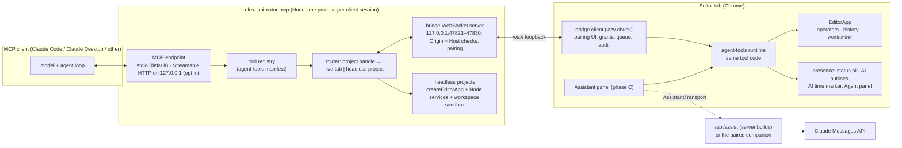

# 21 — Agent bridge architecture: a live MCP bridge, a headless runtime and an in-app assistant over one tool layer

> Research note for Ekza Animator. Date: 2026-10-19. Status: proposal for review; nothing here is decided until the
> owner accepts it. Proposed milestone: **M-AI**, pulling FR-EXT-06 ("scripting console and MCP/agent bridge over
> operators", ROADMAP M5) forward as its own milestone.
> Scope: how an AI agent (Claude Code, Claude Desktop or any MCP client, and later an Assistant panel inside the
> editor) reads and edits an Ekza Animator project. Two runtimes share one tool layer: **(A) live**, a local MCP
> server that relays tool calls over a WebSocket to an open editor tab, and **(B) headless**, the same tools running
> in Node over the headless packages without a browser. **(C)** is an in-app Assistant that drives the same tools
> through the Claude API. The note also covers pairing and permissions, presence, undo and coexistence with the user,
> tool API versioning, packaging, CSP and browser network rules, and testing.
> Every claim about our code is checked against `dev` at v0.2.0 (`packages/editor-core`, `packages/editor`,
> `packages/doc`) and against the M6a contracts (M6A-SPEC §4.1, §4.6, §5.7), which this design must stay compatible
> with. External facts were read on 2026-10-19 and are cited inline and in [Sources](#sources).
> **Sibling notes.** [Research 20](20-mcp-state-and-dcc-servers.md) surveys MCP and DCC servers;
> [research 22](22-animation-agent-toolset.md) owns the **tool catalogue** (37 tools, names, units, schemas, "see"
> tools, evaluation). This note owns the **runtimes, transport, pairing, permissions, presence, coexistence with the
> user, security and packaging**, and uses note 22's tool names. Where the two notes disagreed after review, §15 lists
> the reconciliation this note proposes for the M-AI spec.

---

## 0. Decisions in one screen

| # | Decision | Why |
|---|---|---|
| D1 | **One tool layer, `packages/agent-tools`**, with no DOM or Node dependencies. It holds note 22's 37 task-level tools (schemas, model-facing descriptions, `run(ctx, args)`) plus the few connection tools of this note, each with an access class, against an `EditorApp` and a small `ToolHost`. The live tab, the headless Node runtime and the in-app Assistant all execute the **same code**. | The operator registry is already the API (ADR 0008, R08 D4). A second implementation per runtime would drift. `createEditorApp` already runs in Node (the `headless-tests` package imports, edits and exports real fixtures). |
| D2 | **Agents never touch the user's session state.** Tools take explicit targets (clip, controls, keys) and explicit frames, write through explicit-target operators built on the edit kernel (`writeKeyAt`, `ensureCurve`, `moveKeys` …; note 22 §6.3), read poses with `evaluation.evaluateAt` into side buffers, and never change the user's selection, time, overrides, tools, clipboards or preferences. Only tools covered by a separate `view` grant may (playhead, selection, an unkeyed "pose only" proposal). | `applyChannelEdits` writes at the *current* frame and merges *session overrides*; any change of `sceneFrame` drops the user's unkeyed overrides (`session/keeper.ts`); the runner stores the session selection in every undo entry and undo restores it (`runner.ts`, `history.ts`). An agent that moved the playhead to "key frame 24" would silently destroy the user's unkeyed pose. |
| D3 | **Every agent tool call that edits is one operator run = one transaction = one history step**, labelled `AI: …`. The runner learns an additive `RunContext.actor` (`{kind: 'agent', id, name}`) that prefixes the label and is stored on the `HistoryStep`; steps of different actors never coalesce. `Mod+Z` undoes AI steps like any other step. | ADR 0008/0013 already guarantee one step per operator run; the actor tag is the only missing piece. The owner asked that "any action rolls back with Mod+Z". |
| D4 | **Agent undo without touching user steps.** Note 22's `history_revert` undoes when only this agent's steps lie above the target; otherwise it runs a **selective revert**: a new forward transaction that applies the inverse of the recorded agent batches with the store's compare-before-restore per merge unit (doc's `PatchUndoManager` logic extracted as a pure helper). The Agent panel offers the same ("Revert AI step N", "Revert all AI changes since pairing"). A revert is itself an undoable step. | The doc undo stack is top-only; agent and user steps interleave. Compare-before-restore is exactly the per-user undo rule of research 06 §9, so a revert never destroys later user edits, and the agent never undoes the user's own steps. |
| D5 | **Live transport: stdio MCP server + loopback WebSocket to the tab.** `ekza-animator-mcp` speaks stdio to Claude Code/Desktop (optional Streamable HTTP on `127.0.0.1`), and listens on a WebSocket in a small fixed port range on `127.0.0.1` only. The tab connects out; it never listens. | A browser tab cannot be an MCP server. The PlayCanvas Editor MCP server, the closest analogue (a browser editor, research 20 F7), uses exactly this shape; Blender MCP (add-on socket + stdio server) is the desktop variant. |
| D6 | **Pairing: one-time code shown in the editor, given to the agent, approved in the editor.** The WebSocket server checks `Origin` (allow-list; a missing `Origin` is refused) and `Host` (loopback literal) on upgrade; a tab is paired only when the agent calls `editor_connect {code}` with the code the tab displays; the user then picks grants. A 256-bit session token, held **in memory only** on both sides, resumes dropped connections. | Defeats cross-site WebSocket hijacking and DNS rebinding (WebSockets are not covered by CORS), stops a local non-browser process from posing as the editor (PlayCanvas accepts those, research 20 §2.6) and makes the user name the tab explicitly. |
| D7 | **Permission levels as per-session grants**: `read` (always, once paired), `edit` (document changes, all undoable), `files` (anything that reaches the disk: a browser download after the editor's confirm, or a transfer to and from the agent's workspace folder), `view` (may move the user's playhead, selection or camera, or show an unkeyed pose proposal). Consequential calls (deleting a clip, structural fps change, replacing the open project, more than a threshold of deleted keys, every download) ask for confirmation in the editor. Pause and Disconnect are always one click. | MCP's tool guidance asks for a human in the loop and clear indicators of tool use; MCP clients treat annotations as untrusted hints, so enforcement must live in the editor. |
| D8 | **Presence uses one `PresenceRegistry` in editor-core** that the agent fills now and collaboration (M3) fills later: the agent's focus controls are outlined in an AI colour, an AI time marker sits on the time slider, a status-line pill says "AI is editing: …", and an Agent panel holds grants, the audit log and Revert. | Research 06 §6.7/§8.3 already specifies remote presence (outlines, time markers, curve-space chips). Building it once for the agent pays for M3. |
| D9 | **Headless runtime**: the MCP server can open `.ekzanim`, `.vrm`, `.glb` files from its workspace folder into in-process `EditorApp` instances (`createEditorApp` + Node services), edit, bake and export without a browser. Projects are addressed by opaque handles, the pattern the stateless MCP revision recommends. | Batch work ("five idle variations", "export every clip as VRMA") should not need a GPU or an open tab. |
| D10 | **Images** (note 22 D7, §8): live mode renders real viewport captures (offscreen render target, any camera, any frame, without moving the user's playhead). Headless mode uses note 22's **schematic renderer** (`packages/schematic-render`: bones, joints, floor, trails rasterised in plain TypeScript, PNG through `fflate`, already an `io` dependency). A headless-Chrome render worker is not planned (the repository's CPU rules keep browsers out of CI). | The model needs to see results to correct itself (VRMA Lab's review renders, Blender MCP's `look`), but Node has no WebGL; a schematic is deterministic, dependency-free and good enough for silhouettes, arcs and contacts. |
| D11 | **Tool API is versioned** (`ekza-agent-tools` semver + a manifest hash of names and schemas, committed as a contract file). The bridge handshake carries both sides' toolset versions; same major is required; the tab validates arguments with its own schemas and refuses tools it does not know. | The hosted editor and a cached `npx` package update independently. MCP's 2026-07-28 revision forbids per-connection tool lists, so skew is resolved at call time. |
| D12 | **SDK: `@modelcontextprotocol/server` 2.x** (TypeScript SDK v2, Apache-2.0, implements the stateless 2026-07-28 revision and the initialize-era versions back to 2024-11-05). Fallback: `@modelcontextprotocol/sdk` 1.32.1 (MIT), supported until at least 2027-01-27. WebSocket server: `ws` 8.22.0 (MIT, already in the lockfile). | Both licences are on `ALLOWED_LICENSES`; v2 is the stable line and handles both protocol eras for us. |
| D13 | **Packaging**: `packages/agent-tools` (private, headless), `packages/mcp-server` (Node only; published to npm as the `ekza-animator-mcp` bin, bundled with rolldown), bridge client and Agent panel in `packages/editor/src/agent/` as a **lazy chunk** (the first-visit route gate is 900,000 B). Note 22 adds the headless `motion-analysis` and `schematic-render` packages. | Keeps the dependency graph acyclic and the editor route size unchanged. |
| D14 | **In-app Assistant (C) runs its tool loop in the tab** and reaches the Claude Messages API through an `AssistantTransport`: a server-side proxy route (server builds; off by default, auth required, same rules as ADR 0017's gateway) **or** the paired local companion (`ekza-animator-mcp` holding the key from its environment). The key is never in the browser bundle; direct browser calls with a key are rejected as a default. | Static exports have no server, and ADR 0017 already rejected provider keys in the browser. The companion makes the Assistant work with hosted and static builds. |
| D15 | **No code-execution tool, and no borrowed selection.** `operator_run` reaches only operators classified in note 22's policy table, with argument schemas; `ui.*`, `prefs.*`, `workspace.*`, clipboards, `file.open*` and the like are never agent-callable. Selection-driven operators run with explicit-target arguments or a runner-level scoped selection (§4.4), never by setting the user's selection, running and restoring it. | Blender MCP's `execute_blender_code` runs arbitrary Python inside the host; we bound what a prompt-injected agent can do to undoable document edits and exports the user can see. Set-run-restore leaks the agent's selection into the user's undo history (§4.4). |
| D16 | **Later convergence: the agent as a collaboration peer.** After M3, the headless runtime can join a shared document as a replicating peer with its own presence and per-user undo; the tool layer is unchanged. | Same tool code over a different store; the live bridge stays for local, single-user use. |

---

## 1. What the code already gives us (and what it gets in the way)

| Fact (v0.2.0) | Where | Consequence for the bridge |
|---|---|---|
| Operators run `poll → prepare (async, no writes) → poll → apply (sync, one transaction for flags.undo)`; `app.run` inside `apply` throws `nested-run`; a failing apply rolls the store back and the runner restores the session snapshot. | `editor-core/src/operators/runner.ts`, MVP-SPEC §4.11.0 | One tool call = one operator run gives atomicity and one undo step for free. Tools compose through the edit kernel, not by nesting operators. |
| A run while a preview (gesture) is active returns `cancelled: 'gesture in progress'` (only `edit.escape` is exempt). | `runner.ts` (`GESTURE_SAFE_OPERATORS`) | Agent edits that arrive while the user drags must **wait** for the gesture to end, not fail. |
| The editor history is **one linear stack**; a step's document part is undone only while its `docTxId` is the top of the doc undo stack; doc undo is per merge unit with compare-before-restore. | `history/history.ts`, `history/capture.ts`, `doc/src/undo/patchUndo.ts` | `Mod+Z` naturally undoes AI steps in order. Undoing an *older* AI step needs a forward revert (D4). |
| Every undoable run stores `selectionBefore` (the session selection when the run starts) and `selectionAfter` on its doc undo entry; undo restores `selectionBefore`, redo `selectionAfter`. | `operators/runner.ts` (transaction meta, `tx.annotate`), `history/history.ts` (`restoreSelection`) | Whatever selection the session holds while an agent operator runs becomes part of the user's undo history (§4.4). |
| `OperatorDef.coalesce` merges consecutive runs with the same key within a window into one step; the runner supports it (WP-7a), no built-in operator uses it yet. | `operators/runner.ts` (`coalescingOf`), `types.ts` | The runner must not coalesce an agent step into a user step (or the reverse): the coalesce key is scoped by actor. |
| `applyChannelEdits` writes at the **current clip frame** and merges **session overrides** for keyed channels edited without keying. | `edit/channels.ts` | Not usable as is for agent pose edits at arbitrary frames; agent operators use `writeKeyAt(app, tx, curve, frame, value, tangents, opts?)` and `ensureCurve` (both exported from editor-core) or a frame-parameterised variant (note 22's `pose.setAt`). |
| A change of `sceneFrame` or of the active clip **drops the user's overrides** of the moved characters, and so does a commit that moves a clip frame (fps, range, scene start, loop). | `session/keeper.ts` | Agents must not move the playhead; clip-setting edits by the agent can drop user overrides and therefore need the warning in §5.9. |
| `evaluation.evaluateAt(character, clip, clipFrame, out, {withOverrides})` evaluates into caller buffers; nothing reads a global time. | `evaluation/service.ts`, ARCHITECTURE §5 | Agent reads of any frame never disturb the viewport. |
| The e2e test API already answers most read questions (characters, controls, clips, curves with keys, channel values, overrides, bone and control worlds, limbs, foot pivots, Dope Sheet rows) and accepts a `ControlId` **or** a template key (`fk.upperArm.L`). It is a lazy chunk installed only in e2e builds with `?e2e=1`. | `editor/src/test-api/*`, MVP-SPEC §4.8, M2A-SPEC §4.8 | The read half of the tool layer can be lifted from the test API's pure functions into `agent-tools`; the test API then calls them (one implementation). |
| `createEditorApp({ services })` runs in Node: `headless-tests` imports licensed fixtures, runs operators, bakes and exports, and validates with `gltf-validator`. Without a frame requester, `scheduleBeforeFrame` runs tasks synchronously. | `app/kernel.ts`, `headless-tests/test/ops.support.ts` | The headless runtime is mostly wiring (§6). |
| `setDefaultIdSource` is **process-global** module state; `createKernelApp` sets it when an `idSource` is passed. Built-in rig ops are reference-counted. | `doc/src/ids/generate.ts`, `rig/src/kernel/ops.ts` | Several headless projects in one process must use random IDs (no seeded `idSource`), or run in separate workers. |
| `file.save`/`file.export` download through `services.files.download`; the pure parts are `prepareProjectArchive` and the exporter registry's `run(app, req)` (no document writes). | `workflows/project.ts`, `workflows/exportRun.ts` | Agent exports call the pure functions and hand the bytes to the host, which decides where they go: live, the editor's confirmed download or the opt-in workspace transfer (§5.7); headless, the workspace folder (§6.3). |
| `store.applyChanges(changes, {origin})` exists "for external writes (import pipelines, future remote peers, agents)" and **never enters the undo stack**. | `doc/src/store.ts`, ADR 0002 | Not used for agent edits: the owner wants them on `Mod+Z`. Agent edits are local transactions tagged by actor. |
| `apps/web` sends **no Content-Security-Policy** today; static exports (`ANIMATOR_STATIC_EXPORT=1`) run without a server; dev/e2e-only routes use a page extension so normal builds do not route to them. | `apps/web/next.config.ts`, ADR 0017 §1 | The bridge works without CSP changes now; when ADR 0017 package G-b adds a CSP, it must list the loopback WebSocket origins (§8.3). |
| M6a (in progress) adds `RunContext.source` with an `'api'` value, `OperatorDef.params: ParamDef[]` with `paramSchema()` (JSON Schema 2020-12) and `coerceArgs()`, `session.lastRun` recorded by the runner (closed when "another undoable operator runs"; `edit.adjustLast` polls `history.peekUndo()?.id === lastRun.stepId` and an unchanged `store.version`), `HistoryStep.selection` for selection-only steps, mesh preview sessions (`meshes.session`), and workspaces. | M6A-SPEC §4.1, §4.6, §5.7, §5.8; branch `m6a-contracts-foundation` | Agent runs pass `source: 'api'` plus the new `actor`; `operator_run` gets schemas from `params` where they exist; an agent step necessarily closes the user's Last-op card (§5.9); agent edits wait while a mesh preview session is open. |
| 115 operator ids exist in `OperatorMap` at v0.2.0, many of them selection-driven (`key.set`, `graph.tangent.set`, `graph.keys.move`, `key.tween`, `pose.mirror` act on the current selection or frame). | `operators/args.ts` | Exposing all operators raw would force the agent to drive the user's selection. Curated, target-explicit tools come first (note 22); `operator_run` is a policy-filtered escape hatch. |

## 2. External facts that shape the design

### 2.1 MCP protocol and SDK

- **The 2026-07-28 MCP revision is stateless**: the `initialize` handshake and protocol-level sessions
  (`Mcp-Session-Id`) are gone; every request carries its protocol version and client capabilities in `_meta`; servers
  that need cross-call state "use explicit, server-minted handles passed as ordinary tool arguments"; `tools/list`
  must not vary per connection and should be deterministic; long-lived notifications use `subscriptions/listen`;
  server-to-client requests (elicitation, sampling) become multi-round-trip results; tasks moved to an extension
  ([changelog](https://modelcontextprotocol.io/specification/2026-07-28/changelog)).
- **Streamable HTTP security**: servers **must** validate `Origin` (403 on an invalid one) to prevent DNS rebinding,
  **should** bind to `127.0.0.1` when local, and **should** authenticate; closing the response stream is the
  cancellation signal; on stdio, `notifications/cancelled` cancels
  ([transport](https://modelcontextprotocol.io/specification/2026-07-28/basic/transports/streamable-http)).
- **Tools**: names should be 1–128 characters of `[A-Za-z0-9_.-]`; results may carry text, base64 images,
  `structuredContent` with an `outputSchema`; input validation errors belong in `isError: true` results so the model
  can self-correct; servers **must** validate inputs, apply access control, rate-limit and sanitise outputs; clients
  **must** treat annotations as untrusted unless the server is trusted
  ([tools](https://modelcontextprotocol.io/specification/2026-07-28/server/tools)).
- **TypeScript SDK**: v2 is the stable line, split into `@modelcontextprotocol/server` and `/client` (2.3.1,
  Apache-2.0, Node ≥ 20, 2.0.0 released 2026-07-27); the 2.3.1 packages contain both the per-request-metadata era and
  the initialize-era protocol versions (2025-11-25 back to 2024-11-05) and an `InMemoryTransport` for tests. v1
  (`@modelcontextprotocol/sdk` 1.32.1, MIT) "continues to receive bug fixes and security updates for at least six
  months after the v2 release" ([repository](https://github.com/modelcontextprotocol/typescript-sdk); npm metadata
  read 2026-10-19).
- **Claude API tool names** must match `^[a-zA-Z0-9_-]{1,128}$` — no dots
  ([define tools](https://platform.claude.com/docs/en/agents-and-tools/tool-use/define-tools)). Our tool names are
  therefore `snake_case`; operator ids with dots appear only as arguments.

### 2.2 Clients

- **Claude Code** adds a local stdio server with `claude mcp add [options] <name> -- <command> [args...]`, in local,
  project (`.mcp.json`, approved per project) or user scope; tool output is capped by `MAX_MCP_OUTPUT_TOKENS`
  (default 25,000) with a warning above 10,000 tokens, and image results count toward the cap
  ([Claude Code MCP docs](https://code.claude.com/docs/en/mcp)). Our tool results must be compact and paginated.
  Claude Code also defers MCP tool definitions behind tool search, cuts descriptions at 4,096 characters and drops a
  tool whose full name `mcp__<server>__<tool>` exceeds 128 characters (research 20 F4), so the documented server name
  stays short (`ekza`).
- **Claude Desktop** installs local servers from its config file or as one-click **MCP Bundles** (`.mcpb`, zip with a
  `manifest.json`, renamed from `.dxt` in 2025) ([Anthropic: desktop extensions](https://www.anthropic.com/engineering/desktop-extensions),
  [MCPB docs](https://claude.com/docs/connectors/building/mcpb)).

### 2.3 Browser network rules for a page talking to loopback

- **Mixed content**: Chrome and Firefox treat `127.0.0.1`/`localhost` as potentially trustworthy, so an HTTPS page
  may open `ws://127.0.0.1:…`. **Safari** has long blocked HTTPS pages from reaching localhost
  ([WebKit bug 171934](https://bugs.webkit.org/show_bug.cgi?id=171934) via
  [173161](https://bugs.webkit.org/show_bug.cgi?id=173161), regression report
  [279249](https://bugs.webkit.org/show_bug.cgi?id=279249)). The README names Chrome and Edge as supported browsers.
- **Local Network Access (Chrome)**: a public-origin page reaching a loopback destination needs a user permission;
  Chrome's own post covers `fetch` from Chrome 142 and says WebSockets were "not yet gated" with gating planned
  ([Chrome blog](https://developer.chrome.com/blog/local-network-access)). Vendor documentation reports that
  WebSocket connections are gated **from Chrome 147 (April 2026)** and that the prompt reads "Access other apps and
  services on this device" ([QZ Tray](https://qz.io/docs/LNA), [Visualware](https://myconnectionserver.visualware.com/support/v11/userguide/chrome-lna-websocket));
  the PlayCanvas bridge source says the same ("Chrome 142+, websockets from 147") and notes that a blocked connection
  "looks like nothing is listening".
  A page served from `localhost` (`pnpm dev`, a local static build) talking to loopback is not prompted. **Design
  consequence**: hosted editors will show one browser prompt at first connect; the Connect dialog must explain it and
  detect a denial.
- **WebMCP** (Chrome origin trial / early preview) lets a page register tools with `document.modelContext.registerTool`
  for agents in the browser or extensions; tools are same-origin by default and are not exposed to external MCP
  clients ([Chrome docs](https://developer.chrome.com/docs/ai/webmcp/imperative-api)). It is a later, additional
  adapter for the same tool layer, not a replacement for the bridge.

### 2.4 Prior art

| Tool | Shape | Take | Avoid |
|---|---|---|---|
| PlayCanvas Editor MCP (MIT, TypeScript) | stdio server launched by the client; a WebSocket server bound to `127.0.0.1` that the **browser editor** connects to after the user clicks Connect; `verifyClient` allows `*.playcanvas.com` and localhost origins plus an env list, and accepts connections **without** `Origin`; no token; a second server stands by and takes the port over when the owner yields; protocol version 1 with advertised methods; 60 s call timeout; failure hints name Chrome's local-access permission ("Chrome 142+, websockets from 147") ([wss.ts](https://github.com/playcanvas/editor-mcp-server/blob/main/src/wss.ts), research 20 §2.6) | The whole live shape: tab connects out, Origin allow-list, versioned relay, failure messages that name the permission | No secret (a local process without `Origin` can pose as the editor); silent port takeover by the newest server |
| Blender MCP | Add-on runs a TCP socket server inside Blender (default `localhost:9876`); a stdio MCP server connects to it; JSON commands; `look` renders viewport/camera views; "no authentication or encryption"; `execute_blender_code` runs arbitrary Python ([repo](https://github.com/ahujasid/blender-mcp)) | Relay shape; a "look" tool so the model checks its own work | No auth; arbitrary code execution |
| Figma desktop MCP | The desktop app serves Streamable HTTP at `http://127.0.0.1:3845/mcp` ([Figma docs](https://developers.figma.com/docs/figma-mcp-server/local-server-installation)) | Loopback-only local server | Needs a desktop app; our app is a tab |
| VRMA Lab | `window.vrmaLab.{inspect, edit, review, validate, exportVrma, undo, redo}` over same-origin `postMessage`; deterministic quad-view review renders; read-back validation (research 05) | Command API shared by UI, agents and tests; review renders | Same-origin only; no external agent path |
| Cascadeur 2026.2 | Ships a "simple" MCP server (research 05) | Confirms the category | Desktop, proprietary |

---

## 3. Architecture overview



Layering (additions to ARCHITECTURE §3, enforced by `tooling/check-deps.mjs`):

| Package | May import | Must not import |
|---|---|---|
| `@ekza-studio/motion-analysis`, `@ekza-studio/schematic-render` (note 22 §6.1; private, headless) | anim-core, rig; `fflate` (schematic PNG) | editor-core, React, DOM, WebGL, `node:*` |
| `@ekza-studio/agent-tools` (private, headless) | anim-core, doc, rig, io (main entry), editor-core, motion-analysis, schematic-render, `zod` (note 22 D9) | React, DOM, WebGL, `three`, `node:*`, `ws`, MCP SDK, `@anthropic-ai/sdk` |
| `@ekza-studio/mcp-server` (Node app, published as `ekza-animator-mcp`) | agent-tools, editor-core, io, doc, rig, anim-core, `@modelcontextprotocol/server`, `ws`, `node:*`; optional `gltf-validator` | React, DOM, `three`, viewport, editor |
| `@ekza-studio/editor` (adds `src/agent/`) | everything it imports today + agent-tools | the MCP SDK, `ws` (the browser `WebSocket` is enough) |

Nothing depends on `mcp-server`. `agent-tools` sits between editor-core and editor in the graph. `zod` is not in
the lockfile today; it arrives with `@modelcontextprotocol/server` (`zod ^4.2.0`) and note 22's wire schemas.

---

## 4. The tool layer (`packages/agent-tools`)

### 4.1 Contracts

Note 22 §6.2 defines `AgentToolDef` (zod input and output schemas, annotations, `hosts`, `core`, `budget`, `run`),
the `AgentToolContext` (`app`, `host`, `capture`, `files`, `resolve`, `actor`, `signal`) and the result envelope
(`ok`, `data`, `images`, `undo`, `warnings`, `next`; errors with `code`, `message`, `hint`, `candidates`,
`retryable`). The bridge needs a few additive fields on top; nothing in them depends on a transport:

```ts
// packages/agent-tools/src/types.ts — additions to note 22 §6.2 (sketch; frozen in the M-AI spec)
export type ToolAccess = 'read' | 'edit' | 'files' | 'view';           // the grant a call needs (§5.7)

export interface AgentToolDef<I, O> {
  // …note 22 §6.2 fields…
  readonly access: ToolAccess | ((args: z.output<I>) => ToolAccess);    // e.g. pose_set {key: 'pose_only'} → 'view'
  /** Consequential calls: a prompt the live host shows before the edit; headless requires `confirm: true` in args. */
  confirm?(ctx: AgentToolContext, args: z.output<I>): ConfirmPrompt | null;
  /** Host capabilities the tool needs; a host without one answers `unsupported` with a hint. */
  readonly needs?: readonly HostCapability[];
}

export type HostCapability = 'capture' | 'files' | 'confirm' | 'presence' | 'view' | 'download';
export interface AgentToolContext {
  // …note 22 §6.2 fields…
  readonly host: AgentHost;                                              // 'live' | 'headless'
  readonly capabilities: ReadonlySet<HostCapability>;
  readonly actor: RunActor;                                              // { kind: 'agent', id, name } (§4.2)
  progress(done: number, total: number | null, message?: string): void;  // → MCP notifications/progress
  confirm?(prompt: ConfirmPrompt): Promise<boolean>;                     // live: Agent panel prompt; 60 s → false
  readonly presence?: AgentPresenceSink;                                 // live: focus controls, frame, activity
  /** Live: browser download after the editor's confirm. Headless: absent (files go to the workspace). */
  download?(fileName: string, bytes: Uint8Array, mime: string): Promise<{ readonly accepted: boolean }>;
}
```

The MCP server maps a result to MCP: `structuredContent` = the envelope, a short text rendering of it (for clients
without structured output), images as `{type: 'image', data, mimeType}`, and failures as `isError: true` with the
message, hint and candidates (input problems are tool errors, not protocol errors, so the model can retry).

### 4.2 Editing goes through operators with an actor

Small, additive contract changes in editor-core make every agent edit an ordinary, attributable history step:

1. `RunContext.actor?: RunActor` and `HistoryStep.actor?: RunActor | null`
   (`RunActor = { kind: 'agent'; id: string; name: string }`). The runner prefixes the transaction label with
   `AI: ` when an actor is present and records the actor on the step. The runner scopes coalescing by actor (the
   coalesce key becomes `actorId + key`), so an agent step never merges into a user step or the reverse.
2. `RunContext.signal?: AbortSignal`, checked by the runner before `apply` and passed to long `prepare` phases (bake,
   parse), so a cancelled call stops before it writes (§5.6).
3. **Explicit-target operators** for the edits no operator provides today, as listed in note 22 §6.3: `key.write`,
   `key.delete`, `key.retime`, `pose.setAt`, `pose.goals`, `pose.transfer`, `clip.makeLoop`, `pose.plantContacts`
   (all `flags.undo`, registered `internal` so menus, palette and keymaps do not show them), plus additive optional
   target arguments on existing operators (`key.tween {frames?, targets?}`, `graph.eulerFilter {controls?}`, …). This
   note adds one: `edit.revertSteps {steps}` for the selective revert of D4. Their `apply` uses only exported
   edit-kernel functions (`ensureCurve`, `writeKeyAt`, `moveKeys`, `scaleKeys`, `setTangentTypes`, `insertKeyOnCurve`,
   `deleteKeys`, anim-core's `reduceKeys`, the rig's inverse solvers) with explicit `clip`, `controls`, `keys` and
   `frame` arguments, so scripts, tests and keymaps can use them too.

A tool's `run` validates and resolves arguments (names → IDs, degrees → radians, note 22 §3), then calls
`app.runUntyped(id, resolvedArgs, { source: 'api', actor, signal })`. The operator's poll re-checks targets,
`prepare` does async work (opening partitions, loading model bytes), `apply` writes in one transaction. The tool
returns the new step's id and label in the envelope's `undo` field so the model and the audit log can refer to it.

Rules every tool obeys (unit-tested as invariants, §10):

- **No user U-state writes**: `session.selection`, `session.time`, `session.overrides`, `session.tools`, clipboards,
  prefs and the workspace layout deep-equal before and after any call whose effective access is `read`, `edit` or
  `files`. Only `view`-access calls may change them.
- **Keys, not overrides**: agent pose edits key (or write `staticValue` on channels without keys). Note 22's
  `pose_set {key: 'pose_only'}` (an unkeyed proposal at the playhead that the user accepts with `S`) is the one
  exception; its access is `view`, so it needs the `view` grant and shows in the audit log as a view change.
- **Explicit frames**: frames are clip frames of the named clip (note 22 §3.3); no tool moves the playhead except
  `timeline_set` (`view`).
- **Bounded size**: one call writes at most a configurable number of key records (default 50,000) and touches at most
  one character; larger jobs split.

### 4.3 Reads, units and result shaping

- Reads come from the store, `DocQueries`, `evaluation.evaluateAt` into side `PoseBuffers` (with or without the
  user's overrides, default without and flagged when overrides exist) and rig queries. The test API's read
  functions move into `agent-tools/src/inspect/` and the test API calls them (one implementation).
- **Units, addressing, spaces, envelope and budgets** follow note 22 §3: degrees and metres with the unit in the
  field name, names before IDs, clip frames, character space, `detail: concise | detailed`, paging, at most ~8k tokens
  of text per result (Claude Code warns at 10,000).
- **Revisions**: read results carry `docVersion` and a per-clip `clipRevision` (a counter the host bumps for every
  committed batch touching that clip's partition). Edit tools accept `ifClipRevision`; a mismatch returns the error
  `stale` "this clip changed since you read it (by the user); read again" — optimistic concurrency without locks.
- **Untrusted strings**: names, clip tags and VRM meta text from files are returned as quoted data fields, at most
  120 characters (note 22 §3.5), and flagged `untrusted: true` where they come from imported files, so client-side
  prompt-injection defences can see them.

### 4.4 `operator_run`: policy, grants and the scoped selection

`operator_run {id, args, context?}` (note 22 §5.6, §7) covers the long tail. Its policy table (denied, confirm,
allowed; note 22 §7.3) is data in `agent-tools`, and a new operator is denied until someone classifies it. The bridge
adds the grant: an allowed operator needs `edit` when it is `flags.undo`, `view` when it changes U-state
(`select.*`, `view.*` camera and display operators), and `files` for exports. A proposed additive field
`OperatorDef.agent?: { policy, access, confirm }` lets extensions classify themselves (research 08 §8); operators
without it and without a table entry are not agent-callable. Agents never call `edit.undo`/`edit.redo`; they use
`history_revert`.

**Scoped selection.** For selection-driven operators, note 22 §5.6 proposes to snapshot the user's selection, set
`context` as the selection, run, and restore. On v0.2.0 that leaks: the runner records `selectionBefore` from the
session at the moment the run starts and annotates `selectionAfter` inside the transaction (`operators/runner.ts`),
and undo and redo restore those snapshots (`history/history.ts`). After set-run-restore, the user's next `Mod+Z`
would put the **agent's** temporary selection into the user's session. Under M6a a swap that touches object or
component selection also closes the Last-op card ("Selection changed", M6A-SPEC §5.7), and a `context.frame` would move the
playhead and drop the user's overrides (`session/keeper.ts`). The selection is also visible and clickable between
set and restore while `prepare` awaits. Two safe implementations, in order of preference:

1. **Explicit-target arguments** on the operator (note 22 §6.3 already adds them to `key.tween`, the `graph.*`
   tangent, infinity, weight, simplify and Euler-filter operators). `operator_run` maps `context` onto them.
2. **A runner-level scope** for the rest: an additive `RunContext.selection?: SelectionSnapshot` that selection-driven
   operators read through one helper (`selectionOf(ctx)`) instead of `app.session.getState().selection`; the runner
   records the user's real selection as `selectionBefore`/`selectionAfter`, and the session store is never written.
   Operators that have not moved to the helper are not callable with `context`.

`context.frame` is not supported; operators that act at the current frame need an explicit `frame` argument first.

### 4.5 Tools and their grants

The catalogue is note 22 §4. This note adds three connection tools and assigns each catalogue group its access
class:

| Tools | Access | Notes |
|---|---|---|
| `editor_connect {code}` | pairing | the only tool callable before a live project exists; returns the `project` handle (§5.3) |
| `projects_list` | read | paired tabs (`tab_…`) and open headless projects (`prj_…`) with grants, host capabilities and toolset versions |
| `project_close {project}` | read | headless: frees the project; live: ends the pairing from the agent side |
| `scene_summary`, `rig_describe`, `keys_read`, `curves_summary`, `pose_read`, `analyze_*`, `view_capture`, `view_plot_curves`, `operators_list`, `history_checkpoint` | read | `scene_summary.host` carries mode, capabilities and grants |
| `pose_*`, `ik_set_target`, `keys_*`, `clip_make_loop`, `feet_plant`, `curves_*`, `clip_create`, `clip_update`, `clip_delete`, `recipe_apply`, `history_revert` | edit | `clip_delete`, an fps change in `clip_update` and deletes above the threshold confirm (§5.7); `pose_set {key: 'pose_only'}` and `clip_* {activate: true}` in live mode are `view` |
| `timeline_set` | view | the only tool that moves the user's playhead |
| `export_clip`, `project_save`, `project_load` | files | live: download after the editor's confirm, or a workspace transfer (§5.7); headless: the workspace folder (§6.3); `project_load` in live replaces the user's project and always confirms |
| `operator_run` | per operator (§4.4) | |

Every project-scoped tool takes an optional `project` handle (§5.5). Tool design follows the API guidance on detailed
descriptions, consolidated tools and high-signal results
([define tools](https://platform.claude.com/docs/en/agents-and-tools/tool-use/define-tools),
[Writing tools for agents](https://www.anthropic.com/engineering/writing-tools-for-agents)).

### 4.6 Versioning

- `AGENT_TOOLSET_VERSION` (semver) and a **manifest** (`agent-tools/tools.manifest.json`: names, titles, access,
  annotations, schemas, sorted by name) are contract files; CI regenerates the manifest and fails when it differs
  without a version bump. The manifest hash is sent in the bridge handshake.
- **Compatibility**: the MCP server lists its own toolset (deterministic order). A paired tab with a different
  **major** is refused at pairing with an upgrade hint (`npx ekza-animator-mcp@latest` or reload the editor). Within
  a major, the tab validates arguments with its own schemas and answers an unknown tool with `isError`
  "this editor (v0.x) does not have `tool`; update the editor".
- **Evolution**: additive arguments and result fields are minor changes; renames keep the old name as a deprecated
  alias for one minor (description starts with "Deprecated: use …"); semantic changes get a new name. The bridge
  protocol has its own integer version (`bridge: 1`).
- **Operator-level drift**: `operators_list` returns the classified operators of the *executing* app with schemas,
  so `operator_run` always validates against the editor that runs it.

---

## 5. Live mode

### 5.1 Processes and transports

- **stdio (default)**: Claude Code and Claude Desktop start one `ekza-animator-mcp` process per client session. The
  process writes only MCP messages to stdout and logs to stderr.
- **Streamable HTTP (opt-in)**: `ekza-animator-mcp --http 127.0.0.1:<port>` for clients that prefer HTTP or for one
  long-lived server shared by several clients. It binds `127.0.0.1` only (refuses other addresses), validates `Origin`
  (403) and `Host`, requires a bearer token printed at start (or read from `EKZA_MCP_TOKEN`), and treats a closed
  response stream as cancellation, as the transport spec requires.
- **Bridge WebSocket** (both modes): `ws` server on `127.0.0.1`, first free port in **47821–47830** (tentative,
  Q-AI-1), or `--bridge-port`. `maxPayload` 16 MiB per frame; binary transfers are chunked (§5.4). Each server keeps
  its own port for its lifetime; there is no PlayCanvas-style hand-over, so a new agent session never takes a tab
  away from another one (§12).

### 5.2 Discovery

The Agent panel's **Connect** probes the ten ports with a WebSocket `hello` (no data beyond versions) and lists the
servers that answer: client name (as reported by the MCP client, labelled "reported"), server version, process id,
working-folder name, uptime. One server is selected automatically; several (two Claude Code sessions) are listed. A
`?agentPort=` URL parameter (e2e and power users) skips probing. On a hosted HTTPS origin the first probe triggers
Chrome's loopback permission prompt (§2.3); the dialog says so before probing and shows help when the connection is
refused.

### 5.3 Pairing

```mermaid
sequenceDiagram
  participant U as User
  participant T as Editor tab
  participant S as ekza-animator-mcp
  participant A as Agent (MCP client)
  T->>S: WebSocket upgrade (Origin, Host checked; 403 otherwise)
  T->>S: hello {bridge: 1, toolset, app version, tab title, project}
  S-->>T: hello.ok {server, client name, version}
  T->>T: generate one-time code "K7Q-M4P" (120 s), show it
  T->>S: pair.offer {code}
  U->>A: "Connect to my editor, code K7Q-M4P"
  A->>S: tools/call editor_connect {code}
  S->>T: pair.claimed {client name}
  T->>U: "Claude Code wants access: Read ✓ · Edit ☐ · Files ☐ · View ☐  [Allow] [Deny]"
  U->>T: Allow (Read + Edit)
  T->>S: pair.accept {grants}
  S-->>T: pair.ok {token (256-bit, memory only), session id}
  S-->>A: result {project: "tab_…", grants, scene summary}
```

- Upgrades without an `Origin` header (non-browser local processes) are refused; the tab is the only client.
- Codes: six characters from a 31-letter alphabet without look-alikes (≈ 8.9 × 10⁸ combinations), compared in
  constant time, single use, expire after 120 s; five wrong `editor_connect` attempts per minute lock pairing for a
  minute. Pending offers from tabs that disconnect are dropped.
- Defence in depth: the `Origin` allow-list stops arbitrary websites; the `Host` check stops DNS rebinding; the code
  stops anything the user did not name; the grants dialog makes the user choose capabilities.
- Default `Origin` allow-list: `http://localhost:<any>`, `http://127.0.0.1:<any>`, the official deployment origin(s)
  compiled into the package, and `--allow-origin <origin>` (repeatable) for self-hosted editors. Shared gateway origins
  (for example a path-based IPFS gateway) can be allowed but are then protected by the code alone; the CLI warns.
- The token resumes a dropped connection (network blip, laptop sleep) within an idle timeout (default 30 min). A tab
  reload or a server restart requires a new pairing (Q-AI-12).
- Flow B in reverse (the server shows a code that the user types into the editor) is kept as a fallback for clients
  where typing into chat is awkward.

### 5.4 Bridge wire protocol (`bridge: 1`)

JSON text frames, one message per frame; binary frames only for chunked blobs.

| Direction | Message | Purpose |
|---|---|---|
| tab → server | `hello {bridge, toolset {version, hash}, app {version, build: 'server'\|'static'}, tab {title, project}}` | version negotiation, discovery |
| server → tab | `hello.ok {server {name, version, pid, cwdName}, client {name, version}}` | |
| tab ↔ server | `pair.offer`, `pair.claimed`, `pair.accept {grants}`, `pair.deny`, `pair.ok {token, session}`, `resume {token}` | §5.3 |
| server → tab | `call {id, tool, args, client, progress: boolean}` | `id` is unique per server; the tab dedupes |
| tab → server | `progress {id, done, total, message}` · `result {id, envelope, images}` (note 22 §3.5) | progress maps to MCP `notifications/progress` when the client sent a progress token |
| server → tab | `cancel {id}` | from `notifications/cancelled` (stdio) or a closed HTTP stream |
| tab → server | `grants {grants}` · `paused {on}` · `bye {reason}` | user changed grants, paused or disconnected |
| either | `blob {id, seq, last, sha256?}` + binary frame | imports (server → tab) and exports (tab → server), 1 MiB chunks, total capped by the io input budget (256 MiB) |
| server → tab | WebSocket ping every 15 s | browsers answer pings automatically; two missed pongs close the socket |

### 5.5 Multiple tabs, multiple agents

- One server may hold several paired tabs and open headless projects; every project-scoped tool takes an optional
  `project` handle (`tab_…` or `prj_…`, the same argument note 22 uses for headless projects). With exactly one project
  it is the default; otherwise the call fails with the `projects_list` result as candidates. Handles are opaque,
  random, and expire with the pairing or the headless project (the stateless MCP revision recommends exactly such
  handles).
- A tab pairs with **one** server at a time in M-AI (one agent per tab). Two Claude Code sessions each run their own
  server on its own port; the user connects the tab to the one it wants. Several agents on one tab are a later item
  and would use presence colours per agent.

### 5.6 Call lifecycle

1. **Server**: validate the arguments against its manifest (cheap rejection), resolve the `project`, forward `call`.
2. **Tab, gate**: grant check (`isError` "needs the Edit grant: ask the user to enable it in the Agent panel"), pause
   check, rate limit (default 20 calls/s, burst 50), then the per-tab queue: reads run concurrently; edits run
   **strictly in arrival order**, one at a time, so tool order equals history order.
3. **Gesture wait**: if `store.preview` is active (the user is dragging; the runner would answer `cancelled: 'gesture
   in progress'`) or, under M6a, a mesh preview session is open (`meshes.session`: a tool or a Last-op card drag), the
   edit waits for the commit or cancel (a store subscription) up to `gestureWaitMs` (default 15 s), reporting progress
   "waiting for your drag to finish"; then it runs or fails with note 22's `busy` error (`retryable: true`). Dialogs
   do not block agent edits.
4. **Confirmation** for consequential calls: a non-modal prompt in the Agent panel and a toast; timeout 60 s → denied.
5. **Run**: `tool.run(ctx, args)` → `app.runUntyped(id, resolvedArgs, { source: 'api', actor, signal })`.
6. **Timeouts**: 30 s for reads and edits, 300 s for import and export (both configurable); on timeout the server
   returns `isError` and sends `cancel`.
7. **Cancellation** is cooperative: a queued call is dropped; a call in an async `prepare` (export bake, model parse)
   sees `signal.aborted` before `apply`; once `apply` ran, the step exists (it is undoable) and the audit log marks it
   "completed after cancel". `RunContext.signal` (§4.2) lets long `prepare` phases (bake) stop early.
8. **Reconnect and idempotency**: the tab keeps the last 256 results by call id; after `resume`, the server re-asks
   for results of calls it still waits on and the tab answers from the cache instead of running them again. Calls
   that never reached the tab are resent.

### 5.7 Grants

| Grant | Default at pairing | Allows | Always confirmed |
|---|---|---|---|
| `read` | on (implied by pairing) | inspect, diagnose, capture | — |
| `edit` | off (Q-AI-3) | pose/key/curve/clip/rig edits, revert | clip delete; fps change (`structural`); deleting more than 500 keys in one call; edits while the project is read-only are refused |
| `files` | off | exports and saves as a **browser download** after the editor's confirm (note 22's live default), or, when the user also ticks "Workspace folder", transfers to and from the server's workspace (§6.3) over the bridge; `project_load` | every download; overwriting a workspace file; replacing the open project |
| `view` | off | move the user's playhead (`timeline_set`), change selection, frame the camera, show an unkeyed pose proposal (`pose_set {key: 'pose_only'}`), activate a clip | — |

Grants live in memory for the pairing; the user changes them at any time; **Pause** queues nothing and answers every
call with `isError` "paused by the user"; **Disconnect** ends the pairing.

### 5.8 Presence and UI

- **`PresenceRegistry`** (editor-core, additive): peers `{ id, kind: 'agent' | 'user', name, color, focus: {controls,
  curves, clip, frame}, activity: string | null, since }`. The bridge sets the agent's focus from each call's targets
  and clears it a few seconds after the call. M3 fills the same registry from Yjs awareness (research 06 §6.7).
- **Viewport**: focus controls drawn with an outline in the agent colour (a palette entry that avoids the X/Y/Z axis
  colours and the selection highlight, research 06 §8.3); never recolours curves. **Time slider**: an "AI" marker at
  the agent's focus frame. **Graph Editor**: a chip "AI · L_hand.rz" when the agent edits curves the user is not
  looking at. **Outliner**: a small AI badge on focus rows.
- **Status line pill**: idle "AI connected", busy "AI is editing: Set keys (12 controls @ 24)", waiting "AI is
  waiting for your drag", paused "AI paused". Click opens the Agent panel.
- **Agent panel** (dock panel `agent`, lazy): connection and grants, Pause/Disconnect, the **audit log** (time, tool,
  argument digest, status, duration, the history step with an "Undo"/"Revert" action), a "Revert all AI changes since
  pairing" button, and in phase C the Assistant chat.
- **History**: labels `AI: …`; the future History panel (FR-UNDO-06) filters by actor.

### 5.9 Coexisting with the user

| Situation | Behaviour |
|---|---|
| User presses `Mod+Z` after an AI step | Undoes the newest step, AI or not (one linear history). Toast shows the `AI: …` label. |
| User wants to undo an older AI step | Agent panel → Revert on that step: a forward transaction with compare-before-restore per merge unit; fields the user changed since are skipped and listed (D4). |
| Agent wants to undo its own work | `history_revert {steps \| to}` (note 22): plain undo when only this agent's steps lie above the target, otherwise the selective revert of D4. Undoing the user's own steps (`includeUserSteps: true`) always asks the user, who sees which steps go. Agents never call `edit.undo`. |
| User undid steps (redo stack non-empty) and the agent edits | Any new step clears redo — standard behaviour, shown in the toast "Redo cleared by AI edit" (Q-AI-8). |
| User is dragging, or an M6a tool or card drag is previewing | Agent edits wait (§5.6 step 3); reads proceed and report `previewActive: true`. |
| Agent keys a channel the user has an unkeyed override on, at the same clip and frame | The key is written, but the override still wins on screen; the result warns "the user has unkeyed edits on these channels at frame 24; your keys are hidden behind them until the user changes frame or keys". |
| Agent changes clip fps, range, scene start or loop | May move clip frames and drop the user's overrides (`session/keeper.ts`): such edits are consequential and the confirmation says so. |
| Agent reads while the user edits | Results carry `clipRevision`; stale edits with `ifClipRevision` fail cleanly. Without it, last writer wins per merge unit, as in a local session. |
| M6a Last-op card | Any agent step closes the user's open card ("Changed by AI"): M6a closes it when "another undoable operator runs", and `edit.adjustLast` could not adjust anyway, because it polls `history.peekUndo()?.id === lastRun.stepId` and an unchanged `store.version`. An agent run of an operator with `params` becomes `lastRun` with `source: 'api'` as M6a records it, so the user can tune an AI-made bevel in the card (note 22 §6.4); the card is labelled AI (Q-AI-7). |
| M6a Repeat Last (`G`) | `edit.repeatLast` polls false while `lastRun.source === 'api'`: the user's `G` never replays an agent's operation on the user's selection; it works again after the user's next own run (Q-AI-7). |
| Selection snapshots in undo entries | Agent operators never write the session selection (§4.4), so the `selectionBefore/After` the runner records stay the user's and undoing an AI step never changes the user's selection; agent steps carry no M6a `HistoryStep.selection` part. |
| Coalescing | Coalesce keys are scoped by actor (§4.2): rapid agent calls never merge into the user's last step, and the reverse. |
| Autosave and dirty state | Agent commits are ordinary local commits: they mark the project dirty and autosave as usual. |
| Read-only project (`minWriterVersion` newer than the app) | Edit tools fail with `read-only` and a hint. |

Per-origin undo (the user undoing only their own steps, as in collaboration) is not part of M-AI; the `actor` field on
steps makes it possible later.

### 5.10 Viewport capture

The live backend of note 22's `CaptureService` (`view_capture`, note 22 §5.4, §8) is an additive
`ViewportManager.capture(req)`: `{camera: preset | shotCameraId | {position, target, fovY}, frames, tile size (max
2000 px on the long edge of the sheet), overlays, display flags}` → PNG or WebP bytes plus tile rectangles.

- Renders into a `WebGLRenderTarget` with a temporary camera between two editor frames, reads pixels back and encodes
  with `OffscreenCanvas.convertToBlob`; the user's panes and cameras are untouched.
- A frame other than the current one is evaluated with `evaluateAt` into side buffers, written to the bones for the
  capture and restored before the next editor frame. The capture **never** calls `time.setFrame` (which would drop
  overrides).
- Contact sheets and the VRMA-Lab-style review layouts (full body front and side, upper body, legs and contacts) are
  laid out by the tool from tiles; one capture runs at a time and renders between editor frames.
- Size policy (note 22 §8.4): images cost ⌈w/28⌉ × ⌈h/28⌉ visual tokens; a 768 × 432 still is about 450 and an
  8-frame sheet at 1024 × 512 about 700, far below `MAX_MCP_OUTPUT_TOKENS`; nothing exceeds 2000 px on a side
  ([vision](https://platform.claude.com/docs/en/build-with-claude/vision)).
- When WebGL capture fails (lost context, hidden tab throttling), the live host falls back to the schematic renderer
  and says so in the result (`fidelity: 'schematic'`).

---

## 6. Headless mode

### 6.1 What `createEditorApp` needs in Node

| Area | Today | Headless host provides |
|---|---|---|
| Session/prefs stores | `zustand/vanilla` | nothing (works in Node) |
| Frame loop | `scheduleBeforeFrame` runs tasks synchronously without a frame requester | nothing |
| Hashing | `crypto.subtle` (assets) | nothing (global in Node ≥ 19) |
| Model runtime | `deps.loadModel` parses the GLB from the asset store (`parseGlb` + `skeletonFromGltf`) | nothing; `services.models: null` (no display model; "null in Node tests" already) |
| Export | exporter registry (`runExportPipeline`), read-back and lints | optional `services.validate` with `gltf-validator` (Node package, lazily imported) |
| Files | `services.files.download(fileName, bytes, mime)` | a capturing service; the tool writes the bytes inside the workspace folder |
| Samples | `fetchSample` fetches `<samplesPath>/<file>` (default `/samples/`, relative) | `services.samplesPath` set to an absolute URL with `--samples-url`, or samples bundled into the package; otherwise `project_load {sample}` answers `unsupported` (Node's `fetch` has no page origin and no `file:` scheme) |
| Capture | — | note 22's schematic `CaptureService` (`services.capture`, additive) |
| Autosave | needs a host `AutosaveStore` | none (off) |
| IDs | `setDefaultIdSource` is global | random IDs; seeded IDs only in single-document test processes |
| Display-only services | clipboard, notify, storage | memory clipboard, a notify sink whose messages become result warnings, `storage: null` |

No editor-core change is needed for headless beyond what live mode needs. `packages/mcp-server/src/headless/` holds
`createNodeServices()` and the project manager.

### 6.2 Projects and handles

- `project_load {path | sample}` (note 22) reads an `.ekzanim`, `.ekzanim.json`, `.glb` or `.vrm` from the workspace
  folder (a `.vrma` imports into an open project) and returns a `prj_…` handle with a summary; `project_save` and
  `export_clip` write inside the workspace folder; `project_close` frees it.
- Handles are random, documented with their lifetime ("closed after 30 minutes without calls or when the server
  exits"), and unknown or expired handles produce a tool error that says so, as the stateless MCP guidance suggests.
- At most four projects are open at once (configurable). Each is a separate `EditorApp` with random IDs (the default
  ID source is process-global, §1); bakes yield between clips. Worker-thread isolation per project is a later option
  if a hostile file or a long bake should not block the process.

### 6.3 File sandbox

One **workspace folder** (note 22 §6.1): `--workspace <dir>`, else `CLAUDE_PROJECT_DIR` (Claude Code sets it in the
spawned server's environment to the project root, [Claude Code MCP docs](https://code.claude.com/docs/en/mcp)), else
the working folder; `--allow-dir` adds read-only roots. MCP roots are deprecated in the 2026-07-28 revision (research 20
F1), so the server does not depend on them. Paths resolve with `realpath` inside the roots; symlinks out of a root,
device files and paths with `..` after resolution are refused; only the project, model, animation and export
extensions are readable or writable; exports default to `exports/`; sizes are capped by the `io` input budgets; an
existing file is overwritten only with `overwrite: true` (and, live, after confirmation).

### 6.4 Pictures without WebGL

| Option | Verdict |
|---|---|
| No images headless | Loses the self-check loop for batch work. |
| **Schematic renderer** (chosen; note 22 D7, §8.1, `packages/schematic-render`): `evaluateAt` → bone world positions → orthographic preset cameras, tapered bones coloured by side, joints, floor and grid, contact marks, trails and ghosts, frame labels → RGBA buffer → PNG through `fflate` | Deterministic bytes (golden tests), no new dependency, runs in Node and in the tab (fallback when WebGL capture fails); shows silhouettes, arcs and contacts, which is what motion review needs. |
| CPU-skinned shaded raster (note 22, later) | Only if LLM evaluations show the schematic is too abstract. |
| Headless Chrome render worker (`playwright-core` + system Chrome loading a static build with the project) | Real renders and meshes, but a browser per server, heavy startup, and the repository's CPU rules keep browsers out of CI; not planned. |
| Software WebGL in Node (`headless-gl`, SwiftShader) | Native builds, fragile; rejected. |

### 6.5 Live and headless together

`projects_list` shows both kinds. Typical batch flow: the agent reads the live clip (`keys_read`), opens a headless copy
of the saved project (`project_load`), creates five variations there, exports them, and only then (with `files` and
the workspace transfer) imports the chosen one into the live tab, which asks the user. Headless projects never write
to a live tab directly.

---

## 7. In-app Assistant (phase C)

### 7.1 Where the loop runs

The Assistant panel runs the agent loop **in the tab**, with the tools executing in-process against the live app
(no bridge round trip, same `agent-tools` code, same grants, same audit log and `AI: …` history labels). Only model
requests leave the tab, through an `AssistantTransport`:

| Transport | When | Key |
|---|---|---|
| **Server proxy route** `/api/assist` (`ekza-assist/v1`) | server builds (`next start`) with `ASSISTANT_PROXY_ENABLED=1` and an auth (bearer token, or a session once accounts exist) or a loopback-only bind; 404 otherwise; mounted with the same page-extension technique ADR 0017 uses for the gateway | server env (self-hosted) or BYO key sent per request in a header, never persisted, redacted |
| **Paired companion** (`assist.request` / `assist.event` over the bridge WebSocket) | any build, including static and hosted ones, when `ekza-animator-mcp` runs with `ANTHROPIC_API_KEY` (or an `ant auth login` profile) | stays in the local process |
| Direct browser call with `anthropic-dangerous-direct-browser-access` | rejected as a default | the header enables CORS for browser calls, which exposes the key to every script on the page ([Simon Willison](https://simonwillison.net/2024/Aug/23/anthropic-dangerous-direct-browser-access/)); ADR 0017 rejected provider keys in the browser |

The proxy is thin and stateless: it adds the key, enforces a model allow-list, caps `max_tokens`, request size and
rate, strips unknown parameters, streams SSE back, and keeps daily spend caps from env (ADR 0017 decision 3 applies
unchanged). The Claude API's MCP connector is not an option for the live editor: Anthropic connects to the MCP server
from its own infrastructure, which cannot reach a loopback server.

### 7.2 Request shape (to be verified again when phase C is specified)

Checked on 2026-10-19 against the Claude API documentation
([migration guide](https://platform.claude.com/docs/en/about-claude/models/migration-guide),
[effort](https://platform.claude.com/docs/en/build-with-claude/effort),
[tool use](https://platform.claude.com/docs/en/agents-and-tools/tool-use/overview),
[context editing](https://platform.claude.com/docs/en/build-with-claude/context-editing)):

- Model default `claude-opus-5-5` ($4 / $20 per million input/output tokens); the user may pick
  `claude-sonnet-5-5` or `claude-haiku-5-5`. On `claude-opus-5-5` thinking cannot be disabled and `output_config.effort`
  defaults to `medium`, so the panel sets effort explicitly (`medium` for chat-sized edits, `high` for multi-step
  clean-up).
- Streaming with `eager_input_streaming: true` on our tools; with it the API no longer validates streamed inputs, so
  every tool input is validated against the tool schema before it runs (the same validator the bridge uses), and the
  loop checks `max_tokens` and `refusal` stop reasons before running any tool.
- `tool_choice: auto` (forced `any`/`tool` returns a 400 on `claude-opus-5-5`, `claude-sonnet-5-5`); `strict: true`
  on tools for schema-valid arguments.
- **Append-only history.** Thinking blocks on these models are bound to the conversation prefix ("preserved
  thinking"): editing or removing earlier turns, deleting old tool results or rebuilding `system` or `tools` between
  requests invalidates later thinking blocks, and on accounts created on or after 2026-08-31 such a request is
  rejected with a 400. So the panel never prunes old images or tool results itself (it uses the API's server-side
  tool-result clearing or compaction), the tool list is serialised deterministically and never changes during a
  conversation (grants are enforced at execution, not by removing tools), and a grant change is announced by
  appending a `role: "system"` message rather than editing the system prompt. This also keeps the prompt cache.
- Images in tool results are base64 PNG or WebP from `view_capture`, sized by note 22 §8.4.
- `stop_reason: "refusal"` is handled explicitly (check before reading content); the proxy and the companion send the
  server-side fallback (`fallbacks: "default"` with the beta `server-side-fallback-2026-07-01`), which routes a refused
  request by category, and the panel says when an answer came from a fallback model.

### 7.3 Why not the Claude Agent SDK in the companion

It would bring Claude Code's file, shell and web tools into an editor assistant. The Assistant needs only our tools;
a plain Messages API loop keeps the attack surface to the grants above.

---

## 8. Security

### 8.1 Threats and mitigations

| # | Threat | Mitigation |
|---|---|---|
| T1 | A website opens a WebSocket to the bridge and impersonates an editor tab (cross-site WebSocket hijacking; WebSockets are not covered by CORS) to read the agent's calls or feed it fake results | `Origin` allow-list at upgrade (403); pairing code shown only in the real tab; unpaired sockets receive no calls |
| T2 | DNS rebinding | `Host` must be `127.0.0.1:<port>` or `localhost:<port>`; `Origin` check; loopback bind only |
| T3 | Another local process connects (as an editor, to feed the agent crafted results, or as a client) | Same-user code execution is out of scope, but upgrades without `Origin` are refused and a socket still needs the pairing code the real tab shows; tokens live only in memory; nothing secret is written to disk |
| T4 | Prompt injection through document content (clip and control names, VRM meta, file names) | Names returned as data fields, truncated, imported-file strings flagged `untrusted`; the agent's reach is bounded by grants: no network, no code execution, files only through the editor's download confirm or the workspace folder, every edit undoable |
| T5 | Agent overreach (deletes, mass edits) | Undo and Revert; confirmations for consequential calls; per-call write caps; Pause; audit log |
| T6 | Data exfiltration through other tools of the MCP client | Outside our control; `read` is granted explicitly at pairing; `files` is a separate grant; the grants dialog says what the agent will see |
| T7 | Path traversal through file tools | `realpath` inside roots, extension allow-list, size caps, no symlinks out (§6.3) |
| T8 | Hostile model files through import | Existing `io` budgets and structural checks run before allocation |
| T9 | Resource exhaustion | Rate limits, queue length cap, `maxPayload`, chunked blobs with a total cap, timeouts, open-project cap |
| T10 | Arbitrary code execution | No such tool; `operator_run` is data-only and policy-filtered (D15, note 22 §7.3) |
| T11 | HTTP mode exposed to the network | Binds `127.0.0.1` only (refuses other addresses), `Origin` validation, bearer token, `Mcp-Method`/`Mcp-Name` header checks done by the SDK |
| T12 | Token leaks | Never in URLs or logs; the first message carries it; logs redact it |
| T13 | Assistant proxy abuse (spend) | Off by default, auth or loopback bind required, model allow-list, caps (ADR 0017) |
| T14 | Supply chain (`npx` fetching a compromised release) | Docs pin a version in client config; npm publish with provenance; minimal package contents; the repo's 14-day `minimumReleaseAge` for dependencies |
| T15 | Tool poisoning or a "rug pull" (tool descriptions changing after approval, research 20 F8) | Descriptions are static data in the published package, covered by the manifest hash (§4.6); no runtime-generated descriptions; extension tools only from trusted extensions (research 08 §8.3) |

### 8.2 Browser rules in practice

- Supported: Chrome and Edge (as the editor today). Hosted HTTPS editors → one loopback permission prompt in Chrome.
  Local editors (`localhost`) → no prompt. Safari → not supported for live mode (WebKit blocks HTTPS → localhost);
  the Connect dialog says so.
- An editor embedded in an iframe (the M4a `ekza-animator-embed/v1` protocol) needs the embedder to delegate local
  network access through the iframe's `allow` attribute; M4a must decide whether the bridge is available when
  embedded (Q-AI-15).

### 8.3 CSP

There is no CSP today. When ADR 0017's package G-b adds one, `connect-src` must include the bridge:
`ws://127.0.0.1:* ws://localhost:*` (a host-source may use `:*` for any port; `connect-src` governs WebSocket
connections) or the ten explicit ports if `--bridge-port` outside the range is not supported. Static exports carry
the policy in a `<meta>` tag. The Assistant proxy is same-origin (`'self'`). No `unsafe-eval` is needed (the tool
layer has no code execution).

---

## 9. Packaging and dependencies

| Item | Proposal |
|---|---|
| `packages/agent-tools` | private workspace package, TypeScript sources like the others, Vitest Node environment |
| `packages/mcp-server` | `bin: { "ekza-animator-mcp": "dist/cli.mjs" }`; published to npm as **`ekza-animator-mcp`** (name free on 2026-10-19; Q-AI-5); bundled with **rolldown** 1.2.12 (already in the lockfile through Vitest/Vite) so the private workspace packages are inlined; externals `@modelcontextprotocol/server`, `ws`, `zod`; `engines.node >= 22`; `gltf-validator` optional. Default command = the stdio MCP server; later subcommands for headless batch jobs and printing client snippets (research 20 F3, F9) |
| Dependencies | `@modelcontextprotocol/server` 2.x (2.3.1: Apache-2.0, Node ≥ 20, depends on `zod ^4.2.0` and `@modelcontextprotocol/core`; stdio from the `/stdio` subpath; `InMemoryTransport` exported), `ws` 8.22.0 (MIT, in the lockfile), `zod` 4 (new to the lockfile); chosen versions respect `minimumReleaseAge` (14 days); `package.json` and the lockfile change only through the integration agent (ARCHITECTURE §3 rule 6) |
| Editor | `packages/editor/src/agent/` (bridge client, pairing and grants dialogs, Agent panel, presence UI) as a lazy chunk loaded on first Connect; `check:size` unchanged for the first visit |
| Claude Code | `claude mcp add --transport stdio ekza -- npx -y ekza-animator-mcp@<version>` (a short server name keeps `mcp__ekza__<tool>` well under 128 characters); a project `.mcp.json` entry for contributors; a plugin with an animation skill later (research 20 F3) |
| Other clients | Claude Desktop (`claude_desktop_config.json`, an `.mcpb` bundle later), Cursor, VS Code, Codex: the same `command` + `args` (research 20 F3) |
| Docs | `docs/agents.md` (setup, grants, safety, troubleshooting the Chrome prompt), tool reference generated from the manifest |

---

## 10. Testing

| Layer | Tool | What |
|---|---|---|
| agent-tools | Vitest (Node) over the real kernel and licensed fixtures (the `headless-tests` helpers) | every tool's semantics; one-step undo exactness with the existing `expectUndoRedoExact`; **invariant property test** (fast-check): random sequences of read/edit/files tool calls never change selection, time, overrides, tools, clipboards, prefs; `AI: ` labels and `actor` on steps; no coalescing across actors; **selection-leak regression**: after any `operator_run` with `context`, `edit.undo` restores the user's selection, not the context; Revert skips user-changed fields; `ifClipRevision` conflicts. Tool quality (graders, scripted and real-model runs) is note 22 §12 |
| Schemas and versioning | Vitest + `ajv` (new dev dependency) | every input/output schema is valid 2020-12; names match the pattern; deterministic order; manifest snapshot and version-bump check |
| mcp-server | `@modelcontextprotocol/client` with `InMemoryTransport` | `tools/list` (stable order, annotations); headless end to end: open a fixture, set keys, export VRMA, validate with `gltf-validator` and the three-vrm parity harness; pagination and token budgets; file sandbox negatives |
| CLI smoke | `StdioClientTransport` against the built bin | starts, lists tools, exits cleanly on stdin close |
| Bridge | Node WebSocket client simulating a tab | pairing, wrong/expired codes, lockout, bad or missing `Origin`, bad `Host` → 403, token resume, idempotent results after reconnect, cancel before apply, gesture wait, timeouts, oversized frames, blob checksums |
| Live e2e | Playwright, `chrome` project locally (never the SwiftShader project locally; CI selects it) | in-process bridge on an ephemeral port, `/editor?e2e=1&agentPort=…`, pairing through new test ids (`agent-connect`, `agent-code`, `agent-grant-edit`, `agent-allow`); MCP client drives tools; assert through the test API (new `agent()` slice: paired, grants, queue, audit); `Mod+Z` undoes the AI step; presence outline and status pill; capture returns an image of the requested size; a user drag makes an agent edit wait |
| Assistant | mock Messages API server replaying recorded SSE streams (as ADR 0017's mock provider) | tool loop, streaming tool inputs (truncated input → no run), refusal and fallback handling, append-only history (requests are byte-prefixes of the next request), transport switching; no paid calls in CI |

---

## 11. Phasing and estimate

This note estimates the **bridge, runtimes and editor UI**; note 22 §13 estimates the **tools** (M-AI.1 ≈ 20
agent-days including `agent-tools` infrastructure, the explicit-target operators, `motion-analysis`, both capture
backends and the evaluation harness; M-AI.2 ≈ 8). The two lists do not overlap.

| Package | Content | Agent-days |
|---|---|---|
| AI-0 Contracts | `RunContext.actor`/`signal`, `HistoryStep.actor`, label prefix, actor-scoped coalescing, `RunContext.selection` + `selectionOf(ctx)` (§4.4), `PresenceRegistry`, `OperatorDef.agent?`, doc `planRevert` helper and `edit.revertSteps`, viewport `capture` signature | 2 |
| AI-2 MCP server + headless host | stdio (HTTP opt-in), registry/router, `projects_list`/`project_close`, Node services, project manager, workspace sandbox, bundling, bin | 2.5 |
| AI-3 Bridge | WebSocket server, tab client, discovery, pairing, grants, queue, gesture wait, cancel, resume, blobs, download/workspace transfer | 3 |
| AI-4 Editor UI | Agent panel, pairing and grants dialogs, status pill, presence drawing (viewport, time slider, outliner, graph chip), audit log, Revert, Last-op card AI label | 3 |
| AI-6 Tests and docs | §10 bridge, server and e2e suites, `docs/agents.md` | 2 |
| **Bridge total (this note)** | | **≈ 12.5** |
| **M-AI (A + B) = bridge + note 22 M-AI.1** | | **≈ 32** |
| AI-7 Assistant (C) | panel chat UI, in-tab loop, transports (proxy route + companion), mock server tests | 5–6 |

A **minimum end-to-end slice** — stdio only, live bridge with pairing and grants, status pill and audit log without
viewport outlines, no headless projects, no selective revert, no HTTP (≈ 7–8 days) plus note 22's reduced toolset of
about 20 tools (≈ 11–12 days) — is ≈ 19 agent-days. The earlier conversational guess of 8–12 days for the whole of
M-AI does not hold once both halves are counted. M-AI does not depend on M6a or M6b; it touches
`operators/runner.ts`, which M6a also changes (LastRun), so AI-0 lands after M6a's B0a and is rebased onto it.

---

## 12. Alternatives considered

| Alternative | Why not (now) |
|---|---|
| Expose every operator 1:1 as an MCP tool | 115 tools with selection-driven semantics; the agent would have to drive the user's selection and playhead (destroying unkeyed overrides); poor tool choice by the model |
| Borrow the user's selection for agent runs (set, run, restore; note 22 §5.6 as drafted) | The runner records the session selection in every undo entry (`runner.ts`) and undo restores it (`history.ts`), so the user's `Mod+Z` would restore the agent's temporary selection; M6a closes the Last-op card on object/component selection changes; frame changes drop overrides. Replaced by explicit-target arguments and a runner-level scope (§4.4) |
| Agent edits through `store.applyChanges` (external origin) | Never on the undo stack: the owner wants `Mod+Z` |
| The MCP server drives its own browser (Playwright/CDP) instead of pairing with the user's tab | Not the user's tab or session; heavy; browsers stay out of CI |
| A shared long-lived local hub for all servers and tabs | More moving parts (lifecycle, ownership) for little gain; one server per client session is what stdio gives |
| One fixed port with hand-over to the newest server (PlayCanvas) | A second agent session would silently take the tab from the first; with a port range each server keeps its port and the user picks the server in Connect |
| An `Origin`-less socket accepted as a local editor (PlayCanvas) | Any local process could pose as the editor and feed the agent crafted results; the tab is the only client and must pair |
| Code shown in the terminal, typed into the editor | Works (kept as fallback) but the terminal is not visible in Claude Desktop; the editor-side code matches the owner's request |
| WebMCP only | Experimental, browser agents only, not reachable from Claude Code; a later adapter |
| Claude API MCP connector for the Assistant | Anthropic-side connection cannot reach loopback |
| Arbitrary script tool (like Blender MCP's `execute_blender_code`) | Unbounded blast radius under prompt injection; a scripting console over the same tools can come later for humans |
| Yjs peer for the agent now | Needs the M3 sync server; adopt after M3 (D16) |

## 13. Risks

| Risk | Mitigation |
|---|---|
| Chrome's loopback permission prompt confuses users or is denied (three dismissals reportedly count as a block) | Explain before probing; detect and show recovery steps; recommend a local editor for heavy agent use |
| Tool version skew between hosted editor and `npx` package | Handshake check, manifest hash, clear upgrade messages (§4.6) |
| MCP protocol churn (2026-07-28 removed sessions and `initialize`) | SDK v2 handles both eras; our state is in explicit handles already |
| Prompt injection from imported files | §8.1 T4; nothing the agent does escapes undo, the editor's download confirm or the workspace folder |
| Agent edits surprise the user (redo cleared, hidden behind overrides) | Status pill, outlines, toasts, warnings in results, Pause, Revert |
| Runner conflicts with M6a's LastRun work | Land AI-0 after B0a; additive fields only |
| An agent working in parallel keeps closing the user's M6a Last-op card | Inherent in one linear history (§5.9); edits wait during previews; per-actor undo after M3 removes it |
| Contract drift between notes 20, 21 and 22 | §15 lists the reconciliation; the M-AI spec has one source for names, grants and operators |
| Model quality for full-body motion from numbers | Scope the tools to edits, clean-up, retiming and diagnosis; text-to-motion generation is a separate tool later (owner's framing) |
| Capture stalls a frame on large sizes | Size cap, one capture at a time, render between editor frames |

## 14. Open questions for the owner

| ID | Question | Default proposed |
|---|---|---|
| Q-AI-1 | Bridge port range | 47821–47830 on `127.0.0.1` |
| Q-AI-2 | Pairing direction | code shown in the editor, given to the agent; reverse flow as fallback |
| Q-AI-3 | Grants at pairing | Read on; Edit, Files, View off until the user ticks them |
| Q-AI-4 | Which calls always confirm | clip delete, fps change, project replace, > 500 deleted keys (note 22 uses > 200 with `confirm: true`; one number in the spec), every live download, file overwrite |
| Q-AI-5 | npm name and first public publish | unscoped `ekza-animator-mcp`, published by the owner with provenance |
| Q-AI-6 | MCP SDK line | v2 (`@modelcontextprotocol/server`, Apache-2.0); v1 only if a client breaks |
| Q-AI-7 | Agent runs and M6a Repeat Last / Last-op card | as M6a records them: an agent run with `params` becomes `lastRun` (`source: 'api'`, card labelled AI, adjustable); any agent step closes the user's card; `G` does not repeat `'api'` runs |
| Q-AI-8 | Agent edit while the user's redo stack is non-empty | allowed (standard), toast "Redo cleared by AI edit" |
| Q-AI-9 | Assistant model and billing | `claude-opus-5-5` default ($4 / $20 per million tokens), user-selectable `claude-sonnet-5-5` ($2 / $10) or `claude-haiku-5-5`; BYO key or companion env key; no hosted key |
| Q-AI-10 | Headless pictures | note 22's schematic renderer; no headless Chrome worker |
| Q-AI-11 | Audit log on disk | off by default; `--audit-log <file>` writes tool names, argument digests and statuses, never document data |
| Q-AI-12 | Survive a tab reload without re-pairing | no (token in memory only) |
| Q-AI-13 | Milestone placement | M-AI after the M2a release, in parallel with M6b (no shared code beyond the runner) |
| Q-AI-14 | Scripting console (FR-EXT-06's other half) | a JS console over the same tool layer in M-AI's follow-up, not in M-AI |
| Q-AI-15 | Bridge inside the M4a embed | off unless the embedder opts in |
| Q-AI-16 | `operator_run` with `context` on selection-driven operators | explicit-target arguments first; the runner-level `RunContext.selection` for the rest; never set-run-restore (§4.4) |
| Q-AI-17 | Live files | browser download after the editor's confirm by default (note 22 Q5); workspace transfer over the bridge only when the user ticks it |

## 15. Reconciliation with notes 20 and 22

Notes 20, 21 and 22 were written in parallel. After reading the code, this note proposes the following single answers
for the M-AI spec:

| Topic | Note 22 (or 20) as drafted | Proposed for the spec | Why |
|---|---|---|---|
| Tool names | `noun_verb` catalogue of 37 tools | adopted; this note adds `editor_connect`, `projects_list`, `project_close` | one catalogue, owned by note 22 |
| Scoped selection in `operator_run` | snapshot, set `context` as the selection, run, restore; `context.frame` | explicit-target arguments, else `RunContext.selection` read through `selectionOf(ctx)`; no `context.frame` | set-run-restore leaks into undo (§4.4, `runner.ts`, `history.ts`) |
| Agent undo | `history_revert {to}` undoes to the checkpoint; with user steps in between, refuse unless `includeUserSteps` | same tool; with user steps in between, a selective revert of the agent's steps by default; `includeUserSteps` asks the user | the agent never silently undoes the user's work (D4) |
| Gesture conflict | `busy` from `cancelled: 'gesture in progress'`; the agent retries | the live host waits up to 15 s (also for M6a mesh previews), then `busy` | fewer wasted calls; a drag is short |
| `pose_set {key: 'pose_only'}` | live only, at the playhead | kept; access `view` | it writes session overrides, which are the user's state |
| M6a `lastRun` | agent runs with `params` record `lastRun` (`source: 'api'`) | adopted; `G` does not repeat `'api'` runs; any agent step closes the user's card | M6a's adjust works by undoing the newest step |
| Live files | no files for the agent; exports through the editor's download with confirm | that is the default under the `files` grant; the workspace transfer is opt-in | a coding agent often wants the file in its project folder |
| Live `project_load` | `sample` only | `sample`, or a `.vrma`/model from the workspace when the workspace transfer is on; always confirmed | same reason; the user sees and approves the import |
| Coalescing | not covered | coalesce keys scoped by actor | `OperatorDef.coalesce` exists in the runner |
| Actor shape | `actor: {kind: 'agent', client}` | `RunActor {kind: 'agent', id, name}` on `RunContext` and `HistoryStep` | the id ties steps to one pairing (Revert since pairing, audit log); the name is the client's |
| Pairing secret | Origin allow-list plus a per-launch secret (note 20 F7/F8, open question 1) | one-time code shown in the editor, claimed by `editor_connect`, then a 256-bit in-memory token; `Origin`-less upgrades refused | answers note 20's question |
| Operator count | "~114" (note 20 §5.1) | 115 ids in `OperatorMap` at v0.2.0 | counted in `operators/args.ts` |

---

## Sources

MCP (read 2026-10-19):

- Specification 2026-07-28, changelog: https://modelcontextprotocol.io/specification/2026-07-28/changelog
- Streamable HTTP transport (Origin validation, loopback bind, cancellation, headers):
  https://modelcontextprotocol.io/specification/2026-07-28/basic/transports/streamable-http
- Tools (names, results, structured content, error handling, stateful handles, security):
  https://modelcontextprotocol.io/specification/2026-07-28/server/tools
- TypeScript SDK repository (v1/v2, licences, support window): https://github.com/modelcontextprotocol/typescript-sdk
- npm metadata: `@modelcontextprotocol/server`, `@modelcontextprotocol/client`, `@modelcontextprotocol/core` 2.3.1;
  `@modelcontextprotocol/sdk` 1.32.1; `ws` 8.22.0 (https://www.npmjs.com/package/@modelcontextprotocol/server,
  https://www.npmjs.com/package/@modelcontextprotocol/sdk, https://www.npmjs.com/package/ws)

Clients and Claude API:

- Claude Code MCP configuration and limits: https://code.claude.com/docs/en/mcp
- Desktop extensions / MCP Bundles: https://www.anthropic.com/engineering/desktop-extensions ·
  https://claude.com/docs/connectors/building/mcpb
- Define tools (name pattern, descriptions, tool choice): https://platform.claude.com/docs/en/agents-and-tools/tool-use/define-tools
- Writing tools for agents: https://www.anthropic.com/engineering/writing-tools-for-agents
- Vision (formats, sizes, tokens): https://platform.claude.com/docs/en/build-with-claude/vision
- Direct browser access header: https://simonwillison.net/2024/Aug/23/anthropic-dangerous-direct-browser-access/

Browser platform:

- Chrome Local Network Access: https://developer.chrome.com/blog/local-network-access
- LNA and WebSockets in Chrome 147 (vendor reports): https://qz.io/docs/LNA ·
  https://myconnectionserver.visualware.com/support/v11/userguide/chrome-lna-websocket
- WebKit localhost from HTTPS: https://bugs.webkit.org/show_bug.cgi?id=173161 · https://bugs.webkit.org/show_bug.cgi?id=279249
- WebMCP imperative API: https://developer.chrome.com/docs/ai/webmcp/imperative-api
- CSP `connect-src` and host-source ports: https://developer.mozilla.org/en-US/docs/Web/HTTP/Reference/Headers/Content-Security-Policy/connect-src ·
  https://centralcsp.com/docs/csp-host-source

Claude API facts for the Assistant (read 2026-10-19):

- Migration guide (Claude Opus 5.5: thinking always on, effort default, forced tool choice, preserved thinking,
  refusal fallbacks): https://platform.claude.com/docs/en/about-claude/models/migration-guide
- Effort: https://platform.claude.com/docs/en/build-with-claude/effort
- Tool use overview (`tool_choice`, `strict`, streaming tool inputs): https://platform.claude.com/docs/en/agents-and-tools/tool-use/overview
- Context editing (server-side tool-result clearing): https://platform.claude.com/docs/en/build-with-claude/context-editing
- Compaction: https://platform.claude.com/docs/en/build-with-claude/compaction

Prior art:

- PlayCanvas Editor MCP server (browser editor over a loopback WebSocket): https://github.com/playcanvas/editor-mcp-server ·
  bridge source: https://github.com/playcanvas/editor-mcp-server/blob/main/src/wss.ts
- Blender MCP: https://github.com/ahujasid/blender-mcp
- Figma desktop MCP server: https://developers.figma.com/docs/figma-mcp-server/local-server-installation
- VRMA Lab and Cascadeur: [research 05](05-landscape.md) §2 (VRMA Lab, Cascadeur 2026.2) and §3.7

Project inputs: ARCHITECTURE §3, §4, §10–§12; MVP-SPEC §4.2, §4.5, §4.8, §4.9, §4.11.0; M2A-SPEC §4.8; M6A-SPEC §4.1,
§4.6, §5.7, §5.8; ADR 0002, 0008, 0013, 0017; research 05, 06 (§6.7, §8, §9), 08 (§5, §8), 20, 22; code under
`packages/editor-core/src/{operators,history,session,edit,evaluation,app,workflows}`, `packages/editor/src/{test-api,shell}`,
`packages/doc/src/{store.ts,undo,ids}`, `packages/io/src/glb`, `apps/web/{next.config.ts,playwright.config.ts}`,
`tooling/check-licenses.mjs`, `pnpm-workspace.yaml`; npm metadata and the published `@modelcontextprotocol/server`,
`/client` and `/core` 2.3.1 packages (exports checked).
